# DJI Cloud API 2 — 无人机管理平台使用说明

> **版本**: v1.0 ｜ **更新日期**: 2026-08-08 ｜ **适用系统**: FH Skeleton（DJI Cloud API 2 SDK 集成商接入骨架）

---

## 目录

1. [平台概述](#1-平台概述)
2. [登录与账号管理](#2-登录与账号管理)
3. [数据看板](#3-数据看板)
4. [直播大屏](#4-直播大屏)
5. [设备管理](#5-设备管理)
6. [驾驶舱](#6-驾驶舱)
7. [航线编辑器](#7-航线编辑器)
8. [任务管理](#8-任务管理)
9. [媒体管理](#9-媒体管理)
10. [空域管理](#10-空域管理)
11. [模型库](#11-模型库)
12. [AI 助手（Copilot）](#12-ai-助手copilot)

---

## 1. 平台概述

DJI Cloud API 2 无人机管理平台是基于 DJI Cloud API 2 SDK 构建的全功能无人机运营管理系统。平台提供设备管理、实时监控、航线规划、任务调度、媒体管理、空域管控、三维重建等完整能力，支持集成商快速搭建专业级无人机管理应用。

### 主要功能模块

| 模块 | 功能概述 |
|------|----------|
| 数据看板 | 运营数据总览，资产统计、任务分布、飞行数据可视化 |
| 直播大屏 | 多路实时视频流监控，支持多种布局 |
| 设备管理 | 机场/飞行器列表、在线状态、固件管理 |
| 驾驶舱 | 实时飞行监控、遥控操作、视频画面 |
| 航线编辑器 | 航线库管理、可视化航线创建与编辑 |
| 任务管理 | 飞行任务创建、执行、回放 |
| 媒体管理 | 照片/视频浏览、下载 |
| 空域管理 | 电子围栏、禁飞区、作业区可视化管理 |
| 模型库 | 三维重建任务管理与模型浏览 |
| AI 助手 | 自然语言交互，智能运维操作 |

### 顶部导航栏

平台顶部为统一导航栏，包含所有功能模块入口：

**数据看板** | **直播大屏** | **设备管理** | **驾驶舱** | **航线编辑器** | **任务管理** | **媒体管理** | **空域管理** | **模型库**

右上角提供 **AI 助手** 入口和 **用户菜单**。

---

## 2. 登录与账号管理

### 2.1 登录

访问平台地址后，未登录状态会先展示**引导着陆页**（欢迎页），点击「登录进入系统」进入登录页面；直接访问受保护页面（如数据看板）时也会跳转到该着陆页。

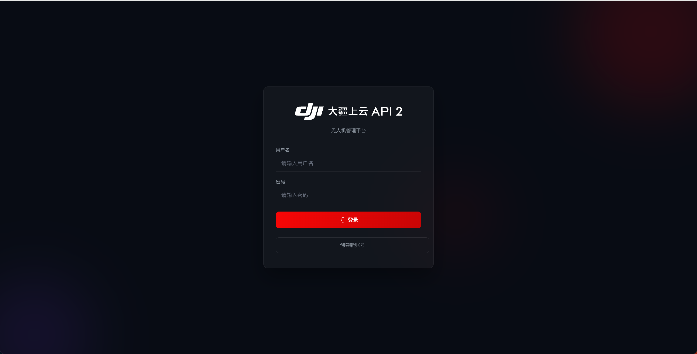

**操作步骤**：
1. 输入用户名
2. 输入密码
3. 点击「登录」按钮

如尚未注册，点击下方「创建新账号」进入注册页面。

### 2.2 注册账号

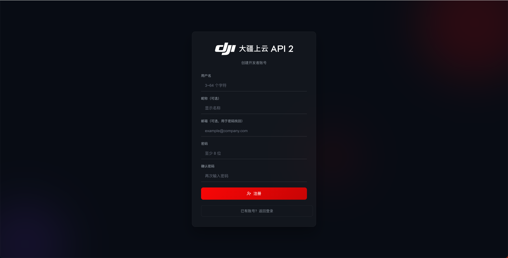

**注册字段说明**：

| 字段 | 是否必填 | 说明 |
|------|----------|------|
| 用户名 | 必填 | 3~64 个字符 |
| 昵称 | 可选 | 显示名称 |
| 邮箱 | 可选 | 联系方式，仅作记录，平台不提供自助找回密码 |
| 密码 | 必填 | 至少 8 位 |
| 确认密码 | 必填 | 需与密码一致 |

**注册后的审核流程**：

1. 提交注册后页面提示「注册成功，请等待管理员审核」，**不会自动登录**
2. 新账号状态为「待审核（Pending）」，管理员在「用户管理」页点击「Approve」通过
3. 审核通过后状态变为「已通过（Approved）」，方可正常登录
4. 被拒绝（Rejected）的账号无法登录

> **提示**：
> - 系统中第一个注册的用户将自动成为管理员（admin）角色，并直接通过审核。
> - 平台默认**关闭开放注册**（后端配置 `FH_USER_REGISTRATION_ENABLED` 默认为 `false`）。如注册页提示不可注册，需由运维临时开启注册，或直接通过初始化 SQL / CLI 创建账号。

### 2.3 用户菜单

点击右上角用户头像展开下拉菜单。

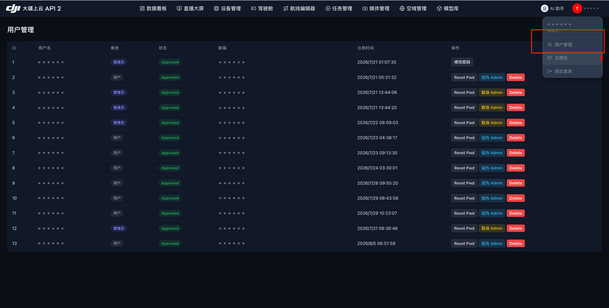

**下拉菜单内容**：

| 菜单项 | 说明 |
|--------|------|
| 用户名 / 角色 | 菜单顶部显示当前账号用户名及角色（管理员 / 普通用户） |
| 用户管理 | 仅管理员可见，进入用户管理页面 |
| 主题色切换 | 取色器，切换平台主题强调色 |
| 使用说明 | 新标签页打开本文档 |
| Mock Debug | 仅在开启调试面板（`VITE_MOCK_DEBUG_PANEL=true`）时显示 |
| 退出登录 | 退出并返回引导着陆页 |

### 2.4 用户管理页面

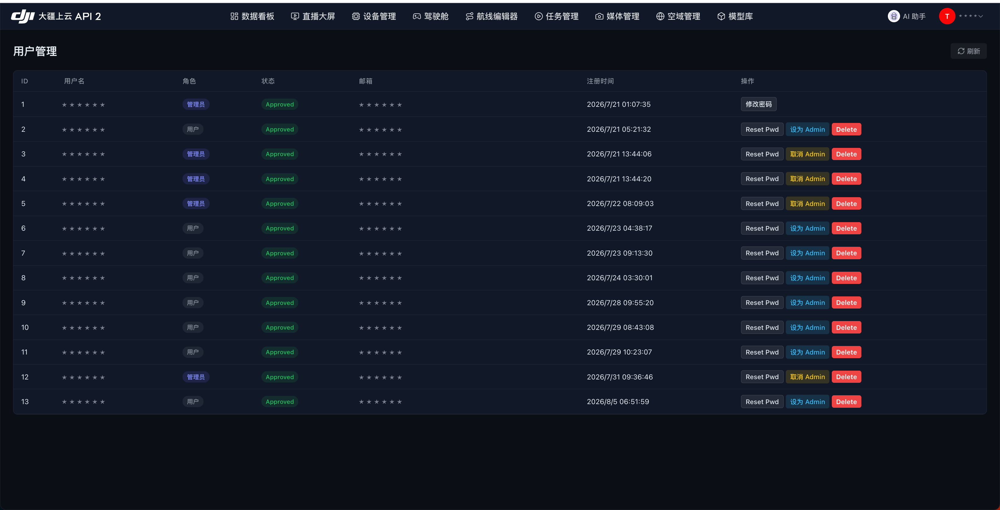

管理员可在此页面对所有用户进行管理。

**列表字段**：

| 字段 | 说明 |
|------|------|
| ID | 用户唯一标识 |
| 用户名 | 登录账号，当前登录用户行带「我」标记 |
| 角色 | 管理员（高亮标签）/ 用户 |
| 状态 | Approved（已通过，绿）/ Pending（待审核，黄）/ Rejected（已拒绝，红） |
| 邮箱 | 注册时填写，可为空，空值显示 `-` |
| 注册时间 | 账号创建时间 |
| 操作 | 见下方操作表 |

**操作说明**：

| 操作 | 显示条件 | 说明 |
|------|----------|------|
| Approve | 仅待审核（Pending）用户 | 审核通过，通过后方可登录 |
| 修改密码 | 仅当前用户行 | 修改自己的密码，需输入旧密码 |
| Reset Pwd | 其他用户行 | 管理员直接重置他人密码，仅需新密码 |
| 设为 Admin | 非自己且当前为普通用户 | 将普通用户提升为管理员 |
| 取消 Admin | 非自己且当前为管理员 | 撤销管理员权限 |
| Delete | 非自己 | 待审核用户表示**拒绝注册**；已通过用户表示**删除账号（不可恢复）** |

> 管理员不能删除或修改自己的角色，避免误操作导致无人可管理。表头右侧「刷新」按钮可重新拉取用户列表。

---

## 3. 数据看板

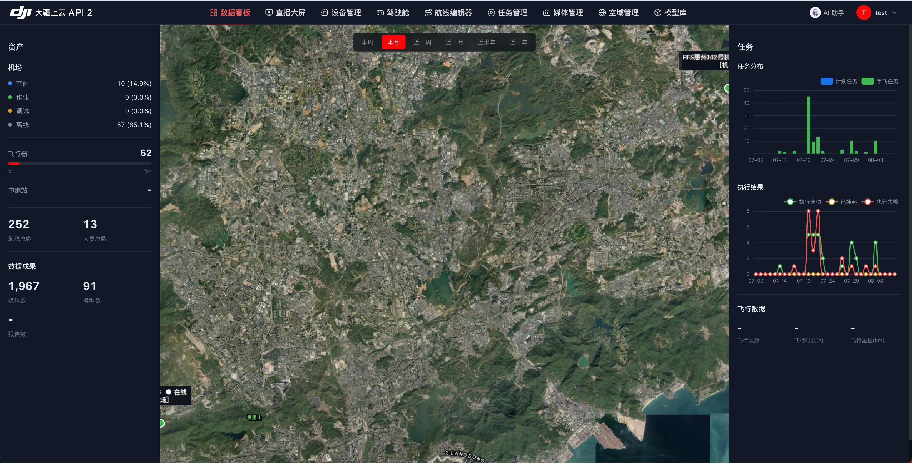

数据看板为系统首页，提供运营数据全局概览。

### 3.1 左侧 — 资产统计

| 数据项 | 说明 |
|--------|------|
| 机场状态 | 空闲/作业/调试/离线数量及占比 |
| 飞行器 | 在线/离线飞行器数量 |
| 中继站 | 中继站数量 |
| 航线总数 | 已创建的航线条数 |
| 人员总数 | 平台注册用户数 |
| 数据成果 | 媒体数、模型数、报告数 |

### 3.2 中央 — 地图视图

卫星影像地图展示所有设备（机场、飞行器）的地理分布位置，设备标记实时更新在线状态。

### 3.3 右侧 — 任务与飞行数据

- **任务分布**：柱状图展示计划任务和手飞任务的时间分布
- **执行结果**：折线图展示任务执行成功/挂起/失败的趋势
- **飞行数据**：统计飞行次数、飞行时长、飞行里程

### 3.4 时间筛选

支持按时间范围切换数据展示，共 6 档：**本周** | **本月** | **近一周** | **近一月** | **近半年** | **近一年**

---

## 4. 直播大屏

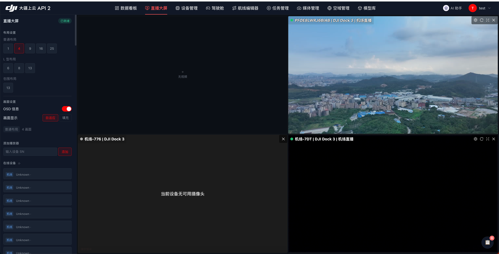

直播大屏用于实时查看多台设备的视频流画面。

### 4.1 布局设置

支持多种画面布局模式：

| 布局类型 | 可选数量 |
|----------|----------|
| 普通布局 | 1 / 4 / 9 / 16 / 25 |
| L 型布局 | 6 / 8 / 13 |
| 包围布局 | 13 |

### 4.2 画面设置

- **OSD 信息**：开关切换，在视频画面上叠加飞行参数
- **画面显示**：自适应 / 填充模式

### 4.3 添加播放器

左侧「添加播放器」面板支持两种方式：
1. 在「输入设备 SN」框中填入 SN 后点击「添加」
2. 或从下方「在线设备」列表中点选设备卡片直接加入画面

「在线设备」标题右侧的「⟳」按钮可刷新列表；无设备在线时显示「暂无在线设备」。

### 4.4 视频画面操作

每个视频窗口在鼠标悬停时，顶部显示一条悬浮条：左侧为设备 SN 和播放状态（如 playing / error），右侧为「×」关闭按钮，点击可关闭该路画面。画质、码流、OSD 叠加等参数请在「画面设置」面板中统一调整（见 4.2）。

---

## 5. 设备管理

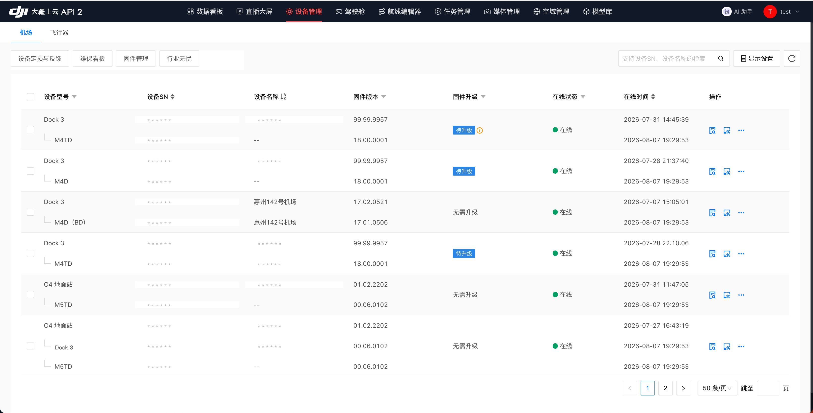

设备管理页面展示平台下所有已接入的机场和飞行器信息。该页面主体由内嵌的 FH2 设备管理组件（`UranusDeviceManagerApp`）渲染；组件加载失败时自动回退到后端的简化设备列表。

### 5.1 设备分类

顶部 Tab 切换：
- **机场**：DJI Dock 3、O4 地面站等网关设备
- **飞行器**：M4TD、M4D、M5TD 等无人机

### 5.2 设备列表字段

| 字段 | 说明 |
|------|------|
| 设备型号 | Dock 3、O4 地面站等 |
| 设备 SN | 设备唯一序列号 |
| 设备名称 | 自定义名称或 SN |
| 固件版本 | 当前固件版本号 |
| 固件升级 | 待升级/无需升级状态 |
| 在线状态 | 绿色圆点=在线 |
| 在线时间 | 最近一次上线时间 |
| 操作 | 详情、驾驶舱入口等 |

### 5.3 功能入口

页面上方提供快捷功能入口：
- **设备定损与反馈**
- **维保看板**
- **固件管理**
- **行业无忧**

### 5.4 搜索与显示

- 支持按设备 SN 或设备名称搜索
- 「显示设置」可自定义列表显示字段
- 分页浏览，默认 50 条/页

---

## 6. 驾驶舱

### 6.1 选择设备

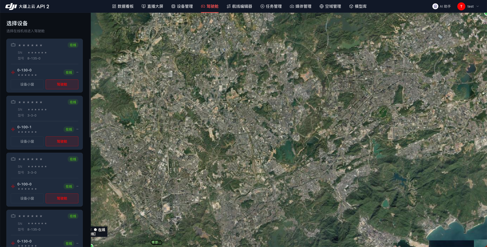

进入驾驶舱前需先选择一台在线机场设备：
- 左侧列出所有在线机场及其关联飞行器
- 显示设备 SN、型号、在线状态
- 点击「驾驶舱」按钮进入该设备的实时控制界面
- 点击「设备小窗」可快速查看设备监控画面

### 6.2 飞行监控

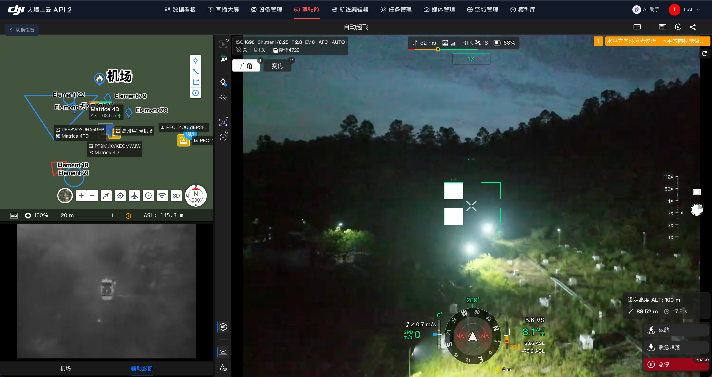

驾驶舱是平台核心功能页面，提供完整的实时飞行监控与操控能力：

**左上 — 地图视图**：
- 卫星地图展示设备位置和飞行轨迹
- 支持 2D/3D 视角切换
- 显示机场、飞行器、航点等标记

**左下 — 辅助影像**：
- 机场摄像头画面（红外/可见光）

**右侧 — 主画面**：
- 飞行器实时视频画面
- 广角/变焦镜头切换
- 相机参数显示（ISO、快门、光圈等）

**底部 — 飞行仪表**：
- 罗盘与航向指示
- 速度（SPD）、高度（ALT/ASL/AGL）
- 飞行距离、飞行时间
- RTK 信号状态、电池电量

**右下 — 操控按钮**：
- 飞行操控面板由 SDK 驾驶舱组件内置渲染，具体按钮以实际页面为准
- 点击左上角「切换设备」可销毁当前驾驶舱并返回设备选择页

> 设备选择页打开「设备小窗」后，可按 `Esc` 或点击右上角「×」关闭小窗。

---

## 7. 航线编辑器

### 7.1 航线库

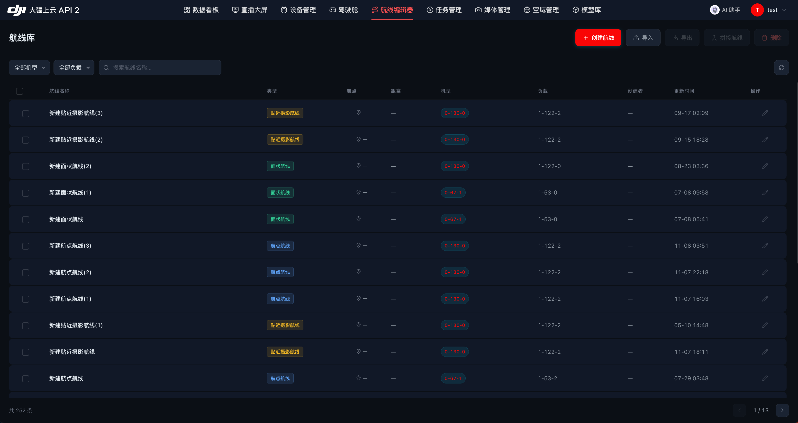

航线库页面管理所有已创建的航线文件。

**列表字段**：复选框、航线名称、类型、航点、距离、机型、负载、更新时间、操作（编辑）

**航线类型**（彩色标签，共 7 种）：
- 航点航线（蓝）、AI巡逻航线（青）
- 面状航线、带状航线（绿）
- 斜面航线、几何体航线、贴近摄影航线（黄）

**操作按钮**：
- **创建航线**：新建航线
- **导入**：导入 KMZ 航线文件
- **导出**：导出选中航线，未勾选时置灰（勾选后按钮显示选中数量）
- **拼接航线**：合并多条航线，**至少勾选 2 条**才可用
- **删除**：批量删除，未勾选时置灰

支持按机型、负载下拉筛选，按航线名称搜索（占位符「搜索航线名称…」），右侧「⟳」刷新。无数据时显示「暂无航线数据」。

### 7.2 创建新航线

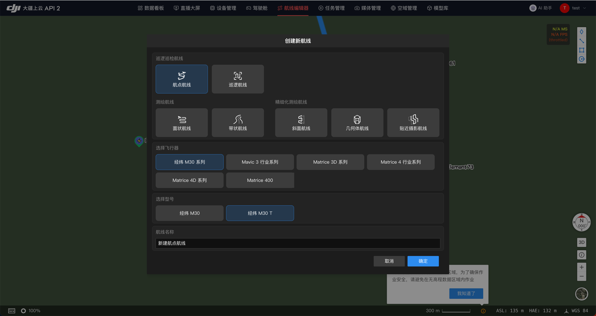

点击「+ 创建航线」后弹出配置对话框：

**第 1 步 — 选择航线类型**：

| 分类 | 航线类型 |
|------|----------|
| 巡逻巡检航线 | 航点航线、巡逻航线 |
| 测绘航线 | 面状航线、带状航线 |
| 精细化测绘航线 | 斜面航线、几何体航线、贴近摄影航线 |

**第 2 步 — 选择飞行器**：
- 经纬 M30 系列
- Mavic 3 行业系列
- Matrice 3D 系列
- Matrice 4 行业系列
- Matrice 4D 系列
- Matrice 400

**第 3 步 — 选择型号**（如：经纬 M30 / 经纬 M30 T）

**第 4 步 — 输入航线名称**，点击「确定」进入编辑器

### 7.3 航线编辑

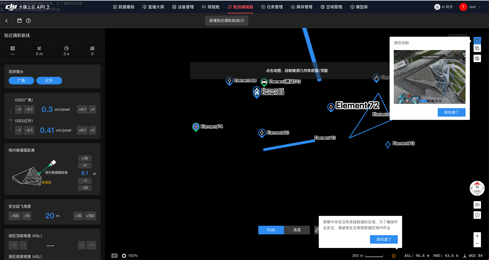

进入航线编辑器后，可在 3D 地图上进行航线规划：

**左侧参数面板**：
- 选择镜头（广角/红外）
- GSD 分辨率设置（cm/pixel）
- 相对被摄面距离
- 安全起飞高度
- 测区顶部/底部高度（ASL）

**地图区域**：
- 在地图上绘制航线区域
- 蓝色线条显示规划航线路径
- 航点标记

**右上 — 测区绘制工具**

### 7.4 贴近摄影流程

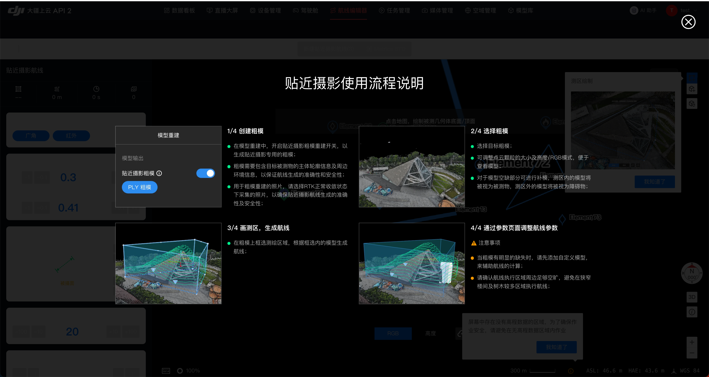

贴近摄影航线遵循 4 步流程：
1. **创建粗模** — 开启贴近摄影粗模重建开关，生成粗模
2. **选择粗模** — 选择目标粗模，调整点云粒度查看
3. **画测区，生成航线** — 在粗模上框选测绘区域
4. **通过参数页面调整航线参数**

---

## 8. 任务管理

### 8.1 任务列表

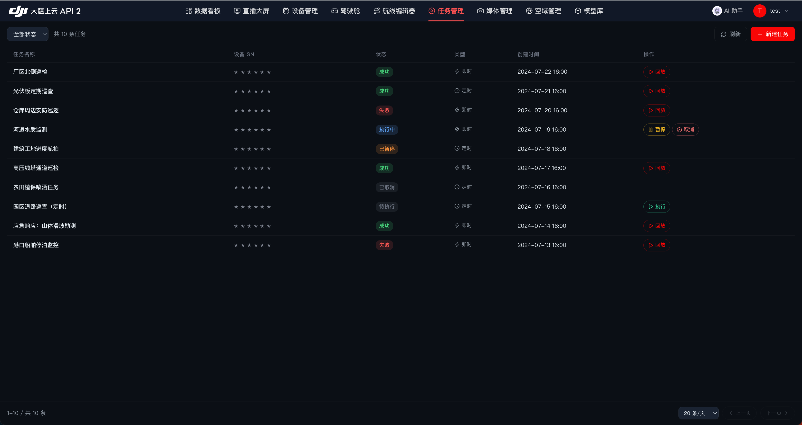

任务管理页面展示所有飞行任务及其执行状态。

**顶部工具栏**：左侧为状态筛选下拉（全部状态 / 成功 / 失败 / 执行中 / 准备中 / 起飞排队中 / 已暂停 / 已取消 / 待执行）和「共 N 条任务」计数；右侧为「刷新」和「新建任务」。

**列表字段**：

| 字段 | 说明 |
|------|------|
| 任务名称 | 自定义任务名称；与其他任务时间窗冲突时附「时间冲突」标记 |
| 设备 SN | 执行任务的设备序列号 |
| 任务 ID | 任务 UUID |
| 状态 | 成功 / 失败 / 执行中 / 准备中 / 起飞排队中 / 已暂停 / 已取消 / 待执行 |
| 类型 | 立即 / 单次定时 / 重复定时 / 连续执行 |
| 创建时间 | 任务创建时间 |
| 操作 | 随状态变化，见下表 |

**操作按钮随状态变化**：

| 任务状态 | 可用操作 |
|----------|----------|
| 待执行 | 执行（置灰）、编辑（视条件）、删除 |
| 执行中 | 暂停、取消（置灰） |
| 准备中 / 起飞排队中 | 无操作按钮，仅展示状态 |
| 已暂停 | 恢复 |
| 成功 / 失败 | 回放 |
| 已取消 | 无操作按钮 |

> **平台能力限制**：当前平台协议的任务状态接口只能表达「暂停 / 恢复」，无法表达「立即执行」和「取消」，因此这两个按钮固定置灰，悬停提示「平台协议仅支持暂停/恢复任务，暂不支持立即执行与取消」。定时类任务（单次定时 / 重复定时）的「执行」按钮额外提示「定时任务将在预定时间自动执行，不支持手动触发」。

> **编辑条件**：仅「待执行」任务可编辑；即时任务、试飞任务、断点续飞任务不可编辑，按钮置灰并给出原因。

点击任意任务行（操作列除外）可进入该任务的回放页面。

### 8.2 新建任务

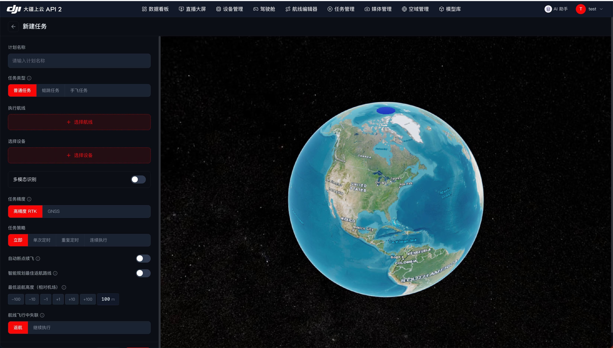

**配置项**：

| 配置 | 选项 / 说明 |
|------|-------------|
| 计划名称 | 必填，最多 50 个字符 |
| 任务类型 | 普通任务（可用）/ 蛙跳任务 / 手飞任务 |
| 执行航线 | 从航线库选择；**手飞任务不显示此项** |
| 选择设备 | 从在线设备中选择执行任务的机场 |
| 多模态识别 | **暂不支持**：SDK 创建 / 编辑请求均无承载位，开关仅保留展示，选中不会下发到设备 |
| 任务精度 | 高精度 RTK / GNSS |
| 任务策略 | 立即 / 单次定时 / 重复定时 / 连续执行 |
| 断点续飞策略（自动断点续飞） | 开 / 关，映射为 `resumable_status`（1=auto，0=manual）；**仅新建时下发**，编辑态无承载位，详情也不回显，故编辑页不提交该字段 |
| 智能规划最佳返航路线 | 开 / 关 |
| 最低返航高度（相对机场） | 默认 100 m，可调范围 20 ~ 1500 m |
| 航线飞行中失联 | 返航 / 继续执行 |

**任务策略与附加项**：

| 策略 | 可用性 | 附加配置 |
|------|--------|----------|
| 立即 | 可用 | 无 |
| 单次定时 | 可用 | 执行时间（日期时间选择器） |
| 重复定时 | 置灰 | 选中后才会显示开始/截止时间与重复周期，当前不可达 |
| 连续执行 | 置灰 | 选中后才会显示最低执行电量（%，10 ~ 100，默认 50），当前不可达 |

> **平台能力限制**：
> - 任务类型中的「蛙跳任务」「手飞任务」以及任务策略中的「重复定时」「连续执行」在当前平台协议下不可用，选项置灰，悬停提示「当前平台协议暂不支持该选项」。
> - 编辑已有任务时，若原任务使用了不支持的策略，页面会提示「当前平台协议无法保留该任务策略，保存后重复规则将丢失，任务只会执行一次」。
> - 「断点续飞策略」只在新建时可设置；编辑页该开关下方会提示「自动续飞策略仅在创建任务时下发，当前 SDK 编辑接口无该字段，保存不会改变原有策略」，且不会提交该字段。任务列表 / 详情里的「断点续飞」标识表示「本任务是否断点续飞任务」，与续飞策略不是同一个概念，不能据此判断自动续飞是否开启。

页面底部为「取消」和「确定」按钮（提交过程中「确定」显示为「提交中...」）。

### 8.3 任务回放

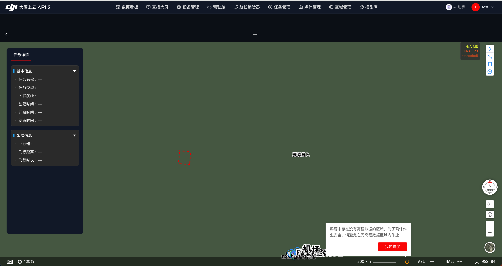

任务执行完成后可查看回放：

**左侧 — 任务详情**：
- 基本信息：任务名称、类型、关联航线、创建/开始/结束时间
- 架次信息：飞行器、飞行距离、飞行时长

**地图区域**：
- 在 3D 地图上回放飞行轨迹
- 标注航点位置

---

## 9. 媒体管理

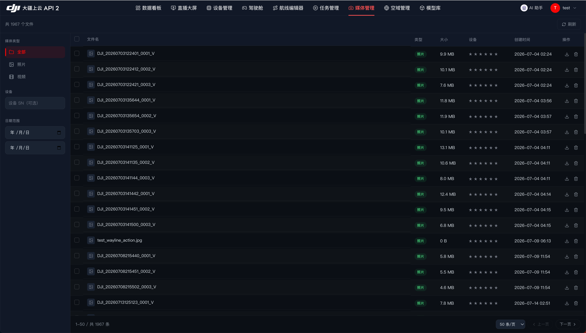

媒体管理页面用于浏览和管理无人机拍摄的照片与视频文件。

### 9.1 筛选条件

**左侧筛选面板**：
- **媒体类型**：全部 / 照片 / 视频
- **设备**：输入设备 SN 筛选
- **日期范围**：设置起止日期

### 9.2 文件列表

| 字段 | 说明 |
|------|------|
| 文件名 | DJI 标准命名格式（如 `DJI_20260703122401_0001_V`） |
| 类型 | 照片 / 视频 |
| 大小 | 文件大小 |
| 设备 | 拍摄设备 SN |
| 创建时间 | 拍摄时间 |
| 操作 | 下载 / 删除 |

勾选文件后，工具栏左侧显示「已选 N 项」及「批量下载」「批量删除」按钮；未勾选时显示「共 N 个文件」。

### 9.3 分页

- 每页可选 20 / 50 / 100 条（默认 50 条/页）
- 显示当前区间与总数（如「1-50 / 共 1967 条」）
- 支持翻页浏览

---

## 10. 空域管理

### 10.1 空域列表

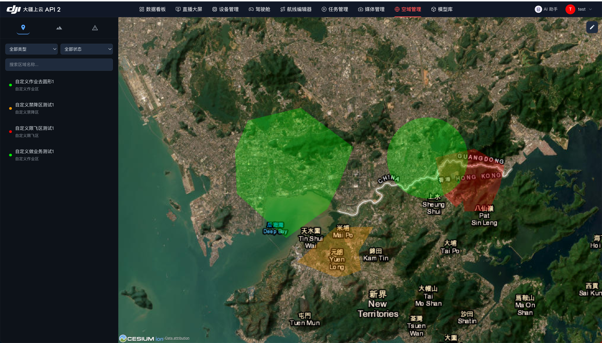

空域管理在 Cesium 3D 地图上可视化展示和管理飞行区域。

**左侧面板**包含三个 Tab：

| Tab | 内容 |
|-----|------|
| 自定义飞行区域 | 自定义作业区 / 限飞区 / 禁降区的绘制与管理 |
| 地形障碍物 | 地形障碍物模型的状态、版本、更新时间，及启用开关 |
| 空域告警 | DJI AirSense（机载 ADS-B 告警）与空域 safeS（三方服务）开关，以及告警距离阈值配置 |

**自定义飞行区域 Tab**：
- 筛选：类型（全部类型 / 自定义作业区 / 自定义限飞区 / 自定义禁降区）、状态（全部状态 / 启用 / 禁用）
- 搜索：区域名称搜索（占位符「搜索区域名称...」）
- 区域列表：每条可单独启用/禁用或删除，删除前弹出确认框「确认删除「区域名称」？删除后无法恢复。」

**地图视图的颜色标识**：

| 区域类型 | 颜色 | 说明 |
|----------|------|------|
| 自定义作业区 | 绿色（`#00FF00`） | 允许飞行的作业范围 |
| 自定义限飞区 | 红色（`#FF0000`） | 禁止飞行的范围 |
| 自定义禁降区 | 橙色（`#FF9900`） | 禁止降落的范围 |
| 已禁用区域 | 灰色（`#606060`） | 已关闭的区域以灰色渲染 |

### 10.2 创建空域

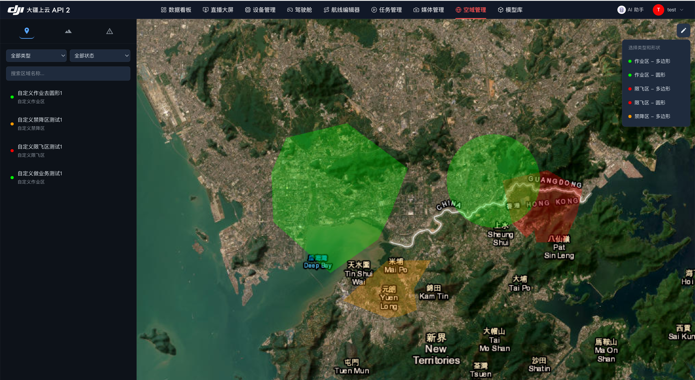

**操作步骤**：
1. 点击「绘制区域」按钮，弹出「选择类型和形状」菜单
2. 从菜单中选定类型与形状：

   | 菜单项 | 对应类型 |
   |--------|----------|
   | 作业区 - 多边形 / 作业区 - 圆形 | 自定义作业区 |
   | 限飞区 - 多边形 / 限飞区 - 圆形 | 自定义限飞区 |
   | 禁降区 - 多边形 | 自定义禁降区（仅支持多边形） |

3. 在地图上点击绘制区域边界
4. 在弹出框中填写「区域名称」（唯一字段，必填）
5. 点击「确认创建」提交，提交过程中按钮显示「创建中...」

> 创建时仅填写区域名称，没有额外的参数设置项；区域也不支持「同步到设备」，创建后在平台侧保存并由服务端下发生效。

---

## 11. 模型库

### 11.1 模型列表

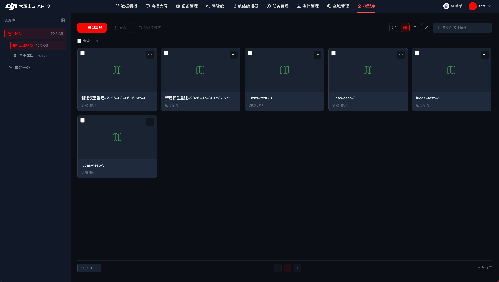

模型库管理三维重建的成果文件。

**左侧导航（资源库，可折叠）**：
- **模型**（可展开，标题右侧显示已用总容量，如 `12.5 GB`）
  - 二维模型（附容量占用）
  - 三维模型（附容量占用）
- **重建任务**

**顶部工具栏（模型视图下）**：
- 左侧：「模型重建」（主按钮）、「导入」（置灰，暂不可用）、「创建文件夹」（置灰，暂不可用）
- 右侧：勾选模型后出现「批量删除 (N)」、「刷新」、网格视图 / 列表视图切换、「筛选」下拉（全部类型 / 正射影像 / 三维网格 / 点云 / 全景）、搜索框（占位符「按文件名称搜索」）

**模型卡片菜单**：下载（置灰，SDK 未提供有效下载链接）、质量报告、查看影像、删除。

**重建任务 Tab**：每条任务显示任务 ID、状态标签（处理中 / 已完成 / 失败）、处理进度百分比（处理中）、输出路径（已完成）；操作按钮随状态为「停止」（处理中）、「重试」（失败）、「查看报告」（已完成）。无任务时显示「暂无重建任务」。

底部为分页条：每页 20 / 50 / 100 条，显示总条数与总页数。

### 11.2 新建模型重建

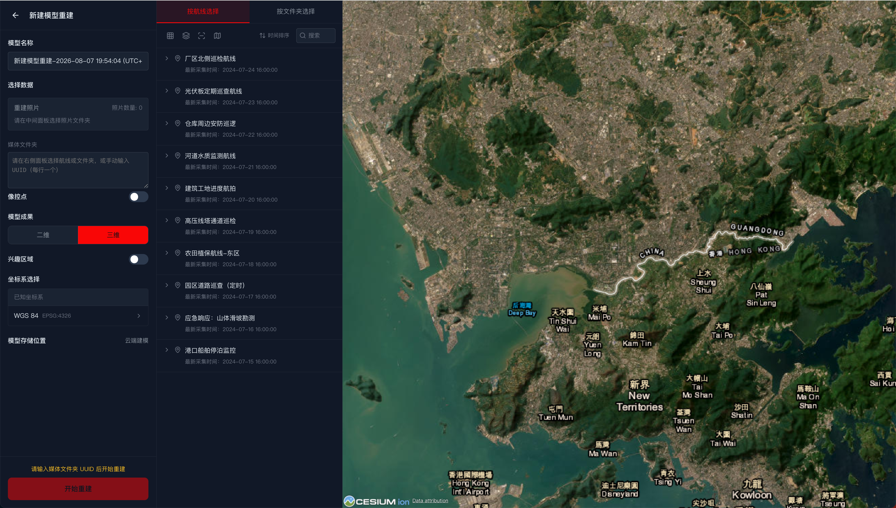

点击工具栏「模型重建」会打开全屏三栏重建面板：**左侧配置栏** / **中间照片选择** / **右侧地图**。

**左侧配置栏**：

| 配置项 | 说明 |
|--------|------|
| 模型名称 | 默认自动生成为「新建模型重建-YYYY-MM-DD HH:mm:ss (UTC+08)」，可修改，最多 50 个字符 |
| 选择数据 | 显示已选照片数量与文件夹数量 |
| 媒体文件夹 | 手动输入媒体文件夹 UUID（每行一个）；一旦在中间面板勾选了航线执行或文件夹，此处自动回填对应 ID 并变为只读 |
| 像控点 | 开 / 关，默认关 |
| 模型成果 | 二维（提交为 2D 正射影像）/ 三维（提交为 3D 网格模型），默认三维 |
| 兴趣区域 | 开 / 关，默认关；开启后在右侧地图上框选 |
| 坐标系选择 | 固定为 WGS 84 / EPSG:4326 |
| 模型存储位置 | 固定为「云端建模」 |

**中间选择面板**（选择方式三选一，两个 Tab 互斥）：

- **按航线选择**：从已执行的航线任务中选择，勾选后显示「已选 N 个执行，M 张照片」
- **按文件夹选择**：在列表中勾选已有媒体文件的文件夹，勾选后显示「已选 N 个文件夹」。列表为服务端缓存（TTL 约 10 分钟），新上传的文件夹可能稍后才出现；加载失败时提供「重试」
- **高级**：未勾选任何航线或文件夹时，也可在「媒体文件夹」输入框中手动输入文件夹 UUID（每行一个）；此时提交的是 UUID 而非文件夹 ID

两个 Tab 均支持按关键词搜索，底部实时显示已选数量。

**提交**：左侧栏底部「开始重建」按钮。未选择数据时按钮置灰并提示「请输入媒体文件夹 UUID 后开始重建」；仅在「选择数据」已有输入、或已选照片数 ≥ 5 时可用。点击后出错会以底部提示条展示。

---

## 12. AI 助手（Copilot）

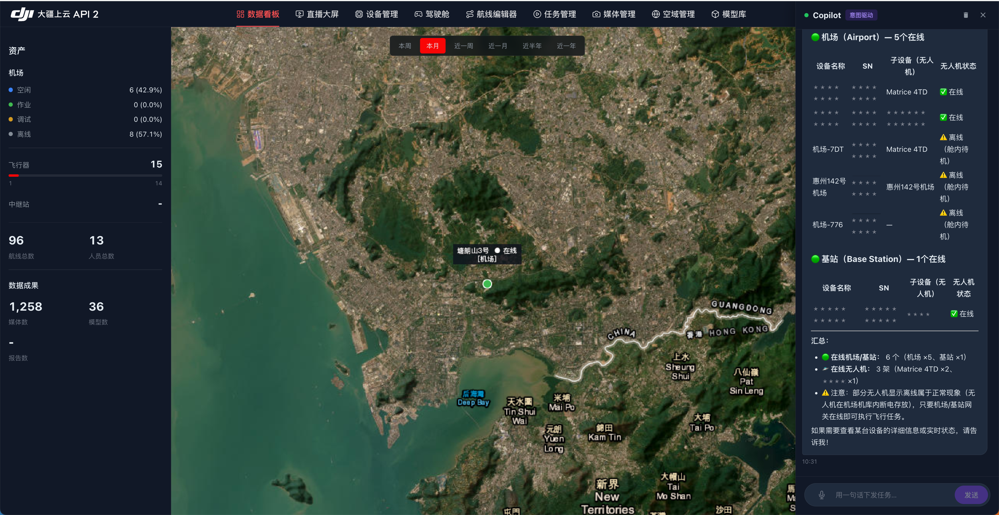

平台内置 AI 助手（Copilot），提供智能运维交互能力。

### 12.1 入口

点击顶部导航栏右侧「AI 助手」按钮（快捷键 `Ctrl + /`，macOS 为 `Cmd + /`），从右侧滑出 Copilot 抽屉；再次按快捷键或点击抽屉右上角「✕」关闭。

抽屉左边缘可拖拽调整宽度。标题栏标识为「Copilot」并带「意图驱动」徽标，右侧依次为「清空对话」和「关闭」按钮。

### 12.2 功能特性

- **意图驱动**：自然语言描述需求，AI 自动执行操作
- **设备查询**：询问设备在线状态、型号信息
- **任务下发**：通过对话创建和管理飞行任务
- **数据汇总**：自动聚合设备、航线、任务等运营数据
- **高风险操作确认**：涉及写操作的工具调用会先以卡片形式展示工具名并等待用户「批准」或「拒绝」，处理后卡片标记为「已批准」/「已拒绝」

### 12.3 使用示例

输入框占位符为「用一句话下发任务…」。空对话时展示欢迎页「你好，我是 CloudAPI2 平台 AI 助手」及快捷提问按钮，例如：

- 查询在线设备列表
- 查一下今天的告警统计
- 帮我查一下航线库有哪些航线
- 查看最近的媒体文件

输入框右侧的麦克风按钮支持语音输入（点击开始录音，再次点击结束，识别结果实时回填到输入框；浏览器不支持语音识别时按钮不可用）。

AI 助手会以结构化表格返回结果，并提供操作建议。

### 12.4 启用条件

AI 助手依赖后端 `feature-chat` 模块，需满足：

1. **在配置文件中显式开启**：`fh.chat.enabled` 在 `application.yml` 中**硬编码为 `false`**，且没有环境变量绑定，集成商需直接修改配置文件改为 `true`（仅设置环境变量无效）
2. **模型接入**：`SPRING_AI_OPENAI_API_KEY`（或 `SPRING_AI_ANTHROPIC_API_KEY`）
3. **MCP 工具通道**：`FH_CHAT_MCP_URL`（MCP Server 地址）、`FH_CHAT_MCP_AUTH_TOKEN`（与 MCP Server 的 `FH_SSE_AUTH_TOKEN` 一致，留空表示不鉴权）
4. **模型名称**（可选）：`FH_CHAT_MODEL`（主模型）、`FH_CHAT_LIGHT_MODEL`（L0 只读查询使用的轻量模型）

---

## 附录：快捷键与操作提示

| 操作 | 说明 |
|------|------|
| 地图缩放 | 鼠标滚轮 |
| 地图旋转 | 按住右键拖拽 |
| 刷新数据 | 各页面右上角刷新按钮 |
| 打开/关闭 AI 助手 | `Ctrl + /`（macOS 为 `Cmd + /`） |
| 关闭驾驶舱「设备小窗」 | `Esc` |

---

> **技术支持**：如有使用问题，请联系平台管理员或查阅 [部署指南](../部署指南.md)。
