# 开始部署

部署流程分为以下四个阶段：

```
安装 CodeMeter → 可视化部署 → 业务初始化 → 功能验证
```

## 1. 安装 CodeMeter 服务

1. 下载 [CodeMeter 服务安装工具](https://terra-1-g.djicdn.com/4670436537e14b5c822b1c7f97b8aac9/%E4%B8%8A%E4%BA%91%20API%202%20%E4%BA%A7%E5%93%81%E5%8F%91%E7%89%88%E8%AE%B0%E5%BD%95/koc3/%E5%B7%A5%E5%85%B7/Install_CodeMeter.tar.gz) 并解压。解压后目录结构如下：

   ```
   Install_CodeMeter/
   ├── Install_CodeMeter.sh            # 2.3 KB  安装脚本（可执行）
   ├── 6000010.WibuCmLIF               # 1.9 KB  Wibu 授权文件
   ├── 6002150.WibuCmLIF               # 1.9 KB  Wibu 授权文件
   └── package/                        # 25 MB   离线安装包
       ├── codemeter-lite_8.10.6221.500_amd64.deb
       ├── codemeter-lite-dev_8.10.6221.500_amd64.deb
       └── libusb-1.0-0_2-1.0.24-3_amd64.deb
   ```

2. 执行命令运行脚本：

   ```bash
   ./Install_CodeMeter.sh
   ```

   > **说明：**
   > - 如您同时部署上云 API 2 平台、Terra 建模服务器和 4G 图传增强，请依次在每台服务器上分别完成 CodeMeter 服务安装。
   > - 4G 图传增强可与上云 API 2 在同一台服务器上安装，也可在独立服务器上安装。

## 2. 可视化安装部署

### 2.1 确认环境

请确认是否满足[部署前准备](./01.prerequisites.md)章节的要求，后续也可以根据可视化工具的指引，解决部署过程中遇到的问题。

---

### 2.2 解压安装包

执行命令解压上云 API 2 安装包：

```bash
tar -xzvf xxxxxxxx-xxxx-xxxx-xxxx-xxxxxxxxxxxx.tar.gz
```

---

### 2.3 启动可视化部署工具

**使用说明：**

1. 进入解压后的目录，解压后目录结构如下：

   ```
   4g-on-prem-installation-package.tar.gz
   es-privatization-system.tgz
   run_installer.sh
   drtc-privatization-deployment.tar
   fh2-on-prem-installation-package.tar.gz
   terracloud-privatization-deployment.tar
   es-privatization-installer
   fh2-privatization-install-packages
   ```

2. 执行命令：

   ```
   bash run_installer.sh
   ```

3. 复制控制台输出的访问地址，使用 Chrome 浏览器访问可视化服务 `{您服务器的IP}:40000`，执行效果如下：

   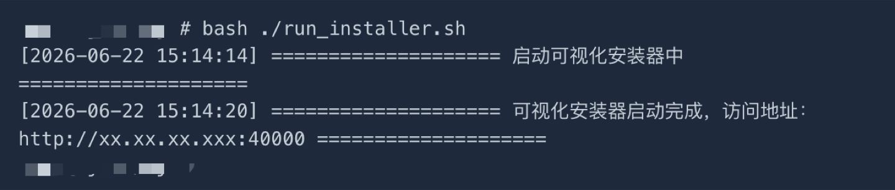

**限制说明：**

- 必须先完成 CodeMeter 服务安装，否则工具无法正常启动
- 需要开放 40000 端口

---

### 2.4 上传许可证

[申请许可证](../01.apply-license.md)后，上传许可证。

   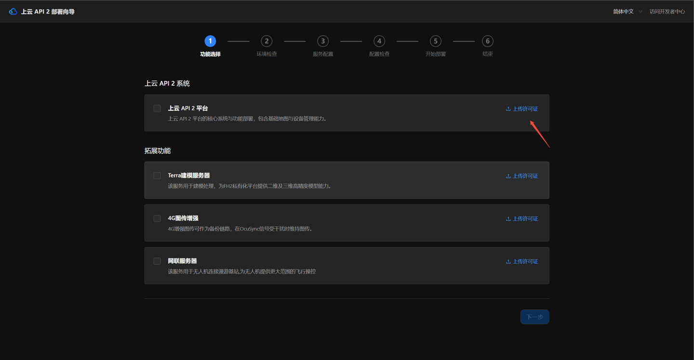

### 2.5 选择需要安装的功能

选择您所需要安装的功能。相应功能在`上传许可证且通过校验后`解锁。上传时选择许可证压缩包（`.tar.gz`），无需解压。

   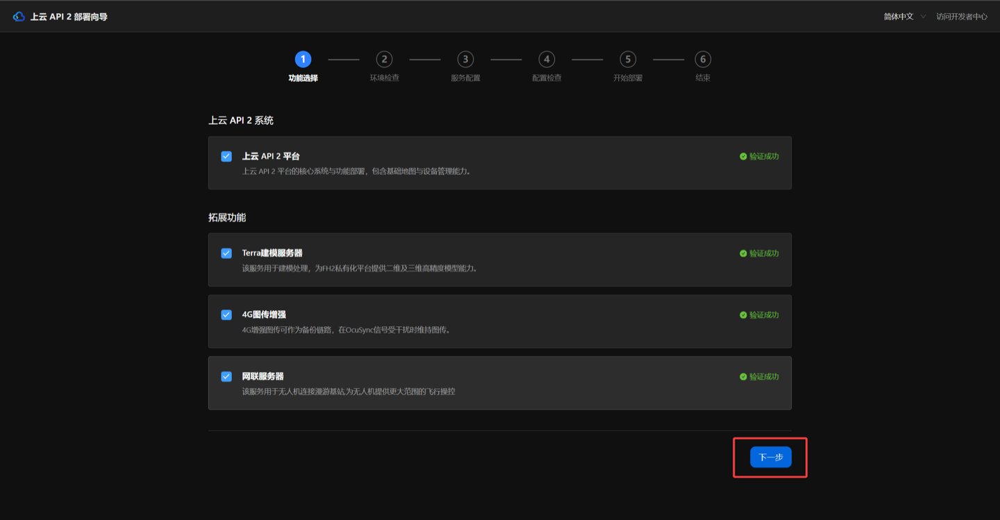

- **上云 API 2 平台**（核心系统与功能部署，包含基础地图与设备管理等能力）
- **Terra 建模服务器**（用于建模处理，为上云 API 2 提供二维及三维高精度建模能力）
- **4G 图传增强**（4G 增强图传可作为备份链路，在 OcuSync 信号受干扰时维持图传信号）

> **说明：** 三个服务验证成功后，点击「下一步」进行后续部署流程。

**限制说明：**
- 仅支持相应服务的初次部署，即对应服务器/节点未存在上云 API 2、4G、Terra 服务
- 仅支持单节点部署，多节点部署需要在对应环境分别运行该工具
- 当许可证异常时（如不合法），将会校验失败并且无法部署对应功能

### 2.6 进行环境检查

根据您选择的服务进行相应的基础环境检查，如操作系统、必备硬件、docker 版本等可用性检查。

   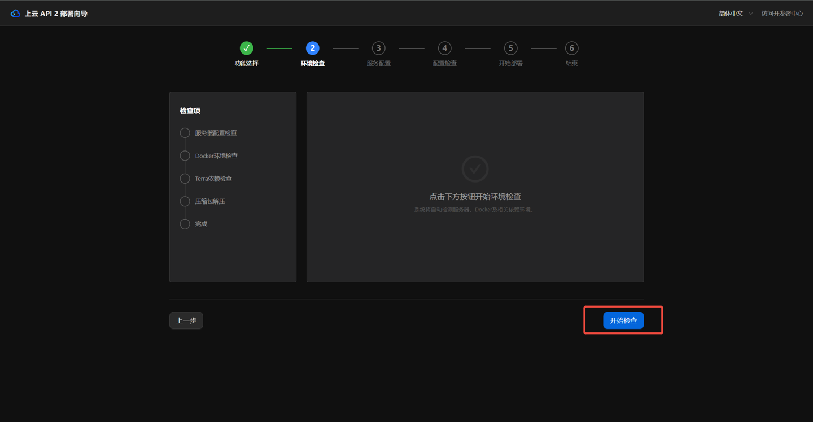

**限制说明：**

- 若发现异常项，您无法进行后续环节。您可以根据报错及建议，解决后重新检查即可

---

### 2.7 编辑服务配置

**使用说明：**

编辑服务部署的配置

   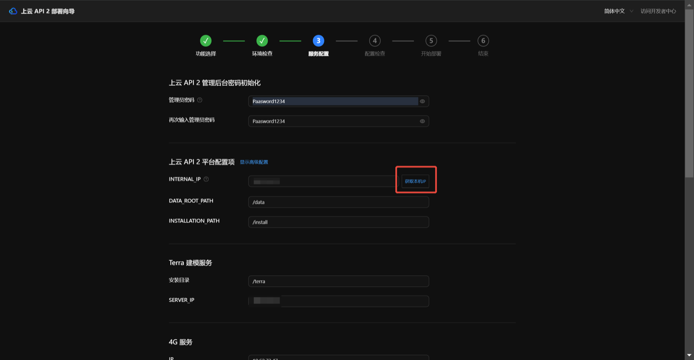

**上云 API 2 配置说明：**

- **AIO 管理后台 管理员密码**
  - AIO 后台用于管理私有化服务，提供大量可视化配置与运维能力，为后续高频界面
  - 该密码用于登录 AIO 管理后台，默认账号为 `admin`
  - 密码须为：12-15 位，且同时包含大写字母、小写字母和数字；仅支持使用以下特殊字符：`_ @ - ! # % ^ * .`
  - 请注意保存、保密

- **`DATA_ROOT_PATH` 数据存储目录**
  - 用于存放上云 API 2 产生的数据，例如航线文件、媒体文件、全景照片、视频等，建议选择一个足够大的存储空间，**注意需要配置为绝对路径**。
  - 默认为 `DATA_ROOT_PATH=/data`

- **`INSTALLATION_PATH` 上云 API 2 安装目录**
  - 用于指定上云 API 2 平台的安装目录，**注意需要配置为绝对路径。安装成功后不能修改！**
  - 默认为 `INSTALLATION_PATH=/install`

- **Terra 服务 IP**
  - 填入 Terra 所在的 IP，用于上云 API 2 与 Terra 服务通信。若您不需要部署 Terra 服务，可忽略。后续也可以通过 AIO 管理后台修改该配置。

- **4G 服务 IP**
  - 填入 4G 所在的 IP，用于上云 API 2 与 4G 服务通信。若您不需要部署 4G 服务，可忽略。后续也可以通过 AIO 管理后台修改该配置。

**Terra 与 4G 配置说明：**

- **Terra 与 4G 安装目录**
  - Terra、4G 与上云 API 2 在同一个服务器（节点）时，需要填入该值。使用 AIO 升级功能将会读取该目录，基于该目录对 Terra、4G 进行升级
  - Terra、4G 与上云 API 2 不在同一个服务器（节点）时，可忽略该值。

- **4G 服务 IP**
  - 填入部署 4G 服务的 IP 地址

---

### 2.8 进行配置检查

   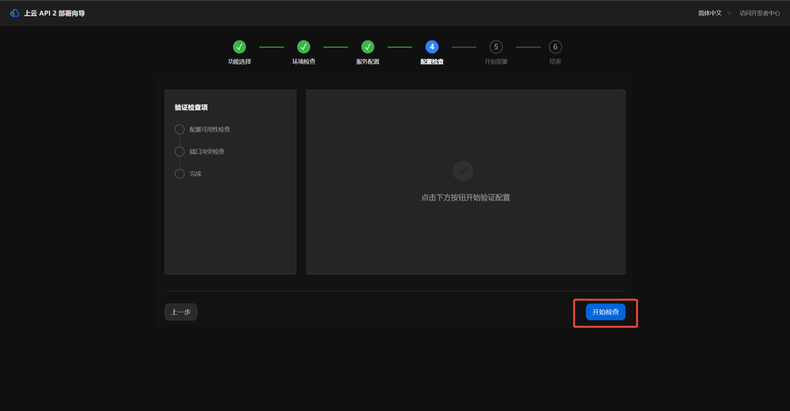

**使用说明：**
对所有配置项进行的可用性检查，如网络端口冲突等。若发现异常将会呈现报错及建议。

**限制说明：**

- 若发现异常项，您无法进行后续环节。您可以根据报错及建议，返回上一步并解决后，重新检查即可

---

### 2.9 启动部署

   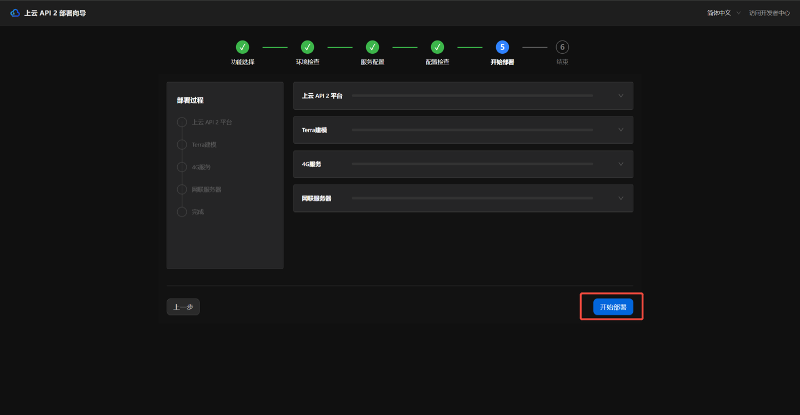

**使用说明：**

该步骤将会根据您所选的功能、配置进行部署。若部署失败将会抛出具体异常。

**限制说明：**

- 若部署失败，您可以根据报错及建议，解决后重试

---

### 2.10 完成部署

1. 部署成功将会进入该页面，您可以通过点击按钮或在浏览器中访问上云 API 2 AIO 管理后台。

   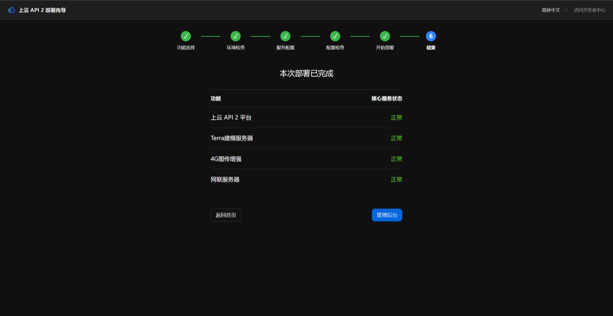

2. **首次访问上云 API 2 AIO 管理后台系统激活流程**：

   首次部署成功后访问 AIO 管理后台，系统将提示 **请先激活再使用系统**，并提供激活二维码。您需要使用手机端 **大疆行业 App** 扫码并完成激活，具体步骤如下：

   - 第一步 **（电脑端）获取激活二维码**：打开 AIO 管理后台页面，在电脑屏幕上获取 **请先激活再使用系统** 的二维码。
   - 第二步 **（手机端）登录大疆行业 App**：切换到 **我的** 页面，点击右上角的 **扫码** 图标。
   - 第三步 **（手机端）扫码连接**：扫描电脑端的激活二维码，手机将跳转至 **平台激活** 界面。
   - 第四步 **（手机端）条款确认**：点击 **授权** 同意授权设备使用整体数据，点击 **加入计划** 加入用户体验改进计划。
   - 第五步 **（手机端）信息提交**：输入大疆开发者账号并点击 **提交**，接着输入开发者邮箱并点击 **提交**。
   - 第六步 **（电脑端）系统激活**：手机端提交成功后再次点击 **扫码** 图标，App 将自动生成 6 位数字激活码。将该激活码填入电脑端页面下方的输入框中，点击 **激活系统** 按钮。系统激活成功后即可登录管理后台，继续进行后续的业务初始化。

   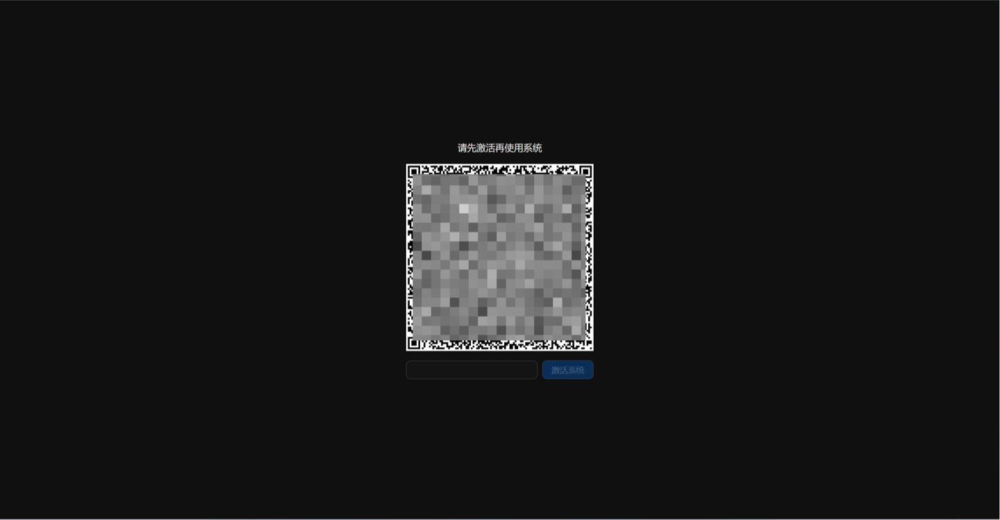

---

## 3. 业务初始化

### 3.1 导入地图数据

为快速部署上云 API 2，安装包随包附带了一份深圳区域的卫星栅格地图，您可以不做额外配置直接使用。

> **注意：** 为了后续业务正常展开使用，需要您针对性配置地图数据，详情参考 [能力扩展](./03.advanced.md) 文档中「离线地图」章节进行操作。

---

### 3.2 导入高程数据

高程数据为所在区域飞行任务与规划的必备数据，您可以按照以下步骤执行。

#### 3.2.1 数据获取

1. 登录开发者控制台，输入您的许可证 ID 后进入高程数据下载页面

   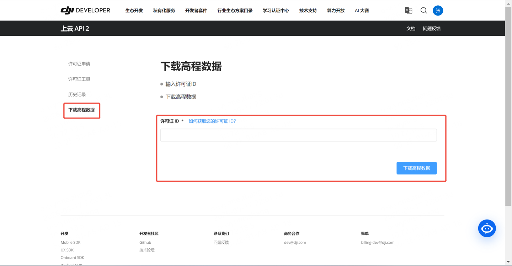

2. 按需选择您需要的飞行区域，并下载高程数据到本地

   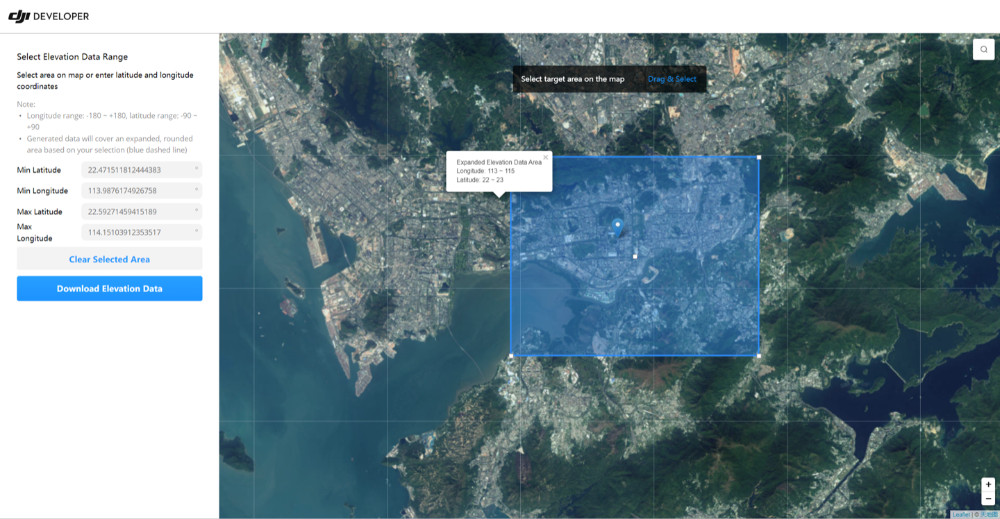

#### 3.2.2 数据发布

1. 进入 AIO 管理后台并登录。在浏览器中输入地址并访问，地址格式如下：

   ```
   {{INTERNAL_IP}}:{{FH_SYSTEM_PORT}} 或
   {{EXTERNAL_IP}}:{{FH_SYSTEM_PORT}} 或
   {{SERVICE_DOMAIN}}:{{FH_SYSTEM_PORT}}
   ```

   - 访问地址示例：`192.168.1.101:30888`
   - `INTERNAL_IP` 为在`2.7`中您所配置的 IP 地址，默认为 `192.168.1.101`
   - `FH_SYSTEM_PORT` 为在`2.7`中您所配置的端口号，默认为 `30888`

2. 上传下载好的高程压缩包，并点击添加

   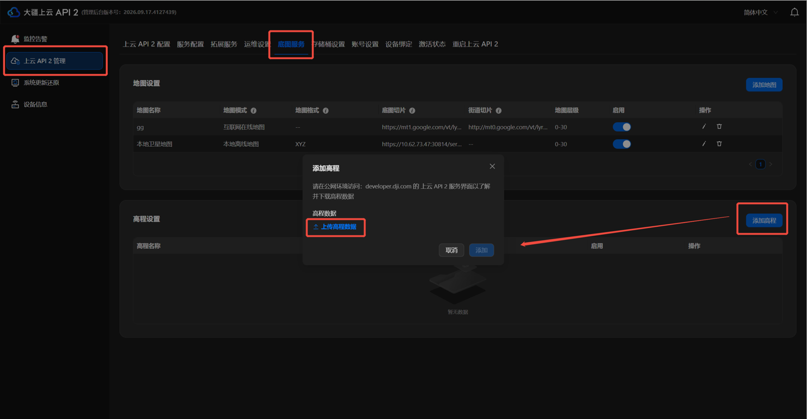

   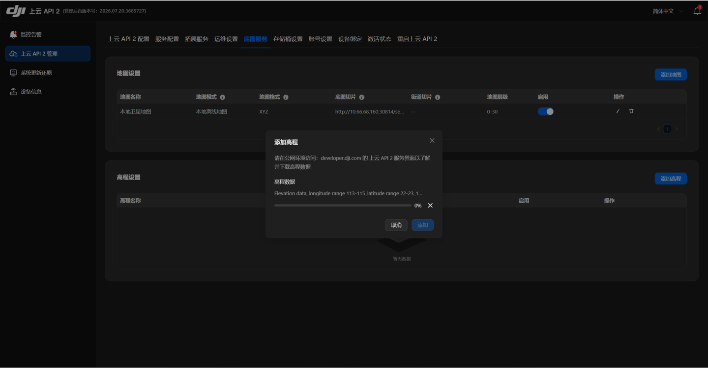

> **注意：** 若您上传遇到"网络异常或路径权限缺失"的异常，请确认客户端与上云 API 2 服务器的时间是否一致（误差大于 15 分钟将会出现该错误）

3. 添加后，您可以管理该高程数据

> **注意：** 该流程也适用于后续替换高程数据

---

## 4. 功能验证

清空浏览器缓存，并通过以下步骤完成功能验证：高程数据导入是否成功、直播转发是否成功、指令飞行功能是否可以正常使用。

**Step 1.** 进入上云 API 2 界面地图 3D 视角，调整屏幕并查看是否存在红色虚线框。如红框的经纬度范围和用户下载的数据范围基本一致，则表明高程数据已载入成功。请避免在红色虚线框外作业，容易导致飞行安全风险。

   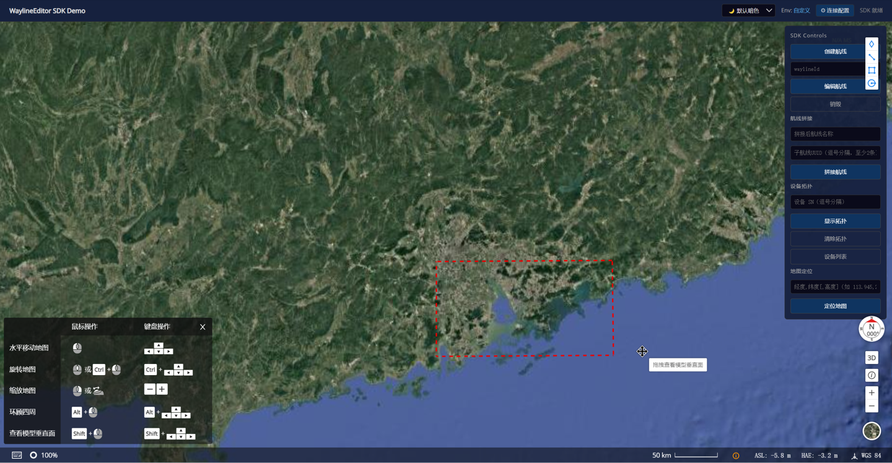

**Step 2.** 点击上云 API 2 界面右下角的圆形图标，此处展示已导入的地图，点击切换地图，观察地图是否正常显示，若正常显示，则表明离线地图数据已配置成功。

   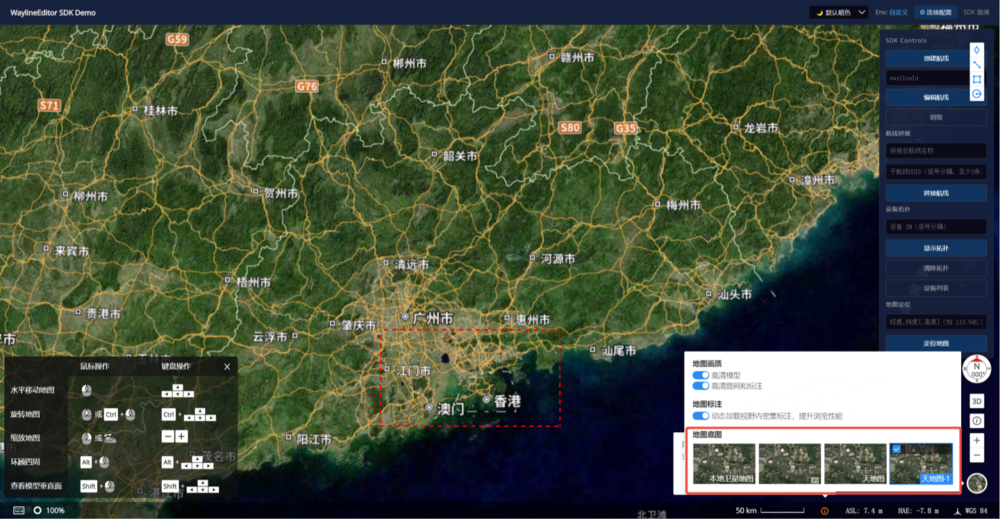

## 下一步

- 需要进阶配置（离线地图、HTTPS、SMTP、监控告警等），请参考：[能力扩展](./03.advanced.md)
- 底座部署完成后，请继续：[设备上云](../04.device-onboarding/00.index.md)
