# 开始部署

部署流程分为以下四个阶段：

```
可视化安装部署 → 负载均衡 → 业务初始化 → 功能验证
```

> **注意：** 开始部署前，请先完成 [申请许可证](../02.apply-license.md)，取得许可证文件和安装包。若您当前运行的是 V1.0.0，请先参考 [V1.0.0 迁移至 V1.1.0](./05.migration.md)。

## 1. 可视化安装部署

V1.1.0 由可视化部署完成全部安装动作，整体流程如下：

```
启动可视化部署 → 环境检查 → 授权配置 → 授权部署 → 上云 API 2 配置 → 上云 API 2 部署 → 完成部署并登录管理后台 →（可选）添加集群节点 →（可选）开启 4G 和 Terra 服务
```

### 1.1 启动可视化部署

**使用说明：**

1. 以 root 用户解压安装包，进入安装目录并启动可视化部署。其中 `<安装包文件名>` 形如 `FFH2-V1.1.0-ubuntu-amd64-full.tar.gz`：

   ```bash
   tar -zxvf <安装包文件名>
   cd <解压目录>/fh2-privatization-install-packages
   ./flighthub2-installer bootstrap --deployment-type PAAS
   ```

2. 终端会输出安装日志路径，并提示「安装向导已启动」及浏览器访问地址，格式为 `http://{您服务器的IP}:30888`，随后进入等待配置状态。执行效果如下：

   ```
   root@test:/opt# ./flighthub2-installer bootstrap  --deployment-type PAAS
   ────────────────────────────────────────────────────────────
     FlightHub2 集群底座 · 离线安装(幂等重跑)
   ────────────────────────────────────────────────────────────
      ✓ 安装明细日志: /opt/flighthub2/log/install.log

   [1/1] 收集配置(浏览器填写必要信息 + 设初始 admin 密码 + 体检)

   ────────────────────────────────────────────────────────────
     🌐 安装向导已启动 → 浏览器打开: http://XXX:30888 (LAN 直连)
     📜 安装日志: /opt/flighthub2/log/install.log
     ⏳ 正在等待你完成配置并点击开始部署…(无人值守可改用 --auto)
   ────────────────────────────────────────────────────────────
   ```

3. 使用 Chrome 浏览器打开该地址，选择「上云 API 2 平台（首节点部署）」，点击「开始部署」。

   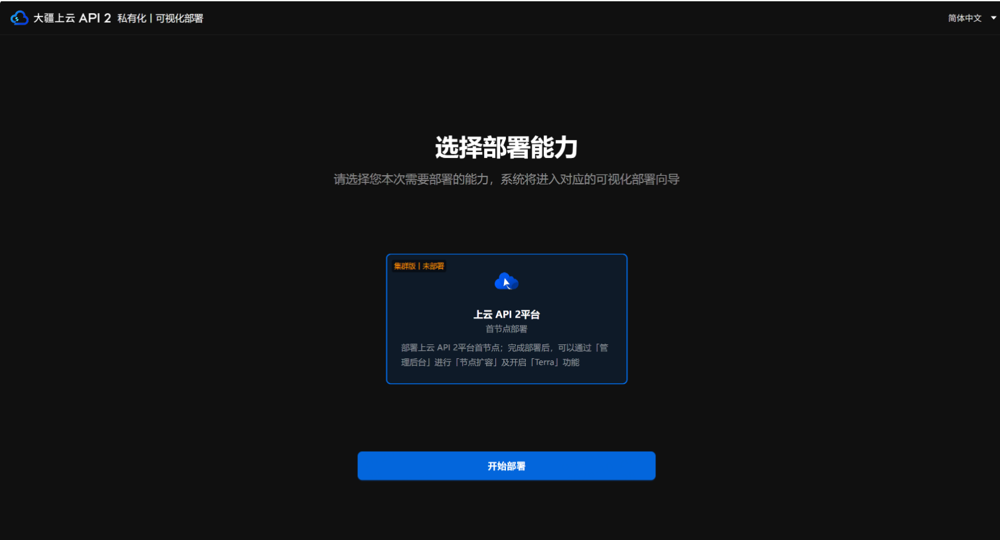

**限制说明：**

- 需要开放 30888 端口
- 请保持该终端运行，它会持续输出后续部署日志
- 本步完成标准：浏览器能够打开可视化部署，终端处于等待配置状态

---

### 1.2 环境检查

**使用说明：**

1. 可视化部署会对本机进行环境检查，提前发现可能阻碍部署的问题。检查项包括：基础资源、内核参数、网络检测、依赖包、残留检测。点击「开始检查」，等待全部检查完成。

   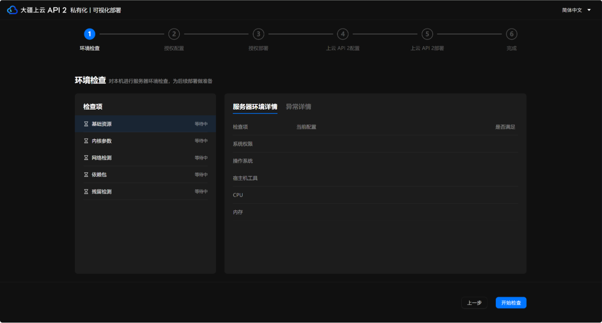

2. 检查结果会逐项展示「已通过」或「有告警」。全部满足后点击「下一步」。

   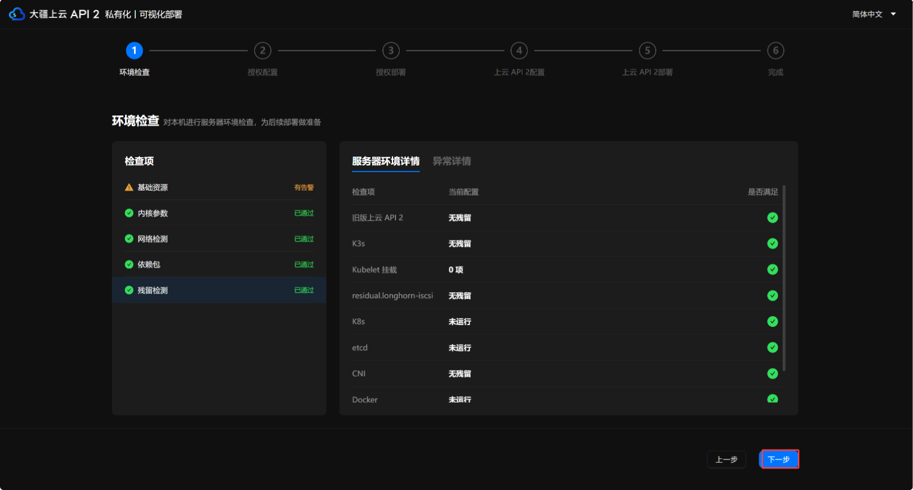

**限制说明：**

- 存在告警项时，请查看「服务器环境详情」和「异常详情」评估影响
- 存在未通过的异常项时，您无法进行后续环节。您可以根据报错及建议，解决后重新检查即可

---

### 1.3 授权配置

**使用说明：**

- **选择授权节点**：「本机部署」（授权节点即当前部署机，无需填写连接信息）或「远程节点」（通过 SSH 连接远程主机作为授权节点）。
- **选择授权文件**：选择「软件许可证」，导入 [申请许可证](../02.apply-license.md) 中下载的许可证文件（`.tar.gz`，无需解压）。导入成功后页面会显示「已选择授权文件」。

   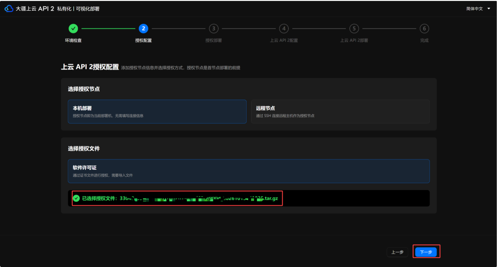

**限制说明：**

- 授权节点是首节点部署的前提
- 上云 API 2、Terra、4G 的许可证须绑定**同一台授权服务器**，V1.1.0 不再支持像 V1.0.0 那样分机安装许可证

---

### 1.4 授权部署

**使用说明：**

1. 点击「下一步」后进入授权部署，依次完成：CodeMeter 驱动 → 导入许可证 → 发布网络授权 → 授权校验。页面实时展示执行日志，可点击「一键导出日志」。

   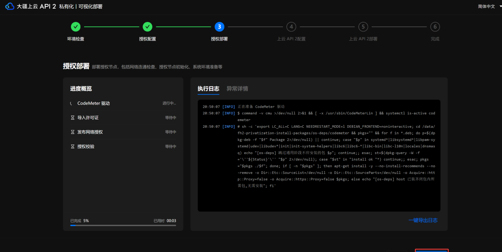

2. 四项均显示「已通过」、进度为 100% 后，点击「下一步」。

   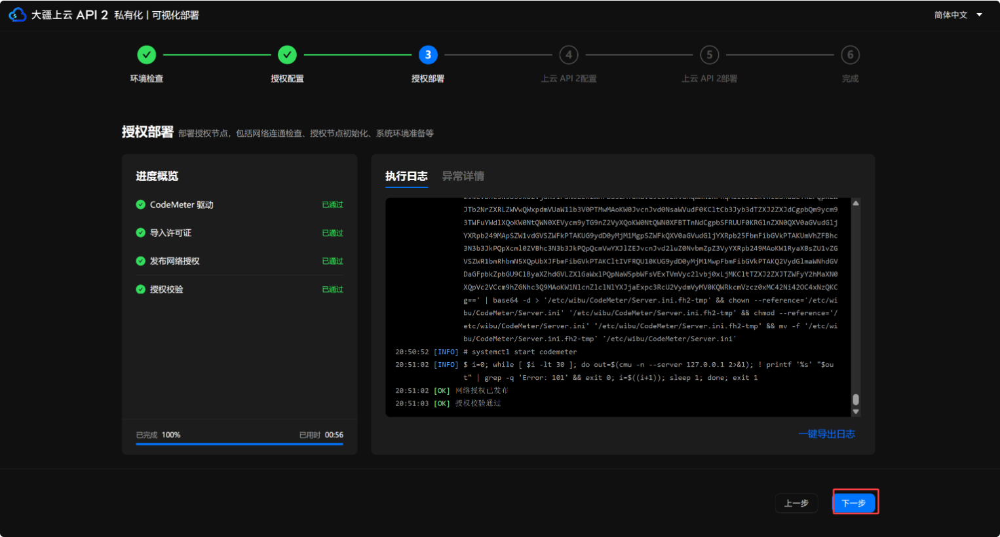

---

### 1.5 上云 API 2 配置

**使用说明：**

按下表填写配置项：

| 配置项 | 说明 |
|---|---|
| 内网 IP | 集群内部通信地址，填写前确认它是实际使用的内网通信 IP |
| 对外访问 IP | 集群的统一入口地址，供前端、API 及设备访问；若该地址变更，设备需要重新上云。单节点填写本机局域网 IP；多节点填写对外 VIP 或统一入口 IP（需自行配置入口转发和自动故障切换，详情参考「2. 负载均衡」）；NAT / 云主机场景填写公网 IP（如弹性 IP），并确保所需端口可达 |
| Pod 网段 | CIDR 格式，不能与本机 IP 段冲突；可视化部署已预填默认值 `10.42.0.0/16`，冲突时按实际网络规划修改 |
| Service 网段 | CIDR 格式，不能与本机 IP 段冲突；可视化部署已预填默认值 `10.43.0.0/16`，冲突时按实际网络规划修改 |
| 管理后台密码 / 确认密码 | 设置 AIO 管理后台 `admin` 账号的初始密码。密码须为：12-15 位，且同时包含大写字母、小写字母和数字；仅支持使用以下特殊字符：`_ @ - ! # % ^ * .`。请注意保存、保密 |
| 端口列表 | 共 166 个端口，展开可查看和修改；提交前需解决端口冲突 |
| 内部存储 · 目录路径 | 持久化存储的绝对路径，用于存放上云 API 2 产生的数据，例如航线文件、媒体文件、全景照片、视频等。建议使用独立磁盘挂载点，剩余空间不少于 200 GB，**注意需要配置为绝对路径** |

   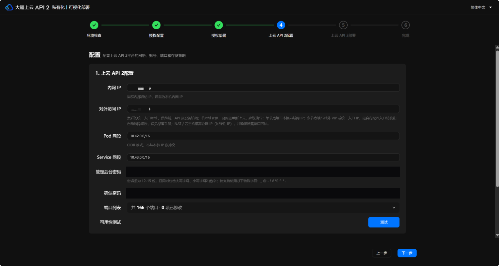

   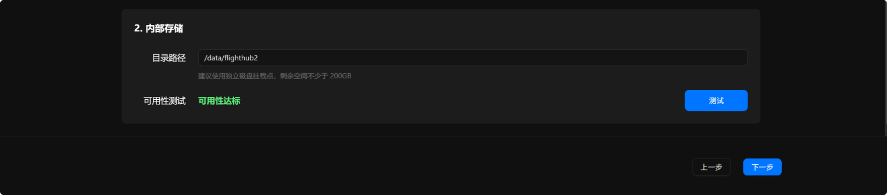

填写完成后点击「测试」，进行可用性检查。出现「可用性达标」后点击「继续」，再点击「下一步」。

   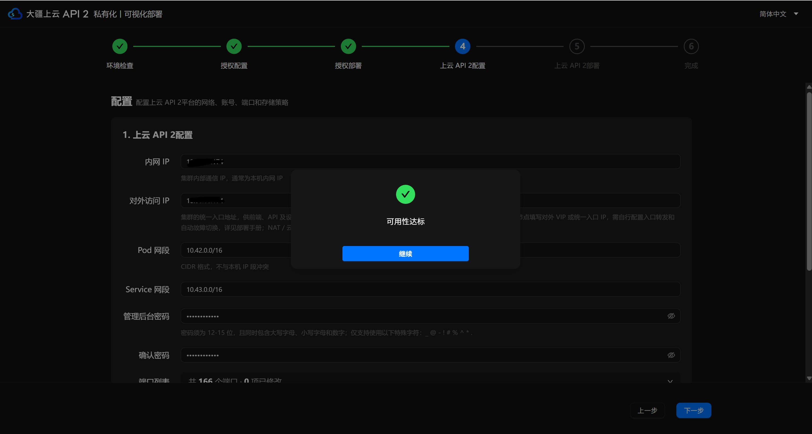

**限制说明：**

- 若发现异常项，您无法进行后续环节。您可以根据报错及建议，解决后重新检查即可

---

### 1.6 上云 API 2 部署

**使用说明：**

1. 点击「开始部署」，安装器开始安装集群底座并部署业务容器。完成后，本机成为集群的**首个节点**。

   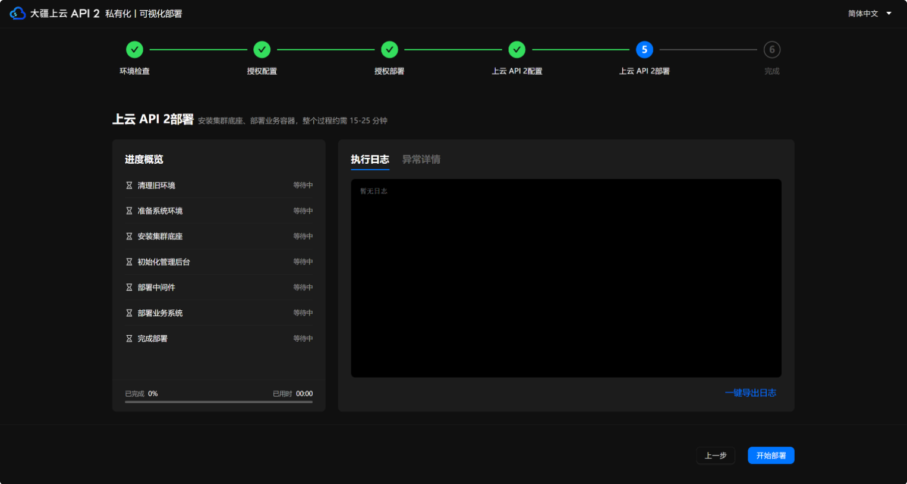

2. 部署过程中可在左侧「进度概览」查看进度，依次经过：清理旧环境 → 准备系统环境 → 安装集群底座 → 初始化管理后台 → 部署中间件 → 部署业务系统 → 完成部署；右侧「执行日志」实时输出。

   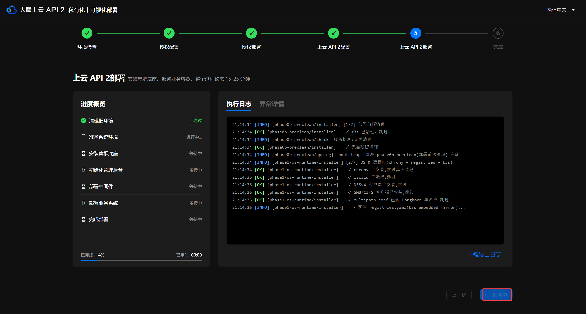

3. 全部阶段显示「已通过」、进度 100% 后，点击「完成」。

   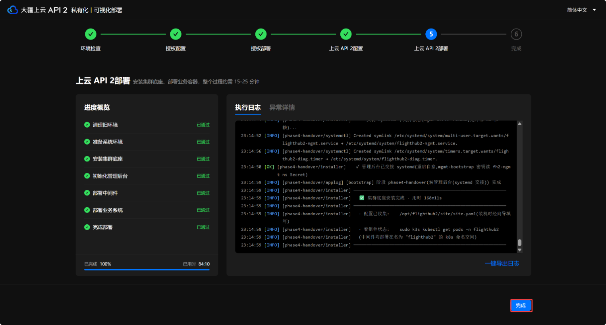

> **说明：** 页面提示整个过程约需 15-25 分钟，实际耗时因服务器性能和环境而异，是整个流程中耗时最长的一步。

**限制说明：**

- 若部署失败，您可以在「异常详情」查看原因，或点击「一键导出日志」排查，解决后重试

---

### 1.7 完成部署并登录 AIO 管理后台

1. 进入「部署成功」页面，即表示可视化安装已完成。页面展示平台版本、首节点、授权节点和管理后台访问地址（`https://{对外访问IP}:30888`），点击「上云 API 2 管理后台」即可进入。

   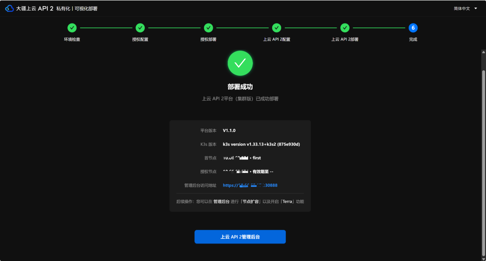

2. **首次访问上云 API 2 AIO 管理后台系统激活流程**：

   首次部署成功后访问 AIO 管理后台，系统将提示 **请先激活再使用系统**，并提供激活二维码。您需要使用手机端 **大疆行业 App** 扫码并完成激活，具体步骤如下：

   - 第一步 **（电脑端）获取激活二维码**：打开 AIO 管理后台页面，在电脑屏幕上获取 **请先激活再使用系统** 的二维码。
   - 第二步 **（手机端）登录大疆行业 App**：切换到 **我的** 页面，点击右上角的 **扫码** 图标。
   - 第三步 **（手机端）扫码连接**：扫描电脑端的激活二维码，手机将跳转至 **平台激活** 界面。
   - 第四步 **（手机端）条款确认**：点击 **授权** 同意授权设备使用整体数据，点击 **加入计划** 加入用户体验改进计划。
   - 第五步 **（手机端）信息提交**：输入大疆开发者账号并点击 **提交**，接着输入开发者邮箱并点击 **提交**。
   - 第六步 **（电脑端）系统激活**：手机端提交成功后再次点击 **扫码** 图标，App 将自动生成 6 位数字激活码。将该激活码填入电脑端页面下方的输入框中，点击 **激活系统** 按钮。系统激活成功后即可登录管理后台，继续进行后续的业务初始化。

   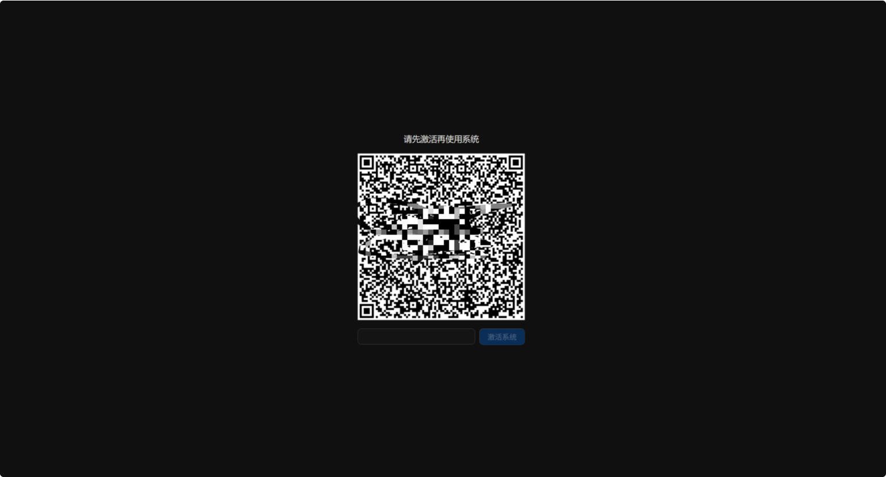

---

### 1.8 添加集群节点（可选）

需要扩容为多节点集群时，在 AIO 管理后台操作：

1. 确认新节点满足 [部署前准备](./01.prerequisites.md) 的要求，并且可通过 SSH 连接、账号具备 sudo 权限。

2. 进入「集群管理 → 集群拓扑」，点击「添加服务器」，按提示填写新节点的连接信息。

   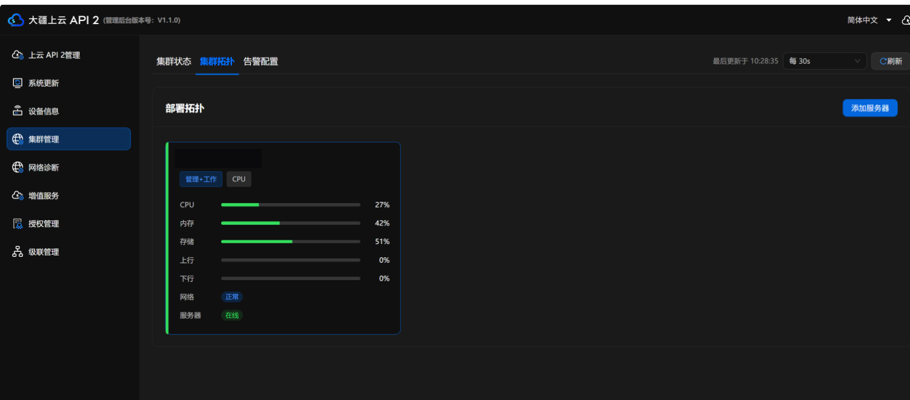

3. 系统自动执行：SSH 连接校验 → 环境预检 → 物料下发 → 安装 k3s → 加入集群 → 拉起 Pod → 就绪。全部显示「完成」后，新节点进入可用状态。

   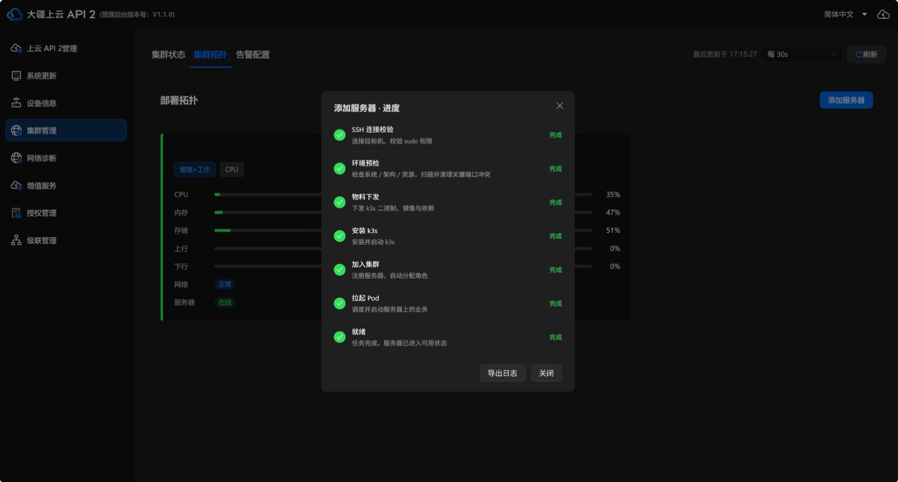

> **注意：** 如遇失败可点击「导出日志」排查。多节点集群上线后，请按「2. 负载均衡」配置负载均衡。

> **说明：** 集群节点的日常运维（集群状态、集群拓扑、替换 / 移除服务器、变更 IP）请参考 [能力扩展](./03.advanced.md) 文档中「节点管理」章节。

---

### 1.9 开启 4G 和 Terra 服务（可选）

已获得对应许可证并需要使用 4G 增强图传或 Terra 建模时，进入 AIO 管理后台「增值服务」，点击对应服务的「启用服务」。服务开启后将自动部署到符合条件的节点，页面会显示当前可用服务节点数。

- **4G 增强图传**：可作为备份链路，在 OcuSync 信号受干扰时维持图传。
- **Terra 建模**：为平台提供二维及三维高精度建模能力，需要具备 GPU 的节点，详情参考 [部署前准备](./01.prerequisites.md) 章节「服务器配置要求」。

   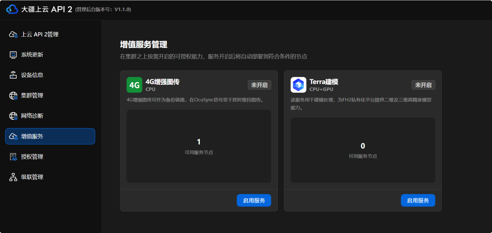

---

## 2. 负载均衡

| 部署形态 | 说明 |
|---|---|
| 单节点部署 | 无需负载均衡，直接使用节点 IP 访问（端口 `30888`） |
| 多节点集群 | 需要配置负载均衡，提供统一访问入口（VIP），将流量分发到各节点的 `30888` 端口，并将该入口地址作为「1.5 上云 API 2 配置」步骤中的「对外访问 IP」 |

> **说明：** 多节点集群推荐使用 L4 负载均衡方案，配置最佳实践参考 [运维手册](https://terra-1-g.djicdn.com/fee90c2e03e04e8da67ea6f56365fc76/SDK%20%E6%96%87%E6%A1%A3/private-fh2/%E5%A4%A7%E7%96%86%E5%8F%B8%E7%A9%BA%202%20%E7%A7%81%E6%9C%89%E7%89%88%E8%BF%90%E7%BB%B4%E6%89%8B%E5%86%8C.pdf)。

---

## 3. 业务初始化

### 3.1 导入地图数据

为快速部署上云 API 2，安装包随包附带了一份深圳区域的卫星栅格地图，您可以不做额外配置直接使用。

> **注意：** 为了后续业务正常展开使用，需要您针对性配置地图数据，详情参考 [能力扩展](./03.advanced.md) 文档中「离线地图」章节进行操作。

---

### 3.2 导入高程数据

高程数据为所在区域飞行任务与规划的必备数据，您可以按照以下步骤执行。

#### 3.2.1 数据获取

1. 登录开发者控制台，输入您的许可证 ID 后进入高程数据下载页面

   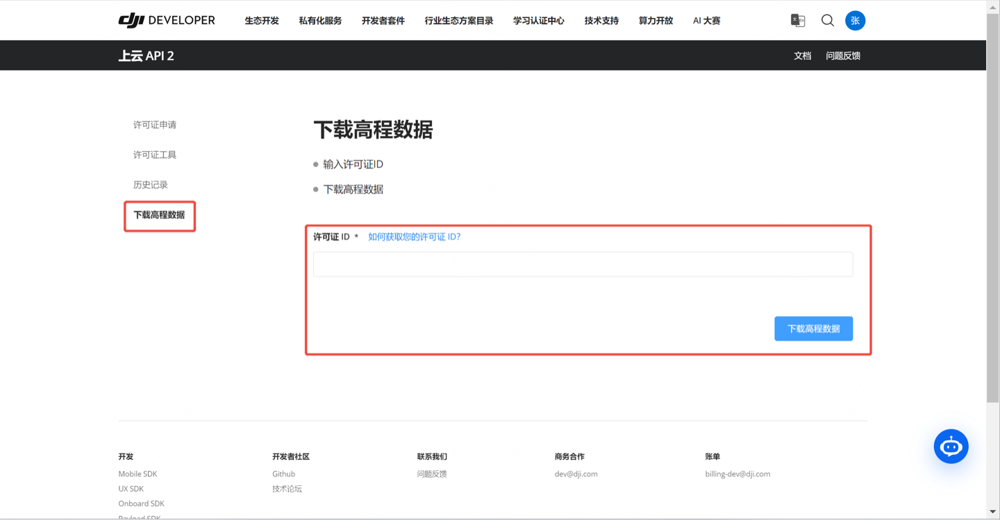

2. 按需选择您需要的飞行区域，并下载高程数据到本地

   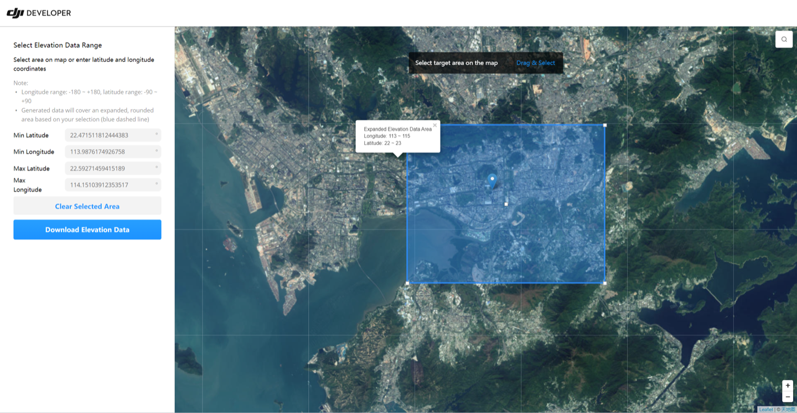

#### 3.2.2 数据发布

1. 进入 AIO 管理后台并登录。在浏览器中输入地址并访问，地址格式如下：

   ```
   https://{{EXTERNAL_IP}}:{{FH_SYSTEM_PORT}}
   ```

   - 访问地址示例：`https://192.168.1.101:30888`
   - `EXTERNAL_IP` 为在 `1.5` 中您所配置的对外访问 IP
   - `FH_SYSTEM_PORT` 为可视化部署的入口端口，默认为 `30888`

2. 上传下载好的高程压缩包，并点击添加

   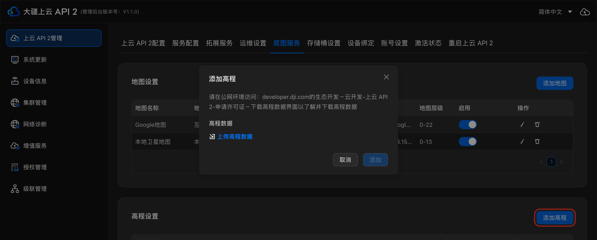

   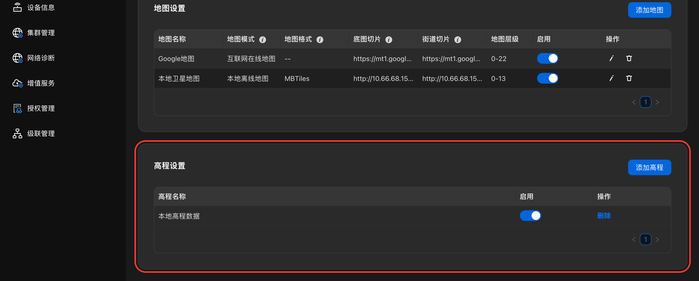

> **注意：** 若您上传遇到"网络异常或路径权限缺失"的异常，请确认客户端与上云 API 2 服务器的时间是否一致（误差大于 15 分钟将会出现该错误）

3. 添加后，您可以管理该高程数据

> **注意：** 该流程也适用于后续替换高程数据

---

### 3.3 绑定机场到组织

在 AIO 管理后台中将机场设备绑定到对应的组织 / 项目。

---

## 4. 功能验证

清空浏览器缓存，并通过以下步骤完成功能验证：高程数据导入是否成功、离线地图是否配置成功、设备是否可正常连接。

**Step 1.** 进入上云 API 2 界面地图 3D 视角，调整屏幕并查看是否存在红色虚线框。如红框的经纬度范围和用户下载的数据范围基本一致，则表明高程数据已载入成功。请避免在红色虚线框外作业，容易导致飞行安全风险。

   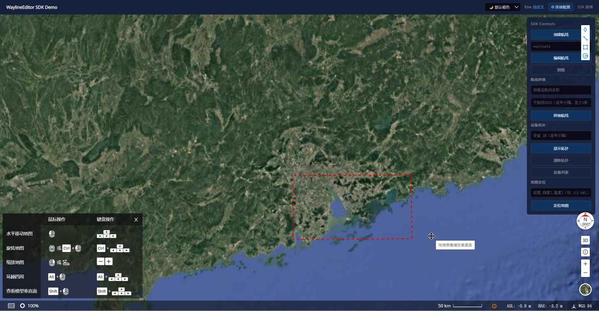

**Step 2.** 点击上云 API 2 界面右下角的圆形图标，此处展示已导入的地图，点击切换地图，观察地图是否正常显示，若正常显示，则表明离线地图数据已配置成功。

   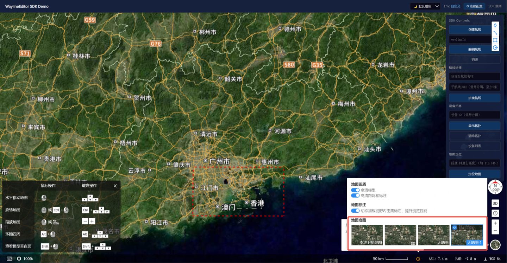

**Step 3.** 确认机场设备可以正常连接并上线。

## 下一步

- 需要进阶配置（离线地图、HTTPS、SMTP、监控告警等），请参考：[能力扩展](./03.advanced.md)
- 底座部署完成后，请继续：[设备上云](../06.device-onboarding/00.index.md)
