# 能力扩展

本文档说明上云 API 2 应用运行与设备管控底座部署完成后的进阶配置项。以下配置均为可选，请根据实际业务需求参考对应章节，无需全部执行。

## 1. 进入 AIO 管理后台

在浏览器中输入地址并访问，地址格式如下：

```
{{INTERNAL_IP}}:{{FH_SYSTEM_PORT}}
{{EXTERNAL_IP}}:{{FH_SYSTEM_PORT}}
{{SERVICE_DOMAIN}}:{{FH_SYSTEM_PORT}}
```

| 参数 | 说明 |
|---|---|
| 访问地址示例 | `192.168.1.101:30888` |
| `INTERNAL_IP` | 「上云 API 2 配置」中您所配置的内网 IP 地址 |
| `EXTERNAL_IP` | 「上云 API 2 配置」中您所配置的对外访问 IP 地址 |
| `FH_SYSTEM_PORT` | 可视化部署的入口端口，默认为 `30888` |
| 密码 | 「上云 API 2 配置」中您所配置的管理后台密码 |
| 账号 | 固定账号：`admin` |

## 2. 离线地图

离线地图瓦片数据支持卫星地图数据和路网地图数据的配置。私有版安装包随包附带了一份深圳区域的卫星栅格地图，可以不做任何配置直接使用安装包自带资源。若需要获取其他区域的离线地图数据，可以选择以下任一格式的数据进行导入配置：XYZ 格式地图瓦片、MBTiles 格式地图瓦片或者用户自定义地图服务。

### 2.1 坐标系说明

用户若选择基于 GeoTiff 等原始数据转换 XYZ、MBTiles 或发布自定义地图服务，原始数据需要为网络墨卡托（WebMercator）地图投影坐标系（编码 EPSG:3857），或者 WGS84 地理坐标系（编码为 EPSG:4326）自行通过 GIS 软件进行投影转换。

若用户能自行获取 XYZ、MBTiles 离线瓦片数据，则需要注意瓦片的行列顺序。

### 2.2 XYZ 格式地图瓦片

XYZ 格式支持的瓦片文件格式为 JPG（或 JPEG）、PNG。推荐使用带透明度的 PNG 瓦片。

**数据获取：**

对于 XYZ 格式的地图瓦片，推荐下述两种方式进行数据获取：

- **方式一：** 通过地图下载工具进行地图文件下载，例如 [MobileAtlasCreator](https://mobac.sourceforge.io/)、[水经微图](https://www.rivermap.cn/down.html)、[太乐地图](https://www.arctiler.com/index.html)。
- **方式二：** 将影像 TIF 数据（需含有坐标系）转为 XYZ 格式瓦片集合。

> **说明：** 部分在线地图数据源可能存在坐标偏移情况，请选择合适的数据源以避免坐标偏移问题。

**数据发布 — 可视化操作：**

进入 AIO 管理后台进行配置。

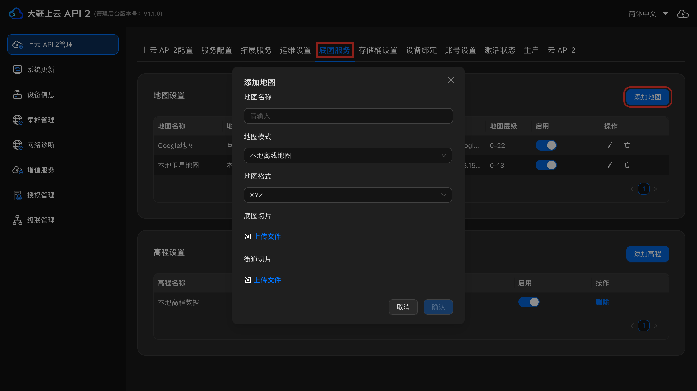

**数据发布 — 命令行操作：**

1. **放置瓦片数据**：`/var/lib/flighthub2/asset-map/png-tiles/` 下放置卫星底图瓦片数据，`/var/lib/flighthub2/asset-map/street-tiles/` 放置路网瓦片数据。若这两个文件夹下存在原有的 PNG / JPG 瓦片文件集合，需要删除该文件集合。其中 `${INSTALLATION_PATH}` 为部署安装包 env 文件中的环境变量。

2. **导入新瓦片**：将新的 XYZ 卫星底图或者路网瓦片文件放入。

3. **修改地图配置文件**。

   地图配置文件路径：`/var/lib/flighthub2/asset-map/map_config.yaml`，修改配置文件可以实现地图数据源的新增 / 删除 / 修改。

   一个数据项中的参数介绍：

   | 参数名称 | 参数用途 | 参数说明 |
   |---|---|---|
   | name | 界面上显示的名称 | 使用常规字符串，不含特殊符号，不为空 |
   | type | 地图上图标类型 | `default` - 即随安装包默认携带的卫星地图；`custom` - 表示自定义的离线数据。此参数仅影响右下角的地图底图图标样式 |
   | link | 卫星数据 URL | 占位符 `{z}`、`{x}`、`{y}` 与实际文件夹、文件名的层级一致，后缀名与数据文件的后缀名一致。举例：`http://myhost.org/services/my-xyz-data1/tiles/{z}/{x}/{y}.png` |
   | street_link | 配套的街道数据 URL | 可选项，若数据项无配套路网数据，可省略此选项。配置规则与 link（卫星数据 URL）一致。 |
   | min_z | 数据可用最小层级 | 可选，默认值为 0，请提供数据源的真实最小层级，只影响卫星数据。地图缩小到对应级别时，所有小于这个层级的数据都会以这个层级的数据为基准缩放。如果没有配置，小于真实最小层级时会显示为空白。 |
   | max_z | 数据可用最大层级 | 可选，无默认值，请提供数据源的真实最大层级，只影响卫星数据。地图放大到对应级别时，所有大于这个层级的数据都会以这个层级的数据为基准缩放。如果没有配置，大于真实最大层级时会显示为空白。 |

   示例如下：

   ```yaml
   map_resource:
     -
       name: 本地卫星地图
       type: default
       street_link:
       link: http://myhost.org/services/my-satellite-data/tiles/{z}/{x}/{y}.jpg
     -
       name: 本地卫星地图
       type: default
       street_link:
       link: http://myhost.org/services/my-satellite-data/tiles/{z}/{x}/{y}.jpg
       min_z: 0
       max_z: 13
   ```

   > **说明：**
   > - XYZ 卫星底图地图瓦片链接的拼接规则：`${SERVICE_DOMAIN}:${MAP_CUSTOM_TCP_PORT}/` + 地图瓦片文件在 `/var/lib/flighthub2/asset-map/png-tiles/` 下的剩余路径。
   > - XYZ 路网瓦片链接的拼接规则：`${SERVICE_DOMAIN}:${MAP_CUSTOM_TCP_PORT}/` + 地图瓦片文件在 `/var/lib/flighthub2/asset-map/street-tiles/` 下的剩余路径。
   > - 瓦片数据格式需要与瓦片文件路径后缀保持一致，如 JPG 格式瓦片的后缀为 `.jpg`

4. **执行离线地图发布脚本**：在 `${部署安装包解压目录}/tool/map/` 路径下执行命令。

   ```bash
   bash ./publish-map.sh
   ```

### 2.3 MBTiles 格式地图瓦片

**数据获取：**

点击 [跳转链接](https://www.maptiler.com/on-prem-datasets/planet/) 并下载红框内的地图文件（仅支持瓦片地图）。

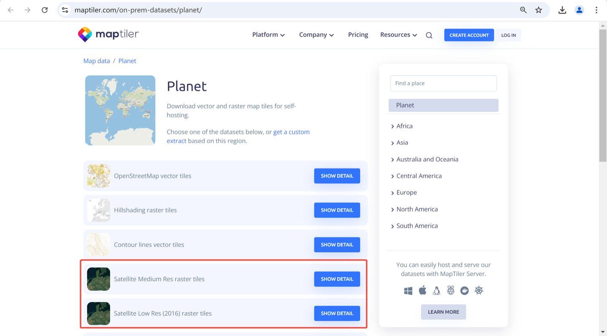

> **说明：**
> - 可以使用 [QGIS](https://www.qgis.org/) 直接将 WGS84 坐标系（EPSG 编号 4326 或 EPSG 编号 3857）的栅格（tif）数据制作成 mbtiles 数据包，也可以用其它工具（命令行工具或 GIS 客户端软件）制作。
> - 部分在线地图数据源可能存在坐标偏移情况，请选择合适的数据源以避免坐标偏移问题。

**数据发布 — 可视化操作：**

进入 AIO 管理后台进行配置。

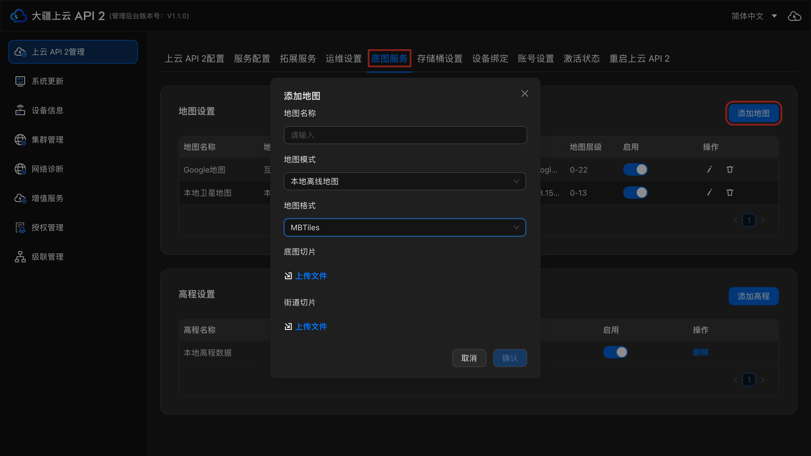

**数据发布 — 命令行操作：**

1. **确认存放路径**：`/var/lib/flighthub2/asset-map/mbtiles/` 下可以放置卫星底图数据或路网数据的 mbtiles 文件，支持同时存放多个不同的 mbtiles 数据。
2. **放入地图文件**：将新的 `.mbtiles` 地图文件放入。
3. **执行离线地图发布脚本**：在 `${部署安装包解压目录}/tool/map/` 路径下执行命令。

   ```bash
   bash ./publish-map.sh
   ```

> **说明：** 卫星底图地图或路网（mbtiles 数据格式）的拼接规则：
> ```
> ${SERVICE_DOMAIN}:${MAP_SERVER_TCP_PORT}/services/{mbtiles_file_name}/tiles/{z}/{x}/{y}.{瓦片格式}
> ```
> 假设 mbtiles 文件名称为：`satelite-2017-11-01-china_shenzhen.mbtiles`，mbtiles 中瓦片的格式为 jpg，则 mbtiles 访问链接为：
> ```
> ${SERVICE_DOMAIN}:${MAP_SERVER_TCP_PORT}/services/satelite-2017-11-01-china_shenzhen/tiles/{z}/{x}/{y}.jpg
> ```

### 2.4 用户自定义地图服务

**数据获取：**

请用户准备自己的地图瓦片服务作为离线地图数据源，部分在线地图数据源可能存在坐标偏移情况，请选择合适的数据源以避免坐标偏移问题。

**数据发布 — 可视化操作：**

进入 AIO 管理后台进行配置。

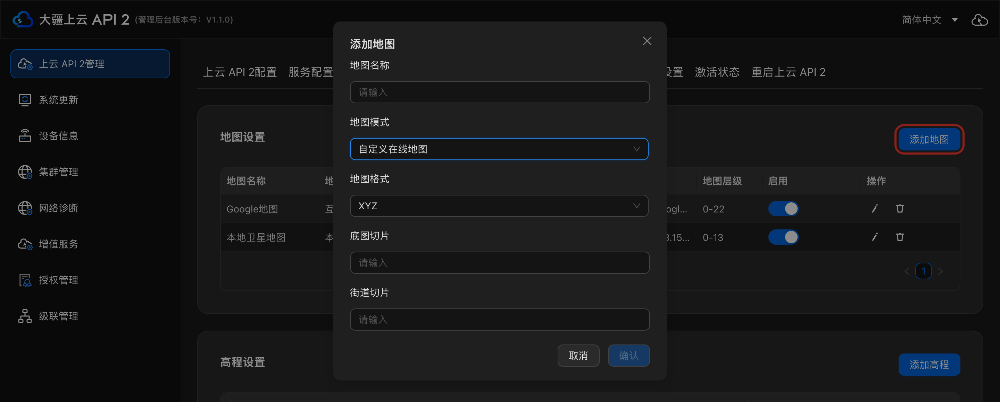

**数据发布 — 命令行操作：**

1. **修改地图配置文件**。

   地图配置文件路径：`/var/lib/flighthub2/asset-map/map_config.yaml`，修改配置文件可以实现地图数据源的新增 / 删除 / 修改。

   一个数据项的参数介绍如下：

   | 参数名称 | 参数用途 | 参数说明 |
   |---|---|---|
   | name | 界面上显示的名称 | 使用常规字符串，不含特殊符号，不为空 |
   | type | 地图上图标类型 | `default` - 即随安装包默认携带的卫星地图；`custom` - 表示自定义的离线数据。此参数仅影响右下角的地图底图图标样式 |
   | link | 卫星数据 URL | URL 中的占位符 `{z}`、`{x}`、`{y}` 与发布的数据服务层级关系一致，后缀名与数据服务瓦片格式的后缀名一致。举例：`http://myhost.org/services/test-data/{z}/{x}/{y}.png` |
   | street_link | 配套的街道数据 URL | 可选项，若数据项无配套路网数据，可省略此选项。配置规则与 link（卫星数据 URL）一致。 |
   | min_z | 数据可用最小层级 | 可选，默认值为 0，请提供数据源的真实最小层级，只影响卫星数据。地图缩小到对应级别时，所有小于这个层级的数据都会以这个层级的数据为基准缩放。如果没有配置，小于真实最小层级时会显示为空白。 |
   | max_z | 数据可用最大层级 | 可选，无默认值，请提供数据源的真实最大层级，只影响卫星数据。地图放大到对应级别时，所有大于这个层级的数据都会以这个层级的数据为基准缩放。如果没有配置，大于真实最大层级时会显示为空白。 |

   示例如下：

   ```yaml
   map_resource:
     -
       name: 自定义地图服务
       type: custom
       link: http://hostname.org/datasets/2024/shenzhen/{z}/{x}/{y}.png
       street_link: http://hostname.org/datasets/2024/shenzhen_rd/{z}/{x}/{y}.png
     -
       name: 自定义地图服务
       type: custom
       link: http://hostname.org/datasets/2024/shenzhen/{z}/{x}/{y}.png
       street_link: http://hostname.org/datasets/2024/shenzhen_rd/{z}/{x}/{y}.png
       min_z: 0
       max_z: 13
   ```

2. **执行离线地图发布脚本**：在 `${部署安装包解压目录}/tool/map/` 路径下执行命令。

   ```bash
   bash ./publish-map.sh
   ```

### 2.5 AR 街道地图部署

**数据获取：**

<!-- FILL: 粘贴 AR 街道地图数据下载链接 URL -->

点击 [跳转链接](<AR_MAP_DOWNLOAD_URL>) 并下载红框内的地图文件。

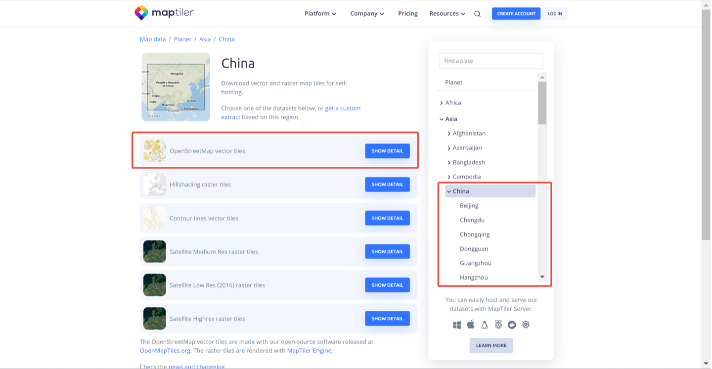

**数据发布 — 命令行操作：**

1. **放置数据**：数据存放路径为 `/var/lib/flighthub2/asset-map/mbtiles/`。
2. **修改地图配置文件**：路径为 `/var/lib/flighthub2/asset-map/map_config.yaml`，`ar_resource` 这一块表示本次新增的 AR 地图资源。

   示例如下：

   ```yaml
   map_resource:
     -
       name: 本地卫星地图
       type: default
       street_link:
       link: http://myhost.org/services/my-satellite-data/tiles/{z}/{x}/{y}.jpg
     -
       name: 本地卫星地图+mbtiles 路网
       type: custom
       street_link: http://myhost.org/services/my-street-data/tiles/{z}/{x}/{y}.png
       link: http://myhost.org/services/my-satellite-data/tiles/{z}/{x}/{y}.jpg
       min_z: 0
       max_z: 13
     -
       name: 在线 link
       type: custom
       street_link: https://<your-map-tile-server>/street/{x}/{y}/{z}
       link: https://<your-map-tile-server>/satellite/{x}/{y}/{z}
   ar_resource:
     -
       name: ar 标注地图
       type: custom
       min_z: 0
       max_z: 14
       link: https://${SERVICE_DOMAIN}:${MAP_SERVER_TCP_PORT}/services/{mbtiles_file_name}/tiles/{z}/{x}/{y}.pbf
   ```

   > **说明：** link 的拼接规则：假设 mbtiles 文件名称为 `osm-2020-02-10-v3.11_china_shenzhen.mbtiles`
   > ```
   > ${SERVICE_DOMAIN}:${MAP_SERVER_TCP_PORT}/services/osm-2020-02-10-v3.11_china_shenzhen/tiles/{z}/{x}/{y}.pbf
   > ```
   > 注意：从 maptiler 下载的地图数据都是 mbtiles 格式，且瓦片格式都是 pbf。

## 3. 域名 / IP 切换

通过 AIO 管理后台界面可实现域名与 IP 访问模式的切换，如下：

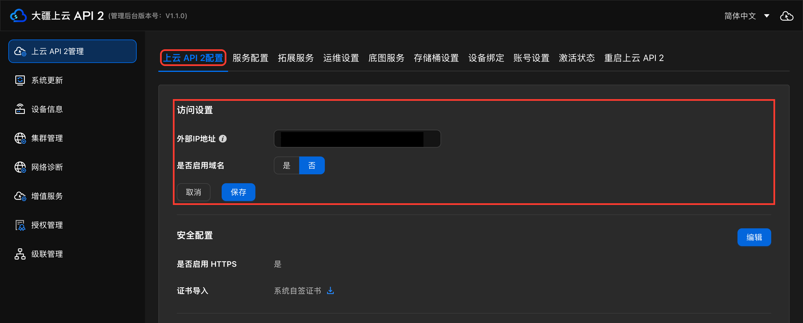

## 4. HTTP / HTTPS 切换

通过 AIO 管理后台界面可实现 HTTP / HTTPS 协议切换，如下：

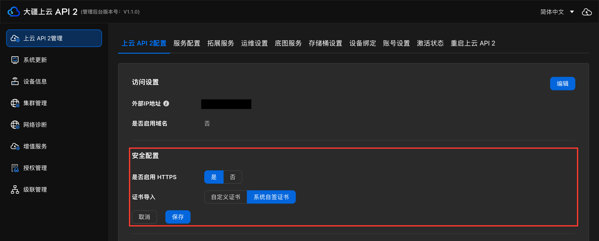

### 4.1 切换为 HTTP

关闭 HTTPS 即可。

> **注意：** 由于浏览器安全策略限制，在 HTTP 模式下无法正常录音，因此如果您需要使用喊话器功能，请配置开启 HTTPS 模式。

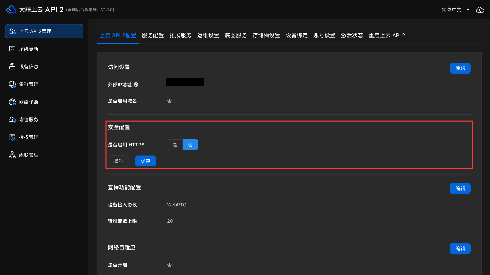

### 4.2 切换为 HTTPS

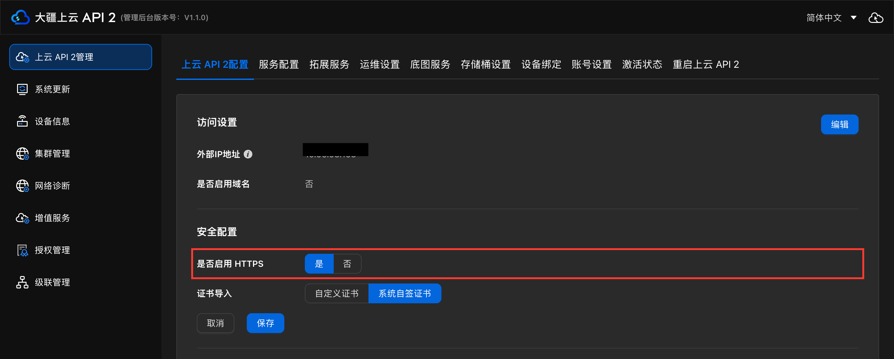

#### 4.2.1 启用系统自签证书

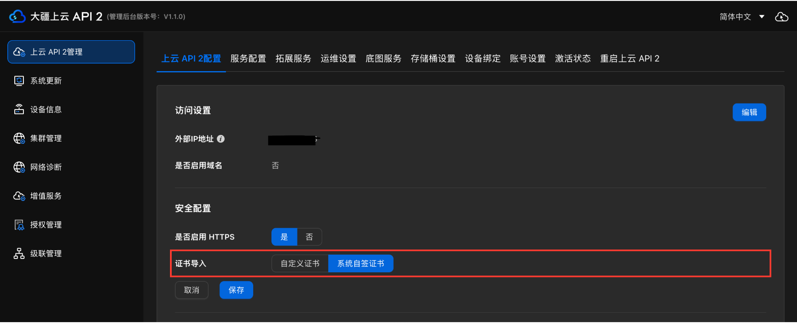

客户端浏览器需要信任自签发根证书，请按照所属环境（Linux、macOS、Windows）选择性阅读。

**Linux 环境：**

在服务器和终端电脑设备的谷歌浏览器中（`设置` → `隐私和安全` → `安全` → `管理证书`）信任自签发 pem 证书，将自签发的根证书 `ca.pem` 导入系统。

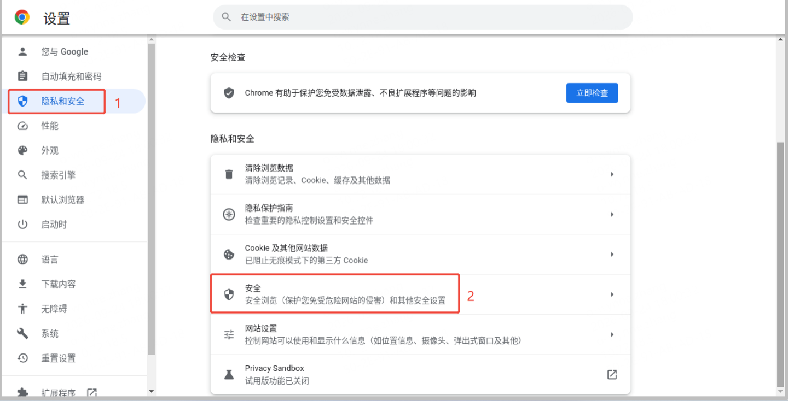

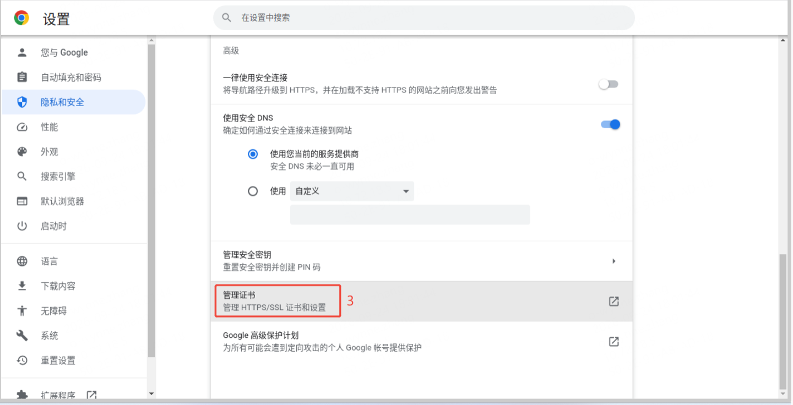

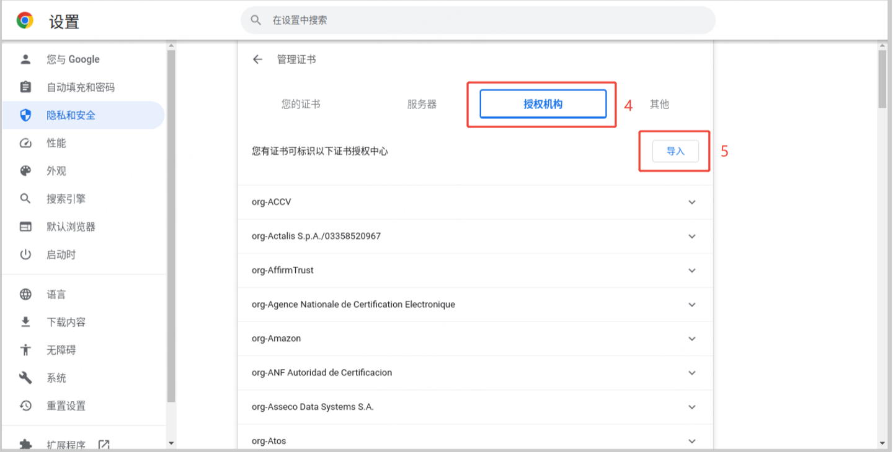

**macOS 环境：**

1. **添加证书**：双击自签发的根证书 `ca.pem`，在弹窗中选择 `系统` 后点击 `添加`。

   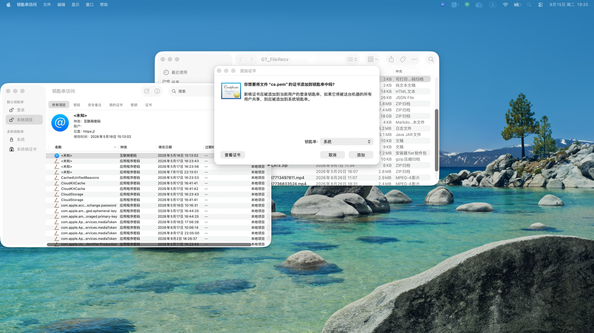

2. **查找证书**：在 `钥匙串访问` 中找到证书。

   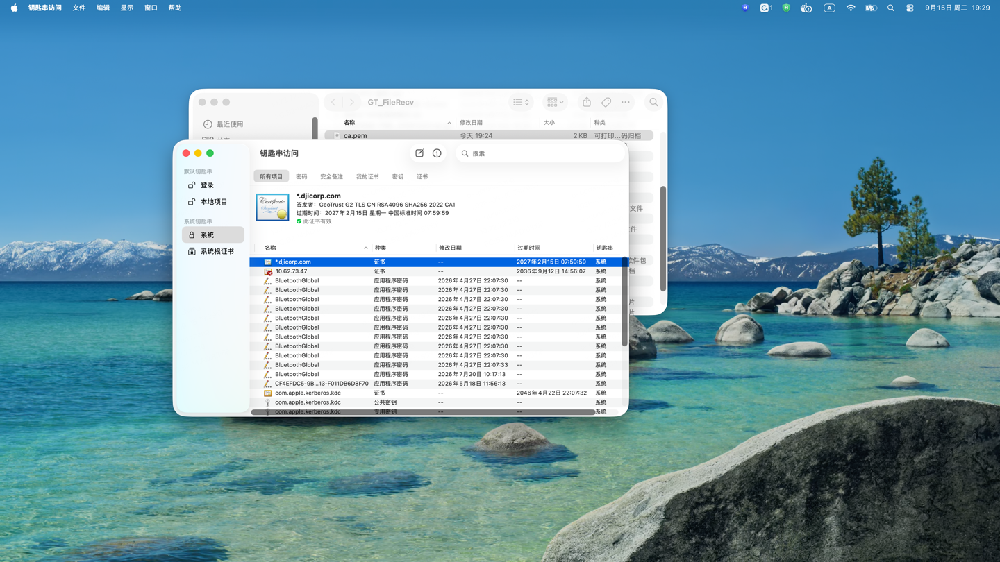

3. **设置信任**：双击证书，在信任标签下的 `使用此证书时` 选项修改为 `始终信任`，关闭窗口。

   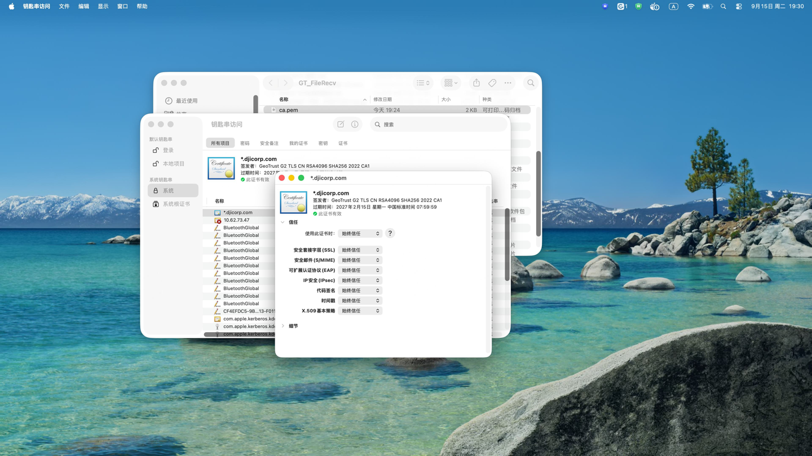

**Windows 环境：**

1. **打开管理证书**：在谷歌浏览器（`设置` → `隐私和安全` → `安全` → `管理证书`）中找到 `管理证书`。

   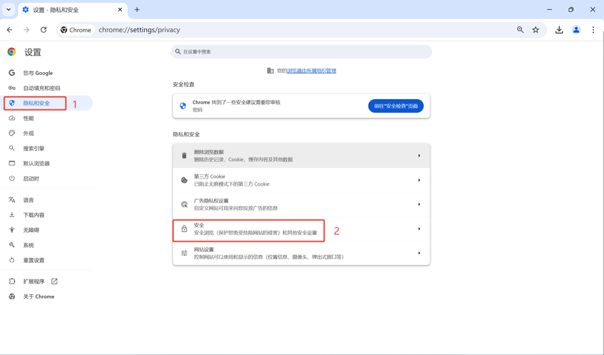

2. **导入证书**：选择 `受信任的根证书颁发机构`，点击 `导入`。

   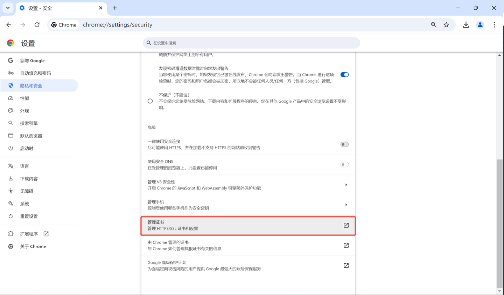

3. **选择根证书**：找到自签发的根证书 `ca.pem` 的位置，导入证书。

   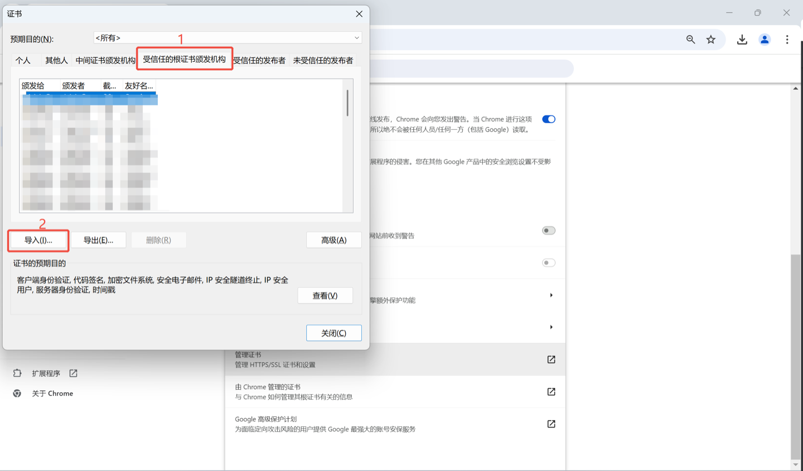

4. **重启浏览器**：显示导入成功后，重启谷歌浏览器。

   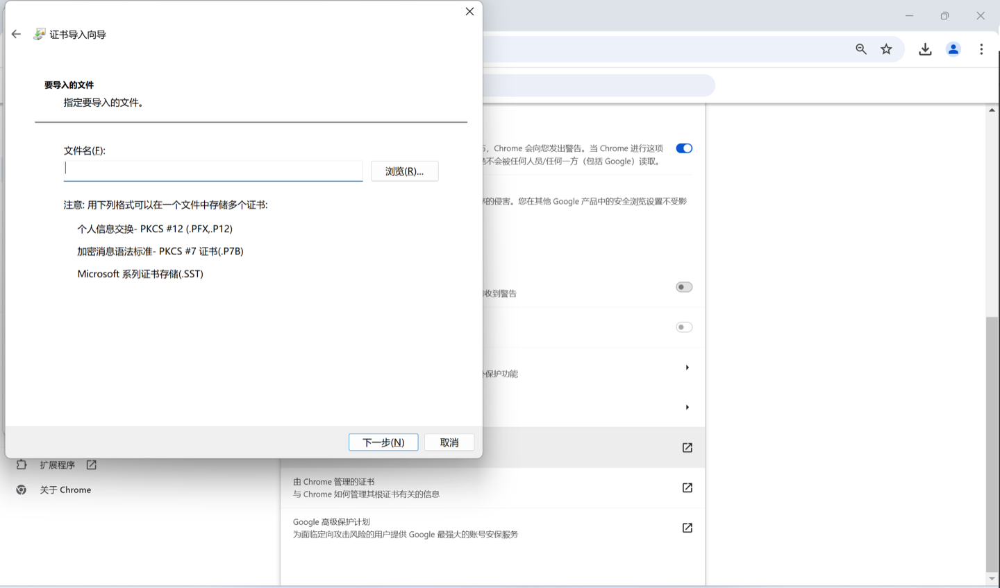

#### 4.2.2 启用自定义证书

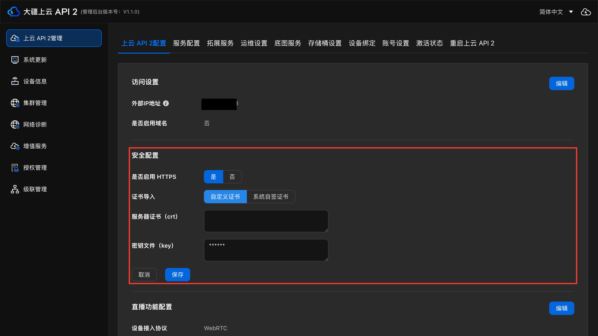

将自定义证书的 CRT、KEY 信息填入并保存。

## 5. 修改上云 API 2 服务默认端口

进入 AIO 管理后台即可修改，如下：

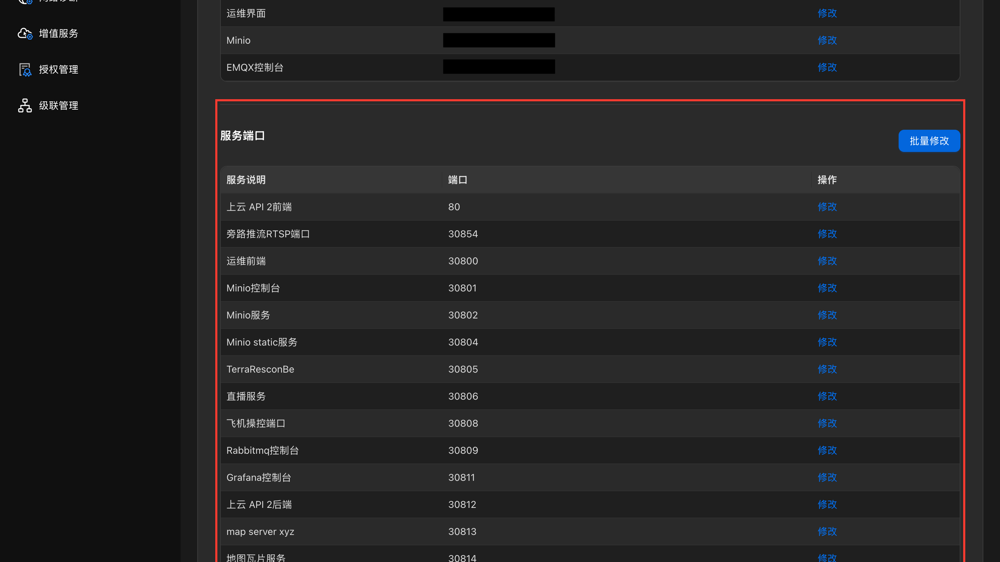

## 6. 配置 SMTP 服务

面向有启用「邮件通知 / 告警订阅」需求的管理员。

本章节将说明如何在 AIO 管理后台的「拓展服务」页面完成 SMTP 配置、如何验证连通性，以及常见问题排查。

### 6.1 前期准备

- 可用的 **SMTP 中继服务**（以下两种用户类型，任选其一）：
  1. **已拥有公司内 SMTP 中继**（如自建 Postfix / Exchange，或企业邮箱提供的 SMTP）；
  2. **暂时没有 SMTP 中继**，可先申请第三方服务（本文以 **Mailgun** 为例）。
- 能登录 AIO 管理后台（[1. 进入 AIO 管理后台](#1-进入-aio-管理后台)）的管理员账号。
- 网络层允许访问 SMTP 服务（常见端口：**587 / STARTTLS** 或 **465 / TLS**）。

### 6.2 在「拓展服务」页面配置 SMTP

SMTP 配置统一在 AIO 管理后台的「拓展服务」页面完成。

#### 6.2.1 进入配置页面

按以下路径进入：

```
上云 API 2 管理 → 拓展服务 → SMTP业务配置
```

对应地址为：

```
https://{{服务器IP}}:30888/#/administration/platform-management/extension
```

登录账号与应用 「[1. 进入 AIO 管理后台](#1-进入-aio-管理后台)」一致，默认账号 `admin`。

页面分为三个区块，自上而下依次为：**业务配置**、**上云 API 2 配置**、**邮件服务连通性测试**。

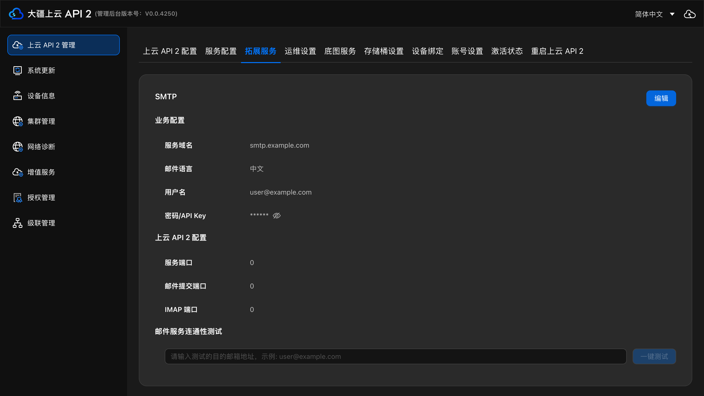

#### 6.2.2 业务配置

| 页面字段 | 说明 | 是否必填 |
|---|---|---|
| **服务域名** | SMTP 中继服务器地址，如 `smtp.mailgun.org`、`smtp.company.com`。**此处填写的是 SMTP 服务器地址，不是您的发件域名** | 是 |
| **邮件语言** | 下拉选择「中文」或「英文」。告警模板语言与该值不一致时，对应邮件会被跳过 | 是 |
| **用户名** | SMTP 认证用户名，通常为发件邮箱地址，如 `noreply@your-domain.com` | 是 |
| **密码/API Key** | SMTP 认证密码或服务商生成的 API Key / 应用专用密码 | 是 |

> **提示：** 「服务域名」的页面文案容易与「发件域名」混淆。此处应填写 SMTP 服务器的主机名，例如 Mailgun 填 `smtp.mailgun.org`；而您的发件域名（`your-domain.com`）是通过「用户名」体现的，不需要填在这一栏。

#### 6.2.3 上云 API 2 配置

该区块用于指定上云 API 2 侧邮件服务的端口：

| 页面字段 | 说明 | 常见取值 |
|---|---|---|
| **服务端口** | SMTP 投递端口，「邮件服务连通性测试」也使用该端口发起连接 | `465`（TLS） |
| **邮件提交端口** | 邮件提交（submission）端口 | `587`（STARTTLS） |
| **IMAP 端口** | IMAP 端口 | `993`（TLS）或 `143` |

> **说明：** 「邮件服务连通性测试」只使用**服务端口**发起连接；该字段留空时，测试会默认按 `465` 连接，不读取「邮件提交端口」与「IMAP 端口」。

#### 6.2.4 保存配置

1. 点击表单的编辑按钮进入编辑态；
2. 按上表填写各字段；
3. 点击保存，页面提示保存成功后自动退出编辑态。

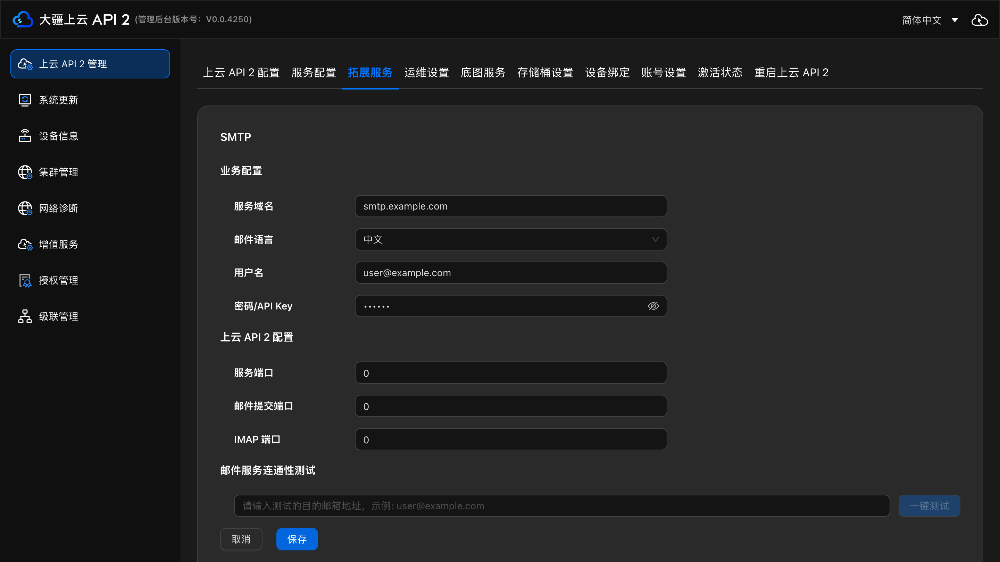

保存后配置即由平台下发，无需再执行 `./flighthub2-installer cli update` 或任何其他命令。

> **提示：** 若您此前是通过 env 文件配置的 SMTP，升级后在页面中确认一次配置值是否已正确带出，避免沿用旧值。

### 6.3 两类用户的配置路径

两种用户类型在页面上填写的位置完全相同，区别只在凭据的获取来源。

#### 6.3.1 已拥有公司内 SMTP 中继

1. **获取配置信息**：向邮件 / IT 管理员获取。
   - SMTP 主机地址（如 smtp.company.com），填到「服务域名」
   - 认证账号、密码（有时需开通「应用专用密码」），填到「用户名」「密码/API Key」
   - 推荐端口与加密方式（常见：587 + STARTTLS 或 465 + TLS），填到「服务端口」

2. **在「拓展服务」页面填写**：
   - **服务域名** = 对方提供的 SMTP 主机
   - **邮件语言** = 中文 / 英文
   - **用户名** = 你的发件账号（建议使用功能型账号，如 noreply@your-domain.com）
   - **密码/API Key** = 对应密码 / 应用专用密码
   - **服务端口** = 对方提供的端口

3. **保存配置**：点击保存即可生效，无需登录服务器执行命令。

4. **外发前的自检**：在页面「邮件服务连通性测试」中输入一个收件邮箱，点击「一键测试」，到目的邮箱确认是否收到测试邮件。

#### 6.3.2 暂时没有 SMTP 中继（以 Mailgun 为例）

Mailgun 是主流邮件服务商之一，支持域名维度的发送与 SMTP 接入。

操作步骤：

1. **注册并登录 Mailgun**（选择合适的区域 / 套餐）。
2. **添加你要发送的域名**（如 your-domain.com）：
   - 按向导在你的 DNS 服务商处添加 **SPF、DKIM**（必需）与（可选的）MX、跟踪 CNAME 等记录。
   - 等待 DNS 生效并在 Mailgun 控制台完成**域名验证**。
3. **创建 / 获取 SMTP 凭据**：
   - 主机：smtp.mailgun.org
   - 用户名：通常为 postmaster@your-domain.com（或你在 Mailgun 上创建的 SMTP 用户）
   - 密码：在控制台生成 / 查看。
4. **在「拓展服务」页面填写**：
   - **服务域名** = `smtp.mailgun.org`
   - **邮件语言** = 中文（或英文）
   - **用户名** = `postmaster@your-domain.com`（或你的发件人账号）
   - **密码/API Key** = 在 Mailgun 控制台复制的密码
   - **服务端口** = `465`
5. **保存配置**：点击保存即可生效。
6. **验证**：在「邮件服务连通性测试」中输入收件邮箱并点击「一键测试」，若收不到邮件，请参考下文的常见问题排查。

### 6.4 网络与安全注意事项

- **网络出口放行：** 开放到 SMTP 中继的 **TCP 587 / 465** 出站访问。
- **凭据最小化：** 仅赋予发信所需权限；避免复用个人邮箱密码，优先使用「应用专用密码」。
- **密钥管理：** 页面中「密码/API Key」默认以掩码显示，点击眼睛图标可查看明文。请仅授权必要人员访问 AIO 管理后台，并定期轮换该凭据。
- **发件人规范：** 实际 From 地址应属于你已验证的域名；避免使用公共域（如 @gmail.com）作为业务系统的 From。
- **访问控制：** 「拓展服务」页面能直接决定全站发信凭据，请限制 AIO 管理后台（`30888` 端口）的访问来源。

### 6.5 如何验证 SMTP 连通性

推荐优先使用页面内置的连通性测试，无需登录服务器。

**1）页面「邮件服务连通性测试」**

在「拓展服务 → SMTP业务配置 → 邮件服务连通性测试」中：

1. 输入一个收件邮箱；
2. 点击「一键测试」；
3. 观察页面提示：
   - 成功：`测试邮件发送成功，请到目的邮箱查看`
   - 失败：`测试失败，请检查 SMTP 配置`

> **注意：** 该测试**直接使用页面表单中当前填写的值**发起：若表单处于编辑态且尚未保存，测试的也是未保存的内容。

**2）服务器侧连通性排查（可选）**

若页面测试失败、需要进一步判断是网络还是凭据问题，可在部署主机上执行：

```bash
# 检查到 SMTP 服务器的 STARTTLS 握手（以 587 端口为例）
openssl s_client -starttls smtp -connect smtp.mailgun.org:587 -quiet
```

看到证书与 250-STARTTLS 等扩展能力，说明网络与 TLS 握手正常，问题更可能在凭据或发件域名配置。

> 页面测试成功即代表 SMTP 链路可用，业务内的模板 / 告警邮件仍以系统实际配置为准。

### 6.6 变更与回滚建议

- **变更**：直接在「拓展服务」页面修改字段并保存，保存即生效，不需要执行任何命令或重启服务。
- **回滚**：重新编辑表单，把字段改回变更前的值并保存。
- **验证**：每次变更后，用「邮件服务连通性测试」发一封测试邮件确认。
- **变更窗口**：建议选择低峰期操作，避免告警邮件在变更期间丢失。

### 6.7 常见问题排查（FAQ）

**Q1：页面提示「测试失败，请检查 SMTP 配置」？**

- 优先核对页面中的「服务域名」「用户名」「密码/API Key」「服务端口」四项是否与 SMTP 服务商提供的一致。
- 确认「服务端口」与服务商端口一致：服务商只提供 `587`（STARTTLS）时，填 `465` 会连接失败。

**Q2：提示认证失败（如 535 5.7.8 Authentication credentials invalid）？**

- 核对「用户名」/「密码/API Key」是否正确、是否使用了「应用专用密码」。
- 账号是否允许 SMTP AUTH；企业邮箱 / Exchange Online 可能默认关闭，需要管理员开启。

**Q3：连接超时或无法连接？**

- 检查到外网的 587 / 465 端口是否被防火墙 / 出口策略拦截。
- 若使用内网中继，确认 DNS 能解析到内网地址。

**Q4：报证书校验错误？**

- 通常是**主机名与证书 CN / SAN 不匹配**或根证书链不完整。更换为与证书匹配的主机名，并确保系统信任根证书。

**Q5：邮件被拒收 / 进入垃圾箱？**

- 确认已正确配置 **SPF / DKIM**（以及可选的 DMARC），发件域名与 From 地址一致。

**Q6：我只想收中文（或英文）告警邮件，怎么设置？**

- 在「邮件语言」下拉中选择「中文」或「英文」即可，无需再修改 env 中的 `DEVOPS_DEFAULT_LANG`。

**Q7：页面上「服务域名」到底填 SMTP 服务器还是我的发件域名？**

- 填 **SMTP 服务器地址**（如 `smtp.mailgun.org`）。发件域名通过「用户名」中的邮箱后缀体现，不需要单独填写。

## 7. 节点管理

### 7.1 功能简介

集群管理是上云 API 2 集群版的核心运维模块，将多台服务器组成统一集群，由一个控制台集中管理，用于支撑大规模设备接入与高并发业务，并支持随业务增长增加服务器扩容。

核心价值：

- **统一管理**：一个控制台管理所有服务器，无需逐台登录机器操作。
- **弹性扩展**：业务增长时增加服务器即可扩容。
- **高可用**：管理服务器多副本，单台故障不影响整体业务。
- **可视化运维**：健康度、告警、负载一目了然，快速发现与定位问题。

进入路径：AIO 管理后台 → 集群管理。界面支持手动刷新与自动刷新（默认 30 秒），并显示最后更新时间。

> **说明：** 服务器角色（管理 / 工作）、算力类型（CPU / CPU+GPU）均由系统自动识别分配，无需手动配置。

### 7.2 集群状态

集群状态页面展示集群指标与异常告警列表。

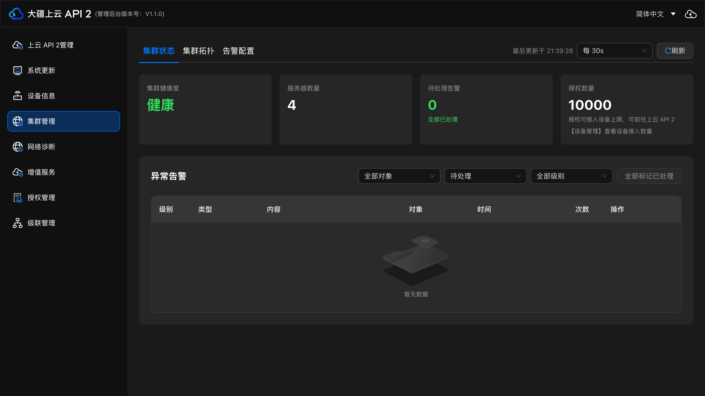

**集群指标：**

| 指标 | 说明 |
|---|---|
| 集群健康度 | 健康 / 降级 / 异常。健康：一切正常；降级：有工作服务器离线，仍可用；异常：管理服务器冗余不足或授权异常，需立即处理 |
| 服务器数量 | 当前集群服务器数量（含管理 / 工作及离线数） |
| 待处理告警 | 当前未处理的告警数量（严重 / 提醒） |
| 授权数量 | 授权可接入的设备上限。实际已接入设备数量请前往「设备管理」查看 |

**异常告警列表：**

| 项目 | 说明 |
|---|---|
| 级别 | 严重（需立即处理）/ 提醒（建议提前介入） |
| 类型 | 集群健康度下降、服务器离线、授权异常、资源占用过高 |
| 去重 | 同一台服务器的同一类问题只保留一条，重复触发只更新次数，避免刷屏 |
| 筛选 | 支持按处理状态（待处理 / 全部）、级别、对象（指定服务器）筛选 |
| 处理 | 支持单条「标记已处理」或「全部标记已处理」，处理后从待处理列表移除 |

### 7.3 集群拓扑

集群拓扑页面以卡片展示所有服务器，每张卡片直接显示：状态（在线 / 离线）、角色与算力、实时负载（CPU / 内存 / 存储 / 网络），以及告警标识（有待处理告警时卡片变色并显示数量）。

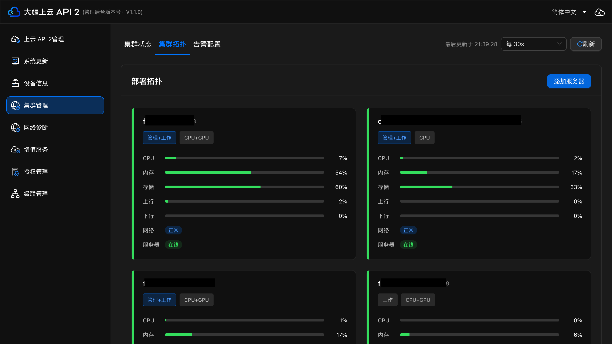

> **说明：** 服务器状态仅区分「在线 / 离线」；其他问题（授权异常、资源过高等）通过告警提示，并在卡片上体现，不单独作为服务器状态。

### 7.4 添加服务器（扩容）

在集群拓扑页面点击右上角的「添加服务器」，填写服务器 IP 与登录信息，点击「开始添加」，系统自动安装并加入集群，新机自动作为工作服务器。

> **说明：** 需授权可接入设备大于 20 台；登录凭据仅用于本次接入，不保存。

### 7.5 服务器详情

点击服务器卡片进入服务器详情，查看基础信息、硬件规格、实时负载，以及可执行的服务器运维操作。

### 7.6 服务器运维操作

在服务器详情页面，可以移除服务器、替换服务器、变更 IP。

| 操作 | 说明 | 前提 / 注意 |
|---|---|---|
| 替换服务器 | 用新机器接管故障 / 退役服务器。管理服务器自动保障不中断；授权服务器需人工重新申请授权，系统确认就绪后再切业务；工作服务器离线或退役时替换 | 停服操作，建议维护窗口；授权申请为线下人工动作 |
| 移除服务器 | 将工作服务器下线 | 仅工作服务器可移除；集群至少保留 3 台；管理 / 授权服务器不可直接移除 |
| 变更服务器 IP | 服务器 IP 不能在线直接改，系统按停服 + 自动化方式变更，只需填新 IP | 停服操作；先检查新地址可用，通过后才变更；离线服务器走「移除 + 重加」或「替换」 |

> **说明：** 添加、替换、变更 IP 均为自动化流程，带分步进度；可导出日志；失败或中断可回滚（含进度反馈）；关键阶段不可中断，请等待完成。

### 7.7 注意事项

- 停服操作（移除 / 替换 / 变更 IP）会中断相关业务，请在维护窗口执行，执行前有二次确认。
- 集群至少保留 3 台服务器；添加服务器需授权数量大于 20 台。
- 授权服务器换机需线下重新申请并安装授权。
- 服务器角色、算力类型由系统自动分配，不支持手动修改。
- 安全保障：高风险操作均二次确认，失败可回滚，涉及业务切换时先检查通过再动业务，现有集群不受影响。

## 8. Prometheus 自定义指标与告警修改

适用对象：使用容器部署的 Prometheus + Alertmanager；需要在上云 API 2 安装包里修改自定义指标阈值、增删规则、验证生效和排错。

### 8.1 流程概述

1. 备份 monitor-cn.yml / monitor-en.yml
2. 修改 expr / labels / annotations（**保留 groups: 顶层结构**）
3. 在**中文和英文**两份文件中做同样修改
4. docker exec prometheus **热加载**
5. 验证规则加载、指标数值、告警触发、Alertmanager 接收、webhook 通知全链路

### 8.2 文件路径及配置

规则文件路径：

```
${INSTALLATION_PATH}/conf/middleware-service/prometheus/rules
```

包含 `monitor-cn.yml`（中文）和 `monitor-en.yml`（英文）两份文件，**强烈建议**两边同步修改。

### 8.3 常用：修改阈值（以 DiskTemperature 为例）

```bash
# 进入规则目录
cd ${INSTALLATION_PATH}/conf/middleware-service/prometheus/rules

# 备份（强烈建议）
cp monitor-cn.yml monitor-cn.yml.bak.$(date +%Y%m%d%H%M%S)
cp monitor-en.yml monitor-en.yml.bak.$(date +%Y%m%d%H%M%S)

# 编辑
vim monitor-cn.yml
```

修改 `expr` 字段中的阈值后，热加载生效：

```bash
docker exec -it prometheus sh -lc 'wget -qS -O- --method=POST http://localhost:9090/-/reload || true'
```

### 8.4 其他可修改项

- **严重等级**：`labels.severity: warning | critical`
  与 Alertmanager 的 inhibit_rules、分流策略有关（配置里的 critical 会抑制同组 warning）。

- **告警文案**：`annotations.summary` / `annotations.description` 支持模板：
  - `{{ $labels.disk_name }}` 插入标签值
  - `{{ $value }}` 插入当前数值

- **分组相关标签（影响去重 / 合并）**：Alertmanager 使用
  ```
  group_by: ['alertname','instance','job','raid_name','disk_name','lang']
  ```
  同组内的告警会合并发送，字段一致才视为「同一组」。

### 8.5 完整示例（中文规则）

> **注意：** 请确认你的文件顶层是 `groups:`，否则 Prometheus 不会加载！

```yaml
# monitor-cn.yml
groups:
- name: raid_alerts
  rules:
  - alert: DiskUsage
    expr: disk_usage > 90
    for: 30s
    labels:
      severity: warning
      lang: cn
      group: raid
      grafana_url: "/d/8CWBzd1f0bik000"
    annotations:
      summary: "RAID 磁盘 {{ $labels.disk_name }} 空间不足，建议在上云 API 2 中清理过期数据"
      description: "RAID 磁盘 {{ $labels.disk_name }} 空间不足，建议在上云 API 2 中清理过期数据"

  - alert: DiskTemperature
    expr: disk_temperature > 50
    for: 30s
    labels:
      severity: warning
      lang: cn
      group: raid
      grafana_url: "/d/8CWBzd1f0bik000"
    annotations:
      summary: "RAID 磁盘 {{ $labels.disk_name }} 温度过高，请检查风扇运行状态及环境温度"
      description: "RAID 磁盘 {{ $labels.disk_name }} 温度过高，请检查风扇运行状态及环境温度"

  - alert: DiskErrCode
    expr: disk_status > 0
    labels:
      severity: critical
      lang: cn
      group: raid
      grafana_url: "/d/8CWBzd1f0bik000"
    annotations:
      summary: "磁盘 {{ $labels.disk_name }} 异常，请至磁盘管理界面查看具体信息。错误码：{{ $value }}"
      description: "磁盘 {{ $labels.disk_name }} 异常，请至磁盘管理界面查看具体信息。错误码：{{ $value }}"
```

同步更新 `monitor-en.yml`，确保英文环境下信息一致。

### 8.6 如何验证新规则已生效

下列命令都在宿主机命令行内执行，把容器名改成实际名称（默认 prometheus / alertmanager）。

**1. 看 Prometheus 是否加载了规则**

```bash
docker exec -it prometheus sh -lc \
'wget -qO- http://localhost:9090/api/v1/rules | tr "," "\n" | egrep -n "name|file|DiskUsage|DiskTemperature|DiskErrCode|raid_alerts"'
```

**2. 看指标有没有数据（实时）**

```bash
docker exec -it prometheus sh -lc '
for q in up disk_temperature disk_usage disk_status; do
  echo "\n== $q =="; wget -qO- "http://localhost:9090/api/v1/query?query=$q";
done'
```

- 如果 `up` 有值，说明目标抓取正常；
- 如果 `disk_*` 有值，说明业务指标在进来。

**3. 看告警是否进入 pending / firing**

```bash
docker exec -it prometheus sh -lc 'wget -qO- http://localhost:9090/api/v1/alerts'
```

**4. 看 Alertmanager 是否收到了**

```bash
docker exec -it alertmanager sh -lc 'wget -qO- http://localhost:9093/api/v2/alerts'
```

**5. 快速验证 WebHook 配置的有效性**

放一条「必然触发」的测试规则（改完 reload）：

```yaml
# 追加到任意规则文件
groups:
- name: _smoke_test_
  rules:
  - alert: SmokeTestAlwaysFire
    expr: vector(1)
    for: 0s
    labels:
      severity: critical
      job: fh-system-devops
      raid_name: test
      disk_name: test
      lang: cn
    annotations:
      summary: "Smoke test firing"
```

热加载后，`/api/v1/alerts` 和 Alertmanager 应立即出现该告警，webhook 应立刻收到通知。

### 8.7 新增一条自定义告警（示例）

假设你新增一个指标 `disk_iops`，希望 IOPS > 2000 告警：

```yaml
groups:
- name: raid_alerts
  rules:
  - alert: DiskHighIOPS
    expr: disk_iops > 2000
    for: 1m
    labels:
      severity: warning
      lang: cn
      group: raid
      grafana_url: "/d/8CWBzd1f0bik000"
    annotations:
      summary: "RAID 磁盘 {{ $labels.disk_name }} IOPS 过高"
      description: "当前 IOPS = {{ $value }}，请检查是否有异常读写负载。"
```

保存后 reload，用 `/api/monitor/metrics` 确认指标存在后会触发 / 验证。请注意，新增的自定义告警的指标项，必须要有一个对应的指标上报源，否则 Prometheus 没得到指标就无从触发告警。

### 8.8 命令速查（容器环境）

```bash
# 规则热加载
docker exec -it prometheus sh -lc 'wget -qS -O- --method=POST http://localhost:9090/-/reload || true'
docker exec -it alertmanager sh -lc 'wget -qS -O- --method=POST http://localhost:9093/-/reload || true'

# 看规则 / 告警
docker exec -it prometheus sh -lc 'wget -qO- http://localhost:9090/api/v1/rules'
docker exec -it prometheus sh -lc 'wget -qO- http://localhost:9090/api/v1/alerts'
docker exec -it alertmanager sh -lc 'wget -qO- http://localhost:9093/api/v2/alerts'

# 看指标
docker exec -it prometheus sh -lc 'wget -qO- "http://localhost:9090/api/v1/query?query=up"'
docker exec -it prometheus sh -lc 'wget -qO- "http://localhost:9090/api/v1/query?query=disk_temperature"'

# 看采集目标与错误
docker exec -it prometheus sh -lc \
'wget -qO- "http://localhost:9090/api/v1/targets?state=active" | tr "," "\n" | egrep -i "job|lastScrape|health|lastError|scrapeUrl"'

# Alertmanager 发送统计（是否有发送 / 失败）
docker exec -it alertmanager sh -lc \
'wget -qO- http://localhost:9093/metrics | egrep "^alertmanager_notifications_total|^alertmanager_notifications_failed_total" | sort'
```

### 8.9 常见问题（必读）

**1. 改了阈值，但迟迟不触发**

- 检查 `evaluation_interval`（45s）和 `for`（例如 30s）。首次评估满足 → pending，到**下一次评估**才会变 firing。
- 测试时可临时去掉 `for`，确保表达式没写错。

**2. 改了 yml，但好像没生效**

- 规则文件**必须有顶层 `groups:`**；
- 后缀要是 `.yml`（你的 rule_files 只匹配 `.yml`）；
- 改完要 reload Prometheus（或者重启容器）；
- 在 Prometheus 容器内 `ls -l /prometheus/rules` 确认你改的就是容器里的那份。

**3. Prometheus / Alertmanager 在容器里，如何 reload？**

```bash
docker exec -it prometheus sh -lc 'wget -qS -O- --method=POST http://localhost:9090/-/reload || true'
docker exec -it alertmanager sh -lc 'wget -qS -O- --method=POST http://localhost:9093/-/reload || true'
```

**4. Alertmanager 为什么不重复发？**

- 重复提醒间隔由 `repeat_interval` 控制（当前默认的间隔时间是 **72h**）。测试时可临时改成 30s 或 1m，改完 reload Alertmanager。

**5. Webhook 端没收到告警，但手动 curl webhook 能触发**

- 可能是 Alertmanager 的去重 / 已发送记录（nflog）导致「认为还没到重复发送时间」。
- 快速 workaround：给告警临时加一个新标签（例如 `rule_rev: "test1"`）改变指纹，或**清理 Alertmanager 数据目录的 nflog** 后重启（操作前先备份）。

**6. Prometheus 查询全是空，但 targets 显示 up**

- 时间跑到未来写入了「未来样本」，后续时钟回拨导致**新样本被丢弃**（常见报错 out of bounds）。
- 处理思路：暂停 Prometheus 后备份并清理 **WAL + chunks_head**（必要时移动整个 /prometheus/data），重新启动后恢复正常。确保宿主机开启 NTP，同步时间。

## 下一步

底座部署完成后，请继续：[设备上云](../06.device-onboarding/00.index.md)
