# 上云 API 2 & 上云 API MQTT 桥接配置说明文档

> **目标**：给出一条可复制、可验证的 MQTT Bridge 接入路径——设备只连上云 API 2 侧 Broker（146），集成商业务只连自有 Broker（152），两者之间由桥接按 Topic 白名单转发。覆盖：
> 1. 桥接配置、启动与重启持久化
> 2. 上下行链路验证
> 3. 运维类场景：远程调试 / 静音、HMS 告警、直播码流、远程日志
> 4. 飞行类场景：一键起飞、flyto、拍照录像、返航、航线任务
> 5. 排障速查
>
> **说明**：本文命令中的环境相关参数（IP / SN / 容器名 / 凭据 / 经纬度）均以 `{参数名}` 形式的占位符给出，**复制后须按文末「环境参数表」连同花括号一起替换为你的实际环境参数，再执行**。其中**凭据类**（EMQX 管理口令、minio 密钥、broker 密码）一律不写入本文，执行时用文中给出的命令现取现填。
>
> ⚠️ **版本适用范围**：本文命令面向 **V1.0.0（docker 底座）**，所列场景与命令**仅在 DJI 环境中实测验证**。面向 **V1.1.0（k3s 底座）** 的文档仍在整理中，两个版本的执行命令存在差异，因此本文命令请在 V1.0.0 环境验证；文中未覆盖的功能与场景不在验证范围内，实际使用时请结合自身环境与业务场景自行验证确认。
>
> ⚠️ **重装前请备份**：重新安装上云 API 2 后，桥接配置文件 `emqx_bridge_mqtt.conf` 会被覆盖为默认值。重装前请备份该文件；重装后按 §3.4 复核桥接状态，并确认 §10.4 的 `reply` 桥与过滤规则仍然生效。
>
> ⚠️ **暂不支持的场景**：双云架构下，媒体存储、自定义飞行区、组织 / 绑定数据等 `requests` 类请求只能由上云 API 2 平台应答，集成商侧暂无法接管。方案选型前请先阅读 §11。

---

## 0. 链路模型

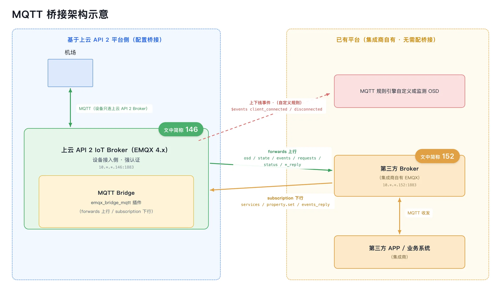

**图例**：左侧蓝色虚线区为基于上云 API 2 的平台侧（在此配置桥接）；右侧橙色虚线区为集成商已有平台（自有 Broker + 业务系统，无需配桥接）。绿色为设备上行数据（forwards）、橙色为业务下行命令（subscription）、红色虚线为设备上下线事件（由规则引擎按 `$events` 主题自定义转发）。

三个关键事实：

1. **设备只连 146**，不连 152。桥接插件 `emqx_bridge_mqtt` 只装在 146 侧，转发与订阅规则也都配在 146。152 侧无需任何插件。
2. **命令一律发给网关（机场）SN**，消息体 `gateway` 字段也填机场 SN。控制飞机（子设备）时用 `video_id` / `payload_index` 区分，topic 仍走机场 SN。
3. **HMS 告警、各类进度事件是设备→云方向**，只需订阅 `events`，无需下发。

---

## 1. 前置条件

| # | 检查项 | 确认方式 | 通过标准 |
|---|---|---|---|
| 1 | 桥接上行已通 | **152** 订阅 osd（见 §3.2） | 持续收到 osd 报文 |
| 2 | 下行覆盖 `services` / `property/set` | **146** `emqx_ctl bridges subscriptions aws` | 含这两条 topic |
| 3 | 上行覆盖 `services_reply` / `events` / `property/set_reply` | **146** `emqx_ctl bridges forwards aws` | 本环境实测 forwards=7 |
| 4 | EMQX 版本 | **146** `docker exec emqx emqx_ctl status \| head -1` | 4.3.5 |
| 5 | 机场 / 飞机在线 | **152** 订阅 osd，看 `mode_code`、`drone_in_dock` | 机场在线；直播 / 拍照 / 飞行需飞机通电 |
| 6 | 飞行控制权在机场 | 无 Pilot 抢占；必要时先发 `flight_authority_grab` | reply `result=0` |
| 7 | （直播）152 有媒体服务器 | **152** `docker ps \| grep srs` | SRS 在 1935 / 1985 / 8088 |
| 8 | （日志）146 minio 可写 | 146 运维界面取账号 / 端口 | 拿到 access key / secret / endpoint |
| 9 | （飞行）电量 | **152** 看 osd 电量字段 | 建议 ≥ 50% |

> 🛑 **安全红线（飞行类场景）**：§9、§10 会让真机起飞。
> - 首轮**强烈建议**开 `simulate_mission` 模拟器模式，并**物理取下桨叶**（防舱盖夹桨）；
> - 否则必须在空旷合规场地、有人现场看护，随时可 `return_home_cancel` 或急停。

---

## 2. 通用下发 / 观测方法

> **执行环境约定**（每个命令块已单独标注）
> - **152**：下发命令、订阅回包 / 事件 / 遥测——连 152 broker（`10.*.*.152:1883`）。**152 即可，无需登 146**。
> - **146 宿主**：查看 / 变更桥接、注入测试数据（`emqx_ctl` / admin API）——须 SSH 到 146（`{SSH_USER}@{146_HOST}`）、进 emqx 容器。
> - 日常操作 99% 在 152 侧，146 只在核对 / 补桥接订阅时才碰。
> - 毫秒时间戳用 `$(date +%s000)`；复杂 payload 用 heredoc 写 `/tmp` 再 `-f` 发送（容器需挂 `-v /tmp:/tmp`）。
> - 152 broker 默认开匿名；若连接被拒，补账号参数 `-u {BROKER_USER} -P {BROKER_PASSWORD}`（demo bridge 固定账号）。
> - 本机跑 `eclipse-mosquitto` 需 Docker 守护在运行（Mac 上 `colima start`）。

### 2.1 观测终端（常驻，先起）　**执行环境：152**

```bash
DOCK_SN={DOCK_SN_SIM}
docker run --rm --network host eclipse-mosquitto mosquitto_sub \
  -h 10.*.*.152 -p 1883 -V mqttv311 -v \
  -t "thing/product/$DOCK_SN/services_reply" \
  -t "thing/product/$DOCK_SN/property/set_reply" \
  -t "thing/product/$DOCK_SN/events" \
  -t "thing/product/$DOCK_SN/osd"
```

### 2.2 消息体固定结构

```json
{
  "tid": "{事务ID，全局唯一}",
  "bid": "{业务ID，全局唯一}",
  "timestamp": 1700000000000,
  "gateway": "{DOCK_SN_SIM}",
  "method": "{方法名}",
  "data": { }
}
```

> ⚠️ **例外**：`property/set` 的属性设置消息**没有 `method` 字段**，通常也不带 `gateway`。

### 2.3 通用下发模板　**执行环境：152**

```bash
DOCK_SN={DOCK_SN_SIM}
docker run --rm --network host eclipse-mosquitto mosquitto_pub \
  -h 10.*.*.152 -p 1883 -V mqttv311 -q 1 \
  -t "thing/product/$DOCK_SN/services" \
  -m "{\"tid\":\"t-1\",\"bid\":\"b-1\",\"timestamp\":$(date +%s000),\"gateway\":\"$DOCK_SN\",\"method\":\"{方法名}\",\"data\":{}}"
```

### 2.4 下发即等回包（`mosquitto_rr`）　**执行环境：152**

```bash
docker run --rm --network host eclipse-mosquitto sh -c '
SN={DOCK_SN_SIM}
mosquitto_rr -h 10.*.*.152 -p 1883 \
  -t "thing/product/$SN/services" \
  -e "thing/product/$SN/services_reply" \
  -m "{\"tid\":\"t1\",\"bid\":\"b1\",\"timestamp\":1700000000000,\"method\":\"{方法名}\",\"data\":{}}"
'
```

---

## 3. 场景一：桥接配置、启动与链路验证

**目的**：在 146 侧配好桥接，并用命令级证据确认上下行双向可达。

### 3.1 146 侧配置与启动　**执行环境：146 宿主**

```bash
# 加载桥接插件（4.x 中这是持久化操作，会写进 data/loaded_plugins）
docker exec emqx emqx_ctl plugins load emqx_bridge_mqtt

# 确认插件已激活
docker exec emqx emqx_ctl plugins list | grep -i bridge_mqtt      # 期望 active=true

# 核对桥接状态与规则条数
docker exec emqx emqx_ctl bridges list                            # 见 aws（Running）
docker exec emqx emqx_ctl bridges forwards aws                    # 本环境 7 条
docker exec emqx emqx_ctl bridges subscriptions aws               # 本环境 3 条

# 确认版本（4.3.5）
docker exec emqx emqx_ctl status | head -1
```

桥接关键配置（`emqx_bridge_mqtt.conf`）：

```ini
bridge.mqtt.aws.address  = 10.*.*.152:1883
bridge.mqtt.aws.username = {BROKER_USER}
bridge.mqtt.aws.password = {152_BROKER_PASSWORD}

# 关键：EMQX 重启后桥接自动拉起
bridge.mqtt.aws.start_type = auto

# ⚠️ forward_mountpoint 留空不被 4.3 接受，不用就整行注释，不要赋空值
# bridge.mqtt.aws.forward_mountpoint =
```

- **forwards（上行，7 条）**：`osd` / `state` / `events` / `requests` / `services_reply` / `status` / `property.set_reply`
- **subscription（下行，3 条）**：`services` / `property.set` / `events_reply`

单独补一条下行订阅（例如漏配了 `events_reply`）：

```bash
docker exec emqx emqx_ctl bridges add-subscription aws 'thing/product/+/events_reply' 1
docker exec emqx emqx_ctl bridges subscriptions aws               # 核对已生效
```

> ⚠️ `add-subscription` 是运行时操作。**重启后务必复核一次**，必要时同步写进 `emqx_bridge_mqtt.conf`。

### 3.2 上行链路验证（146 → 152）　**执行环境：152**

思路：有设备在线时，直接在 152 订阅设备 osd，看 146 的遥测是否实时穿过桥接——这是上行最简的**纯 MQTT 决定性验证**。

```bash
docker run --rm --network host eclipse-mosquitto mosquitto_sub \
  -h 10.*.*.152 -p 1883 -V mqttv311 -u {BROKER_USER} -P {BROKER_PASSWORD} -v \
  -t 'thing/product/{DOCK_SN_SIM}/osd'
```

**验收**：持续打印 `thing/product/{DOCK_SN_SIM}/osd` 报文（约 0.5Hz）。

**实操命令效果**

1、152 侧持续收到 146 透过桥接送来的 osd

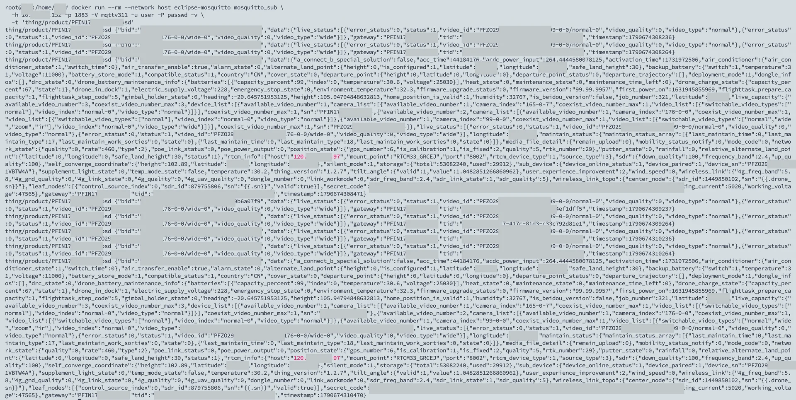


### 3.3 下行链路验证（152 → 146）

**146**：开 trace（验后务必关，改回 notice）

```bash
docker exec emqx emqx_ctl log set-level debug
docker exec emqx emqx_ctl trace start topic 'thing/product/{DOCK_SN_SIM}/services' /tmp/trace_services.log
```

**152**：发一条测试 services

```bash
docker run --rm --network host eclipse-mosquitto mosquitto_pub \
  -h 10.*.*.152 -p 1883 -V mqttv311 \
  -t 'thing/product/{DOCK_SN_SIM}/services' -m '{"bridge_test":"downlink","ts":2}'
```

**146**：读 trace。⚠️ trace 文件写在 **emqx 容器内**的 `/tmp`（**不在宿主机 `/tmp`**）

```bash
docker exec emqx cat /tmp/trace_services.log
# 实时看：docker exec emqx tail -f /tmp/trace_services.log
# 导到宿主机：docker cp emqx:/tmp/trace_services.log /tmp/
```

见到该 `downlink` 消息 → **下行通**。随后关 trace：

```bash
docker exec emqx emqx_ctl trace stop topic 'thing/product/{DOCK_SN_SIM}/services'
docker exec emqx emqx_ctl log set-level notice
```

> ⚠️ 若 146 上同时还有别的 trace 在用 debug 级别，`log set-level notice` 会中断它们，酌情保留 debug。

**验收**：上行的 osd 在 152 可见 **且** 下行 services 在 146 trace 可见 = 桥接配置正确。

**实操命令效果**

1、152 发送测试 services 命令

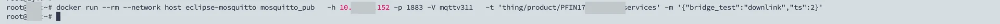

2、146 检查 trace 日志打印，确认消息抵达后关闭 trace

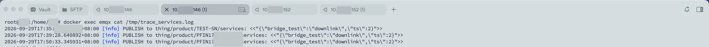


### 3.4 重启后桥接还在不在

`emqx_ctl plugins load` 是持久化操作，会把插件记进 `data/loaded_plugins`，EMQX 启动时重读并自动加载。**重启不失效需同时满足三个条件**：

| # | 条件 | 核对命令 146 |
|---|---|---|
| 1 | `data/loaded_plugins` 含 `emqx_bridge_mqtt`，且 `data/` 在持久卷上 | `docker exec emqx cat /opt/emqx/data/loaded_plugins` |
| 2 | `emqx_bridge_mqtt.conf` 在持久卷上 | `docker inspect emqx --format '{{json .Mounts}}'` |
| 3 | `bridge.mqtt.aws.start_type = auto` | 查配置文件 |

> ⚠️ 容器化部署最常见的翻车点是第 1、2 条：`data/` 或 conf 没挂持久卷，容器一重建配置就回到镜像默认值，桥接配置失效。本环境实测过：**146 整机重装会把 EMQX 打回 4.3.5 并恢复默认桥接配置**，重装后必须重新配置并复核版本。

---

## 4. 能力边界与三条硬性规则

### 4.1 桥接做不到什么

**(1) 设备上下线事件，桥接转发不了。**
上下线是 EMQX 的**系统 Topic**（`$events/client_connected` / `$events/client_disconnected`），MQTT 桥接无法转发。替代方案：配 Webhook；或用规则引擎把系统事件改写到自定义普通 Topic 再加进 forwards；或监测 osd 到达情况间接判断。

**(2) 漏配一条 Topic，那类消息就彻底到不了。** 典型后果：

| 漏配 | 后果 |
|---|---|
| `events` | 命令回包收得到，但所有 `*_progress` 一条都看不到，任务像是卡住 |
| `property/set` | 静音等属性设置下发后毫无反应 |
| `property/set_reply` | 属性设置的回包收不到，无法确认是否生效 |
| `events_reply` | 日志 / 媒体上传终态机场收不到 ack，会重发几次 |

**(3) 仿真设备不提供真实硬件能力。** 本环境机场 `{DOCK_SN_SIM}` 的 `peername=10.0.2.1`（VirtualBox NAT 网段），为仿真设备。直播等依赖真实摄像头 / 传感器的能力需用真机验证，`services_reply` 须逐条实测确认。

**(4) 双云场景下，部分 `requests` 请求的应答由平台侧固定产生，集成商无法接管。** 影响自有对象存储、自定义飞行区等场景——见 §11。

### 4.2 三条硬性规则

**规则一：白名单必须显式枚举。** 可用 `+` 通配设备 SN，但不要用 `thing/product/#` ——那会让上下行集合失去控制，直接违反规则二。

**规则二：`forwards ∩ subscriptions = ∅`。** 上行集合与下行集合**不能有交集**。一旦同一 Topic 既在 forwards 又在 subscription，会形成环路；更隐蔽的是**同一个 `tid` 出现两个应答源**。这正是"配了桥接反而设备上不了云"的根因（见 §12 Q5）。

> **唯一例外**：真机航线任务需要集成商应答 `flighttask_resource_get`。处理方式**不是**放宽 `aws` 桥的 subscription，而是另起一条只下行的专用桥 + 规则引擎白名单，把放行范围收窄到单个 method——见 §10.4。规则二本身依然成立。

**规则三：方向不能搞反。**

- `services` / `property/set` 是**你发给设备**的 → 下行 subscription
- `services_reply` / `events` / `osd` 是**设备发给你**的 → 上行 forwards
- `events_reply` 是**你 ack 设备**的 → 下行 subscription

---

## 5. 场景二：远程调试模式 / 静音模式

**协议**：远程调试走 `/services`，method `debug_mode_open` / `debug_mode_close`，data 空；静音走 `/property/set` 设 `silent_mode`（0/1），**属性设置消息无 `method` 字段**。

### 5.1 开 / 关远程调试　**执行环境：152**

```bash
DOCK_SN={DOCK_SN_SIM}

# 打开远程调试
docker run --rm --network host eclipse-mosquitto mosquitto_pub \
  -h 10.*.*.152 -p 1883 -V mqttv311 -q 1 \
  -t "thing/product/$DOCK_SN/services" \
  -m "{\"tid\":\"t-dbg-1\",\"bid\":\"b-dbg-1\",\"timestamp\":$(date +%s000),\"gateway\":\"$DOCK_SN\",\"method\":\"debug_mode_open\",\"data\":{}}"

# 关闭远程调试（把 method 换成 debug_mode_close）
docker run --rm --network host eclipse-mosquitto mosquitto_pub \
  -h 10.*.*.152 -p 1883 -V mqttv311 -q 1 \
  -t "thing/product/$DOCK_SN/services" \
  -m "{\"tid\":\"t-dbg-2\",\"bid\":\"b-dbg-2\",\"timestamp\":$(date +%s000),\"gateway\":\"$DOCK_SN\",\"method\":\"debug_mode_close\",\"data\":{}}"
```

### 5.2 开 / 关静音模式（属性设置）　**执行环境：152**

```bash
DOCK_SN={DOCK_SN_SIM}

# 开静音（关静音把 silent_mode 改 0）
docker run --rm --network host eclipse-mosquitto mosquitto_pub \
  -h 10.*.*.152 -p 1883 -V mqttv311 -q 1 \
  -t "thing/product/$DOCK_SN/property/set" \
  -m "{\"tid\":\"t-sil-1\",\"bid\":\"b-sil-1\",\"timestamp\":$(date +%s000),\"data\":{\"silent_mode\":1}}"
```

**验收**：
- `services_reply`（调试）/ `property/set_reply`（静音）`result = 0`；
- osd 里 `silent_mode` 由 0→1；远程调试开启后 osd `mode_code` 变化；
- 快速核验静音：

```bash
docker run --rm --network host eclipse-mosquitto mosquitto_sub \
  -h 10.*.*.152 -p 1883 -V mqttv311 -v -t "thing/product/+/osd" \
 | grep --line-buffered -o '"silent_mode":[0-9]*'
```

- 亦可在 146 前端组件（设备管理）看仓盖 / 静音状态变化。

> ⚠️ **静音状态看 `osd`，不看 `state`。** 这是最常见的观测对象找错。

**实操命令效果**

1、打开远程调试，此时静音模式已处于打开态

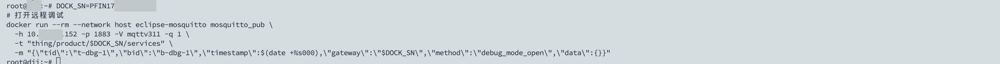

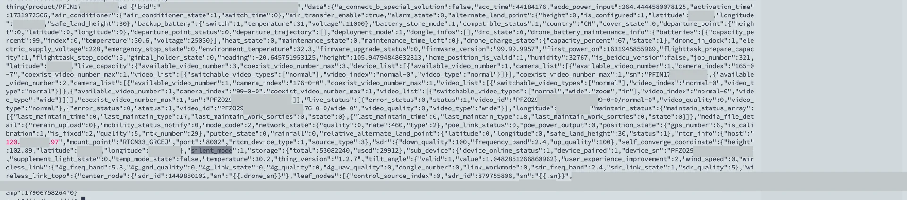

2、关闭静音模式（打开静音指令相同，仅参数不同）

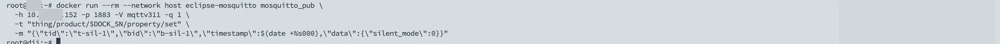

3、打开静音模式，并关闭远程调试

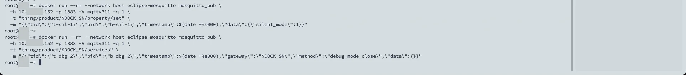

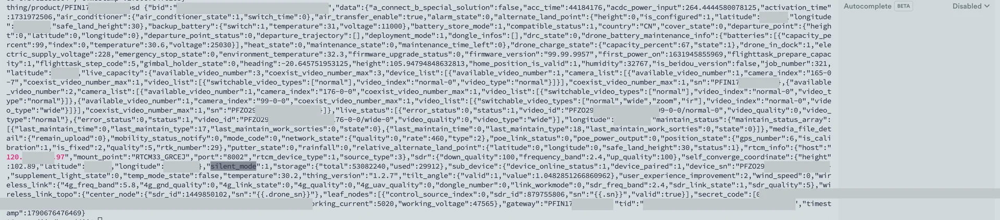


---

## 6. 场景三：接收机场 HMS 告警

**协议**：HMS 是**设备→云**事件，走 `thing/product/{DOCK_SN}/events`，`method = hms`，`data.list[]` 每条含 `code / level / module / in_the_sky / imminent / device_type / args`。**只需订阅接收，无下发命令。**

### 6.1 152 侧订阅接收　**执行环境：152**

```bash
DOCK_SN={DOCK_SN_SIM}
docker run --rm --network host eclipse-mosquitto mosquitto_sub \
  -h 10.*.*.152 -p 1883 -V mqttv311 -v \
  -t "thing/product/$DOCK_SN/events" \
 | grep --line-buffered -i hms
```

### 6.2 无真实故障时，在 146 注入一条告警验证链路　**执行环境：146 宿主**

先取 EMQX 管理凭据（**敏感，勿落文件**）：

```bash
docker exec emqx emqx_ctl mgmt list
```

再注入：

```bash
docker exec emqx curl -s -u {EMQX_ADMIN_USER}:{146_EMQX_ADMIN_HASH} \
  -X POST 'http://127.0.0.1:8081/api/v4/mqtt/publish' \
  -H 'Content-Type: application/json' \
  -d '{"clientid":"hms-injector","topic":"thing/product/{DOCK_SN_SIM}/events","qos":1,"payload":"{\"tid\":\"t-hms-1\",\"bid\":\"b-hms-1\",\"timestamp\":'"$(date +%s000)"',\"method\":\"hms\",\"data\":{\"list\":[{\"code\":\"0x16111115\",\"level\":1,\"module\":3,\"in_the_sky\":0,\"imminent\":0,\"device_type\":\"3-3-0\",\"args\":{}}]}}"}'
```

**验收**：152 订阅端收到 `method:hms` 且 `data.list[].code` 与注入一致；sample DB `manage_device_hms` 新增该记录 → HMS 链路（上行 events）通。

**实操命令效果**

1、152 订阅接收 HMS 告警信息

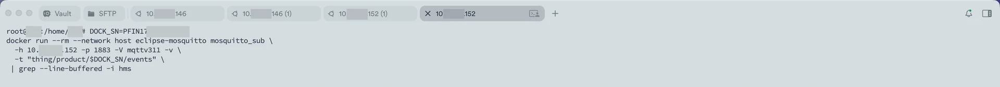

2、146 注入 HMS 告警后，在 152 侧查看 events

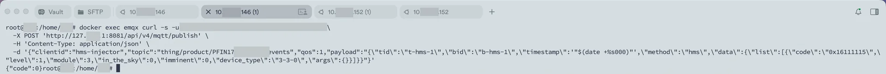

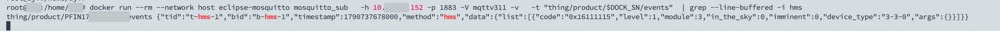

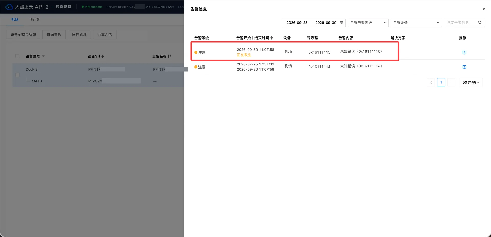


---

## 7. 场景四：拉取机场 / 无人机直播码流

比前面多一个**硬前置**：152 侧需有 RTMP 媒体服务器（SRS），且机场能访问到该地址。

> **本节命令用真机 SN `{DOCK_SN}`**：直播依赖真实摄像头，仿真设备不提供视频源（见 §4.1-3），故本节须在真机上验证。

### 7.1 152 安装并启动 SRS　**执行环境：152**

```bash
# 有网 Mac 拉取导出（强制 amd64）→ scp 到 152 → load 启动
docker pull --platform linux/amd64 ossrs/srs:5
docker save ossrs/srs:5 -o /tmp/srs5.tar && scp /tmp/srs5.tar {SSH_USER}@10.*.*.152:/home/{SSH_USER}/

# 152 上：
docker load -i /home/{SSH_USER}/srs5.tar
docker run -d --name srs --restart unless-stopped \
  -p 1935:1935 -p 1985:1985 -p 8088:8080 -p 8000:8000/udp ossrs/srs:5
docker ps | grep srs
```

> ⚠️ **本环境 SRS 的 HTTP 实际映射在宿主 8088**（容器内 8080）。拉流地址用 8088，不是 8080。

### 7.2 取 `video_id`（格式 `SN/camera_index/video_index`）　**执行环境：152**

设备把可推流能力上报在 osd 里，`device_list[].camera_list[].video_list[]` 同时列出机场与飞机的相机。

```bash
docker run --rm --network host eclipse-mosquitto mosquitto_sub \
  -h 10.*.*.152 -p 1883 -V mqttv311 -u {BROKER_USER} -P {BROKER_PASSWORD} -v \
  -t 'thing/product/{DOCK_SN}/osd'
# 在输出里找 camera_index 和 video_index，按 SN/camera_index/video_index 拼出 video_id
```

osd 的 camera_index 字段，机场与飞机相机均在其中

> ⚠️ **`video_id` 用 `camera_index`，不是 `payload_index`。** 机场相机是 `165-0-7`。
>
> ⚠️ **真机只有在飞机通电在线时才上报飞机的 `live_capacity`。** 若 osd 里 `sub_device.device_online_status = 0`，说明飞机离线，拿不到飞机 video_id——这不是桥接问题。本环境实测均出现过此情况。

### 7.3 开播 / 切清晰度 / 停播（纯 MQTT）　**执行环境：152**

机场相机常态通电，无需起飞飞机。如需拉飞机码流，先起飞飞机，再把 `VIDEO_ID` 和 `STREAM` 同步改成飞机的。

```bash
DOCK_SN={DOCK_SN}
VIDEO_ID="{DOCK_SN}/165-0-7/normal-0"
# ⚠️ 流名必须与 VIDEO_ID 对应，换相机时两个变量都要改，否则会推到错误的流上
STREAM="{DOCK_SN}-165-0-7"

# ① 开始推流（url_type=1 RTMP；url 指向 152 SRS）
docker run --rm --network host eclipse-mosquitto mosquitto_pub \
  -h 10.*.*.152 -p 1883 -V mqttv311 -q 1 \
  -t 'thing/product/{DOCK_SN}/services' \
  -m '{"tid":"t-live-1","bid":"b-live-1","timestamp":1710000000000,"method":"live_start_push","data":{"url_type":1,"url":"rtmp://10.*.*.152:1935/live/{DOCK_SN}-165-0-7","video_id":"{DOCK_SN}/165-0-7/normal-0","video_quality":0}}'


# ② 切清晰度（video_quality:0 自适应 / 1 流畅 / 2 标清 / 3 高清 / 4 超清）
SN={DOCK_SN}
docker run --rm --network host eclipse-mosquitto mosquitto_pub \
  -h 10.*.*.152 -p 1883 -V mqttv311 -q 1 \
  -t "thing/product/$SN/services" \
  -m "{\"tid\":\"t-video_quality-1\",\"bid\":\"b-video_quality-1\",\"timestamp\":1710000000000,\"method\":\"live_set_quality\",\"data\":{\"video_id\":\"$SN/165-0-7/normal-0\",\"video_quality\":2}}"


# ③ 停止推流
docker run --rm --network host eclipse-mosquitto mosquitto_pub \
-h 10.*.*.152 -p 1883 -V mqttv311 -q 1 -t 'thing/product/{DOCK_SN}/services' \
-m '{"tid":"t-stop-1","bid":"b-stop-1","timestamp":1,"method":"live_stop_push","data":{"video_id":"{DOCK_SN}/165-0-7/normal-0"}}'
```

**验收**：
- 三条 `services_reply` `result = 0`；
- SRS 侧有流：`curl -s http://10.*.*.152:1985/api/v1/streams/`（`publish.active=true`、`recv_bytes` 在涨）；
- 拉流播放：`http://10.*.*.152:8088/live/{DOCK_SN}-165-0-7.flv`；
- 播放页：`http://10.*.*.152:8088/players/srs_player.html`。

**失败排查**：

| 现象 | 判断 |
|---|---|
| reply `result` 非 0 | 看错误码；`video_id` 是否取自 `camera_index` |
| reply 受理成功，但 SRS `streams` 为空、`clients=0` | **设备未推流**。仿真设备不提供真实视频源，此类场景需用真机验证，非配置或流程错误 |
| SRS 有流但拉不动 | 端口用错（本环境是 8088 不是 8080），或流名与 `video_id` 不对应 |

---

**实操效果：**

1、开始直播

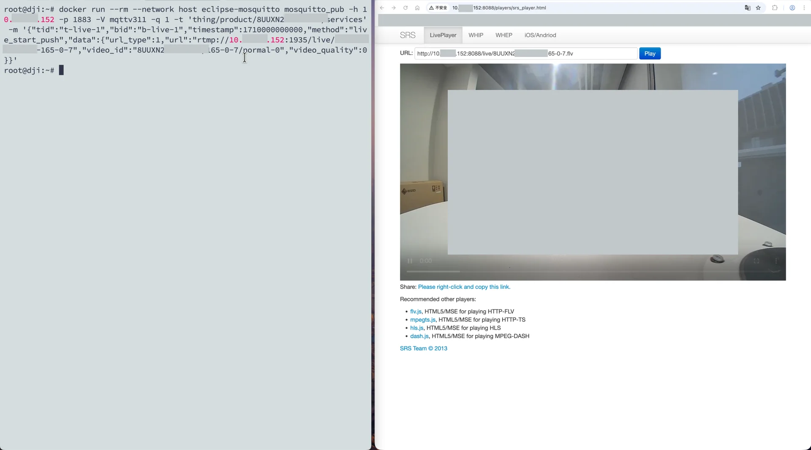

2、调制画面质量

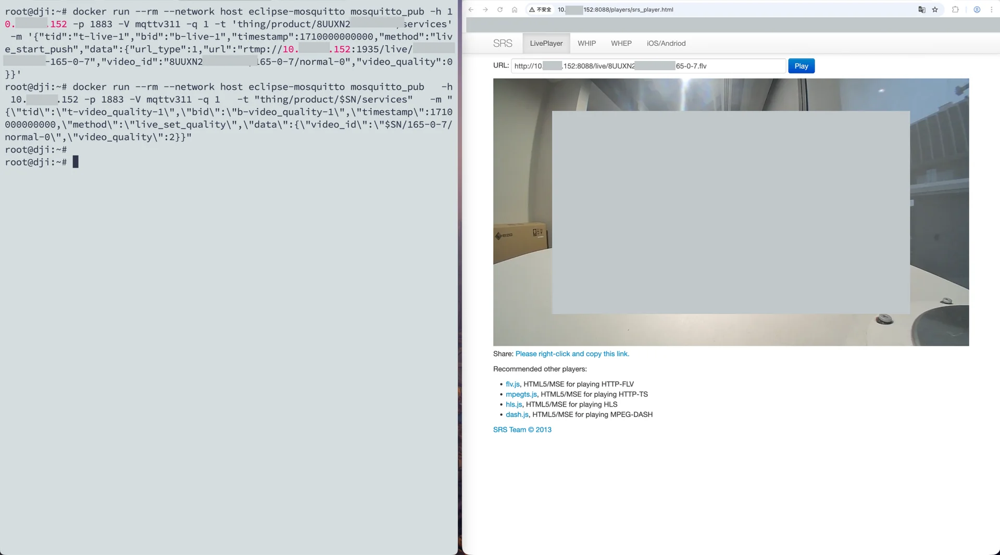

3、停止画面直播

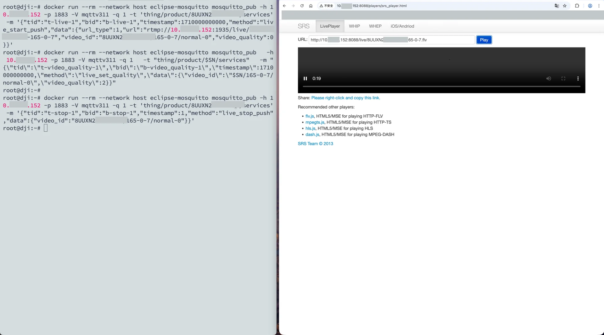


## 8. 场景五：远程拉取机场 / 无人机日志

**协议**：三步——`fileupload_list`（列可上传日志）→ `fileupload_start`（触发上传到对象存储）→ `events` 里 `fileupload_progress`（进度 / 终态）。上传目标是 **146 minio**。

**前置**：从 146 运维界面取 minio 账号 / 密钥。本环境 endpoint `http://10.*.*.146:30802`，bucket `file-storage-privatization`。

### 8.1 152 订阅进度　**执行环境：152**

```bash
DOCK_SN={DOCK_SN}
docker run --rm --network host eclipse-mosquitto mosquitto_sub \
  -h 10.*.*.152 -p 1883 -V mqttv311 -v \
  -t "thing/product/$DOCK_SN/services_reply" \
  -t "thing/product/$DOCK_SN/events"
```

### 8.2 获取日志列表　`fileupload_list`　**执行环境：152**

```bash
docker run --rm --network host eclipse-mosquitto sh -c '
SN={DOCK_SN}
mosquitto_rr -h 10.*.*.152 -p 1883 \
-t "thing/product/$SN/services" \
-e "thing/product/$SN/services_reply" \
-m "{\"tid\":\"t1\",\"bid\":\"b1\",\"timestamp\":1784976406616,\"method\":\"fileupload_list\",\"data\":{\"module_list\":[\"3\"]}}"
'
```

`module_list` 取值：`"3"` = 机场。**从回包里拿到 `boot_index` / `start_time` / `end_time` / `size`，填入下一步——不要照抄示例值。**

### 8.3 触发上传　`fileupload_start`　**执行环境：152**

```bash
cat > /tmp/start.json <<'EOF'
{"tid":"s1","bid":"s1","timestamp":1784976406616,"method":"fileupload_start","data":{"bucket":"file-storage-privatization","credentials":{"access_key_id":"{MINIO_ACCESS_KEY}","access_key_secret":"{MINIO_SECRET}","security_token":"","expire":2000000000000},"endpoint":"http://10.*.*.146:30802","file_store_dir":"device-logs/{DOCK_SN}","provider":"minio","file_type":"text_log","region":"us-east-1","params":{"files":[{"device_sn":"{DOCK_SN}","module":"3","object_key":"device-logs/{DOCK_SN}/19718.tar","list":[{"boot_index":19718,"start_time":1784645903,"end_time":1784647704,"size":1948839587,"tag":0}]}]}}}
EOF
docker run --rm --network host -v /tmp:/tmp eclipse-mosquitto   mosquitto_pub -h 10.*.*.152 -p 1883 -t "thing/product/{DOCK_SN}/services" -f /tmp/start.json
```

**验收**：

- `fileupload_list` 回包列出日志文件；
- `fileupload_start` 后 `events` 里 `fileupload_progress` 推进到终态（`status: ok` / `percent:100`）；
- 146 minio 的 `file-storage-privatization/device-logs/{DOCK_SN}/` 下出现日志文件。可在 146 上核对：

```bash
# 146
docker inspect minio --format '{{range .Mounts}}{{.Source}} -> {{.Destination}}{{println}}{{end}}' # 查看 minio 挂载地址
ls -l  /data/minio/data/file-storage-privatization/device-logs/{DOCK_SN}/19718.tar/
```

> ⚠️ **闭环提示**：日志上传终态走 `events_reply`，146 桥接下行须订阅 `events_reply`，否则机场会重发几次终态。本环境已配置。若缺失，146 补：
> ```bash
> docker exec emqx emqx_ctl bridges add-subscription aws 'thing/product/+/events_reply' 1
> ```

---

**实操命令效果**

1、获取设备日志列表，依赖 eclipse-mosquitto 的请求响应工具「mosquitto_rr」

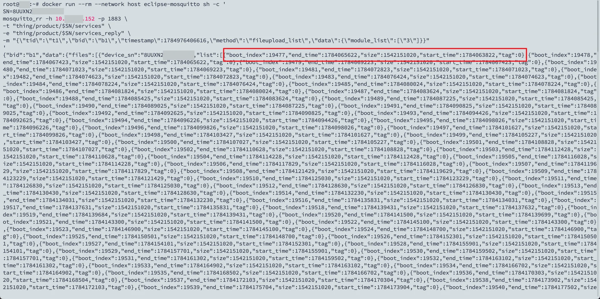

2、使用上云 API 2 的 minio 登录账号密码上传对应文件，展示上传进度

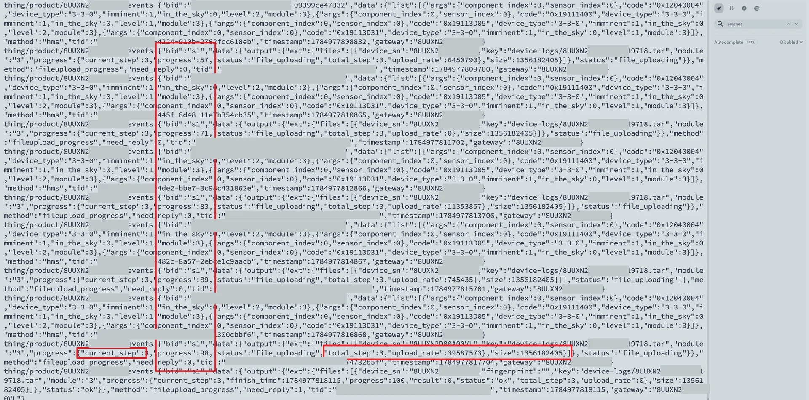

3、在 146 环境的 minio 查看上传的日志

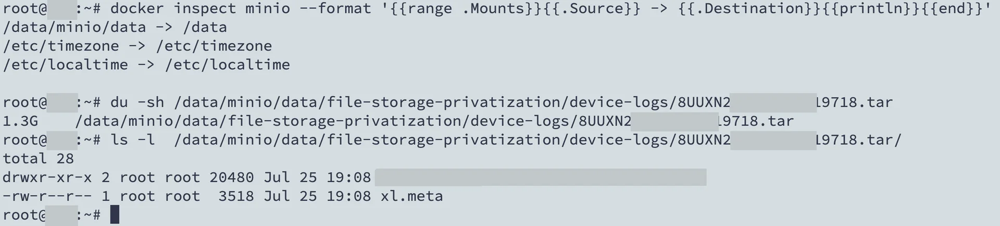


## 9. 场景六：飞行控制（起飞 / flyto / 拍照录像 / 返航）

> 🛑 先读 §1 的安全红线。以下操作会让真机起飞。
>
> **本节命令用仿真机 SN `{DOCK_SN_SIM}`**：配合 `simulate_mission` 模拟器模式先行验证命令与事件流程。真机执行时把 SN 换成 `{DOCK_SN}`，并按 §1 安全红线决定是否保留 `simulate_mission`。

### 9.1 一键起飞　`takeoff_to_point`　**执行环境：152**

**规范 data**：

```json
{
  "target_latitude": {纬度}, "target_longitude": {经度},
  "target_height": 100, "security_takeoff_height": 30, "rth_altitude": 100,
  "rc_lost_action": 0, "max_speed": 8, "flight_id": "{uuid}",
  "simulate_mission": {"is_enable": 1, "latitude": {纬度}, "longitude": {经度}}
}
```

| 字段 | 说明 |
|---|---|
| `target_height` | 目标点椭球高（WGS84） |
| `security_takeoff_height` | 先垂直升到该高度再平飞 |
| `flight_id` | 全局唯一，云端用于区分 / 染色本架次 |
| `simulate_mission` | 模拟器模式，首轮建议 `is_enable:1` |

**实操命令**（经纬度为本环境机场坐标，**实测须按现场替换**）：

```bash
DOCK_SN={DOCK_SN_SIM}
cat > /tmp/takeoff.json <<EOF
{"tid":"t-takeoff-2","bid":"b-takeoff-2","timestamp":$(date +%s000),"gateway":"$DOCK_SN","method":"takeoff_to_point","data":{"target_latitude":{LAT},"target_longitude":{LON},"target_height":100,"security_takeoff_height":30,"rth_altitude":100,"rc_lost_action":2,"max_speed":8,"flight_id":"fid-$(date +%s)","simulate_mission":{"is_enable":1,"latitude":{LAT},"longitude":{LON}}}}
EOF
docker run --rm --network host -v /tmp:/tmp eclipse-mosquitto mosquitto_pub \
  -h 10.*.*.152 -p 1883 -V mqttv311 -q 1 \
  -t "thing/product/$DOCK_SN/services" -f /tmp/takeoff.json
```

**验收**：
- `services_reply` 收到 `takeoff_to_point` 且 `result = 0`；
- `events` 收到 `takeoff_to_point_progress`，`status` 依次 `task_ready` → `wayline_progress` → `wayline_ok` / `task_finish`，`result = 0`；
- osd 里 `mode_code` 转飞行态、经纬高变化（模拟器下主要是高度变化）。

**失败排查**（此判据对所有场景通用）：

| 现象 | 原因 | 查哪里 |
|---|---|---|
| `services_reply` 迟迟不来 | **下行没通** | 前置检查 #2:subscription 是否含 `services` |
| reply `result=0` 但无 `*_progress` | **上行 events 没桥过来** | 前置检查 #3:forwards 是否含 `events` |

**实操命令效果**

1、执行一键起飞命令

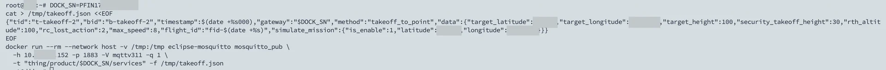

2、接收起飞任务执行进度

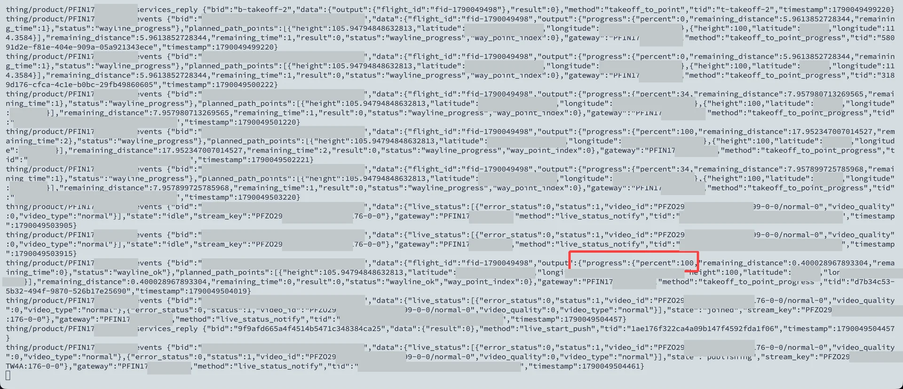

3、驾驶舱实际效果

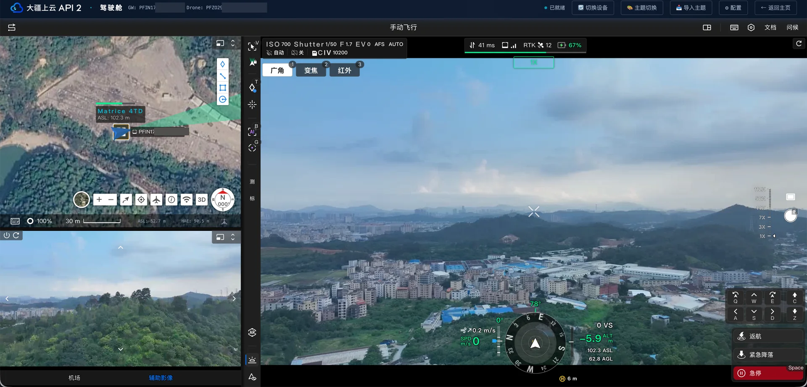

4、osd 信息

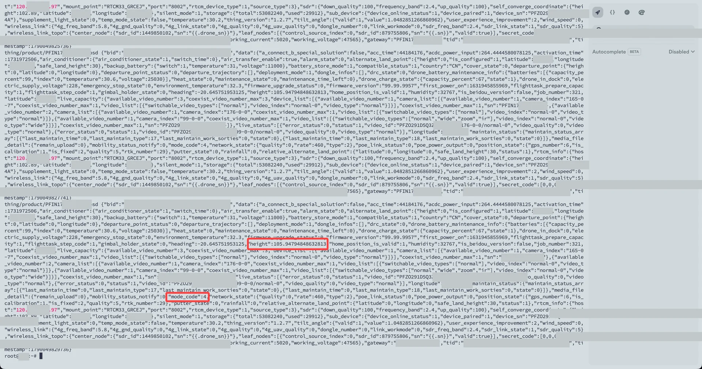


### 9.2 flyto　`fly_to_point`　**执行环境：152**

```bash
DOCK_SN={DOCK_SN_SIM}
cat > /tmp/flyto.json <<EOF
{"tid":"t-flyto-1","bid":"b-flyto-1","timestamp":$(date +%s000),"gateway":"$DOCK_SN","method":"fly_to_point","data":{"fly_to_id":"flyto-$(date +%s)","max_speed":8,"points":[{"latitude":{LAT},"longitude":{LON},"height":306}]}}
EOF
docker run --rm --network host -v /tmp:/tmp eclipse-mosquitto mosquitto_pub \
  -h 10.*.*.152 -p 1883 -V mqttv311 -q 1 \
  -t "thing/product/$DOCK_SN/services" -f /tmp/flyto.json
```

**验收**：reply `result = 0`；`events` 里 `fly_to_point_progress` 的 `status` 走 `wayline_progress` → `wayline_ok`。

**相关 method**：`fly_to_point_update`（中途改点）、`fly_to_point_stop`（停止）。

**实操命令效果**

1、执行 flyto 命令

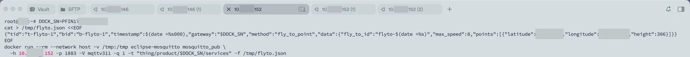

2、飞行进度

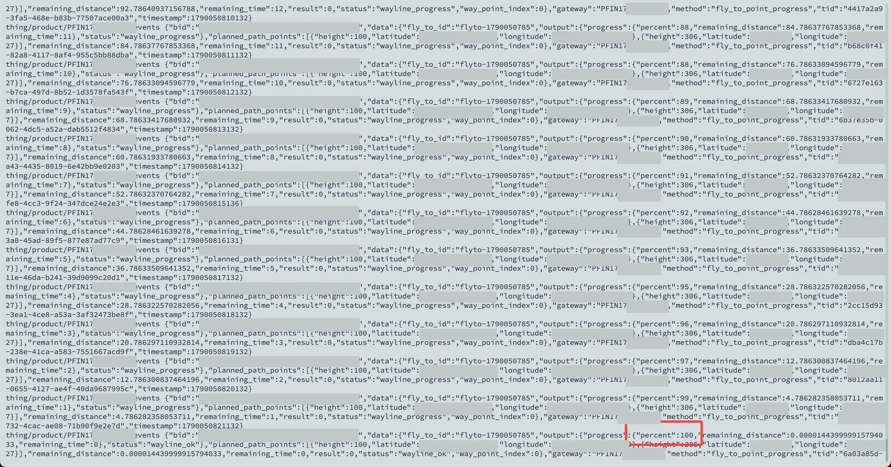

3、驾驶舱飞行效果

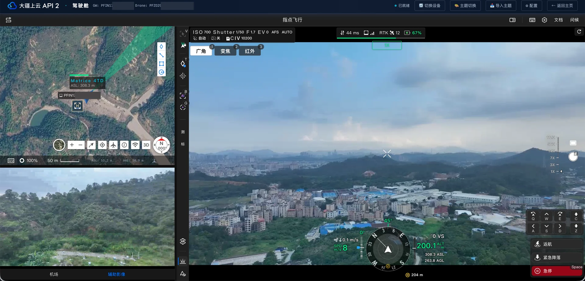

4、机场 osd 信息

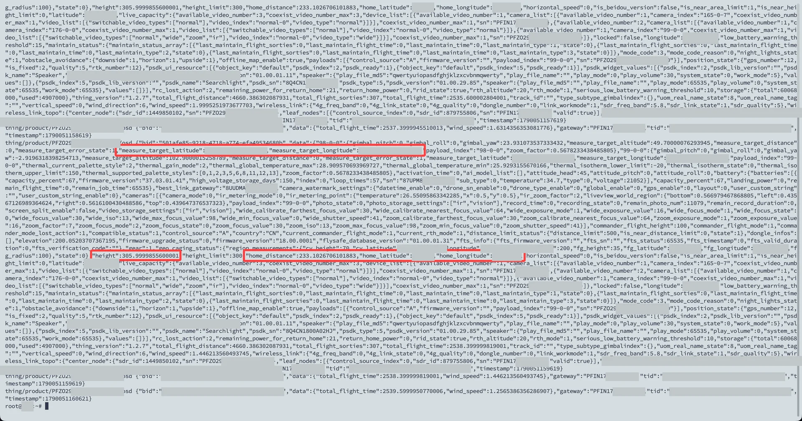


### 9.3 拍照　**执行环境：152**

**第一步永远是确认 `payload_index`**：从**飞机** osd 取 `cameras[0].payload_index`。本环境实测为 `99-0-0`，但**换机型 / 换挂载位置取值会变，不要照抄**。

```bash
DOCK_SN={DOCK_SN_SIM}
PI=99-0-0

# ① 切拍照模式（camera_mode:0 拍照 / 1 录像）
docker run --rm --network host eclipse-mosquitto mosquitto_pub \
  -h 10.*.*.152 -p 1883 -V mqttv311 -q 1 \
  -t "thing/product/$DOCK_SN/services" \
  -m "{\"tid\":\"t-mode-1\",\"bid\":\"b-mode-1\",\"timestamp\":$(date +%s000),\"gateway\":\"$DOCK_SN\",\"method\":\"camera_mode_switch\",\"data\":{\"payload_index\":\"$PI\",\"camera_mode\":0}}"

# ② 拍照
docker run --rm --network host eclipse-mosquitto mosquitto_pub \
  -h 10.*.*.152 -p 1883 -V mqttv311 -q 1 \
  -t "thing/product/$DOCK_SN/services" \
  -m "{\"tid\":\"t-photo-1\",\"bid\":\"b-photo-1\",\"timestamp\":$(date +%s000),\"gateway\":\"$DOCK_SN\",\"method\":\"camera_photo_take\",\"data\":{\"payload_index\":\"$PI\"}}"

# ③ 若 reply 回负载权限相关错误（控制权不在机场手上），先抢权再重试
docker run --rm --network host eclipse-mosquitto mosquitto_pub \
  -h 10.*.*.152 -p 1883 -V mqttv311 -q 1 \
  -t "thing/product/$DOCK_SN/services" \
  -m "{\"tid\":\"t-pauth-1\",\"bid\":\"b-pauth-1\",\"timestamp\":$(date +%s000),\"gateway\":\"$DOCK_SN\",\"method\":\"payload_authority_grab\",\"data\":{\"payload_index\":\"$PI\"}}"
```

**验收**：各条 reply `result = 0`；全景模式另有 `camera_photo_take_progress` 事件。

**实操命令效果**

1、先通过 osd 拿到飞机相机的 payload_index

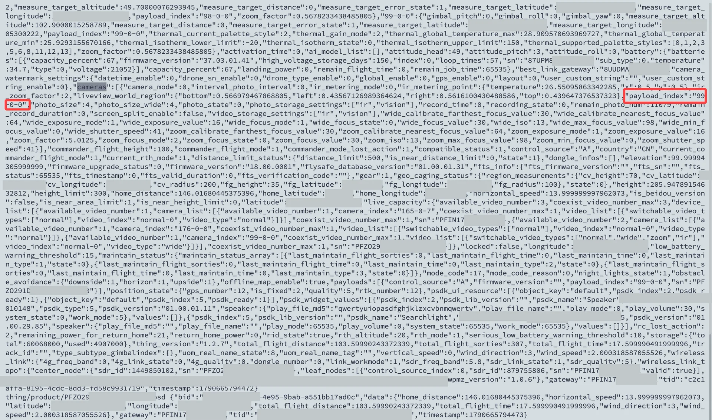

2、执行拍照命令

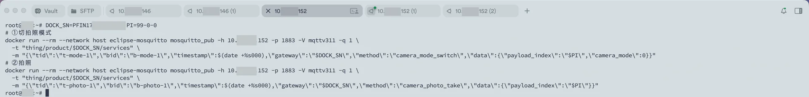

3、拍照响应

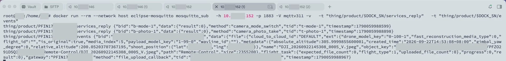


### 9.4 录像　**执行环境：152**

```bash
DOCK_SN={DOCK_SN_SIM}
PI=99-0-0

# ① 切录像模式
docker run --rm --network host eclipse-mosquitto mosquitto_pub \
  -h 10.*.*.152 -p 1883 -V mqttv311 -q 1 \
  -t "thing/product/$DOCK_SN/services" \
  -m "{\"tid\":\"t-mode-2\",\"bid\":\"b-mode-2\",\"timestamp\":$(date +%s000),\"gateway\":\"$DOCK_SN\",\"method\":\"camera_mode_switch\",\"data\":{\"payload_index\":\"$PI\",\"camera_mode\":1}}"

# ② 开始录像
docker run --rm --network host eclipse-mosquitto mosquitto_pub \
  -h 10.*.*.152 -p 1883 -V mqttv311 -q 1 \
  -t "thing/product/$DOCK_SN/services" \
  -m "{\"tid\":\"t-rec-start\",\"bid\":\"b-rec-start\",\"timestamp\":$(date +%s000),\"gateway\":\"$DOCK_SN\",\"method\":\"camera_recording_start\",\"data\":{\"payload_index\":\"$PI\"}}"

# ③ 隔几秒停止录像
docker run --rm --network host eclipse-mosquitto mosquitto_pub \
  -h 10.*.*.152 -p 1883 -V mqttv311 -q 1 \
  -t "thing/product/$DOCK_SN/services" \
  -m "{\"tid\":\"t-rec-stop\",\"bid\":\"b-rec-stop\",\"timestamp\":$(date +%s000),\"gateway\":\"$DOCK_SN\",\"method\":\"camera_recording_stop\",\"data\":{\"payload_index\":\"$PI\"}}"
```

**验收**：三条 reply 均 `result = 0`；osd 里录像状态位变化。

**实操命令效果**

1、执行切换到录像模式

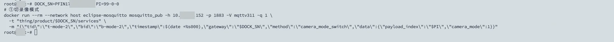


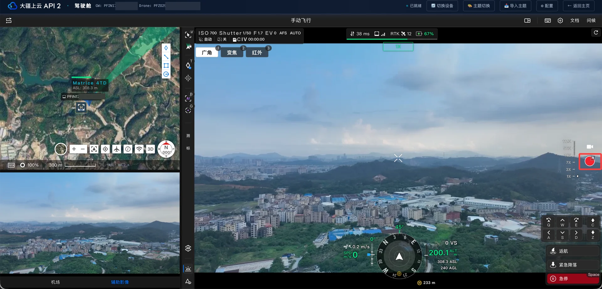

2、开始录像：指令、响应与驾驶舱效果

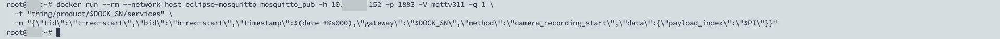


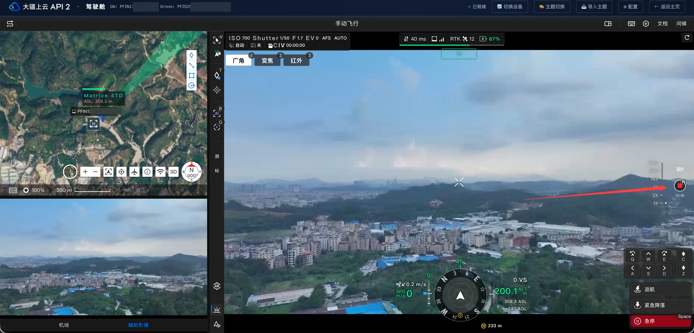

3、停止录像：指令、响应与驾驶舱效果

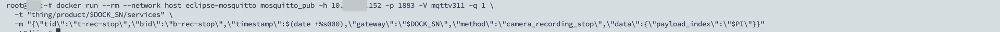

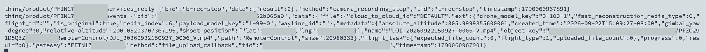

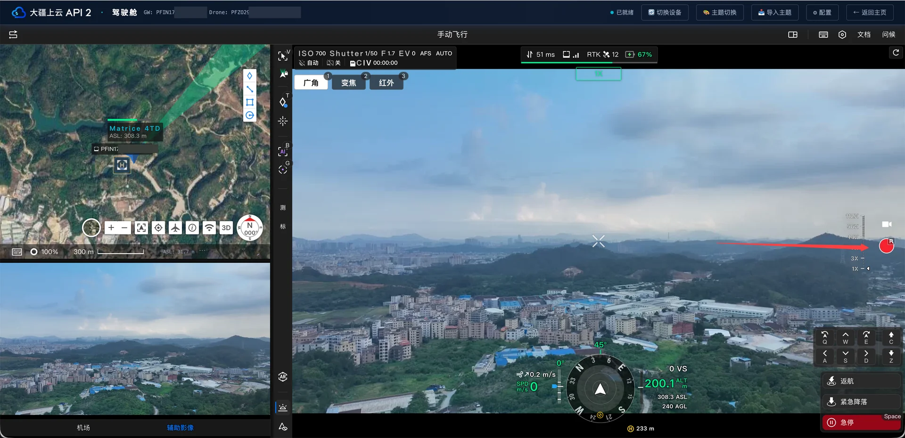


### 9.5 一键返航　`return_home`　**执行环境：152**

```bash
DOCK_SN={DOCK_SN_SIM}

# 返航
docker run --rm --network host eclipse-mosquitto mosquitto_pub \
  -h 10.*.*.152 -p 1883 -V mqttv311 -q 1 \
  -t "thing/product/$DOCK_SN/services" \
  -m "{\"tid\":\"t-rth-1\",\"bid\":\"b-rth-1\",\"timestamp\":$(date +%s000),\"gateway\":\"$DOCK_SN\",\"method\":\"return_home\",\"data\":{}}"

# 取消返航（飞机转入悬停）
docker run --rm --network host eclipse-mosquitto mosquitto_pub \
  -h 10.*.*.152 -p 1883 -V mqttv311 -q 1 \
  -t "thing/product/$DOCK_SN/services" \
  -m "{\"tid\":\"t-rth-2\",\"bid\":\"b-rth-2\",\"timestamp\":$(date +%s000),\"gateway\":\"$DOCK_SN\",\"method\":\"return_home_cancel\",\"data\":{}}"
```

**验收**：reply `result = 0` 且 `output.status` 进入 `in_progress`；`events` 推送 `return_home_info` 返航轨迹；最终降落回舱、osd `drone_in_dock = 1`。

**实操命令效果**

1、触发返航命令

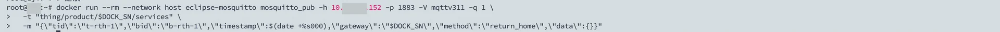

2、驾驶舱效果

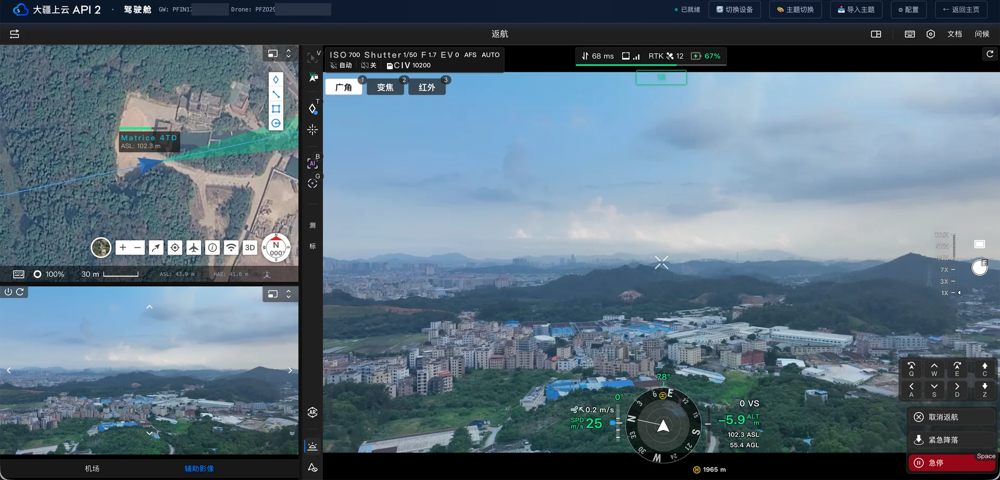

3、返航进度效果


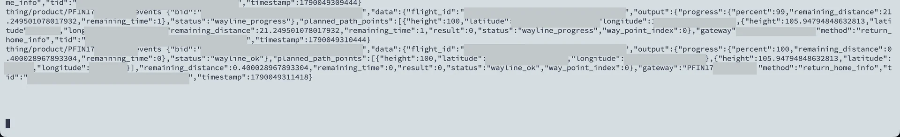


---

## 10. 场景七：航线任务 `flighttask`

> 🛑 **真机与仿真设备行为不同，本节务必先读 §10.1。** 仿真设备能跑通的流程，真机会在 `flighttask_execute` 之后失败。

### 10.1 真机与仿真设备的关键差异

| 行为 | 仿真设备（SN 以 `PF` 开头） | 真机 |
|---|---|---|
| `execute` 后是否回查航线文件 | **不回查**，直接用 `prepare` 里给的 `file.url` | **必定**发一条 `flighttask_resource_get` 到 `requests`，重新索取 KMZ |
| `rth_mode` 字段 | 不校验，可不填 | **必填**，缺失时执行到约 20% 报 `316031`（返航 2.0 模式设置失败） |
| 能否直接用 §10.5 下发 | ✅ | ❌ 需先完成 §10.4 |

**真机为什么会失败**：设备回查 `flighttask_resource_get` 时，按默认桥接配置（规则二：`requests_reply` 不下行）这条请求由平台侧应答。平台拿 `flight_id` 去查自己的任务库，而任务是集成商经 MQTT 直接下发的、平台库里没有这条记录，于是返回 `record not found`，设备拿不到 KMZ，8 轮退避重试后报 **`314013`**。

集成商侧持有该任务与航线、完全能够应答，但 `requests_reply` 同时还承载 `airport_organization_get`、`airport_bind_status`、`storage_config_get` 等**本应由平台负责**的方法，整条放通就会出现同一 `tid` 双应答（见 §12 Q5）。§10.4 的方案是建立 method 级白名单，**只放行 `flighttask_resource_get`**。

### 10.2 硬前置

1. **KMZ 航线文件必须放在平台侧能访问到的 URL**（内网对象存储 / 文件服务），并提供其 **fingerprint**。
2. **若平台侧不出外网，需先通过配置更新下发内网 NTP 地址做时钟同步**，否则航线任务不执行。
3. **（仅真机）资源回查应答通道已配置并验证通过** —— 见 §10.4。

### 10.3 获取 KMZ 的 URL 与 fingerprint　**执行环境：146**

**不要硬编码预签名 URL**——签发即 24h 有效，过期会导致 `break_reason=4`。每次下发前动态获取：

```bash
ssh {SSH_USER}@{146_HOST} 'docker exec file-storage wget -qO- \
  "http://127.0.0.1:8080/wayline/api/inner/v1/waylines?uuid={WAYLINE_UUID}"' \
 | python3 -c "import sys,json;d=json.load(sys.stdin);w=d['data'][0];print('URL:',w['url']);print('FP :',w['finger_print'])"
```

- 接口：file-storage 内网 API `GET /wayline/api/inner/v1/waylines?uuid={航线uuid}`，容器内 `127.0.0.1:8080`；
- 返回 `data[0].url` 是服务端签好名的下载地址，`data[0].finger_print` 是 fingerprint；
- **不走凭证、不碰 minio key**；
- {SSH_USER} 用户在 docker 组，`docker exec` 免 sudo。

> ⚠️ 服务端下发的 `finger_print` 与本地对 KMZ 实算的 MD5 **可能不一致**。优先用服务端返回值；若因此 `break_reason=4`，再换本地实算值试。

**实操命令效果**

1、按航线 uuid 查到的航线文件信息

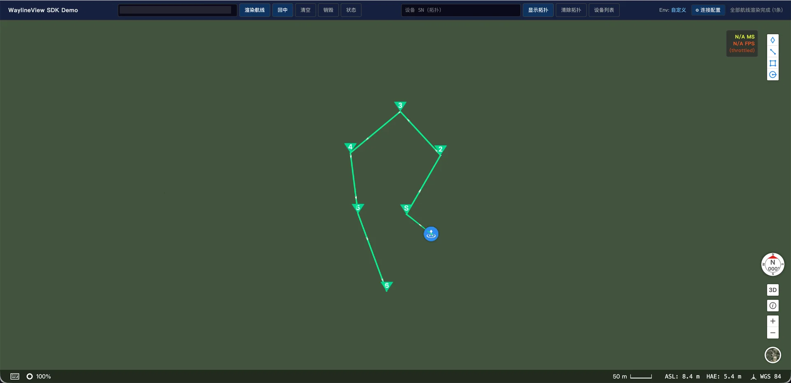


### 10.4 真机必配：资源回查应答通道　**执行环境：146**

仅真机需要。仿真设备不回查，可跳过本节。

#### 为什么不能直接把 `requests_reply` 加进 subscriptions

**根本原因：`requests_reply` 是单一主题、覆盖全部 `requests` 方法，而这些方法的应答方恰好分成相反的两类。**

| `requests` 方法 | 应答方 |
|---|---|
| `airport_organization_get` / `airport_organization_bind` / `airport_bind_status` 等组织绑定类 | **平台侧本地应答** |
| `flighttask_resource_get` / `storage_config_get` | **集成商侧应答** |

整条放通会打断设备上云绑定。实测现象：设备（Pilot）做「云服务配置 → 第三方服务」绑定时报 **「网络异常，查询机场绑定的组织信息失败」**，从 subscription 移除后立即恢复。

冲突链：

| 步骤 | 发生了什么 |
|---|---|
| 1 | 设备发 `airport_organization_get`，平台侧本地应答，回正确的组织信息 ✅ |
| 2 | 但 forwards 含 `requests`，同一条请求**也**被转发到集成商侧 |
| 3 | 集成商库里没有这个机场的组织 / 绑定码，回一条失败或空的 `requests_reply` |
| 4 | subscription 含 `requests_reply`，这条失败应答被拉回平台侧，同样投递给设备 |
| 5 | 设备对同一个 `tid` 收到两条应答，失败的那条竞争覆盖了平台的正确应答 → 绑定失败 |

**这不是配置写错，而是单一主题无法按 method 分离造成的固有取舍。** 平台侧对组织绑定类请求是「查本地库 → 校验绑定码 → 产出应答 → 到此终止」的闭环，本就不期待第三方再插一脚。

因此平台的标准配置是 **subscription 不设 `requests_reply`**——这是长期固定结论，不是绑定期间的临时规避。

#### 那真机航线任务怎么办

突破口在于：**规则引擎能做 method 级判断，而 subscription 不能。**

方案因此不去碰 subscription，而是把集成商的应答先引到一个设备订阅不到的隔离入口，再用规则只挑出 `flighttask_resource_get` 放行，组织绑定类的应答在这一层就被丢弃——既守住了「`requests_reply` 不进 subscription」的结论，又让航线资源回查拿得到应答。

落地时还有两个技术约束，它们决定了必须独立成一条新桥：

1. **规则引擎没有拦截能力。** EMQX 4.3 的 `rule-actions list` 只有 `republish` / `inspect` / `do_nothing` 这类转发与观察动作，**没有 drop / stop**。消息一旦发布到本地 Broker，规则引擎只能事后观察，拦不住它投递给设备——所以"先放通进 subscription、再用规则过滤"走不通，必须让消息一开始就落在设备订阅不到的地方。
2. **`receive_mountpoint` 是桥级参数。** 它作用于整条桥的全部订阅，配在 `aws` 桥上会把 `services` / `property/set` / `events_reply` 一并加前缀，**设备立刻失去全部控制指令**。所以隔离入口只能由一条新桥提供。

结论：独立一条**只下行、不上行**的专用桥，配隔离入口与规则白名单。

#### 数据流

```text
集成商 Broker：thing/product/{DOCK_SN}/requests_reply
    ↓ reply 桥订阅，receive_mountpoint 加前缀
隔离入口：reply/ext/thing/product/{DOCK_SN}/requests_reply   ← 设备不订阅
    ↓ 规则引擎判断 method 与 data.result
    ↓ 命中则 republish，payload 原样透传
设备 Topic：thing/product/{DOCK_SN}/requests_reply
    ↓
设备
```

未命中的消息停在隔离入口，无人订阅，自然丢弃。

#### 配置 reply 桥

追加到 `emqx_bridge_mqtt.conf` 末尾，**不改动现有 `aws` 桥的任何一行**：

```ini
## 下行专用桥：接收集成商 requests_reply，经规则引擎按 method 过滤后投递设备
## ⚠️ 严禁为本桥配置 forwards
## ⚠️ 严禁在任何桥的 forwards 中加入 thing/product/+/requests_reply 或其通配覆盖
##    （thing/product/#、thing/#、#），否则 republish 结果会被回传远端形成无限环路
bridge.mqtt.reply.address              = 10.*.*.152:1883
bridge.mqtt.reply.proto_ver            = mqttv4
bridge.mqtt.reply.start_type           = auto
bridge.mqtt.reply.clientid             = cloud_api2_bridge_reply
bridge.mqtt.reply.clean_start          = true
bridge.mqtt.reply.username             = {BROKER_USER}
bridge.mqtt.reply.password             = {BROKER_PASSWORD}
bridge.mqtt.reply.ssl                  = off
bridge.mqtt.reply.keepalive            = 60s
bridge.mqtt.reply.reconnect_interval   = 30s
bridge.mqtt.reply.retry_interval       = 20s
bridge.mqtt.reply.batch_size           = 32
bridge.mqtt.reply.max_inflight_size    = 32
bridge.mqtt.reply.queue.replayq_dir       = data/replayq/emqx_reply_bridge/
bridge.mqtt.reply.queue.replayq_seg_bytes = 10MB
bridge.mqtt.reply.queue.max_total_size    = 1GB

## 隔离入口前缀，末尾斜杠不可省，否则会拼成 reply/extthing/...
bridge.mqtt.reply.receive_mountpoint   = reply/ext/

bridge.mqtt.reply.subscription.1.topic = thing/product/+/requests_reply
bridge.mqtt.reply.subscription.1.qos   = 1
```

| 约束 | 说明 |
|---|---|
| `clientid` | 必须与 `aws` 桥不同，否则远端互踢会话 |
| 不配 `forwards` | 本桥单向下行 |
| `receive_mountpoint` | 末尾斜杠不可省 |
| `replayq_dir` | 与 `aws` 的 `emqx_aws_bridge/` 分开 |

#### 创建过滤规则

```bash
docker exec emqx emqx_ctl rules create \
 "SELECT topic, payload, qos, nth(5, tokens(topic, '/')) as sn FROM \"reply/ext/thing/product/+/requests_reply\" WHERE payload.method = 'flighttask_resource_get' AND is_int(payload.data.result) AND payload.data.result = 0" \
 '[{"name":"republish","params":{"target_topic":"thing/product/${sn}/requests_reply","target_qos":-1,"payload_tmpl":"${payload}"}}]' \
 -i reply_filter_flighttask_resource_get \
 -d "Allow only flighttask_resource_get replies to reach devices"
```

三个条件同时成立才放行：

- `method = 'flighttask_resource_get'` —— 只认这一个方法
- `is_int(data.result)` —— 结果码必须是整数，字符串 `"0"` 会被拦住
- `data.result = 0` —— 只放行成功的应答

#### 让配置生效

```bash
docker exec emqx emqx_ctl plugins reload emqx_bridge_mqtt
```

> ⚠️ **该操作会重启包含 `aws` 在内的全部文件桥。** EMQX 4.3.5 存在 ecpool 挂死缺陷（见 §12 Q6），reload 正是触发路径之一。请安排维护窗口，执行后**立即**按下面第 ① 步确认上行存活。

#### 验证

**① `aws` 桥上行是否存活。** 唯一可靠依据是 152 侧能否收到 osd——`bridges list` 显示的 `Running` 是陈旧值，不能作数：

```bash
# 152
docker run --rm --network host eclipse-mosquitto mosquitto_sub \
  -h 10.*.*.152 -p 1883 -V mqttv311 -v -t 'thing/product/+/osd' -W 10
```

**② 规则指标**：

```bash
# 146
docker exec emqx emqx_ctl rules show reply_filter_flighttask_resource_get
```

| 字段 | 预期 |
|---|---|
| `metrics.matched` | 等于放行用例数 |
| `actions[].success` | 等于 `matched` |
| `actions[].failed` | **0** |

**③ 白名单是否收得够紧。** 逐条发到隔离入口 `reply/ext/thing/product/{DOCK_SN}/requests_reply` 验证：

| `method` | `data.result` | 预期 |
|---|---|---|
| `flighttask_resource_get` | 整数 `0` | **放行**，且 payload 逐字节一致 |
| `flighttask_resource_get` | 整数 `219021` | 拦截 |
| `flighttask_resource_get` | 字符串 `"0"` | 拦截（`is_int` 生效） |
| `airport_organization_get` | 整数 `0` | 拦截 |
| `storage_config_get` | 整数 `0` | 拦截 |
| `airport_bind_status` | 整数 `0` | 拦截 |

> ⚠️ **隔离入口前缀不是安全边界。** 生产环境须用 ACL 限制普通客户端对 `reply/ext/#` 的发布权限，否则可绕过内容判断直接把消息投给设备。

### 10.5 下发顺序：先 prepare，再 execute　**执行环境：152**

```bash
DOCK_SN={DOCK_SN}
FID="ft-$(date +%s)"
KMZ_URL="{上一步取到的预签名URL}"
KMZ_FP="{上一步取到的finger_print}"

# ① prepare
cat > /tmp/ft_prepare.json <<EOF
{"tid":"t-ft-1","bid":"b-ft-1","timestamp":$(date +%s000),"gateway":"$DOCK_SN","method":"flighttask_prepare","data":{"flight_id":"$FID","task_type":0,"execute_time":$(date +%s000),"file":{"url":"$KMZ_URL","fingerprint":"$KMZ_FP"},"rth_altitude":100,"rth_mode":1,"out_of_control_action":0,"exit_wayline_when_rc_lost":0}}
EOF
docker run --rm --network host -v /tmp:/tmp eclipse-mosquitto mosquitto_pub \
  -h 10.*.*.152 -p 1883 -V mqttv311 -q 1 \
  -t "thing/product/$DOCK_SN/services" -f /tmp/ft_prepare.json

# ② prepare 回 result=0 之后，再 execute
cat > /tmp/ft_execute.json <<EOF
{"tid":"t-ft-2","bid":"b-ft-2","timestamp":$(date +%s000),"gateway":"$DOCK_SN","method":"flighttask_execute","data":{"flight_id":"$FID"}}
EOF
docker run --rm --network host -v /tmp:/tmp eclipse-mosquitto mosquitto_pub \
  -h 10.*.*.152 -p 1883 -V mqttv311 -q 1 \
  -t "thing/product/$DOCK_SN/services" -f /tmp/ft_execute.json
```

**`prepare` 的四个返航相关字段都是必填。** 官方字段表未标注，但实测缺失会直接失败：

| 字段 | 缺失后果 |
|---|---|
| `rth_altitude` / `out_of_control_action` / `exit_wayline_when_rc_lost` | `prepare` 即报 `325001` |
| `rth_mode` | `prepare` 与 `execute` 都返回 0，执行到约 20% 才报 `316031`（返航 2.0 模式设置失败） |

> ⚠️ **`$FID` 两步必须一致。** 必须在同一个 shell 会话内执行；若分两个终端跑，把 `flight_id` 固定写死成字符串。
>
> ⚠️ **执行前确认机场不在远程调试态**（osd 里 `mode_code=0`、`drc_state=0`），否则 `execute` 报 `514146`。先发 `debug_mode_close` 退出调试态再试。
>
> 💡 **用仿真设备演练流程**时，把 `DOCK_SN` 换成 `{DOCK_SN_SIM}`，并在 `data` 里加 `"simulate_mission":{"is_enable":1,"latitude":{LAT},"longitude":{LON}}`。仿真设备不校验 `rth_mode`，但建议保留该字段，以免切到真机时遗漏。

**验收**：
- `events` 收到 `flighttask_ready`（条件任务）或直接 `flighttask_progress`；
- `flighttask_progress` 的 `current_step` 从准备阶段推进到「航线执行中」，`status` / `percent` 持续更新，直到降落；
- 全程 `result` 中无 `break_reason`。

> `break_reason` 的取值来自本环境实测观察，**完整枚举以官方上云 API 2 文档为准**。

**失败排查（一）：`result` 错误码**，出现在 `services_reply` 或 `flighttask_progress` 里。

| 值 | 含义 | 处理 |
|---|---|---|
| `325001` | `prepare` 参数不完整 | 补齐四个返航相关字段，见上表 |
| `316031` | 返航 2.0 模式设置失败 | `prepare` 缺 `rth_mode` |
| `314013` | 航线文件获取失败 | **真机专有**：设备回查 `flighttask_resource_get` 无人应答。检查 §10.4 的 reply 桥与过滤规则是否生效（`rules show` 看 `matched` 是否在涨） |
| `514146` | 机场处于远程调试态 | 先发 `debug_mode_close` |

**失败排查（二）：`flighttask_progress.break_reason`**，非 0 即中断。

| 值 | 含义 | 处理 |
|---|---|---|
| `4` | KMZ 加载失败 | URL 不可达 / 已过期，或 fingerprint 不匹配 |
| `771` | 返航点未刷新 | 等返航点刷新后重试 |
| `772` | 电量过低无法开始 | 等待充电 |

**任务过程控制**：`flighttask_pause` / `flighttask_recovery` / `flighttask_undo` / `return_home`。

**实操命令效果**

1、执行 prepare 命令与响应

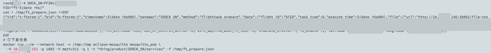

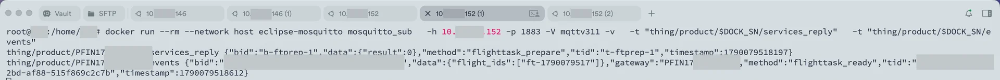

2、执行 execute 命令

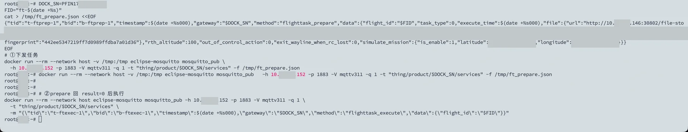

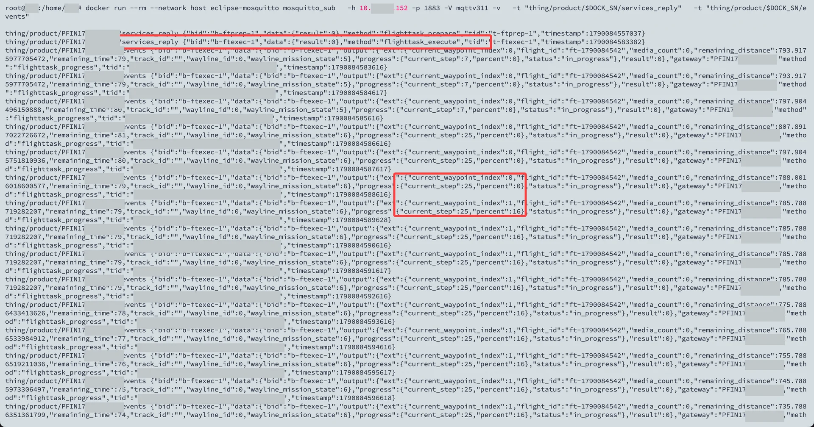

3、开始飞行，航线任务进度推进

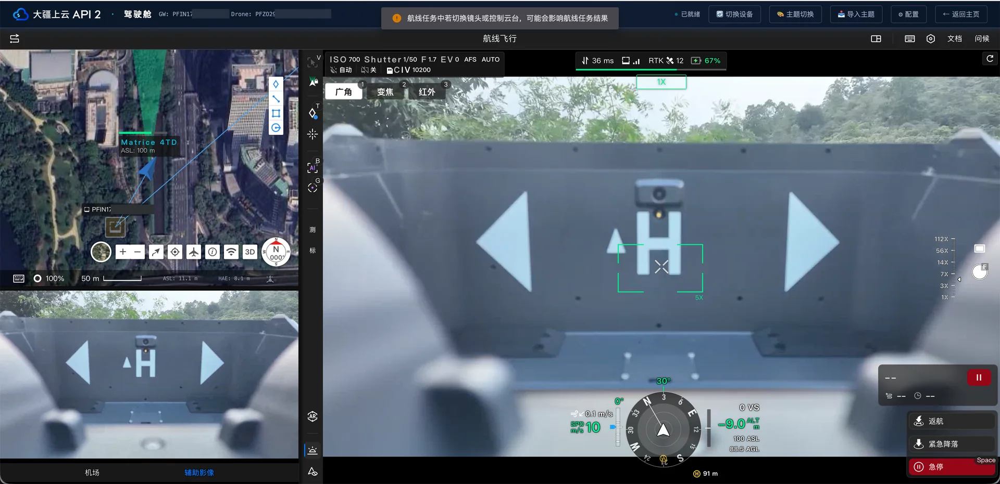

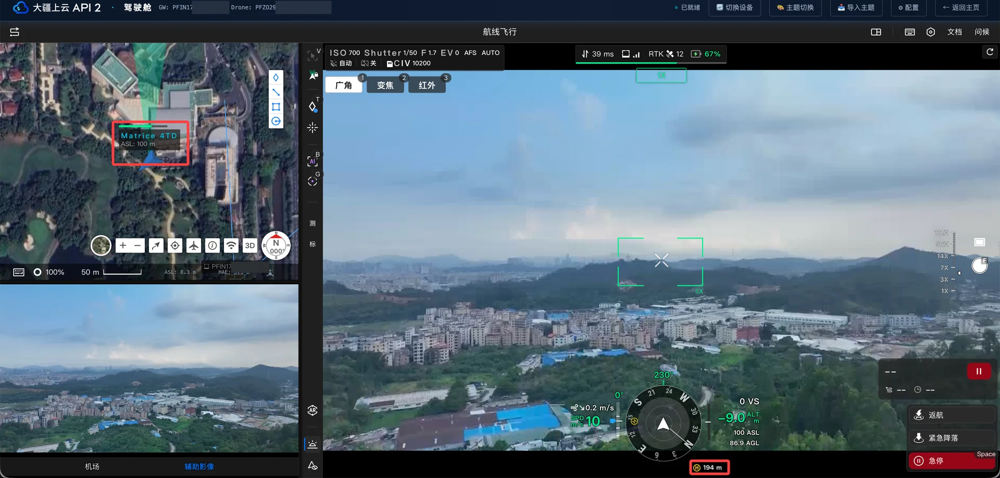

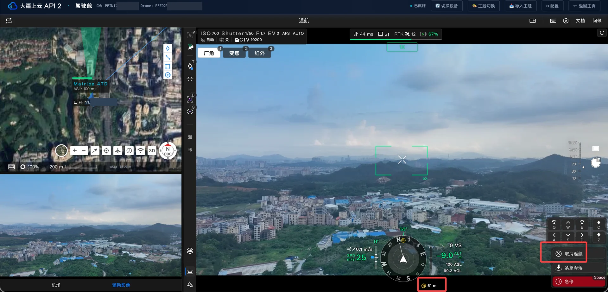


---

## 11. 暂不支持的场景

以下场景在当前版本下**无法通过桥接实现**。根因是同一条 `requests` 请求，平台侧与集成商侧都会应答，而设备采用哪一方的应答目前没有仲裁策略；平台侧的应答由多条链路产生，也没有统一开关可以关闭。

### 11.1 受影响的能力

| 场景 | 涉及方法 | 实测现象 |
|---|---|---|
| 集成商使用上云 API 平台存储回收媒体文件 | `storage_config_get` | 设备采用上云 API 2 凭证，媒体文件全部写入平台对象存储 |
| 集成商下发上云 API 平台的自定义飞行区 | `flight_areas_get` | 集成商下发的飞行区文件未被设备采用 |
| 集成商上云 API 平台侧组织 / 绑定数据 | `airport_organization_get`、`airport_bind_status` 等 | 上云 API 2 平台本地应答设备 |

### 11.2 触发条件

三者同时满足才会遇到：

1. 走 MQTT 桥接的双云架构（上云 API 2 平台 + 集成商自有云）；
2. 设备发起的是 `requests` 类请求，且平台侧存在对应的应答链路；
3. 集成商希望对同一请求应答，以使用自有存储 / 飞行区 / 组织数据。

### 11.3 不受影响的部分

- **`flighttask_resource_get`**：§10.4 的白名单方案已解决。集成商直接下发的任务不在平台任务库中，平台查不到也就不会应答，不存在应答竞争。
- **下行指令**（`services`、`property/set`）与**上行遥测、事件**（`osd` / `state` / `events` / `services_reply`）：不涉及 `requests` 应答，完全不受影响。
- **单云部署**，或集成商接受上云 API 2 平台存储、上云 API 2 平台飞行区的方案。

### 11.4 当前可行的替代做法

媒体场景：接受平台对象存储，集成商侧订阅 `events` 消费 `file_upload_callback`，从中获取文件信息后按需从平台存储拉取。其余场景暂无替代方案。

---

## 12. 排障速查

### Q1. 插件加载报错，或转发了对端收不到

`forward_mountpoint` 留了空值，EMQX 4.3 不接受。**整行注释掉**，不要赋空字符串。

### Q2. 下发静音后 `state` 里看不到变化

两个原因叠加：① 静音状态在 **`osd`** 的 `silent_mode`，不在 `state`；② forwards 没配 `property/set_reply`，回包也收不到。两处都改。

### Q3. 设备上下线事件收不到

上下线是 EMQX 系统 Topic（`$events/client_connected` / `client_disconnected`），**桥接无法转发**。改用 Webhook、规则引擎改写到自定义 Topic，或监测 osd 间接判断。

### Q4. 日志上传完成后机场反复重发终态

subscription 缺 `events_reply`。146 补：

```bash
docker exec emqx emqx_ctl bridges add-subscription aws 'thing/product/+/events_reply' 1
```

### Q5. 配置桥接之后，设备反而无法上云 ⚠️

**现象**：桥接配好后，原本正常的设备上云流程失败，机场绑定 / 组织查询等握手步骤卡住或超时。

**根因**：**subscription 里多配了 `requests_reply`**。

设备上云握手是一问一答：设备通过 `requests` 发起请求（绑定状态查询、组织信息获取、存储配置获取），**146 本地后台**通过 `requests_reply` 回复。一旦把 `requests_reply` 加进下行 subscription，就出现**同一个 `tid` 两个应答源**——146 后台回一份，152 侧 sample 也回一份经桥接下行送到设备。设备收到两份不一致的应答，握手逻辑被打乱。

**解决**：从 subscription 中移除 `requests_reply`。严守规则二 `forwards ∩ subscriptions = ∅`。`requests` 走上行，`requests_reply` 由 146 后台负责，**不要桥接**。

> 这条同样适用于其他 `*_reply`：**只有 `events_reply` 需要集成商侧 ack**，其余 reply 类不要加进下行。
>

### Q6. `bridges list` 显示 Running，但数据实际没在走

EMQX **4.3.5 的 ecpool 假死 bug #6286**。supervisor 状态 stale，显示 Running 不代表链路活着。

**判断**：在 152 订阅 osd，能持续收到即健康；收不到且 146 的 `replayq` 只涨不落，即假死。

```bash
# 146 看 replayq 趋势（间隔采样，不是单点）
docker exec emqx sh -c "du -sk /opt/emqx/data/replayq/emqx_aws_bridge | cut -f1"
docker exec emqx sh -c "ls /opt/emqx/data/replayq/emqx_aws_bridge/ | wc -l"
```

**解决**：该问题将随后续底座版本升级解决。

### Q7. 下发命令后 `services_reply` 一直不来

排查顺序：① subscription 是否含 `thing/product/+/services`；② 消息体 `gateway` 是否填机场 SN；③ topic 里 SN 是否正确；④ JSON 转义是否正确。

### Q8. reply 返回 `result=0`，但完全没有进度事件

forwards 没配 `events`。命令执行了，但进度事件没桥回来。

### Q9. 开播返回成功但 SRS 没有流

见 §7.3 的失败排查表。重点：查 SRS API 确认设备是否真推了流；仿真设备不提供真实视频源，需用真机验证。

### Q10. 航线任务 `break_reason = 4`

KMZ 加载失败。① URL 是否**对 146 可达**（不是对你本机可达）；② 预签名 URL 是否已过期（24h）；③ fingerprint 用服务端返回值还是本地实算值，两者可能不一致，换着试。

---

## 13. 验收总纲（一句话）

> 桥接双向通（§3）后：能在 152 下发 `debug_mode_open` / `silent_mode` 并收到 `result=0` 与 osd 状态变化（§5）；能在 152 收到设备上行的 HMS 告警（§6）；能在 152 用 MQTT 命令拉起 / 切换 / 停止直播并在 SRS 见流（§7）；能用 `fileupload_*` 触发日志上传并在 146 minio 见文件（§8）；能在 152 下发飞行与航线命令，收到 `result=0` 的 reply 且 `events` 里 `*_progress` 推进到 `ok` / `finish`（§9、§10）。

---

## 附：环境参数表

| 参数 | 取值 | 来源 / 说明 |
|---|---|---|
| 机场 SN `{DOCK_SN}` | `{DOCK_SN_SIM}`/`{DOCK_SN}` | **{DOCK_SN_SIM}** 仿真机场，osd 实测（`peername=10.0.2.1`）<br />**{DOCK_SN}** Dock 3 真机 |
| 飞机 SN `{DRONE_SN}` | `{DRONE_SN_SIM}` | osd 实测，仿真飞机 |
| 152 broker（集成商业务侧） | `10.*.*.152:1883`，容器 `cloud_api_sample-emqx-1` | 匿名；必要时 `-u {BROKER_USER} -P {BROKER_PASSWORD}` |
| 146 broker（设备侧） | `10.*.*.146:1883`，容器 `emqx` | SSH `{SSH_USER}@{146_HOST}` |
| 桥接名 / 插件 | `aws` / `emqx_bridge_mqtt` | forwards=7，subscriptions=3 |
| 桥接 clientid | `cloud_api2_bridge` | 在 152 侧 `clients list` 可见 |
| 152 SRS | 容器 `srs`，`1935` RTMP / `1985` API / **`8088`** HTTP-FLV | 镜像 `ossrs/srs:5` |
| 146 minio / S3 | `http://10.*.*.146:30802`，bucket `file-storage-privatization` | file-storage 配置 |
| 146 file-storage 内网 API | 容器 `file-storage` 内 `127.0.0.1:8080` | 取 KMZ URL 与 fingerprint |
| 146 EMQX 管理 API | 容器内 `127.0.0.1:8081`，`/api/v4/mqtt/publish` | 账号 `{EMQX_ADMIN_USER}` |
| 机场相机 `camera_index` | `165-0-7`，`video_index=normal-0` | 直播 video_id 用 |
| 飞机云台相机 `camera_index` | `99-0-0`，可切 normal/wide/zoom/ir | 直播 video_id 用 |
| 飞机 FPV `camera_index` | `176-0-0`，仅 normal | 直播 video_id 用 |
| 飞机 `payload_index` | `99-0-0` | 拍照 / 录像用，**非直播**，与 camera_index 同值但概念不同 |
| 航线 uuid（示例） | `{WAYLINE_UUID}` | 6 点、786m |
| 航线起点（模拟器用） | `{LAT}` / `{LON}` | `wayline_files.start_latitude/longitude` |
| 机场坐标（起飞用） | `{LAT}` / `{LON}` | 实测须按现场替换 |
| `video_quality` | 0 自适应 / 1 流畅 / 2 标清 / 3 高清 / 4 超清 | |
| `camera_mode` | 0 拍照 / 1 录像 | |
| `module_list`（日志） | `"3"` = 机场 | |
| 飞行默认参数 | `max_speed 8`、`rth_altitude 100`、`target_height 100`、`security_takeoff_height 30`、`task_type 0` | |
| 146 EMQX 管理口令 | `{146_EMQX_ADMIN_HASH}` | `docker exec emqx emqx_ctl mgmt list` |
| minio 账号 / 密钥 | `{MINIO_ACCESS_KEY}` / `{MINIO_SECRET}` | 146 运维界面 |
| 152 broker 密码 | `{152_BROKER_PASSWORD}` | 桥接配置 `bridge.mqtt.aws.password` |

> ⚠️ **凭据类**（EMQX 管理口令、minio 密钥、152 broker 密码）本文一律占位符，执行时现取现填，勿写入任何文件或代码仓库。

---

**文档版本**：v2.0 · 2026-10-19
