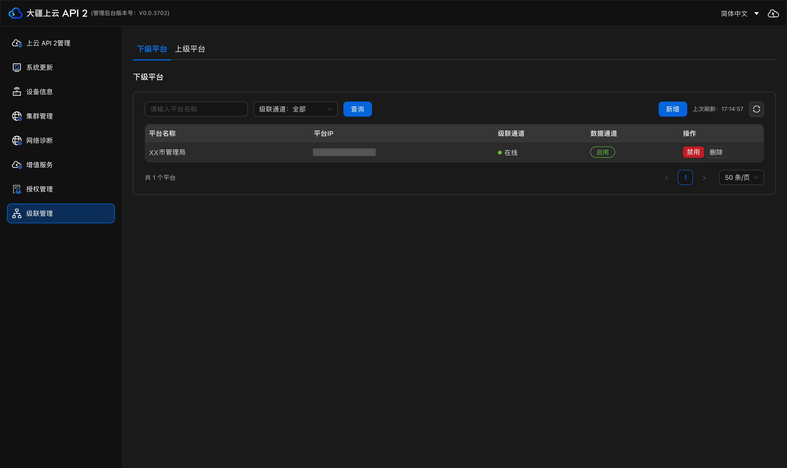
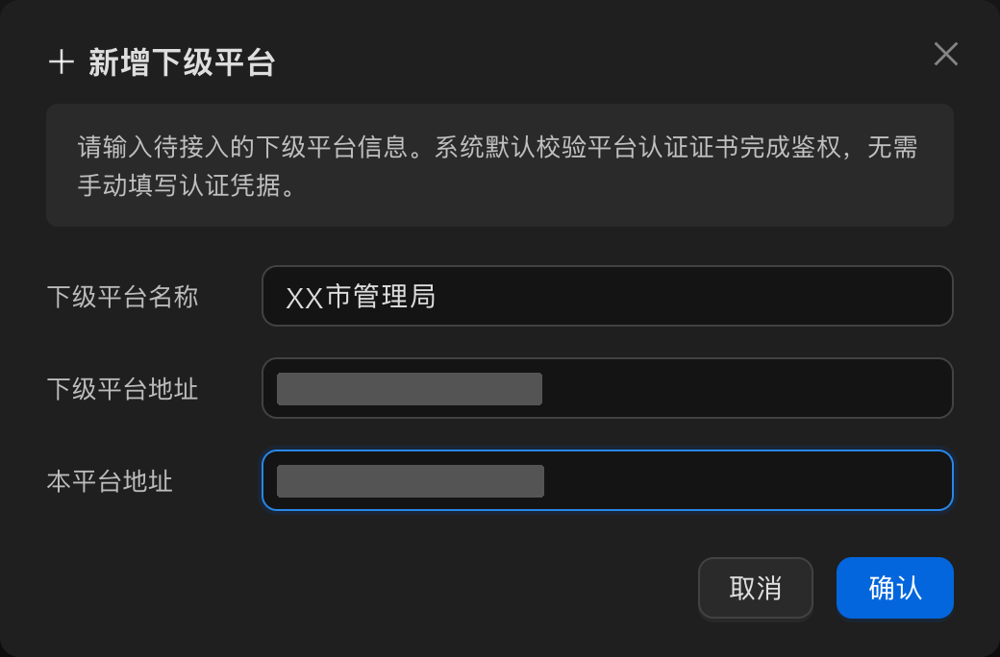
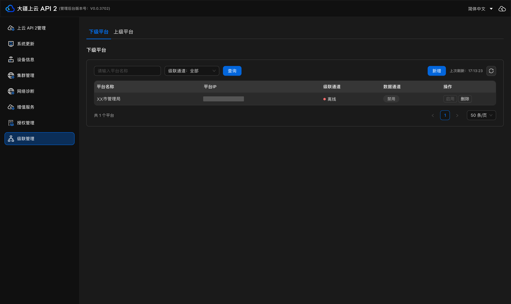
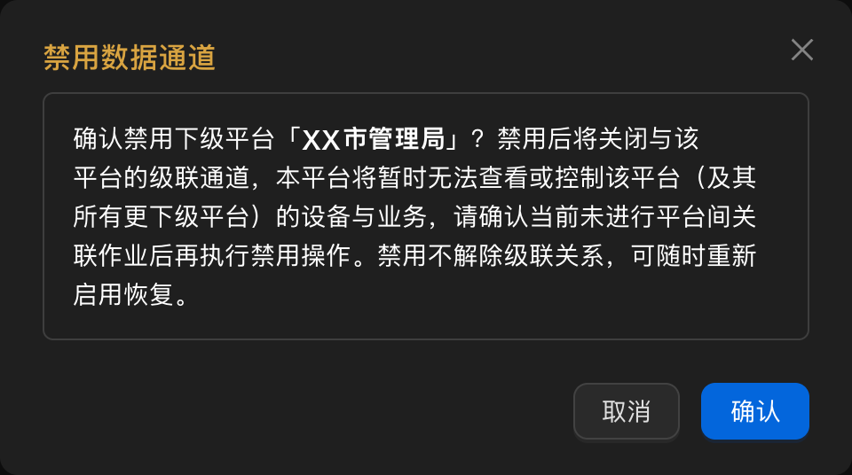
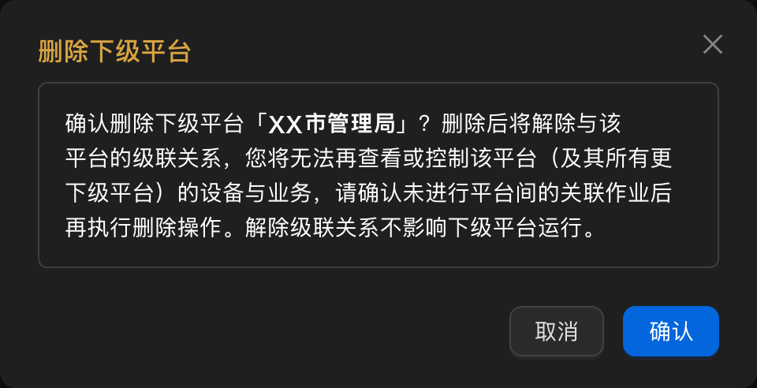
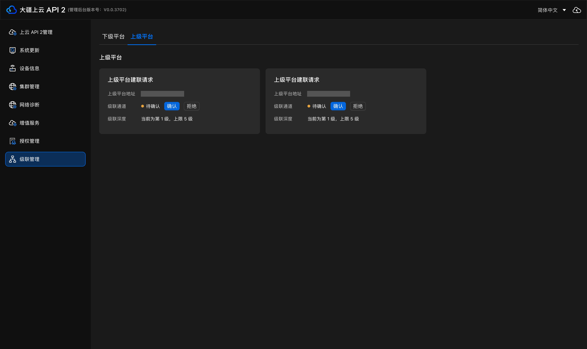
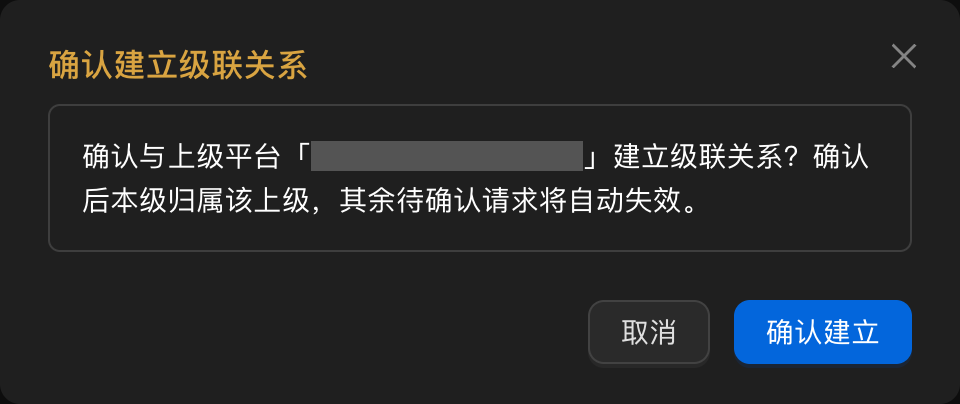
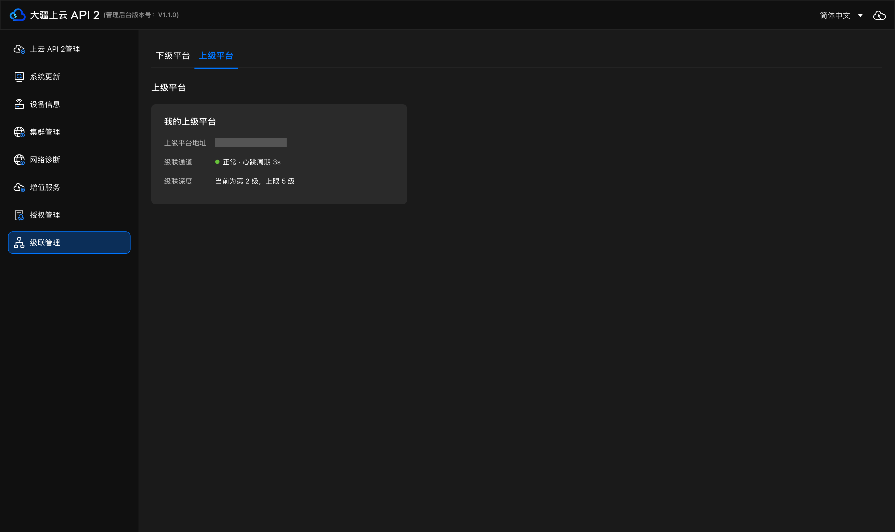
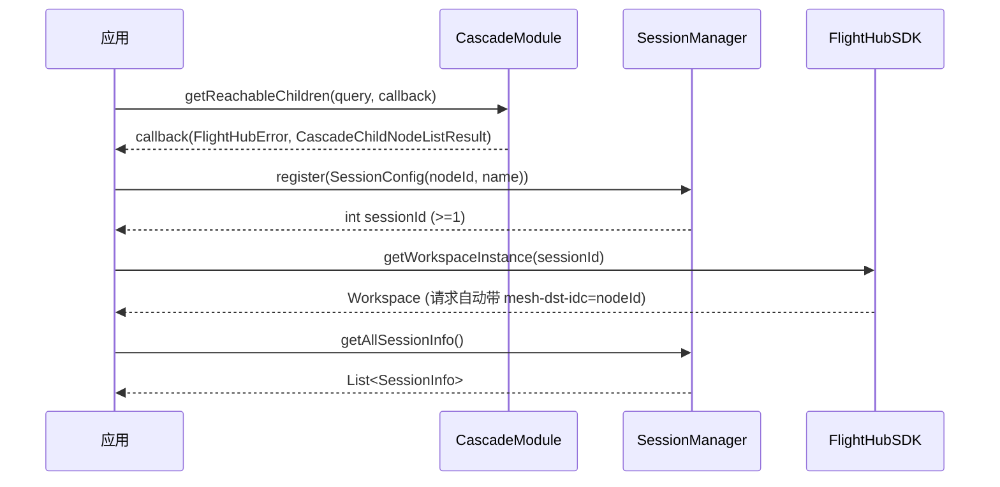

# 上云 API 2 系统级联说明文档

系统级联用于把多级组织各自**独立部署**的上云 API 2 实例连成一棵组织树，最多支持 5 级（如 总部 — 省 — 地市 — 区县 — 镇所）。建成后，上级平台可以查看下级平台的设备状态、飞行数据、直播画面，并可对下级设备下发航线任务、实时控制与负载控制指令；下级平台可以查看自己的上级平台，但看不到兄弟平台，也不会被兄弟平台查看。

本文介绍如何在管理后台完成级联配置，包括上级平台添加下级平台**与下级平台确认上级平台**两个方向。

文档共分三部分：**1、上云 API 2 级联配置**；**2、级联场景下前端组件使用说明**；**3、级联场景下 SDK 使用说明**。第一部分为管理后台的级联配置操作，后两部分介绍如何在级联场景下集成与使用前端组件与 SDK。

---

## 1、上云 API 2 级联配置

### 前提条件

**部署与组网**

- 每一级组织各部署一套独立的上云 API 2 实例，版本需支持系统级联。
- 各级实例之间网络可达：上级平台能访问下级平台的对外地址，下级平台也能回连上级平台的对外地址，级联通道依托 Mesh 组网。
- 规划好组织层级，最多 5 级；一个下级平台只能归属一个上级平台，上级平台可以管理多个下级平台。

**证书与认证**

- 各级实例已完成安装部署，根证书由安装流程下发。新增下级平台时系统默认校验平台认证证书完成鉴权，**无需手动填写认证凭据**。
- 级联通道的通信加密与双向证书认证由系统自动完成，无需额外配置。

**账号与权限**

- 需要以可视化运维管理员身份登录各级实例的管理后台。级联配置仅在管理后台进行。
- 级联授权以**平台为整体单位**，不能按角色单独分配。如需对个别设备或能力做更细的限制，需由开发者/集成商在业务侧自行实现。

**两侧配合**

- 级联关系需要上级与下级共同确认：上级平台发起新增，下级平台在自己的「上级平台」页确认。缺少任意一侧的操作，级联通道都建不起来：此时上级平台侧显示 `离线`，下级平台侧停留在 `待确认`。

---

### 选择配置方向

管理后台的 `级联管理` 下有两个页面，按本平台当前所处的角色选择：

- **下级平台**：本平台作为上级平台时使用。在此新增、启用/禁用、删除下级平台，并查看各下级平台的级联通道与数据通道状态。
- **上级平台**：本平台作为下级平台时使用。在此查看上级平台信息，并确认上级发起的级联请求。

> 同一个平台可以既是某平台的上级平台、又是另一平台的下级平台，两个页面需要分别配置。

---

### 添加下级平台

**可见性与授权规则**

- 可见性为「上级 → 下级」单向：上级平台可查看下级平台，下级平台可查看本平台的上级平台及权限清单，但看不到兄弟平台。
- 授权向下继承：上级平台自动获得下级平台下所有层级平台的策略，例如省级平台可自动查看市下所有县区。
- 组织权限整体构成树形结构，配置入口统一在上级平台的 `级联管理 → 下级平台`。

**操作指引**

1. **进入下级平台页**，登录上级平台管理后台，选择 `级联管理 → 下级平台`。

   列表展示平台名称、平台IP、级联通道、数据通道与操作列；顶部可按级联通道状态过滤、按平台名称搜索；列表分页默认 50 条/页，可切换 20/50/100 条并支持按页跳转。

   <div></div>

   > 上图为已添加 1 个下级平台时的列表。

2. **新增下级平台**，点击 `新增`，在弹窗中填写三项信息。

   - **下级平台名称**：便于识别的平台名称，建议按行政区划或单位命名，如 `XX市管理局`。
   - **下级平台地址**：下级平台的对外 IP 或地址，上级平台通过它访问下级平台。**地址末尾需加上端口**，格式为 `IP:端口`，如 `<下级平台IP>:30443`。端口默认为 `30443`，若部署时修改过网关端口，以实际端口为准。
   - **本平台地址**：本平台对外的 IP 或地址，供下级平台回连使用。**同样需在末尾加上端口**，格式为 `IP:端口`，如 `<本平台IP>:30443`。

   填写完成后的弹窗如下：

   <div></div>

   > 系统默认校验平台认证证书完成鉴权，无需手动填写认证凭据。

   提交后，列表中新增一行，此时级联通道为 `离线`、数据通道为 `禁用`：

   <div></div>

3. **通知下级平台确认**。新增完成后，该下级平台的数据通道默认为 `禁用`，级联通道还不会显示 `在线`。「启用」按钮的悬停提示为：

   > 请联系下级平台运维人员管理后台-级联管理-上级平台页面确认建立级联通道

4. **检查级联通道**。下级平台在其 `级联管理 → 上级平台` 页确认后，本页列表中该下级平台的「级联通道」显示 `在线`，表示两侧已建联。

   本页的级联通道只有 `在线` 与 `离线` 两种状态，顶部筛选下拉也仅这三项（全部 / 在线 / 离线）。状态由数据上报判定：连续 3 个周期未收到数据，即判为离线。

5. **启用数据通道**。在操作列点击 `启用`，上级平台与该下级平台之间的数据上报与指令通道才真正打开；点击 `禁用` 会弹出**二次确认**弹窗，确认后关闭数据通道。

   <div></div>

   > 数据通道禁用后，上级平台不再接收该下级平台的数据，也无法向该下级平台设备下发指令；下级平台本级的任务、飞行与录制不受影响。**禁用不解除级联关系，可随时重新启用恢复。**

6. **（可选）删除下级平台**。点击 `删除`，二次确认后删除级联关系。删除后，下级平台不再展示该上级平台，上级平台也不再持有该下级平台的数据与控制权限。

   <div></div>

   > **解除级联关系不影响下级平台运行。**

---

### 确认上级平台

1. **进入上级平台页**，登录下级平台管理后台，选择 `级联管理 → 上级平台`。

2. **查看待确认的上级平台**。上级平台完成新增后，本页面出现标题为 `上级平台建联请求` 的卡片，卡片上显示上级平台地址（`IP:端口` 形式，即上级平台在新增时填写的「本平台地址」）、`待确认` 状态的级联通道，以及 `确认` / `拒绝` 两个按钮；卡片下方标注当前层级与上限，如「当前为第 1 级，上限 5 级」。

   <div></div>

   > 未确认或已拒绝的建联请求会并列展示，因此页面可能出现多张上级平台卡片。一个下级平台只能归属一个上级平台。

3. **点击确认**，弹出二次确认弹窗，确认后建立级联通道。

   <div></div>

   > 弹窗说明：确认后本级归属该上级，其余待确认请求将自动失效。若选择 `拒绝`，本次级联不生效，上级平台侧该下级平台的级联通道保持 `离线`。

4. **查看确认结果**。确认后页面标题变为 `我的上级平台`，卡片上展示 `级联通道` 与 `级联深度`：通道连通时显示 `正常` 并附心跳周期（如 `心跳周期 3s`），对端暂不可达时显示 `离线 · 心跳周期 0s`；此时上级平台侧该下级平台的级联通道会同步变为 `在线`，再在上级平台启用数据通道即可开始数据流转。

   <div></div>

   卡片上展示上级平台地址（`IP:端口` 形式）、级联通道状态（正常 / 离线，正常时附心跳周期）与级联深度（显示当前层级，上限 5 级）。本页只反映上下级关系与本平台作为下级的状态，数据通道的开关由上级平台在其 `级联管理 → 下级平台` 页控制。

   > 两侧对同一个通道的用词不同：本级（下级平台）看到的是 `正常` / `待确认` / `离线`，上级平台列表看到的是 `在线` / `离线`，指的是同一条级联通道，不影响判断。

5. 上级平台删除本平台的级联关系后，本页面不再展示该上级平台。

---

### 跨平台查看与控制

上级平台侧级联通道显示 `在线` 且数据通道启用后，上级平台可在前端组件中切换平台，查看下级平台的数据。

- **设备管理**：按不同上云 API 2 实例聚合展示设备在线/离线、电量、载重，可选择下级平台，并支持按名称搜索。
- **航线视图 / 航线编辑 / 飞行记录**：与设备管理一致，选择下级平台后查看该平台的航线与飞行记录。
- **驾驶舱**：查看下级平台设备的位置、高度、速度、姿态等 OSD 飞行数据。
- **直播查看**：驾驶舱、设备小窗、大屏均可查看下级平台设备的直播画面。直播大屏支持跨平台合并多个下级平台的码流，也可收敛到单一下级平台；其他组件一次只展示一个平台。

**控制类能力**

- 上级平台可对下级平台设备下发任务类指令（航线下发 / 取消，任务暂停 / 恢复 / 终止，终止方式可选返航或就地降落，任务接管 / 归还，自动返航，禁飞 / 锁飞，解锁）、实时控制指令（DRC 操控）与负载类指令（云台离散角度转动、变焦、拍照/录像、喊话、探照灯）。
- 同一台设备同一时间只有一方控制。
- 系统级联默认按平台整体开放；如对个别设备做了专门限制，指令会以命令级失败返回。

**断连时的行为**

- 级联通道断连期间，上级平台侧该下级平台标红显示断连、指令通道关闭，指令不下发也不排队；链路恢复后由上级平台重新发起。
- 断连不影响下级平台本级的任务、飞行与录制。
- 断连期间的数据不缓存、不补传；恢复后仅上报当前数据，不做历史对账。

> 当前版本不支持把下级平台的媒体、录像文件回传到上级平台库；跨平台访问审计（谁在何时查看了哪个平台的数据）不在上云 API 2 提供范围内，需由开发者/集成商基于 SDK 与接口调用自行设计与实现。

### 常见问题

**新增下级平台后「级联通道」一直不显示「在线」**，可能原因及处理方法如下：

- **下级平台未确认**：新增后下级平台的数据通道默认为禁用，需由下级平台运维人员登录其管理后台，进入 `级联管理 → 上级平台` 页面确认建立级联通道。把鼠标悬停在「启用」按钮上，也会提示这一步。这是最常见原因。
- **下级平台已拒绝**：由上级平台删除后重新新增，再由下级重新确认。
- **地址填写有误**：检查「下级平台地址」能否从上级平台访问，以及「本平台地址」是否为下级平台可回连的地址（填写内部地址会导致回连失败）。
- **网络不可达**：确认两侧网络互通、端口放通，Mesh 组网正常。

**下级平台列表中某平台显示「离线」**，可能原因及处理方法如下：

- **网络或服务异常**：检查下级平台实例是否正常运行、网络是否连通。
- **数据上报中断**：状态由数据上报判定，连续 3 个周期未收到数据即判离线；链路恢复后状态自动更新。
- **数据通道被禁用**：在操作列确认该下级平台的数据通道为 `启用`。

**上级平台看不到下级平台设备，或指令下发失败**，可能原因及处理方法如下：

- **数据通道未启用**：到 `级联管理 → 下级平台` 确认该下级平台的数据通道状态。
- **未切换到对应下级平台**：前端组件一次只展示一个平台的数据，需先切换到目标下级平台。
- **授权限制**：平台级默认全开，如下级平台对具体设备或能力做了显式限制，指令会以命令级失败返回（忙 / 无权 / 不可达 / 拒绝），可根据返回结果定位。
- **设备状态**：目标设备离线或正被本级控制时，指令同样会被拒绝。

**级联通道恢复后，上级平台看不到断连期间的数据**，可能原因及处理方法如下：

- **属预期行为**：断连期间不缓存、不排队，恢复后只上报当前数据，不补传历史、也不做对账。断连期间的完整数据请在下级平台本级查询。

**上级平台页出现多张建联请求卡片**，可能原因及处理方法如下：

- **存在多个待确认的上级平台**：未确认或已拒绝时会并列展示。一个下级平台只能归属一个上级平台，确认正确的那个后，其余卡片不再展示。

**升级上云 API 2 版本后，原有业务是否受影响**，可能原因及处理方法如下：

- **未启用系统级联**：升级对原有业务无感知，不需要额外处理。

---

## 2、级联场景下前端组件使用说明

本部分说明前端组件如何支持级联场景：选择目标平台、访问下级平台数据、将 HTTP 请求和 WebSocket 连接路由到指定级联节点。以设备管理组件为例说明接入方式。

### 功能概览

级联功能用于让前端组件在同一套页面或组件内访问本平台和下级平台的数据与业务能力。

核心能力：

- 平台选择：展示本平台和可达下级平台。
- 节点状态：展示平台在线、离线、通道未启用、未组网等状态。
- 跨节点 HTTP：访问下级平台数据时，请求头携带 `mesh-dst-idc`。
- 跨节点 WebSocket：浏览器无法设置自定义 WebSocket header，推送连接通过 query 携带 `mesh-dst-idc`。
- 组件实例级路由：组件实例可根据当前选择的平台独立携带目标 `nodeID`，互不影响。
- 业务态保持：切换平台通常只影响当前列表或新请求，不应中断已打开的组件实例。

### 使用前提

使用级联功能前，需要确认以下条件已满足：

| 条件 | 说明 |
|---|---|
| 级联服务可用 | 后端需提供 `/gateway/cascade/api` 相关接口 |
| 目标平台已组网 | 下级平台应处于已组网、通道启用状态 |
| 目标平台在线 | 离线平台不能拉取设备列表 |
| 用户有有效 Token | 请求头需要携带 `X-User-Token`，并按项目要求携带 `user_id` |
| 业务组件可访问目标资源 | 目标平台需具备对应组件所需的数据或业务能力 |

### 级联管理配置步骤

级联关系需要先在管理后台完成配置，前端组件才能通过 `mesh-dst-idc` 访问下级平台数据。

管理入口：

```text
管理后台 → 级联管理
```

#### 配置下级平台

进入「级联管理 → 下级平台」页面，可以查看当前已接入的下级平台列表。

列表信息包括：

| 字段 | 说明 |
|---|---|
| 平台名称 | 下级平台名称 |
| 平台 IP | 下级平台地址 |
| 级联通道 | 下级平台与本平台的级联链路状态，例如在线 / 离线 |
| 数据通道 | 本平台是否允许该下级平台的数据通道启用 |
| 操作 | 支持启用、禁用、删除 |

点击「新增」后填写下级平台信息：

| 字段 | 说明 |
|---|---|
| 下级平台名称 | 用于在管理后台中识别该下级平台，例如“XX市管理局” |
| 下级平台地址 | 待接入下级平台的地址，格式为 `IP:端口`，如 `<下级平台IP>:30443` |
| 本平台地址 | 本平台对外地址 / IP，供下级平台回连，格式同上 |

确认后，系统会默认校验平台认证证书完成鉴权，无需手动填写认证凭据。

#### 查看上级平台

进入「级联管理 → 上级平台」页面，可以查看当前平台接入的上级平台信息。

页面展示内容包括：

| 字段 | 说明 |
|---|---|
| 上级平台地址 | 当前平台接入的上级平台地址（`IP:端口` 形式） |
| 级联通道 | 与上级平台的链路状态和心跳周期 |
| 级联深度 | 当前平台在级联拓扑中的层级，最大支持 5 级 |

#### 启用和验证

完成下级平台新增后，需要确认以下状态：

- 下级平台在列表中可见。
- 级联通道显示在线或正常。
- 数据通道处于启用状态。
- 上级平台页面能显示上级平台、心跳周期和级联深度。

前端组件侧可以通过以下方式验证级联配置是否生效：

- 调用 `/gateway/cascade/api/children` 能返回下级平台列表。
- 下级平台节点的 `enabled` 不为 `false`。
- 下级平台节点的 `networked` 不为 `false`。
- 携带 `mesh-dst-idc: <nodeID>` 访问业务接口时，能返回目标平台数据。
- WebSocket 地址追加 `?mesh-dst-idc=<nodeID>` 后，能收到目标平台推送。

### 级联前端实现要点

前端组件接入级联时，遵循统一的节点选择、请求头和 WebSocket query 规则。

#### 级联接口

级联服务统一走 PaaS 网关前缀：

```text
/gateway/cascade/api
```

前端会调用以下只读接口：

| 接口 | 作用 |
|---|---|
| `GET /gateway/cascade/api/parent` | 获取上级平台信息，用于推导本平台层级 |
| `GET /gateway/cascade/api/children` | 获取下级平台列表 |
| `GET /gateway/cascade/api/nodes/index` | 获取组网列表，适用于需要展示全量组网节点的场景 |

#### 平台列表构造

平台列表可按以下方式构造：

```text
本平台（前端合成） + /children 返回的下级平台
```

本平台是前端合成节点，因为 cascade-svc 没有单独的“查询自己”接口。

#### 跨节点设备列表

设备列表不属于 cascade-svc，而是复用设备管理接口。

本平台设备：

```text
POST /gateway/device/api/v1/manager/devices
```

下级平台设备：

```text
POST /gateway/device/api/v1/manager/devices
mesh-dst-idc: <目标平台 nodeID>
```

请求体示例：

```json
{
  "page_num": 1,
  "page_size": 50,
  "device_online_status": ["online"]
}
```

#### 跨节点 WebSocket 推送

WebSocket 推送由于浏览器不支持自定义 header，会通过 query 携带：

```text
?mesh-dst-idc=<目标平台 nodeID>
```

### 前端组件接入示例：设备管理

设备管理级联 Demo 参考：

```text
uranus-fe/paasjs-demo/paas-device-manager.html
```

设备管理组件本身仍使用组件库两层 API：

```text
setupDeviceManager(conf) → mountXxx({ container, props, on })
```

级联目标节点选择、`mesh-dst-idc` 注入、WebSocket query 拼接由宿主页面完成。

#### 页面配置项

Demo 页面提供一个「级联目标节点 (mesh-dst-idc)」下拉框：

```html
<select id="sel-mesh-node">
  <option value="">不设置目标节点</option>
</select>
```

用户选择下级平台后：

- HTTP 请求通过 `auth.headers()` 携带 `mesh-dst-idc: <nodeID>`。
- WebSocket 地址追加 `?mesh-dst-idc=<nodeID>`。
- 设备管理组件挂载方式不变，仍调用 `setupDeviceManager()` 和 `mountDeviceList()`。

#### 拉取级联节点

设备管理 Demo 通过 cascade-svc 拉取下级平台列表，并按 `parentID` 组装层级下拉。

```js
async function loadMeshNodes(serverUrl) {
  var base = new URL(serverUrl).origin
  var resp = await fetch(base + '/gateway/cascade/api/children?page=1&size=100', {
    method: 'GET',
    headers: buildAuthHeaders(loadAuthConfig() || DEFAULT_AUTH),
  })
  var json = await resp.json()
  var list = (json && json.data && json.data.list) || []

  var sel = document.getElementById('sel-mesh-node')
  sel.innerHTML = '<option value="">不设置目标节点</option>'

  flattenMeshNodeTree(list).forEach(function (row) {
    var node = row.node
    var opt = document.createElement('option')
    opt.value = node.nodeID
    opt.disabled = !isMeshNodeSelectable(row)
    opt.textContent = formatMeshNodeOption(row)
    sel.appendChild(opt)
  })
}
```

节点不可选规则：

```js
function getMeshNodeDisabledReason(node) {
  if (node.networked === false) return '未组网'
  if (!node.enabled) return '未启用'
  return ''
}
```

#### 注入 HTTP header

设备管理 Demo 将选中的节点保存在本地存储中：

```js
var MESH_KEY = 'dm_mesh_dst_idc'

function getSelectedMeshNode() {
  return localStorage.getItem(MESH_KEY) || ''
}
```

构造传给设备管理 SDK 的 `auth` 时，在 `headers()` 闭包里动态追加 `mesh-dst-idc`：

```js
function buildSdkAuth(authConfig) {
  if (!authConfig) authConfig = DEFAULT_AUTH
  var rawHeaders =
    typeof authConfig.headers === 'function'
      ? authConfig.headers()
      : authConfig.headers || {}

  return {
    authKeys: authConfig.authKeys || [],
    headers: function () {
      var resolved = {}
      var token = localStorage.getItem('x-user-token') || ''

      for (var k in rawHeaders) {
        resolved[k] = String(rawHeaders[k]).replace(/\$\{token\}/g, token)
      }

      var meshDstIdc = getSelectedMeshNode()
      if (meshDstIdc) {
        resolved['mesh-dst-idc'] = meshDstIdc
      }

      return resolved
    },
  }
}
```

注意：`mesh-dst-idc` 不需要加入 `authKeys`，网关固定读取该 header 完成级联目标路由。

#### 拼接 WebSocket query

浏览器 WebSocket 不能像 HTTP 一样追加自定义 header，因此推送连接通过 URL query 传递目标节点：

```js
function buildNotifyWsUrl(wsUrl) {
  if (!wsUrl) return wsUrl
  var meshDstIdc = getSelectedMeshNode()
  if (!meshDstIdc) return wsUrl
  return wsUrl + (wsUrl.indexOf('?') >= 0 ? '&' : '?') + 'mesh-dst-idc=' + encodeURIComponent(meshDstIdc)
}
```

#### 初始化并挂载设备管理

最终初始化时，把带有 `mesh-dst-idc` 的 `auth` 和 `wsUrl` 传给设备管理组件库：

```js
function initDeviceManager(config) {
  var DeviceManager = window.UranusDeviceManagerApp
  var authConfig = loadAuthConfig() || DEFAULT_AUTH
  var auth = buildSdkAuth(authConfig)

  DeviceManager.setupDeviceManager({
    serverUrl: config.serverUrl,
    wsUrl: buildNotifyWsUrl(config.wsUrl),
    auth: auth,
    locale: 'zh',
    theme: 'light',
    antThemeBaseUrl: './device-manager-sdk/ant-theme',
    callbacks: {
      onError: function (err) {
        console.error('[DeviceManager]', err)
      },
    },
  }).then(function () {
    DeviceManager.mountDeviceList({
      container: '#uranus-device-manager-app',
      props: { deviceType: 'airport' },
    })
  })
}
```

### 排查建议

| 现象 | 检查点 |
|---|---|
| 平台列表为空 | 检查 `/gateway/cascade/api/children` 返回值、Token、当前平台是否已有下级 |
| 平台不可选 | 检查 `enabled`、`networked`、在线状态 |
| 子平台设备列表为空 | 检查设备是否在线，检查请求头 `mesh-dst-idc` 是否为目标平台 `nodeID` |
| WebSocket 推送不更新 | 检查推送地址是否正确，跨节点时 URL query 是否包含 `mesh-dst-idc` |
| Token 过期 | 使用函数形式 `auth.headers()`，确保每次请求都返回最新 token |

### 接入边界

- 前端组件接入示例只使用 cascade-svc 的只读接口，不调用 provision、启用/禁用节点、删除节点等运维写接口。
- 设备列表仍走设备管理接口，级联路由依赖 `mesh-dst-idc`。
- 级联目标路由由 `mesh-dst-idc` 指定，鉴权仍由 `auth.headers()` 提供。
- 宿主页面负责保存和刷新用户 Token。

---

## 3、级联场景下 SDK 使用说明

### 概述

系统级联让 SDK 在**多级（上级/下级）平台组网**下工作：通过 `CascadeModule` 管理组网（发现节点、启禁、探活、跨节点透传），通过 `SessionManager` 为每个下级平台注册一个 Session，之后业务接口带上 `sessionId` 即可把请求路由到指定节点（「切 node」）。

- **CascadeModule**：级联组网的管理/控制面——查下级/上级平台、启禁、探活、跨节点消息。只「发现和管理网络」，不承载业务数据。
- **SessionManager**：为下级平台登记 Session（返回 `sessionId`），业务请求凭 `sessionId` 路由到对应 node。
- `sessionId=0` 为 `initialize()` 后自动创建的默认 Session（上级平台/本节点）；注册下级平台返回 `sessionId>=1`。

> 当前版本范围：组网管理（增删启禁查）+ 节点发现/探活 + 跨节点透传 + 业务请求按 node 路由。
> 不含：任务控制、控制权/接管、授权权限、限飞、直播码流分 Session。

**获取方式：**
```java
CascadeModule cascade = FlightHubSDK.getCascade();              // 组网管理
SessionManager sessionMgr = FlightHubSDK.getSessionManager();   // Session 登记
```

### 切 node 时序图



### 示例代码

```java
// ===== 1. 发现可达下级平台 =====
CascadeModule cascade = FlightHubSDK.getCascade();
CascadeChildrenQuery query = new CascadeChildrenQuery();   // page/size 都 <=0 表示不分页返回全部
cascade.getReachableChildren(query, new FlightHubCallback.CascadeGetReachableChildrenCallback() {
    @Override
    public void onResult(FlightHubError err, CascadeChildNodeListResult result) {
        if (!err.isSuccess()) return;
        for (CascadeNodeInfo node : result.getList()) {
            System.out.println("nodeId=" + node.getNodeId()
                + " name=" + node.getName()
                + " online=" + node.getOnline()       // "online"/"offline"
                + " networked=" + node.isNetworked());
        }
    }
});

// ===== 2. 为下级平台注册 Session，拿到 sessionId =====
SessionManager sessionMgr = FlightHubSDK.getSessionManager();
SessionConfig cfg = new SessionConfig();
cfg.setNode_id("<下级平台 nodeId>");                       // 必填：下级平台 nodeId
cfg.setDisplay_name("child-platform-a");                  // 可选
int sessionId = sessionMgr.register(cfg);                 // 同 nodeId 幂等；失败返回 -1
System.out.println("sessionId=" + sessionId);

// ===== 3. 切到下级平台做业务（请求自动带 mesh-dst-idc=nodeId）=====
Workspace ws = FlightHubSDK.getWorkspaceInstance(sessionId);
ws.getDeviceManageModule().getDeviceList(new FlightHubCallback.DeviceListCallback() {
    @Override
    public void onResult(List<DeviceTopo> devices, FlightHubError error) {
        System.out.println("下级平台设备数=" + (devices == null ? 0 : devices.size()));
    }
});
// 其他门面同理：getDroneInstance(sessionId, sn) / getDockInstance(sessionId, sn)
// 不传 sessionId（或传 0）= 上级平台/本节点，等价原有行为

// ===== 4. 列出所有 Session（含 session 0）=====
for (SessionInfo info : sessionMgr.getAllSessionInfo()) {
    System.out.println(info.getSessionId() + " node=" + info.getNodeId());
}

// ===== 5. 跨节点透传消息 =====
cascade.postToNode("<下级平台 nodeId>", "任意业务 payload", new FlightHubCallback.CascadePostToNodeCallback() {
    @Override
    public void onResult(FlightHubError err) {
        System.out.println("投递结果: " + (err.isSuccess() ? "成功" : "失败"));  // 返回投递结果，非业务结果
    }
});

// ===== 6. 订阅事件 =====
int statusListenId = cascade.listenNodeStatusChanged(event -> {
    // 全量快照、幂等自愈；status: enabled/disabled/deleted（操作维度，非在线态）
    System.out.println("节点状态变更, changedAt=" + event.getChangedAt());
});
int notifyListenId = cascade.listenNotifyPayload(event -> {
    System.out.println("收到跨节点消息: " + event.getPayload());  // SDK 不解析
});
// 取消
cascade.cancelListenNodeStatusChanged(statusListenId);
cascade.cancelListenNotifyPayload(notifyListenId);
```

### 接口清单

#### SessionManager（2）

| 接口 | 说明 |
|------|------|
| `register(SessionConfig)` → `int` | 注册下级平台 Session；同 nodeId 幂等；返回 sessionId(>=1)，失败 -1 |
| `getAllSessionInfo()` → `List<SessionInfo>` | 列出全部 Session（含 session 0） |

#### CascadeModule（15）

| 分类 | 接口 | 说明 |
|------|------|------|
| 变更 | `addChildNode(req, cb)` | 配网新增下级平台（`AddChildNodeRequest`：sourceAddr/childAddr/name 必填） |
| 变更 | `enableChildNodes(ids, cb)` | 批量启用 |
| 变更 | `disableChildNodes(ids, cb)` | 批量禁用 |
| 变更 | `deleteChildNode(nodeId, cb)` | 删除下级平台 |
| 查询 | `getReachableChildren(query, cb)` | 下级平台列表（分页/过滤可选） |
| 查询 | `getParentNode(cb)` | 上级平台信息 |
| 查询 | `getNodeIndex(page, size, cb)` | 组网节点扁平索引 |
| 查询 | `respondToParent(req, cb)` | 响应上级组网请求（accept/reject） |
| 联通 | `getConnectivity(cb)` | 下级联通性探活（reachable/rtt） |
| 联通 | `getParentConnectivity(cb)` | 上级联通性探活 |
| 消息 | `postToNode(dstNodeId, body, cb)` | 跨节点透传（body ≤ 1MB，不解析） |
| 事件 | `listenNodeStatusChanged(cb)` → `int` | 订阅节点状态变更（返回 listenId） |
| 事件 | `cancelListenNodeStatusChanged(listenId)` | 取消订阅 |
| 事件 | `listenNotifyPayload(cb)` → `int` | 订阅跨节点消息（返回 listenId） |
| 事件 | `cancelListenNotifyPayload(listenId)` | 取消订阅 |

### 注意事项

- **初始化顺序**（否则 WS 握手 401）：先 `loadLibrary()` → `setHttpHeaders()` / `setWebSocketAuthHeaders()` → **最后** `initialize()`。鉴权头必须在 `initialize()` 之前注入（初始化内部即建立 session 0 的 WebSocket）。
- **sessionId 是唯一钥匙**：业务入口一律 `FlightHubSDK.getXxxInstance(sessionId, ...)`；不传或传 0 即上级平台/本节点。
- **幂等**：同一 `nodeId` 重复 `register` 返回相同 sessionId。
- **状态两个维度勿混**：在线态 `online/offline` 只在 REST 查询结果；事件 `listenNodeStatusChanged` 的 status 是操作维度 `enabled/disabled/deleted`。
- `postToNode` 回调返回的是**投递结果**（是否送达），不是对端业务处理结果。
- **破坏性操作**（addChildNode/deleteChildNode/enable/disable）会改变级联拓扑，请在变更窗口执行，并提前通知相关平台的运维人员。
- 字段命名：Java bean 用下划线转驼峰（如 C++ `node_id` → Java `getNodeId()`；`SessionConfig.setNode_id()` 保留下划线）。
