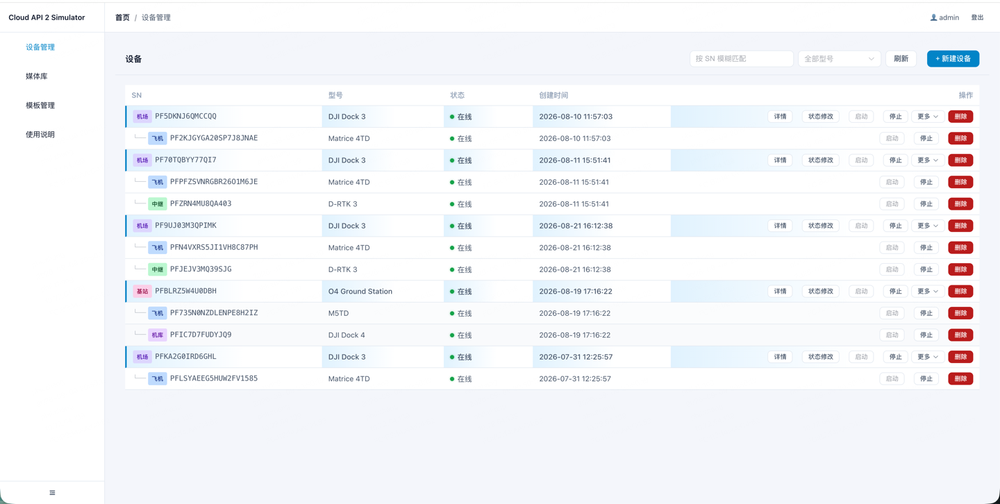
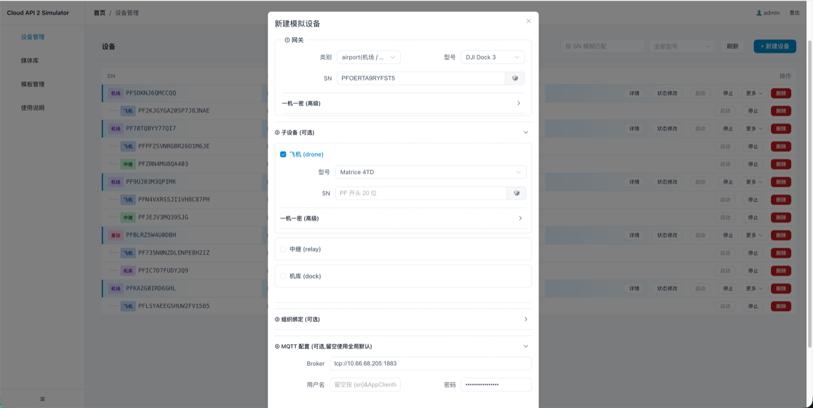
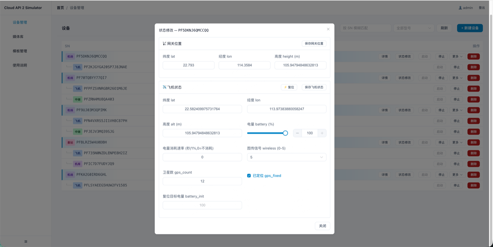
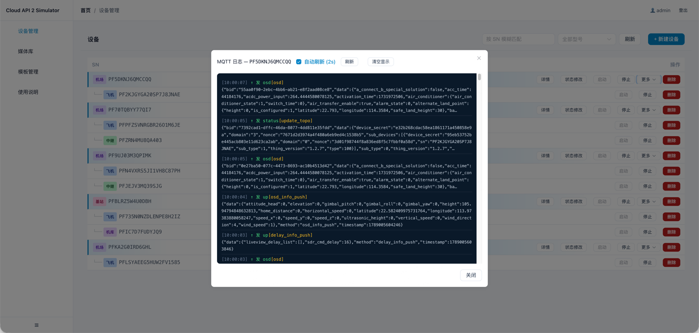
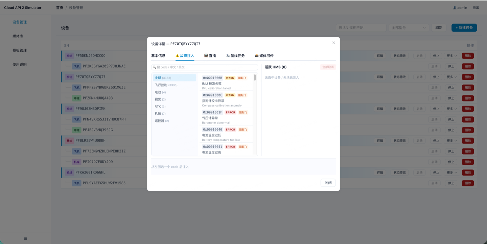
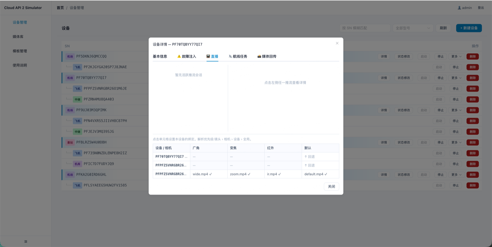
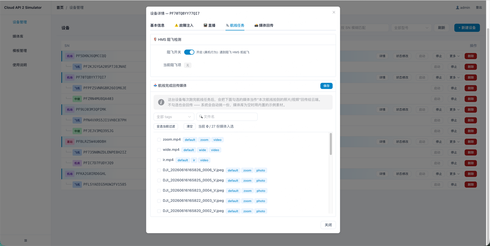
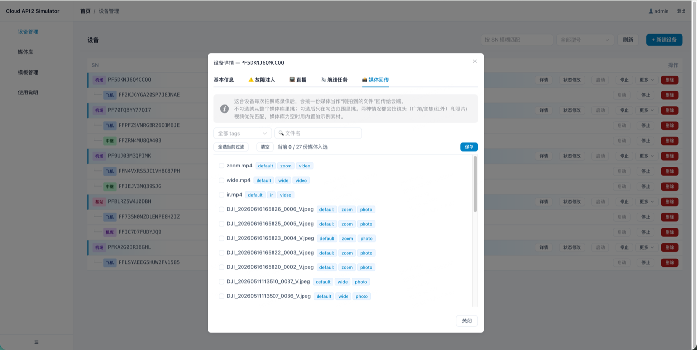
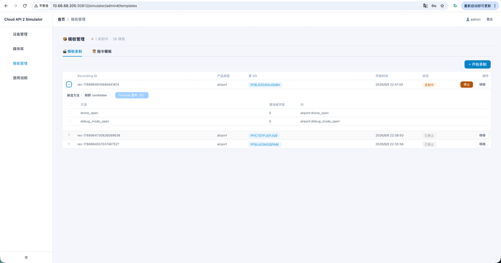

# 使用上云 API 2 设备模拟器

**上云 API 2 全新支持 DJI 设备模拟器功能**，无需真机即可完成云端功能的开发与联调。

## 1. 设备模拟器介绍

设备模拟器支持对大疆各型号机场和飞行器进行模拟，像真设备一样连接上云、上报状态、接收并响应指令。

### 支持的功能

- 直播与远程操控
- 执行航线任务与回传媒体文件
- 设备管理与调试
- 设备状态修改与故障注入
- 指令模板录制与管理

### 使用场景

| 场景 | 说明 |
| --- | --- |
| **没有真机也能联调** | 云端功能开发完，用它当对端把链路跑通 |
| **造出真机很难复现的场景** | 电量只剩 5%、图传信号断了、某个部件报故障 |
| **不受场地和天气限制** | 随时起飞、飞航线、拍照录像、推直播流 |
| **批量铺设备** | 一次造几十台，测云端的列表、调度、并发 |

## 2. 设备模拟器使用流程和支持的功能

### 2.1 设备模拟器使用流程

```
设备模拟器开启和登录  →  虚拟设备创建  →  虚拟设备设置和启停  →  设备虚拟调试
```

### 2.2 设备模拟器支持的功能

| 功能分类 | 具体能力 |
| --- | --- |
| **虚拟设备管理** | 新建设备、启动与停止虚拟设备、查看设备日志 |
| **媒体管理** | 上传和管理媒体文件 |
| **虚拟设备设置** | 修改设备状态、故障注入、直播设置、航线任务设置、媒体回传设置 |
| **虚拟设备调试** | 设备管理和设备运维、直播和远程操控、航线任务执行与媒体回传 |
| **指令模板录制** | 使用真实设备录制指令模板并在模拟器使用 |

## 3. 设备模拟器功能详细介绍

### 3.1 设备模拟器开启和登录

在服务器安装上云 API 2 服务包后，使用浏览器打开登录页：

```
http://{服务器IP}:30812/simulator/admin#/login
```

输入用户名和密码登录即可，默认账号为 `admin` / `Password@`。

:::tip
模拟器自带使用说明书，可通过 `http://{IP}:{端口号}/simulator/admin#/docs` 访问。其中 **IP** 为您服务器的 IP，**端口号**为您定义的后端服务端口，默认为 `30812`。
:::


### 3.2 虚拟设备设置和启停

支持新建设备、修改设备状态、启动和停止虚拟设备、查看设备日志等。

**设备管理页**



**新建设备**



**修改设备信息**



**查看设备日志**



### 3.3 设备虚拟调试 —— 故障注入、直播设置、航线任务设置、媒体回传设置

| 设置项 | 作用 |
| --- | --- |
| **故障注入** | 模拟设备异常报错 |
| **直播设置** | 选择上传的视频文件，模拟设备直播 |
| **航线任务设置** | 设置 HMS 阻飞，并选择航线任务完成后回传的媒体文件 |
| **媒体回传设置** | 选择航线任务完成后回传的媒体文件 |

**故障注入**



**直播设置**



**航线任务设置**



**媒体回传设置**



### 3.4 设备虚拟调试 —— 指令模板录制

虚拟设备之所以能响应云端指令，是因为内置了一批指令模板，每个模板描述「收到某个指令后该怎么响应，状态怎么变」。

如果云端下发的指令不在指令模板中，则设备无法响应。此时可以使用真实设备录制指令模板并添加到模拟器，后续模拟器即可响应该指令。



## 上一步

模拟器随底座一同部署，使用前需先完成：[部署上云 API 2 应用运行与设备管控底座](./02.deployment/00.index.md)

## 下一步

- [设备上云](./04.device-onboarding/00.index.md) — 接入真实设备
- [使用上云 API 2 AI Plugin 加速集成](./05.ai-plugin.md)
- [使用上云 API 2 二次开发 Demo](./09.demo/00.index.md)
