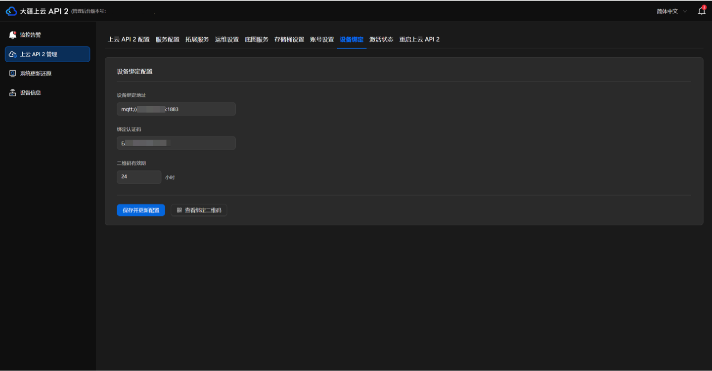
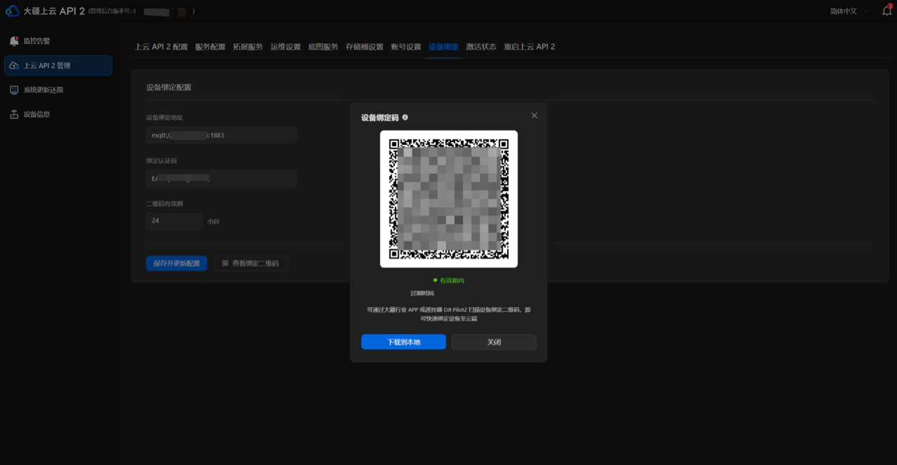
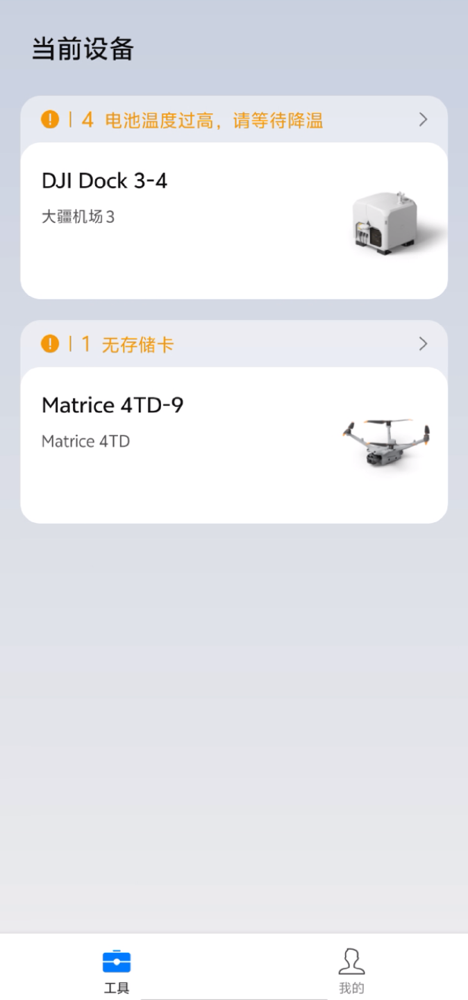
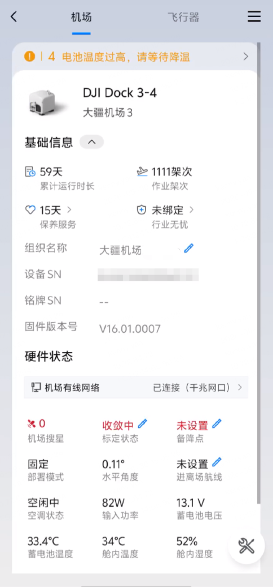
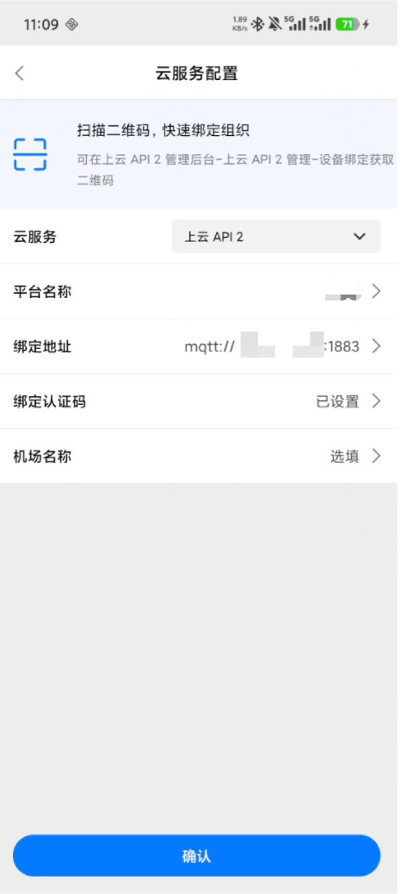
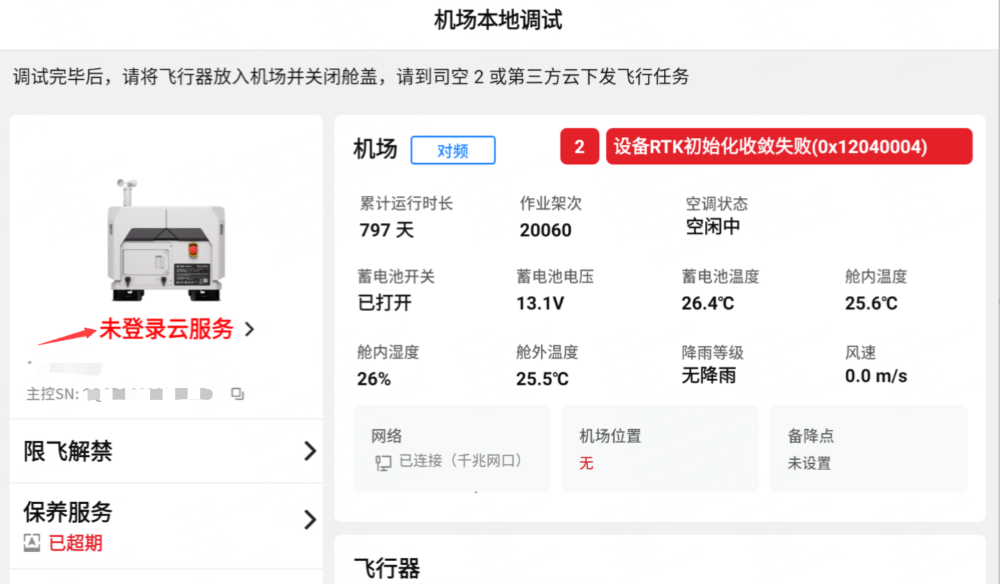
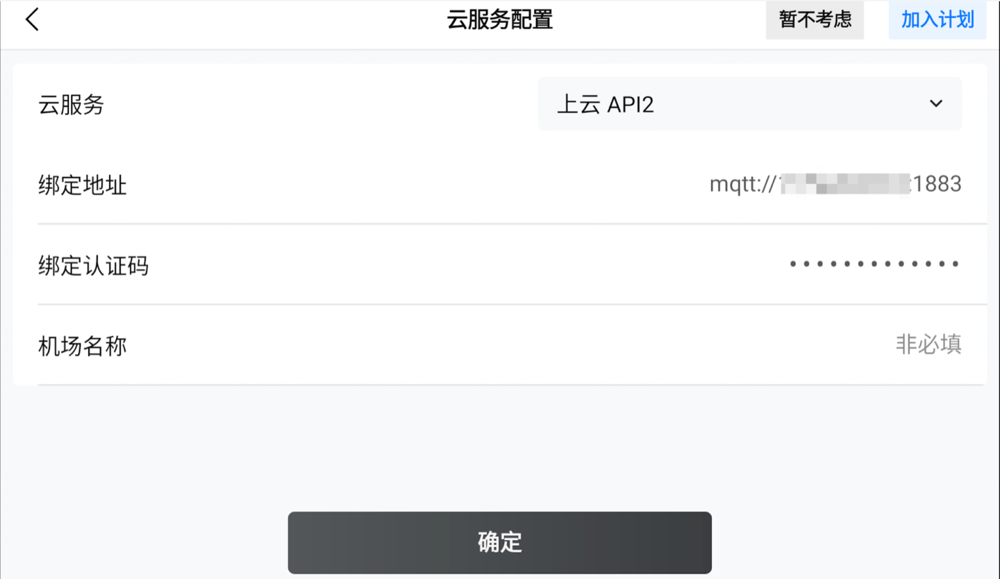

# 设备上云

您可通过大疆行业 App 或 DJI Pilot 绑定机场与飞行器，并将设备接入上云 API 2。

## 前置条件

- 已安装最新版本的大疆行业 App（适用于大疆机场 3/大疆机场 4）或 DJI Pilot（适用于大疆机场 1/大疆机场 2）
- 已完成飞行器与机场的绑定激活。
- 机场已接入有线或 4G 网络。
- 如果您的设备是大疆机场 4，在接入上云 API 2 前，需要完成**进离场航线**的设置（参考[大疆机场 4 进离场航线配置](./01.dock4-approach-departure-wayline.md)）。

## 获取绑定参数

绑定地址与绑定认证码在 AIO 管理后台的 `设备绑定` 页获取，两种上云方式都要用到。

- **设备绑定地址**：格式为 `mqtt://{IP 地址}:{端口}`，例如 `mqtt://47.96.69.xx:1883`
- **绑定认证码**：设备接入时的认证凭据
- **二维码有效期**：默认 24 小时，超期后需重新生成

点击 `查看绑定二维码`，可得到一张供 App 扫描的设备绑定二维码，扫码即可自动填入上述参数。

## 上云步骤

### 通过大疆行业 App 上云（适用于大疆机场 3/大疆机场 4）

1. 使用双头 USB-C 线**连接手机至机场**。

2. 在首页工具列表页面，**选择对应设备**。

   

3. 在设备详情页面，**点击 `组织名称` 后的 `编辑` 图标**。

   

4. 在云服务配置页面，**云服务选择 `上云 API 2`**。

5. 填写平台名称、绑定地址、绑定认证码、机场名称等信息，以下两种方式任选其一：

   **方式一：扫码自动填写（推荐）**

   在云服务配置页面**点击扫码入口**，扫描 AIO 管理后台的设备绑定二维码，参数自动填入，页面提示 `导入成功`。

   

   **方式二：手动填写**

   - **平台名称**：您在[申请许可证](../01.apply-license.md)时填写的平台名称
   - **绑定地址**：格式为 `mqtt://{IP 地址}:{端口}`，例如 `mqtt://47.96.69.xx:1883`
   - **绑定认证码**：在 AIO 管理后台 `设备绑定` 页获取
   - **机场名称**：可选，可根据实际需要自定义机场设备名称

6. 填写完毕后，**点击 `确认`** 即可完成上云操作。

### 通过 DJI Pilot 上云（适用于大疆机场 2/大疆机场 1）

1. 使用双头 USB-C 线**连接遥控器至机场**。

2. 在机场本地调试页，**点击 `登录云服务`**。

   

3. 进入云服务配置，**云服务选择 `上云 API 2`**，填写绑定地址、绑定认证码、机场名称等信息。

   

   - **绑定地址**：格式为 `mqtt://{IP 地址}:{端口}`，例如 `mqtt://47.96.69.xx:1883`
   - **绑定认证码**：在 AIO 管理后台 `设备绑定` 页获取
   - **机场名称**：可选，可根据实际需要自定义机场设备名称

4. 填写完毕后，**点击 `确定`** 即可完成上云操作。

## 上一步

设备上云前需先完成部署：[部署上云 API 2 应用运行与设备管控底座](../02.deployment/00.index.md)

## 下一步

设备接入完成后，请继续：[配置鉴权](../08.auth.md)
