# 使用上云 API 2 设备模拟器

**上云 API 2 全新支持 DJI 设备模拟器功能**，无需真机即可完成云端功能的开发与联调。

## 1. 设备模拟器介绍

设备模拟器是一台虚拟的大疆机场和无人机。它像真设备一样连上云端、上报状态、接收并响应指令，但不需要你手上真的有一台机场。

你需要另外准备的只有一个能访问的云端（司空或自建平台）——模拟器只负责扮演设备一侧。

### 支持的功能

- 虚拟设备创建、启停与批量铺设
- 物模型编辑：修改设备全部状态字段（位置、电量、图传、卫星数等）
- 故障注入、直播推流、航线任务、媒体回传
- 调试面板：手动下发指令、上报事件、推送物模型
- 媒体库：管理拍照与直播用的素材
- 场景管理：录制真机行为，抽取成场景并随时回放

### 使用场景

| 场景 | 说明 |
| --- | --- |
| **没有真机也能联调** | 云端功能开发完，用它当对端把链路跑通 |
| **造出真机很难复现的场景** | 电量只剩 5%、图传信号断了、某个部件报故障 |
| **不受场地和天气限制** | 随时起飞、飞航线、拍照录像、推直播流 |
| **批量铺设备** | 一次造几十上百台，测云端的列表、调度、并发 |
| **复现真机行为** | 录一段真机的交互，存成场景随时在虚拟设备上回放 |

## 2. 快速上手：5 分钟让一台设备上线

1. 打开「设备管理」→ 右上角「+ 新建设备」。
2. 「预设组合」选一套整机（例如「机场3 + M4TD」），表单会自动填好，机场和飞机一步到位。
3. **「一机一密」两个字段留空** —— 只有在云端正式注册过的设备才需要填，虚拟设备填了会被云端拒绝。
4. 点「创建」（默认勾选创建后立即启动），回到列表看状态变成绿色即表示已连上云端。
5. 去云端的设备列表确认它在线（最多等半分钟）。

走到这一步，说明设备、网络、云端三方都通了。

:::tip
预设组合选「自定义」可以自由拼组合：网关 + 最多 3 个子设备（飞机 / 中继 / 机库）。子设备的型号下拉会按网关型号自动过滤，只列真机上真实存在的组合。

很多功能（起飞、直播、航线）都需要机场下面有飞机才能用。
:::

## 3. 设备管理

### 3.1 开启和登录

在服务器安装上云 API 2 服务包后，使用浏览器打开登录页：

```
http://{服务器IP}:30812/simulator/admin#/login
```

默认账号为 `admin` / `Password@`，可通过 `SIMULATOR_ADMIN_USER` / `SIMULATOR_ADMIN_PASSWORD` 环境变量覆盖。

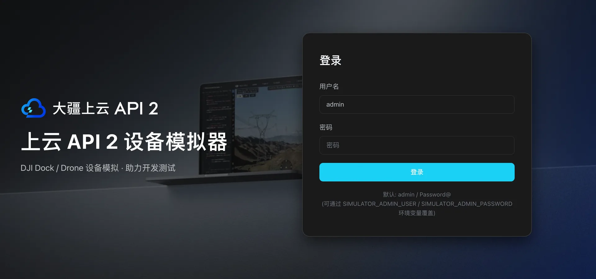

:::tip
模拟器自带使用说明书，登录后点左侧「使用说明」，或通过 `http://{IP}:{端口号}/simulator/admin#/docs` 访问。其中 **IP** 为您服务器的 IP，**端口号**为您定义的后端服务端口，默认为 `30812`。
:::

### 3.2 设备列表

「设备管理」是主界面，所有设备在这里创建和控制。列表按网关与子设备的从属关系分层展示，支持按 SN 模糊匹配和按型号过滤。

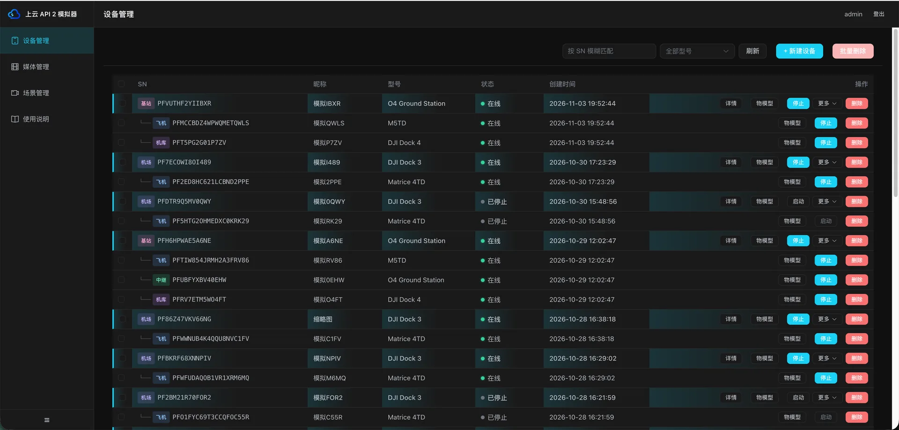

每行可执行的操作：

| 操作 | 说明 |
| --- | --- |
| **启动 / 停止** | 一个按钮来回切，相当于给设备通电断电。启动后才会连云端 |
| **详情** | 打开这台设备的功能面板（故障注入、直播、航线任务、媒体回传） |
| **物模型** | 打开状态编辑面板。每一台设备都有，不只是网关 |
| **更多 ▾** | 查看日志、编辑拓扑（增删子设备 / 改绑定）、打开调试面板 |
| **删除 / 批量删除** | 勾选多台后批量删 |

### 3.3 新建设备

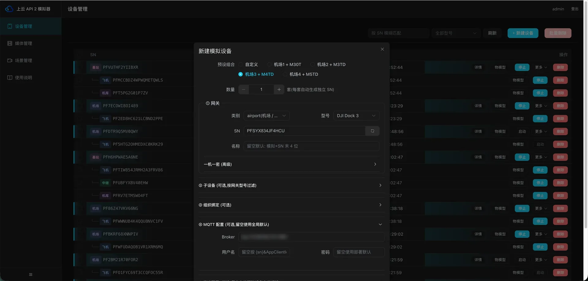

| 字段 | 说明 |
| --- | --- |
| **预设组合** | 一键选一套官方整机组合（机场1 + M30T / 机场2 + M3TD / 机场3 + M4TD / 机场4 + M5TD），自动填表 |
| **数量** | 选了预设后可以填套数（最多 50 套），每套自动生成互不重复的编号，用来批量铺设备 |
| **SN** | 设备的唯一编号，点随机生成即可。生成的编号带 `PF` 开头，方便在云端一眼认出哪些是虚拟设备 |
| **型号** | 决定这台设备「是什么」，云端会据此显示对应的机型 |
| **子设备** | 给网关配飞机 / 中继 / 机库，省得再单独建一遍 |
| **一机一密** | 虚拟设备留空，详见[快速上手](#_2-快速上手-5-分钟让一台设备上线)第 3 条 |
| **组织绑定 / MQTT 配置** | 不填就用部署时的默认配置，一般不用管 |

### 3.4 物模型：修改设备状态

点列表里的「物模型」打开。这里能看到并修改设备全部的状态字段，不只是位置、经纬度、高度、电量、图传信号、卫星数这些常用项 —— 模板里有多少字段就列多少。

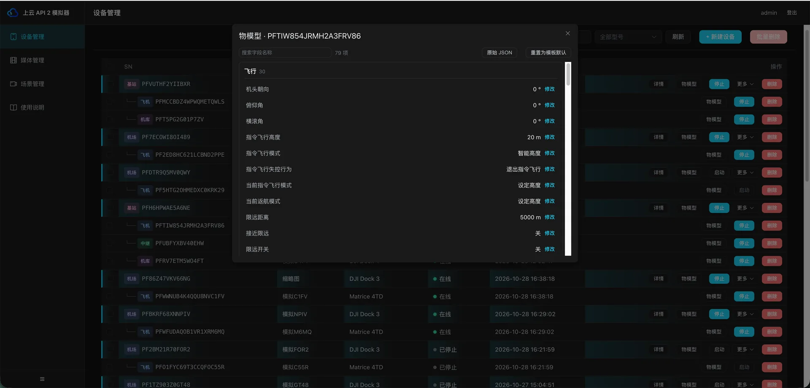

- **耗电速率**可以调快让电量迅速掉下去（方便测低电量告警），填 `0` 则电量不消耗。
- 飞机还有**一键复位**，把飞机恢复成满电、待机的初始状态。
- 设备没启动也能改，改动会存下来，下次启动时带上。
- 改完立刻生效：飞行类字段（电量、位置）直接写进飞行引擎不会被冲掉，其余字段合并进下一次状态上报。
- 右上角支持切换到**原始 JSON** 编辑，或**重置为模板默认**。

### 3.5 设备日志

「更多 ▾ → 日志」会实时滚动这台设备与云端往来的每一条消息，是排查问题最直接的地方。支持自动刷新、手动刷新与清空显示。

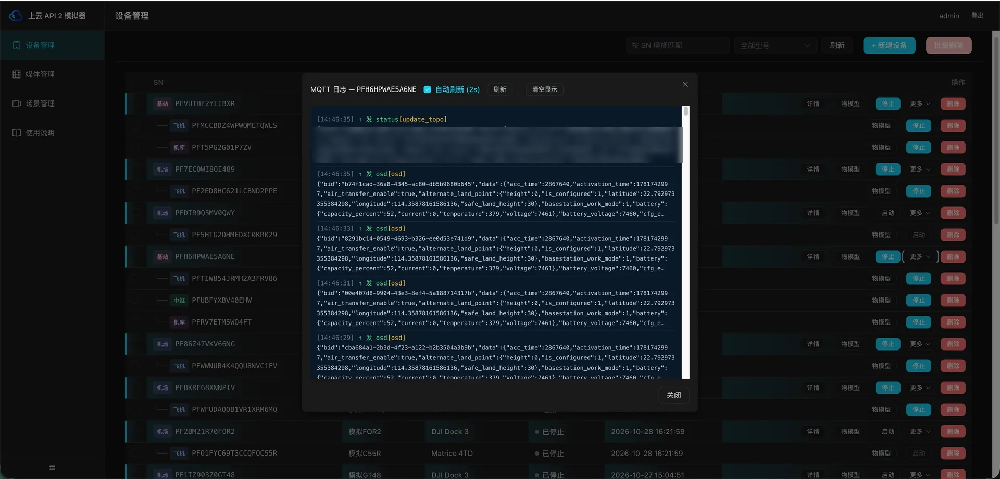

## 4. 设备详情：故障注入 / 直播 / 航线任务 / 媒体回传

在设备列表点网关行的「详情」打开，里面按功能分成几个面板。

| 设置项 | 作用 |
| --- | --- |
| **故障注入** | 模拟设备异常报错 |
| **直播** | 选择上传的视频文件，模拟设备直播 |
| **航线任务** | 设置 HMS 阻飞，并选择航线任务完成后回传的媒体文件 |
| **媒体回传** | 选择设备平时拍照录像时回传的媒体文件 |

### 4.1 故障注入

让设备报一个故障给云端，用来测云端的告警、阻飞等逻辑。左侧按部件分类（飞行控制、电池、视觉、RTK、机场、遥控器），中间是故障码列表（可按 code / 中文 / 英文搜索），右侧是当前正在报的故障，随时可以单条或全部取消。

注入时可以设置级别（WARN / ERROR），并设定周期、开始时间与结束时间；留空就是立即开始、一直报到手动取消。

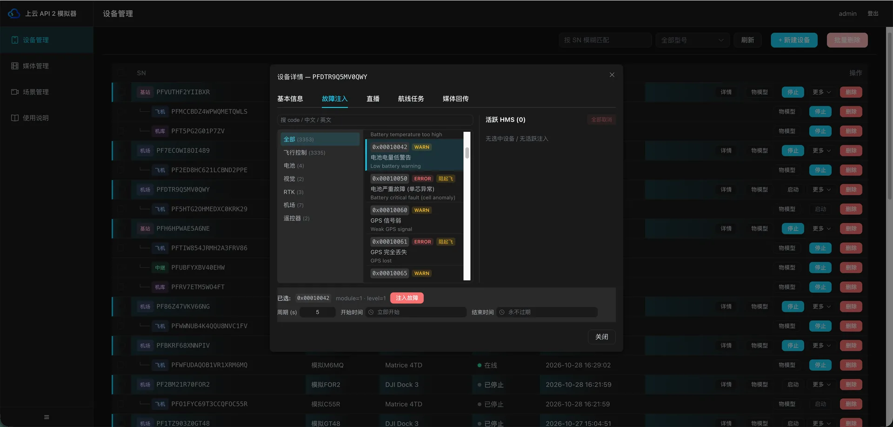

### 4.2 直播

让飞机推一路视频流给云端。上方是当前正在推的流，能看到推流地址、用的哪个视频文件，也可以强制断掉。

下方是**绑定矩阵**：一行一个相机（机场盖板相机、FPV 辅助影像、主云台相机），列是镜头（广角 / 变焦 / 红外），点单元格指定这个镜头推流时该播哪个视频文件。不设也能推 —— 会用内置的示例视频。

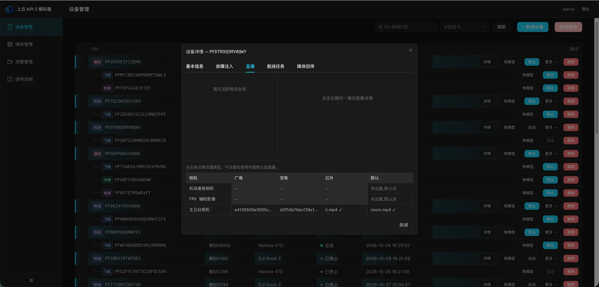

### 4.3 航线任务

云端下发航线后，飞机会自动飞（下载航线 → 开盖 → 起飞 → 按航点飞 → 自动拍照 → 上报进度），暂停 / 恢复 / 返航 / 取消都支持。这个面板控制两件事：

- **HMS 阻飞检测** —— 打开后，只要有严重故障就拒绝起飞（和真机一样）；关掉则忽略故障强行起飞，方便调试。
- **航线完成回传媒体** —— 这台设备每次跑完航线任务后，把勾选的媒体当作「本次航线拍到的照片/视频」回传给云端。

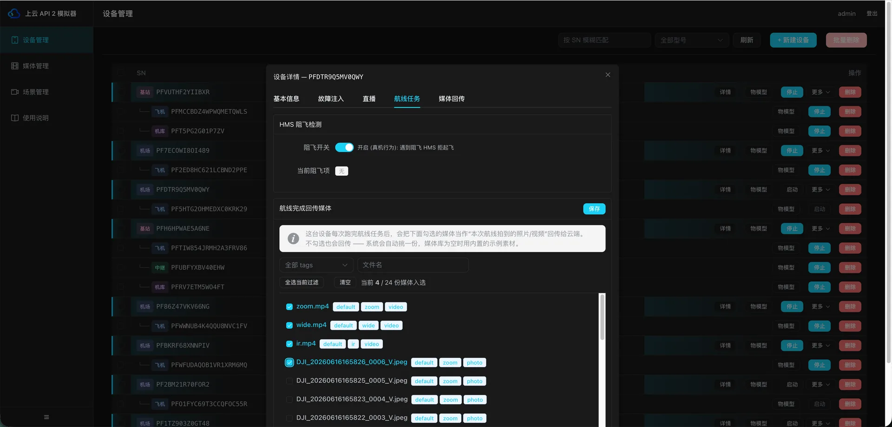

### 4.4 媒体回传

真设备拍完照会把文件传给云端。虚拟设备没有真的镜头，所以是从媒体库里挑一份现成的文件冒充刚拍的。两个地方可以设置，作用不同：

- **「媒体回传」面板** —— 管这台设备平时拍照录像时回传什么。
- **「航线任务」里的回传媒体** —— 管这台设备跑完一趟航线后回传什么。

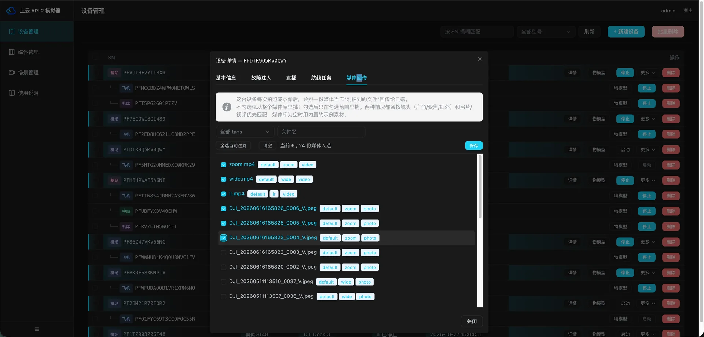

:::tip
两处都不设置也没关系：系统会自动从媒体库里挑，媒体库为空时就用内置示例文件，不会出现「云端等不到文件」的情况。
:::

## 5. 调试面板：手动发指令、报事件

「更多 ▾ → 调试」打开调试面板（设备要在线）。三个页签，都是模拟某一端的行为来验证链路：

| 页签 | 用途 |
| --- | --- |
| **指令** | 模拟云端向这台设备下发一条指令，效果和云端真的发下来完全一样。填指令名（比如 `cover_open` 开舱盖）和参数 JSON，设备的回复在「日志」里看。适合云端不方便操作时单独验证某个指令 |
| **事件** | 让设备主动向云端「汇报」一条事件（不关联任何指令），用来复现特定场景 |
| **物模型** | 以原始 JSON 的方式改设备上报的状态。「更新设备状态」把改动写进设备（之后每次上报都带新值，常用）；「只推送改动」只发一次给云端、不改设备自身状态，适合临时试探云端的反应 |

模拟器支持的指令清单可在「使用说明 → 目前支持的指令」中查看。

## 6. 媒体管理

「媒体管理」放的是给虚拟设备「充当拍摄结果」的图片和视频。设备要回传照片或推流时，就从这里取。

上传时的标签含义：

- **适用镜头**（广角 / 变焦 / 红外）—— 设备用哪个镜头拍，就优先回传标了对应镜头的素材，可多选。
- **照片还是视频** —— 拍照时优先回传照片，录像时优先回传视频。
- **自定义标签** —— 纯粹方便自己在库里分类搜索，不影响设备挑哪一份。

标签只是「优先匹配」，不是硬性过滤。实在找不到完全匹配的，系统会退而求其次挑一份可用的，不会让回传落空。

点列表里的任意一行，会显示它当前被绑定在哪些设备、哪些镜头上。**删除文件时会一并解除这些绑定，请留意。**

## 7. 场景管理：把真机行为录下来，随时回放

「场景管理」分三个页签：**场景库 / 录制 / 回放**。核心思路是把真机的真实行为变成可复用的资产：录一段 → 抽成场景 → 随时在虚拟设备上复现。

典型用途是**异常场景回归** —— 大风返航、舱盖卡住、RTK 无法定位这类真机上很难重演的情况，录一次，以后反复回放。

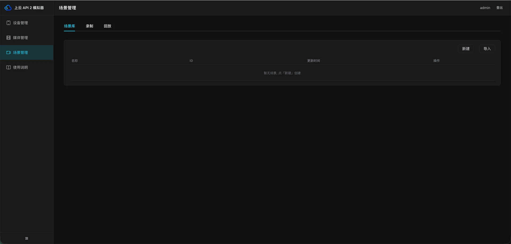

### 7.1 第一步：录一段真机交互

前提：手上有一台能正常工作的真设备，并且能让它执行你想录的操作。

在「录制」页签填真设备的 SN 和录制时长（`0` = 一直录到手动停止，单设备最长 24h），点「开始录制」后，立刻去云端对真设备下发你要录的指令（别等到时间快结束才操作）。录制中随时可以点「停止」，列表里能看到每段录制的状态。

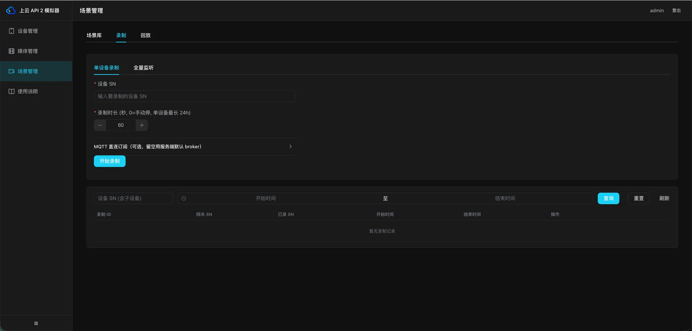

也可以切到「全量监听」，录下整台 broker 上所有设备的消息。「剔除模拟器自建设备」打开后只录真实设备，关闭则全量保留。

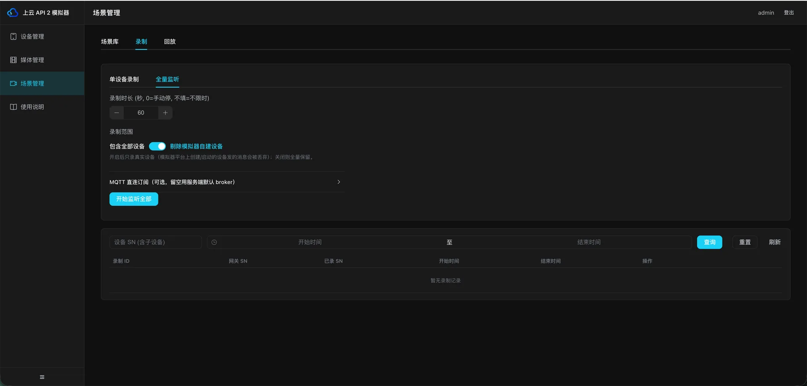

:::tip
录制是旁路「旁听」，不影响真设备工作。录制默认保留 7 天，重要的点「永久保留」；也可以在「MQTT 直连订阅」里临时填别的 broker 地址和账号，录别的环境。
:::

### 7.2 第二步：看看录到了什么

录制列表点「查看」打开消息流抽屉：按设备 / 方向（上行下行）/ topic 关键字过滤浏览每一条消息，「涉及的指令」表列出这段录制里出现过的所有指令，还可以把整段消息导出成文件慢慢分析。

### 7.3 第三步：抽取成场景

录制行点「抽取成场景」（或者在抽屉里对着某个指令点「抽取此项」），填场景名与产品类型，抽取模式三选一：

| 模式 | 说明 |
| --- | --- |
| **全部**（推荐） | 时间线 + 指令触发 |
| **仅时间线** | 按原时间顺序重放 |
| **仅指令触发** | 云端发指令时才触发 |

还可选择缩小时间窗口、只纳入部分设备、只抽取部分指令（留空 = 全部）。点「预览」看会生成多少个触发器和步骤，确认后抽取。

录制里写死的真机编号会被自动替换成占位符，回放时再绑定到当时的虚拟设备 —— 同一个场景可以用在任何设备上。

### 7.4 第四步：回放

场景库点「回放」→ 配置对话框：勾上「自动创建目标设备」就会新建一套设备来演这个场景（推荐），也可以选已有设备，还能设倍速。回放开始后在「回放」页签看进度条，可暂停 / 恢复 / 停止。

**回放结束设备不会自动删除**，不需要时请手动删。

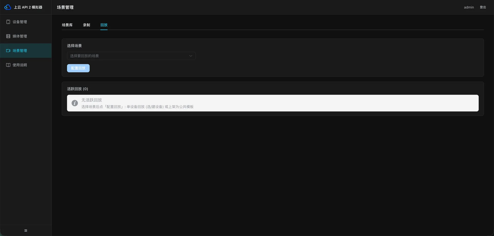

### 7.5 上架为公共模板

回放配置对话框里还有一个「上架为模板」页签：把场景里的指令触发规则发布出去，之后这个型号的所有设备（包括已经创建的）收到同样指令时都会按场景脚本响应，立即生效，不用重启。不用了在场景库点「下架」。

:::tip
这是给设备「补新行为」的推荐方式 —— 以前要改模板文件重编部署，现在录一段、抽出来、上架就完事。
:::

场景库还支持：在线编辑场景 YAML（时间线、触发规则、占位符都是明文可改的）、导出 / 导入 zip 把场景分享给别的环境或同事、重命名与删除。

## 8. 常见问题排查

**设备上不了线 / 云端看不到**，按最常见的原因往下排：

1. **一机一密填错了** —— 占绝大多数。如果这个 SN 从没在云端注册过，把这两个字段清空即可；如果注册过，那必须和云端后台里的值一字不差。
2. **某个子设备的 SN 云端不认** —— 机场上报时会带上它名下所有子设备，只要有一个云端不认，整台机场都会被拒。验证办法：新建一台不带任何子设备的机场，看能不能上线；能的话再逐个把子设备加回去，就能定位到是哪一个。
3. **设备状态是红色 / ERROR** —— 打开「更多 ▾ → 日志」看具体报错。
4. **日志里一条消息都没有** —— 说明根本没连上云端，属于网络或部署配置问题，需要找部署这套服务的同学看。
5. **云端页面没刷新** —— 偶尔云端会缓存设备列表，强制刷新一下页面。

排查到第 2 步还没解决的话，把设备 SN 和日志内容一起发给开发同学，会快很多。

**其它常见疑问**

| 问题 | 解答 |
| --- | --- |
| SN 能改吗？ | 不能，它是设备的身份。要改只能删了重建 |
| 云端发的指令设备没反应？ | 先看「使用说明 → 目前支持的指令」里有没有这个指令；有的话打开日志确认收到了没有。也可以用[场景管理](#_7-场景管理-把真机行为录下来-随时回放)录一段真机行为补上这个指令 |
| 飞机相关功能是灰的？ | 检查这台机场下面是不是没有飞机，或者飞机没启动 |
| 直播报「没有可用媒体」？ | 该镜头没绑定视频文件 —— 去详情 → 直播的绑定矩阵里设一个，或不管它用内置示例流 |

## 上一步

模拟器随底座一同部署，使用前需先完成：[部署上云 API 2 应用运行与设备管控底座](./03.deployment/00.index.md)

## 下一步

- [设备上云](./06.device-onboarding/00.index.md) — 接入真实设备
- [使用航线转换工具](./05.DJI-enterprise-toolkit/01.wayline-convert-tool.md) — 把已有航线转换到新机型
- [使用上云 API 2 AI Plugin 加速集成](./07.ai-plugin.md)
- [使用上云 API 2 二次开发 Demo](./11.demo/00.index.md)
