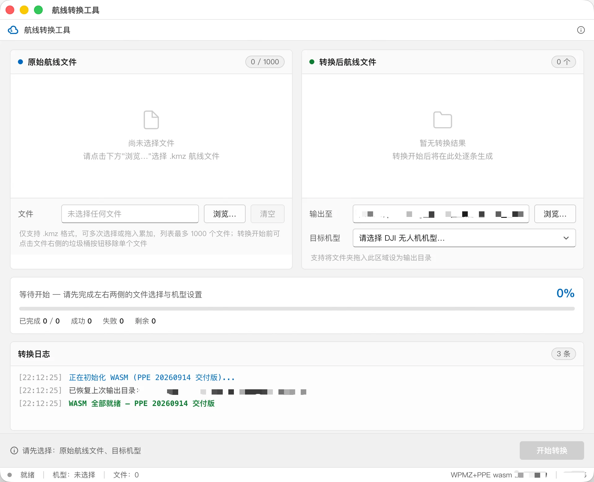
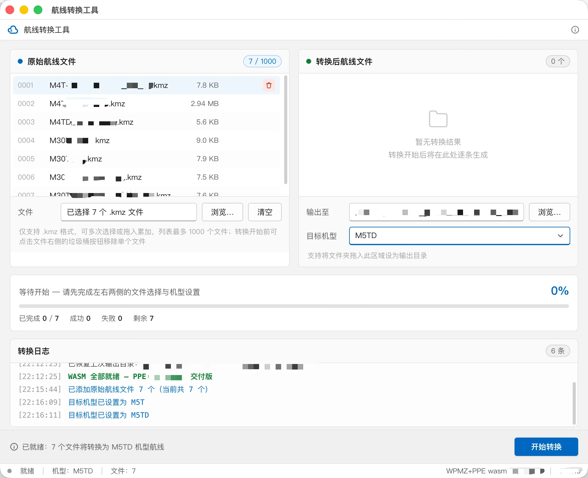
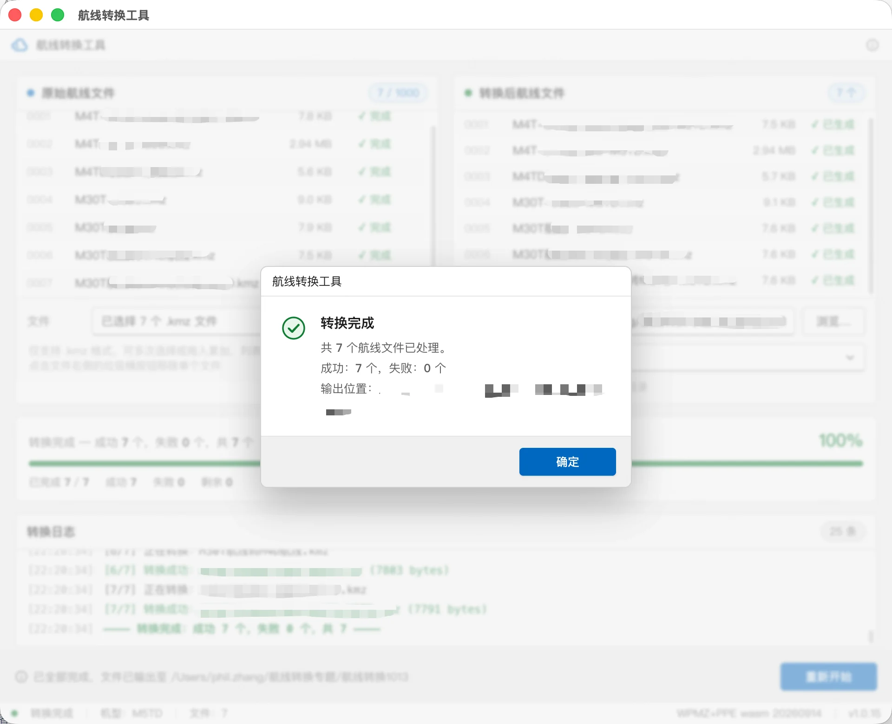
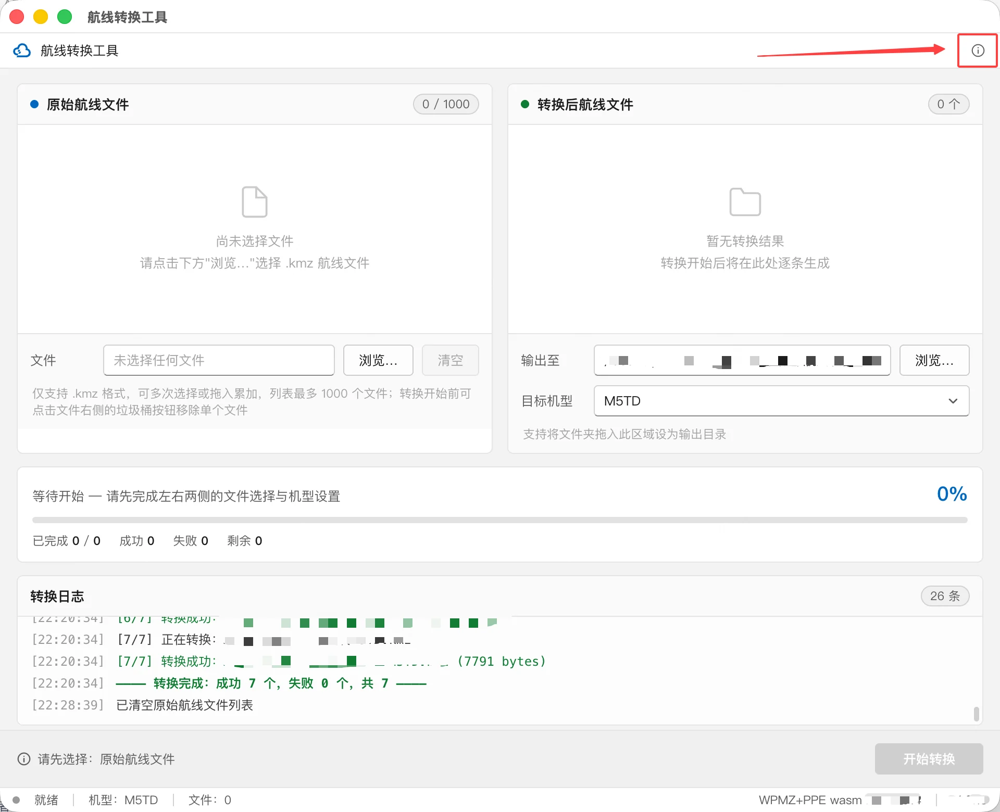
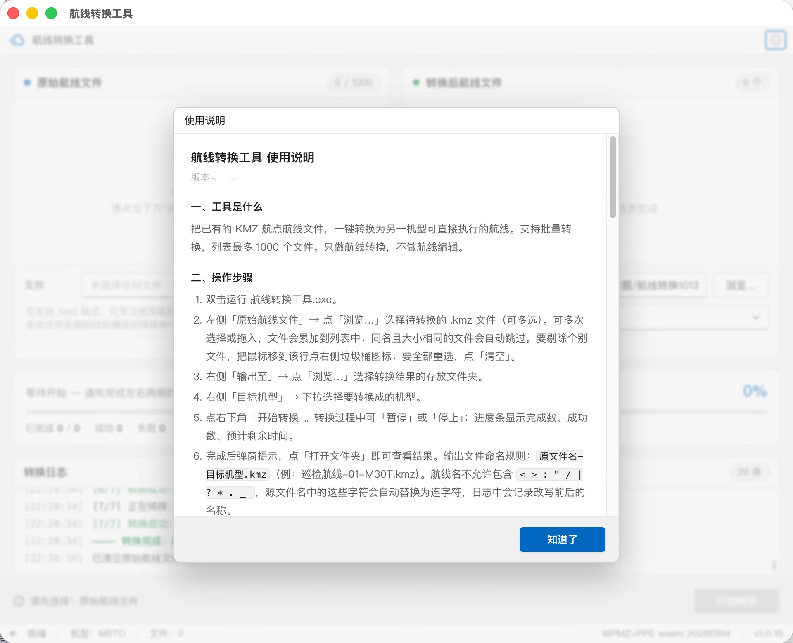
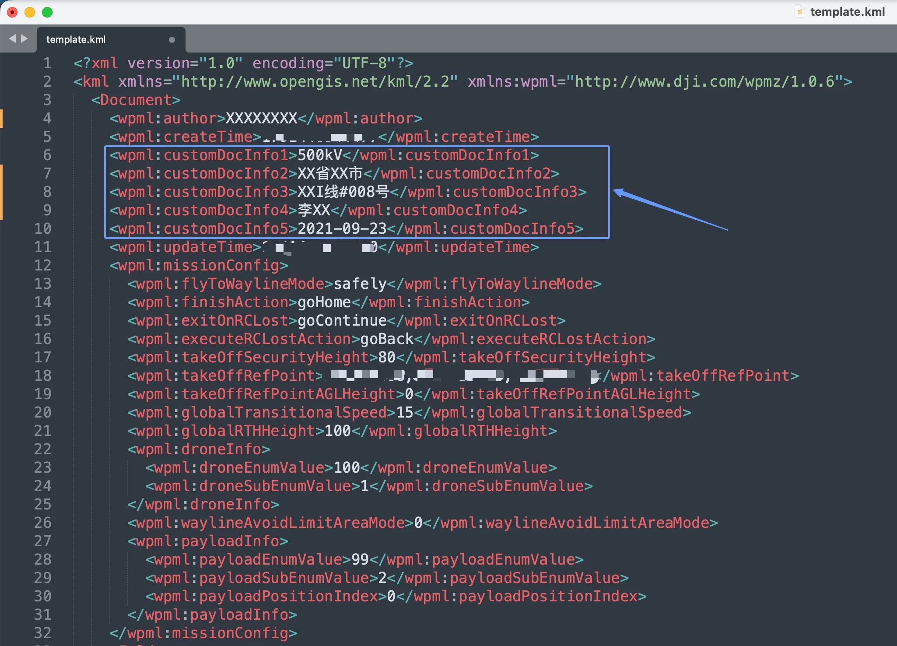
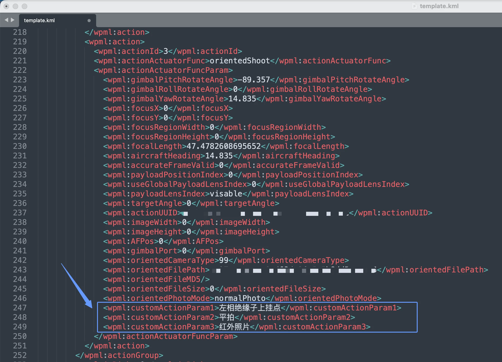

# 航线转换工具

**航线转换工具**把已有的 KMZ 航点航线文件一键转换为另一机型可直接执行的航线，支持批量处理，单次列表最多 1000 个文件。

:::tip
本工具只做航线转换，不做航线编辑。如需编辑航线，请使用[航线编辑组件](../08.frontend/02.wayline.md)。
:::

## 1. 航线转换工具介绍

设备换代后，原有航线在新机型上执行出现多拍、少拍、拍照模糊、拍偏等不兼容问题。本工具读取 KMZ 航线文件，按目标机型的机身尺寸、云台安装位置、镜头组合与能力边界重新计算航点与动作参数，输出可直接执行的新航线。

本工具为桌面端程序，当前仅提供 Windows 版 `.exe` 程序，需在 Windows 电脑上运行。

### 支持的功能

- 批量转换 KMZ 航点航线，单次最多 1000 个文件
- 以云台转动中心为基准对齐航点坐标，保证拍照位置不变
- 自动对齐拍照动作、补偿云台 yaw、换算焦距
- 超出目标机型能力时自动取限位值，不中断转换
- 保留航线文件中的用户自定义字段
- 实时进度与逐条转换日志

### 使用场景

| 场景 | 说明 |
| --- | --- |
| **机队换代** | 老机型航线资产平移到新机型，无需重新规划 |
| **批量迁移** | 一次导入上千条航线，统一转换为目标机型 |
| **多机型协同** | 同一巡检任务下发给不同机型执行 |

## 2. 航线转换工具使用流程和支持范围

### 2.1 航线转换工具使用流程

```
选择原始航线文件  →  设置输出目录与目标机型  →  开始转换  →  查看转换结果
```

### 2.2 支持范围

| 项目 | 支持情况 |
| --- | --- |
| **航线类型** | 仅支持航点航线 |
| **转换方向** | 老机型 → 新机型 |
| **文件格式** | 仅支持 KMZ 格式 |
| **单次数量** | 最多 1000 个文件 |

**支持的机型**

| 机型系列 | 具体机型 |
| --- | --- |
| **M30 系列** | M30、M30T |
| **M3 系列** | M3E、M3T、M3TA |
| **M3D 系列** | M3D、M3TD |
| **M4 系列** | M4E、M4T |
| **M4D 系列** | M4D、M4TD |
| **M5 系列** | M5T |
| **M5D 系列** | M5TD |

:::warning
不支持第三方自定义格式航线（如 json 格式航线）。

输入的 KMZ 文件中必须包含完整可用的 `template.kml` 和 `waylines.wpml`。如果缺少 `template.kml`，或 `template.kml` 内容缺失、格式错误，将无法正常转换。
:::

## 3. 航线转换工具功能详细介绍

### 3.1 启动工具

双击运行 `航线转换工具.exe`，进入工具主界面。

界面分为四个区域：左上为**原始航线文件**列表，右上为**转换后航线文件**列表与输出设置，中部为**进度区**，下方为**转换日志**。



### 3.2 选择原始航线文件

在左侧「原始航线文件」区域点击「浏览…」，选择待转换的 `.kmz` 文件，支持多选。

| 操作 | 说明 |
| --- | --- |
| **累加选择** | 可多次选择或直接拖入，文件会累加到列表中 |
| **自动去重** | 同名且大小相同的文件会自动跳过 |
| **移除单个** | 鼠标移到该行，点击右侧垃圾桶图标 |
| **全部重选** | 点击「清空」按钮 |

:::tip
非 `.kmz` 格式的文件会被忽略。列表总数上限为 1000 个，达到上限后新增的文件不会加入，需先移除部分文件。
:::

### 3.3 设置输出目录与目标机型

在右侧区域完成两项设置：

- **输出至** —— 点击「浏览…」选择转换结果的存放文件夹，也可直接把文件夹拖入该区域
- **目标机型** —— 下拉选择要转换成的机型

两项设置完成且已选择原始文件后，右下角「开始转换」按钮变为可用状态，底部状态栏会显示待转换的文件数与目标机型。



### 3.4 执行转换

点击右下角「开始转换」。转换过程中：

- 进度条显示完成数、成功数、失败数与剩余数量
- 可随时点击「暂停」或「停止」
- 「转换日志」逐条记录每个文件的转换过程与耗时

转换完成后弹窗提示本次处理结果，点击「打开文件夹」即可查看输出文件。



**输出文件命名规则**

```
原文件名-目标机型.kmz
```

例如：`巡检航线-01-M5TD.kmz`。

:::warning
航线名不允许包含 `< > : " / | ? * . _` 这些字符。源文件名中如含有上述字符，会自动替换为连字符，日志中会记录改写前后的名称。
:::

### 3.5 查看内置使用说明

点击界面右上角的信息图标，可随时查看工具内置的使用说明。



内置说明包含工具简介、操作步骤、支持范围、重要提示等完整内容，与本文档保持一致。



## 4. 重要提示：转换后航点位置会发生变化

转换后，航线文件中的航点经纬度和高度会与原航线不同，**这是正常现象**。

### 4.1 为什么会变化

无人机的定位点在**机身**位置，而真正拍照的是**相机镜头**。不同机型的机身尺寸和云台安装位置不同，如果航点坐标原样不动，镜头的实际位置就会偏移，导致拍照拍偏。

本工具以**云台转动中心**为基准做对齐：保证转换前后相机所在位置不变，因此反推出的航点坐标必须相应平移。

### 4.2 偏移量范围

| 偏移方向 | 最大偏移距离 |
| --- | --- |
| **三维综合** | 约 6.5 厘米 |
| **水平方向** | 约 6.2 厘米 |
| **垂直方向** | 约 5.8 厘米 |

偏移方向随该航点的机头朝向而变化。该偏移量远小于航线安全间距，正常作业不受影响。

:::warning
- 请勿用坐标是否完全一致来判断转换是否成功
- 贴近设备作业（如近距离绕柱、狭窄空间）时，建议首飞现场观察确认
- 受 M5 系列 3x 镜头硬件变更影响，转换到 M5 系列后拍摄的 3x 照片，画面会比原机型的 3x 照片略小一些、拍摄目标物在画面中更大一些
:::

## 5. 其他自动处理的内容

| 处理项 | 说明 |
| --- | --- |
| **拍照动作对齐** | 不同机型镜头组合不同（广角/变焦/可见光/红外），工具会自动拆分或合并拍照动作，保证转换前后照片数量一致。转换到 M3 系列（航线内不支持拍照设置）时，会删除航线中的拍照设置，实际拍照跟随遥控器的设置 |
| **云台 yaw 补偿** | M3D、M4D、M5D 等机型云台不支持 yaw 转动，工具会用机身 yaw 转动补偿，保证拍照角度基本一致 |
| **焦距换算** | 保持变焦倍数一致，根据不同机型镜头特点对 `focalLength` 进行修改 |
| **超出能力自动限位** | 云台俯仰角、变焦倍数超出目标机型极限值时，自动使用该机型的极限值，不会导致转换失败 |
| **能力差异处理** | 目标机型不支持的动作直接删除，不阻止转换；新机型的新能力（如避障绕行、红外拍照）不会自动开启，保持与原航线一致 |
| **保留自定义字段** | 航线文件中的用户自定义字段不会被删除，详见[保留用户自定义字段](#_6-保留用户自定义字段) |

## 6. 保留用户自定义字段

航线转换过程中，工具**不会删除**用户自定义字段，字段内容原样保留到输出文件中。

KMZ 航线文件中支持在两处位置添加用户自定义字段，且**仅支持写在 `template.kml` 中**，写在 `waylines.wpml` 中的自定义字段不受支持。

| 位置 | 所在节点 | 作用范围 | 字段名 | 数量上限 |
| --- | --- | --- | --- | --- |
| **位置 1** | `<Document>` | 整条航线 | `customDocInfo1` ~ `customDocInfo5` | 5 个 |
| **位置 2** | `<wpml:action>` 下的 `<wpml:actionActuatorFuncParam>` | 单个航点动作 | `customActionParam1` ~ `customActionParam3` | 3 个 |

:::warning
字段名是**固定**的，必须严格使用上表列出的名称。使用其他自定义字段名时，工具不保证保留。
:::

### 6.1 位置 1：整条航线级自定义字段

在 `template.kml` 的 `<Document>` 节点中添加，用于为整条航线附加总体信息。每条航线最多支持 5 个。

**字段格式**

```xml
<wpml:customDocInfo1>{用户自定义内容1}</wpml:customDocInfo1>
<wpml:customDocInfo2>{用户自定义内容2}</wpml:customDocInfo2>
<wpml:customDocInfo3>{用户自定义内容3}</wpml:customDocInfo3>
<wpml:customDocInfo4>{用户自定义内容4}</wpml:customDocInfo4>
<wpml:customDocInfo5>{用户自定义内容5}</wpml:customDocInfo5>
```

**示例**

下图为在 `<Document>` 中添加电压等级、所在地区、线路编号、负责人、建档日期等航线级信息：



### 6.2 位置 2：航点动作级自定义字段

在 `template.kml` 的 `<wpml:action>` 节点下的 `<wpml:actionActuatorFuncParam>` 中添加，用于为单个航点动作附加信息。每个 `actionActuatorFuncParam` 最多支持 3 个。

**字段格式**

```xml
<wpml:customActionParam1>{用户自定义内容1}</wpml:customActionParam1>
<wpml:customActionParam2>{用户自定义内容2}</wpml:customActionParam2>
<wpml:customActionParam3>{用户自定义内容3}</wpml:customActionParam3>
```

**示例**

下图为在某个拍照动作的 `<wpml:actionActuatorFuncParam>` 中添加拍摄部位、拍摄角度、照片类型等动作级信息：



### 6.3 使用规则

| 规则 | 说明 |
| --- | --- |
| **转换不删除** | 航线转换时，上述自定义字段原样保留，不会被删除或改写 |
| **大疆不使用** | DJI 软件和飞行器不读取、不使用这些字段的内容，完全由用户自行定义和使用 |
| **仅限 template.kml** | 写在 `waylines.wpml` 中的自定义字段不在支持范围内 |
| **字段名固定** | 只有上表列出的固定字段名受支持，其他命名不保证保留 |

## 7. 使用建议

1. **转换前备份原始航线文件**。工具不会修改原文件，但建议保留备份。
2. **首次批量转换后先实地验证**。建议选一条航线试飞，确认拍照位置与清晰度无误后再全量投入作业。
3. **关注转换日志**。日志逐条记录每个文件的转换结果，可用于核对哪些文件被改写了航线名、哪些动作被删除。

## 下一步

- [设备上云](../06.device-onboarding/00.index.md) — 接入真实设备后执行转换好的航线
- [航线机型转换 SDK](../09.sdk/features/wayline/wayline-convert.md) — 同等转换能力的 SDK 接口，适合集成到自有系统
- [航线编辑组件](../08.frontend/02.wayline.md) — 在前端组件中编辑和管理航线
- [航线与航线任务](../09.sdk/features/wayline/wayline-asset-manage.md) — 通过 SDK 管理航线资产与下发任务
