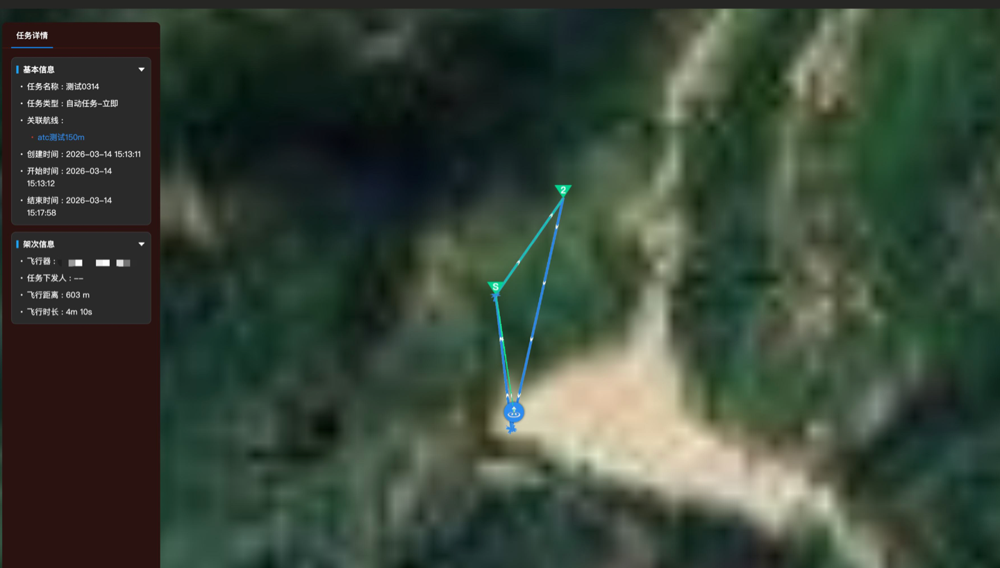
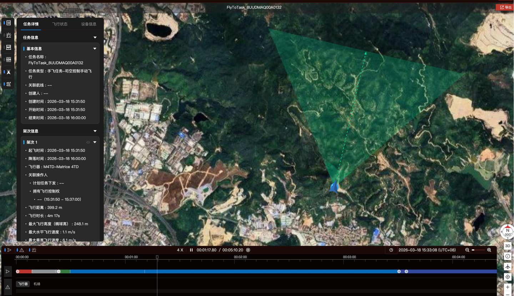

# 飞行记录

飞行记录组件（`FlyDataReplay`）用于展示无人机的历史飞行数据，包括飞行时间、飞行时长、飞行轨迹和回放等信息。组件自带 SDK 资源，不依赖 `paas.js`。

接入前请先完成 [集成前端组件](./00.index.md) 中的前置准备。

## 1. 引入 SDK 资源

回放组件需要加载 **Cesium** 和 **SDK 自身两个文件**（将 `[服务器地址]` 替换为你的前端服务地址）。运行时依赖库（WPMZ/PPE 等 WASM）已打包进 SDK，实例化时自动注入，无需手动引入：

```html
<!-- 1. Cesium 全局（提供 window.Cesium） -->
<link rel="stylesheet" href="http://[服务器地址]/paasjs-demo/sdk-runtime/cesium/Widgets/widgets.css">
<script src="http://[服务器地址]/paasjs-demo/sdk-runtime/cesium/Cesium.js"></script>

<!-- 2. FlyDataReplay SDK（defer 保证 Cesium 先加载） -->
<link rel="stylesheet" href="http://[服务器地址]/paasjs-demo/fly-data-sdk/index.css">
<script defer src="http://[服务器地址]/paasjs-demo/fly-data-sdk/index.js"></script>
```

> **重要变化**：新版 `FlyDataReplay` 不再依赖 `paas.js`，改为 SDK 自建 Cesium 地图（`internal` 模式）。旧版参数 `hostUrl` 已废弃，可直接删除。

## 2. DOM 骨架与必备样式

`FlyDataReplay` 内部组件通过 Vue `<teleport>` 投递到固定选择器，**完整 DOM 骨架与样式必须提供，ID 与类名不可改**。

**DOM 结构**

```html
<div class="fh2-container">
  <!-- 顶栏 teleport 目标 -->
  <div id="wayline-header"></div>
  <div class="project-details">
    <!-- 与 .right-micro-app 必须相邻兄弟 -->
    <div id="project-middle-container"></div>
    <div id="project-right-micro-app" class="right-micro-app">
      <div class="maps-micro-app">
        <div id="project-map-app-placeholder" class="map-app-placeholder">
          <!-- 地图容器（由 SDK internal 模式接管） -->
          <div id="map-app-global" class="map-app-container"></div>
        </div>
      </div>
      <!-- player.mount() 的目标 -->
      <div id="fly-data-app-container"></div>
    </div>
  </div>
</div>
```

**必备 CSS**

```css
.fh2-container {
  display: flex;
  flex-direction: column;
  height: 100vh;
  width: 100vw;
  padding-top: 48px;    /* 给 #wayline-header 顶栏留位，无顶栏可改为 0 */
}

.map-app-container > div { width: 100%; height: 100%; }

.project-details {
  position: relative;
  width: 100%;
  display: flex;
  flex: 1;
  overflow: hidden;
}

.project-details .right-micro-app {
  position: relative;
  display: flex;
  flex: 1;
}

.project-details .right-micro-app .maps-micro-app {
  display: flex;
  flex: 1;
  height: 100%;
}

.project-details .right-micro-app .map-app-placeholder {
  flex: 1;
  position: relative;
  display: flex;
  flex-direction: column;
  height: 100%;
}

.project-details .right-micro-app .map-app-container {
  height: 100%;
  min-height: 0;    /* 必须设置，否则地图算错高度 */
}

/* fly-data 容器：绝对定位覆盖在地图上，不占 flex 空间 */
.project-details .right-micro-app #fly-data-app-container {
  position: absolute;
  top: 0; left: 0;
  width: 100%; height: 100%;
  pointer-events: none;
}

/* TeleportShim 传送内容脱离文档流 */
.project-details .right-micro-app > .fly-data-root {
  position: absolute;
  top: 0; left: 0;
  width: 100%; height: 100%;
  pointer-events: none;
  background: transparent;
}
```

## 3. 初始化

```typescript
new FlyDataReplay(options: IFlyDataReplayOptions): FlyDataReplay
```

**IFlyDataReplayOptions 参数**

| 字段 | 类型 | 必需 | 说明 |
|------|------|------|------|
| `taskId` | string | ✓ | 飞行任务 ID（UUID 格式） |
| `api.baseUrl` | string | ✓ | 后端服务地址，例如 `http://[服务器地址]:30812/gateway` |
| `api.auth` | IAuth | ✓ | HTTP 鉴权配置 |
| `map` | object | ✗ | 地图配置（替代旧版 `hostUrl` + FH2 依赖），见下 |
| `runtimeDepsBasePath` | string | ✗ | 运行时依赖库（WPMZ/PPE 等 WASM）资源目录，默认取 SDK 脚本所在目录 |
| `features` | object | ✗ | 功能开关，控制各按钮和轨道的**初始激活状态** |
| `sidebarItems` | array | ✗ | 自定义侧边栏面板 |
| `renderTaskInfo` | function | ✗ | 自定义任务信息区域 |
| `theme` | object | ✗ | 主题配色，可在 mount 后通过 `setTheme()` 热切换 |
| `hostUrl` | — | — | **已废弃**，传入无效，删除即可 |

**map 地图配置**

| 字段 | 类型 | 说明 |
|------|------|------|
| `mode` | `'internal'` \| `'external'` | 默认 `internal`（SDK 自建 Cesium） |
| `container` | string \| HTMLElement | `internal` 模式地图容器，推荐传 `'#map-app-global'` |
| `env.cesiumBaseUrl` | string | Cesium 资源目录 URL |
| `env.terrainKey` | string | 地形鉴权 key，通常传空串 |
| `env.featureGateway` | array | 特性开关网关，一般传 `[]` |
| `notifyWsUrl` | string | 推送中心 WebSocket 地址，doodle 插件据此实时更新地图 |
| `topo` | object | 拓扑设备连线配置，不传则不加载拓扑插件 |

**map.topo 字段**

| 字段 | 类型 | 说明 |
|------|------|------|
| `snList` | string[] | 初始显示的设备 SN 列表 |
| `pollMs` | number | 轮询间隔（ms），不传或 `0` 则不轮询 |
| `showFullTopo` | boolean | `true` 点击展开整条拓扑，`false`（默认）仅显示当前设备 |

**完整初始化示例**

```javascript
var auth = {
  authKeys: ['user_id'],
  headers: { user_id: '<your-user-id>' },
  // 生产环境请换为函数形式：
  // headers: function () { return { 'X-User-Token': localStorage.getItem('x-user-token') || '' } }
}

window.addEventListener('load', async function () {
  var player = new window.FlyDataReplay({
    taskId: 'your-task-uuid',
    api: {
      baseUrl: 'http://[服务器地址]:30812/gateway',
      auth: auth,
    },
    // runtimeDepsBasePath：WASM 等运行时依赖库的根目录
    // 不传时自动从 SDK 脚本 URL 推导（index.js 所在目录）
    // 当 WASM 部署在不同路径时需手动指定
    runtimeDepsBasePath: '/paasjs-demo/sdk-runtime',
    map: {
      mode: 'internal',
      container: '#map-app-global',
      env: {
        cesiumBaseUrl: '/paasjs-demo/sdk-runtime/cesium/',
        terrainKey: '',
        featureGateway: [],
      },
      // 推送中心 ws（可选）：doodle 插件据此实时更新地图
      notifyWsUrl: 'ws://[服务器地址]:30812/openapi/v0.9/notification/ws/v1/notifications',
      // 拓扑设备连线（可选）：不传则不加载该插件
      topo: {
        snList: [],
        // showFullTopo: true,
      },
    },
    features: { /* 见下节 */ },
  })

  // 错误事件建议在 loadMap 之前注册
  player.on('error', function (e) {
    console.error('[FlyDataReplay error]', e.code, e.message, e.data)
  })

  // 必须先 loadMap，再 mount
  await player.loadMap()
  player.mount(document.getElementById('fly-data-app-container'))
})
```

## 4. 功能开关

控制各按钮和轨道的**初始激活状态**（选中/未选中），而非显示/隐藏。优先级：`features` > localStorage 缓存 > 代码默认值。

```javascript
features: {
  playerBarBtn: {
    // params 与 media 互斥，同时传 true 时 params 优先
    // 若想初始展示媒体记录面板，把 params 设为 false、media 设为 true
    params:     true,    // 数据记录/参数面板（初始激活）
    media:      false,   // 媒体记录面板（照片/视频/告警 tab）
    media_list: false,   // 媒体照片弹窗
    sdr:        true,    // SDR 信号图
    fov:        true,    // 飞机视角
    // wayline 字段已废弃，传入无效，无需配置
  },
  playerTrack: {
    flight_status:     true,    // 飞行状态轨道（初始激活）
    device_warning:    true,    // 设备告警轨道
    ai_target_warning: false,   // AI 目标告警轨道
    video_recording:   true,    // 视频录制轨道：有视频数据且此值为 true 才自动展开
    height_chart:      true,    // 高程图轨道
  },
}
```

## 5. 自定义侧边栏面板

向播放器右侧侧边栏注入自定义面板按钮：

```javascript
sidebarItems: [
  {
    key: 'my-custom-panel',   // 唯一标识
    icon: '<svg viewBox="0 0 24 24">...</svg>',   // 侧边栏图标（SVG 字符串）
    label: '我的面板',          // 鼠标悬浮提示
    // renderPanel 接收当前飞行任务数据，返回 HTMLElement 或 HTML 字符串
    renderPanel: function (taskData) {
      return '<div style="padding:12px;color:#fff;">'
           + '<h4>飞行任务 ID：' + taskData.flight_id + '</h4>'
           + '<p>起飞时间：' + new Date(taskData.begin_time).toLocaleString() + '</p>'
           + '</div>'
    },
  },
]
```

## 6. 自定义任务信息区域

覆盖 SDK 默认的任务信息展示，注入自己的业务信息：

```javascript
renderTaskInfo: function (taskData) {
  return {
    taskInfoTitle: '工单信息',    // 覆盖任务信息标题（可选）
    baseInfoTitle: '工单详情',    // 覆盖基本信息标题（可选）
    content: '<p>工单号：WO-001</p><p>负责人：张三</p>',  // 自定义面板内容（可选）
  }
}
```

## 7. 事件监听与错误码

```typescript
player.on(eventName: string, callback: (data: any) => void): void
player.off(eventName: string, callback: Function): void
// 也可用 '*' 订阅全部事件，回调首参为事件名
player.on('*', function (eventName, data) { ... })
```

**事件说明**

| 事件名 | 参数 | 说明 |
|--------|------|------|
| `back` | 无 | 点击播放器返回按钮 |
| `wayline-preview` | `{ waylineId: string, waylineName: string }` | 点击跳转航线 |
| `device-selected` | `{ deviceSn: string }` | 拓扑设备 marker 被点击选中（需配置 `map.topo`） |
| `error` | `{ code: number, message: string, data?: any }` | SDK 内部错误 |

```javascript
player.on('back', function () {
  window.history.back()
})

player.on('wayline-preview', function (payload) {
  window.open('/editor/edit?id=' + payload.waylineId)
})

player.on('error', function (e) {
  console.error('[FlyDataReplay error]', e.code, e.message, e.data)
  switch (e.code) {
    case 5001: alert('鉴权失败，请重新登录'); break
    case 6002: alert('地图加载失败，请检查配置'); break
    default:   console.warn('错误', e.code, e.message)
  }
})
```

**错误码**

| 错误码 | 名称 | 说明 |
|--------|------|------|
| `5000` | `API_ERROR` | API 请求失败（网络错误/5xx） |
| `5001` | `API_AUTH_ERROR` | API 鉴权失败（token 过期或无效） |
| `6000` | `PARSE_ERROR` | 航线数据解析失败（KMZ 格式异常） |
| `6002` | `MAP_INIT_ERROR` | 地图初始化失败 |

## 8. 拓扑设备连线

配置 `map.topo` 后，可在地图上叠加设备拓扑连线，并在运行时动态切换：

```typescript
player.showDeviceTopo(sns: string[]): void   // 传空数组 = 清除并停止轮询
player.selectedDeviceSn: string | null       // getter：当前选中的设备 SN
FlyDataReplay.getTopoList(): Promise<any[]>  // 静态方法：拉取全量设备拓扑列表
```

```javascript
// 显示指定设备的拓扑
player.showDeviceTopo(['GW12345678'])

// 清除拓扑
player.showDeviceTopo([])

// 拉取全量拓扑列表
var list = await window.FlyDataReplay.getTopoList()

// 监听设备点选
player.on('device-selected', function (payload) {
  console.log('选中设备：', payload.deviceSn)
})
```

## 9. 主题定制

SDK 内置 4 套预设主题，可按需使用或自定义。

**主题字段说明（`FlyDataTheme`）**

| 字段 | 默认值 | 说明 |
|------|--------|------|
| `primaryColor` | `#1890ff` | 主色（按钮/链接/激活态） |
| `primaryHoverColor` | `#40a9ff` | 主色 hover 态 |
| `primaryFocusColor` | `#096dd9` | 主色按下/聚焦态 |
| `bgBasic` | `#232323` | 基础背景色（主背景） |
| `bgSub` | `#282828` | 次级背景色（面板/侧栏） |
| `bgModal` | `#1c1c1c` | 弹窗内容背景 |
| `bgHighlight` | `#101010` | 输入框/高亮区背景 |
| `controlBg` | `#2a2a2a` | 控件背景色 |
| `controlHoverBg` | `#333333` | 控件 hover 背景色 |
| `borderColor` | `#4f4f4f` | 边框色 |
| `listActiveBg` | `rgba(24,144,255,.2)` | 列表项 active 背景 |
| `listHoverBg` | `rgba(64,169,255,.15)` | 列表项 hover 背景 |

**4 套内置主题色值**（可直接使用）

| 主题名 | 主色 | 背景 |
|--------|------|------|
| `default` | `#1890ff`（蓝） | `#232323` |
| `ocean` | `#00b4d8`（青） | `#0a1929` |
| `violet` | `#9f67ff`（紫） | `#1a1528` |
| `forest` | `#34d399`（绿） | `#0e1a16` |

**初始化时传入**

```javascript
var player = new window.FlyDataReplay({
  // ...其他配置
  theme: {
    primaryColor:      '#2d8cf0',
    primaryHoverColor: '#5cadff',
    primaryFocusColor: '#1a6fd1',
    bgBasic:           '#141e30',
    bgSub:             '#1b2a45',
    bgModal:           '#101828',
    bgHighlight:       '#0d1420',
    controlBg:         '#1e3050',
    controlHoverBg:    '#274060',
    borderColor:       '#2a4570',
    listActiveBg:      'rgba(45,140,240,0.25)',
    listHoverBg:       'rgba(92,173,255,0.18)',
  },
})
```

**运行时热切换（`mount()` 后随时调用）**

```javascript
player.setTheme({
  primaryColor: '#34d399',
  primaryHoverColor: '#5eead4',
  primaryFocusColor: '#10b981',
})
```

## 10. 销毁与重建

```typescript
player.destroy(): void
```

销毁后释放所有资源。**切换飞行任务（更换 taskId）时，必须先销毁旧实例再创建新实例**：

```javascript
function recreatePlayer(oldPlayer, options) {
  if (oldPlayer) {
    oldPlayer.destroy()
  }
  var container = document.getElementById('fly-data-app-container')
  container.innerHTML = ''   // 清空旧容器
  var newPlayer = new window.FlyDataReplay(options)
  newPlayer.on('error', function (e) { console.error(e) })
  return newPlayer
}

// 切换 taskId 时：
player = recreatePlayer(player, { taskId: newTaskId, /* ...其他配置 */ })
await player.loadMap()
player.mount(document.getElementById('fly-data-app-container'))
```

> **不能同页面挂多个实例**。地图实例（Cesium）是全局单例，多实例会互相覆盖状态。切换任务请使用单实例 + `destroy()` 后重建的模式。

## 11. 设备兼容性说明

飞行记录组件针对不同的**大疆机场型号**在功能表现上存在差异。

| 设备型号 | 兼容性说明 |
|---|---|
| **大疆机场** | 组件仅支持展示飞行轨迹和任务详情信息，不支持时间轴等其他功能 |
| **大疆机场 2** | **设备固件版本 ≥ v14.01.04.07** 时支持组件所有功能，否则仅支持展示飞行轨迹和任务详情信息，不支持时间轴等其他功能 |
| **大疆机场 3** | 所有固件版本均支持组件所有功能 |

设备为大疆机场的组件效果（仅支持部分功能）：



设备为大疆机场 3 的组件效果（支持全部功能）：



若功能不完整，请按以下顺序确认：

1. 确认设备型号（机场 1 / 2 / 3）。
2. 若为机场 2，查看固件版本是否 ≥ v14.01.04.07。
3. 机场 2 如需完整功能，建议升级固件至 v14.01.04.07 及以上。

## 下一步

- 主题定制与完整接入示例：[集成参考](./06.integration.md)
- 其他组件：[驾驶舱与设备小窗](./01.cockpit.md)、[航线组件](./02.wayline.md)、[直播大屏](./04.livestream.md)、[设备管理组件](./05.device-manager.md)
