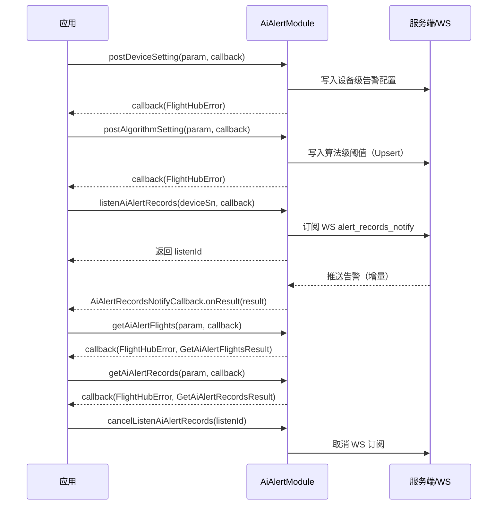

# AI 智能告警（AiAlertModule）

## 1 功能概述

### 1.1 功能简介

`AiAlertModule` 是**工作空间级**的 AI 智能告警模块，适用于 PAAS 纯血场景。它覆盖告警的全链路管理：设备级告警开关与方式配置、算法级识别阈值设置（Upsert），以及告警数据的查询、实时推送订阅与删除。

本模块与机载侧能力紧密协作：告警的触发依赖机载 AI 算法完成识别（见 [机载 AI 控制](./ai-control.md)），算法安装与生命周期管理见 [机载 AI 算法管理](./ai-algorithm.md)，AI Box 硬件管理见 [AI Box 管理](./ai-box.md)。`AiAlertModule` 专注于云端告警记录的读写与推送。

**获取方式：**

```java
Workspace workspace = FlightHubSDK.getWorkspaceInstance();
AiAlertModule aiAlertModule = workspace.getAIAlertModule();
```

### 1.2 核心概念

| 概念 | 说明 |
| --- | --- |
| 设备级告警配置 | 以无人机 SN 为粒度，控制目标检测告警总开关（`enableTargetAlert`）以及告警方式（声音/图像/其他）与间隔秒数，对应 `PostAiAlertDeviceSettingParam` + `AiAlertAlarmInfo`。 |
| 算法级阈值配置 | 以算法类型（`algorithmType`）+ 算法名称（`algorithmName`）为粒度，为各目标类型（人/车/船）设置识别置信度阈值上下限，对应 `PostAiAlertAlgorithmSettingParam` + `AiAlertAlarmTarget`。写入为 Upsert 语义。 |
| 告警架次（`AiAlertFlightItem`） | 按架次 ID 聚合的告警计数统计，含架次开始时间、任务名称与状态。查询入口为 `getAiAlertFlights()`，支持时间段与算法来源过滤、分页。 |
| 告警明细（`AiAlertRecordItem`） | 单条告警的完整信息，含唯一 ID（`alertUuid`）、架次 ID、位置、目标识别结果列表（`AiAlertTargetAlertInfo`）、缩略图 CDN URL、时间戳等。查询结果按 `flightId` 分组，字段 `thumbnailUrl` 仅在 `status` 为 1/2/3 时有值且有效期 24 小时。 |
| 实时告警推送 | `listenAiAlertRecords()` 订阅 WS topic `alert_records.alert_records_notify`，服务端增量推送新告警与未读通知。回调类型 `AiAlertRecordsNotifyCallback` **无 error 参数**，须先判空 `result`。返回值 `listenId` < 0 表示订阅失败。 |
| 删除策略 | `deleteAiAlertRecord()` 优先按 `alertUuid` 精确删除单条；`alertUuid` 为空时按 `flightId` 批量删除该架次全部记录。 |

### 1.3 能力清单

| 能力分组 | 接口 | 接口类型 | 说明 |
| --- | --- | --- | --- |
| 设备级告警配置 | `postDeviceSetting(param, cb)` | 异步回调 | 写入设备级告警配置（开关、告警方式、间隔）。入参 `PostAiAlertDeviceSettingParam`，成功仅看 `error.isSuccess()` |
| 设备级告警配置 | `getDeviceSetting(param, cb)` | 异步回调 | 读取设备级告警配置。入参 `GetAiAlertDeviceSettingParam`，回调返回 `GetAiAlertDeviceSettingResult` |
| 算法级阈值配置 | `postAlgorithmSetting(param, cb)` | 异步回调 | 写入算法级阈值配置（Upsert）。入参 `PostAiAlertAlgorithmSettingParam`，成功仅看 `error.isSuccess()` |
| 算法级阈值配置 | `getAlgorithmSetting(param, cb)` | 异步回调 | 读取算法级阈值配置。入参 `GetAiAlertAlgorithmSettingParam`，回调返回 `GetAiAlertAlgorithmSettingResult` |
| 告警数据查询 | `getAiAlertFlights(param, cb)` | 异步回调 | 查询告警架次统计（分页）。入参 `GetAiAlertFlightsParam`，回调返回 `GetAiAlertFlightsResult` |
| 告警数据查询 | `getAiAlertRecords(param, cb)` | 异步回调 | 查询告警明细记录（按 `flight_id` 分组，分页）。入参 `GetAiAlertRecordsParam`，回调返回 `GetAiAlertRecordsResult` |
| 实时告警推送 | `listenAiAlertRecords(deviceSn, cb)` | 订阅/回调 | 监听告警记录推送（增量更新 + 未读通知）。回调类型 `AiAlertRecordsNotifyCallback`，返回 `listenId`（< 0 表示失败） |
| 实时告警推送 | `cancelListenAiAlertRecords(listenId)` | 同步 | 取消监听告警记录推送，传入 `listenAiAlertRecords()` 返回的 `listenId` |
| 告警记录管理 | `deleteAiAlertRecord(param, cb)` | 异步回调 | 删除告警记录。`alertUuid` 非空时精确删除，为空时按 `flightId` 批量删除该架次全部记录 |

---

## 2 前提条件

- 已完成上云 API 2 底座部署并获取服务地址与鉴权 Token。详见 [部署指南](../../../02.deployment/00.index.md)、[鉴权接入指南](../../../08.auth.md)。
- 已完成 SDK 初始化且 `FlightHubSDK.isInitialized()` 返回 `true`。详见 [SDK初始化](../init/sdk-init.md)。
- 已通过 `FlightHubSDK.getWorkspaceInstance()` 获取工作空间实例，并调用其 `getAIAlertModule()` 拿到本模块实例。
- 涉及告警数据的设备已完成上云并绑定至当前工作空间。详见 [设备上云](../../../04.device-onboarding/00.index.md)。
- 使用 `listenAiAlertRecords()` 订阅实时推送前，须在 SDK 配置中正确设置 WebSocket 通知地址，否则回调不会触发。详见 [SDK配置](../init/sdk-config.md)。
- 本模块为纯查询/配置型，**无需**飞行控制权或 DRC 链路。

---

## 3 快速上手

### 3.1 获取模块实例

```java
// 前置：已完成 FlightHubSDK.initialize(config)
Workspace workspace = FlightHubSDK.getWorkspaceInstance();
AiAlertModule aiAlertModule = workspace.getAIAlertModule();
```

### 3.2 使用流程

1. **获取模块实例** —— 从工作空间实例调用 `getAIAlertModule()`。
2. **配置设备级告警** —— 组装 `PostAiAlertDeviceSettingParam`（SN、开关、`AiAlertAlarmInfo`），调用 `postDeviceSetting()` 写入。
3. **配置算法级阈值** —— 组装 `PostAiAlertAlgorithmSettingParam`（SN、算法类型/名称、`AiAlertAlarmTarget` 列表），调用 `postAlgorithmSetting()` 写入（Upsert）。
4. **订阅实时推送** —— 调用 `listenAiAlertRecords(deviceSn, callback)` 获取 `listenId`，检查 `listenId >= 0`；回调 `AiAlertRecordsNotifyCallback.onResult(result)` 无 error 参数，须判空 `result`。
5. **查询告警架次** —— 用 `getAiAlertFlights()` 按时间段与算法来源过滤，分页遍历 `AiAlertFlightItem` 列表，获取各架次的告警数量。
6. **查询告警明细** —— 用 `getAiAlertRecords()` 传入 `flightId` 列表，按 `flightId` 分组取回 `AiAlertRecordItem`，读取 `thumbnailUrl`（status 1/2/3 有效）。
7. **取消订阅** —— 模块销毁或不再需要时调用 `cancelListenAiAlertRecords(listenId)`。
8. **删除记录** —— 按 `alertUuid` 精确删除或按 `flightId` 批量删除。

### 3.3 调用时序图



---

## 4 示例代码

### 4.1 完整示例

```java
/**
 * AI 智能告警：配置 → 订阅推送 → 查询架次与明细 → 删除记录。
 */
public class AiAlertManager {

    private int listenId = -1; // 订阅 ID，< 0 表示未订阅

    // ============ 1. 配置设备级告警（开关 + 告警方式 + 间隔） ============
    public void configureDeviceSetting(String droneSn) {
        AiAlertModule module = FlightHubSDK.getWorkspaceInstance().getAIAlertModule();

        // 告警方式与间隔
        AiAlertAlarmInfo alarmInfo = new AiAlertAlarmInfo();
        alarmInfo.setAlarmMethod(Arrays.asList(1, 2)); // 1=声音, 2=图像
        alarmInfo.setAlarmInterval(10);                // 告警间隔 10 秒

        PostAiAlertDeviceSettingParam param = new PostAiAlertDeviceSettingParam();
        param.setDroneSn(droneSn);
        param.setEnableTargetAlert(true);  // 开启目标检测告警
        param.setAlarmInfo(alarmInfo);

        module.postDeviceSetting(param, (error, result) -> {
            // 注意: PostAiAlertDeviceSettingResult 为空 Bean，成功只看 error
            if (error != null && !error.isSuccess()) {
                System.err.println("写入设备级告警配置失败: " + error
                        + " serverCode=" + error.getServerCode()
                        + " msg=" + error.getServerMessage());
                return;
            }
            System.out.println("设备级告警配置写入成功，droneSn=" + droneSn);
        });
    }

    // ============ 2. 配置算法级阈值（Upsert） ============
    public void configureAlgorithmSetting(String droneSn, int algorithmType, String algorithmName) {
        AiAlertModule module = FlightHubSDK.getWorkspaceInstance().getAIAlertModule();

        // 设置人目标阈值：置信度下限 60%
        AiAlertAlarmTarget personTarget = new AiAlertAlarmTarget();
        personTarget.setTargetType(0);            // 0=人
        personTarget.setTargetValue(70);          // 基准置信度 70
        personTarget.setUseMinThreshold(true);    // 启用阈值下限
        personTarget.setTargetMinThreshold(60);   // 下限 60%
        personTarget.setUseMaxThreshold(false);   // 不启用上限

        // 设置车目标阈值：置信度下限 50%
        AiAlertAlarmTarget vehicleTarget = new AiAlertAlarmTarget();
        vehicleTarget.setTargetType(1);           // 1=车
        vehicleTarget.setTargetValue(65);
        vehicleTarget.setUseMinThreshold(true);
        vehicleTarget.setTargetMinThreshold(50);
        vehicleTarget.setUseMaxThreshold(false);

        PostAiAlertAlgorithmSettingParam param = new PostAiAlertAlgorithmSettingParam();
        param.setDroneSn(droneSn);
        param.setAlgorithmType(algorithmType);
        param.setAlgorithmName(algorithmName);
        param.setAlarmTargets(Arrays.asList(personTarget, vehicleTarget));

        // 注意: Upsert 语义，已有配置会被覆盖
        module.postAlgorithmSetting(param, (error, result) -> {
            if (error != null && !error.isSuccess()) {
                System.err.println("写入算法阈值配置失败: " + error);
                return;
            }
            System.out.println("算法阈值配置写入成功，algorithmType=" + algorithmType);
        });
    }

    // ============ 3. 订阅实时告警推送 ============
    public void startListening(String deviceSn) {
        AiAlertModule module = FlightHubSDK.getWorkspaceInstance().getAIAlertModule();

        // 注意: AiAlertRecordsNotifyCallback 回调无 error 参数，须先判空 result
        listenId = module.listenAiAlertRecords(deviceSn, result -> {
            if (result == null) {
                System.err.println("收到空推送，跳过处理");
                return;
            }
            if (result.getData() == null) return;
            for (AiAlertNotifyFlightData flightData : result.getData()) {
                System.out.println("架次推送 flightId=" + flightData.getFlightId()
                        + " 任务=" + flightData.getFlightTaskName());
                if (flightData.getRecords() != null) {
                    for (AiAlertNotifyRecordItem record : flightData.getRecords()) {
                        System.out.println("  告警 uuid=" + record.getAlertUuid()
                                + " 无人机=" + record.getDroneSn()
                                + " 时间戳=" + record.getTimestamp()
                                + " 位置=(" + (record.getLocation() != null
                                        ? record.getLocation().getLatitude()
                                          + "," + record.getLocation().getLongitude()
                                        : "null") + ")");
                    }
                }
            }
        });

        // 注意: listenId < 0 表示订阅失败，需检查 SDK 配置中的 WS 通知地址
        if (listenId < 0) {
            System.err.println("告警推送订阅失败，请检查 SDK 配置与网络连接");
        } else {
            System.out.println("告警推送订阅成功，listenId=" + listenId);
        }
    }

    // ============ 4. 查询告警架次统计（分页） ============
    public void queryAlertFlights(String droneSn, long beginAt, long endAt) {
        AiAlertModule module = FlightHubSDK.getWorkspaceInstance().getAIAlertModule();

        GetAiAlertFlightsParam param = new GetAiAlertFlightsParam();
        param.setDroneSn(droneSn);
        param.setBeginAt(beginAt);   // 毫秒时间戳
        param.setEndAt(endAt);
        // 可选：按算法来源过滤，例如 Arrays.asList(1) 表示仅看算法来源=1
        param.setAlgorithmSources(Collections.emptyList());
        param.setPage(1);
        param.setPageSize(20);

        module.getAiAlertFlights(param, (error, result) -> {
            if (error != null && !error.isSuccess()) {
                System.err.println("查询告警架次失败: " + error);
                return;
            }
            if (result == null || result.getData() == null) return;
            System.out.println("共 " + result.getTotal() + " 个架次，当前第 "
                    + result.getPage() + "/" + result.getPageCount() + " 页");
            for (AiAlertFlightItem item : result.getData()) {
                System.out.println("  架次 flightId=" + item.getFlightId()
                        + " 任务=" + item.getFlightTaskName()
                        + " 告警数=" + item.getCount()
                        + " 状态=" + item.getStatus()
                        + " 开始时间=" + item.getStartTime());
            }
        });
    }

    // ============ 5. 取消告警推送订阅 ============
    public void stopListening() {
        if (listenId >= 0) {
            FlightHubSDK.getWorkspaceInstance().getAIAlertModule()
                    .cancelListenAiAlertRecords(listenId);
            System.out.println("已取消告警推送订阅，listenId=" + listenId);
            listenId = -1;
        }
    }

    // ============ 6. 删除告警记录 ============
    public void deleteRecord(String alertUuid, String flightId) {
        AiAlertModule module = FlightHubSDK.getWorkspaceInstance().getAIAlertModule();

        DeleteAiAlertRecordParam param = new DeleteAiAlertRecordParam();
        // 注意: alertUuid 非空时精确删除单条（优先）；为空时按 flightId 批量删除整个架次
        param.setAlertUuid(alertUuid);
        param.setFlightId(flightId);

        module.deleteAiAlertRecord(param, error -> {
            boolean ok = error != null && error.isSuccess();
            System.out.println("删除告警记录: " + (ok ? "成功" : "失败 " + error));
        });
    }
}
```

**`GetAiAlertFlightsParam` 字段说明：**

| 字段 | 类型 | 说明 |
| --- | --- | --- |
| `getDroneSn()` | `String` | 无人机序列号（网关 SN） |
| `getBeginAt()` | `long` | 查询时间段起始（毫秒时间戳） |
| `getEndAt()` | `long` | 查询时间段截止（毫秒时间戳） |
| `getAlgorithmSources()` | `List<Integer>` | 算法来源过滤列表，空列表表示不过滤 |
| `getPage()` | `int` | 页码 |
| `getPageSize()` | `int` | 每页数量 |

**`AiAlertFlightItem` 字段说明：**

| 字段 | 类型 | 说明 |
| --- | --- | --- |
| `getFlightId()` | `String` | 架次 ID |
| `getFlightTaskName()` | `String` | 飞行任务名称 |
| `getCount()` | `int` | 该架次告警数量 |
| `getStatus()` | `int` | 架次状态 |
| `getStartTime()` | `long` | 架次开始时间（毫秒时间戳） |

**`AiAlertRecordItem` 字段说明：**

| 字段 | 类型 | 说明 |
| --- | --- | --- |
| `getAlertUuid()` | `String` | 告警唯一 ID |
| `getFlightId()` | `String` | 所属架次 ID |
| `getDroneSn()` | `String` | 无人机序列号 |
| `getGatewaySn()` | `String` | 遥控器序列号 |
| `getStatus()` | `int` | 0=待处理 / 1=处理中 / 2=已完成 / 3=云云对接 / 4=失败 / 5=超时 |
| `getAlgorithmSource()` | `int` | 算法来源 |
| `getLocation()` | `AiAlertLocation` | 告警发生时的位置信息（含 latitude/longitude/altitude） |
| `getTargetAlertInfos()` | `List<AiAlertTargetAlertInfo>` | 各目标类型的识别结果列表 |
| `getThumbnailUrl()` | `String` | 缩略图 CDN URL（status 1/2/3 时有值，24 小时有效期） |
| `getLabels()` | `List<String>` | 目标标签列表 |
| `getTimestamp()` | `long` | 告警毫秒时间戳 |
| `getTaskName()` | `String` | 飞行任务名称 |
| `getMediaIndex()` | `int` | 媒体文件索引 |

### 4.2 场景化片段

**读取设备级告警配置**

```java
// 前置：SDK 已初始化
GetAiAlertDeviceSettingParam param = new GetAiAlertDeviceSettingParam();
param.setDroneSn("无人机SN");

FlightHubSDK.getWorkspaceInstance().getAIAlertModule()
        .getDeviceSetting(param, (error, result) -> {
            if (error != null && !error.isSuccess()) {
                System.err.println("读取设备级配置失败: " + error);
                return;
            }
            if (result == null) return;
            System.out.println("目标告警开关=" + result.isEnableTargetAlert());
            if (result.getAlarmInfo() != null) {
                System.out.println("告警方式=" + result.getAlarmInfo().getAlarmMethod()
                        + " 间隔=" + result.getAlarmInfo().getAlarmInterval() + "s");
            }
        });
```

**查询告警明细记录（按架次 ID 分组）**

```java
// 前置：已通过 getAiAlertFlights() 得到 flightId 列表
GetAiAlertRecordsParam param = new GetAiAlertRecordsParam();
param.setFlightId(Arrays.asList("flight-id-001", "flight-id-002")); // 架次 ID 列表
param.setTargetType(Arrays.asList(0, 1));     // 0=人, 1=车；空列表不过滤
param.setAlgorithmSources(Collections.emptyList());
param.setPage(1);
param.setPageSize(50);

FlightHubSDK.getWorkspaceInstance().getAIAlertModule()
        .getAiAlertRecords(param, (error, result) -> {
            if (error != null && !error.isSuccess()) {
                System.err.println("查询告警明细失败: " + error);
                return;
            }
            if (result == null || result.getData() == null) return;
            // 注意: getData() 返回 Map<flightId, List<AiAlertRecordItem>>，按架次分组
            for (Map.Entry<String, List<AiAlertRecordItem>> entry : result.getData().entrySet()) {
                System.out.println("架次 " + entry.getKey() + " 共 " + entry.getValue().size() + " 条告警");
                for (AiAlertRecordItem record : entry.getValue()) {
                    // 注意: thumbnailUrl 仅 status=1/2/3 时有值，且 24 小时后失效
                    System.out.println("  uuid=" + record.getAlertUuid()
                            + " status=" + record.getStatus()
                            + " thumbnail=" + record.getThumbnailUrl());
                }
            }
        });
```

**读取算法级阈值配置**

```java
// 前置：SDK 已初始化
GetAiAlertAlgorithmSettingParam param = new GetAiAlertAlgorithmSettingParam();
param.setDroneSn("无人机SN");
param.setAlgorithmType(1); // 按算法类型查询

FlightHubSDK.getWorkspaceInstance().getAIAlertModule()
        .getAlgorithmSetting(param, (error, result) -> {
            if (error != null && !error.isSuccess()) {
                System.err.println("读取算法阈值配置失败: " + error);
                return;
            }
            if (result == null) return;
            System.out.println("算法=" + result.getAlgorithmName()
                    + " type=" + result.getAlgorithmType());
            if (result.getAlarmTargets() != null) {
                for (AiAlertAlarmTarget target : result.getAlarmTargets()) {
                    // targetType: 0=人 / 1=车 / 2=船
                    System.out.println("  目标类型=" + target.getTargetType()
                            + " 置信度=" + target.getTargetValue()
                            + " 下限启用=" + target.isUseMinThreshold()
                            + " 下限值=" + target.getTargetMinThreshold()
                            + " 上限启用=" + target.isUseMaxThreshold()
                            + " 上限值=" + target.getTargetMaxThreshold());
                }
            }
        });
```

---

## 5 相关文档

- [SDK初始化](../init/sdk-init.md) —— 获取工作空间实例与调用本模块前必须完成的初始化步骤
- [SDK配置](../init/sdk-config.md) —— 设置 WebSocket 通知地址，告警实时推送的必要前提
- [AI Box 管理](./ai-box.md) —— 硬件 AI Box 的应用安装、文件导入导出等管理操作
- [机载 AI 控制](./ai-control.md) —— 机载 AI 识别开关、过滤、模型选择及 AI 数据订阅（告警触发的上游）
- [机载 AI 算法管理](./ai-algorithm.md) —— 机载算法全生命周期：列表查询、批量装载/卸载、上传凭证等
- [设备上云](../../../04.device-onboarding/00.index.md) —— 告警数据关联设备绑定至工作空间的前置流程
- [部署指南](../../../02.deployment/00.index.md) —— 上云 API 2 底座部署与服务地址获取
- [鉴权接入指南](../../../08.auth.md) —— 获取鉴权 Token 的接入流程
- [使用 API 文档查阅接口详情](../../03.api-docs-guide.md) —— 查阅 `AiAlertModule` 完整方法签名与字段定义
