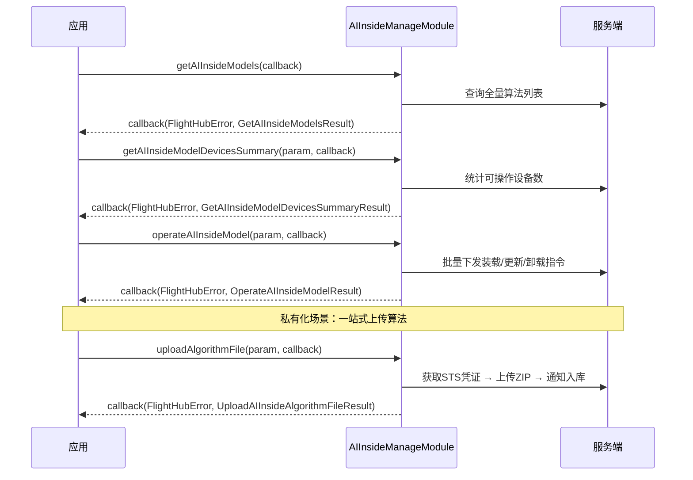

# 机载 AI 算法管理（AIInsideManageModule）

## 1 功能概述

### 1.1 功能简介

`AIInsideManageModule` 是**工作空间级**的机载 AI 算法管理模块，负责机载算法包的全生命周期管理：查询工作空间内的全量算法列表、分页查看各算法与设备的绑定详情、统计可操作设备数、批量下发装载（load）/ 更新（update）/ 卸载（unload）指令；以及面向私有化部署场景的算法上传凭证申请、文件入库通知与算法删除。

本模块负责算法的元数据管理与部署下发，不负责飞行过程中的 AI 识别开关、阈值调整、目标过滤或 AI 数据订阅——这些由 [机载 AI 控制](./ai-control.md) 提供。AI 智能告警的配置与查询详见 [AI 智能告警](./ai-alert.md)；AI Box 应用安装与文件导入导出见 [AI Box 管理](./ai-box.md)。

**获取方式：**

```java
Workspace workspace = FlightHubSDK.getWorkspaceInstance();
AIInsideManageModule module = workspace.getAIInsideManageModule();
```

### 1.2 核心概念

| 概念 | 说明 |
| --- | --- |
| 算法（AI Inside Model） | 以 `signedId` 全局唯一标识的机载算法包，包含签名名称（`signedName`）、显示名称（`modelName`）、版本号、有效期、推理参数、可识别标签及适用图像来源等元数据。 |
| 算法签名 ID（`signedId`） | 识别和操作某一具体算法的唯一键，贯穿列表查询、设备查询、统计与批量操作全流程。 |
| 操作类型（`operationType`） | 批量指令的操作类型：`load`（首次装载）/ `update`（版本更新）/ `unload`（卸载）。`getAIInsideModelDevicesSummary` 的统计粒度与此字段一致。 |
| 绑定设备（`AIInsideDeviceItem`） | 某算法的一台绑定机场及其关联飞机，包含机场 SN、型号、在线状态、工作状态与当前算法操作进度；通过 `getAIInsideModelDevices` 分页获取。 |
| 私有化上传 | 私有化部署场景下，ISV 可自行将算法 ZIP 包上传至平台 MinIO 存储：① `createAIInsideAlgorithm` 申请 STS 临时凭证；② 使用凭证直传 ZIP 到 MinIO；③ `fileUploadAIInsideAlgorithm` 通知后端解压入库。`uploadAlgorithmFile` 将上述三步封装为一站式接口。 |
| 可操作设备统计 | 在下发批量指令前，可用 `getAIInsideModelDevicesSummary` 预估覆盖范围：`totalDevices` 为算法绑定的设备总数，`operableDevices` 为满足当前操作类型条件的可操作设备数。 |

### 1.3 能力清单

**算法查询**

| 方法 | 说明 | 回调结果 |
| --- | --- | --- |
| `getAIInsideModels(GetAIInsideModelsCallback)` | 获取工作空间内全量机载算法列表，按签名时间降序排列 | `GetAIInsideModelsResult`（含 `List<AIInsideModelItem>`） |
| `getAIInsideModelDevices(GetAIInsideModelDevicesParam, GetAIInsideModelDevicesCallback)` | 分页查询指定算法绑定的设备详情；可按飞机 SN 列表过滤 | `GetAIInsideModelDevicesResult`（分页信息 + `List<AIInsideDeviceItem>`） |
| `getAIInsideModelDevicesSummary(GetAIInsideModelDevicesSummaryParam, GetAIInsideModelDevicesSummaryCallback)` | 统计指定算法在指定操作类型下的总设备数与可操作设备数 | `GetAIInsideModelDevicesSummaryResult` |

**算法部署操作**

| 方法 | 说明 | 回调结果 |
| --- | --- | --- |
| `operateAIInsideModel(OperateAIInsideModelParam, OperateAIInsideModelCallback)` | 批量下发装载 / 更新 / 卸载指令；可指定设备 SN 列表，为空则对全部可操作设备下发 | `OperateAIInsideModelResult`（含各设备操作结果码 `List<AIInsideOperateDeviceResult>`） |

**私有化算法管理**

| 方法 | 说明 | 回调结果 |
| --- | --- | --- |
| `createAIInsideAlgorithm(CreateAIInsideAlgorithmParam, CreateAIInsideAlgorithmCallback)` | 申请算法包上传凭证，返回 MinIO STS 临时凭证及存储路径信息（私有化场景） | `CreateAIInsideAlgorithmResult`（含 `AIInsideCredentials` 及 bucket/endpoint/fileStoreDir） |
| `fileUploadAIInsideAlgorithm(FileUploadAIInsideAlgorithmParam, FileUploadAIInsideAlgorithmCallback)` | 通知后端处理已上传至 MinIO 的算法文件，解压解析后写入数据库（私有化场景） | `FileUploadAIInsideAlgorithmResult`（含 `AIInsideAlgorithmDetail`） |
| `deleteAIInsideAlgorithm(DeleteAIInsideAlgorithmParam, DeleteAIInsideAlgorithmCallback)` | 删除指定算法，同步清理 MinIO 文件与数据库记录（私有化场景） | 仅 `FlightHubError`（code=0 表示成功） |
| `uploadAlgorithmFile(UploadAIInsideAlgorithmFileParam, UploadAlgorithmFileCallback)` | 一站式算法文件上传：自动串联获取 STS 凭证 → 上传 ZIP 到 MinIO → 通知入库（私有化场景） | `UploadAIInsideAlgorithmFileResult`（含 objectKey/objectUrl/etag 及 `AIInsideAlgorithmDetail`） |

---

## 2 前提条件

- 已完成上云 API 2 底座部署，并获取到服务地址与鉴权 Token。详见 [部署指南](../../../02.deployment/00.index.md)、[鉴权接入指南](../../../08.auth.md)。
- 已完成 SDK 初始化且 `FlightHubSDK.isInitialized()` 返回 `true`。详见 [SDK初始化](../init/sdk-init.md)。
- 已通过 `FlightHubSDK.getWorkspaceInstance()` 获取工作空间实例，并调用其 `getAIInsideManageModule()` 取得本模块实例。
- 执行算法部署操作（load / update / unload）前，目标设备须已完成上云且绑定至当前工作空间。详见 [设备上云](../../../04.device-onboarding/00.index.md)。
- 私有化算法上传功能仅在私有化部署环境下可用；调用方需具备平台 MinIO 存储的写入权限，且本地算法文件须为合法 ZIP 格式。
- 本模块为 Workspace 级查询/管理接口，**无需申请飞行控制权，也无需建立 DRC 链路**。

---

## 3 快速上手

### 3.1 获取模块实例

```java
// 前置：已完成 FlightHubSDK.initialize(config)
Workspace workspace = FlightHubSDK.getWorkspaceInstance();
AIInsideManageModule module = workspace.getAIInsideManageModule();
```

### 3.2 使用流程

**常规（SaaS / 私有化通用）部署流程：**

1. **获取模块实例** —— 从工作空间实例调用 `getAIInsideManageModule()`。
2. **查询算法列表** —— 调用 `getAIInsideModels()` 获取全量算法，记录目标算法的 `signedId`。
3. **（可选）查看绑定设备** —— 用 `getAIInsideModelDevices()` 分页查询该算法绑定的机场列表及当前操作进度。
4. **（可选）统计可操作数量** —— 调用 `getAIInsideModelDevicesSummary()` 预估本次操作的覆盖范围（`operableDevices`），可用于 UI 下发前的确认提示。
5. **下发批量指令** —— 组装 `OperateAIInsideModelParam`（`signedId` + `operationType` + 可选 `droneSNList`），调用 `operateAIInsideModel()` 批量下发。
6. **查看操作结果** —— 回调的 `OperateAIInsideModelResult.getResults()` 包含各设备 SN 与结果码，`code=0` 表示该设备成功接受指令。

**私有化场景算法上传（快速方式）：**

1. 准备算法 ZIP 文件的本地绝对路径。
2. 调用 `uploadAlgorithmFile()` 一站式完成上传与入库，回调中通过 `AIInsideAlgorithmDetail` 确认入库详情。

### 3.3 调用时序图



---

## 4 示例代码

### 4.1 完整示例

```java
/**
 * 机载 AI 算法管理：查询算法列表 → 分页查看绑定设备 → 设备数量统计 → 批量下发装载指令。
 */
public class AIInsideManageExample {

    private final AIInsideManageModule module =
            FlightHubSDK.getWorkspaceInstance().getAIInsideManageModule();

    // ============ 1. 查询全量算法列表 ============
    public void listAlgorithms() {
        module.getAIInsideModels(new FlightHubCallback.GetAIInsideModelsCallback() {
            @Override
            public void onResult(FlightHubError error, GetAIInsideModelsResult result) {
                if (error != null && !error.isSuccess()) {
                    System.err.println("获取算法列表失败: " + error.getServerMessage());
                    return;
                }
                if (result == null || result.getModels() == null) return;

                for (AIInsideModelItem model : result.getModels()) {
                    // signedId 是后续所有操作的唯一标识
                    System.out.println("算法: signedId=" + model.getSignedId()
                            + " signedName=" + model.getSignedName()
                            + " modelName=" + model.getModelName()
                            + " version=" + model.getSignedVersion()
                            + " 过期时间(Unix秒)=" + model.getExpiredUtc()
                            + " 绑定SN数=" + (model.getSnList() != null
                                    ? model.getSnList().size() : 0));
                }
            }
        });
    }

    // ============ 2. 分页查询指定算法绑定的设备 ============
    public void listAlgorithmDevices(String signedId) {
        GetAIInsideModelDevicesParam param = new GetAIInsideModelDevicesParam();
        param.setSignedId(signedId); // 算法签名 ID（必填）
        param.setPage(1);            // 页码从 1 开始（必填）
        param.setPageSize(20);       // 每页条数（必填）
        // 注意：setDroneSn() 为可选；不调用则查询该算法下全部绑定设备

        module.getAIInsideModelDevices(param,
                new FlightHubCallback.GetAIInsideModelDevicesCallback() {
            @Override
            public void onResult(FlightHubError error, GetAIInsideModelDevicesResult result) {
                if (error != null && !error.isSuccess()) {
                    System.err.println("获取绑定设备失败: " + error.getServerMessage());
                    return;
                }
                if (result == null || result.getList() == null) return;

                System.out.println("共 " + result.getTotal() + " 台设备，当前第 "
                        + result.getPage() + " 页，每页 " + result.getPageSize() + " 条");
                for (AIInsideDeviceItem device : result.getList()) {
                    System.out.println("  机场 SN=" + device.getDeviceSn()
                            + " 在线=" + device.isDeviceOnlineStatus()
                            + " 工作状态=" + device.getDeviceWorkingStatus());
                }
            }
        });
    }

    // ============ 3. 统计可操作设备数（下发前预估覆盖范围） ============
    public void summarizeDevices(String signedId) {
        GetAIInsideModelDevicesSummaryParam param = new GetAIInsideModelDevicesSummaryParam();
        param.setSignedId(signedId);
        // 注意：operationType 决定统计维度，"load"/"update"/"unload" 对应不同的可操作条件
        param.setOperationType("load");

        module.getAIInsideModelDevicesSummary(param,
                new FlightHubCallback.GetAIInsideModelDevicesSummaryCallback() {
            @Override
            public void onResult(FlightHubError error,
                    GetAIInsideModelDevicesSummaryResult result) {
                if (error != null && !error.isSuccess()) {
                    System.err.println("统计失败: " + error.getServerMessage());
                    return;
                }
                if (result == null) return;

                System.out.println("绑定总设备数=" + result.getTotalDevices()
                        + " 本次可操作设备数=" + result.getOperableDevices());
            }
        });
    }

    // ============ 4. 批量下发装载指令 ============
    public void loadAlgorithm(String signedId) {
        OperateAIInsideModelParam param = new OperateAIInsideModelParam();
        param.setSignedId(signedId);
        param.setOperationType("load"); // "load" / "update" / "unload"
        // 注意：不调用 setDroneSNList() 则对全部可操作设备下发；
        //       如需指定设备，调用：param.setDroneSNList(Arrays.asList("sn1", "sn2"))

        module.operateAIInsideModel(param,
                new FlightHubCallback.OperateAIInsideModelCallback() {
            @Override
            public void onResult(FlightHubError error, OperateAIInsideModelResult result) {
                if (error != null && !error.isSuccess()) {
                    System.err.println("批量指令下发失败: " + error.getServerMessage());
                    return;
                }
                if (result == null || result.getResults() == null) return;

                for (AIInsideOperateDeviceResult deviceResult : result.getResults()) {
                    // code=0 表示该设备成功接受指令；非 0 请参考错误码说明（如 238002=机场状态不满足）
                    System.out.println("  飞机 SN=" + deviceResult.getDroneSn()
                            + " 结果码=" + deviceResult.getCode()
                            + (deviceResult.getCode() == 0 ? " [成功]" : " [失败]"));
                }
            }
        });
    }
}
```

### 4.2 场景化片段

**私有化场景：一站式上传算法文件**

```java
// 前置：私有化部署环境，具备平台 MinIO 访问权限
AIInsideManageModule module = FlightHubSDK.getWorkspaceInstance().getAIInsideManageModule();

UploadAIInsideAlgorithmFileParam param = new UploadAIInsideAlgorithmFileParam();
// 注意：filePath 须为本地算法 ZIP 文件的绝对路径
param.setFilePath("/data/algorithms/fire_detection_v2.zip");

module.uploadAlgorithmFile(param, new FlightHubCallback.UploadAlgorithmFileCallback() {
    @Override
    public void onResult(FlightHubError error, UploadAIInsideAlgorithmFileResult result) {
        if (error != null && !error.isSuccess()) {
            System.err.println("算法上传失败: " + error.getServerMessage());
            return;
        }
        if (result == null) return;

        System.out.println("上传成功: objectKey=" + result.getObjectKey()
                + " objectUrl=" + result.getObjectUrl()
                + " etag=" + result.getEtag());

        // 入库后的完整算法详情
        AIInsideAlgorithmDetail detail = result.getDetail();
        if (detail != null) {
            System.out.println("入库详情: signedId=" + detail.getSignedId()
                    + " signedName=" + detail.getSignedName()
                    + " modelName=" + detail.getModelName()
                    + " version=" + detail.getSignedVersion()
                    + " modelType=" + detail.getModelType()
                    + " 创建时间=" + detail.getCreatedAt());
        }
    }
});
```

**私有化场景：手动三步上传（精细控制版）**

```java
// 第一步：申请 MinIO STS 上传凭证
CreateAIInsideAlgorithmParam createParam = new CreateAIInsideAlgorithmParam();
createParam.setName("fire_detection_v2.zip"); // 上传文件名（必填）

module.createAIInsideAlgorithm(createParam,
        new FlightHubCallback.CreateAIInsideAlgorithmCallback() {
    @Override
    public void onResult(FlightHubError error, CreateAIInsideAlgorithmResult result) {
        if (error != null && !error.isSuccess()) {
            System.err.println("申请凭证失败: " + error.getServerMessage());
            return;
        }
        if (result == null || result.getCredentials() == null) return;

        AIInsideCredentials creds = result.getCredentials();
        // 注意：凭证有过期时间（creds.getExpire() 为 Unix 秒），须在过期前完成 ZIP 上传
        System.out.println("endpoint=" + result.getEndpoint()
                + " bucket=" + result.getBucket()
                + " region=" + result.getRegion()
                + " fileStoreDir=" + result.getFileStoreDir()
                + " accessKeyId=" + creds.getAccessKeyId()
                + " expire=" + creds.getExpire());

        // 第二步：使用 MinIO SDK 将 ZIP 直传至 result.getEndpoint() / result.getBucket()
        // objectKey = result.getFileStoreDir() + "fire_detection_v2.zip"
        String fileKey = result.getFileStoreDir() + "fire_detection_v2.zip";
        // ...（调用方自行实现 MinIO 上传逻辑，使用 accessKeyId / accessKeySecret）...

        // 第三步：上传完成后通知后端解压入库
        notifyFileProcessed(fileKey);
    }
});
```

```java
// 第三步：通知后端处理已上传文件（在 MinIO 上传完成后调用）
private void notifyFileProcessed(String fileKey) {
    FileUploadAIInsideAlgorithmParam fileParam = new FileUploadAIInsideAlgorithmParam();
    // 注意：fileKey 为 MinIO 对象 Key，即 fileStoreDir 与文件名拼接结果
    fileParam.setFileKey(fileKey);

    module.fileUploadAIInsideAlgorithm(fileParam,
            new FlightHubCallback.FileUploadAIInsideAlgorithmCallback() {
        @Override
        public void onResult(FlightHubError error, FileUploadAIInsideAlgorithmResult result) {
            if (error != null && !error.isSuccess()) {
                System.err.println("文件入库失败: " + error.getServerMessage());
                return;
            }
            if (result == null || result.getDetail() == null) return;

            System.out.println("算法入库成功: signedId=" + result.getDetail().getSignedId()
                    + " modelUuid=" + result.getDetail().getModelUuid());
        }
    });
}
```

**私有化场景：删除算法**

```java
DeleteAIInsideAlgorithmParam deleteParam = new DeleteAIInsideAlgorithmParam();
deleteParam.setSignedId("algo_signed_id_here"); // 要删除的算法签名 ID（必填）

module.deleteAIInsideAlgorithm(deleteParam,
        new FlightHubCallback.DeleteAIInsideAlgorithmCallback() {
    @Override
    public void onResult(FlightHubError error) {
        if (error != null && !error.isSuccess()) {
            System.err.println("删除算法失败: " + error.getServerMessage());
            return;
        }
        // 注意：删除会同步清理 MinIO 文件与数据库记录，操作不可恢复
        System.out.println("算法已删除");
    }
});
```

---

## 5 相关文档

- [SDK初始化](../init/sdk-init.md) —— 获取工作空间实例与调用本模块前必须完成的初始化步骤
- [部署指南](../../../02.deployment/00.index.md) —— 上云 API 2 底座部署与服务地址获取
- [鉴权接入指南](../../../08.auth.md) —— 获取鉴权 Token 的接入流程
- [设备上云](../../../04.device-onboarding/00.index.md) —— 将飞机绑定至工作空间的前置流程
- [机载 AI 控制](./ai-control.md) —— 飞行中的 AI 识别开关、阈值调整、目标过滤与 AI 数据订阅
- [AI Box 管理](./ai-box.md) —— AI Box 盒子信息查询与应用安装操作
- [AI 智能告警](./ai-alert.md) —— 设备告警配置、算法阈值与告警架次明细
- [使用 API 文档查阅接口详情](../../03.api-docs-guide.md) —— 查阅 `AIInsideManageModule` 完整方法签名与字段定义
