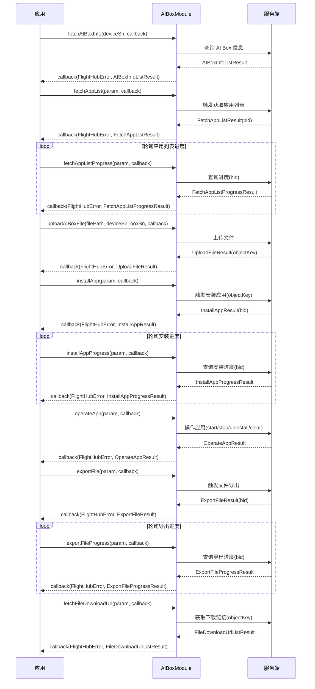

# AI Box 管理（AIBoxModule）

## 1 功能概述

### 1.1 功能简介

`AIBoxModule` 是**无人机级**的 AI Box 管理模块，作用域为一架具体的无人机（通过设备 SN 标识）。它解决的是「查询机载 AI Box 信息、管理盒子上的应用生命周期、导入导出文件」这一组事情：支持盒子信息查询、应用列表获取（异步带进度）、应用安装（异步带进度）、应用操作（启动/停止/卸载/清除数据）、文件导出（异步带进度）、文件下载链接获取、本地文件上传。

AI Box 是挂载在 DJI 无人机上的智能计算盒子，可独立运行 AI 推理应用。本模块通过 SDK 管理通道远程管理盒子与其上运行的应用。机载 AI 推理控制（识别开关、过滤、阈值、模型选择等）见 [机载 AI 控制](./ai-control.md)；机载算法全生命周期管理见 [机载 AI 算法管理](./ai-algorithm.md)；平台级 AI 智能告警配置见 [AI 智能告警](./ai-alert.md)。

**获取方式：**

```java
// 前置：已完成 FlightHubSDK.initialize(config)，设备已上云且在线
AIBoxModule aiBoxModule = FlightHubSDK.getDroneInstance("your_device_sn").getAIBoxModule();
```

### 1.2 核心概念

| 概念 | 说明 |
| --- | --- |
| AI Box | 挂载在无人机上的智能计算盒子，可独立运行 AI 推理应用。一架无人机可能挂载多个 AI Box，通过 `boxSn` 区分。 |
| 盒子序列号（`boxSn`） | 唯一标识一个 AI Box，通过 `fetchAIBoxInfo()` 查得。后续所有接口的 `param.setBoxSn()` 均需填入此值。 |
| 设备序列号（`deviceSn`） | 所挂载无人机的 SN，与 `getDroneInstance()` 传入的 SN 一致。 |
| 业务 ID（`bid`） | 异步任务（获取应用列表/安装/导出）下发后，由服务端在初始回调中返回的任务追踪标识；进度查询时需通过 `param.setBid()` 回传同一值。 |
| 应用 ID（`appId`） | AI Box 上某一应用的唯一标识，从 `AIBoxAppInfoResult.getId()` 取得；用于应用操作（`operateApp`）与文件导出（`exportFile`）。 |
| 对象存储 Key（`objectKey`） | 文件在对象存储中的唯一路径标识。上传成功后由 `UploadFileResult.getObjectKey()` 返回，可作为 `installApp` 的 `param.setObjectKey()` 入参；导出完成后由 `ExportFileProgressExtResult.getObjectKey()` 返回，可用于 `fetchFileDownloadUrl`。 |
| 导出类型（`exportType`） | `AIBoxExportFileParam` 的整型枚举字段，表示导出内容类型（日志或应用数据）。 |
| 操作动作（`action`） | `AIBoxOperateAppParam` 的字符串字段，取值：`"start"`（启动）、`"stop"`（停止）、`"uninstall"`（卸载）、`"clear"`（清除数据）。 |
| 异步进度模式 | 获取应用列表、安装应用、导出文件均为异步任务。调用触发接口后先取得 `bid`，再轮询对应进度接口，直到 `status` 指示完成或失败。 |

### 1.3 能力清单

| 能力分组 | 对应接口 | 说明 |
| --- | --- | --- |
| **盒子信息** | `fetchAIBoxInfo(deviceSn, callback)` | 查询指定设备的 AI Box 信息列表，含 `boxSn`、固件版本、存储容量 |
| **应用查询** | `fetchAppList(param, callback)` | 触发异步获取 AI Box 应用列表，回调返回 `bid` 与初始状态 |
|  | `fetchAppListProgress(param, callback)` | 按 `bid` 查询获取应用列表的进度，进度完成后扩展字段含应用详情列表 |
| **应用安装** | `installApp(param, callback)` | 触发异步安装 AI Box 应用（需 `objectKey`），回调返回 `bid` 与初始状态 |
|  | `installAppProgress(param, callback)` | 按 `bid` 查询安装进度 |
| **应用操作** | `operateApp(param, callback)` | 对指定应用执行启动/停止/卸载/清除数据操作 |
| **文件导出** | `exportFile(param, callback)` | 触发异步导出 AI Box 文件（日志或应用数据），回调返回 `bid` 与初始状态 |
|  | `exportFileProgress(param, callback)` | 按 `bid` 查询导出进度，完成后扩展字段含导出文件的对象存储 Key |
|  | `fetchFileDownloadUrl(param, callback)` | 按对象存储 Key 列表获取文件下载链接 |
| **文件上传** | `uploadAIBoxFile(filePath, deviceSn, boxSn, callback)` | 上传本地文件到 AI Box 对象存储，回调返回 `objectKey`，可用于后续 `installApp` |

---

## 2 前提条件

- 已完成上云 API 2 底座部署，并获取到服务地址与鉴权 Token。详见 [部署指南](../../../02.deployment/00.index.md)、[鉴权接入指南](../../../08.auth.md)。
- 已完成 SDK 初始化且 `FlightHubSDK.isInitialized()` 返回 `true`。详见 [SDK初始化](../init/sdk-init.md)。
- 目标无人机已完成设备上云、已绑定至当前工作空间且在线。详见 [设备上云](../../../04.device-onboarding/00.index.md)。
- 目标无人机上已挂载 AI Box，且 AI Box 与无人机间通信正常；建议先调用 `fetchAIBoxInfo()` 确认 AI Box 列表非空，取得有效 `boxSn` 后再进行后续操作。
- 本模块所有接口通过管理通道下发，**无需**抢占飞行控制权（`ControlAuthModule`）或建立 DRC 链路。

---

## 3 快速上手

### 3.1 获取模块实例

```java
// 前置：已完成 FlightHubSDK.initialize(config)，目标设备已上云且在线
AIBoxModule aiBoxModule = FlightHubSDK.getDroneInstance("your_device_sn").getAIBoxModule();
```

### 3.2 使用流程

1. **查询盒子信息** —— 调用 `fetchAIBoxInfo()` 获取 AI Box 列表，从 `AIBoxInfoResult.getSn()` 取得 `boxSn`；后续所有接口均需此字段。
2. **获取应用列表** —— 调用 `fetchAppList()` 触发异步任务，从 `FetchAppListResult.getBid()` 取得 `bid`；轮询 `fetchAppListProgress()` 直至任务完成，从 `ext.getAiBoxAppInfo()` 取得应用详情列表。
3. **上传并安装应用** —— 调用 `uploadAIBoxFile()` 上传本地应用包，回调中取 `UploadFileResult.getObjectKey()`；以此 `objectKey` 调用 `installApp()` 触发异步安装；轮询 `installAppProgress()` 直至完成。
4. **操作应用** —— 取得 `appId` 后调用 `operateApp()`，按需执行 `"start"`、`"stop"`、`"uninstall"` 或 `"clear"` 操作。
5. **导出文件并下载** —— 调用 `exportFile()` 触发异步导出，取得 `bid`；轮询 `exportFileProgress()` 直至完成，从 `ext.getObjectKey()` 取得导出文件的对象存储 Key；调用 `fetchFileDownloadUrl()` 换取下载链接。

### 3.3 调用时序图



---

## 4 示例代码

### 4.1 完整示例

以下示例展示：查询 AI Box 信息 → 获取应用列表（异步轮询）→ 启动指定应用 → 导出应用数据（异步轮询）→ 获取下载链接。

```java
import java.util.Arrays;
import java.util.List;

/**
 * AI Box 管理完整示例：
 * 1. 查询 AI Box 信息，取得 boxSn
 * 2. 获取应用列表（触发 + 轮询进度）
 * 3. 启动指定应用
 * 4. 导出应用数据（触发 + 轮询进度）
 * 5. 获取导出文件下载链接
 */
public class AIBoxDemo {

    private final String deviceSn;
    private String boxSn;       // 从 fetchAIBoxInfo 取得
    private String appId;       // 从应用列表取得

    public AIBoxDemo(String deviceSn) {
        this.deviceSn = deviceSn;
    }

    // ============ 1. 查询 AI Box 信息 ============
    public void queryBoxInfo() {
        AIBoxModule module = FlightHubSDK.getDroneInstance(deviceSn).getAIBoxModule();

        module.fetchAIBoxInfo(deviceSn, new FlightHubCallback.FetchAIBoxInfoCallback() {
            @Override
            public void onResult(FlightHubError error, AIBoxInfoListResult result) {
                if (error == null || !error.isSuccess()) {
                    System.err.println("查询 AI Box 信息失败: " + error);
                    return;
                }
                if (result == null || result.getAiBoxes() == null || result.getAiBoxes().isEmpty()) {
                    System.err.println("未检测到 AI Box，请确认设备挂载状态");
                    return;
                }
                // 注意：一架无人机可能挂载多个 AI Box，这里取第一个演示
                AIBoxInfoResult box = result.getAiBoxes().get(0);
                boxSn = box.getSn();
                System.out.println("AI Box 信息:"
                        + " index=" + box.getIndex()
                        + " type=" + box.getType()
                        + " sn=" + box.getSn()
                        + " firmwareVersion=" + box.getFirmwareVersion()
                        + " storageTotal=" + box.getStorageTotal()
                        + " storageUsed=" + box.getStorageUsed());

                // 取得 boxSn 后，继续获取应用列表
                fetchAppList();
            }
        });
    }

    // ============ 2. 获取应用列表（触发异步任务） ============
    private void fetchAppList() {
        AIBoxModule module = FlightHubSDK.getDroneInstance(deviceSn).getAIBoxModule();

        AIBoxFetchAppListParam param = new AIBoxFetchAppListParam();
        param.setDeviceSn(deviceSn);
        param.setBoxSn(boxSn);

        module.fetchAppList(param, new FlightHubCallback.FetchAppListCallback() {
            @Override
            public void onResult(FlightHubError error, FetchAppListResult result) {
                if (error == null || !error.isSuccess()) {
                    System.err.println("触发获取应用列表失败: " + error);
                    return;
                }
                if (result == null) return;
                String bid = result.getBid();
                System.out.println("获取应用列表任务已下发, bid=" + bid + " status=" + result.getStatus());
                // 注意：此处拿到的是任务初始状态，需轮询进度接口确认应用列表已返回
                pollAppListProgress(bid);
            }
        });
    }

    // ============ 3. 轮询获取应用列表进度 ============
    private void pollAppListProgress(String bid) {
        AIBoxModule module = FlightHubSDK.getDroneInstance(deviceSn).getAIBoxModule();

        AIBoxFetchAppListProgressParam param = new AIBoxFetchAppListProgressParam();
        param.setDeviceSn(deviceSn);
        param.setBoxSn(boxSn);
        param.setBid(bid);

        module.fetchAppListProgress(param, new FlightHubCallback.FetchAppListProgressCallback() {
            @Override
            public void onResult(FlightHubError error, FetchAppListProgressResult result) {
                if (error == null || !error.isSuccess()) {
                    System.err.println("查询应用列表进度失败: " + error);
                    return;
                }
                if (result == null) return;
                System.out.println("应用列表进度: status=" + result.getStatus()
                        + " percent=" + result.getPercent()
                        + " deviceCode=" + result.getDeviceCode());

                FetchAppListProgressExtResult ext = result.getExt();
                if (ext != null && ext.getAiBoxAppInfo() != null) {
                    // 进度完成后，ext 中包含完整的应用列表
                    for (AIBoxAppInfoResult app : ext.getAiBoxAppInfo()) {
                        System.out.println("  应用: id=" + app.getId()
                                + " name=" + app.getName()
                                + " version=" + app.getVersion()
                                + " publisher=" + app.getPublisher()
                                + " appSize=" + app.getAppSize()
                                + " dataSize=" + app.getDataSize()
                                + " type=" + app.getType());
                        // 注意：取第一个应用的 id 用于后续操作演示
                        if (appId == null) {
                            appId = app.getId();
                        }
                    }
                    if (ext.getErrorReason() != null && !ext.getErrorReason().isEmpty()) {
                        System.err.println("  扩展错误原因: " + ext.getErrorReason());
                    }
                    // 应用列表已就绪，继续执行启动操作
                    if (appId != null) {
                        startApp();
                    }
                }
                // 若 status 未完成，生产代码中应延迟后重新调用 pollAppListProgress
            }
        });
    }

    // ============ 4. 启动应用 ============
    private void startApp() {
        AIBoxModule module = FlightHubSDK.getDroneInstance(deviceSn).getAIBoxModule();

        AIBoxOperateAppParam param = new AIBoxOperateAppParam();
        param.setDeviceSn(deviceSn);
        param.setBoxSn(boxSn);
        param.setAppId(appId);
        // 注意：action 取值："start"=启动, "stop"=停止, "uninstall"=卸载, "clear"=清除数据
        param.setAction("start");

        module.operateApp(param, new FlightHubCallback.OperateAppCallback() {
            @Override
            public void onResult(FlightHubError error, OperateAppResult result) {
                if (error == null || !error.isSuccess()) {
                    System.err.println("启动应用失败: " + error);
                    return;
                }
                if (result == null) return;
                System.out.println("启动应用成功: bid=" + result.getBid() + " status=" + result.getStatus());
                // 启动后触发文件导出演示
                exportAppData();
            }
        });
    }

    // ============ 5. 导出应用数据（触发异步任务） ============
    private void exportAppData() {
        AIBoxModule module = FlightHubSDK.getDroneInstance(deviceSn).getAIBoxModule();

        AIBoxExportFileParam param = new AIBoxExportFileParam();
        param.setDeviceSn(deviceSn);
        param.setBoxSn(boxSn);
        param.setAppId(appId);
        // 注意：exportType 为整型枚举，具体枚举值（日志/应用数据）见接口文档
        param.setExportType(1);

        module.exportFile(param, new FlightHubCallback.ExportFileCallback() {
            @Override
            public void onResult(FlightHubError error, ExportFileResult result) {
                if (error == null || !error.isSuccess()) {
                    System.err.println("触发文件导出失败: " + error);
                    return;
                }
                if (result == null) return;
                String bid = result.getBid();
                System.out.println("文件导出任务已下发, bid=" + bid + " status=" + result.getStatus());
                pollExportProgress(bid);
            }
        });
    }

    // ============ 6. 轮询导出进度 ============
    private void pollExportProgress(String bid) {
        AIBoxModule module = FlightHubSDK.getDroneInstance(deviceSn).getAIBoxModule();

        AIBoxExportFileProgressParam param = new AIBoxExportFileProgressParam();
        param.setDeviceSn(deviceSn);
        param.setBoxSn(boxSn);
        param.setBid(bid);

        module.exportFileProgress(param, new FlightHubCallback.ExportFileProgressCallback() {
            @Override
            public void onResult(FlightHubError error, ExportFileProgressResult result) {
                if (error == null || !error.isSuccess()) {
                    System.err.println("查询导出进度失败: " + error);
                    return;
                }
                if (result == null) return;
                System.out.println("导出进度: status=" + result.getStatus()
                        + " percent=" + result.getPercent()
                        + " deviceCode=" + result.getDeviceCode());

                ExportFileProgressExtResult ext = result.getExt();
                if (ext != null && ext.getObjectKey() != null && !ext.getObjectKey().isEmpty()) {
                    // 导出完成，ext.getObjectKey() 即导出文件在对象存储中的 Key
                    System.out.println("  导出文件 objectKey=" + ext.getObjectKey()
                            + " exportType=" + ext.getExportType()
                            + " appId=" + ext.getAppId());
                    // 继续获取下载链接
                    fetchDownloadUrl(ext.getObjectKey());
                }
                // 若 status 未完成，生产代码中应延迟后重新调用 pollExportProgress
            }
        });
    }

    // ============ 7. 获取文件下载链接 ============
    private void fetchDownloadUrl(String objectKey) {
        AIBoxModule module = FlightHubSDK.getDroneInstance(deviceSn).getAIBoxModule();

        FetchFileDownloadUrlParam param = new FetchFileDownloadUrlParam();
        param.setDeviceSn(deviceSn);
        param.setBoxSn(boxSn);
        // 注意：objectKeys 为列表，可批量换取多个文件的下载链接
        param.setObjectKeys(Arrays.asList(objectKey));

        module.fetchFileDownloadUrl(param, new FlightHubCallback.FetchFileDownloadUrlCallback() {
            @Override
            public void onResult(FlightHubError error, FileDownloadUrlListResult result) {
                if (error == null || !error.isSuccess()) {
                    System.err.println("获取下载链接失败: " + error);
                    return;
                }
                if (result == null || result.getList() == null) return;
                List<String> urls = result.getList();
                System.out.println("获取到 " + urls.size() + " 个下载链接:");
                for (String url : urls) {
                    System.out.println("  " + url);
                }
            }
        });
    }
}
```

**示例涉及的主要 Bean 字段说明：**

`AIBoxInfoResult`（AI Box 信息）

| 字段 | 类型 | 说明 |
| --- | --- | --- |
| `getIndex()` | `int` | 索引 |
| `getType()` | `int` | 类型 |
| `getSn()` | `String` | 序列号（即 `boxSn`） |
| `getFirmwareVersion()` | `String` | 固件版本 |
| `getStorageTotal()` | `double` | 总存储容量 |
| `getStorageUsed()` | `double` | 已使用存储容量 |

`AIBoxAppInfoResult`（AI Box 应用信息，来自 `FetchAppListProgressExtResult.getAiBoxAppInfo()`）

| 字段 | 类型 | 说明 |
| --- | --- | --- |
| `getId()` | `String` | 应用 ID |
| `getName()` | `String` | 应用名称 |
| `getVersion()` | `String` | 应用版本 |
| `getDescription()` | `String` | 应用描述 |
| `getPublisher()` | `String` | 发布者 |
| `getAppSize()` | `double` | 应用大小 |
| `getDataSize()` | `double` | 数据大小 |
| `getType()` | `int` | 应用类型 |

`ExportFileProgressResult`（导出文件进度结果）

| 字段 | 类型 | 说明 |
| --- | --- | --- |
| `getBid()` | `String` | 业务 ID |
| `getStatus()` | `String` | 状态 |
| `getPercent()` | `int` | 进度百分比 |
| `getCreateTime()` | `long` | 创建时间 |
| `getUpdateTime()` | `long` | 更新时间 |
| `getDeviceCode()` | `int` | 设备错误码 |
| `getExt()` | `ExportFileProgressExtResult` | 进度扩展信息 |

`ExportFileProgressExtResult`（导出进度扩展，包含最终 `objectKey`）

| 字段 | 类型 | 说明 |
| --- | --- | --- |
| `getSn()` | `String` | 设备序列号 |
| `getExportType()` | `int` | 导出类型 |
| `getAppId()` | `String` | 应用 ID |
| `getObjectKey()` | `String` | 导出文件在对象存储中的 Key，完成后可用于 `fetchFileDownloadUrl` |

### 4.2 场景化片段

**上传本地应用包并安装到 AI Box**

```java
// 场景：已知 deviceSn 和 boxSn，将本地 APK/安装包上传后触发安装
AIBoxModule module = FlightHubSDK.getDroneInstance(deviceSn).getAIBoxModule();

// 注意：filePath 为本地文件绝对路径；上传完成后 objectKey 可用于 installApp
module.uploadAIBoxFile(
        "/local/path/to/app_package.zip",   // filePath：本地文件路径
        deviceSn,                            // deviceSn：无人机序列号
        boxSn,                               // boxSn：AI Box 序列号
        new FlightHubCallback.UploadAIBoxFileCallback() {
            @Override
            public void onResult(FlightHubError error, UploadFileResult result) {
                if (error == null || !error.isSuccess()) {
                    System.err.println("上传文件失败: " + error);
                    return;
                }
                if (result == null) return;
                String objectKey = result.getObjectKey();
                System.out.println("上传成功: objectKey=" + objectKey
                        + " objectUrl=" + result.getObjectUrl()
                        + " etag=" + result.getEtag());

                // 上传成功后立即触发安装
                AIBoxInstallAppParam installParam = new AIBoxInstallAppParam();
                installParam.setDeviceSn(deviceSn);
                installParam.setBoxSn(boxSn);
                // 注意：objectKey 由上传回调返回，不可手动拼写
                installParam.setObjectKey(objectKey);

                module.installApp(installParam, new FlightHubCallback.InstallAppCallback() {
                    @Override
                    public void onResult(FlightHubError error, InstallAppResult result) {
                        if (error == null || !error.isSuccess()) {
                            System.err.println("触发安装失败: " + error);
                            return;
                        }
                        if (result == null) return;
                        String bid = result.getBid();
                        System.out.println("安装任务已下发, bid=" + bid + " status=" + result.getStatus());
                        // 生产代码：按 bid 轮询 installAppProgress 直到 status 完成
                    }
                });
            }
        }
);
```

**卸载应用**

```java
// 场景：已知 appId，对指定应用执行卸载
AIBoxOperateAppParam param = new AIBoxOperateAppParam();
param.setDeviceSn(deviceSn);
param.setBoxSn(boxSn);
param.setAppId(appId);
param.setAction("uninstall");   // 注意：action 字符串区分大小写，须小写

FlightHubSDK.getDroneInstance(deviceSn).getAIBoxModule()
        .operateApp(param, new FlightHubCallback.OperateAppCallback() {
            @Override
            public void onResult(FlightHubError error, OperateAppResult result) {
                if (error == null || !error.isSuccess()) {
                    System.err.println("卸载应用失败: " + error);
                    return;
                }
                System.out.println("卸载指令已下发: bid=" + (result != null ? result.getBid() : "-")
                        + " status=" + (result != null ? result.getStatus() : "-"));
            }
        });
```

---

## 5 相关文档

- [SDK初始化](../init/sdk-init.md) —— 获取设备实例与调用本模块前必须完成的初始化步骤
- [设备上云](../../../04.device-onboarding/00.index.md) —— 设备绑定到工作空间的前置流程
- [部署指南](../../../02.deployment/00.index.md) —— 上云 API 2 底座部署与服务地址获取
- [鉴权接入指南](../../../08.auth.md) —— 获取鉴权 Token 的接入流程
- [机载 AI 控制](./ai-control.md) —— 针对无人机机载 AI 的识别开关、过滤、阈值、模型选择与 AI 数据订阅
- [机载 AI 算法管理](./ai-algorithm.md) —— 机载算法全生命周期：列表/绑定查询/批量装载卸载/上传凭证/文件处理
- [AI 智能告警](./ai-alert.md) —— 平台级 AI 告警配置：设备告警规则、算法阈值、告警架次与告警明细查询
- [使用 API 文档查阅接口详情](../../03.api-docs-guide.md) —— 查阅 `AIBoxModule` 完整方法签名与字段定义
