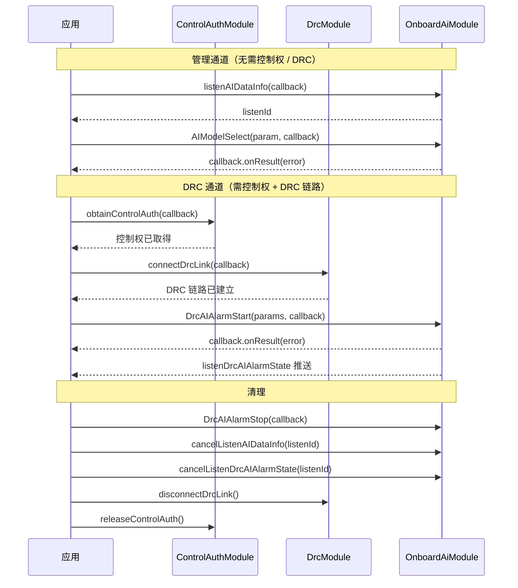

# 机载 AI 控制（OnboardAiModule）

## 1 功能概述

### 1.1 功能简介

`OnboardAiModule` 是**无人机级别**的机载 AI 控制模块。它解决的是「通过 SDK 在飞行中配置并操控无人机载 AI 能力」这一件事：设置 AI 识别开关、过滤规则、分数阈值与模式、选择 AI 模型（管理通道，无需 DRC 链路），以及通过低延迟 DRC 通道进行 AI 目标跟随、AI 主动告警开启/关闭/模型配置，并订阅机载 AI 识别数据与告警状态实时推送。

本模块分两类操作通道：管理通道方法（`AIIdentify*`、`AIModelSelect`）直接下发、无需控制权与 DRC 链路；DRC 通道方法（`DrcAI*`）需要先取得飞行控制权并建立 DRC 链路方可下发。

**获取方式：**

```java
// sn 为目标无人机 SN，须保证该设备已上云且在线
OnboardAiModule onboardAiModule = FlightHubSDK.getDroneInstance(sn).getOnboardAiModule();
```

### 1.2 核心概念

| 概念 | 说明 |
| --- | --- |
| 管理通道 AI 配置 | `AIIdentifySet` / `AIIdentifyFilterSet` / `AIIdentifyScoreSet` / `AIIdentifyScoreModeSet` / `AIIdentifyScoreReset` / `AIModelSelect` 走管理通道，无需控制权及 DRC 链路，回调类型为 `ResultCallback`，用 `error.isSuccess()` 判成功。 |
| DRC 通道 AI 控制 | `DrcAI*` 系列方法走低延迟 DRC 链路，须先通过 [控制权管理](../remote-control/control-auth.md) 抢得飞行控制权、再通过 [DRC 链路](../remote-control/drc.md) `connectDrcLink()` 建链，回调类型为 `ResultCallbackWithError`，用 `error != null && error.isSuccess()` 判成功。 |
| AI 目标跟随（Spotlight Zoom） | 一套五步序列：`DrcAISpotlightZoomSet` 开关跟踪 → `DrcAISpotlightZoomSelect` 框选目标 → `DrcAISpotlightZoomConfirm` 确认 → `DrcAISpotlightZoomTrack` 选择识别目标并跟随 → `DrcAISpotlightZoomStop` 停止。 |
| AI 主动告警 | `DrcAIAlarmStart` 按码流 + 算法类型 + 告警目标配置并开启，`DrcAIAlarmStop` 关闭，`DrcAIModelsConfig` 配置各码流 AI 模型，`listenDrcAIAlarmState` 订阅告警状态实时推送。 |
| AI 数据订阅 | `listenAIDataInfo` 订阅机载 AI 识别数据推送，返回 `listenId` 用于退订，回调类型为 `AiDataInfoCallback`，无 error 参数，须判空 result。 |
| 监听 ID（`listenId`） | 事件订阅方法（`listenAIDataInfo` / `listenDrcAIAlarmState`）的 int 型返回值，取消订阅时须回传同一个值。 |

### 1.3 能力清单

**AI 数据订阅**

| 能力 | 对应接口 | 接口类型 | 说明 |
| --- | --- | --- | --- |
| 订阅机载 AI 数据 | `listenAIDataInfo(AiDataInfoCallback)` | 事件订阅 | 返回 `listenId`；回调无 error 参数，须判空 result |
| 取消订阅机载 AI 数据 | `cancelListenAIDataInfo(int)` | 同步 | 传入对应 `listenId` |

**AI 识别配置（管理通道）**

| 能力 | 对应接口 | 接口类型 | 说明 |
| --- | --- | --- | --- |
| 设置 AI 识别开关 | `AIIdentifySet(AiIdentifySetParam, ResultCallback)` | 异步回调 | 开启或关闭 AI 识别 |
| 设置 AI 识别过滤 | `AIIdentifyFilterSet(AiIdentifyFilterSetParam, ResultCallback)` | 异步回调 | 配置识别目标过滤规则 |
| 设置 AI 识别分数阈值 | `AIIdentifyScoreSet(AiIdentifyScoreSetParam, ResultCallback)` | 异步回调 | 设置 AI 识别置信度阈值 |
| 设置 AI 识别分数模式 | `AIIdentifyScoreModeSet(AiIdentifyScoreModeSetParam, ResultCallback)` | 异步回调 | 设置 AI 识别分数计算模式 |
| 重置 AI 识别分数 | `AIIdentifyScoreReset(AiIdentifyScoreResetParam, ResultCallback)` | 异步回调 | 须填 index + light_type（官方 index=0；light_type: 1 广角/2 变焦/3 红外） |
| 选择 AI 模型 | `AIModelSelect(AiModelSelectParam, ResultCallback)` | 异步回调 | 在设备内已安装的模型中选取生效模型 |

**AI 目标跟随（DRC 通道）**

| 能力 | 对应接口 | 接口类型 | 说明 |
| --- | --- | --- | --- |
| AI 跟踪开关 | `DrcAISpotlightZoomSet(int, ResultCallbackWithError)` | DRC 异步 | 传入 0/1 关闭或开启跟踪；需控制权 + DRC 链路 |
| AI 框选目标跟随 | `DrcAISpotlightZoomSelect(AiSpotlightZoomSelectParams, ResultCallbackWithError)` | DRC 异步 | 按归一化坐标框选目标；需控制权 + DRC 链路 |
| AI 跟随确认 | `DrcAISpotlightZoomConfirm(ResultCallbackWithError)` | DRC 异步 | 确认框选结果并启动跟随；需控制权 + DRC 链路 |
| AI 识别目标跟随 | `DrcAISpotlightZoomTrack(int, ResultCallbackWithError)` | DRC 异步 | 传入识别目标 ID 启动跟随；需控制权 + DRC 链路 |
| 停止 AI 目标跟随 | `DrcAISpotlightZoomStop(ResultCallbackWithError)` | DRC 异步 | 停止当前目标跟随；需控制权 + DRC 链路 |

**AI 主动告警（DRC 通道）**

| 能力 | 对应接口 | 接口类型 | 说明 |
| --- | --- | --- | --- |
| 开启 AI 主动告警 | `DrcAIAlarmStart(AiAlarmStartParams, ResultCallbackWithError)` | DRC 异步 | 按码流 + 算法 + 目标配置告警并开启；需控制权 + DRC 链路 |
| 关闭 AI 主动告警 | `DrcAIAlarmStop(ResultCallbackWithError)` | DRC 异步 | 停止当前 AI 主动告警；需控制权 + DRC 链路 |
| AI 模型配置 | `DrcAIModelsConfig(AiModelsConfigParams, ResultCallbackWithError)` | DRC 异步 | 为各码流指定生效的 AI 模型列表；需控制权 + DRC 链路 |
| 订阅 AI 告警状态 | `listenDrcAIAlarmState(AiAlarmStateCallback)` | 事件订阅 | 返回 `listenId`；回调无 error 参数，须判空 result |
| 取消订阅 AI 告警状态 | `cancelListenDrcAIAlarmState(int)` | 同步 | 传入对应 `listenId` |

---

## 2 前提条件

- 已完成上云 API 2 底座部署，并获取到服务地址与鉴权 Token。详见 [部署指南](../../../02.deployment/00.index.md)、[鉴权接入指南](../../../08.auth.md)。
- 已完成 SDK 初始化且 `FlightHubSDK.isInitialized()` 返回 `true`。详见 [SDK 初始化](../init/sdk-init.md)。
- 目标无人机已完成上云、已绑定至当前工作空间且在线。详见 [设备上云](../../../04.device-onboarding/00.index.md)。
- **DRC 通道方法**（`DrcAI*` 系列）额外要求：须先通过 [控制权管理](../remote-control/control-auth.md) 取得飞行控制权，再通过 [DRC 链路](../remote-control/drc.md) `connectDrcLink()` 成功建链，方可下发指令。
- **事件订阅**（`listenAIDataInfo`、`listenDrcAIAlarmState`）：SDK 配置中的 `notificationServerAddress` 须正确填写且连接可用，否则推送不会到达。详见 [SDK 配置](../init/sdk-config.md)。
- 机载 AI 能力依赖无人机端已安装相应 AI 算法包，算法包的管理与装载详见 [机载 AI 算法管理](./ai-algorithm.md)。

---

## 3 快速上手

### 3.1 获取模块实例

```java
// 前置：已完成 FlightHubSDK.initialize(config)，目标无人机在线
String droneSn = "your_drone_sn";
OnboardAiModule onboardAiModule = FlightHubSDK.getDroneInstance(droneSn).getOnboardAiModule();
```

### 3.2 使用流程

1. **获取模块实例** —— 用目标无人机 SN 调用 `FlightHubSDK.getDroneInstance(sn).getOnboardAiModule()`。
2. **订阅 AI 数据（可选）** —— 调用 `listenAIDataInfo()` 并保存 `listenId`，用于实时消费机载 AI 识别结果。
3. **管理通道配置（可选）** —— 根据需求调用 `AIModelSelect`、`AIIdentifySet`、`AIIdentifyScoreSet` 等配置方法，无需控制权。
4. **取得控制权 + 建 DRC 链路** —— 若需使用 AI 目标跟随或 AI 主动告警，须先完成 [控制权管理](../remote-control/control-auth.md) 与 [DRC 链路](../remote-control/drc.md) 建链。
5. **DRC 通道控制** —— 调用 `DrcAIAlarmStart` / `DrcAISpotlightZoomSet` 等方法；可同步订阅 `listenDrcAIAlarmState` 获取告警状态。
6. **停止与退订** —— 业务结束时调用 `DrcAIAlarmStop` / `DrcAISpotlightZoomStop`，用保存的 `listenId` 调用 `cancelListenAIDataInfo` / `cancelListenDrcAIAlarmState` 退订，最后断开 DRC 链路并释放控制权。

### 3.3 调用时序图



---

## 4 示例代码

### 4.1 完整示例

下面的示例演示了完整的机载 AI 控制流程：订阅 AI 识别数据 → 配置并开启 AI 主动告警（DRC 通道） → 订阅告警状态 → 业务结束后关闭并退订。

```java
import com.dji.flighthubsdk.FlightHubSDK;
import com.dji.flighthubsdk.FlightHubCallback;
import com.dji.flighthubsdk.FlightHubError;
import com.dji.flighthubsdk.bean.AiAlarmStartParams;
import com.dji.flighthubsdk.bean.AiAlarmStreamInputConf;
import com.dji.flighthubsdk.bean.AiAlarmTarget;
import com.dji.flighthubsdk.bean.AiModelsConfigParams;
import com.dji.flighthubsdk.bean.AiModelsConfigSet;
import com.dji.flighthubsdk.core.OnboardAiModule;
import com.dji.flighthubsdk.core.ControlAuthModule;
import com.dji.flighthubsdk.core.DrcModule;
import java.util.Arrays;
import java.util.Collections;

public class OnboardAiExample {

    private int aiDataListenId = -1;
    private int alarmStateListenId = -1;

    public void run(String droneSn) {
        OnboardAiModule aiModule = FlightHubSDK.getDroneInstance(droneSn).getOnboardAiModule();
        ControlAuthModule authModule = FlightHubSDK.getDroneInstance(droneSn).getControlAuthModule();
        DrcModule drcModule = FlightHubSDK.getDroneInstance(droneSn).getDrcModule();

        // ── 步骤 1：订阅机载 AI 数据（管理通道，随时可订阅）─────────────────────
        aiDataListenId = aiModule.listenAIDataInfo(aiDataInfo -> {
            // 注意: 回调无 error 参数，须判空 result
            if (aiDataInfo == null) {
                System.out.println("AI 数据回调为空，忽略本次推送");
                return;
            }
            // 处理机载 AI 识别数据
            System.out.println("收到机载 AI 识别数据: " + aiDataInfo);
        });

        // ── 步骤 2：获取控制权（DRC 通道方法的前置条件）──────────────────────────
        authModule.obtainControlAuth(error -> {
            if (!error.isSuccess()) {
                System.out.println("获取控制权失败: " + error.getMessage());
                return;
            }
            System.out.println("控制权已取得，准备建立 DRC 链路");

            // ── 步骤 3：建立 DRC 链路 ────────────────────────────────────────────
            drcModule.connectDrcLink(drcError -> {
                if (!drcError.isSuccess()) {
                    System.out.println("DRC 链路建立失败: " + drcError.getMessage());
                    authModule.releaseControlAuth(null);
                    return;
                }
                System.out.println("DRC 链路已建立，开始配置 AI 告警");

                // ── 步骤 4：订阅 AI 告警状态（DRC 通道告警状态推送）────────────────
                alarmStateListenId = aiModule.listenDrcAIAlarmState(stateInfo -> {
                    // 注意: 回调无 error 参数，须判空 result
                    if (stateInfo == null) {
                        System.out.println("告警状态回调为空，忽略本次推送");
                        return;
                    }
                    System.out.println("AI 告警状态推送: " + stateInfo);
                });

                // ── 步骤 5：配置 AI 模型（选择各码流生效的模型）────────────────────
                AiModelsConfigSet visibleLightConfig = new AiModelsConfigSet();
                visibleLightConfig.setStreamType(1);                              // 1 = 广角码流
                visibleLightConfig.setModels(Collections.singletonList(0));       // 0 = DJI 官方模型

                AiModelsConfigParams modelsConfigParams = new AiModelsConfigParams();
                modelsConfigParams.setAiModelsConfig(Collections.singletonList(visibleLightConfig));

                aiModule.DrcAIModelsConfig(modelsConfigParams, configError -> {
                    if (configError == null || !configError.isSuccess()) {
                        String msg = configError != null ? configError.getMessage() : "error 为 null";
                        System.out.println("AI 模型配置失败: " + msg);
                        return;
                    }
                    System.out.println("AI 模型配置成功，开始配置并开启告警");

                    // ── 步骤 6：开启 AI 主动告警 ────────────────────────────────────
                    // 告警目标：人（targetType=0），启用最小阈值
                    AiAlarmTarget personTarget = new AiAlarmTarget();
                    personTarget.setTargetType(0);                              // 0 = 人
                    personTarget.setTargetValue(1.0);
                    personTarget.setUseMinThreshold(true);
                    personTarget.setTargetMinThreshold(0.6);
                    personTarget.setUseMaxThreshold(false);

                    // 注意: AiAlarmStreamInputConf 对应一路码流的告警配置
                    AiAlarmStreamInputConf streamConf = new AiAlarmStreamInputConf();
                    streamConf.setStreamSource(1);                              // 码流编号 1
                    streamConf.setModelIdx(0);                                  // 模型编号 0
                    streamConf.setAlgorithmType(1);                             // 1 = DJI 可见光人车船
                    streamConf.setAlarmInterval(5);                             // 告警间隔 5 秒
                    streamConf.setAlarmTargets(Collections.singletonList(personTarget));

                    AiAlarmStartParams alarmParams = new AiAlarmStartParams();
                    alarmParams.setStreamInputConfs(Collections.singletonList(streamConf));

                    aiModule.DrcAIAlarmStart(alarmParams, startError -> {
                        if (startError == null || !startError.isSuccess()) {
                            String msg = startError != null ? startError.getMessage() : "error 为 null";
                            System.out.println("开启 AI 告警失败: " + msg);
                            return;
                        }
                        System.out.println("AI 主动告警已开启，持续监听状态推送");
                    });
                });
            });
        });
    }

    /** 业务结束时调用，停止告警并清理所有资源 */
    public void cleanup(String droneSn) {
        OnboardAiModule aiModule = FlightHubSDK.getDroneInstance(droneSn).getOnboardAiModule();
        DrcModule drcModule = FlightHubSDK.getDroneInstance(droneSn).getDrcModule();
        ControlAuthModule authModule = FlightHubSDK.getDroneInstance(droneSn).getControlAuthModule();

        // 关闭 AI 主动告警
        aiModule.DrcAIAlarmStop(stopError -> {
            if (stopError == null || !stopError.isSuccess()) {
                String msg = stopError != null ? stopError.getMessage() : "error 为 null";
                System.out.println("关闭 AI 告警失败: " + msg);
            } else {
                System.out.println("AI 主动告警已关闭");
            }
        });

        // 退订事件，防止内存泄漏
        if (aiDataListenId >= 0) {
            aiModule.cancelListenAIDataInfo(aiDataListenId);
        }
        if (alarmStateListenId >= 0) {
            aiModule.cancelListenDrcAIAlarmState(alarmStateListenId);
        }

        // 断开 DRC 链路，释放控制权
        drcModule.disconnectDrcLink(null);
        authModule.releaseControlAuth(null);
    }
}
```

**`AiAlarmStreamInputConf` 字段说明**

| 字段 | 类型 | 说明 |
| --- | --- | --- |
| `getStreamSource()` | `int` | 码流编号 |
| `getModelIdx()` | `int` | 模型编号 |
| `getAlgorithmType()` | `int` | 告警算法类型：1 DJI 可见光人车船、2 DJI 红外人车船、3 DJI 红外温度识别、5 三方红外 AI、255 三方算法 |
| `getAlarmInterval()` | `int` | 告警间隔（秒） |
| `getAlarmTargets()` | `List<AiAlarmTarget>` | 告警目标数组 |

**`AiAlarmTarget` 字段说明**

| 字段 | 类型 | 说明 |
| --- | --- | --- |
| `getTargetType()` | `int` | 告警目标类型：0 人、1 车、2 船、3 绝对温度点、4 移动目标、128～137 自定义 |
| `getTargetValue()` | `double` | 告警目标数值 |
| `isUseMinThreshold()` | `boolean` | 是否使用 `targetMinThreshold` |
| `isUseMaxThreshold()` | `boolean` | 是否使用 `targetMaxThreshold` |
| `getTargetMinThreshold()` | `double` | 告警目标最小阈值 |
| `getTargetMaxThreshold()` | `double` | 告警目标最大阈值 |

**`AiModelsConfigSet` 字段说明**

| 字段 | 类型 | 说明 |
| --- | --- | --- |
| `getStreamType()` | `int` | 码流类型：0 融合流、1 广角、2 变焦、3 红外 |
| `getModels()` | `List<Integer>` | 模型索引列表，DJI 官方为 0，三方模型为其他值 |

### 4.2 场景化片段

**场景：AI 框选目标跟随**

在 DRC 链路已建立的前提下，通过视频帧上的归一化坐标框选目标，确认后启动 AI 目标跟随。

```java
// 前置：已持有 OnboardAiModule aiModule、已取得控制权、DRC 链路已建立
// 注意: AiSpotlightZoomSelectParams 的坐标均为归一化值（0.0~1.0），以视频帧左上角为原点

// 1. 开启 AI 跟踪（1 = 开启，0 = 关闭）
aiModule.DrcAISpotlightZoomSet(1, setError -> {
    if (setError == null || !setError.isSuccess()) {
        String msg = setError != null ? setError.getMessage() : "error 为 null";
        System.out.println("开启 AI 跟踪失败: " + msg);
        return;
    }
    System.out.println("AI 跟踪已开启，准备框选目标");

    // 2. 框选目标：以视频帧中心区域为目标框
    AiSpotlightZoomSelectParams selectParams = new AiSpotlightZoomSelectParams();
    selectParams.setCenterX(0.5);   // 目标框中心 X 坐标（画面水平中心）
    selectParams.setCenterY(0.4);   // 目标框中心 Y 坐标（画面偏上方）
    selectParams.setWidth(0.2);     // 目标框宽度占画面 20%
    selectParams.setHeight(0.3);    // 目标框高度占画面 30%

    aiModule.DrcAISpotlightZoomSelect(selectParams, selectError -> {
        if (selectError == null || !selectError.isSuccess()) {
            String msg = selectError != null ? selectError.getMessage() : "error 为 null";
            System.out.println("框选目标失败: " + msg);
            return;
        }
        System.out.println("框选成功，确认跟随目标");

        // 3. 确认跟随
        aiModule.DrcAISpotlightZoomConfirm(confirmError -> {
            if (confirmError == null || !confirmError.isSuccess()) {
                String msg = confirmError != null ? confirmError.getMessage() : "error 为 null";
                System.out.println("跟随确认失败: " + msg);
                return;
            }
            System.out.println("AI 目标跟随已启动");
        });
    });
});

// 业务结束后停止跟随
// aiModule.DrcAISpotlightZoomStop(stopError -> { ... });
```

**`AiSpotlightZoomSelectParams` 字段说明**

| 字段 | 类型 | 说明 |
| --- | --- | --- |
| `getCenterX()` | `double` | 目标框中心 X 坐标（0.0～1.0） |
| `getCenterY()` | `double` | 目标框中心 Y 坐标（0.0～1.0） |
| `getWidth()` | `double` | 目标框宽度（0.0～1.0） |
| `getHeight()` | `double` | 目标框高度（0.0～1.0） |

---

## 5 相关文档

- [SDK 初始化](../init/sdk-init.md)
- [SDK 配置](../init/sdk-config.md)
- [部署指南](../../../02.deployment/00.index.md)
- [鉴权接入指南](../../../08.auth.md)
- [设备上云](../../../04.device-onboarding/00.index.md)
- [控制权管理](../remote-control/control-auth.md)
- [DRC 链路](../remote-control/drc.md)
- [AI Box 管理](./ai-box.md)
- [AI 智能告警](./ai-alert.md)
- [机载 AI 算法管理](./ai-algorithm.md)
- [使用 API 文档查阅接口详情](../../03.api-docs-guide.md)
