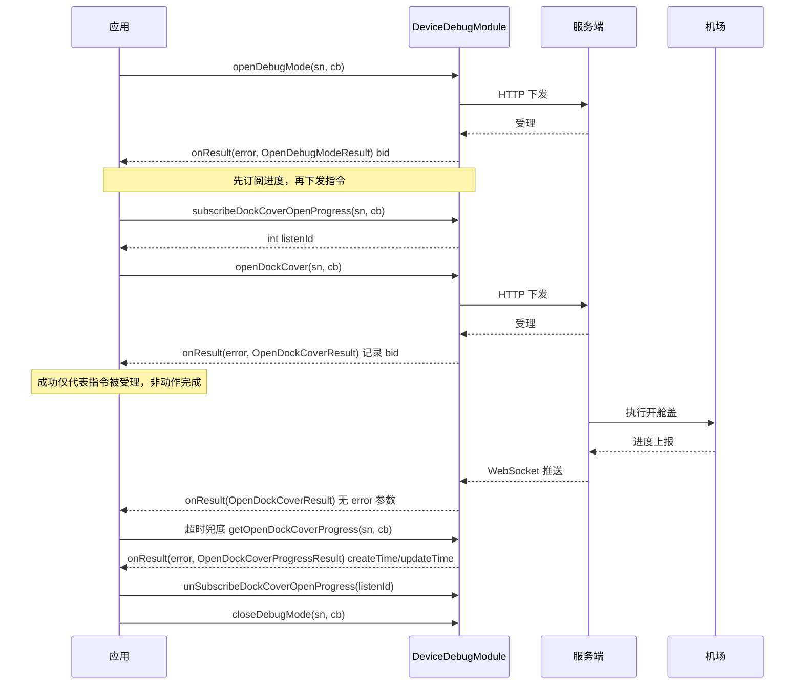

# 设备远程调试（DeviceDebugModule）

## 1 功能概述

### 1.1 功能简介

`DeviceDebugModule` 是设备远程调试与远程运维的统一入口。它把「运维人员在机场现场手动做的事」搬到了云端：开关舱盖、给飞机上下电、开关充电、格式化存储、重启设备、切换空调与静音模式、调整限高限远与避障、开关夜航灯与声光报警、切换 SIM / eSIM、发起手动换电、开关 Dongle 电源与地理围栏、切换飞机 SDR 工作模式，以及切换设备的云环境。

本模块共 **59 个方法**，可以按「响应形态」分成三类，这个分类决定了你的调用方式：

| 类别 | 特征 | 典型接口 | 使用方式 |
| --- | --- | --- | --- |
| **即时操作** | 一次请求一次回调，回调即终态 | `setHeightLimit`、`setDockAirConditionerMode`、`droneSdrWorkMode` | 下发 → 读回调 → 结束 |
| **过程操作** | 下发后设备需要执行一段时间，需另外跟踪进度 | `openDockCover`、`deviceReboot`、`deviceFormat`、`openDrone`、`openCharge`、`droneFormat`、`esimOperatorSwitch`、`simSlotSwitch`、`startManualBatterySwap`、`cloudEnvironmentSwitch` | 下发 → 拿 `bid` → 订阅进度 / 轮询进度 → 判终态 |
| **进度获取** | 过程操作的配套，分「订阅推送」与「主动查询」两套 | `subscribeXxxProgress` / `unSubscribeXxxProgress`、`listenDeviceCloudEnvironmentSwitchProgress`、`getXxxProgress` | 优先订阅，查询用于补偿与对账 |

**这是一个高风险模块。** 格式化会清除设备存储、重启会中断作业、飞机断电会导致正在执行的任务失败、修改限高限远与避障会直接改变飞行安全边界、切换云环境会改变设备的接入归属。所有写操作都应有二次确认与操作审计。

模块实例的获取方式见「3.1 获取模块实例」。

### 1.2 核心概念

| 概念 | 说明 |
| --- | --- |
| `device_sn` 显式入参 | 本模块**绝大多数方法的第一个参数都是 `String device_sn`**（`cloudEnvironmentSwitch` / `cloudEnvironmentSwitchCallback` 例外，其设备列表在入参对象里）。模块实例只是入口，真正决定操作对象的是这个入参。因此「从哪个实例取模块」并不限制「能操作哪台设备」，但强烈建议保持一致以免混乱 |
| 机场 SN vs 飞机 SN | 部分接口对 SN 的归属有硬要求：`startManualBatterySwap` / `getManualBatterySwapProgress` 必须传**机场 SN**；`setDonglePowerSwitch` 必须传**飞行器 SN（非机场 SN）**且飞机已安装 Dongle。传错会直接失败 |
| `bid`（业务 ID） | 绝大多数返回体都有 `getBid()`。它是本次过程操作的业务流水号，用于把「下发」与「后续的进度推送 / 进度查询」关联起来，也是排障时向服务端追溯的唯一线索。**过程操作必须记录 `bid`** |
| 即时 vs 过程 | javadoc 明确标注了 `droneFormat` 为「过程操作」、`droneSdrWorkMode` 为「即时操作」。过程操作的成功回调只代表**指令已被接受**，不代表动作已完成 |
| 订阅进度 vs 查询进度 | 同一个动作往往两套都有：`subscribeDockCoverOpenProgress`（WebSocket 推送，返回 `listenId`）与 `getOpenDockCoverProgress`（HTTP 主动查询）。推荐订阅为主、查询为辅 |
| 进度回调无 error 参数 | **所有 `SubscribeXxxProgressCallback` 与 `DeviceCloudEnvironmentSwitchProgressCallback` 的 `onResult` 只有一个 result 参数，没有 `FlightHubError`**。链路或业务异常不会从进度推送里体现，必须靠超时兜底 |
| 调试模式 | `openDebugMode` / `closeDebugMode` 是机场调试态开关。舱盖、飞机上下电、充电这类会破坏正常作业流程的操作通常要求先进入调试模式，退出时务必关闭 |
| `listenId` | 订阅进度接口各自返回 `int listenId`，取消时必须传回同一个值，且必须调用**同名配对**的 `unSubscribeXxx` / `cancelListenXxx` |

### 1.3 能力清单

**调试模式（2）**

| 能力 | 对应接口 | 接口类型 | 说明 |
| --- | --- | --- | --- |
| 打开调试模式 | `openDebugMode(device_sn, OpenDebugModeCallback)` | 异步回调 | 回调 `onResult(FlightHubError, OpenDebugModeResult)` |
| 关闭调试模式 | `closeDebugMode(device_sn, CloseDebugModeCallback)` | 异步回调 | 回调 `onResult(FlightHubError, CloseDebugModeResult)` |

**舱盖控制（4）**

| 能力 | 对应接口 | 接口类型 | 说明 |
| --- | --- | --- | --- |
| 打开舱盖 | `openDockCover(device_sn, OpenDockCoverCallback)` | 过程操作 | 返回 `OpenDockCoverResult`（`message` / `bid`） |
| 查询舱盖打开进度 | `getOpenDockCoverProgress(device_sn, OpenDockCoverProgressCallback)` | 异步回调 | 返回 `OpenDockCoverProgressResult`（含 `createTime` / `updateTime`） |
| 关闭舱盖 | `closeDockCover(device_sn, CloseDockCoverCallback)` | 过程操作 | 返回 `CloseDockCoverResult` |
| 查询舱盖关闭进度 | `getCloseDockCoverProgress(device_sn, CloseDockCoverProgressCallback)` | 异步回调 | 返回 `CloseDockCoverProgressResult` |

**重启与格式化（5）**

| 能力 | 对应接口 | 接口类型 | 说明 |
| --- | --- | --- | --- |
| 设备重启 | `deviceReboot(device_sn, DeviceRebootCallback)` | 过程操作 | 高风险，会中断作业与所有链路 |
| 查询重启进度 | `getDeviceRebootProgress(device_sn, DeviceRebootProgressCallback)` | 异步回调 | 返回 `DeviceRebootProgressResult` |
| 设备格式化 | `deviceFormat(device_sn, DeviceFormatCallback)` | 过程操作 | **不可逆**，清除设备存储数据 |
| 查询格式化进度 | `getDeviceFormatProgress(device_sn, DeviceFormatProgressCallback)` | 异步回调 | 返回 `DeviceFormatProgressResult` |
| 飞行器格式化 | `droneFormat(device_sn, DroneFormatCallback)` | 过程操作 | javadoc 标注「过程操作」；**无配套 `getDroneFormatProgress`**，进度只能靠 `subscribeDroneFormatProgress` |

**飞机上下电与充电（4）**

| 能力 | 对应接口 | 接口类型 | 说明 |
| --- | --- | --- | --- |
| 飞行器开机 | `openDrone(device_sn, OpenDroneCallback)` | 过程操作 | 返回 `OpenDroneResult` |
| 飞行器关机 | `closeDrone(device_sn, CloseDroneCallback)` | 过程操作 | 返回 `CloseDroneResult`；飞行中禁止调用 |
| 打开充电 | `openCharge(device_sn, OpenChargeCallback)` | 过程操作 | 返回 `OpenChargeResult` |
| 关闭充电 | `closeCharge(device_sn, CloseChargeCallback)` | 过程操作 | 返回 `CloseChargeResult` |

**机场环境与功耗（3）**

| 能力 | 对应接口 | 接口类型 | 说明 |
| --- | --- | --- | --- |
| 设置空调模式 | `setDockAirConditionerMode(device_sn, int mode, ResultCallbackWithError)` | 即时操作 | `mode`：**0=空闲，1=制冷，2=制热，3=除湿**；回调只有 `FlightHubError` |
| 设置静音模式 | `setDockSilentMode(device_sn, int mode, ResultCallbackWithError)` | 即时操作 | javadoc 未定义取值，见 [使用 API 文档查阅接口详情](../../03.api-docs-guide.md) |
| 机场低功耗开关 | `setLowPowerSwitch(device_sn, int low_power_mode, LowPowerSwitchCallback)` | 异步回调 | `low_power_mode`：**0=关，1=开** |

**飞行安全边界（4）**

| 能力 | 对应接口 | 接口类型 | 说明 |
| --- | --- | --- | --- |
| 设置限远 | `setDistanceLimit(device_sn, int distance_limit_state, int distance_limit_value, SetDistanceLimitCallback)` | 即时操作 | 两个入参：开关状态 + 距离值；返回体**只有 `message`，无 `bid`** |
| 设置限高 | `setHeightLimit(device_sn, int height_limit, SetHeightLimitCallback)` | 即时操作 | 返回体**只有 `message`，无 `bid`** |
| 设置避障状态 | `setObstacleAvoidance(device_sn, int obstacle_avoidance_state, SetObstacleAvoidanceCallback)` | 即时操作 | 返回体只有 `message` |
| 设置返航剩余电量 | `setRemainingPowerForRth(device_sn, int remaining_power_for_rth, SetRemainingPowerForRthCallback)` | 即时操作 | 入参为**返航剩余电量百分比**；返回体只有 `message` |

**灯光（2）**

| 能力 | 对应接口 | 接口类型 | 说明 |
| --- | --- | --- | --- |
| 设置夜航灯状态 | `setNightLightsState(device_sn, int night_lights_state, SetNightLightsStateCallback)` | 即时操作 | 返回体只有 `message` |
| 切换报警灯状态 | `switchAlarmLightState(device_sn, int alarm_state, SwitchAlarmLightStateCallback)` | 即时操作 | 回调第二参数类型为 **`SwitchAlarmStateResult`**（与回调名不同名），只有 `message` |

**SIM / eSIM（3）**

| 能力 | 对应接口 | 接口类型 | 说明 |
| --- | --- | --- | --- |
| eSIM 运营商切换 | `esimOperatorSwitch(device_sn, String imei, int operator_type, String device_type, EsimOperatorSwitchCallback)` | 过程操作 | 需传设备 IMEI 与设备类型 |
| 查询 eSIM 切换进度 | `getEsimOperatorSwitchProgress(device_sn, EsimOperatorSwitchProgressCallback)` | 异步回调 | javadoc 注明 **query 键为 `sn`**；返回体含 `getDataJson()` 原始 JSON |
| SIM 卡槽切换 | `simSlotSwitch(device_sn, String imei, int sim_slot, String device_type, SimSlotSwitchCallback)` | 过程操作 | 返回 `SimSlotSwitchResult`；**无 `getSimSlotSwitchProgress` 查询接口**，进度只能订阅 |

**电池（3）**

| 能力 | 对应接口 | 接口类型 | 说明 |
| --- | --- | --- | --- |
| 设置电池存储模式 | `setBatteryStoreMode(device_sn, int battery_store_mode, SetBatteryStoreModeCallback)` | 异步回调 | javadoc 未定义取值，见 [使用 API 文档查阅接口详情](../../03.api-docs-guide.md) |
| 发起手动换电 | `startManualBatterySwap(device_sn, int slot_id, ManualBatterySwapCallback)` | 过程操作 | `device_sn` 必须为**机场 SN**；`slot_id` 为目标电池卡槽 ID |
| 查询手动换电进度 | `getManualBatterySwapProgress(device_sn, ManualBatterySwapProgressCallback)` | 异步回调 | **机场 SN，query 键为 `sn`**；返回体含 `getDataJson()` |

**Dongle、地理围栏与 SDR（3）**

| 能力 | 对应接口 | 接口类型 | 说明 |
| --- | --- | --- | --- |
| Dongle 电源开关 | `setDonglePowerSwitch(device_sn, int power_state, DonglePowerSwitchCallback)` | 异步回调 | **必须传飞行器 SN**；`power_state`：0=关，1=开 |
| 设置 Geo Caging | `setGeoCagingEnable(device_sn, int geoCagingSwitch, List<GeoCagingInfoParam> geoCagingInfos, SetGeoCagingEnableCallback)` | 即时操作 | `geoCagingSwitch`：**1=开启，0=关闭**；回调**只有 `FlightHubError`**，无 result |
| 切换飞机 SDR 工作模式 | `droneSdrWorkMode(device_sn, int mode, ResultCallbackWithError)` | 即时操作 | javadoc 未定义 `mode` 取值，见 [使用 API 文档查阅接口详情](../../03.api-docs-guide.md) |

**云环境切换（4）**

| 能力 | 对应接口 | 接口类型 | 说明 |
| --- | --- | --- | --- |
| 云环境切换 | `cloudEnvironmentSwitch(CloudEnvironmentSwitchParam param, ResultCallbackWithError)` | 过程操作 | **入参是 `CloudEnvironmentSwitchParam`（设备列表在其中），无独立 `device_sn` 形参**；回调只有 `FlightHubError`。切换目标由 `getTargetConfig()` 描述 |
| 云环境切换鉴权应答 | `cloudEnvironmentSwitchCallback(CloudEnvironmentSwitchCallbackParam param, ResultCallbackWithError)` | 过程操作 | 用于应答服务端下发的设备鉴权校验（`getDeviceAuthVerify()`）；回调只有 `FlightHubError` |
| 订阅云环境切换进度 | `listenDeviceCloudEnvironmentSwitchProgress(device_sn, DeviceCloudEnvironmentSwitchProgressCallback)` | 事件订阅 | 返回 `int listenId`；进度回调载荷 `CloudEnvironmentSwitchResult`（`message` / `bid` / `progress`），**无 `FlightHubError`** |
| 取消订阅云环境切换进度 | `cancelListenDeviceCloudEnvironmentSwitchProgress(int listenId)` | 同步返回 | 传入订阅时返回的 `listenId` |

**进度订阅（11 组，共 22 个方法）**

| 订阅接口 | 取消接口 | 回调载荷 |
| --- | --- | --- |
| `subscribeDockCoverOpenProgress(device_sn, cb)` | `unSubscribeDockCoverOpenProgress(listenId)` | `OpenDockCoverResult` |
| `subscribeDockCoverCloseProgress(device_sn, cb)` | `unSubscribeDockCoverCloseProgress(listenId)` | `CloseDockCoverResult` |
| `subscribeDeviceRebootProgress(device_sn, cb)` | `unSubscribeDeviceRebootProgress(listenId)` | `DeviceRebootResult` |
| `subscribeDeviceFormatProgress(device_sn, cb)` | `unSubscribeDeviceFormatProgress(listenId)` | `DeviceFormatResult` |
| `subscribeDroneOpenProgress(device_sn, cb)` | `unSubscribeDroneOpenProgress(listenId)` | `OpenDroneResult` |
| `subscribeDroneCloseProgress(device_sn, cb)` | `unSubscribeDroneCloseProgress(listenId)` | `CloseDroneResult` |
| `subscribeDroneFormatProgress(device_sn, cb)` | `unSubscribeDroneFormatProgress(listenId)` | `DroneFormatResult` |
| `subscribeDroneChargeOpenProgress(device_sn, cb)` | `unSubscribeDroneChargeOpenProgress(listenId)` | `OpenChargeResult` |
| `subscribeDroneChargeCloseProgress(device_sn, cb)` | `unSubscribeDroneChargeCloseProgress(listenId)` | `CloseChargeResult` |
| `subscribeDeviceEsimOperatorSwitchProgress(device_sn, cb)` | `unSubscribeDeviceEsimOperatorSwitchProgress(listenId)` | `EsimOperatorSwitchResult` |
| `subscribeDeviceSimSlotSwitchProgress(device_sn, cb)` | `unSubscribeDeviceSimSlotSwitchProgress(listenId)` | `SimSlotSwitchResult` |

> 上表 11 组共 22 个方法，另有云环境切换的 `listenDeviceCloudEnvironmentSwitchProgress` / `cancelListenDeviceCloudEnvironmentSwitchProgress` 一组，合计 12 组进度订阅。`subscribeDroneFormatProgress` 是 `droneFormat` 唯一的进度来源。**进度回调统一复用「非 Progress」结果 Bean，且只有 result 一个参数、没有 `FlightHubError`。**

---

## 2 前提条件

- 已完成上云 API 2 底座部署并获取鉴权 Token。详见 [部署指南](../../../02.deployment/00.index.md)、[鉴权接入指南](../../../08.auth.md)。
- 已完成 SDK 初始化且 `FlightHubSDK.isInitialized()` 返回 `true`。详见 [SDK初始化](../init/sdk-init.md)。
- **使用任意 `subscribeXxxProgress` / `listenDeviceCloudEnvironmentSwitchProgress` 时，`notificationServerAddress` 必须正确配置且已注入 WebSocket 鉴权头**，否则订阅接口仍会返回 `listenId` 但回调永不触发。详见 [SDK配置](../init/sdk-config.md)。
- 目标设备已上云、已绑定当前工作空间且**处于在线状态**。离线设备的所有调试指令都会失败，建议先用 [设备在线状态](./device-online-status.md) 或 [设备管理](./device-manage.md) 判断在线再下发。
- 部分操作（舱盖、飞机上下电、充电）通常要求机场先进入调试模式（`openDebugMode`）。
- 飞机侧操作（`droneFormat`、`droneSdrWorkMode`、`setDonglePowerSwitch`）要求飞机已上电且在舱内可通信。
- 涉及飞行参数修改与飞机上下电的操作，需确认设备**当前没有正在执行的任务**。可结合 [航线任务管理](../wayline/wayline-task-manage.md) 校验。
- 云环境切换（`cloudEnvironmentSwitch`）会改变设备的接入归属，需在切换前确认目标环境配置正确、设备处于空闲态，并准备好应答服务端下发的鉴权校验。

---

## 3 快速上手

### 3.1 获取模块实例

```java
// 机场维度（舱盖、充电、空调、静音、低功耗、换电等机场侧能力）
Dock dock = FlightHubSDK.getDockInstance("your_dock_sn");
DeviceDebugModule dockDebug = dock.getDeviceDebugModule();

// 飞机维度（飞机格式化、SDR 工作模式、Dongle 电源等飞机侧能力）
Drone drone = FlightHubSDK.getDroneInstance("your_drone_sn");
DeviceDebugModule droneDebug = drone.getDeviceDebugModule();

// 注意：模块的每个方法都要显式传 device_sn，实例本身不限定操作对象
```

### 3.2 使用流程

**即时操作（如设置限高）**

1. 校验设备在线。
2. 调用 `setHeightLimit(sn, value, callback)`。
3. 回调中判断 `error.isSuccess()`，成功即终态。

**过程操作（如打开舱盖）**

1. 校验设备在线，必要时先 `openDebugMode(sn, cb)`。
2. **先订阅进度**：`int listenId = subscribeDockCoverOpenProgress(sn, cb)`，保存 `listenId`。
   —— 顺序很重要：先订阅再下发，避免动作过快导致早期进度丢失。
3. **下发指令**：`openDockCover(sn, cb)`，在回调中记录 `result.getBid()`。
4. **消费进度推送**，同时启动本地超时定时器（进度回调不带 error，超时是唯一兜底）。
5. **超时或推送异常时补偿**：调用 `getOpenDockCoverProgress(sn, cb)` 主动核对。
6. **终态后清理**：`unSubscribeDockCoverOpenProgress(listenId)`，并按需 `closeDebugMode(sn, cb)`。

### 3.3 调用时序图



---

## 4 示例代码

### 4.1 完整示例

```java
/**
 * 远程复位机场：进入调试模式 -> 开舱盖 -> 飞机下电 -> 飞机上电 -> 关舱盖 -> 退出调试模式。
 * 关键点：过程操作一律「先订阅进度、再下发指令」，并为每一步设置本地超时兜底
 *（进度回调不带 FlightHubError，失败不会以错误对象推送过来）。
 */
public class DockRemoteResetter {

    private static final long STEP_TIMEOUT_MS = 120_000L;   // 单步超时，按机型实际耗时调整

    private final String dockSn;
    private final DeviceDebugModule debug;
    /** 动作key -> listenId，退订时逐个释放 */
    private final Map<String, Integer> listenIds = new ConcurrentHashMap<>();
    private final ScheduledExecutorService timer = Executors.newSingleThreadScheduledExecutor();

    public DockRemoteResetter(String dockSn) {
        this.dockSn = dockSn;
        Dock dock = FlightHubSDK.getDockInstance(dockSn);
        this.debug = dock.getDeviceDebugModule();   // 注意：模块方法仍需显式传 device_sn
    }

    /** 入口：串行执行复位流程 */
    public void reset() {
        // 前置：设备必须在线，否则所有调试指令都会失败
        if (!isDeviceOnline(dockSn)) {
            System.err.println("机场离线，取消复位");
            return;
        }
        openDebugMode();
    }

    // ================= 1. 进入调试模式 =================
    private void openDebugMode() {
        debug.openDebugMode(dockSn, (error, result) -> {
            if (error != null && !error.isSuccess()) {
                fail("打开调试模式", error);
                return;
            }
            System.out.println("调试模式已开启, bid=" + (result != null ? result.getBid() : "null"));
            openCover();
        });
    }

    // ================= 2. 开舱盖（过程操作） =================
    private void openCover() {
        // 注意：先订阅，再下发。动作可能很快完成，反序会丢失进度推送
        int listenId = debug.subscribeDockCoverOpenProgress(dockSn, result -> {
            // 注意：进度回调只有 result，没有 FlightHubError
            System.out.println("开舱盖进度: " + (result != null ? result.getMessage() : "null")
                    + " bid=" + (result != null ? result.getBid() : "null"));
        });
        listenIds.put("coverOpen", listenId);

        debug.openDockCover(dockSn, (error, result) -> {
            if (error != null && !error.isSuccess()) {
                unsubscribe("coverOpen");
                fail("打开舱盖", error);
                return;
            }
            // 注意：这里的成功只代表指令被受理，不代表舱盖已打开
            String bid = result != null ? result.getBid() : null;
            System.out.println("开舱盖指令已受理, bid=" + bid);

            // 超时兜底：到点主动查一次进度，避免推送丢失后流程永久挂起
            timer.schedule(() -> checkCoverOpenProgress(bid), STEP_TIMEOUT_MS, TimeUnit.MILLISECONDS);
        });
    }

    private void checkCoverOpenProgress(String expectedBid) {
        debug.getOpenDockCoverProgress(dockSn, (error, result) -> {
            unsubscribe("coverOpen");
            if (error != null && !error.isSuccess() || result == null) {
                fail("查询开舱盖进度", error);
                return;
            }
            // 注意：进度查询返回的是 OpenDockCoverProgressResult，比推送多 createTime/updateTime，
            //       且这两个字段是 double 类型
            System.out.printf("开舱盖进度: %s create=%.0f update=%.0f%n",
                    result.getMessage(), result.getCreateTime(), result.getUpdateTime());
            // 用 bid 对账，避免把上一次运维动作的残留结果当成本次
            if (expectedBid != null && !expectedBid.equals(result.getBid())) {
                System.err.println("bid 不匹配，疑似历史残留进度: " + result.getBid());
                return;
            }
            closeDroneStep();
        });
    }

    // ================= 3. 飞机下电 =================
    private void closeDroneStep() {
        int listenId = debug.subscribeDroneCloseProgress(dockSn, result ->
                System.out.println("飞机下电进度: " + (result != null ? result.getMessage() : "null")));
        listenIds.put("droneClose", listenId);

        debug.closeDrone(dockSn, (error, result) -> {
            if (error != null && !error.isSuccess()) {
                unsubscribe("droneClose");
                fail("飞机下电", error);
                return;
            }
            System.out.println("飞机下电指令已受理, bid=" + (result != null ? result.getBid() : "null"));
            timer.schedule(() -> { unsubscribe("droneClose"); openDroneStep(); },
                    30_000L, TimeUnit.MILLISECONDS);   // 无查询接口时用固定等待 + 状态复核
        });
    }

    // ================= 4. 飞机上电 =================
    private void openDroneStep() {
        int listenId = debug.subscribeDroneOpenProgress(dockSn, result ->
                System.out.println("飞机上电进度: " + (result != null ? result.getMessage() : "null")));
        listenIds.put("droneOpen", listenId);

        debug.openDrone(dockSn, (error, result) -> {
            if (error != null && !error.isSuccess()) {
                unsubscribe("droneOpen");
                fail("飞机上电", error);
                return;
            }
            System.out.println("飞机上电指令已受理, bid=" + (result != null ? result.getBid() : "null"));
            timer.schedule(() -> { unsubscribe("droneOpen"); closeCover(); },
                    60_000L, TimeUnit.MILLISECONDS);
        });
    }

    // ================= 5. 关舱盖 =================
    private void closeCover() {
        int listenId = debug.subscribeDockCoverCloseProgress(dockSn, result ->
                System.out.println("关舱盖进度: " + (result != null ? result.getMessage() : "null")));
        listenIds.put("coverClose", listenId);

        debug.closeDockCover(dockSn, (error, result) -> {
            if (error != null && !error.isSuccess()) {
                unsubscribe("coverClose");
                fail("关闭舱盖", error);
                return;
            }
            timer.schedule(() -> debug.getCloseDockCoverProgress(dockSn, (e2, r2) -> {
                unsubscribe("coverClose");
                if (r2 != null) System.out.println("关舱盖进度: " + r2.getMessage());
                closeDebugMode();
            }), STEP_TIMEOUT_MS, TimeUnit.MILLISECONDS);
        });
    }

    // ================= 6. 退出调试模式（必须执行） =================
    private void closeDebugMode() {
        debug.closeDebugMode(dockSn, (error, result) -> {
            if (error != null && !error.isSuccess()) {
                // 注意：调试模式未关闭会让机场停留在调试态、无法执行定时任务，此处必须告警
                System.err.println("关闭调试模式失败，机场可能仍处于调试态: " + error);
            } else {
                System.out.println("复位流程完成，调试模式已关闭");
            }
            shutdown();
        });
    }

    // ================= 辅助 =================
    private void unsubscribe(String key) {
        Integer id = listenIds.remove(key);
        if (id == null) return;
        // 注意：各组订阅的取消方法各不相同，必须配对调用，不能交叉
        switch (key) {
            case "coverOpen":  debug.unSubscribeDockCoverOpenProgress(id);  break;
            case "coverClose": debug.unSubscribeDockCoverCloseProgress(id); break;
            case "droneOpen":  debug.unSubscribeDroneOpenProgress(id);      break;
            case "droneClose": debug.unSubscribeDroneCloseProgress(id);     break;
            default: break;
        }
    }

    private void fail(String step, FlightHubError error) {
        System.err.println(step + " 失败: " + describe(error));
        closeDebugMode();   // 失败也要退出调试模式，避免设备卡在调试态
    }

    private String describe(FlightHubError e) {
        if (e == null) return "unknown";
        return "sdk=" + e.getErrorCode() + " http=" + e.getHttpCode()
                + " server=" + e.getServerCode() + "/" + e.getServerMessage()
                + " device=" + e.getDeviceCode();
    }

    private boolean isDeviceOnline(String sn) {
        // 实际实现请用 DeviceManageModule 查询或 DeviceStateModule 订阅维护的本地缓存
        return true;
    }

    /** 退出前释放所有订阅与定时器，防止泄漏 */
    public void shutdown() {
        for (String key : new ArrayList<>(listenIds.keySet())) unsubscribe(key);
        timer.shutdown();
    }
}
```

### 4.2 场景化片段

**批量下发飞行安全边界（限高、限远、避障、返航电量）**

```java
// 前置：设备在线且无任务执行中；各 int 取值请先查服务端 API 文档确认，不要凭印象填
public void applySafetyProfile(DeviceDebugModule debug, String droneSn,
                               int heightLimit, int distanceState, int distanceValue,
                               int obstacleState, int rthPowerPercent) {

    debug.setHeightLimit(droneSn, heightLimit, (error, result) -> {
        // 注意：SetHeightLimitResult 只有 getMessage()，没有 getBid()
        System.out.println("限高: " + (isOk(error) ? result.getMessage() : describe(error)));
    });

    // 注意：限远是两个入参——开关状态 + 距离值
    debug.setDistanceLimit(droneSn, distanceState, distanceValue, (error, result) ->
            System.out.println("限远: " + (isOk(error) ? result.getMessage() : describe(error))));

    debug.setObstacleAvoidance(droneSn, obstacleState, (error, result) ->
            System.out.println("避障: " + (isOk(error) ? result.getMessage() : describe(error))));

    debug.setRemainingPowerForRth(droneSn, rthPowerPercent, (error, result) ->
            System.out.println("返航电量: " + (isOk(error) ? result.getMessage() : describe(error))));
}

private static boolean isOk(FlightHubError e) { return e == null || e.isSuccess(); }
```

**设置机场空调模式（javadoc 已给出取值）**

```java
// mode: 0=空闲, 1=制冷, 2=制热, 3=除湿
// 注意：回调用的是 ResultCallbackWithError，只有 FlightHubError，没有 result
debug.setDockAirConditionerMode(dockSn, 1, error -> {
    if (error != null && !error.isSuccess()) {
        System.err.println("设置制冷失败: " + error.getServerMessage());
        return;
    }
    System.out.println("已切换到制冷模式");
});

// 机场当前空调状态从 OSD 读取，用枚举解析整型值
// DockAirConditionerState state = DockAirConditionerState.fromValue(osdValue);  // 未命中返回 UNKNOWN
```

**Dongle 电源开关（必须传飞行器 SN）**

```java
// 注意：device_sn 必须是「飞行器 SN」，传机场 SN 会失败；且飞机需已安装 Dongle
// 注意：power_state 0=关 1=开；抓包时底层 JSON 字段名是 action，不是 power_state
debug.setDonglePowerSwitch(droneSn, 1, (error, result) -> {
    if (error != null && !error.isSuccess()) {
        System.err.println("Dongle 上电失败: " + error);
        return;
    }
    System.out.println("Dongle 已上电, bid=" + result.getBid());
});
```

**手动换电（机场 SN，进度含原始 JSON）**

```java
// 注意：startManualBatterySwap 与 getManualBatterySwapProgress 的 device_sn 都必须是机场 SN
debug.startManualBatterySwap(dockSn, slotId, (error, result) -> {
    if (error != null && !error.isSuccess()) {
        System.err.println("发起换电失败: " + error);
        return;
    }
    final String bid = result.getBid();
    System.out.println("换电已发起, bid=" + bid);

    // 轮询进度（本接口无订阅入口，只能查询）
    debug.getManualBatterySwapProgress(dockSn, (e2, progress) -> {
        if (e2 != null && !e2.isSuccess() || progress == null) return;
        System.out.println("换电进度: " + progress.getMessage());
        // 详细进度字段在原始 JSON 里，需自行解析；字段含义以服务端 API 为准
        System.out.println("原始数据: " + progress.getDataJson());
    });
});
```

**设置地理围栏（回调只有 error）**

```java
GeoCagingInfoParam cage = new GeoCagingInfoParam();
cage.setFgLongitude(113.9612);   // 飞行地理围栏中心经度
cage.setFgLatitude(22.5426);     // 飞行地理围栏中心纬度
cage.setFgRadius(500);           // 半径，单位米
cage.setFgHeight(120);           // 高度，单位米
cage.setCvLongitude(113.9612);   // 自定义电子围栏中心经度
cage.setCvLatitude(22.5426);
cage.setCvRadius(300);
cage.setCvHeight(100);

// geoCagingSwitch: 1=开启, 0=关闭
// 注意：SetGeoCagingEnableResult 不存在，回调只有 FlightHubError 一个参数
debug.setGeoCagingEnable(droneSn, 1, Collections.singletonList(cage), error -> {
    if (error != null && !error.isSuccess()) {
        System.err.println("设置地理围栏失败: " + error.getServerMessage());
        return;
    }
    System.out.println("地理围栏已开启");
});
```

**切换设备云环境（过程操作，含鉴权应答与进度订阅）**

```java
// 注意：cloudEnvironmentSwitch 的入参是 CloudEnvironmentSwitchParam，设备列表在其中，
//       没有独立的 device_sn 形参；进度订阅仍按 device_sn 单独订阅。
// 注意：CloudEnvDeviceList / CloudEnvTargetConfig 的具体字段取值以服务端 API 为准，
//       此处只演示 SDK 侧的调用骨架与回调形态，不臆造字段值。

// 1) 先按设备 SN 订阅切换进度（进度回调只有 result，无 FlightHubError）
int listenId = debug.listenDeviceCloudEnvironmentSwitchProgress(deviceSn, result -> {
    if (result == null) return;
    // CloudEnvironmentSwitchResult: getMessage() / getBid() / getProgress()（int，进度百分比）
    System.out.println("云环境切换进度: " + result.getProgress()
            + "% bid=" + result.getBid() + " msg=" + result.getMessage());
});

// 2) 组装切换入参并下发
CloudEnvironmentSwitchParam param = new CloudEnvironmentSwitchParam();
param.setDevicesList(devicesList);       // List<CloudEnvDeviceList>，含 host / nodes / parents
param.setTargetConfig(targetConfig);     // CloudEnvTargetConfig，含 type 与各云配置

debug.cloudEnvironmentSwitch(param, error -> {
    // 注意：回调是 ResultCallbackWithError，只有 FlightHubError，没有 result
    if (error != null && !error.isSuccess()) {
        System.err.println("云环境切换下发失败: " + error.getServerMessage());
        debug.cancelListenDeviceCloudEnvironmentSwitchProgress(listenId);
        return;
    }
    System.out.println("云环境切换已下发，等待进度与鉴权校验");
});

// 3) 收到服务端下发的设备鉴权校验后，用 cloudEnvironmentSwitchCallback 应答
//    校验信息在 CloudEnvironmentSwitchCallbackParam.getDeviceAuthVerify()（sn / secret / nonce）
CloudEnvironmentSwitchCallbackParam ack = new CloudEnvironmentSwitchCallbackParam();
ack.setCode(authCode);                   // int，鉴权结果码，取值以服务端 API 为准
ack.setStatus(authStatus);               // String，鉴权状态
ack.setDeviceAuthVerify(authVerifyParam);// DeviceAuthVerifyParam
debug.cloudEnvironmentSwitchCallback(ack, error -> {
    boolean ok = error == null || error.isSuccess();
    System.out.println("鉴权应答: " + (ok ? "成功" : "失败 " + error));
});

// 4) 终态或超时后取消订阅
// debug.cancelListenDeviceCloudEnvironmentSwitchProgress(listenId);
```

**格式化前的安全确认（不可逆操作）**

```java
// 注意：deviceFormat 会清除设备存储数据且不可逆。下发前必须确认媒体已全部回传
public void formatAfterMediaUploaded(DeviceDebugModule debug, String sn, boolean mediaAllUploaded) {
    if (!mediaAllUploaded) {
        System.err.println("仍有媒体文件未上传完成，拒绝格式化");
        return;
    }
    // 业务层应在此处插入二次确认与操作审计
    int listenId = debug.subscribeDeviceFormatProgress(sn, result ->
            System.out.println("格式化进度: " + (result != null ? result.getMessage() : "null")));

    debug.deviceFormat(sn, (error, result) -> {
        if (error != null && !error.isSuccess()) {
            debug.unSubscribeDeviceFormatProgress(listenId);
            System.err.println("格式化下发失败: " + error);
            return;
        }
        System.out.println("格式化已下发, bid=" + result.getBid());
        // 后续用 getDeviceFormatProgress 兜底核对，终态后 unSubscribeDeviceFormatProgress(listenId)
    });
}
```

---

## 5 相关文档

- [SDK初始化](../init/sdk-init.md) —— 调用本模块的前置条件
- [SDK配置](../init/sdk-config.md) —— `notificationServerAddress` 配置，进度订阅不触发时首先核对这里
- [设备上云](../../../04.device-onboarding/00.index.md) / 设备固件版本 —— 设备接入与调试能力的固件下限
- [设备管理](./device-manage.md) —— 查询设备列表、拓扑与在线状态，下发调试指令前的校验入口
- [设备在线状态](./device-online-status.md) —— 订阅在线状态，离线设备提前拦截调试指令
- [设备健康管理](./device-hms.md) —— HMS 告警常常是发起远程调试的触发点
- [机场控制](./dock-control.md) —— 机场业务侧控制能力，与本模块的调试能力职责不同
- [机场状态监听](../remote-control/dock-status.md) / [飞机状态监听](../remote-control/drone-status.md) —— 读取空调状态、温湿度、电量等 OSD 数据，判断调试操作的前置状态
- [媒体服务](../media/media-service.md) —— 格式化前校验媒体文件是否已全部回传
- [固件管理](./firmware.md) —— 远程升级，与重启操作需协同规划
- [日志管理](./log-manage.md) —— 调试失败时拉取设备日志进一步定位
- [设备保修维护](./device-maintenance.md) —— 调试无法恢复的硬件故障，转入报修流程
- [使用 API 文档查阅接口详情](../../03.api-docs-guide.md) —— 查阅 javadoc 未给出的 int 入参取值定义
