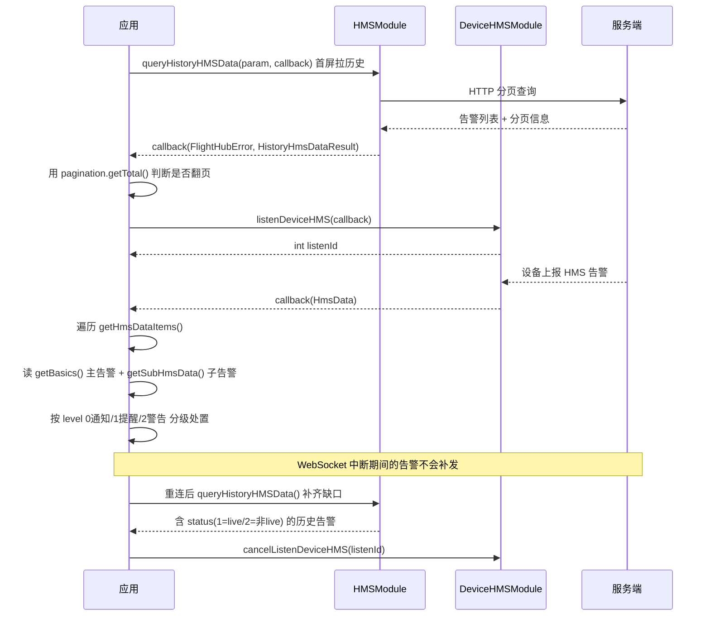

# 设备健康管理（DeviceHMSModule / HMSModule）

## 1 功能概述

### 1.1 功能简介

HMS（Health Management System，健康管理系统）是设备自身的健康告警体系：电池异常、云台故障、图传中断、RTK 异常、机场舱门卡阻等问题都会以 HMS 告警的形式上报。设备健康管理能力由**两个模块**分工完成：

| 模块 | 作用域 | 获取方式 | 解决的问题 |
| --- | --- | --- | --- |
| `DeviceHMSModule` | **设备级** | `drone.getDeviceHMSModule()` / `dock.getDeviceHMSModule()` | 实时订阅这台设备的 HMS 告警（WebSocket 推送） |
| `HMSModule` | **工作空间级** | `workspace.getHMSModule()` | 分页查询历史 HMS 告警（HTTP 请求） |

两者是「实时」与「回溯」的关系，**不能互相替代**：`DeviceHMSModule` 只推送变化、不提供查询，页面刷新后拿不到历史告警；`HMSModule` 只能主动查询、不会推送，无法用于实时告警面板。生产上通常两者都用——首屏用 `HMSModule` 查最近告警，之后用 `DeviceHMSModule` 增量刷新。

「设备在线」不等于「设备健康」：在线状态订阅见 [设备在线状态](./device-online-status.md)，本模块关注的是设备在线之后的健康度。设备资产与拓扑信息见 [设备管理](./device-manage.md)。

### 1.2 核心概念

| 概念 | 说明 |
| --- | --- |
| HMS 告警 | 设备自检产生的健康事件，由告警码（`code`）标识，配合 `args` 参数块（组件索引、传感器索引等）定位到具体部件 |
| 主告警与子告警 | 实时推送的一条 `HmsDataItem` 由**主告警** `getBasics()` 与**子告警列表** `getSubHmsData()` 组成。子告警是主告警的细化，用 `getId()` / `getParentId()` 表达父子关系 |
| 一次推送多条告警 | 回调载荷 `HmsData` 是**告警集合**：`getHmsDataItems()` 返回 `List<HmsDataItem>`。一次推送可能包含多条告警，必须遍历处理 |
| 告警级别（`level`） | javadoc 在历史告警字段 `getLevel()` 标注取值：**`0` = 通知、`1` = 提醒、`2` = 警告**；实时告警的 `HmsDataBasics.getLevel()` 为同名同义字段 |
| 事件状态（`status`） | **仅历史查询结果 `HistoryHmsDataResultItem` 有该字段**，javadoc 标注取值：**`1` = live（告警仍在持续）、`2` = 非 live（告警已结束）** |
| 紧急与飞行中标记 | `imminent`（是否紧急）、`inTheSky`（是否在飞行中）为 `int` 标记位，用于判断告警的处置优先级 |
| 告警去重键 | `statusKey` / `jointKey` 是 SDK 提供的告警标识键，可用于同一告警在多次推送间的去重与状态合并 |
| 设备级作用域 | `DeviceHMSModule` 实例已绑定获取它的设备，**推送载荷 `HmsData` 中不含设备 SN**，SN 需在注册回调时通过闭包带入 |
| 监听 ID（`listenId`） | `listenDeviceHMS()` 返回的整型句柄，取消订阅时必须回传同一个值 |

### 1.3 能力清单

| 能力 | 对应接口 | 接口类型 | 说明 |
| --- | --- | --- | --- |
| 订阅设备实时 HMS 告警 | `DeviceHMSModule.listenDeviceHMS(callback)` | 事件订阅 | 入参 `FlightHubCallback.DeviceHmsCallback`，返回 `int listenId`；飞机与机场共用此方法 |
| 取消订阅设备实时 HMS 告警 | `DeviceHMSModule.cancelListenDeviceHMS(listenId)` | 同步返回 | 传入订阅时返回的 `listenId` |
| 分页查询历史 HMS 告警 | `HMSModule.queryHistoryHMSData(params, callback)` | 异步回调 | 入参 `HistoryHmsDataParam`，回调返回 `FlightHubError` + `HistoryHmsDataResult` |

---

## 2 前提条件

- 已完成上云 API 2 底座部署并获取鉴权 Token。详见 [部署指南](../../../02.deployment/00.index.md)、[鉴权接入指南](../../../08.auth.md)。
- 已完成 SDK 初始化且 `FlightHubSDK.isInitialized()` 返回 `true`。详见 [SDK初始化](../init/sdk-init.md)。
- **使用 `DeviceHMSModule` 实时订阅时**：SDK 配置中的 `notificationServerAddress` 必须正确，且已通过 `FlightHubSDK.setWebSocketAuthHeaders()` 注入 WebSocket 鉴权头。配置缺失时 `listenDeviceHMS()` 仍会返回 `listenId`，但回调永不触发。详见 [SDK配置](../init/sdk-config.md)。
- 目标设备已完成上云并绑定至当前工作空间。详见 [设备上云](../../../04.device-onboarding/00.index.md)。
- 设备处于在线状态时才会产生实时 HMS 推送。在线状态见 [设备在线状态](./device-online-status.md)。

---

## 3 快速上手

### 3.1 获取模块实例

```java
// 设备级：实时 HMS 告警订阅
Drone drone = FlightHubSDK.getDroneInstance("your_drone_sn");
DeviceHMSModule droneHmsModule = drone.getDeviceHMSModule();

Dock dock = FlightHubSDK.getDockInstance("your_dock_sn");
DeviceHMSModule dockHmsModule = dock.getDeviceHMSModule();

// 工作空间级：历史 HMS 告警查询
Workspace workspace = FlightHubSDK.getWorkspaceInstance();
HMSModule hmsModule = workspace.getHMSModule();
```

### 3.2 使用流程

1. **首屏拉历史告警** —— 用 `HMSModule.queryHistoryHMSData()` 查最近一段时间的告警，给告警面板赋初值（实时订阅不会补发历史）。
2. **按设备注册实时订阅** —— 对每台需要监控的飞机 / 机场，取 `DeviceHMSModule` 并调用 `listenDeviceHMS()`，在回调中通过闭包带入 SN。
3. **保存 `listenId`** —— 以「SN + 设备类型」为键存入订阅管理器，同一设备只订阅一次。
4. **在回调中遍历并展开告警** —— 遍历 `HmsData.getHmsDataItems()`，每条读 `getBasics()`，再遍历 `getSubHmsData()` 取子告警。
5. **按 `level` 分级处置** —— `0` 通知、`1` 提醒、`2` 警告；`level=2` 且 `inTheSky` 为真时优先提示返航。
6. **用 `statusKey` / `jointKey` 去重** —— 同一告警可能被多次推送，避免重复弹窗与重复建单。
7. **链路恢复后补齐** —— WebSocket 重连后用 `queryHistoryHMSData()` 拉断线区间的告警，并用 `status` 判断哪些已恢复。
8. **退出时退订** —— 用保存的 `listenId` 调 `cancelListenDeviceHMS()`。

### 3.3 调用时序图



---

## 4 示例代码

### 4.1 完整示例

```java
/**
 * 设备健康告警监控：首屏查历史 + 实时订阅 + 断线补齐 + 统一退订。
 * 注意：实时推送载荷 HmsData 不含设备 SN，必须在注册回调时把 SN 带进去。
 */
public class DeviceHealthMonitor {

    /** 去重键（sn + statusKey）-> 告警首次出现时间，避免同一告警重复建单 */
    private final Map<String, Long> activeAlarms = new ConcurrentHashMap<>();
    /** SN -> 实时订阅句柄 */
    private final Map<String, Integer> droneListenIds = new ConcurrentHashMap<>();
    private final Map<String, Integer> dockListenIds  = new ConcurrentHashMap<>();

    // ============ 1. 首屏：分页查询历史 HMS 告警（实时订阅不会补发历史） ============
    public void loadRecentAlarms(List<String> snList, long beginMs, long endMs) {
        queryPage(snList, beginMs, endMs, 1, 50);
    }

    private void queryPage(List<String> snList, long beginMs, long endMs, int pageNum, int pageSize) {
        HMSModule hmsModule = FlightHubSDK.getWorkspaceInstance().getHMSModule();

        // 也可用带参构造：new HistoryHmsDataParam(snList, beginMs, endMs, pageSize, pageNum)
        HistoryHmsDataParam param = new HistoryHmsDataParam();
        param.setSnList(snList);
        param.setCreateTimeBegin(beginMs);   // 注意：毫秒时间戳，不是秒
        param.setCreateTimeEnd(endMs);
        param.setPageSize(pageSize);
        param.setPageNum(pageNum);

        hmsModule.queryHistoryHMSData(param, new FlightHubCallback.QueryHistoryHMSDataCallback() {
            @Override
            public void onResult(FlightHubError error, HistoryHmsDataResult result) {
                if (error != null && !error.isSuccess()) {
                    System.err.println("查询历史 HMS 失败: " + error
                            + " serverCode=" + error.getServerCode()
                            + " msg=" + error.getServerMessage());
                    return;
                }
                if (result == null || result.getList() == null) return;

                for (HistoryHmsDataResultItem item : result.getList()) {
                    // 历史条目自带 SN 与 message，可直接展示
                    System.out.println("[历史] sn=" + item.getSn()
                            + " code=" + item.getCode()
                            + " level=" + levelText(item.getLevel())      // 0通知/1提醒/2警告
                            + " status=" + statusText(item.getStatus())   // 1=live / 2=非live
                            + " msg=" + item.getMessage()
                            + " time=" + item.getCreateTime());

                    // status=1 表示告警仍在持续，需要进入待处理列表
                    if (item.getStatus() == 1) {
                        activeAlarms.putIfAbsent(item.getSn() + "#" + item.getStatusKey(),
                                                 item.getCreateTime());
                    } else {
                        activeAlarms.remove(item.getSn() + "#" + item.getStatusKey());
                    }
                }

                // 注意：必须处理分页，只取第一页会漏数据
                HistoryHmsDataResultPagination pg = result.getPagination();
                if (pg != null && pg.getPageNum() * pg.getPageSize() < pg.getTotal()) {
                    queryPage(snList, beginMs, endMs, pg.getPageNum() + 1, pg.getPageSize());
                }
            }
        });
    }

    // ============ 2. 实时订阅飞机 HMS 告警 ============
    public void watchDrone(final String droneSn) {
        if (droneListenIds.containsKey(droneSn)) return;   // 注意：避免重复订阅导致告警重复弹窗

        DeviceHMSModule module = FlightHubSDK.getDroneInstance(droneSn).getDeviceHMSModule();

        // 飞机与机场统一使用 listenDeviceHMS 订阅
        int listenId = module.listenDeviceHMS(new FlightHubCallback.DeviceHmsCallback() {
            @Override
            public void onResult(HmsData hms_data) {
                // 注意：HmsData 不含 SN，靠这里的闭包变量 droneSn 带入
                handleRealtimeHms(droneSn, hms_data);
            }
        });
        droneListenIds.put(droneSn, listenId);
    }

    // ============ 3. 实时订阅机场 HMS 告警（方法名与飞机完全一致） ============
    public void watchDock(final String dockSn) {
        if (dockListenIds.containsKey(dockSn)) return;

        DeviceHMSModule module = FlightHubSDK.getDockInstance(dockSn).getDeviceHMSModule();
        // 回调可用 lambda 赋值
        int listenId = module.listenDeviceHMS(hmsData -> handleRealtimeHms(dockSn, hmsData));
        dockListenIds.put(dockSn, listenId);
    }

    // ============ 4. 统一处理实时告警：遍历 + 展开子告警 + 分级 ============
    private void handleRealtimeHms(String sn, HmsData hmsData) {
        if (hmsData == null || hmsData.getHmsDataItems() == null) return;

        // 注意：一次推送可能包含多条告警，必须遍历，不能只取第一条
        for (HmsDataItem item : hmsData.getHmsDataItems()) {
            HmsDataBasics main = item.getBasics();
            if (main != null) {
                onAlarm(sn, main, false);
            }
            // 注意：子告警是主告警的细化（如具体哪颗电芯异常），漏读会丢关键信息
            List<HmsDataBasics> subs = item.getSubHmsData();
            if (subs != null) {
                for (HmsDataBasics sub : subs) {
                    onAlarm(sn, sub, true);
                }
            }
        }
    }

    private void onAlarm(String sn, HmsDataBasics b, boolean isSub) {
        // 用 statusKey 做去重键，避免同一告警多次推送导致重复建单
        String dedupKey = sn + "#" + b.getStatusKey();
        boolean isNew = activeAlarms.putIfAbsent(dedupKey, System.currentTimeMillis()) == null;

        HmsArgs args = b.getArgs();
        System.out.println((isSub ? "  [子告警] " : "[主告警] ")
                + "sn=" + sn
                + " code=" + b.getCode()
                + " level=" + levelText(b.getLevel())
                + " inTheSky=" + b.getInTheSky()
                + " imminent=" + b.getImminent()
                + (args != null ? " componentIndex=" + args.getComponentIndex()
                                + " sensorIndex=" + args.getSensorIndex() : "")
                + " id=" + b.getId() + " parentId=" + b.getParentId());

        if (!isNew) return;   // 重复推送，不再触发下游动作

        // 按 level 分级处置：2=警告 优先级最高
        if (b.getLevel() == 2) {
            if (b.getInTheSky() != 0) {
                System.err.println("!! 飞行中出现警告级告警，建议立即返航: " + b.getCode());
            }
            createTicket(sn, b.getCode());
        }
        // 注意：实时推送的 HmsDataBasics 没有 message 与 status；
        // 告警文案需按 code 自行映射，是否已恢复需要走 queryHistoryHMSData
    }

    // ============ 5. WebSocket 重连后补齐断线区间（推送不会补发） ============
    public void reconcileAfterReconnect(List<String> snList, long disconnectedAtMs) {
        loadRecentAlarms(snList, disconnectedAtMs, System.currentTimeMillis());
    }

    // ============ 6. 退出前统一退订（必须执行，否则订阅泄漏） ============
    public void shutdown() {
        for (Map.Entry<String, Integer> e : droneListenIds.entrySet()) {
            FlightHubSDK.getDroneInstance(e.getKey()).getDeviceHMSModule()
                    .cancelListenDeviceHMS(e.getValue());
        }
        droneListenIds.clear();

        for (Map.Entry<String, Integer> e : dockListenIds.entrySet()) {
            FlightHubSDK.getDockInstance(e.getKey()).getDeviceHMSModule()
                    .cancelListenDeviceHMS(e.getValue());
        }
        dockListenIds.clear();
    }

    private void createTicket(String sn, String code) {
        System.out.println("为设备 " + sn + " 的告警 " + code + " 创建工单");
    }

    /** javadoc 标注取值：0=通知, 1=提醒, 2=警告 */
    private static String levelText(int level) {
        switch (level) {
            case 0:  return "通知";
            case 1:  return "提醒";
            case 2:  return "警告";
            default: return "未知(" + level + ")";
        }
    }

    /** javadoc 标注取值：1=live, 2=非 live（仅历史查询结果有该字段） */
    private static String statusText(int status) {
        switch (status) {
            case 1:  return "live";
            case 2:  return "非live";
            default: return "未知(" + status + ")";
        }
    }
}
```

### 4.2 场景化片段

**作业前健康预检：存在持续中的警告级告警则阻断任务下发**

```java
// 前置：SDK 已初始化。检查最近 24 小时内该设备是否有 status=1（live）的 level=2（警告）告警
public void preflightCheck(String deviceSn, Consumer<Boolean> onDecision) {
    long now = System.currentTimeMillis();
    HistoryHmsDataParam param = new HistoryHmsDataParam(
            Collections.singletonList(deviceSn),
            now - 24L * 60 * 60 * 1000,   // 注意：毫秒时间戳
            now,
            100,                          // pageSize
            1);                           // pageNum

    FlightHubSDK.getWorkspaceInstance().getHMSModule()
            .queryHistoryHMSData(param, (error, result) -> {
                if (error != null && !error.isSuccess()) {
                    onDecision.accept(false);   // 查不到就不放行，避免带病起飞
                    return;
                }
                if (result == null || result.getList() == null) {
                    onDecision.accept(true);
                    return;
                }
                for (HistoryHmsDataResultItem item : result.getList()) {
                    // level=2 警告 且 status=1 告警仍在持续
                    if (item.getLevel() == 2 && item.getStatus() == 1) {
                        System.err.println("预检不通过: " + item.getCode() + " " + item.getMessage());
                        onDecision.accept(false);
                        return;
                    }
                }
                onDecision.accept(true);
            });
}
```

**按告警码统计高发故障，产出设备健康度报表**

```java
// 前置：把全量分页数据先拉到 items 列表中（分页处理见完整示例）
Map<String, Long> countByCode = items.stream()
        .filter(i -> i.getLevel() >= 1)   // 只统计提醒与警告，忽略通知
        .collect(Collectors.groupingBy(HistoryHmsDataResultItem::getCode,
                                       Collectors.counting()));
countByCode.entrySet().stream()
        .sorted(Map.Entry.<String, Long>comparingByValue().reversed())
        .limit(10)
        .forEach(e -> System.out.println("告警码 " + e.getKey() + " 共 " + e.getValue() + " 次"));
```

---

## 5 相关文档

- [SDK初始化](../init/sdk-init.md) —— 订阅与查询生效的前置条件，含 WebSocket 鉴权头注入
- [SDK配置](../init/sdk-config.md) —— `notificationServerAddress` 配置方式，实时回调不触发时首先核对这里
- [设备上云](../../../04.device-onboarding/00.index.md) —— 设备绑定到工作空间的前置流程
- [设备管理](./device-manage.md) —— 设备列表与详情查询，确认 SN 是否属于当前工作空间
- [设备在线状态](./device-online-status.md) —— 在线不等于健康，两者需配合判断设备可用性
- [设备保修维护](./device-maintenance.md) —— 告警定位到硬件问题后的保修与维护记录
- [设备远程调试](./device-debug.md) —— 告警排查过程中的远程调试手段
- [固件管理](./firmware.md) —— 部分告警需通过固件升级修复
- [日志管理](./log-manage.md) —— 告警根因分析时拉取设备日志
- [飞机状态监听](../remote-control/drone-status.md) / [机场状态监听](../remote-control/dock-status.md) —— 实时 OSD 遥测，与 HMS 告警互为补充
- [使用 API 文档查阅接口详情](../../03.api-docs-guide.md) —— 查阅 `DeviceHMSModule` / `HMSModule` 与各 HMS 数据结构的完整定义
