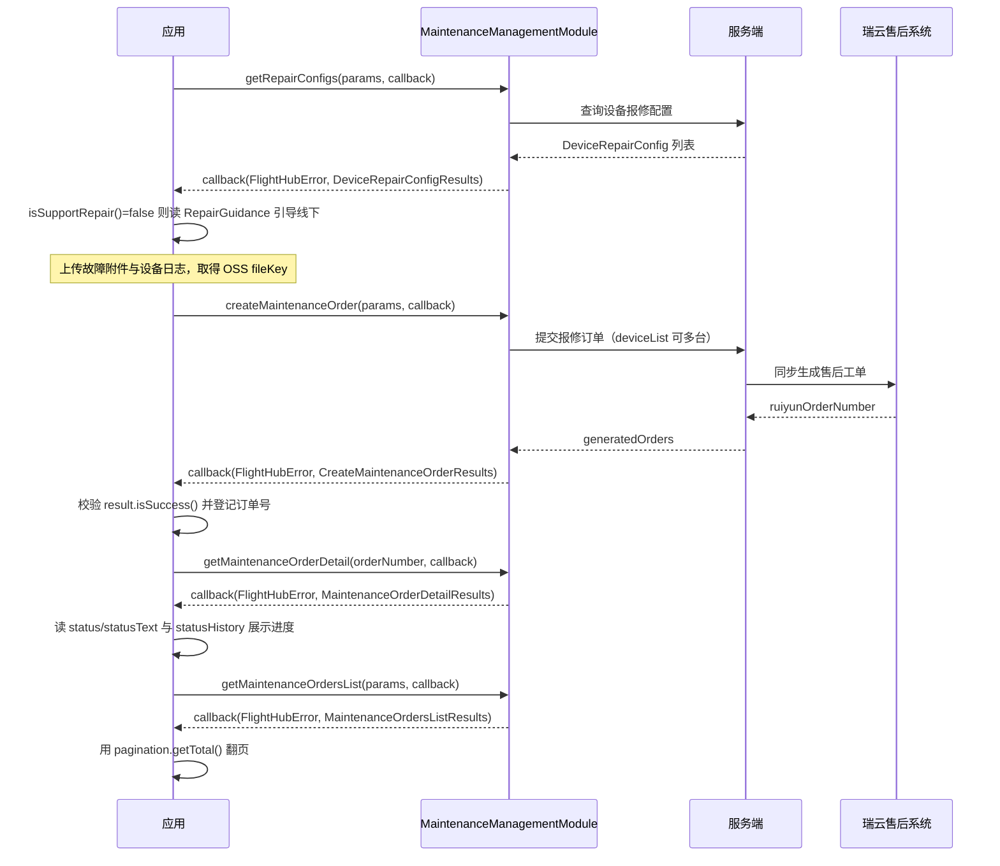

# 设备保修维护（MaintenanceManagementModule）

## 1 功能概述

### 1.1 功能简介

`MaintenanceManagementModule` 是**工作空间级**的设备报修管理模块，把「设备坏了怎么送修」这条线上化：先查设备**是否支持在线报修**，再提交**报修订单**，之后按订单编号查**详情**或分页查**订单列表**跟踪进度。

它覆盖报修的完整闭环——从可行性判定（`getRepairConfigs`）、订单创建（`createMaintenanceOrder`）到进度跟踪（`getMaintenanceOrderDetail` / `getMaintenanceOrdersList`）。订单会同步到瑞云（DJI 售后工单系统），返回结构中的 `ruiyunOrderNumber` 是与线下维修流程对齐的关键字段。

本模块常与设备健康告警联动使用：HMS 告警定位到硬件问题后，把告警时间作为 `faultOccurrenceTime`、把日志报告 UUID 作为 `reportUuid` 一并提交，能显著提升受理效率。HMS 告警见 [设备健康管理](./device-hms.md)，设备日志见 [日志管理](./log-manage.md)。

**获取方式：**

```java
Workspace workspace = FlightHubSDK.getWorkspaceInstance();
MaintenanceManagementModule module = workspace.getMaintenanceManagementModule();
```

### 1.2 核心概念

| 概念 | 说明 |
| --- | --- |
| 报修配置（Repair Config） | 按设备 SN 返回「该设备能不能在线报修」。`isSupportRepair()` 为 `false` 时会给出 `RepairGuidance`（跳转链接 + 描述码），引导用户走线下渠道 |
| 报修来源类型（`sourceType`） | javadoc 明确取值：**`0` = 定损、`2` = 日志反馈、`3` = 直接报修**（**没有 `1`**）。该字段在 `MaintenanceOrderDeviceItemParams` 上，不在 `CreateMaintenanceOrderParams` 上 |
| 允许的来源类型 | `DeviceRepairConfig.getAllowedSourceTypes()` 返回该设备被允许的 `sourceType` 集合。创建订单时用的 `sourceType` 必须落在这个集合内 |
| 来源关联 ID（`sourceRefId`） | 定损来源传定损报告 UUID，日志反馈来源传日志报告 UUID；直接报修可不传 |
| 订单状态（`status`） | javadoc 明确取值：**`0` 草稿 / `1` 提交中 / `2` 受理中 / `3` 已受理 / `4` 维修处理中 / `5` 待评价 / `6` 已完成 / `7` 已取消**。返回结构同时给出 `statusText` 文本，界面展示优先用它 |
| 一次提交多设备 | `CreateMaintenanceOrderParams.deviceList` 是列表，一次可提交多台设备；返回的 `generatedOrders` 是**订单列表**，`isSuccess()` 表示是否**全部**创建成功 |
| 瑞云工单 | `ruiyunOrderNumber` / `ruiyunSyncStatus` 是与瑞云售后系统同步的三方单号与同步状态，用于和线下维修对账 |
| 附件与日志 | `attachments` 传 OSS `fileKey`（先上传拿到 object key，再提交订单）；`logList` 传设备日志文件的 OSS 路径 |
| 时间字段是字符串 | 本模块所有时间字段（`faultOccurrenceTime`、`createdAt`、`createdAtStart` 等）都是 **`String`**，不是时间戳 |

### 1.3 能力清单

| 能力 | 对应接口 | 接口类型 | 说明 |
| --- | --- | --- | --- |
| 查询设备报修配置 | `getRepairConfigs(params, callback)` | 异步回调 | 入参 `GetDeviceRepairConfigParams`（设备 SN 列表），回调返回 `DeviceRepairConfigResults` |
| 创建报修订单 | `createMaintenanceOrder(params, callback)` | 异步回调 | 入参 `CreateMaintenanceOrderParams`，回调返回 `CreateMaintenanceOrderResults` |
| 查询单个报修订单详情 | `getMaintenanceOrderDetail(orderNumber, callback)` | 异步回调 | 入参订单编号字符串，回调返回 `MaintenanceOrderDetailResults` |
| 分页查询报修订单列表 | `getMaintenanceOrdersList(params, callback)` | 异步回调 | 入参 `GetMaintenanceOrdersListParams`（分页 + 多维筛选 + 排序），回调返回 `MaintenanceOrdersListResults` |

---

## 2 前提条件

- 已完成上云 API 2 底座部署并获取鉴权 Token。详见 [部署指南](../../../02.deployment/00.index.md)、[鉴权接入指南](../../../08.auth.md)。
- 已完成 SDK 初始化且 `FlightHubSDK.isInitialized()` 返回 `true`。详见 [SDK初始化](../init/sdk-init.md)。
- 目标设备已完成上云并绑定至当前工作空间。详见 [设备上云](../../../04.device-onboarding/00.index.md)。
- 提交附件或日志前，文件已上传至对象存储并取得 `fileKey` / `objectKey`。
- 使用日志反馈来源报修时，已通过日志管理生成日志报告并取得 `reportUuid`。详见 [日志管理](./log-manage.md)。

---

## 3 快速上手

### 3.1 获取模块实例

```java
// 前置：已完成 FlightHubSDK.initialize(config)
Workspace workspace = FlightHubSDK.getWorkspaceInstance();
MaintenanceManagementModule module = workspace.getMaintenanceManagementModule();
```

### 3.2 使用流程

1. **查报修配置** —— `getRepairConfigs()` 传入设备 SN 列表，读 `isSupportRepair()` 决定报修入口是否可用，读 `getAllowedSourceTypes()` 得到本设备允许的来源类型。
2. **不支持时给出引导** —— 读 `RepairGuidance.getDescription()` 区分「型号不支持」与「已有未完成订单」，分别跳转官网维修页或已有订单详情。
3. **准备附件与日志（按需）** —— 先把故障照片、设备日志上传至对象存储，取得 `fileKey` / `objectKey`。
4. **组装订单参数** —— 填 `deviceList`（每台设备设置 `deviceSn`、`deviceModelKey`、`sourceType`、必要时 `sourceRefId`）、故障描述与发生时间、联系人信息与地址；日志反馈场景补 `reportUuid` 与 `logList`。
5. **创建订单** —— `createMaintenanceOrder()`，先判断 `error.isSuccess()`，再判断 `result.isSuccess()`，最后遍历 `generatedOrders` 记录订单号与瑞云单号。
6. **跟踪进度** —— 用 `getMaintenanceOrderDetail(orderNumber)` 查单个订单的状态、状态历史与维修信息；用 `getMaintenanceOrdersList()` 做列表看板与批量筛选。
7. **分页翻页** —— 用 `CommonPaginationData` 的 `getPage()` / `getPageSize()` / `getTotal()` 判断是否还有下一页。

### 3.3 调用时序图



---

## 4 示例代码

### 4.1 完整示例

```java
/**
 * 设备报修全流程：查配置 -> 创建订单 -> 查详情 -> 分页查列表。
 * 关键点：sourceType 取值只有 0/2/3，且挂在 MaintenanceOrderDeviceItemParams 上。
 */
public class DeviceRepairService {

    private final MaintenanceManagementModule module =
            FlightHubSDK.getWorkspaceInstance().getMaintenanceManagementModule();

    // ============ 1. 查报修配置：决定报修入口是否可用 ============
    public void checkRepairable(String deviceSn, Consumer<DeviceRepairConfig> onOk) {
        GetDeviceRepairConfigParams params = new GetDeviceRepairConfigParams();
        params.setDeviceSns(Collections.singletonList(deviceSn));

        module.getRepairConfigs(params, new FlightHubCallback.GetRepairConfigsCallback() {
            @Override
            public void onResult(FlightHubError error, DeviceRepairConfigResults result) {
                if (error != null && !error.isSuccess()) {
                    System.err.println("查询报修配置失败: " + error
                            + " serverCode=" + error.getServerCode()
                            + " msg=" + error.getServerMessage());
                    return;
                }
                if (result == null || result.getData() == null) return;

                for (DeviceRepairConfig cfg : result.getData()) {
                    // 注意：是 isSupportRepair() 而不是 getSupportRepair()
                    if (cfg.isSupportRepair()) {
                        System.out.println("设备 " + cfg.getDeviceSn()
                                + " 支持在线报修，允许来源类型=" + cfg.getAllowedSourceTypes());
                        onOk.accept(cfg);
                    } else {
                        // 注意：不支持的原因有两种，必须靠描述码区分，提示语完全不同
                        RepairGuidance g = cfg.getRepairGuidance();
                        String desc = (g != null) ? g.getDescription() : null;
                        if ("devices_repair_detail_repair_order_unfinished".equals(desc)) {
                            System.out.println("该设备已有未完成的报修订单，请先查看已有订单");
                        } else {
                            System.out.println("该型号不支持在线报修，请前往: "
                                    + (g != null ? g.getRedirectUrl() : "官网维修页"));
                        }
                    }
                }
            }
        });
    }

    // ============ 2. 创建报修订单（直接报修场景） ============
    public void createDirectRepairOrder(String deviceSn, String deviceModelKey,
                                        String faultDesc, String faultTime,
                                        List<MaintenanceOrderAttachmentsParams> attachments) {
        CreateMaintenanceOrderParams params = new CreateMaintenanceOrderParams();

        // ---- 设备项：sourceType 在这里，不在 CreateMaintenanceOrderParams 上 ----
        MaintenanceOrderDeviceItemParams item = new MaintenanceOrderDeviceItemParams();
        item.setDeviceSn(deviceSn);
        item.setDeviceModelKey(deviceModelKey);
        item.setSourceType(3);   // 注意：取值只有 0=定损 / 2=日志反馈 / 3=直接报修，没有 1
        // 定损或日志反馈来源时还需 item.setSourceRefId(reportUuid);
        params.setDeviceList(Collections.singletonList(item));

        // ---- 故障信息 ----
        params.setFaultDescription(faultDesc);
        params.setFaultOccurrenceTime(faultTime);   // 注意：String 类型，不是时间戳

        // ---- 联系信息 ----
        MaintenanceOrderContactAddressParams addr = new MaintenanceOrderContactAddressParams();
        addr.setCountry("中国");
        addr.setProvince("广东省");
        addr.setCity("深圳市");
        addr.setDistrict("南山区");
        addr.setDetail("XX 路 XX 号");
        params.setContactAddress(addr);
        params.setContactPerson("张三");
        params.setContactPhone("13800138000");
        params.setContactEmail("zhangsan@example.com");

        // ---- 附件：必须先上传对象存储拿到 fileKey，这里传的不是本地路径 ----
        if (attachments != null && !attachments.isEmpty()) {
            params.setAttachments(attachments);
        }

        module.createMaintenanceOrder(params, new FlightHubCallback.CreateMaintenanceOrderCallback() {
            @Override
            public void onResult(FlightHubError error, CreateMaintenanceOrderResults result) {
                if (error != null && !error.isSuccess()) {
                    System.err.println("创建报修订单失败: " + error);
                    return;
                }
                if (result == null) return;

                // 注意：isSuccess() 是「全部成功」语义，批量提交时为 false 需逐条核对
                if (!result.isSuccess()) {
                    System.err.println("部分设备创建失败，请核对已生成订单");
                }
                if (result.getGeneratedOrders() != null) {
                    for (GeneratedOrderInfo o : result.getGeneratedOrders()) {
                        System.out.println("订单创建成功: " + o.getOrderNumber()
                                + " status=" + statusText(o.getStatus())
                                + " 瑞云单号=" + o.getRuiyunOrderNumber());
                    }
                }
            }
        });
    }

    // ============ 3. 查询单个订单详情 ============
    public void loadOrderDetail(String orderNumber) {
        module.getMaintenanceOrderDetail(orderNumber, new FlightHubCallback.GetMaintenanceOrderDetailCallback() {
            @Override
            public void onResult(FlightHubError error, MaintenanceOrderDetailResults result) {
                if (error != null && !error.isSuccess() || result == null) return;
                System.out.println("订单 " + result.getOrderNumber()
                        + " 状态: " + result.getStatusText() + "(" + result.getStatus() + ")"
                        + " 瑞云单号: " + result.getRuiyunOrderNumber());
                // 状态历史用于审计留痕
                if (result.getStatusHistory() != null) {
                    for (MaintenanceOrderStatusHistoryItem h : result.getStatusHistory()) {
                        System.out.println("  " + h.getChangeTime()
                                + " " + h.getFromStatus() + "->" + h.getToStatus()
                                + " 操作人:" + h.getOperatorName()
                                + " 备注:" + h.getRemark());
                    }
                }
            }
        });
    }

    // ============ 4. 分页查询订单列表 ============
    public void loadOrderList(int page) {
        GetMaintenanceOrdersListParams params = new GetMaintenanceOrdersListParams();
        params.setPage(page);
        params.setPageSize(20);              // 注意：取值范围 [1, 100]
        params.setStatus("4");               // 注意：入参是 String，不是 int
        params.setSortColumn("created_at");  // 只接受四个固定值之一
        params.setSortType("desc");
        module.getMaintenanceOrdersList(params, new FlightHubCallback.GetMaintenanceOrdersListCallback() {
            @Override
            public void onResult(FlightHubError error, MaintenanceOrdersListResults result) {
                if (error != null && !error.isSuccess() || result == null) return;
                if (result.getList() != null) {
                    for (MaintenanceOrdersListItem item : result.getList()) {
                        System.out.println("订单 " + item.getOrderNumber()
                                + " 状态:" + item.getStatusText()   // 返回结构里 getStatus() 是 int
                                + " 型号:" + item.getDeviceModelName());
                    }
                }
                CommonPaginationData pg = result.getPagination();
                if (pg != null) {
                    System.out.println("第 " + pg.getPage() + " 页，共 " + pg.getTotal() + " 条");
                }
            }
        });
    }

    /** javadoc 明确取值：0 草稿 / 1 提交中 / 2 受理中 / 3 已受理 / 4 维修处理中 / 5 待评价 / 6 已完成 / 7 已取消 */
    private static String statusText(int status) {
        switch (status) {
            case 0:  return "草稿";
            case 1:  return "提交中";
            case 2:  return "受理中";
            case 3:  return "已受理";
            case 4:  return "维修处理中";
            case 5:  return "待评价";
            case 6:  return "已完成";
            case 7:  return "已取消";
            default: return "未知(" + status + ")";
        }
    }
}
```

### 4.2 场景化片段

**日志反馈报修：关联日志报告 UUID**

```java
// 前置：已通过日志管理上传设备日志并取得 reportUuid 与日志文件 OSS 路径
CreateMaintenanceOrderParams params = new CreateMaintenanceOrderParams();

MaintenanceOrderDeviceItemParams item = new MaintenanceOrderDeviceItemParams();
item.setDeviceSn(deviceSn);
item.setDeviceModelKey(deviceModelKey);
item.setSourceType(2);              // 2 = 日志反馈
item.setSourceRefId(reportUuid);    // 来源关联 ID：日志报告 UUID
params.setDeviceList(Collections.singletonList(item));

params.setReportUuid(reportUuid);   // 订单级也要带上日志报告 UUID

// 日志文件清单（objectKey 是 OSS 路径，不是本地路径）
MaintenanceOrderLogInfoParams logInfo = new MaintenanceOrderLogInfoParams();
logInfo.setDeviceSn(deviceSn);
logInfo.setModule("flight_control");
logInfo.setObjectKey("logs/" + deviceSn + "/20260101_flight.tar.gz");
params.setLogList(Collections.singletonList(logInfo));

params.setFaultDescription("飞行中图传频繁中断，日志已上传");
// ... 联系人信息略 ...
module.createMaintenanceOrder(params, (error, result) -> { /* ... */ });
```

**HMS 告警联动一键报修**

```java
// 前置：从设备健康管理收到 level=2 的硬件类告警，把告警信息带入报修单
public void repairFromHmsAlarm(String deviceSn, String deviceModelKey,
                               String hmsCode, String hmsMessage, long alarmTimeMs) {
    // 先确认设备支持在线报修，避免提交后失败
    checkRepairable(deviceSn, cfg -> {
        // 校验 sourceType 是否在该设备允许范围内
        if (cfg.getAllowedSourceTypes() != null && !cfg.getAllowedSourceTypes().contains(3)) {
            System.out.println("该设备不允许直接报修，允许的来源类型: " + cfg.getAllowedSourceTypes());
            return;
        }
        String faultTime = new SimpleDateFormat("yyyy-MM-dd HH:mm:ss").format(new Date(alarmTimeMs));
        createDirectRepairOrder(deviceSn, deviceModelKey,
                "HMS 告警 " + hmsCode + ": " + hmsMessage, faultTime, null);
    });
}
```

**上报设备拓扑，便于售后判断整机关联**

```java
// 前置：从设备管理拿到网关与子设备关系
MaintenanceOrderTopoNodeParams host = new MaintenanceOrderTopoNodeParams();
host.setSn(dockSn);
host.setDeviceModelKey(dockModelKey);
host.setOnlineStatus(true);          // 注意：getter 是 isOnlineStatus()

MaintenanceOrderTopoNodeParams node = new MaintenanceOrderTopoNodeParams();
node.setSn(droneSn);
node.setDeviceModelKey(droneModelKey);
node.setOnlineStatus(false);

MaintenanceOrderDeviceTopoParams topo = new MaintenanceOrderDeviceTopoParams();
topo.setHosts(Collections.singletonList(host));
topo.setNodes(Collections.singletonList(node));
params.setDeviceTopo(topo);
```

---

## 5 相关文档

- [SDK初始化](../init/sdk-init.md) —— 调用本模块的前置条件
- [SDK配置](../init/sdk-config.md) —— 服务地址与鉴权头配置
- [鉴权接入指南](../../../08.auth.md) —— 报修接口的鉴权要求
- [设备上云](../../../04.device-onboarding/00.index.md) —— 设备绑定到工作空间的前置流程
- [设备管理](./device-manage.md) —— 获取设备 SN、型号 Key 与设备拓扑关系
- [设备健康管理](./device-hms.md) —— HMS 告警是报修的主要触发来源，告警时间可直接作为故障发生时间
- [设备远程调试](./device-debug.md) —— 报修前的远程排查手段，可减少不必要的送修
- [日志管理](./log-manage.md) —— 日志反馈报修所需的日志上传与报告 UUID 获取
- [固件管理](./firmware.md) —— 部分故障可通过固件升级解决，无需报修
- [使用 API 文档查阅接口详情](../../03.api-docs-guide.md) —— 查阅 `MaintenanceManagementModule` 与各报修数据结构的完整定义
