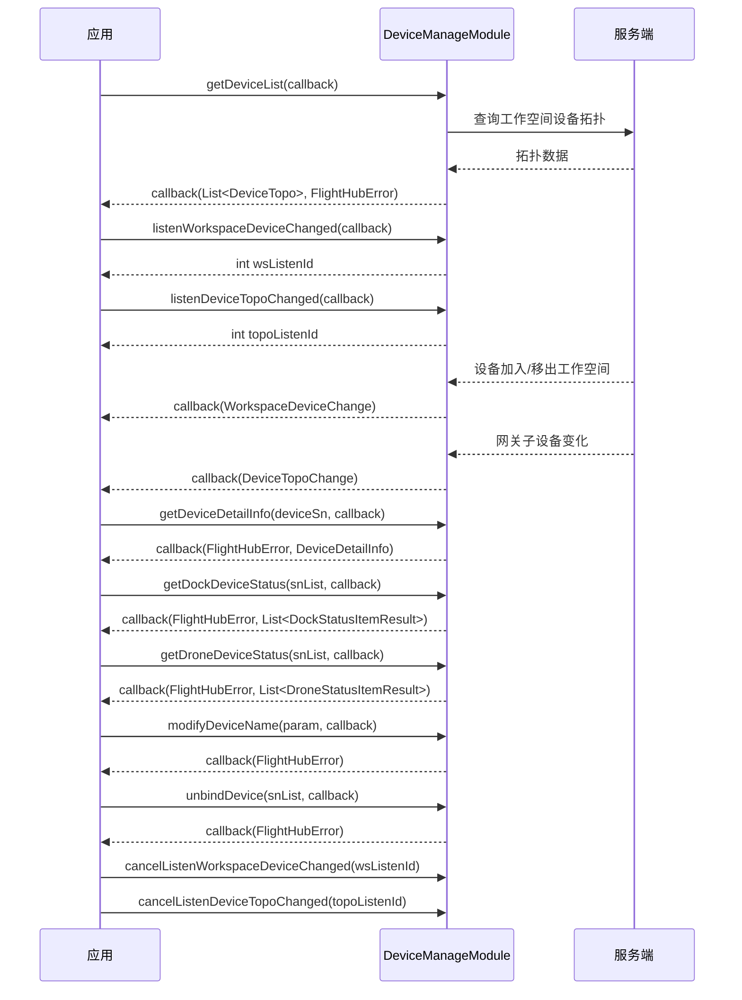

# 设备管理（DeviceManageModule）

## 1 功能概述

### 1.1 功能简介

`DeviceManageModule` 是**工作空间级**的设备资产管理模块，作用域为当前鉴权 Token 所属的工作空间。它回答三类问题：**工作空间里有哪些设备**（设备拓扑列表）、**某台设备是什么情况**（机型、固件、在线状态、子设备、状态快照），以及**设备台账发生了什么变化**（设备加入/移出、网关下挂子设备变化）。同时提供两个写操作：修改设备呼号、将设备从工作空间解绑。

本模块只负责设备的**资产与拓扑信息**，不负责设备的实时遥测与控制：飞机/机场的实时 OSD 数据请使用 [飞机状态监听](../remote-control/drone-status.md)、[机场状态监听](../remote-control/dock-status.md)，在线/离线事件的单设备维度监听请使用 [设备在线状态](./device-online-status.md)，设备健康告警请使用 [设备健康管理](./device-hms.md)。

**获取方式：**

```java
Workspace workspace = FlightHubSDK.getWorkspaceInstance();
DeviceManageModule deviceManageModule = workspace.getDeviceManageModule();
```

### 1.2 核心概念

| 概念 | 说明 |
| --- | --- |
| 工作空间（Workspace） | 设备所归属的组织单元。本模块所有接口的可见范围均为**当前 Token 对应的工作空间**，跨工作空间的设备不会返回。 |
| 设备 SN | 设备序列号，是本模块所有接口的业务主键。查详情、改名、解绑、查状态快照都以 SN 定位设备。 |
| 设备拓扑（`DeviceTopo`） | 一个拓扑节点 = 一台主设备（`getDevice()`）+ 其挂载的子设备列表（`getSubDevices()`）。例如「机场 + 机场内的飞机」会作为一个节点返回。 |
| 网关（Gateway） | 拓扑中直连云端、并为子设备代理上下行链路的主设备（如机场、遥控器）。设备拓扑变更事件以 `gatewaySn` 为维度下发。 |
| 设备呼号（`deviceCallsign`） | 用户为设备设置的可读名称，即控制台上看到的「设备名称」。`modifyDeviceName()` 修改的就是该字段。 |
| 监听 ID（`listenId`） | 订阅型接口返回的整型句柄。取消订阅时必须回传同一个 `listenId`，否则订阅不会被释放。 |

### 1.3 能力清单

| 能力 | 对应接口 | 接口类型 | 说明 |
| --- | --- | --- | --- |
| 获取设备列表 | `getDeviceList()` | 异步回调 | 返回工作空间内全部设备的拓扑列表（主设备 + 子设备） |
| 获取设备详情 | `getDeviceDetailInfo()` | 异步回调 | 按 SN 查询单台设备的机型、固件、在线状态、子设备等详情 |
| 查询机场状态快照 | `getDockDeviceStatus()` | 异步回调 | 批量查询机场的在线状态与属性快照（环境温湿度、市电、网络、备降点等） |
| 查询飞机状态快照 | `getDroneDeviceStatus()` | 异步回调 | 批量查询飞机的在线状态与属性快照（电池、限高、返航点、飞行统计等） |
| 修改设备名称 | `modifyDeviceName()` | 异步回调 | 批量修改设备呼号 |
| 解绑设备 | `unbindDevice()` | 异步回调 | 批量将设备从当前工作空间解绑 |
| 订阅工作空间设备变更 | `listenWorkspaceDeviceChanged()` / `cancelListenWorkspaceDeviceChanged()` | 事件订阅 | 设备加入或移出工作空间时推送增量变更 |
| 订阅设备拓扑变更 | `listenDeviceTopoChanged()` / `cancelListenDeviceTopoChanged()` | 事件订阅 | 网关下挂子设备发生变化时，推送该网关的最新子设备列表 |

---

## 2 前提条件

- 已完成上云 API 2 底座部署，并获取到服务地址与鉴权 Token。详见 [部署指南](../../../02.deployment/00.index.md)、[鉴权接入指南](../../../08.auth.md)。
- 已完成 SDK 初始化（`JniLibraryLoader.loadLibrary()` → 注入鉴权头 → `FlightHubSDK.initialize(config)`），且 `FlightHubSDK.isInitialized()` 返回 `true`。详见 [SDK初始化](../init/sdk-init.md)。
- 设备已完成上云并绑定至当前工作空间，否则设备不会出现在设备列表中。详见 [设备上云](../../../04.device-onboarding/00.index.md)。
- 若需使用两个 `listenXxx` 订阅接口，SDK 配置中的 `notificationServerAddress`（WebSocket 通知地址）必须正确且连接可用，否则接口能返回 `listenId`，但回调不会被触发。详见 [SDK配置](../init/sdk-config.md)。

---

## 3 快速上手

### 3.1 获取模块实例

```java
// 前置：已完成 FlightHubSDK.initialize(config)
Workspace workspace = FlightHubSDK.getWorkspaceInstance();
DeviceManageModule deviceManageModule = workspace.getDeviceManageModule();
```

### 3.2 使用流程

1. **初始化 SDK 并获取模块实例** —— `FlightHubSDK.initialize()` → `getWorkspaceInstance()` → `getDeviceManageModule()`。
2. **拉取全量设备拓扑** —— 调用 `getDeviceList()`，在业务侧建立「SN → 设备」的本地缓存和设备树。
3. **订阅变更事件保持缓存新鲜** —— 调用 `listenWorkspaceDeviceChanged()` 感知设备增减，调用 `listenDeviceTopoChanged()` 感知网关下挂子设备变化，保存返回的 `listenId`。
4. **按需查询详情与状态** —— 用户进入详情页时调用 `getDeviceDetailInfo(sn)`；渲染概览卡片时按设备类型批量调用 `getDockDeviceStatus()` 或 `getDroneDeviceStatus()`。
5. **执行写操作** —— 需要改名时调用 `modifyDeviceName()`（支持批量），设备退场时调用 `unbindDevice()`（需二次确认）。
6. **退出时释放订阅** —— 页面销毁或应用退出前，用步骤 3 保存的 `listenId` 调用 `cancelListenWorkspaceDeviceChanged()` 和 `cancelListenDeviceTopoChanged()`。

### 3.3 调用时序图



---

## 4 示例代码

### 4.1 完整示例

```java
Workspace workspace = FlightHubSDK.getWorkspaceInstance();
DeviceManageModule deviceManageModule = workspace.getDeviceManageModule();

// ============ 1. 获取设备列表（含拓扑） ============
deviceManageModule.getDeviceList(new FlightHubCallback.DeviceListCallback() {
    @Override
    public void onResult(List<DeviceTopo> devices, FlightHubError error) {
        // 注意：error 可能为 null，判空后再判 isSuccess()
        if (error != null && !error.isSuccess()) {
            System.err.println("获取设备列表失败: " + error);
            return;
        }
        if (devices == null) return;

        for (DeviceTopo topo : devices) {
            Device master = topo.getDevice();
            if (master == null) continue;
            System.out.println("网关设备 SN: " + master.getDeviceSn()
                    + " 型号: " + master.getModelKey()          // 注意：是 getModelKey()，不是 getDeviceModelKey()
                    + " 在线: " + master.isOnline());

            List<Device> subDevices = topo.getSubDevices();
            if (subDevices == null || subDevices.isEmpty()) continue;
            for (Device sub : subDevices) {
                System.out.println("  └─ 子设备 SN: " + sub.getDeviceSn()
                        + " 型号: " + sub.getModelKey()
                        + " 在线: " + sub.isOnline());
            }
        }
    }
});

// ============ 2. 获取设备详情 ============
String deviceSn = "your_device_sn";
deviceManageModule.getDeviceDetailInfo(deviceSn, new FlightHubCallback.GetDeviceDetailInfoCallback() {
    @Override
    public void onResult(FlightHubError error, DeviceDetailInfo deviceDetail) {
        if (error != null && !error.isSuccess()) {
            System.err.println("获取设备详情失败: " + error.getServerMessage());
            return;
        }
        if (deviceDetail == null) return;

        System.out.println("设备 SN: " + deviceDetail.getDeviceSn());
        System.out.println("设备呼号: " + deviceDetail.getDeviceCallsign());
        System.out.println("整机 SN: " + deviceDetail.getCompleteMachineSn());
        System.out.println("在线状态: " + deviceDetail.isOnline());
        System.out.println("固件版本: " + deviceDetail.getDeviceFirmwareVersion());
        System.out.println("工作状态码: " + deviceDetail.getDeviceWorkingStatus());

        ModelInfo modelInfo = deviceDetail.getModelInfo();
        if (modelInfo != null) {
            System.out.println("机型: " + modelInfo.getName() + " (" + modelInfo.getKey() + ")");
        }
        List<SubDeviceInfo> subs = deviceDetail.getSubDevices();
        if (subs != null) {
            for (SubDeviceInfo sub : subs) {
                System.out.println("  └─ 子设备: " + sub.getDeviceSn()
                        + " 固件: " + sub.getDeviceFirmwareVersion()
                        + " 飞安库: " + sub.getFlysafeDatabaseVersion());
            }
        }
    }
});

// ============ 3. 批量查询机场状态快照 ============
List<String> dockSnList = Arrays.asList("dock_sn_001", "dock_sn_002");
deviceManageModule.getDockDeviceStatus(dockSnList, new FlightHubCallback.DockDeviceStatusListCallback() {
    @Override
    public void onResult(FlightHubError error, List<DockStatusItemResult> items) {
        if (error != null && !error.isSuccess() || items == null) return;
        for (DockStatusItemResult item : items) {
            System.out.println("机场 " + item.getSn() + " 在线: " + item.isOnline()
                    + " 快照时间: " + item.getUpdatedTime());
            DockStatusPropertiesResult props = item.getProperties();
            if (props == null) continue;   // 注意：设备离线或未上报时 properties 为 null
            System.out.println("  舱内温度: " + props.getTemperature()
                    + "℃, 环境温度: " + props.getEnvironmentTemperature()
                    + "℃, 湿度: " + props.getHumidity()
                    + ", 降雨量: " + props.getRainfall());
        }
    }
});

// ============ 4. 批量查询飞机状态快照 ============
List<String> droneSnList = Arrays.asList("drone_sn_001");
deviceManageModule.getDroneDeviceStatus(droneSnList, new FlightHubCallback.DroneDeviceStatusListCallback() {
    @Override
    public void onResult(FlightHubError error, List<DroneStatusItemResult> items) {
        if (error != null && !error.isSuccess() || items == null) return;
        for (DroneStatusItemResult item : items) {
            DroneStatusPropertiesResult props = item.getProperties();
            if (props == null) continue;
            System.out.println("飞机 " + item.getSn()
                    + " 模式码: " + props.getModeCode()
                    + " 限高: " + props.getHeightLimit() + "m"
                    + " 距起飞点: " + props.getHomeDistance() + "m"
                    + " 总架次: " + props.getTotalFlightSorties());
        }
    }
});

// ============ 5. 批量修改设备名称 ============
ModifyDeviceNameItem nameItem = new ModifyDeviceNameItem();
nameItem.setDeviceSn(deviceSn);
nameItem.setDeviceCallsign("1 号机场-东门");

ModifyDeviceNameParam nameParam = new ModifyDeviceNameParam();
nameParam.setDeviceList(Arrays.asList(nameItem));   // 支持一次提交多台设备

deviceManageModule.modifyDeviceName(nameParam, new FlightHubCallback.ModifyDeviceNameCallback() {
    @Override
    public void onResult(FlightHubError error) {
        boolean ok = error != null && error.isSuccess();
        System.out.println("修改设备名称: " + (ok ? "成功" : "失败 " + error));
    }
});

// ============ 6. 订阅工作空间设备变更（设备加入/移出） ============
int wsListenId = deviceManageModule.listenWorkspaceDeviceChanged(
    new FlightHubCallback.WorkspaceDeviceChangeCallback() {
        @Override
        public void onResult(WorkspaceDeviceChange change) {
            if (change == null || change.getDeviceChanges() == null) return;
            for (DeviceChange item : change.getDeviceChanges()) {
                // changeType 取值为 "add"（加入工作空间）或 "reduce"（移出工作空间）
                System.out.println("设备变更类型: " + item.getChangeType()
                        + " 设备: " + item.getChangeDevices());
                // 推送为增量且不含设备详情，如需展示详情请用 SN 再查 getDeviceDetailInfo()
            }
        }
    }
);

// ============ 7. 订阅设备拓扑变更（网关下挂子设备变化） ============
int topoListenId = deviceManageModule.listenDeviceTopoChanged(
    new FlightHubCallback.DeviceTopoChangeCallback() {
        @Override
        public void onResult(DeviceTopoChange change) {
            if (change == null) return;
            // devices 是该网关当前的完整设备列表，按 gatewaySn 整体替换本地缓存
            System.out.println("网关 " + change.getGatewaySn()
                    + " 当前设备列表: " + change.getDevices());
        }
    }
);

// ============ 8. 退出前取消订阅（必须执行，否则订阅泄漏） ============
deviceManageModule.cancelListenWorkspaceDeviceChanged(wsListenId);
deviceManageModule.cancelListenDeviceTopoChanged(topoListenId);
```

### 4.2 场景化片段

**设备解绑（不可逆，需二次确认）**

```java
// 前置：已在业务侧完成用户二次确认，且确认设备无进行中的任务、直播等占用
List<String> unbindSnList = Arrays.asList("device_sn_to_unbind");
deviceManageModule.unbindDevice(unbindSnList, new FlightHubCallback.ResultCallbackWithError() {
    @Override
    public void onResult(FlightHubError error) {
        if (error != null && error.isSuccess()) {
            System.out.println("解绑成功，请同步清理本地设备缓存");
            // 解绑后设备不再出现在 getDeviceList() 结果中，需重新走设备上云流程才能恢复
        } else {
            System.err.println("解绑失败: serverCode=" + (error == null ? "-" : error.getServerCode())
                    + " message=" + (error == null ? "-" : error.getServerMessage()));
        }
    }
});
```

**按设备类型分组后批量查询状态快照**

```java
// 从 getDeviceList() 结果中按类型拆分 SN，再分别批量查询，避免逐台设备发起请求
List<String> dockSns = new ArrayList<>();
List<String> droneSns = new ArrayList<>();
for (DeviceTopo topo : deviceTopoList) {
    Device master = topo.getDevice();
    if (master != null) dockSns.add(master.getDeviceSn());       // 网关（机场）
    if (topo.getSubDevices() != null) {
        for (Device sub : topo.getSubDevices()) {
            droneSns.add(sub.getDeviceSn());                      // 子设备（飞机）
        }
    }
}
if (!dockSns.isEmpty())  deviceManageModule.getDockDeviceStatus(dockSns, dockStatusCallback);
if (!droneSns.isEmpty()) deviceManageModule.getDroneDeviceStatus(droneSns, droneStatusCallback);
```

---

## 5 相关文档

- [设备上云](../../../04.device-onboarding/00.index.md) —— 设备绑定到工作空间的前置流程，设备列表为空时首先核对这里
- [SDK初始化](../init/sdk-init.md) —— 获取 `Workspace` 实例前必须完成的初始化步骤
- [SDK配置](../init/sdk-config.md) —— WebSocket 通知地址等配置项，影响两个订阅接口能否收到推送
- [设备在线状态](./device-online-status.md) —— 单设备维度的在线/离线事件监听，与本页的工作空间维度变更互补
- [设备健康管理](./device-hms.md) —— 设备 HMS 健康告警，本模块不提供告警能力
- [飞机状态监听](../remote-control/drone-status.md) / [机场状态监听](../remote-control/dock-status.md) —— 实时 OSD 遥测数据，替代状态快照的高频轮询
- [固件管理](./firmware.md) —— 基于详情中的固件版本执行升级
- [设备管理组件](../../../06.frontend/05.device-manager.md) —— 前端独立组件形态的设备管理能力，与 SDK 能力对照参考
- [使用 API 文档查阅接口详情](../../03.api-docs-guide.md) —— 查阅 `DeviceManageModule` 完整方法签名与字段定义
