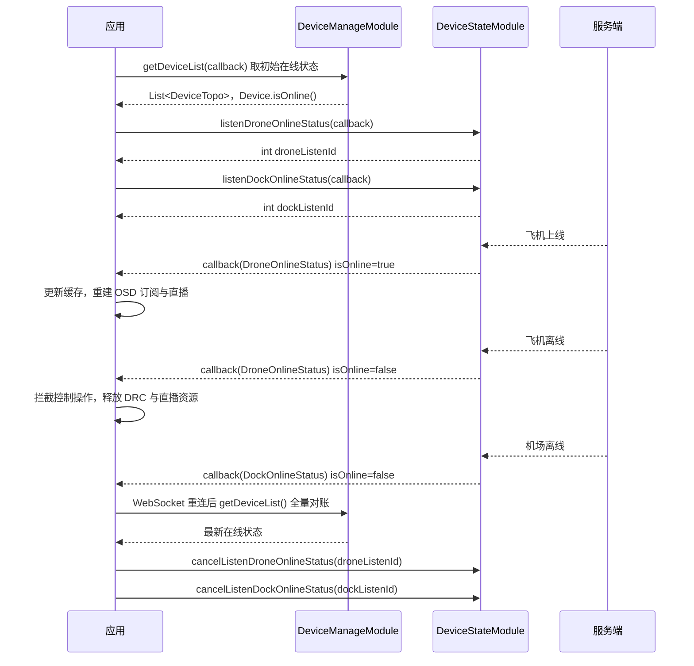

# 设备在线状态（DeviceStateModule）

## 1 功能概述

### 1.1 功能简介

`DeviceStateModule` 是**设备级**的在线状态订阅模块，作用域为获取该模块时所用的那一台设备。它只做一件事：在设备上线 / 离线时通过 WebSocket 主动推送状态变更，让业务侧不必轮询也能第一时间知道「这台设备现在还能不能操控」。

它是所有控制类操作的**前置判据**：控制权申请、DRC 链路建立、飞行控制、相机控制等能力都要求设备在线，用本模块维护在线状态可以在设备离线时提前拦截请求，避免大量无意义的失败调用。

本模块**只提供在线状态订阅**，不提供状态查询与其他设备信息：

- 需要**主动查询**某一时刻的在线状态 → 用 [设备管理](./device-manage.md) 的 `getDeviceList()`（`Device.isOnline()`）、`getDeviceDetailInfo()` 或 `getDockDeviceStatus()` / `getDroneDeviceStatus()`
- 需要感知**设备加入 / 移出工作空间**或**网关下挂子设备变化** → 用 [设备管理](./device-manage.md) 的 `listenWorkspaceDeviceChanged()` / `listenDeviceTopoChanged()`
- 需要设备**健康告警** → 用 [设备健康管理](./device-hms.md)

**获取方式：**

```java
// 飞机维度
Drone drone = FlightHubSDK.getDroneInstance(droneSn);
DeviceStateModule droneStateModule = drone.getDeviceStateModule();

// 机场维度
Dock dock = FlightHubSDK.getDockInstance(dockSn);
DeviceStateModule dockStateModule = dock.getDeviceStateModule();
```

### 1.2 核心概念

| 概念 | 说明 |
| --- | --- |
| 设备级作用域 | 模块实例从 `Drone` / `Dock` 上获取，已经绑定了该设备的 SN。**推送内容里不带 SN**，SN 由你订阅时用的实例决定 |
| Owner 语义 | javadoc 标注 `listenDockOnlineStatus` 为「Dock owner」、`listenDroneOnlineStatus` 为「Drone owner」。即：从 `Dock` 实例上订阅机场在线状态，从 `Drone` 实例上订阅飞机在线状态，方法与实例类型要对应 |
| 在线状态载荷 | `DockOnlineStatus` / `DroneOnlineStatus` 都是**只含一个 `online` 布尔字段**的极简 Bean，通过 `isOnline()` 读取 |
| 监听 ID（`listenId`） | 订阅接口返回的整型句柄，取消订阅时必须回传同一个值。机场与飞机的 `listenId` 要分别保存，取消时也要调各自的 `cancelListenXxx` |
| 订阅 vs 快照 | 本模块是**事件推送**（依赖 WebSocket），只在状态发生变化时触发；订阅成功不代表立即会收到一条当前状态 |

### 1.3 能力清单

| 能力 | 对应接口 | 接口类型 | 说明 |
| --- | --- | --- | --- |
| 订阅机场在线状态 | `listenDockOnlineStatus(callback)` | 事件订阅 | 入参 `FlightHubCallback.DockOnlineStatusCallback`，返回 `int listenId` |
| 取消订阅机场在线状态 | `cancelListenDockOnlineStatus(listenId)` | 同步返回 | 传入订阅时返回的 `listenId` |
| 订阅飞机在线状态 | `listenDroneOnlineStatus(callback)` | 事件订阅 | 入参 `FlightHubCallback.DroneOnlineStatusCallback`，返回 `int listenId` |
| 取消订阅飞机在线状态 | `cancelListenDroneOnlineStatus(listenId)` | 同步返回 | 传入订阅时返回的 `listenId` |

---

## 2 前提条件

- 已完成上云 API 2 底座部署并获取鉴权 Token。详见 [部署指南](../../../02.deployment/00.index.md)、[鉴权接入指南](../../../08.auth.md)。
- 已完成 SDK 初始化且 `FlightHubSDK.isInitialized()` 返回 `true`。详见 [SDK初始化](../init/sdk-init.md)。
- **SDK 配置中的 `notificationServerAddress`（消息通知 WebSocket 地址）必须正确且连接可用**，且已通过 `setWebSocketAuthHeaders()` 注入鉴权头。这是本模块的硬依赖——配置缺失时接口仍会正常返回 `listenId`，但回调永不触发。详见 [SDK配置](../init/sdk-config.md)。
- 目标设备已完成上云并绑定至当前工作空间。详见 [设备上云](../../../04.device-onboarding/00.index.md)。

---

## 3 快速上手

### 3.1 获取模块实例

```java
// 前置：已完成 FlightHubSDK.initialize(config)，且已配置 notificationServerAddress
Drone drone = FlightHubSDK.getDroneInstance("your_drone_sn");
DeviceStateModule droneStateModule = drone.getDeviceStateModule();

Dock dock = FlightHubSDK.getDockInstance("your_dock_sn");
DeviceStateModule dockStateModule = dock.getDeviceStateModule();
```

### 3.2 使用流程

1. **取得初始状态** —— 先调 [设备管理](./device-manage.md) 的 `getDeviceList()` 或 `getDeviceDetailInfo()`，用 `isOnline()` 给本地缓存和界面赋初值。
2. **按设备获取模块实例** —— 对每台需要跟踪的设备，用其 SN 拿到 `Drone` / `Dock` 实例，再取 `DeviceStateModule`。
3. **注册订阅并把 SN 带进回调** —— 调用 `listenDroneOnlineStatus()` / `listenDockOnlineStatus()`，在回调里通过闭包变量或成员字段携带 SN。
4. **保存 `listenId`** —— 按「SN + 设备类型」为键存入订阅管理器。
5. **在回调中更新缓存并联动** —— 离线时释放该设备的 OSD 订阅、DRC 链路、直播资源；上线时触发对账与恢复。
6. **链路恢复后对账** —— WebSocket 重连后重新查询一次全量在线状态，修正断线期间可能丢失的变更。
7. **退出时释放订阅** —— 用保存的 `listenId` 调用对应的 `cancelListenDroneOnlineStatus()` / `cancelListenDockOnlineStatus()`。

### 3.3 调用时序图



---

## 4 示例代码

### 4.1 完整示例

```java
/**
 * 设备在线状态跟踪器：首屏查询 + 增量订阅 + 统一退订。
 * 注意：推送载荷不含 SN，必须在注册回调时把 SN 带进去。
 */
public class DeviceOnlineTracker {

    /** SN -> 是否在线（控制类操作前的本地判据） */
    private final Map<String, Boolean> onlineCache = new ConcurrentHashMap<>();
    /** SN -> 飞机订阅句柄 */
    private final Map<String, Integer> droneListenIds = new ConcurrentHashMap<>();
    /** SN -> 机场订阅句柄 */
    private final Map<String, Integer> dockListenIds = new ConcurrentHashMap<>();

    // ============ 1. 首屏：查询初始在线状态（本模块不提供查询接口） ============
    public void loadInitialStatus() {
        Workspace workspace = FlightHubSDK.getWorkspaceInstance();
        workspace.getDeviceManageModule().getDeviceList(new FlightHubCallback.DeviceListCallback() {
            @Override
            public void onResult(List<DeviceTopo> devices, FlightHubError error) {
                if (error != null && !error.isSuccess()) {
                    System.err.println("获取初始在线状态失败: " + error);
                    return;
                }
                if (devices == null) return;
                for (DeviceTopo topo : devices) {
                    Device master = topo.getDevice();
                    if (master != null) onlineCache.put(master.getDeviceSn(), master.isOnline());
                    List<Device> subs = topo.getSubDevices();
                    if (subs == null) continue;
                    for (Device sub : subs) onlineCache.put(sub.getDeviceSn(), sub.isOnline());
                }
            }
        });
    }

    // ============ 2. 订阅飞机在线状态 ============
    public void watchDrone(final String droneSn) {
        if (droneListenIds.containsKey(droneSn)) return;   // 注意：避免重复订阅导致回调重复触发

        Drone drone = FlightHubSDK.getDroneInstance(droneSn);
        DeviceStateModule stateModule = drone.getDeviceStateModule();

        int listenId = stateModule.listenDroneOnlineStatus(new FlightHubCallback.DroneOnlineStatusCallback() {
            @Override
            public void onResult(DroneOnlineStatus status) {
                if (status == null) return;
                // 注意：DroneOnlineStatus 只有 isOnline()，不含 SN；SN 靠这里的闭包变量 droneSn 带入
                boolean online = status.isOnline();
                Boolean prev = onlineCache.put(droneSn, online);
                if (prev != null && prev == online) return;   // 状态未变则不重复联动

                System.out.println("飞机 " + droneSn + " -> " + (online ? "在线" : "离线"));
                if (online) {
                    onDroneOnline(droneSn);
                } else {
                    onDroneOffline(droneSn);
                }
            }
        });
        droneListenIds.put(droneSn, listenId);
    }

    // ============ 3. 订阅机场在线状态 ============
    public void watchDock(final String dockSn) {
        if (dockListenIds.containsKey(dockSn)) return;

        Dock dock = FlightHubSDK.getDockInstance(dockSn);
        DeviceStateModule stateModule = dock.getDeviceStateModule();

        // 回调是 @FunctionalInterface，可用 lambda
        int listenId = stateModule.listenDockOnlineStatus(status -> {
            if (status == null) return;
            boolean online = status.isOnline();
            onlineCache.put(dockSn, online);
            System.out.println("机场 " + dockSn + " -> " + (online ? "在线" : "离线"));
        });
        dockListenIds.put(dockSn, listenId);
    }

    // ============ 4. 上线 / 离线联动 ============
    private void onDroneOnline(String droneSn) {
        // 上线后对账：拉取详情，按需重建 OSD 订阅与直播
        FlightHubSDK.getWorkspaceInstance().getDeviceManageModule()
            .getDeviceDetailInfo(droneSn, (error, detail) -> {
                if (error != null && !error.isSuccess() || detail == null) return;
                System.out.println("飞机上线，固件版本: " + detail.getDeviceFirmwareVersion());
            });
    }

    private void onDroneOffline(String droneSn) {
        // 离线清场：停止消费 OSD、断开 DRC、关闭直播、把进行中的任务标为异常
        System.out.println("飞机 " + droneSn + " 离线，释放相关运行时资源");
    }

    // ============ 5. 控制类操作前的本地拦截 ============
    public boolean canControl(String deviceSn) {
        return Boolean.TRUE.equals(onlineCache.get(deviceSn));
    }

    // ============ 6. WebSocket 重连后全量对账（补齐断线期间丢失的变更） ============
    public void reconcile() {
        loadInitialStatus();
    }

    // ============ 7. 退出前统一退订（必须执行，否则订阅泄漏） ============
    public void shutdown() {
        for (Map.Entry<String, Integer> e : droneListenIds.entrySet()) {
            FlightHubSDK.getDroneInstance(e.getKey()).getDeviceStateModule()
                    .cancelListenDroneOnlineStatus(e.getValue());   // 注意：必须用飞机专用的取消方法
        }
        droneListenIds.clear();

        for (Map.Entry<String, Integer> e : dockListenIds.entrySet()) {
            FlightHubSDK.getDockInstance(e.getKey()).getDeviceStateModule()
                    .cancelListenDockOnlineStatus(e.getValue());    // 注意：机场与飞机的 listenId 不可混用
        }
        dockListenIds.clear();
    }
}
```

### 4.2 场景化片段

**机场与飞机联动，判断作业是否可开始**

```java
// 前置：dockSn 与 droneSn 已通过 getDeviceList() 的拓扑关系确定对应关系
// 机场在线但飞机离线，通常表示飞机未在舱内或未上电
public boolean canStartMission(String dockSn, String droneSn) {
    boolean dockOnline  = Boolean.TRUE.equals(onlineCache.get(dockSn));
    boolean droneOnline = Boolean.TRUE.equals(onlineCache.get(droneSn));
    if (!dockOnline) {
        System.out.println("机场离线，请检查机场网络与供电");
        return false;
    }
    if (!droneOnline) {
        System.out.println("机场在线但飞机离线，请确认飞机在舱内且已上电");
        return false;
    }
    return true;
}
```

---

## 5 相关文档

- [SDK初始化](../init/sdk-init.md) —— 订阅生效的前置条件，含 WebSocket 鉴权头注入
- [SDK配置](../init/sdk-config.md) —— `notificationServerAddress` 配置方式，回调不触发时首先核对这里
- [设备上云](../../../04.device-onboarding/00.index.md) —— 设备绑定到工作空间的前置流程
- [设备管理](./device-manage.md) —— 在线状态的**查询**入口，以及工作空间设备变更与拓扑变更订阅
- [设备健康管理](./device-hms.md) —— 设备 HMS 健康告警，在线不等于健康
- [飞机状态监听](../remote-control/drone-status.md) / [机场状态监听](../remote-control/dock-status.md) —— 设备在线后进一步订阅实时 OSD 遥测
- [控制权管理](../remote-control/control-auth.md) —— 控制类操作的另一个前置条件，与在线状态需一并校验
- [使用 API 文档查阅接口详情](../../03.api-docs-guide.md) —— 查阅 `DeviceStateModule` 与两个状态 Bean 的完整定义
