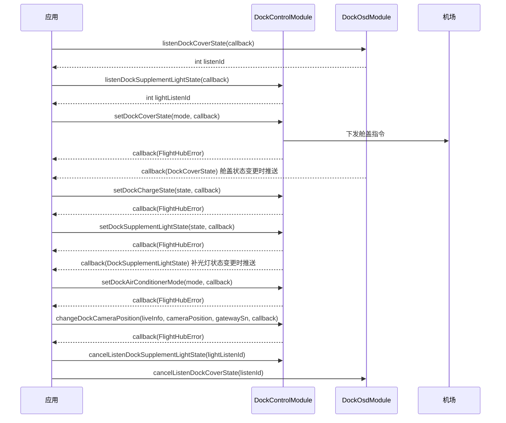

# 机场控制（DockControlModule）

## 1 功能概述

### 1.1 功能简介

`DockControlModule` 是**单设备级**的机场控制模块，作用域为某一台指定 SN 的机场。它面向机场的**物理执行机构下发控制指令**：切换舱内/舱外摄像头、开合舱盖、开关充电、开关补光灯、设置空调模式；并对补光灯状态与空调工作模式提供事件订阅。

本模块只负责**下发控制指令**与自身两类状态订阅，不负责机场的完整实时状态：舱盖开合结果、充电状态等 OSD 遥测请配合 [机场状态监听](../remote-control/dock-status.md) 订阅确认；设备资产与在线状态请使用 [设备管理](./device-manage.md)。多数控制接口属「**下发指令 + 从状态订阅确认结果**」型：下发成功仅表示指令被受理，动作是否完成需通过对应状态订阅回读。

**获取方式：**

```java
Dock dock = FlightHubSDK.getDockInstance("your_dock_sn");
DockControlModule dockControlModule = dock.getDockControlModule();
```

### 1.2 核心概念

| 概念 | 说明 |
| --- | --- |
| 机场（Dock） | 本模块的作用对象。通过 `FlightHubSDK.getDockInstance(sn)` 按机场 SN 获取 `Dock` 实例，再取本模块，所有指令都下发给这一台机场。 |
| 下发与回读分离 | 控制接口回调返回的 `FlightHubError` 只表示指令是否**被受理**，不代表物理动作已完成。舱盖、充电等最终状态需通过状态订阅回读。舱盖状态、充电状态订阅在 [机场状态监听](../remote-control/dock-status.md)（`DockOsdModule`）中；补光灯状态、空调工作模式订阅在本模块内。 |
| 监听 ID（`listenId`） | 订阅型接口返回的整型句柄。取消订阅时必须回传同一个 `listenId`，否则订阅不会被释放。 |
| 摄像头位置（`DockCameraPosition`） | 机场直播画面的取景来源，取值为舱内主摄、舱外辅助摄像头等枚举。切换时需传入当前的直播信息 `LiveInfo`。 |
| 舱盖模式（`DockCoverMode`） | 舱盖操作枚举：开启、关闭、强制关闭。`FORCE_CLOSE` 会绕过常规安全流程。 |

### 1.3 能力清单

| 能力 | 对应接口 | 接口类型 | 说明 |
| --- | --- | --- | --- |
| 切换舱内/舱外摄像头 | `changeDockCameraPosition()` | 异步回调 | 切换机场直播画面的取景来源（舱内/舱外） |
| 设置舱盖开关 | `setDockCoverState()` | 异步回调 | 开启、关闭或强制关闭机场舱盖 |
| 设置充电开关 | `setDockChargeState()` | 异步回调 | 开启或关闭机场对飞机的充电 |
| 设置补光灯开关 | `setDockSupplementLightState()` | 异步回调 | 开启或关闭机场补光灯 |
| 设置空调模式 | `setDockAirConditionerMode()` | 异步回调 | 设置机场空调工作模式（空闲/制冷/制热/除湿） |
| 订阅空调工作模式 | `listenDockAirConditionerStatusInfo()` / `cancelListenDockAirConditionerStatusInfo()` | 事件订阅 | 机场空调工作模式变化时推送 |
| 订阅补光灯状态 | `listenDockSupplementLightState()` / `cancelListenDockSupplementLightState()` | 事件订阅 | 机场补光灯状态变化时推送 |

---

## 2 前提条件

- 已完成上云 API 2 底座部署，并获取到服务地址与鉴权 Token。详见 [部署指南](../../../02.deployment/00.index.md)、[鉴权接入指南](../../../08.auth.md)。
- 已完成 SDK 初始化且 `FlightHubSDK.isInitialized()` 返回 `true`。详见 [SDK初始化](../init/sdk-init.md)。
- 目标机场已完成上云并绑定至当前工作空间，可通过 `FlightHubSDK.getDockInstance(sn)` 取得 `Dock` 实例；机场需在线，否则控制指令无法下达到设备。
- 若需使用 `listenXxx` 订阅接口，SDK 配置中的 `notificationServerAddress`（WebSocket 通知地址）必须正确且连接可用，否则接口能返回 `listenId`，但回调不会被触发。详见 [SDK配置](../init/sdk-config.md)。
- 使用 `changeDockCameraPosition()` 前需先取得机场当前的直播信息 `LiveInfo`（来自直播相关模块 `LiveDeviceModule`）。

---

## 3 快速上手

### 3.1 获取模块实例

```java
// 前置：已完成 FlightHubSDK.initialize(config)
Dock dock = FlightHubSDK.getDockInstance("your_dock_sn");
DockControlModule dockControlModule = dock.getDockControlModule();
```

### 3.2 使用流程

1. **初始化 SDK 并获取模块实例** —— `FlightHubSDK.initialize()` → `getDockInstance(sn)` → `getDockControlModule()`。
2. **订阅结果状态（下发前）** —— 舱盖/充电结果订阅 [机场状态监听](../remote-control/dock-status.md)（`DockOsdModule.listenDockCoverState()` / `listenDockDroneChargeState()`）；补光灯/空调用本模块的 `listenDockSupplementLightState()`、`listenDockAirConditionerStatusInfo()`，保存返回的 `listenId`。
3. **下发控制指令** —— 按需调用 `setDockCoverState()`、`setDockChargeState()`、`setDockSupplementLightState()`、`setDockAirConditionerMode()`、`changeDockCameraPosition()`。
4. **回读确认结果** —— 在步骤 2 的状态订阅回调中确认物理动作是否到位，而非仅凭下发回调的 `isSuccess()`。
5. **退出时释放订阅** —— 页面销毁或应用退出前，用步骤 2 保存的 `listenId` 调用对应的 `cancelListenXxx()`。

### 3.3 调用时序图



---

## 4 示例代码

### 4.1 完整示例

```java
// 前置：已完成 FlightHubSDK.initialize(config)
Dock dock = FlightHubSDK.getDockInstance("your_dock_sn");
DockControlModule dockControlModule = dock.getDockControlModule();

// ============ 1. 设置舱盖开关 ============
// mode 取值：OPEN / CLOSE / FORCE_CLOSE
dockControlModule.setDockCoverState(DockCoverMode.OPEN, new FlightHubCallback.ResultCallbackWithError() {
    @Override
    public void onResult(FlightHubError error) {
        // 注意：error 可能为 null；此处成功仅表示指令被受理，是否开合到位需从机场状态订阅回读
        if (error != null && error.isSuccess()) {
            System.out.println("开舱指令已下发，请通过舱盖状态订阅确认结果");
        } else {
            System.err.println("开舱指令失败: " + error);
        }
    }
});

// ============ 2. 设置充电开关 ============
dockControlModule.setDockChargeState(false, new FlightHubCallback.ResultCallbackWithError() {
    @Override
    public void onResult(FlightHubError error) {
        boolean ok = error != null && error.isSuccess();
        System.out.println("停止充电指令: " + (ok ? "已下发" : "失败 " + error));
    }
});

// ============ 3. 设置补光灯开关 ============
dockControlModule.setDockSupplementLightState(true, new FlightHubCallback.ResultCallbackWithError() {
    @Override
    public void onResult(FlightHubError error) {
        boolean ok = error != null && error.isSuccess();
        System.out.println("补光灯开启指令: " + (ok ? "已下发" : "失败 " + error));
    }
});

// ============ 4. 设置空调模式（0=空闲 1=制冷 2=制热 3=除湿） ============
dockControlModule.setDockAirConditionerMode(1, new FlightHubCallback.ResultCallbackWithError() {
    @Override
    public void onResult(FlightHubError error) {
        boolean ok = error != null && error.isSuccess();
        System.out.println("空调设为制冷: " + (ok ? "已下发" : "失败 " + error));
    }
});

// ============ 5. 订阅空调工作模式 ============
int acListenId = dockControlModule.listenDockAirConditionerStatusInfo(
    new FlightHubCallback.DockAirConditionerStatusInfoCallback() {
        @Override
        public void onResult(DockAirConditionerStatusInfo statusInfo) {
            if (statusInfo == null) return;
            System.out.println("空调当前模式: " + statusInfo.getAirConditionerState()
                    + " 切换时间: " + statusInfo.getSwitchTime());
        }
    }
);

// ============ 6. 订阅补光灯状态 ============
int lightListenId = dockControlModule.listenDockSupplementLightState(
    new FlightHubCallback.DockSupplementLightStateCallback() {
        @Override
        public void onResult(DockSupplementLightState lightState) {
            if (lightState == null) return;
            System.out.println("补光灯状态: " + lightState.getSupplementLightState());
        }
    }
);

// ============ 7. 退出前取消订阅（必须执行，否则订阅泄漏） ============
dockControlModule.cancelListenDockAirConditionerStatusInfo(acListenId);
dockControlModule.cancelListenDockSupplementLightState(lightListenId);
```

### 4.2 场景化片段

**切换舱内/舱外摄像头（需先取得直播信息 `LiveInfo`）**

```java
// 前置：从直播模块（LiveDeviceModule）取得机场当前可用的 LiveInfo
// liveInfo 为空或与当前直播不匹配时切换会失败
LiveInfo liveInfo = /* 来自直播模块的可用直播源 */ null;
if (liveInfo != null) {
    // cameraPosition 取值：INSIDE（舱内/主摄）/ OUTSIDE（舱外/辅助摄1）/ AUX2（辅助摄2）
    dockControlModule.changeDockCameraPosition(
            liveInfo,
            DockCameraPosition.OUTSIDE,
            "your_gateway_sn",   // 网关设备序列号
            new FlightHubCallback.ResultCallbackWithError() {
                @Override
                public void onResult(FlightHubError error) {
                    boolean ok = error != null && error.isSuccess();
                    System.out.println("切换至舱外摄像头: " + (ok ? "成功" : "失败 " + error));
                }
            });
}
```

**强制收舱（不可逆，需人工二次确认）**

```java
// 前置：常规 CLOSE 因遮挡等原因无法闭合，且已人工确认舱内无飞机异常、无异物
// 注意：FORCE_CLOSE 绕过常规安全流程，可能夹伤舱内飞机或异物，仅在确认安全后使用
dockControlModule.setDockCoverState(DockCoverMode.FORCE_CLOSE, new FlightHubCallback.ResultCallbackWithError() {
    @Override
    public void onResult(FlightHubError error) {
        if (error != null && error.isSuccess()) {
            System.out.println("强制收舱指令已下发，请通过舱盖状态订阅确认结果");
        } else {
            System.err.println("强制收舱失败: serverCode=" + (error == null ? "-" : error.getServerCode())
                    + " deviceCode=" + (error == null ? "-" : error.getDeviceCode()));
        }
    }
});
```

---

## 5 相关文档

- [SDK初始化](../init/sdk-init.md) —— 获取 `Dock` 实例前必须完成的初始化步骤
- [SDK配置](../init/sdk-config.md) —— WebSocket 通知地址等配置项，影响两个订阅接口能否收到推送
- [机场状态监听](../remote-control/dock-status.md) —— 舱盖状态、充电状态等 OSD 遥测订阅，控制指令下发后在此回读结果
- [设备管理](./device-manage.md) —— 机场资产、在线状态与拓扑信息，控制前确认机场在线
- [使用 API 文档查阅接口详情](../../03.api-docs-guide.md) —— 查阅 `DockControlModule` 完整方法签名与字段定义
