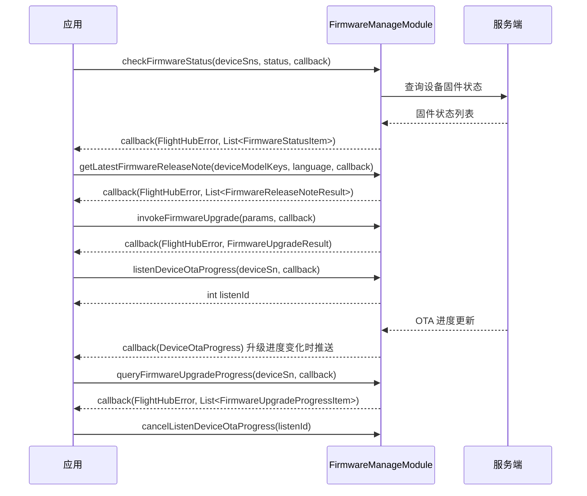

# 固件管理（FirmwareManageModule）

## 1 功能概述

### 1.1 功能简介

`FirmwareManageModule` 是**工作空间级**的固件管理模块，作用域为当前鉴权 Token 所属的工作空间。它覆盖固件的三类使用诉求：**了解固件现状**（查询固件列表、检查设备固件状态、查询兼容性配置、获取发布说明）、**执行固件升级**（触发升级、查询升级进度、订阅 OTA 升级进度推送），以及**管理自定义固件包**（上传固件文件、提交固件信息、发布 / 取消发布 / 删除固件）。

本模块只负责固件本身的查询、升级与包管理。设备的固件版本、固件状态字段出现在设备资产信息中，其读取与设备台账维护请使用 [设备管理](./device-manage.md)；固件版本号的口径与含义请参考 设备固件版本。

**获取方式：**

```java
Workspace workspace = FlightHubSDK.getWorkspaceInstance();
FirmwareManageModule firmwareManageModule = workspace.getFirmwareManageModule();
```

### 1.2 核心概念

| 概念 | 说明 |
| --- | --- |
| 固件包（Firmware） | 平台侧管理的一份固件文件及其元信息（`FirmwareItemResult`），以固件 `id` 定位，具备版本号、设备型号 key、状态、描述等属性。 |
| 固件文件 ID（`fileId`） | 发布、取消发布、删除固件时使用的固件文件标识，对应 `FirmwareItemResult.getId()`。 |
| 固件状态（`firmwareStatus`） | 设备当前的固件升级需求判定，取值为整型编码：`1`=无需升级、`2`=待升级、`3`=一致性升级、`4`=固件升级中。见 `FirmwareStatusItem`。 |
| 固件升级类型（`firmwareUpgradeType`） | 触发升级时指定的升级方式，取值为整型编码：`1`=普通升级、`2`=一致性升级。见 `FirmwareUpgradeDeviceItem`。 |
| 一致性升级 | 网关（如机场）与其子设备（如飞机、中继）固件版本需要拉齐时执行的升级类型，对应升级类型 `3`（状态）/ `2`（触发）。 |
| OTA 升级进度 | 设备固件下载与刷写的实时进度，可通过 `listenDeviceOtaProgress()` 订阅推送，或通过 `queryFirmwareUpgradeProgress()` 主动查询。 |
| 监听 ID（`listenId`） | 订阅型接口返回的整型句柄。取消订阅时必须回传同一个 `listenId`，否则订阅不会被释放。 |
| 对象存储 Key（`objectKey`） | 自定义固件包上传到对象存储后的文件标识，由 `uploadFirmwareFile()` 返回，供 `submitFirmwareInfo()` 登记固件信息时引用。 |

### 1.3 能力清单

| 能力 | 对应接口 | 接口类型 | 说明 |
| --- | --- | --- | --- |
| 查询固件列表 | `queryFirmwareList()` | 异步回调 | 分页查询工作空间内的固件包列表 |
| 检查设备固件状态 | `checkFirmwareStatus()` | 异步回调 | 按设备 SN 批量检查固件版本与升级状态 |
| 触发固件升级 | `invokeFirmwareUpgrade()` | 异步回调 | 对一批设备下发固件升级 |
| 查询固件升级进度 | `queryFirmwareUpgradeProgress()` | 异步回调 | 按设备 SN 查询当前升级进度快照 |
| 获取最新固件发布说明 | `getLatestFirmwareReleaseNote()` | 异步回调 | 按设备型号 key 获取最新固件的发布说明 |
| 查询固件兼容性配置 | `queryFirmwareCompatibilityConfig()` | 异步回调 | 查询各设备型号的兼容版本与规则 |
| 上传固件文件 | `uploadFirmwareFile()` | 异步回调 | 上传本地固件文件到对象存储 |
| 提交固件信息 | `submitFirmwareInfo()` | 异步回调 | 登记已上传固件包的元信息 |
| 发布固件 | `releaseFirmware()` | 异步回调 | 将固件包置为发布状态 |
| 取消发布固件 | `unReleaseFirmware()` | 异步回调 | 撤销固件包的发布状态 |
| 删除固件 | `deleteFirmware()` | 异步回调 | 删除固件包 |
| 订阅设备固件升级进度 | `listenDeviceOtaProgress()` / `cancelListenDeviceOtaProgress()` | 事件订阅 | 订阅指定设备的 OTA 升级进度推送 |

---

## 2 前提条件

- 已完成上云 API 2 底座部署，并获取到服务地址与鉴权 Token。详见 [部署指南](../../../02.deployment/00.index.md)、[鉴权接入指南](../../../08.auth.md)。
- 已完成 SDK 初始化（`JniLibraryLoader.loadLibrary()` → 注入鉴权头 → `FlightHubSDK.initialize(config)`），且 `FlightHubSDK.isInitialized()` 返回 `true`。详见 [SDK初始化](../init/sdk-init.md)。
- 设备已完成上云并绑定至当前工作空间，否则 `checkFirmwareStatus()`、`invokeFirmwareUpgrade()` 等按 SN 操作的接口无法定位到设备。详见 [设备上云](../../../04.device-onboarding/00.index.md)。
- 若需使用 `listenDeviceOtaProgress()` 订阅进度推送，SDK 配置中的 `notificationServerAddress`（WebSocket 通知地址）必须正确且连接可用，否则接口能返回 `listenId`，但回调不会被触发。详见 [SDK配置](../init/sdk-config.md)。

---

## 3 快速上手

### 3.1 获取模块实例

```java
// 前置：已完成 FlightHubSDK.initialize(config)
Workspace workspace = FlightHubSDK.getWorkspaceInstance();
FirmwareManageModule firmwareManageModule = workspace.getFirmwareManageModule();
```

### 3.2 使用流程

1. **初始化 SDK 并获取模块实例** —— `FlightHubSDK.initialize()` → `getWorkspaceInstance()` → `getFirmwareManageModule()`。
2. **检查固件状态** —— 调用 `checkFirmwareStatus(deviceSns, status, callback)`，筛出需要升级的设备。
3. **确认发布说明（可选）** —— 调用 `getLatestFirmwareReleaseNote(deviceModelKeys, language, callback)` 获取目标型号的最新固件说明。
4. **触发升级** —— 构造 `FirmwareUpgradeParam`（包含 `FirmwareUpgradeDeviceItem` 列表）后调用 `invokeFirmwareUpgrade(params, callback)`。
5. **跟踪进度** —— 调用 `listenDeviceOtaProgress(deviceSn, callback)` 订阅实时进度并保存 `listenId`，或按需调用 `queryFirmwareUpgradeProgress(deviceSn, callback)` 查询快照。
6. **退出时释放订阅** —— 页面销毁或应用退出前，用步骤 5 保存的 `listenId` 调用 `cancelListenDeviceOtaProgress(listenId)`。

### 3.3 调用时序图



---

## 4 示例代码

### 4.1 完整示例

```java
Workspace workspace = FlightHubSDK.getWorkspaceInstance();
FirmwareManageModule firmwareManageModule = workspace.getFirmwareManageModule();

String targetSn = "your_device_sn";

// ============ 1. 查询固件列表（分页） ============
firmwareManageModule.queryFirmwareList(1, 20, new FlightHubCallback.QueryFirmwareListCallback() {
    @Override
    public void onResult(FlightHubError error, List<FirmwareItemResult> items) {
        // 注意：error 可能为 null，判空后再判 isSuccess()
        if (error != null && !error.isSuccess()) {
            System.err.println("查询固件列表失败: " + error);
            return;
        }
        if (items == null) return;
        for (FirmwareItemResult item : items) {
            System.out.println("固件 ID: " + item.getId()
                    + " 型号: " + item.getDeviceModelKey()
                    + " 版本: " + item.getVersion()
                    + " 状态: " + item.getStatus()
                    + " 创建时间: " + item.getCreatedAt());
        }
    }
});

// ============ 2. 检查设备固件状态 ============
List<String> deviceSns = Arrays.asList(targetSn);
firmwareManageModule.checkFirmwareStatus(deviceSns, Collections.emptyList(),
    new FlightHubCallback.CheckFirmwareStatusCallback() {
        @Override
        public void onResult(FlightHubError error, List<FirmwareStatusItem> items) {
            if (error != null && !error.isSuccess() || items == null) return;
            for (FirmwareStatusItem item : items) {
                // firmwareStatus：1=无需升级 2=待升级 3=一致性升级 4=固件升级中
                System.out.println("SN: " + item.getSn()
                        + " 当前版本: " + item.getFirmwareVersion()
                        + " 固件状态: " + item.getFirmwareStatus());
                FirmwareService service = item.getServices();
                if (service != null && service.getProgress() != null) {
                    System.out.println("  升级服务进度: " + service.getProgress().getPercent() + "%");
                }
            }
        }
    }
);

// ============ 3. 获取最新固件发布说明 ============
List<String> modelKeys = Arrays.asList("your_device_model_key");
firmwareManageModule.getLatestFirmwareReleaseNote(modelKeys, "zh",
    new FlightHubCallback.GetLatestFirmwareReleaseNoteCallback() {
        @Override
        public void onResult(FlightHubError error, List<FirmwareReleaseNoteResult> notes) {
            if (error != null && !error.isSuccess() || notes == null) return;
            for (FirmwareReleaseNoteResult note : notes) {
                System.out.println("型号: " + note.getDeviceModelKey()
                        + " 版本: " + note.getProductVersion()
                        + " 发布时间: " + note.getReleasedTime()
                        + "\n说明: " + note.getReleaseNote());
            }
        }
    }
);

// ============ 4. 触发固件升级 ============
FirmwareUpgradeDeviceItem deviceItem = new FirmwareUpgradeDeviceItem();
deviceItem.setSn(targetSn);
deviceItem.setDeviceModelKey("your_device_model_key");
deviceItem.setFirmwareUpgradeType(1);            // 1=普通升级 2=一致性升级
deviceItem.setProductVersion("your_target_version");

FirmwareUpgradeParam upgradeParam = new FirmwareUpgradeParam();
upgradeParam.setDevices(Collections.singletonList(deviceItem));   // 支持一次提交多台设备

firmwareManageModule.invokeFirmwareUpgrade(upgradeParam,
    new FlightHubCallback.InvokeFirmwareUpgradeCallback() {
        @Override
        public void onResult(FlightHubError error, FirmwareUpgradeResult result) {
            if (error != null && !error.isSuccess()) {
                System.err.println("触发升级失败: " + error.getServerMessage());
                return;
            }
            if (result == null) return;
            System.out.println("升级触发状态: " + result.getStatus());
            if (result.getDevices() != null) {
                for (FirmwareUpgradeResponseDeviceItemResult d : result.getDevices()) {
                    System.out.println("  设备: " + d.getSn() + " 目标版本: " + d.getProductVersion());
                }
            }
        }
    }
);

// ============ 5. 订阅设备 OTA 升级进度（WebSocket 推送） ============
int listenId = firmwareManageModule.listenDeviceOtaProgress(targetSn,
    new FlightHubCallback.DeviceOtaProgressCallback() {
        @Override
        public void onResult(DeviceOtaProgress msg) {
            // msg 为进度推送消息对象；如需结构化进度，收到推送后调用 queryFirmwareUpgradeProgress 获取快照
            System.out.println("收到 " + targetSn + " 的 OTA 进度推送");
            queryProgressSnapshot(firmwareManageModule, targetSn);
        }
    }
);

// ============ 6. 退出前取消订阅（必须执行，否则订阅泄漏） ============
firmwareManageModule.cancelListenDeviceOtaProgress(listenId);
```

```java
// 查询升级进度快照（供上面回调调用）
private void queryProgressSnapshot(FirmwareManageModule module, String deviceSn) {
    module.queryFirmwareUpgradeProgress(deviceSn,
        new FlightHubCallback.QueryFirmwareUpgradeProgressCallback() {
            @Override
            public void onResult(FlightHubError error, List<FirmwareUpgradeProgressItem> items) {
                if (error != null && !error.isSuccess() || items == null) return;
                for (FirmwareUpgradeProgressItem item : items) {
                    FirmwareUpgradeProgressOTA ota = item.getOta();
                    if (ota != null && ota.getProgress() != null) {
                        System.out.println("SN: " + item.getSn()
                                + " OTA 状态: " + ota.getStatus()
                                + " 进度: " + ota.getProgress().getPercent() + "%"
                                + " 步骤: " + ota.getProgress().getCurrentStep());
                    }
                }
            }
        }
    );
}
```

### 4.2 场景化片段

**自定义固件上架：上传 → 提交信息 → 发布**

```java
// 前置：已具备固件包管理权限，本地固件文件路径可读
String localFilePath = "/path/to/firmware.zip";

firmwareManageModule.uploadFirmwareFile(localFilePath,
    new FlightHubCallback.UploadFirmwareFileCallback() {
        @Override
        public void onResult(FlightHubError error, UploadFileResult result) {
            if (error != null && !error.isSuccess() || result == null) {
                System.err.println("上传固件文件失败");
                return;
            }
            // 用上传返回的 objectKey 登记固件信息
            FirmwareInfoParam infoParam = new FirmwareInfoParam();
            infoParam.setDeviceModelKey("your_device_model_key");
            infoParam.setVersion("your_version");
            infoParam.setDesc("自定义固件包");
            infoParam.setObjectKey(result.getObjectKey());
            infoParam.setMd5("your_file_md5");

            firmwareManageModule.submitFirmwareInfo(infoParam,
                new FlightHubCallback.SubmitFirmwareInfoCallback() {
                    @Override
                    public void onResult(FlightHubError error) {
                        boolean ok = error != null && error.isSuccess();
                        System.out.println("提交固件信息: " + (ok ? "成功" : "失败 " + error));
                        // 提交成功后，通过 queryFirmwareList 找到对应固件 id 再调用 releaseFirmware 发布
                    }
                }
            );
        }
    }
);
```

**固件包下架与清理（不可逆，需二次确认）**

```java
// 前置：已在业务侧完成用户二次确认，且确认无进行中的升级任务依赖该固件
String fileId = "firmware_file_id";
firmwareManageModule.unReleaseFirmware(fileId, new FlightHubCallback.UnReleaseFirmwareCallback() {
    @Override
    public void onResult(FlightHubError error) {
        if (error != null && error.isSuccess()) {
            // 取消发布后如需彻底删除，再调用 deleteFirmware
            firmwareManageModule.deleteFirmware(fileId, new FlightHubCallback.DeleteFirmwareCallback() {
                @Override
                public void onResult(FlightHubError error) {
                    System.out.println("删除固件: " + (error != null && error.isSuccess() ? "成功" : "失败"));
                }
            });
        } else {
            System.err.println("取消发布失败: serverCode="
                    + (error == null ? "-" : error.getServerCode())
                    + " message=" + (error == null ? "-" : error.getServerMessage()));
        }
    }
});
```

---

## 5 相关文档

- [SDK初始化](../init/sdk-init.md) —— 获取 `Workspace` 实例前必须完成的初始化步骤
- [SDK配置](../init/sdk-config.md) —— WebSocket 通知地址等配置项，影响 OTA 进度订阅能否收到推送
- [设备上云](../../../04.device-onboarding/00.index.md) —— 设备绑定到工作空间的前置流程，按 SN 操作固件前需先完成
- [设备管理](./device-manage.md) —— 设备资产与拓扑信息，设备详情中包含固件版本与固件状态字段
- 设备固件版本 —— 固件版本号与固件状态字段的口径说明
- [使用 API 文档查阅接口详情](../../03.api-docs-guide.md) —— 查阅 `FirmwareManageModule` 完整方法签名与字段定义
