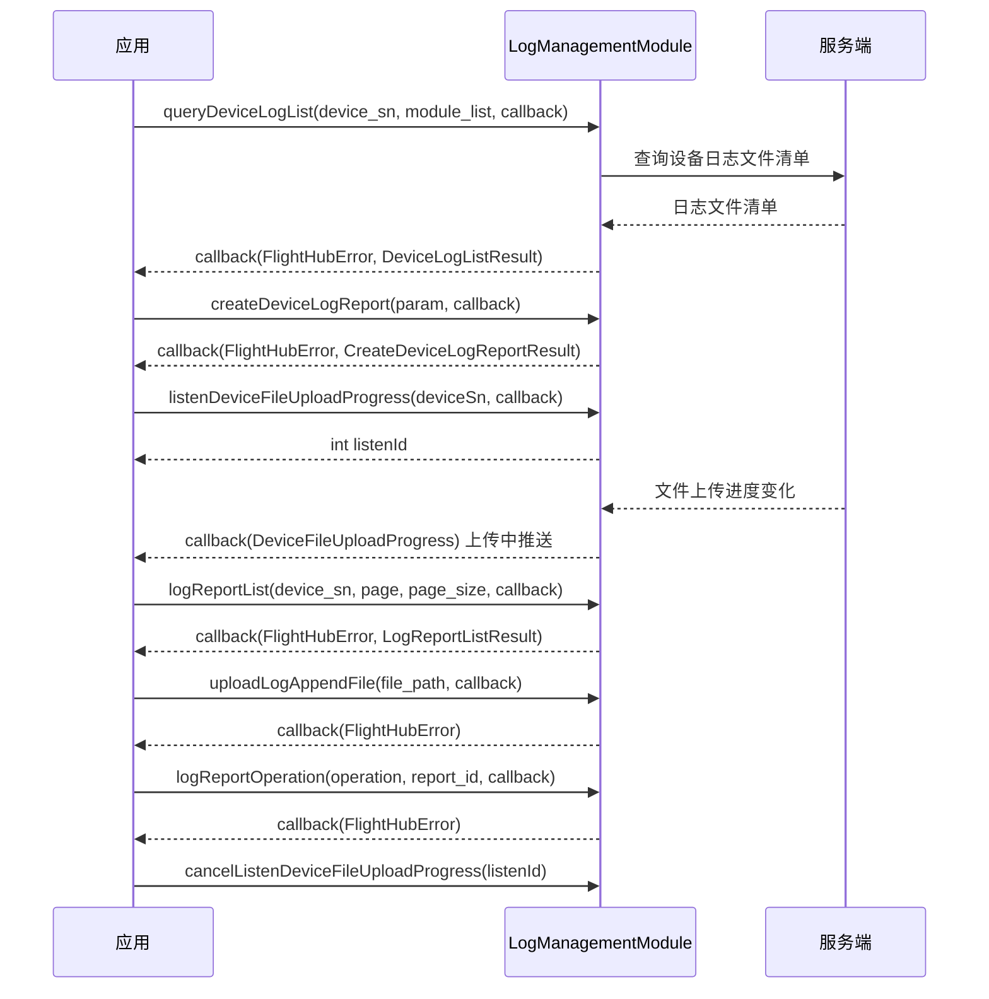

# 日志管理（LogManagementModule）

## 1 功能概述

### 1.1 功能简介

`LogManagementModule` 是**工作空间级**的设备日志管理模块，作用域为当前鉴权 Token 所属的工作空间。它面向设备排障与售后场景，回答四类问题：**设备上有哪些可上传的日志文件**（按设备与模块列出日志文件清单）、**如何把选定的日志打包成一份可追踪的报告**（创建日志报告并拿到报告 UUID 与追踪编号）、**已经提交过哪些日志报告**（分页查询报告列表与状态），以及**报告与文件上传进行到哪一步**（对报告执行取消/删除操作、上传附件、订阅文件上传进度）。

本模块只负责**日志文件的收集、打包上报与进度跟踪**，不负责设备资产与拓扑管理、也不负责设备健康告警：设备清单与详情请使用 [设备管理](./device-manage.md)，日志报告生成的售后追踪编号（工单）请结合 [设备保修维护](./device-maintenance.md) 理解，媒体文件（照片/视频）的上传与管理请使用 [媒体服务](../media/media-service.md)。

**获取方式：**

```java
Workspace workspace = FlightHubSDK.getWorkspaceInstance();
LogManagementModule logManagementModule = workspace.getLogManagementModule();
```

### 1.2 核心概念

| 概念 | 说明 |
| --- | --- |
| 设备日志文件（`DeviceLogListResultFileItem`） | 设备侧按模块归集的一组可上传日志。一个文件项 = 某台设备（`getDeviceSn()`）某个模块（`getModule()`）下的日志清单（`getList()`）。 |
| 模块过滤（`module_list`） | `queryDeviceLogList()` 的整型编码列表，用于按设备模块过滤要查询的日志。取值为编码值，含义以 [SDK API 文档](../../03.api-docs-guide.md) 为准。 |
| 日志报告（Log Report） | 把选定的设备日志连同设备拓扑、联系信息打包提交后生成的上报单据，由报告 UUID（`reportUuid`）唯一标识，并附带一个追踪编号（`trackNumber`）用于售后跟踪。 |
| 对象存储 Key | 日志文件与附件在对象存储中的定位标识（如 `getObjectKey()`、`getFileObjectKey()`）。创建报告时通过对象 Key / 文件路径引用具体文件，而非直接传输文件内容。 |
| 监听 ID（`listenId`） | `listenDeviceFileUploadProgress()` 返回的整型句柄。取消订阅时必须回传同一个 `listenId`，否则订阅不会被释放。 |

### 1.3 能力清单

| 能力 | 对应接口 | 接口类型 | 说明 |
| --- | --- | --- | --- |
| 查询设备日志文件列表 | `queryDeviceLogList()` | 异步回调 | 按设备 SN 与模块过滤，返回设备侧可上传的日志文件清单 |
| 创建设备日志报告 | `createDeviceLogReport()` | 异步回调 | 将选定日志连同拓扑、联系信息打包上报，返回报告 UUID 与追踪编号 |
| 查询日志报告列表 | `logReportList()` | 异步回调 | 分页查询某设备已提交的日志报告及其状态 |
| 操作日志报告 | `logReportOperation()` | 异步回调 | 对指定报告执行取消、删除等操作 |
| 上传日志附件 | `uploadLogAppendFile()` | 异步回调 | 上传本地文件作为日志报告的附件 |
| 订阅文件上传进度 | `listenDeviceFileUploadProgress()` / `cancelListenDeviceFileUploadProgress()` | 事件订阅 | 设备日志文件上传过程中推送进度 |

---

## 2 前提条件

- 已完成上云 API 2 底座部署，并获取到服务地址与鉴权 Token。详见 [部署指南](../../../02.deployment/00.index.md)、[鉴权接入指南](../../../08.auth.md)。
- 已完成 SDK 初始化且 `FlightHubSDK.isInitialized()` 返回 `true`。详见 [SDK初始化](../init/sdk-init.md)。
- 目标设备已完成上云并绑定至当前工作空间，否则查询不到该设备的日志文件。详见 [设备上云](../../../04.device-onboarding/00.index.md)。
- 若需使用 `listenDeviceFileUploadProgress()` 订阅进度，SDK 配置中的 `notificationServerAddress`（WebSocket 通知地址）必须正确且连接可用，否则接口能返回 `listenId`，但回调不会被触发。详见 [SDK配置](../init/sdk-config.md)。

---

## 3 快速上手

### 3.1 获取模块实例

```java
// 前置：已完成 FlightHubSDK.initialize(config)
Workspace workspace = FlightHubSDK.getWorkspaceInstance();
LogManagementModule logManagementModule = workspace.getLogManagementModule();
```

### 3.2 使用流程

1. **初始化 SDK 并获取模块实例** —— `FlightHubSDK.initialize()` → `getWorkspaceInstance()` → `getLogManagementModule()`。
2. **查询设备日志文件清单** —— 调用 `queryDeviceLogList(deviceSn, moduleList, callback)`，得到设备各模块下的日志文件项。
3. **构建并提交日志报告** —— 根据查询结果组装 `CreateDeviceLogReportRequestParam`（设备拓扑、日志列表、联系信息等），调用 `createDeviceLogReport()`，保存返回的 `reportUuid` 与 `trackNumber`。
4. **订阅上传进度** —— 调用 `listenDeviceFileUploadProgress(deviceSn, callback)` 保存返回的 `listenId`，在界面展示上传进度。
5. **按需管理报告** —— 用 `logReportList(deviceSn, page, pageSize, callback)` 分页查看历史报告；用 `uploadLogAppendFile(filePath, callback)` 上传补充附件；用 `logReportOperation(operation, reportId, callback)` 取消或删除报告。
6. **退出时释放订阅** —— 页面销毁或应用退出前，用步骤 4 保存的 `listenId` 调用 `cancelListenDeviceFileUploadProgress(listenId)`。

### 3.3 调用时序图



---

## 4 示例代码

### 4.1 完整示例

```java
Workspace workspace = FlightHubSDK.getWorkspaceInstance();
LogManagementModule logManagementModule = workspace.getLogManagementModule();

String deviceSn = "your_device_sn";
String deviceModelKey = "your_device_model_key";

// ============ 1. 查询设备日志文件列表 ============
// module_list 为模块编码列表，取值含义见 SDK API 文档；此处传空列表
List<Integer> moduleList = Collections.emptyList();
logManagementModule.queryDeviceLogList(deviceSn, moduleList,
    new FlightHubCallback.QueryDeviceLogListCallback() {
        @Override
        public void onResult(FlightHubError error, DeviceLogListResult result) {
            // 注意：error 可能为 null，判空后再判 isSuccess()
            if (error != null && !error.isSuccess()) {
                System.err.println("查询设备日志文件失败: " + error);
                return;
            }
            if (result == null || result.getFiles() == null) return;
            for (DeviceLogListResultFileItem fileItem : result.getFiles()) {
                System.out.println("设备 " + fileItem.getDeviceSn()
                        + " 模块 " + fileItem.getModule()
                        + " 对象Key " + fileItem.getObjectKey()
                        + " 日志条数 " + (fileItem.getList() == null ? 0 : fileItem.getList().size()));
            }
        }
    }
);

// ============ 2. 创建设备日志报告 ============
// 2.1 设备拓扑：填写主设备节点
DeviceLogReportDeviceTopoItemParam hostItem = new DeviceLogReportDeviceTopoItemParam();
hostItem.setSn(deviceSn);
hostItem.setDeviceModelKey(deviceModelKey);

DeviceLogReportDeviceTopoParam deviceTopo = new DeviceLogReportDeviceTopoParam();
deviceTopo.setHosts(Collections.singletonList(hostItem));

// 2.2 日志列表：从查询结果中组装（此处示意单条日志）
DeviceLogReportLogItemParam logItem = new DeviceLogReportLogItemParam();
logItem.setBootIndex(0);
logItem.setStartTime(System.currentTimeMillis() / 1000 - 3600);
logItem.setEndTime(System.currentTimeMillis() / 1000);
logItem.setSize(1024L);
logItem.setMd5("your_log_md5");

DeviceLogReportLogListItemParam logListItem = new DeviceLogReportLogListItemParam();
logListItem.setDeviceSn(deviceSn);
logListItem.setModule("your_module");
logListItem.setList(Collections.singletonList(logItem));

// 2.3 联系信息（可选）
DeviceLogReportContactInformationParam contact = new DeviceLogReportContactInformationParam();
contact.setEmail("ops@example.com");
contact.setPhone("13800000000");

// 2.4 组装请求参数
CreateDeviceLogReportRequestParam param = new CreateDeviceLogReportRequestParam();
param.setReportInformation("现场设备异常日志上报");
param.setErrorStartTime(System.currentTimeMillis() / 1000 - 3600);
param.setCrashed(false);
param.setDeviceTopo(deviceTopo);
param.setLogList(Collections.singletonList(logListItem));
param.setReportContactInformation(contact);

logManagementModule.createDeviceLogReport(param,
    new FlightHubCallback.CreateDeviceLogReportCallback() {
        @Override
        public void onResult(FlightHubError error, CreateDeviceLogReportResult result) {
            if (error != null && !error.isSuccess()) {
                System.err.println("创建日志报告失败: " + error.getServerMessage());
                return;
            }
            if (result == null) return;
            // 保存报告 UUID 与追踪编号，用于后续查询与售后跟进
            System.out.println("报告 UUID: " + result.getReportUuid());
            System.out.println("追踪编号: " + result.getTrackNumber());
        }
    }
);

// ============ 3. 订阅文件上传进度（WebSocket 推送） ============
int listenId = logManagementModule.listenDeviceFileUploadProgress(deviceSn,
    new FlightHubCallback.DeviceFileUploadProgressCallback() {
        @Override
        public void onResult(DeviceFileUploadProgress msg) {
            if (msg == null) return;   // 注意：推送内容可能为 null，先判空
            System.out.println("收到文件上传进度推送: " + msg);
        }
    }
);

// ============ 4. 查询日志报告列表（分页） ============
logManagementModule.logReportList(deviceSn, 1, 10,
    new FlightHubCallback.LogReportListCallback() {
        @Override
        public void onResult(FlightHubError error, LogReportListResult result) {
            if (error != null && !error.isSuccess() || result == null) return;
            LogReportListResultPagination page = result.getPagination();
            if (page != null) {
                System.out.println("第 " + page.getPage() + " 页，共 " + page.getTotal() + " 条");
            }
            if (result.getList() == null) return;
            for (LogReportListResultItem item : result.getList()) {
                System.out.println("报告 " + item.getReportUuid()
                        + " 状态 " + item.getStatus()
                        + " 追踪编号 " + item.getTrackNumber());
            }
        }
    }
);

// ============ 5. 上传日志附件 ============
String appendFilePath = "/path/to/append_file.zip";
logManagementModule.uploadLogAppendFile(appendFilePath,
    new FlightHubCallback.UploadLogAppendFileCallback() {
        @Override
        public void onResult(FlightHubError error) {
            boolean ok = error != null && error.isSuccess();
            System.out.println("上传附件: " + (ok ? "成功" : "失败 " + error));
        }
    }
);

// ============ 6. 退出前取消订阅（必须执行，否则订阅泄漏） ============
logManagementModule.cancelListenDeviceFileUploadProgress(listenId);
```

### 4.2 场景化片段

**取消或删除日志报告（删除不可逆，需二次确认）**

```java
// 前置：已从 createDeviceLogReport() 或 logReportList() 拿到 reportUuid，并完成用户二次确认
// operation 取值（如取消、删除）以 SDK API 文档为准
String reportId = "your_report_uuid";
String operation = "delete";
logManagementModule.logReportOperation(operation, reportId,
    new FlightHubCallback.LogReportOperationCallback() {
        @Override
        public void onResult(FlightHubError error) {
            if (error != null && error.isSuccess()) {
                System.out.println("报告操作成功，请同步刷新本地报告列表");
            } else {
                System.err.println("报告操作失败: serverCode="
                        + (error == null ? "-" : error.getServerCode())
                        + " message=" + (error == null ? "-" : error.getServerMessage()));
            }
        }
    }
);
```

---

## 5 相关文档

- [SDK初始化](../init/sdk-init.md) —— 获取 `Workspace` 实例前必须完成的初始化步骤
- [SDK配置](../init/sdk-config.md) —— WebSocket 通知地址等配置项，影响文件上传进度订阅能否收到推送
- [设备上云](../../../04.device-onboarding/00.index.md) —— 设备绑定到工作空间的前置流程，查询不到设备日志时首先核对这里
- [设备管理](./device-manage.md) —— 设备清单、详情与拓扑，日志上报所需的设备 SN 与型号 key 由此获取
- [设备保修维护](./device-maintenance.md) —— 日志报告生成的追踪编号（工单）在售后维护流程中的承接
- [媒体服务](../media/media-service.md) —— 照片/视频等媒体文件的上传与管理，与日志附件上传区分使用
- [使用 API 文档查阅接口详情](../../03.api-docs-guide.md) —— 查阅 `LogManagementModule` 完整方法签名、参数类型与字段定义
