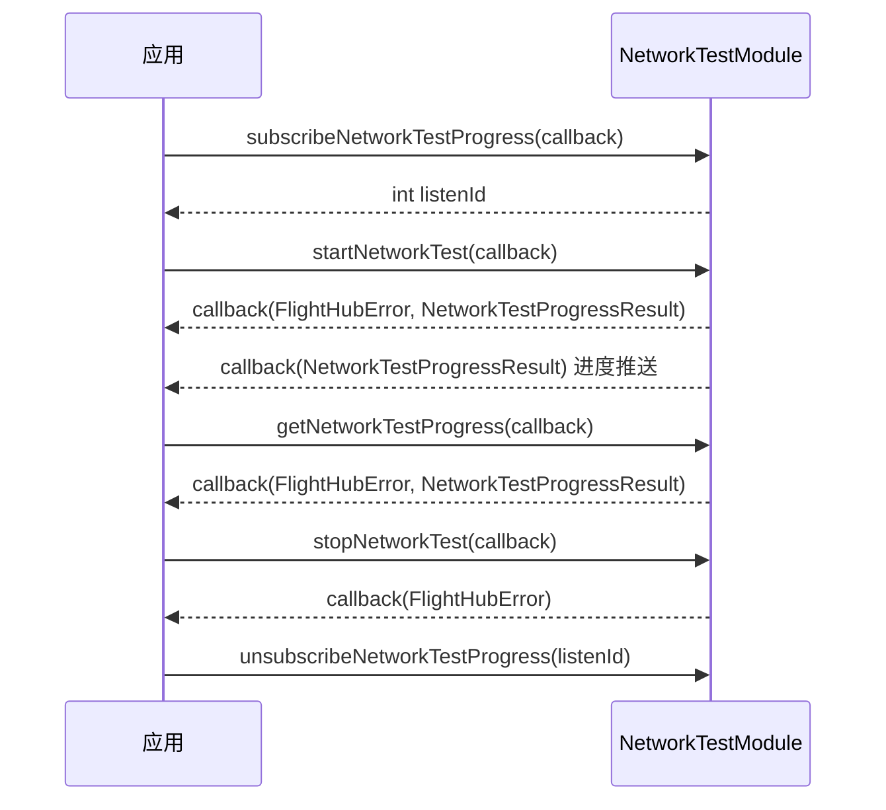

# 网络测速（NetworkTestModule）

## 1 功能概述

### 1.1 功能简介

`NetworkTestModule` 是**单设备级**的网络测速模块，作用域为一台机场或基站设备。它用于评估机场/基站与云端之间的网络质量：发起一次网络测速任务、停止进行中的测速、按需查询当前测速进度，以及订阅测速进度的实时推送。测速结果包含下载速度与上传速度等指标。

本模块只负责**网络测速**这一件事，不负责设备的其他调试与配置操作（如格式化、重启、开关舱盖等），也不提供设备网络的持续遥测。测速任务针对的是承载该模块的机场/基站设备本身。

**获取方式：**

```java
// 机场设备
NetworkTestModule networkTestModule = dock.getNetworkTestModule();
// 或基站设备
NetworkTestModule networkTestModule = baseStation.getNetworkTestModule();
```

### 1.2 核心概念

| 概念 | 说明 |
| --- | --- |
| 测速任务 | 一次由 `startNetworkTest()` 发起的网络速度测量过程。任务进行中可通过查询或订阅获取进度，结束前可用 `stopNetworkTest()` 主动停止。 |
| 业务 ID（`bid`） | 测速进度结果中的业务标识，用于关联一次测速任务的多次进度上报。 |
| 测速进度（`NetworkTestProgressResult`） | 测速过程的进度与结果快照，包含消息、业务 ID、创建/更新时间，以及下载速度与上传速度。 |
| 监听 ID（`listenId`） | `subscribeNetworkTestProgress()` 返回的整型句柄。取消订阅时必须回传同一个 `listenId`，否则订阅不会被释放。 |

### 1.3 能力清单

| 能力 | 对应接口 | 接口类型 | 说明 |
| --- | --- | --- | --- |
| 开始网络测速 | `startNetworkTest()` | 异步回调 | 发起一次网络测速任务，回调返回错误信息与首个进度结果 |
| 停止网络测速 | `stopNetworkTest()` | 异步回调 | 停止进行中的网络测速任务，回调仅返回错误信息 |
| 查询测速进度 | `getNetworkTestProgress()` | 异步回调 | 主动查询当前测速进度，回调返回错误信息与进度结果 |
| 订阅测速进度 | `subscribeNetworkTestProgress()` / `unsubscribeNetworkTestProgress()` | 事件订阅 | 订阅测速进度的实时推送，进度回调仅返回结果 |

---

## 2 前提条件

- 已完成上云 API 2 底座部署，并获取到服务地址与鉴权 Token。详见 [部署指南](../../../02.deployment/00.index.md)、[鉴权接入指南](../../../08.auth.md)。
- 已完成 SDK 初始化且 `FlightHubSDK.isInitialized()` 返回 `true`。详见 [SDK初始化](../init/sdk-init.md)。
- 已获取到目标机场或基站设备实例（`Dock` / `BaseStation`），并通过其 `getNetworkTestModule()` 拿到本模块实例。
- 目标设备已上云、已绑定至当前工作空间且处于在线状态，否则测速任务无法下发、进度无法上报。
- 若需使用 `subscribeNetworkTestProgress()` 订阅接口，SDK 配置中的 `notificationServerAddress`（WebSocket 通知地址）必须正确且连接可用，否则接口能返回 `listenId`，但进度回调不会被触发。详见 [SDK配置](../init/sdk-config.md)。

---

## 3 快速上手

### 3.1 获取模块实例

```java
// 前置：已完成 FlightHubSDK.initialize(config)，并已获取到机场/基站设备实例
NetworkTestModule networkTestModule = dock.getNetworkTestModule();
// 基站设备：baseStation.getNetworkTestModule();
```

### 3.2 使用流程

1. **获取模块实例** —— 从机场或基站设备实例调用 `getNetworkTestModule()`。
2. **订阅测速进度（可选）** —— 若需实时进度，调用 `subscribeNetworkTestProgress()` 并保存返回的 `listenId`。
3. **发起测速** —— 调用 `startNetworkTest()`，在回调中读取首个进度结果（注意 `result` 可能为 `null`）。
4. **查询进度** —— 需要主动拉取当前进度时调用 `getNetworkTestProgress()`。
5. **停止测速（可选）** —— 需要提前结束时调用 `stopNetworkTest()`。
6. **退出时取消订阅** —— 任务结束或页面销毁前，用步骤 2 保存的 `listenId` 调用 `unsubscribeNetworkTestProgress()`。

### 3.3 调用时序图



---

## 4 示例代码

### 4.1 完整示例

```java
// 前置：已完成 FlightHubSDK.initialize(config)，并已获取到机场设备实例 dock
NetworkTestModule networkTestModule = dock.getNetworkTestModule();

// ============ 1. 订阅测速进度（进度回调仅返回 result，无 error 参数） ============
int listenId = networkTestModule.subscribeNetworkTestProgress(
    new FlightHubCallback.SubscribeNetworkTestProgressCallback() {
        @Override
        public void onResult(NetworkTestProgressResult result) {
            if (result == null) return;   // 注意：订阅回调无 error 参数，需对 result 判空
            System.out.println("测速进度推送: bid=" + result.getBid()
                    + " 下载=" + result.getDownloadSpeed()
                    + " 上传=" + result.getUploadSpeed()
                    + " 消息=" + result.getMessage());
        }
    }
);

// ============ 2. 开始网络测速（回调为 error + result 两个参数） ============
networkTestModule.startNetworkTest(new FlightHubCallback.StartNetworkTestCallback() {
    @Override
    public void onResult(FlightHubError error, NetworkTestProgressResult result) {
        // 注意：error 可能为 null，判空后再判 isSuccess()
        if (error != null && !error.isSuccess()) {
            System.err.println("开始测速失败: " + error);
            return;
        }
        if (result == null) return;   // 注意：失败或进度未产生时 result 可能为 null
        System.out.println("测速已开始: bid=" + result.getBid()
                + " 创建时间=" + result.getCreateTime());
    }
});

// ============ 3. 主动查询测速进度（回调为 error + result 两个参数） ============
networkTestModule.getNetworkTestProgress(new FlightHubCallback.GetNetworkTestProgressCallback() {
    @Override
    public void onResult(FlightHubError error, NetworkTestProgressResult result) {
        if (error != null && !error.isSuccess()) {
            System.err.println("查询测速进度失败: " + error);
            return;
        }
        if (result == null) return;
        System.out.println("当前进度: 下载=" + result.getDownloadSpeed()
                + " 上传=" + result.getUploadSpeed()
                + " 更新时间=" + result.getUpdateTime());
    }
});

// ============ 4. 停止网络测速（回调仅返回 error） ============
networkTestModule.stopNetworkTest(new FlightHubCallback.StopNetworkTestCallback() {
    @Override
    public void onResult(FlightHubError error) {
        boolean ok = error != null && error.isSuccess();
        System.out.println("停止测速: " + (ok ? "成功" : "失败 " + error));
    }
});

// ============ 5. 退出前取消订阅（必须执行，否则订阅泄漏） ============
networkTestModule.unsubscribeNetworkTestProgress(listenId);
```

---

## 5 相关文档

- [SDK初始化](../init/sdk-init.md) —— 获取设备实例与调用本模块前必须完成的初始化步骤
- [SDK配置](../init/sdk-config.md) —— WebSocket 通知地址等配置项，影响订阅接口能否收到进度推送
- [部署指南](../../../02.deployment/00.index.md) —— 上云 API 2 底座部署与服务地址获取
- [鉴权接入指南](../../../08.auth.md) —— 获取鉴权 Token 的接入流程
- [SDK API 文档](../../03.api-docs-guide.md) —— 查阅 `NetworkTestModule` 完整方法签名与字段定义
