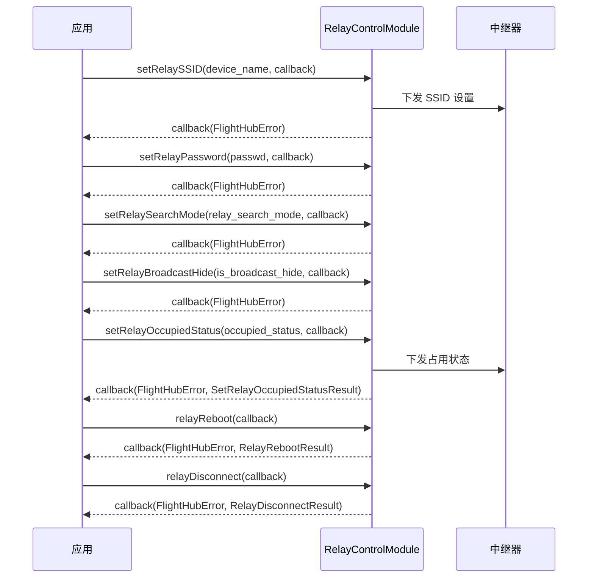

# 中继器控制（RelayControlModule）

## 1 功能概述

### 1.1 功能简介

`RelayControlModule` 是**单设备级**的中继器控制模块，作用域为通过 SN 指定的某一台中继器设备。它面向中继器的运维与网络配置，提供两类能力：**网络参数设置**（SSID、密码、搜索模式、广播隐藏状态、占用状态）与**设备运维动作**（重启、断开连接）。中继器用于在无人机与机场/网关之间中转链路、扩展通信覆盖范围。

本模块只负责中继器自身的控制与配置，不负责其所在设备的资产台账与拓扑关系（请使用 [设备管理](./device-manage.md)），也不负责中继器的 RTK 标定（由同属 `Relay` 设备的 `RtkCalibrationModule` 承接）。本模块所有接口均为一次性下发的控制指令，不提供状态订阅能力。

**获取方式：**

```java
// 前置：已完成 FlightHubSDK.initialize(config)
Relay relay = FlightHubSDK.getRelayInstance("your_relay_sn");
RelayControlModule relayControlModule = relay.getRelayControlModule();
```

### 1.2 核心概念

| 概念 | 说明 |
| --- | --- |
| 中继器（Relay） | 用于中转无人机与机场/网关通信链路、扩展作业半径的设备。通过 `FlightHubSDK.getRelayInstance(sn)` 获取设备实例后，再取 `getRelayControlModule()` 进行控制。 |
| 设备 SN | 中继器序列号，是定位设备的业务主键。获取 `Relay` 实例时传入，模块方法本身不再重复携带 SN。 |
| 广播隐藏（`is_broadcast_hide`） | 是否隐藏中继器 Wi-Fi 广播的 SSID。`true` 表示隐藏广播，`false` 表示对外可见。 |
| 搜索模式（`relay_search_mode`） | 中继器搜索/组网模式，`int` 编码值，取值口径以实际发版说明为准。 |
| 占用状态（`occupied_status`） | 中继器被占用/可抢占状态，`int` 编码值，取值口径以实际发版说明为准。 |
| 业务 ID（`bid`） | 运维类动作（占用状态、重启、断开）回调结果中返回的业务标识，配合 `status` 用于追踪本次指令的受理情况。 |

### 1.3 能力清单

| 能力 | 对应接口 | 接口类型 | 说明 |
| --- | --- | --- | --- |
| 设置广播隐藏状态 | `setRelayBroadcastHide()` | 异步回调 | 设置中继站广播隐藏状态（隐藏 / 显示 SSID 广播） |
| 设置 SSID | `setRelaySSID()` | 异步回调 | 设置中继站 SSID（设备名称） |
| 设置密码 | `setRelayPassword()` | 异步回调 | 设置中继站接入密码 |
| 设置搜索模式 | `setRelaySearchMode()` | 异步回调 | 设置中继站搜索模式（编码值） |
| 设置占用状态 | `setRelayOccupiedStatus()` | 异步回调 | 设置中继站占用状态，回调返回结果对象（`bid` / `status`） |
| 重启 | `relayReboot()` | 异步回调 | 重启中继站，回调返回结果对象（`bid` / `status`） |
| 断开连接 | `relayDisconnect()` | 异步回调 | 断开中继站连接，回调返回结果对象（`bid` / `status`） |

---

## 2 前提条件

- 已完成上云 API 2 底座部署，并获取到服务地址与鉴权 Token。详见 [部署指南](../../../02.deployment/00.index.md)、[鉴权接入指南](../../../08.auth.md)。
- 已完成 SDK 初始化（`JniLibraryLoader.loadLibrary()` → 注入鉴权头 → `FlightHubSDK.initialize(config)`），且 `FlightHubSDK.isInitialized()` 返回 `true`。详见 [SDK初始化](../init/sdk-init.md)。
- 目标中继器已完成上云并绑定至当前工作空间，且能通过其 SN 用 `FlightHubSDK.getRelayInstance(sn)` 获取到有效的 `Relay` 实例。详见 [设备管理](./device-manage.md)。
- 中继器处于在线且可控状态，否则控制指令会在设备层被拒绝或超时。

---

## 3 快速上手

### 3.1 获取模块实例

```java
// 前置：已完成 FlightHubSDK.initialize(config)
Relay relay = FlightHubSDK.getRelayInstance("your_relay_sn");
RelayControlModule relayControlModule = relay.getRelayControlModule();
```

### 3.2 使用流程

1. **初始化 SDK 并获取设备实例** —— `FlightHubSDK.initialize()` → `getRelayInstance(sn)` 拿到目标中继器的 `Relay` 实例。
2. **获取控制模块** —— 调用 `relay.getRelayControlModule()` 获取 `RelayControlModule`。
3. **下发网络配置** —— 按需调用 `setRelaySSID()`、`setRelayPassword()`、`setRelaySearchMode()`、`setRelayBroadcastHide()`，在回调中用 `error.isSuccess()` 判断是否成功。
4. **下发运维动作** —— 需要时调用 `setRelayOccupiedStatus()`、`relayReboot()`、`relayDisconnect()`，在回调中同时读取 `FlightHubError` 与结果对象的 `getBid()` / `getStatus()`。
5. **处理结果** —— 失败时按 `FlightHubError` 分层错误码定位；运维动作用 `bid` / `status` 追踪指令受理情况。

### 3.3 调用时序图



---

## 4 示例代码

### 4.1 完整示例

```java
// 前置：已完成 FlightHubSDK.initialize(config)
Relay relay = FlightHubSDK.getRelayInstance("your_relay_sn");
RelayControlModule relayControlModule = relay.getRelayControlModule();

// ============ 1. 设置广播隐藏状态（false=对外可见广播） ============
relayControlModule.setRelayBroadcastHide(false, new FlightHubCallback.SetRelayBroadcastHideCallback() {
    @Override
    public void onResult(FlightHubError error) {
        // 注意：error 可能为 null，判空后再判 isSuccess()
        boolean ok = error != null && error.isSuccess();
        System.out.println("设置广播隐藏: " + (ok ? "成功" : "失败 " + error));
    }
});

// ============ 2. 设置 SSID（设备名称） ============
relayControlModule.setRelaySSID("Relay_01", new FlightHubCallback.SetRelaySSIDCallback() {
    @Override
    public void onResult(FlightHubError error) {
        boolean ok = error != null && error.isSuccess();
        System.out.println("设置 SSID: " + (ok ? "成功" : "失败 " + error));
    }
});

// ============ 3. 设置接入密码 ============
relayControlModule.setRelayPassword("your_password", new FlightHubCallback.SetRelayPasswordCallback() {
    @Override
    public void onResult(FlightHubError error) {
        boolean ok = error != null && error.isSuccess();
        System.out.println("设置密码: " + (ok ? "成功" : "失败 " + error));
    }
});

// ============ 4. 设置搜索模式（int 编码值，取值以发版说明为准） ============
int relaySearchMode = 1;
relayControlModule.setRelaySearchMode(relaySearchMode, new FlightHubCallback.SetRelaySearchModeCallback() {
    @Override
    public void onResult(FlightHubError error) {
        boolean ok = error != null && error.isSuccess();
        System.out.println("设置搜索模式: " + (ok ? "成功" : "失败 " + error));
    }
});

// ============ 5. 设置占用状态（回调返回 error + result 两个参数） ============
int occupiedStatus = 1;
relayControlModule.setRelayOccupiedStatus(occupiedStatus, new FlightHubCallback.SetRelayOccupiedStatusCallback() {
    @Override
    public void onResult(FlightHubError error, SetRelayOccupiedStatusResult result) {
        if (error != null && !error.isSuccess()) {
            System.err.println("设置占用状态失败: " + error);
            return;
        }
        if (result == null) return;   // 注意：结果对象可能为 null
        System.out.println("设置占用状态成功, bid=" + result.getBid() + ", status=" + result.getStatus());
    }
});

// ============ 6. 中继器重启（回调返回 error + result 两个参数） ============
// 注意：重启会中断经该中继器中转的链路，请在无进行中任务时调用
relayControlModule.relayReboot(new FlightHubCallback.RelayRebootCallback() {
    @Override
    public void onResult(FlightHubError error, RelayRebootResult result) {
        if (error != null && !error.isSuccess()) {
            System.err.println("重启失败: " + error);
            return;
        }
        if (result == null) return;
        System.out.println("重启指令已受理, bid=" + result.getBid() + ", status=" + result.getStatus());
    }
});

// ============ 7. 中继器断开连接（回调返回 error + result 两个参数） ============
relayControlModule.relayDisconnect(new FlightHubCallback.RelayDisconnectCallback() {
    @Override
    public void onResult(FlightHubError error, RelayDisconnectResult result) {
        if (error != null && !error.isSuccess()) {
            System.err.println("断开连接失败: " + error);
            return;
        }
        if (result == null) return;
        System.out.println("断开指令已受理, bid=" + result.getBid() + ", status=" + result.getStatus());
    }
});
```

### 4.2 场景化片段

**中继器入网配置（SSID + 密码 + 搜索模式串行下发）**

```java
// 前置：已获取 relayControlModule；中继器在线可控
// 说明：三项配置相互独立，按业务顺序依次下发，任一步失败均在其回调中处理
relayControlModule.setRelaySSID("Relay_Site_A", ssidError -> {
    if (ssidError == null || !ssidError.isSuccess()) {
        System.err.println("SSID 设置失败，终止后续配置: " + ssidError);
        return;
    }
    relayControlModule.setRelayPassword("your_password", pwdError -> {
        if (pwdError == null || !pwdError.isSuccess()) {
            System.err.println("密码设置失败: " + pwdError);
            return;
        }
        relayControlModule.setRelaySearchMode(1, modeError -> {
            boolean ok = modeError != null && modeError.isSuccess();
            System.out.println("入网配置完成: " + (ok ? "成功" : "搜索模式设置失败 " + modeError));
        });
    });
});
```

---

## 5 相关文档

- [SDK初始化](../init/sdk-init.md) —— 获取 `Relay` 实例前必须完成的初始化步骤
- [SDK配置](../init/sdk-config.md) —— 服务地址、鉴权等配置项，影响接口能否正常下发
- [设备管理](./device-manage.md) —— 查询中继器是否已上云、是否绑定至当前工作空间，控制指令失败时先核对这里
- [使用 API 文档查阅接口详情](../../03.api-docs-guide.md) —— 查阅 `RelayControlModule` 完整方法签名、编码字段取值与结果对象定义
