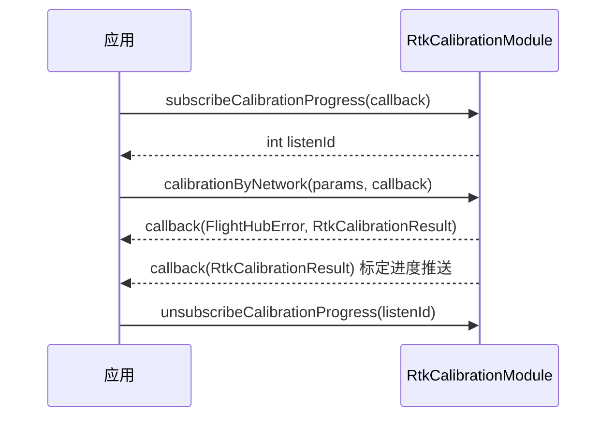

# RTK 标定（RtkCalibrationModule）

## 1 功能概述

### 1.1 功能简介

`RtkCalibrationModule` 是**设备级**的 RTK 标定模块，作用域为一台具体设备（机场 `Dock`、基站 `BaseStation` 或中继 `Relay`）。它提供两种标定方式——**网络模式标定**（`calibrationByNetwork()`，通过 NTRIP 网络 RTK 服务获取差分数据）与**手动模式标定**（`calibrationByManual()`，直接指定标定点的经纬度与高度），并提供**标定进度订阅**（`subscribeCalibrationProgress()` / `unsubscribeCalibrationProgress()`）用于跟踪标定过程。

本模块只负责设备自身定位基准的 RTK 标定，不负责设备的其他调试操作与实时遥测。设备开关舱、格式化、网络诊断等远程调试能力请使用设备远程调试相关模块；设备的实时状态与位置请使用对应的状态监听能力。

**获取方式：**

```java
Dock dock = FlightHubSDK.getDockInstance(sn);
RtkCalibrationModule rtkModule = dock.getRtkCalibrationModule();
```

### 1.2 核心概念

| 概念 | 说明 |
| --- | --- |
| RTK 标定 | Real-Time Kinematic 载波相位差分定位标定。为设备建立准确的定位基准，是设备物理层面的操作，标定结果直接影响飞行与作业的定位精度。 |
| 网络模式标定 | 通过外部 NTRIP 网络 RTK 服务（主机地址、端口、账号、密码、挂载点）获取差分数据完成标定，对应 `calibrationByNetwork()`。 |
| 手动模式标定 | 直接提供已知标定点的经度、纬度、高度完成标定，对应 `calibrationByManual()`。 |
| 承载设备 | 机场（`Dock`）、基站（`BaseStation`）、中继（`Relay`）三类设备均可通过 `getRtkCalibrationModule()` 获取本模块，标定作用于获取模块时指定的那台设备。 |
| 业务标识（`bid`） | 标定结果 `RtkCalibrationResult` 中的业务 ID，用于关联一次标定任务及其进度推送。 |
| 监听 ID（`listenId`） | `subscribeCalibrationProgress()` 返回的整型句柄，取消订阅时必须回传同一个 `listenId`，否则订阅不会被释放。 |

### 1.3 能力清单

| 能力 | 对应接口 | 接口类型 | 说明 |
| --- | --- | --- | --- |
| 网络模式 RTK 标定 | `calibrationByNetwork()` | 异步回调 | 通过 NTRIP 网络 RTK 服务参数完成标定 |
| 手动模式 RTK 标定 | `calibrationByManual()` | 异步回调 | 通过指定经纬度与高度完成标定 |
| 订阅标定进度 | `subscribeCalibrationProgress()` | 事件订阅 | 返回 `listenId`，标定过程中推送进度 |
| 取消订阅标定进度 | `unsubscribeCalibrationProgress()` | 事件订阅 | 用 `listenId` 释放进度订阅 |

---

## 2 前提条件

- 已完成上云 API 2 底座部署，并获取到服务地址与鉴权 Token。详见 [部署指南](../../../02.deployment/00.index.md)、[鉴权接入指南](../../../08.auth.md)。
- 已完成 SDK 初始化且 `FlightHubSDK.isInitialized()` 返回 `true`。详见 [SDK初始化](../init/sdk-init.md)。
- 目标设备（机场 / 基站 / 中继）已完成上云并绑定至当前工作空间且在线，可通过 `FlightHubSDK.getDockInstance(sn)` / `getBaseStationInstance(sn)` / `getRelayInstance(sn)` 获取到设备实例。详见 [设备上云](../../../04.device-onboarding/00.index.md)。
- 使用网络模式标定时，需提前准备好可用的 NTRIP 网络 RTK 服务信息（主机地址、端口、账号、密码、挂载点）。
- 若需接收标定进度推送，SDK 配置中的 WebSocket 通知地址必须正确且连接可用，否则 `subscribeCalibrationProgress()` 能返回 `listenId`，但进度回调不会被触发。详见 [SDK配置](../init/sdk-config.md)。

---

## 3 快速上手

### 3.1 获取模块实例

```java
// 前置：已完成 FlightHubSDK.initialize(config)
// 以机场为例，基站 / 中继同理，分别用 getBaseStationInstance(sn) / getRelayInstance(sn)
Dock dock = FlightHubSDK.getDockInstance(sn);
RtkCalibrationModule rtkModule = dock.getRtkCalibrationModule();
```

### 3.2 使用流程

1. **初始化 SDK 并获取设备实例** —— `FlightHubSDK.initialize()` → `getDockInstance(sn)`（或基站 / 中继）。
2. **获取模块实例** —— 调用设备实例的 `getRtkCalibrationModule()`。
3. **订阅标定进度** —— 调用 `subscribeCalibrationProgress()`，保存返回的 `listenId`，用于跟踪标定过程。
4. **下发标定命令** —— 网络模式调用 `calibrationByNetwork(params, callback)`，手动模式调用 `calibrationByManual(params, callback)`，在 `RtkCalibrationCallback` 中判断命令是否受理。
5. **跟踪标定结果** —— 通过进度订阅回调 `onResult(RtkCalibrationResult result)` 观察标定推进直至完成。
6. **退出时释放订阅** —— 标定完成或页面销毁前，用步骤 3 保存的 `listenId` 调用 `unsubscribeCalibrationProgress(listenId)`。

### 3.3 调用时序图



---

## 4 示例代码

### 4.1 完整示例

```java
// 前置：已完成 FlightHubSDK.initialize(config)
String sn = "your_dock_sn";
Dock dock = FlightHubSDK.getDockInstance(sn);
RtkCalibrationModule rtkModule = dock.getRtkCalibrationModule();

// ============ 1. 订阅标定进度（下发标定命令前先订阅） ============
int listenId = rtkModule.subscribeCalibrationProgress(new FlightHubCallback.SubscribeCalibrationProgressCallback() {
    @Override
    public void onResult(RtkCalibrationResult result) {
        if (result == null) return;
        // 进度推送：message 为进度/结果描述，bid 关联本次标定任务
        System.out.println("标定进度: " + result.getMessage() + " bid=" + result.getBid());
    }
});

// ============ 2. 网络模式标定 ============
NetworkRtkCalibrationParams networkParams = new NetworkRtkCalibrationParams();
networkParams.setHost("xx.xx.xx.xx");                 // NTRIP 服务主机地址
networkParams.setPort(8002);                          // NTRIP 服务端口
networkParams.setAccount(base64("your_rtk_account")); // 注意：账号需 Base64 编码
networkParams.setPassword(base64("your_rtk_password"));// 注意：密码需 Base64 编码
networkParams.setMountPoint("your_mount_point");      // 挂载点
rtkModule.calibrationByNetwork(networkParams, new FlightHubCallback.RtkCalibrationCallback() {
    @Override
    public void onResult(FlightHubError error, RtkCalibrationResult result) {
        // 注意：error 可能为 null，判空后再判 isSuccess()
        if (error != null && !error.isSuccess()) {
            System.err.println("网络模式标定下发失败: " + error);
            return;
        }
        System.out.println("网络模式标定已受理: " + (result == null ? "-" : result.getMessage()));
    }
});

// ============ 3. 手动模式标定 ============
ManulRtkCalibrationParams manualParams = new ManulRtkCalibrationParams();
manualParams.setLongitude(114.358081165);   // 经度
manualParams.setLatitude(22.793250718);     // 纬度
manualParams.setHeight(100);                // 高度，单位：米
rtkModule.calibrationByManual(manualParams, new FlightHubCallback.RtkCalibrationCallback() {
    @Override
    public void onResult(FlightHubError error, RtkCalibrationResult result) {
        if (error != null && !error.isSuccess()) {
            System.err.println("手动模式标定下发失败: " + error);
            return;
        }
        System.out.println("手动模式标定已受理: " + (result == null ? "-" : result.getMessage()));
    }
});

// ============ 4. 标定完成或退出前取消订阅（必须执行，否则订阅泄漏） ============
rtkModule.unsubscribeCalibrationProgress(listenId);
```

### 4.2 场景化片段

**中继设备网络模式标定（需额外设置版本）**

```java
// 前置：中继设备已上云在线
Relay relay = FlightHubSDK.getRelayInstance("your_relay_sn");
RtkCalibrationModule relayRtkModule = relay.getRtkCalibrationModule();

NetworkRtkCalibrationParams relayNetworkParams = new NetworkRtkCalibrationParams();
relayNetworkParams.setHost("xx.xx.xx.xx");
relayNetworkParams.setPort(8002);
relayNetworkParams.setAccount(base64("your_rtk_account"));
relayNetworkParams.setPassword(base64("your_rtk_password"));
relayNetworkParams.setMountPoint("your_mount_point");
relayNetworkParams.setVersion(3);   // 注意：中继设备网络模式标定需设置版本
relayRtkModule.calibrationByNetwork(relayNetworkParams, new FlightHubCallback.RtkCalibrationCallback() {
    @Override
    public void onResult(FlightHubError error, RtkCalibrationResult result) {
        boolean ok = error != null && error.isSuccess();
        System.out.println("中继网络模式标定: " + (ok ? "已受理" : "失败 " + error));
    }
});
```

---

## 5 相关文档

- [SDK初始化](../init/sdk-init.md) —— 获取设备实例前必须完成的初始化步骤
- [SDK配置](../init/sdk-config.md) —— WebSocket 通知地址等配置项，影响标定进度订阅能否收到推送
- [设备上云](../../../04.device-onboarding/00.index.md) —— 设备绑定到工作空间的前置流程，取不到设备实例时首先核对这里
- [使用 API 文档查阅接口详情](../../03.api-docs-guide.md) —— 查阅 `RtkCalibrationModule` 完整方法签名与字段定义
