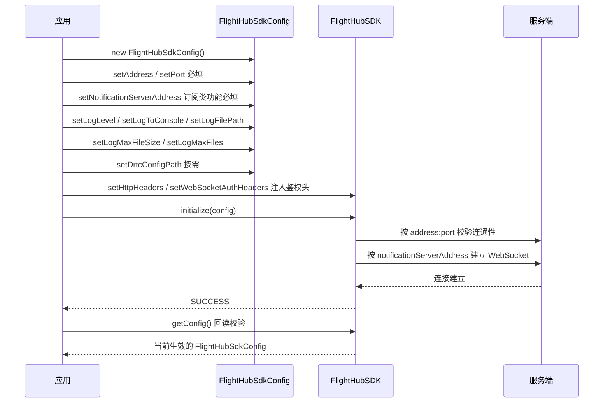

# SDK 配置（FlightHubSdkConfig）

## 1 功能概述

### 1.1 功能简介

`FlightHubSdkConfig` 是 SDK 的**初始化配置对象**，在调用 `FlightHubSDK.initialize(FlightHubSdkConfig)` 时传入，一次性决定 SDK 的三类行为：**连到哪里**（服务地址、端口、消息通知 WebSocket 地址）、**日志怎么记**（级别、终端输出、文件路径与滚动策略）、**可选能力的依赖**（DRTC 配置文件路径）。

它是一个纯数据类（POJO），`new` 出来后用 setter 逐项赋值即可，本身不发起任何网络请求。**配置错误的代价集中在初始化阶段**：地址、端口错会导致初始化失败，通知地址缺失会导致所有订阅类接口注册成功但收不到推送，日志路径不可写会导致初始化直接失败。

本页只讲配置字段本身。鉴权头不属于本配置对象，而是通过 `FlightHubSDK.setHttpHeaders()` 与 `FlightHubSDK.setWebSocketAuthHeaders()` 单独注入；初始化的完整调用顺序见 [SDK初始化](./sdk-init.md)，Token 获取见 [鉴权接入指南](../../../08.auth.md)。

### 1.2 核心概念

| 概念 | 说明 |
| --- | --- |
| 服务地址与端口分离 | `address` 只填协议 + 主机（如 `http://10.0.0.1`），端口由 `port` 单独指定，且 `port` 是 **`String`** 类型 |
| 消息通知地址 | `notificationServerAddress` 是**完整 WebSocket URL**（含协议、主机、端口、路径），不是由 `address` + `port` 拼出来的，必须单独配置 |
| 双通道日志 | 终端输出（`logToConsole`）与文件落盘（`logFilePath`）是两个开关，**可同时开启**，互不排斥 |
| 日志滚动 | `logMaxFileSize`（单文件字节上限）+ `logMaxFiles`（保留文件数上限）共同决定滚动策略；两者为 `0` 或未设置时由 SDK 使用内置默认值 |
| 配置不可热改 | 配置在 `initialize()` 时生效。运行期只有日志级别可通过 `FlightHubSDK.setLogLevel()` 动态调整，其余字段需 `shutdown()` 后重新初始化 |
| 鉴权头独立设置 | 鉴权头不在 `FlightHubSdkConfig` 中，而由 `FlightHubSDK.setHttpHeaders()` / `setWebSocketAuthHeaders()` 传入 `HeaderKeyValue` 列表 |

### 1.3 能力清单

| 能力 | 对应接口 | 接口类型 | 说明 |
| --- | --- | --- | --- |
| 配置服务地址 | `setAddress(String)` / `getAddress()` | 同步返回 | FlightHub 服务地址，含协议 |
| 配置服务端口 | `setPort(String)` / `getPort()` | 同步返回 | 服务端口，字符串类型 |
| 配置消息通知地址 | `setNotificationServerAddress(String)` / `getNotificationServerAddress()` | 同步返回 | 消息通知 WebSocket 完整 URL |
| 配置日志级别 | `setLogLevel(String)` / `getLogLevel()` | 同步返回 | `debug` / `info` / `warn` / `error` |
| 配置终端输出 | `setLogToConsole(boolean)` / `isLogToConsole()` | 同步返回 | 输出到标准输出 / 标准错误 |
| 配置版本信息打印 | `setShowVersionInfo(boolean)` / `isShowVersionInfo()` | 同步返回 | 初始化时打印 SDK 版本与构建信息 |
| 配置日志文件路径 | `setLogFilePath(String)` / `getLogFilePath()` | 同步返回 | 默认 `flight_hub_sdk.log`，可为文件名或目录 |
| 配置日志滚动 | `setLogMaxFileSize(long)` / `getLogMaxFileSize()`、`setLogMaxFiles(int)` / `getLogMaxFiles()` | 同步返回 | 单文件字节上限、保留文件数上限 |
| 配置 DRTC 路径 | `setDrtcConfigPath(String)` / `getDrtcConfigPath()` | 同步返回 | `drtc_config_node.json` 路径，飞机 DRTC 拉流场景必填 |
| 配置对象比较与打印 | `equals()` / `hashCode()` / `toString()` | 同步返回 | 便于配置差异比对与启动日志留痕 |

---

## 2 前提条件

- 已完成上云 API 2 底座部署，并从部署产物中取得 FlightHub 服务地址、端口与消息通知 WebSocket 地址。详见 [部署指南](../../../02.deployment/00.index.md)。
- 已获得 SDK 包并加入工程依赖。详见 软件下载、[准备工作](../../02.preparation.md)。
- 日志落盘目录对运行进程可写（容器场景需已挂载卷或授予写权限）。
- 如需飞机 DRTC 拉流，已准备好 `drtc_config_node.json` 文件。

---

## 3 快速上手

### 3.1 创建配置对象

```java
FlightHubSdkConfig config = new FlightHubSdkConfig();
config.setAddress("http://10.0.0.1");   // 注意：含协议
config.setPort("30812");                // 注意：String 类型
```

### 3.2 使用流程

1. **`new FlightHubSdkConfig()`** —— 无参构造，未显式设置的字段走 SDK 内置默认值。
2. **配置连接信息（必填）** —— `setAddress()`、`setPort()`；使用订阅类功能时还需 `setNotificationServerAddress()`。
3. **配置日志策略（建议）** —— `setLogLevel()`、`setLogToConsole()`、`setLogFilePath()`、`setLogMaxFileSize()`、`setLogMaxFiles()`、`setShowVersionInfo()`。
4. **配置可选依赖（按需）** —— 需要飞机 DRTC 拉流时设置 `setDrtcConfigPath()`。
5. **传入初始化** —— 先注入鉴权头，再 `FlightHubSDK.initialize(config)`，判断返回值是否为 `SUCCESS`。
6. **回读校验（建议）** —— 用 `FlightHubSDK.getConfig()` 打印实际生效的配置，确认与预期一致。

### 3.3 调用时序图



---

## 4 示例代码

### 4.1 完整示例

```java
/**
 * 构建 SDK 配置。生产环境建议把连接信息从环境变量或配置中心读入，不要硬编码。
 */
public static FlightHubSdkConfig buildConfig(String host, String port, String logDir) {
    FlightHubSdkConfig config = new FlightHubSdkConfig();

    // ---- 连接信息（必填） ----
    config.setAddress("http://" + host);   // 注意：必须含协议，且不要把端口写进来
    config.setPort(port);                  // 注意：String 类型，不是 int

    // 消息通知 WebSocket 完整 URL。注意：不会由 address+port 自动推导，必须显式配置；
    // 留空时 SDK 仍能初始化成功、HTTP 接口正常，但所有 listenXxx 都收不到推送。
    config.setNotificationServerAddress(
            "ws://" + host + ":" + port + "/openapi/v0.9/notification/ws/v1/notifications");

    // ---- 日志策略（建议显式配置） ----
    config.setLogLevel("info");                             // debug / info / warn / error
    config.setLogToConsole(true);                           // 容器场景便于 docker logs 查看
    config.setShowVersionInfo(true);                        // 初始化时打印版本与构建信息，排障必备
    config.setLogFilePath(logDir + "/flight_hub_sdk.log");  // 注意：容器内建议用可写绝对路径
    config.setLogMaxFileSize(10L * 1024 * 1024);            // 注意：单位是字节，此处 10MB
    config.setLogMaxFiles(5);                               // 与上一行相乘即日志总量上限（约 50MB）

    // ---- 可选依赖 ----
    // 仅 Linux BUILD_WITH_DRTC_USER 场景需要；为空时飞机 DRTC 拉流 Init 会失败
    // config.setDrtcConfigPath("/app/conf/drtc_config_node.json");

    return config;
}

/** 注入鉴权头、初始化并回读校验实际生效的配置 */
public static boolean initAndVerify(FlightHubSdkConfig config, String token) {
    JniLibraryLoader.loadLibrary();   // 注意：必须在 initialize 之前

    // 鉴权头不在 FlightHubSdkConfig 中，需单独注入；HTTP 与 WebSocket 各设一次
    List<HeaderKeyValue> headers = Arrays.asList(new HeaderKeyValue("Authorization", token));
    FlightHubSDK.setHttpHeaders(headers);
    FlightHubSDK.setWebSocketAuthHeaders(headers);

    FlightHubSdkErrorCode rc = FlightHubSDK.initialize(config);
    if (rc != FlightHubSdkErrorCode.SUCCESS) {
        System.err.println("初始化失败: " + rc);
        // 初始化失败优先怀疑：address 缺协议、port 写错、日志目录不可写
        return false;
    }

    // 回读当前生效配置，确认与预期一致（多环境部署时能快速发现配错环境）
    FlightHubSdkConfig effective = FlightHubSDK.getConfig();
    if (effective != null) {
        System.out.println("生效地址: " + effective.getAddress() + ":" + effective.getPort());
        System.out.println("通知地址: " + effective.getNotificationServerAddress());
        System.out.println("日志: level=" + effective.getLogLevel()
                + " console=" + effective.isLogToConsole()          // 注意：isXxx() 而非 getXxx()
                + " file=" + effective.getLogFilePath()
                + " maxSize=" + effective.getLogMaxFileSize()
                + " maxFiles=" + effective.getLogMaxFiles());
        System.out.println("配置快照: " + effective);                // toString() 已覆写，可直接打印
    }
    return true;
}
```

### 4.2 场景化片段

**从环境变量读取配置，实现多环境切换**

```java
// 前置：部署时通过环境变量注入，代码不区分环境
String host  = System.getenv().getOrDefault("FH_HOST", "127.0.0.1");
String port  = System.getenv().getOrDefault("FH_PORT", "30812");
String wsUrl = System.getenv("FH_WS_URL");   // 建议整条 URL 外置，避免协议/路径拼错

FlightHubSdkConfig config = new FlightHubSdkConfig();
config.setAddress("http://" + host);
config.setPort(port);
if (wsUrl != null && !wsUrl.isEmpty()) {
    config.setNotificationServerAddress(wsUrl);
} else {
    // 兜底拼接，但要注意 TLS 环境应为 wss
    config.setNotificationServerAddress(
            "ws://" + host + ":" + port + "/openapi/v0.9/notification/ws/v1/notifications");
}
```

**切换服务环境（必须先关闭再重新初始化）**

```java
// 前置：配置在 initialize() 时固化，直接改 config 对象不会生效
if (FlightHubSDK.isInitialized()) {
    // 注意：shutdown() 前先取消各模块的所有订阅，之后已持有的模块实例与 listenId 全部失效
    FlightHubSDK.shutdown();
}
FlightHubSdkConfig newConfig = buildConfig("10.0.0.2", "30812", "/app/logs");
FlightHubSdkErrorCode rc = FlightHubSDK.initialize(newConfig);
```

---

## 5 相关文档

- [部署指南](../../../02.deployment/00.index.md) —— 服务地址、端口与消息通知地址的来源
- 软件下载 / [准备工作](../../02.preparation.md) —— 获取 SDK 包并配置工程依赖
- [SDK初始化](./sdk-init.md) —— 本配置的使用方，含完整初始化顺序与错误码语义
- [鉴权接入指南](../../../08.auth.md) —— 鉴权头与本配置分开设置，Token 获取方式见此
- [使用 API 文档查阅接口详情](../../03.api-docs-guide.md) —— 查阅 `FlightHubSdkConfig` 完整字段定义
