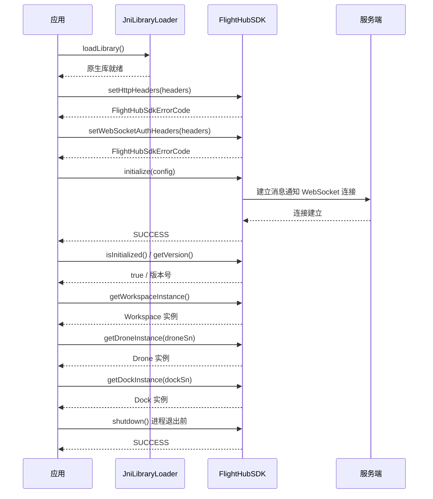

# SDK 初始化（FlightHubSDK）

## 1 功能概述

### 1.1 功能简介

`FlightHubSDK` 是 Flight Hub SDK 的**统一入口门面类**，全部方法均为静态方法，无需实例化。它承担三件事：**SDK 生命周期管理**（初始化、状态查询、关闭）、**全局鉴权头与日志配置注入**、**业务实例工厂**（`Workspace` / `Drone` / `Dock` / `BaseStation` / `Relay` / `Stream`）。

所有功能模块都必须先经由本类拿到对应层级的实例，再从实例上获取模块，例如 `FlightHubSDK.getWorkspaceInstance().getDeviceManageModule()`。**未完成初始化就调用任何模块接口，都会返回 `ERROR_NOT_INITIALIZED`。**

本页只讲初始化流程与入口能力；配置项字段的完整含义与取值建议见 [SDK配置](./sdk-config.md)，鉴权 Token 的获取方式见 [鉴权接入指南](../../../08.auth.md)。

> **说明**
> javadoc 中还存在 `FlightHubSdkManager`，其方法签名与本类几乎一致，但它是 **SDK 内部管理器**，javadoc 已明确标注「仅供 SDK 内部使用：应用侧不应直接依赖本类」。业务代码请统一使用 `FlightHubSDK`。

### 1.2 核心概念

| 概念 | 说明 |
| --- | --- |
| JNI 原生库 | SDK 的核心能力由 C++ 原生库实现，Java 层通过 JNI 调用。必须先执行 `JniLibraryLoader.loadLibrary()` 从 JAR 中提取并加载平台相关的原生库，否则初始化会失败 |
| `FlightHubSdkConfig` | 初始化配置对象，携带服务地址、端口、WebSocket 通知地址、日志级别与落盘策略、DRTC 配置路径。详见 [SDK配置](./sdk-config.md) |
| HTTP 请求头 / WebSocket 鉴权头 | 两套**独立**的头部配置：`setHttpHeaders()` 作用于所有 HTTP 接口，`setWebSocketAuthHeaders()` 作用于消息通知的 WebSocket 连接。二者互不继承，**都要设置** |
| 实例层级 | `Workspace` 是工作空间级全局单例；`Drone` / `Dock` / `BaseStation` / `Relay` 按 SN 获取，是设备级实例；`Stream` 是非设备直播（通用 WHEP 拉流、自定义 SEI）的全局入口 |
| `FlightHubSdkErrorCode` | SDK 层错误码枚举。本页接口**同步返回**该枚举，而各功能模块的异步回调返回的是 `FlightHubError`（其中 `getErrorCode()` 即本枚举） |

### 1.3 能力清单

| 能力 | 对应接口 | 接口类型 | 说明 |
| --- | --- | --- | --- |
| 加载 JNI 原生库 | `JniLibraryLoader.loadLibrary()` | 同步返回 | 初始化前必须执行；`isLibraryLoaded()` 可查询加载状态 |
| 初始化 SDK | `FlightHubSDK.initialize(config)` | 同步返回 | 传入配置初始化；另有无参重载 `initialize()` 使用默认配置 |
| 关闭 SDK | `FlightHubSDK.shutdown()` | 同步返回 | 释放原生资源与网络连接 |
| 查询初始化状态 | `FlightHubSDK.isInitialized()` | 同步返回 | 返回 `boolean` |
| 查询版本与构建信息 | `FlightHubSDK.getVersion()` / `getBuildInfo()` | 同步返回 | 版本号字符串 / 含版本·分支·提交的构建信息 |
| 设置 HTTP 请求头 | `FlightHubSDK.setHttpHeaders(headersKV)` | 同步返回 | 作用于所有 HTTP 接口 |
| 设置 WebSocket 鉴权头 | `FlightHubSDK.setWebSocketAuthHeaders(headersKV)` | 同步返回 | 作用于消息通知连接 |
| 读取已设置的头部 | `FlightHubSDK.getHttpHeaders()` / `getWebSocketAuthHeaders()` | 同步返回 | 返回 `List<HeaderKeyValue>` |
| 动态调整日志级别 | `FlightHubSDK.setLogLevel(level)` | 同步返回 | 取值 `debug` / `info` / `warn` / `error` |
| 读取当前配置 | `FlightHubSDK.getConfig()` | 同步返回 | 返回 `FlightHubSdkConfig` |
| 获取工作空间实例 | `FlightHubSDK.getWorkspaceInstance()` | 同步返回 | 工作空间级模块的唯一入口 |
| 获取飞机实例 | `FlightHubSDK.getDroneInstance(sn)` | 同步返回 | 飞机级模块入口 |
| 获取机场实例 | `FlightHubSDK.getDockInstance(sn)` | 同步返回 | 机场级模块入口 |
| 获取基站实例 | `FlightHubSDK.getBaseStationInstance(sn)` | 同步返回 | 基站级模块入口 |
| 获取中继实例 | `FlightHubSDK.getRelayInstance(sn)` | 同步返回 | 中继级模块入口（中继控制、RTK 标定） |
| 获取遥控器实例 | `FlightHubSDK.getRemoteControllerInstance(sn)` | 同步返回 | **javadoc 标注「暂无功能实现，暂不可用」**，请勿在业务中依赖 |
| 获取流实例 | `FlightHubSDK.getStream()` | 同步返回 | 非设备直播能力入口（WHEP 拉流、自定义 SEI） |

---

## 2 前提条件

- 已完成上云 API 2 底座部署，并能拿到 FlightHub 服务地址、端口与消息通知 WebSocket 地址。详见 [部署指南](../../../02.deployment/00.index.md)。
- 已获取有效的鉴权 Token。详见 [鉴权接入指南](../../../08.auth.md)。
- 已获得 SDK 包并加入工程依赖。详见 软件下载、[准备工作](../../02.preparation.md)。
- 运行环境与 SDK 包内置的原生库平台匹配（`JniLibraryLoader` 按平台从 JAR 中提取原生库）。
- 若需使用飞机 DRTC 拉流（Linux `BUILD_WITH_DRTC_USER` 场景），需提前准备 `drtc_config_node.json` 并通过 `setDrtcConfigPath()` 指定。

---

## 3 快速上手

### 3.1 初始化 SDK

```java
// 一次性完成：加载原生库 -> 注入鉴权头 -> 初始化
JniLibraryLoader.loadLibrary();

FlightHubSdkConfig config = new FlightHubSdkConfig();
config.setAddress("http://10.0.0.1");   // 含协议
config.setPort("30812");                // 注意：String 类型
config.setNotificationServerAddress("ws://10.0.0.1:30812/openapi/v0.9/notification/ws/v1/notifications");

List<HeaderKeyValue> headers = new ArrayList<>();
headers.add(new HeaderKeyValue("X-User-Token", "your_jwt_token"));
FlightHubSDK.setHttpHeaders(headers);
FlightHubSDK.setWebSocketAuthHeaders(headers);   // 注意：与 HTTP 头互不继承，必须分别设置

FlightHubSdkErrorCode rc = FlightHubSDK.initialize(config);
```

### 3.2 使用流程

1. **加载 JNI 原生库** —— `JniLibraryLoader.loadLibrary()`，可用 `isLibraryLoaded()` 校验。
2. **构建配置** —— `new FlightHubSdkConfig()` 并设置服务地址、端口、通知地址与日志策略。
3. **注入鉴权头** —— `setHttpHeaders()` 与 `setWebSocketAuthHeaders()` 各调一次，**必须早于 `initialize()`**。
4. **初始化** —— `initialize(config)`，判断返回值是否为 `SUCCESS`；非 `SUCCESS` 应终止启动流程并输出错误码。
5. **自检与留痕** —— `isInitialized()` 确认状态，打印 `getVersion()` / `getBuildInfo()` 便于日后排障。
6. **获取业务实例** —— `getWorkspaceInstance()` 取工作空间级模块，`getDroneInstance(sn)` / `getDockInstance(sn)` 取设备级模块。
7. **退出前清理** —— 先取消所有模块的订阅（各模块的 `cancelListenXxx(listenId)`），再调用 `shutdown()`。

### 3.3 调用时序图



---

## 4 示例代码

### 4.1 完整示例

```java
public class FlightHubBootstrap {

    /** 应用启动时调用一次；返回 false 表示初始化失败，应终止启动流程 */
    public static boolean init(String host, String port, String token) {
        // ---- 1. 加载 JNI 原生库（必须在 initialize 之前，且只需一次） ----
        if (!JniLibraryLoader.isLibraryLoaded()) {
            JniLibraryLoader.loadLibrary();
        }

        // ---- 2. 构建 SDK 配置 ----
        FlightHubSdkConfig config = new FlightHubSdkConfig();
        config.setAddress("http://" + host);            // 注意：地址需含协议
        config.setPort(port);                           // 注意：String 类型，不是 int
        config.setNotificationServerAddress(
                "ws://" + host + ":" + port + "/openapi/v0.9/notification/ws/v1/notifications");
        config.setLogLevel("info");
        config.setLogToConsole(true);                   // 容器环境便于 docker logs 查看
        config.setLogFilePath("/app/logs/flight_hub_sdk.log");  // 注意：容器内需为可写绝对路径
        config.setLogMaxFileSize(10L * 1024 * 1024);    // 注意：单位是字节，此处为 10MB
        config.setLogMaxFiles(5);
        config.setShowVersionInfo(true);

        // ---- 3. 注入鉴权头（必须在 initialize 之前） ----
        List<HeaderKeyValue> headers = new ArrayList<>();
        headers.add(new HeaderKeyValue("X-User-Token", token));
        FlightHubSDK.setHttpHeaders(headers);            // 作用于所有 HTTP 接口
        FlightHubSDK.setWebSocketAuthHeaders(headers);   // 注意：WS 头不继承 HTTP 头，必须单独设置

        // ---- 4. 初始化并校验结果 ----
        FlightHubSdkErrorCode rc = FlightHubSDK.initialize(config);
        if (rc != FlightHubSdkErrorCode.SUCCESS) {
            // ERROR_ALREADY_INITIALIZED 说明重复初始化，视为已就绪
            if (rc == FlightHubSdkErrorCode.ERROR_ALREADY_INITIALIZED) {
                System.out.println("SDK 已初始化，跳过");
                return true;
            }
            System.err.println("SDK 初始化失败: " + rc + " (code=" + rc.getValue() + ")");
            return false;
        }

        // ---- 5. 自检与留痕：排障时这两行信息价值最高 ----
        System.out.println("SDK 已初始化: " + FlightHubSDK.isInitialized());
        System.out.println("SDK 版本: " + FlightHubSDK.getVersion());
        System.out.println("构建信息: " + FlightHubSDK.getBuildInfo());
        return true;
    }

    /** 获取各层级业务实例 */
    public static void useInstances(String droneSn, String dockSn) {
        // 工作空间级：设备管理、航线、任务、媒体、安全服务等
        Workspace workspace = FlightHubSDK.getWorkspaceInstance();
        DeviceManageModule deviceManageModule = workspace.getDeviceManageModule();

        // 飞机级：OSD、控制权、飞控、相机、DRC 等
        Drone drone = FlightHubSDK.getDroneInstance(droneSn);
        DroneOsdModule droneOsdModule = drone.getDroneOsdModule();

        // 机场级：环控、机场 OSD、网络测速、RTK 标定等
        Dock dock = FlightHubSDK.getDockInstance(dockSn);
        DockControlModule dockControlModule = dock.getDockControlModule();

        // 非设备直播能力：WHEP 拉流、自定义 SEI
        Stream stream = FlightHubSDK.getStream();
        CustomSEIModule customSEIModule = stream.getCustomSEIModule();
    }

    /** 进程退出前调用；调用前请先取消所有模块的订阅 */
    public static void destroy() {
        if (!FlightHubSDK.isInitialized()) return;
        FlightHubSdkErrorCode rc = FlightHubSDK.shutdown();
        System.out.println("SDK 关闭: " + rc);
        // 注意：shutdown() 之后所有已持有的模块实例与 listenId 均失效，不可再复用
    }
}
```

### 4.2 场景化片段

**鉴权 Token 轮换（无需重启进程）**

```java
// 前置：SDK 已初始化，业务侧检测到 Token 即将过期或已收到 401
public static void refreshToken(String newToken) {
    List<HeaderKeyValue> headers = new ArrayList<>();
    headers.add(new HeaderKeyValue("X-User-Token", newToken));

    // 两套头部都要刷新，否则 HTTP 恢复正常但推送仍然中断（或反之）
    FlightHubSdkErrorCode httpRc = FlightHubSDK.setHttpHeaders(headers);
    FlightHubSdkErrorCode wsRc   = FlightHubSDK.setWebSocketAuthHeaders(headers);
    System.out.println("Token 刷新: http=" + httpRc + " ws=" + wsRc);

    // 可回读校验实际生效的头部
    for (HeaderKeyValue kv : FlightHubSDK.getHttpHeaders()) {
        System.out.println("HTTP header: " + kv.getKey() + " = " + kv.getValue());
    }
}
```

**线上临时提升日志级别定位问题**

```java
// 前置：SDK 已初始化。复现问题前提级，复现后立即降回，避免日志暴涨
FlightHubSDK.setLogLevel("debug");
// ... 触发问题复现 ...
FlightHubSDK.setLogLevel("info");
```

---

## 5 相关文档

- [部署指南](../../../02.deployment/00.index.md) —— 获取本页所需的服务地址、端口与通知地址
- [鉴权接入指南](../../../08.auth.md) —— 鉴权 Token 的获取方式与头部键名，注入鉴权头前必读
- 软件下载 / [准备工作](../../02.preparation.md) —— 获取 SDK 包并配置工程依赖
- [SDK配置](./sdk-config.md) —— `FlightHubSdkConfig` 全部字段的含义与取值建议
- 使用流程 —— 从初始化到业务调用的整体串联
- 接口调用时序图 —— 各类能力的通用调用时序
- 使用上云 API 2 设备模拟器 —— 无真机时验证初始化与业务链路
- [使用 API 文档查阅接口详情](../../03.api-docs-guide.md) —— 查阅 `FlightHubSDK`、`FlightHubSdkErrorCode` 完整定义
