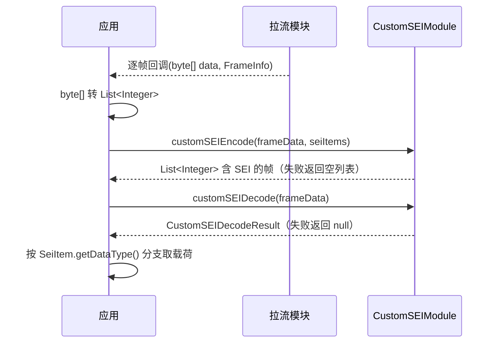

# 自定义 SEI（CustomSEIModule）

## 1 功能概述

### 1.1 功能简介

`CustomSEIModule` 是**流处理级**的自定义 SEI（Supplemental Enhancement Information，补充增强信息）编解码模块。它解决的是「在 H.264 视频帧里塞入自定义元信息、以及从帧里把它取回来」这一件事：把自定义 SEI 数据项编码进 H.264 帧、从含 SEI 的 H.264 帧解码出自定义数据项与头部信息。两个方法都是**本地同步调用**，不涉及网络请求。

本模块只做**帧级 SEI 的编解码**，不负责拉流取帧本身。待编码/解码的 H.264 帧数据来自逐帧回调：SDK 内拉流见 [直播视频流](./live-stream.md)，通用 WHEP 拉流见 [WHEP 自定义拉流](./whep-pull-stream.md)。

**获取方式：**

```java
// 通过 FlightHubSDK.getStream() 获取 Stream，再取本模块
Stream stream = FlightHubSDK.getStream();
CustomSEIModule customSEIModule = stream.getCustomSEIModule();
```

### 1.2 核心概念

| 概念 | 说明 |
| --- | --- |
| SEI 数据项（`SeiItem`） | 联合体风格的数据项，通过 `getDataType()` 区分实际类型。推荐用静态工厂创建：`ofCustomData()`、`ofDetectionBox()`、`ofDetectionPolygon()`、`ofTextOverlay()`。 |
| 数据类型（`SeiDataType`） | 枚举：`CUSTOM_DATA` 自定义透传字节、`DETECTION_BOX` 目标检测框、`DETECTION_POLYGON` 多边形检测区域、`TEXT_OVERLAY` 文本叠加、`UNKNOWN` 未知。 |
| 帧数据（`List<Integer>`） | 编解码方法的帧入参与编码返回值均为 `List<Integer>`（H.264 字节序列，每元素为一个字节值）。拉流回调给出的是 `byte[]`，使用前需转换。 |
| 编码（`customSEIEncode`） | 把 `List<SeiItem>` 编码进原始 H.264 帧，返回含 SEI 的新帧；**失败时返回空列表**。 |
| 解码（`customSEIDecode`） | 从含 SEI 的 H.264 帧解出 `CustomSEIDecodeResult`（SEI 头部 `SeiHeader` + 数据项列表 `List<SeiItem>`）；**失败时返回 `null`**。 |
| SEI 头部（`SeiHeader`） | 含协议版本 `version`、保留字段 `reserved`、数据大小 `dataSize`（编码时自动计算）、时间戳 `timestamp`（毫秒）。 |

### 1.3 能力清单

| 能力 | 对应接口 | 接口类型 | 说明 |
| --- | --- | --- | --- |
| 编码自定义 SEI 到帧 | `customSEIEncode(frameData, customSeiData)` | 同步返回 | 入参原始帧 `List<Integer>` + `List<SeiItem>`，返回含 SEI 的帧 `List<Integer>`，失败返回空列表 |
| 从帧解码自定义 SEI | `customSEIDecode(frameData)` | 同步返回 | 入参含 SEI 的帧 `List<Integer>`，返回 `CustomSEIModule.CustomSEIDecodeResult`，失败返回 `null` |

**SEI 数据项类型（`SeiItem` 的四种载荷）：**

| 类型 | 载荷结构 | 关键字段 |
| --- | --- | --- |
| `CUSTOM_DATA` | `SeiData` | `data`：自定义字节数据（`List<Integer>`） |
| `DETECTION_BOX` | `SeiDetectionBox` | `id` / `type` / `state`；`x` / `y` / `width` / `height`（像素）；`confidence`（0-100） |
| `DETECTION_POLYGON` | `SeiDetectionPolygon` | `id` / `type` / `state` / `confidence`（0-100）；`points`（`SeiPoint2D` 顶点列表，`x` / `y` 像素） |
| `TEXT_OVERLAY` | `SeiTextOverlay` | `id`；`x` / `y`（像素）；`fontSize`；`colorR` / `colorG` / `colorB`（0-255）；`alpha`（0-255，255 不透明）；`text` |

---

## 2 前提条件

- 已完成上云 API 2 底座部署，并获取到服务地址与鉴权 Token。详见 [部署指南](../../../02.deployment/00.index.md)、[鉴权接入指南](../../../08.auth.md)。
- 已完成 SDK 初始化且 `FlightHubSDK.isInitialized()` 返回 `true`。详见 [SDK初始化](../init/sdk-init.md)。
- 已通过 `FlightHubSDK.getStream()` 获取 `Stream` 实例，并调用其 `getCustomSEIModule()` 拿到本模块实例。
- 已具备待处理的 H.264 帧数据：编码场景需原始帧，解码场景需含 SEI 的帧；帧数据来自 [直播视频流](./live-stream.md) 或 [WHEP 自定义拉流](./whep-pull-stream.md) 的逐帧回调（`byte[]`，使用前转为 `List<Integer>`）。
- 编解码为本地同步操作，无网络依赖，但需注意帧回调频率高，编解码应放在合适的线程避免阻塞取帧。

---

## 3 快速上手

### 3.1 获取模块实例

```java
// 前置：已完成 FlightHubSDK.initialize(config)
Stream stream = FlightHubSDK.getStream();
CustomSEIModule module = stream.getCustomSEIModule();
```

### 3.2 使用流程

1. **获取模块实例** —— `FlightHubSDK.getStream().getCustomSEIModule()`。
2. **取帧** —— 从 [直播视频流](./live-stream.md) 或 [WHEP 自定义拉流](./whep-pull-stream.md) 的逐帧回调拿到 `byte[]`，转为 `List<Integer>`。
3. **编码** —— 用静态工厂构造 `List<SeiItem>`，调用 `customSEIEncode(frameData, seiItems)`，对返回的空列表做失败处理。
4. **解码** —— 对含 SEI 的帧调用 `customSEIDecode(frameData)`，对返回 `null` 做失败处理。
5. **消费结果** —— 从 `CustomSEIDecodeResult` 读取头部与 `List<SeiItem>`，按 `getDataType()` 分支取对应载荷。

### 3.3 调用时序图



---

## 4 示例代码

### 4.1 完整示例

```java
/**
 * 自定义 SEI 编解码：构造 SEI 数据项 -> 编码进帧 -> 从帧解码回来。
 * 注意：帧数据为 List<Integer>（H.264 字节序列），编码失败返回空列表，解码失败返回 null。
 */
public class CustomSeiCodec {

    private final CustomSEIModule module = FlightHubSDK.getStream().getCustomSEIModule();

    // ============ 1. 编码：把检测框 + 文本叠加编码进一帧 ============
    public List<Integer> encode(byte[] rawFrame) {
        List<Integer> frameData = toIntList(rawFrame);

        // 目标检测框（坐标/尺寸为像素，confidence 0-100）
        SeiDetectionBox box = new SeiDetectionBox();
        box.setId(1);
        box.setType(0);
        box.setState(0);
        box.setX(100);
        box.setY(80);
        box.setWidth(200);
        box.setHeight(150);
        box.setConfidence(95);

        // 文本叠加（颜色分量 0-255，alpha 255 为不透明）
        SeiTextOverlay text = new SeiTextOverlay();
        text.setId(1);
        text.setX(100);
        text.setY(60);
        text.setFontSize(24);
        text.setColorR(255);
        text.setColorG(0);
        text.setColorB(0);
        text.setAlpha(255);
        text.setText("目标A");

        // 注意：推荐用静态工厂创建 SeiItem，工厂已设置正确的 dataType
        List<SeiItem> seiItems = java.util.Arrays.asList(
                SeiItem.ofDetectionBox(box),
                SeiItem.ofTextOverlay(text));

        List<Integer> encoded = module.customSEIEncode(frameData, seiItems);
        // 注意：编码失败时返回空列表（不是 null），需判断 isEmpty
        if (encoded == null || encoded.isEmpty()) {
            System.err.println("SEI 编码失败");
            return java.util.Collections.emptyList();
        }
        System.out.println("SEI 编码成功，帧长度=" + encoded.size());
        return encoded;
    }

    // ============ 2. 解码：从含 SEI 的帧取回数据项 ============
    public void decode(byte[] frameWithSei) {
        List<Integer> frameData = toIntList(frameWithSei);

        CustomSEIModule.CustomSEIDecodeResult result = module.customSEIDecode(frameData);
        // 注意：解码失败时返回 null，需判空
        if (result == null) {
            System.err.println("SEI 解码失败或该帧无自定义 SEI");
            return;
        }

        SeiHeader header = result.getHeader();
        if (header != null) {
            System.out.println("SEI 头部: 版本=" + header.getVersion()
                    + " 数据大小=" + header.getDataSize()
                    + " 时间戳(ms)=" + header.getTimestamp());
        }

        if (result.getSeiData() == null) return;
        for (SeiItem item : result.getSeiData()) {
            // 按数据类型分支读取对应载荷
            switch (item.getDataType()) {
                case CUSTOM_DATA:
                    SeiData custom = item.getCustomData();
                    if (custom != null) {
                        System.out.println("自定义数据字节数=" + custom.getData().size());
                    }
                    break;
                case DETECTION_BOX:
                    SeiDetectionBox b = item.getDetectionBox();
                    if (b != null) {
                        System.out.println("检测框 id=" + b.getId()
                                + " 位置=(" + b.getX() + "," + b.getY() + ")"
                                + " 尺寸=" + b.getWidth() + "x" + b.getHeight()
                                + " 置信度=" + b.getConfidence());
                    }
                    break;
                case DETECTION_POLYGON:
                    SeiDetectionPolygon poly = item.getDetectionPolygon();
                    if (poly != null && poly.getPoints() != null) {
                        System.out.println("多边形 id=" + poly.getId()
                                + " 顶点数=" + poly.getPoints().size()
                                + " 置信度=" + poly.getConfidence());
                    }
                    break;
                case TEXT_OVERLAY:
                    SeiTextOverlay t = item.getTextOverlay();
                    if (t != null) {
                        System.out.println("文本叠加 id=" + t.getId()
                                + " 内容=" + t.getText()
                                + " 位置=(" + t.getX() + "," + t.getY() + ")");
                    }
                    break;
                case UNKNOWN:
                default:
                    System.out.println("未知 SEI 数据类型");
                    break;
            }
        }
    }

    /** byte[] 转 List<Integer>：编解码方法的帧入参为 List<Integer> */
    private static List<Integer> toIntList(byte[] bytes) {
        List<Integer> list = new java.util.ArrayList<>(bytes.length);
        for (byte b : bytes) {
            list.add((int) b & 0xFF);   // 注意：转为无符号字节值
        }
        return list;
    }
}
```

### 4.2 场景化片段

**编码自定义透传字节（`CUSTOM_DATA`）**

```java
// 前置：已获取 CustomSEIModule，frameData 为 List<Integer> 帧数据
SeiData custom = new SeiData();
custom.setData(java.util.Arrays.asList(0x01, 0x02, 0x03));   // 自定义字节数据

List<Integer> encoded = FlightHubSDK.getStream().getCustomSEIModule()
        .customSEIEncode(frameData, java.util.Collections.singletonList(SeiItem.ofCustomData(custom)));
if (encoded.isEmpty()) {
    System.err.println("编码失败");   // 注意：失败返回空列表
}
```

---

## 5 相关文档

- [SDK初始化](../init/sdk-init.md) —— 获取 `Stream` 实例与调用本模块前必须完成的初始化步骤
- [直播视频流](./live-stream.md) —— 待编解码 H.264 帧数据的来源之一（SDK 内拉流）
- [WHEP 自定义拉流](./whep-pull-stream.md) —— 待编解码 H.264 帧数据的来源之一（通用 WHEP 拉流）
- [直播设备管理](./live-device.md) —— 发现可用直播源
- [部署指南](../../../02.deployment/00.index.md) —— 上云 API 2 底座部署与服务地址获取
- [鉴权接入指南](../../../08.auth.md) —— 获取鉴权 Token 的接入流程
- [使用 API 文档查阅接口详情](../../03.api-docs-guide.md) —— 查阅 `CustomSEIModule` 完整方法签名与字段定义
