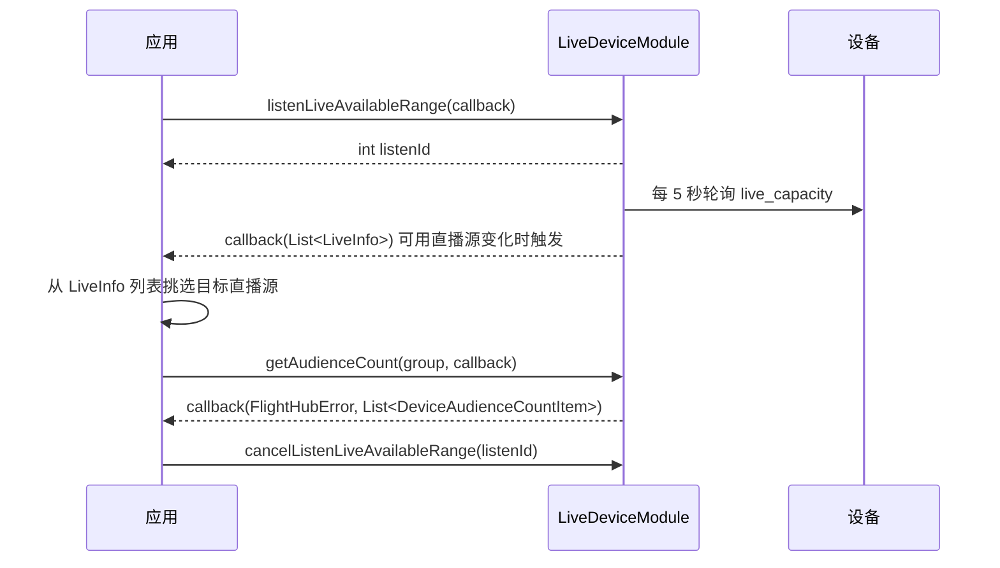

# 直播设备管理（LiveDeviceModule）

## 1 功能概述

### 1.1 功能简介

`LiveDeviceModule` 是**设备级**的直播设备管理模块，作用域为一台具体设备（飞机 / 机场 / 基站）。它解决的是「开播之前先搞清楚这台设备能播什么、有谁在看」这一件事：监听设备的可用直播源（`LiveInfo` 列表）、查询在线观众数量，以及订阅机场的直播状态（`live_status`）与直播能力（`live_capacity`）推送。

本模块只做**直播源的发现与状态查询**，本身不拉流。它产出的 `LiveInfo` 是拉流的入参：拿到某路可用直播源后，用 [直播视频流](./live-stream.md) 的 `getLiveStream(LiveInfo)` 拉流。

**获取方式：**

```java
// 飞机、机场、基站均可获取本模块
Drone drone = FlightHubSDK.getDroneInstance("your_device_sn");
LiveDeviceModule liveDeviceModule = drone.getLiveDeviceModule();
```

### 1.2 核心概念

| 概念 | 说明 |
| --- | --- |
| 可用直播源（`LiveInfo`） | 一路可播放的直播画面，含设备序列号 `deviceSn`、负载/摄像头索引 `payloadIndex`、视频流索引 `videoId`、可切换镜头类型列表 `switchableLensTypeSwigValues`。它是拉流的入参。 |
| 直播能力（`live_capacity`） | 设备当前能开出多少路直播、最大并存路数、各摄像头能力。SDK 每 5 秒轮询设备 topo/properties 解析得到，**非 WebSocket 实时推送，也不反映已开播流的状态**。 |
| 直播状态（`live_status`） | 机场侧各路直播画面的实时状态，含画面 ID、类型、画质、状态与错误状态。 |
| 在线观众数量 | 某台设备当前的观看人数，可按流分组（`AudienceCountGroup` 的一级/二级分组）筛选，不筛选时传 `null`。 |
| 监听 ID（`listenId`） | 三个 `listen*` 方法返回的整型句柄，取消订阅时必须回传同一个值。 |

### 1.3 能力清单

| 能力 | 对应接口 | 接口类型 | 说明 |
| --- | --- | --- | --- |
| 监听可用直播源 | `listenLiveAvailableRange(cb)` / `cancelListenLiveAvailableRange(listenId)` | 事件订阅 | 每 5 秒轮询设备直播能力，解析为 `LiveInfo` 列表；注册时若有缓存立即回调一次；事件回调仅返回 `List<LiveInfo>` |
| 查询在线观众数量 | `getAudienceCount(group, cb)` | 异步回调 | `group` 可选（传 `null` 不按分组筛选），回调返回 `List<DeviceAudienceCountItem>` |
| 订阅机场直播状态 | `listenDockLiveStatus(cb)` / `cancelListenDockLiveStatus(listenId)` | 事件订阅 | 订阅 `live_status`，事件回调仅返回 `DockLiveStatus` |
| 订阅机场直播能力 | `listenDockLiveCapacity(cb)` / `cancelListenDockLiveCapacity(listenId)` | 事件订阅 | 订阅 `live_capacity`，事件回调仅返回 `DockLiveCapacity` |

---

## 2 前提条件

- 已完成上云 API 2 底座部署，并获取到服务地址与鉴权 Token。详见 [部署指南](../../../02.deployment/00.index.md)、[鉴权接入指南](../../../08.auth.md)。
- 已完成 SDK 初始化且 `FlightHubSDK.isInitialized()` 返回 `true`。详见 [SDK初始化](../init/sdk-init.md)。
- 已通过 `FlightHubSDK.getDroneInstance(sn)`（或 `getDockInstance` / `getBaseStationInstance`）获取目标设备实例，并调用其 `getLiveDeviceModule()` 拿到本模块实例。
- 目标设备已完成上云、已绑定至当前工作空间且在线，否则无法上报直播能力。详见 [设备上云](../../../04.device-onboarding/00.index.md)。
- 若需使用 `listenDockLiveStatus()` / `listenDockLiveCapacity()` 订阅机场推送，SDK 配置中的 `notificationServerAddress` 必须正确且连接可用，否则接口能返回 `listenId`，但事件回调不会被触发。详见 [SDK配置](../init/sdk-config.md)。

---

## 3 快速上手

### 3.1 获取模块实例

```java
// 前置：已完成 FlightHubSDK.initialize(config)
Drone drone = FlightHubSDK.getDroneInstance("your_device_sn");
LiveDeviceModule module = drone.getLiveDeviceModule();
```

### 3.2 使用流程

1. **获取模块实例** —— 从设备实例调用 `getLiveDeviceModule()`。
2. **监听可用直播源** —— 调用 `listenLiveAvailableRange()` 并保存 `listenId`，从回调的 `LiveInfo` 列表中挑选要播的那一路。
3. **发起拉流** —— 用选中的 `LiveInfo` 交给 [直播视频流](./live-stream.md) 拉流。
4. **（可选）查观众数** —— 调用 `getAudienceCount()` 查询当前在线观看人数。
5. **（可选）订阅机场状态/能力** —— 机场场景下用 `listenDockLiveStatus()` / `listenDockLiveCapacity()` 实时刷新面板。
6. **退出时取消订阅** —— 用保存的各 `listenId` 调用对应的 `cancelListen*()`。

### 3.3 调用时序图



---

## 4 示例代码

### 4.1 完整示例

```java
/**
 * 直播设备管理：监听可用直播源 -> 查询观众数 -> 退订。
 * 拿到的 LiveInfo 交给 LiveModule 用于拉流。
 */
public class LiveDeviceExplorer {

    private int rangeListenId = -1;
    private final String deviceSn;

    public LiveDeviceExplorer(String deviceSn) {
        this.deviceSn = deviceSn;
    }

    // ============ 1. 监听可用直播源（事件回调仅返回列表，无 error 参数） ============
    public void start() {
        LiveDeviceModule module =
                FlightHubSDK.getDroneInstance(deviceSn).getLiveDeviceModule();

        rangeListenId = module.listenLiveAvailableRange(new FlightHubCallback.LiveAvailableRangeCallback() {
            @Override
            public void onResult(List<LiveInfo> liveInfos) {
                if (liveInfos == null) return;   // 注意：订阅回调无 error 参数，需判空
                System.out.println("可用直播源数量: " + liveInfos.size());
                for (LiveInfo info : liveInfos) {
                    System.out.println("  sn=" + info.getDeviceSn()
                            + " payloadIndex=" + info.getPayloadIndex()
                            + " videoId=" + info.getVideoId()
                            + " 可切换镜头=" + info.getSwitchableLensTypeSwigValues());
                    // 注意：此处拿到的 LiveInfo 即为 getLiveStream(LiveInfo) 的入参
                }
                // 有可用直播源后查询观众数
                queryAudience();
            }
        });
    }

    // ============ 2. 查询在线观众数量（group 传 null 表示不按分组筛选） ============
    public void queryAudience() {
        FlightHubSDK.getDroneInstance(deviceSn).getLiveDeviceModule()
                .getAudienceCount(null, new FlightHubCallback.GetAudienceCountCallback() {
                    @Override
                    public void onResult(FlightHubError error, List<DeviceAudienceCountItem> items) {
                        if (error != null && !error.isSuccess()) {
                            System.err.println("查询观众数失败: " + error);
                            return;
                        }
                        if (items == null) return;
                        for (DeviceAudienceCountItem item : items) {
                            System.out.println("设备 " + item.getSn() + " 在线观众=" + item.getCount());
                        }
                    }
                });
    }

    // ============ 3. 退出前取消订阅（必须执行，否则订阅泄漏） ============
    public void stop() {
        if (rangeListenId != -1) {
            FlightHubSDK.getDroneInstance(deviceSn).getLiveDeviceModule()
                    .cancelListenLiveAvailableRange(rangeListenId);
            rangeListenId = -1;
        }
    }
}
```

### 4.2 场景化片段

**机场场景：订阅直播状态与直播能力**

```java
// 前置：SDK 已初始化，notificationServerAddress 配置正确
LiveDeviceModule module = FlightHubSDK.getDockInstance(dockSn).getLiveDeviceModule();

int statusListenId = module.listenDockLiveStatus(new FlightHubCallback.DockLiveStatusCallback() {
    @Override
    public void onResult(DockLiveStatus dockLiveStatus) {
        if (dockLiveStatus == null || dockLiveStatus.getLiveStatus() == null) return;
        for (LiveStatusItem item : dockLiveStatus.getLiveStatus()) {
            System.out.println("画面 videoId=" + item.getVideoId()
                    + " 类型=" + item.getVideoType()
                    + " 画质=" + item.getVideoQuality()
                    + " 状态=" + item.getStatus()
                    + " 错误状态=" + item.getErrorStatus());
        }
    }
});

int capacityListenId = module.listenDockLiveCapacity(new FlightHubCallback.DockLiveCapacityCallback() {
    @Override
    public void onResult(DockLiveCapacity dockLiveCapacity) {
        if (dockLiveCapacity == null) return;
        System.out.println("可用直播路数=" + dockLiveCapacity.getAvailableVideoNumber()
                + " 最大并存路数=" + dockLiveCapacity.getCoexistVideoNumberMax());
        if (dockLiveCapacity.getDeviceList() != null) {
            for (LiveCapacityDevice dev : dockLiveCapacity.getDeviceList()) {
                System.out.println("  设备 " + dev.getSn()
                        + " 可用=" + dev.getAvailableVideoNumber()
                        + " 最大并存=" + dev.getCoexistVideoNumberMax());
            }
        }
    }
});

// 退出前分别取消订阅
module.cancelListenDockLiveStatus(statusListenId);
module.cancelListenDockLiveCapacity(capacityListenId);
```

---

## 5 相关文档

- [SDK初始化](../init/sdk-init.md) —— 获取设备实例与调用本模块前必须完成的初始化步骤
- [SDK配置](../init/sdk-config.md) —— WebSocket 通知地址等配置项，影响机场状态/能力订阅能否收到推送
- [直播视频流](./live-stream.md) —— 用本模块产出的 `LiveInfo` 拉流播放
- [直播同步](./live-sync.md) —— 把直播流转发至第三方平台（RTMP / GB28181 / RTSP）
- [设备上云](../../../04.device-onboarding/00.index.md) —— 设备绑定到工作空间的前置流程
- [部署指南](../../../02.deployment/00.index.md) —— 上云 API 2 底座部署与服务地址获取
- [鉴权接入指南](../../../08.auth.md) —— 获取鉴权 Token 的接入流程
- [使用 API 文档查阅接口详情](../../03.api-docs-guide.md) —— 查阅 `LiveDeviceModule` 完整方法签名与字段定义
