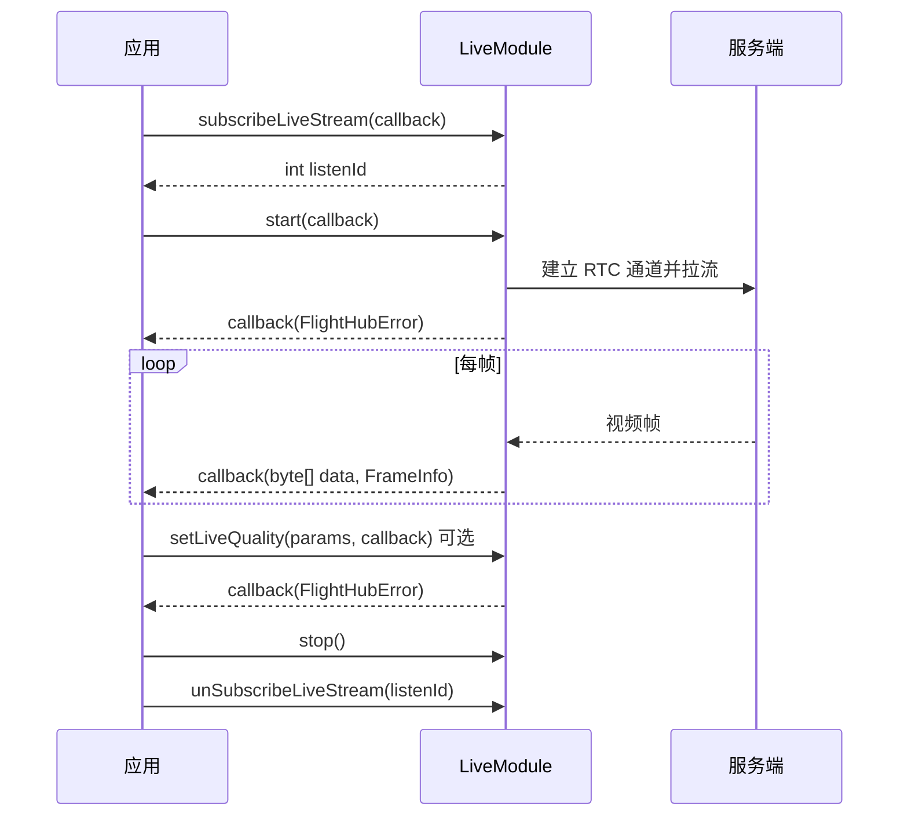

# 直播视频流（LiveModule）

## 1 功能概述

### 1.1 功能简介

`LiveModule` 是**单路直播源级**的视频流拉流模块，作用域为一路具体的直播画面（由 `LiveInfo` 指定）。它解决的是「把设备的某一路直播画面播放出来」这一件事：发起拉流、订阅逐帧视频数据、设置画质，以及订阅这路画面附带的各类 SEI 元信息（AI 检测框、AR 相机姿态、FOV 画幅焦距、智能辅助朝向、EIS 电子防抖裁剪区）。

本模块负责**拉流与逐帧数据消费**，不负责发现可播的直播源。可用直播源（`LiveInfo`）来自 [直播设备管理](./live-device.md)；对逐帧数据做自定义 SEI 编解码见 [自定义 SEI](./custom-sei.md)。

**获取方式：**

```java
// liveInfo 来自 LiveDeviceModule.listenLiveAvailableRange 的回调，代表要播放的那一路直播源
Drone drone = FlightHubSDK.getDroneInstance("your_device_sn");
LiveModule liveModule = drone.getLiveStream(liveInfo);
```

### 1.2 核心概念

| 概念 | 说明 |
| --- | --- |
| 直播源入参（`LiveInfo`） | 获取本模块时必须传入的那一路直播源，来自 [直播设备管理](./live-device.md) 的 `listenLiveAvailableRange()`。一路 `LiveInfo` 对应一个 `LiveModule`。 |
| 自动拉流 vs 仅取地址 | `start()` 建立 RTC 通道并自动拉流；`startWithURL()` 只调用后端接口拿到拉流地址（`LiveStreamStartResult`），不建立通道、不自动拉流，由使用方自行用返回的 `url` 做 WHEP/RTC 播放。 |
| 拉流地址信息（`LiveStreamStartResult`） | `startWithURL()` 返回，含拉流地址 `url`、提供方类型 `urlType`（`agora`/`drtc`/`volc`）、推流端标识 `publishUid`、凭证过期时间戳 `expireTs`、DRTC 仲裁地址 `providerUrl`。 |
| 视频帧（`FrameInfo`） | `subscribeLiveStream()` 每帧回调一次，返回原始字节 `data` 与帧信息 `FrameInfo`（当前仅 `isKeyFrame()` 是否关键帧）。 |
| SEI 元信息 | 直播画面附带的补充增强信息，按类型分五种订阅：AI 检测框、AR 相机姿态、FOV 画幅焦距、智能辅助朝向、EIS 电子防抖裁剪区。各自独立订阅、独立返回对应结构体。 |
| 画质等级（`videoQuality`） | `setLiveQuality()` 的画质等级：`0`=自适应、`1`=标清、`4`=超清。 |

### 1.3 能力清单

| 能力 | 对应接口 | 接口类型 | 说明 |
| --- | --- | --- | --- |
| 开始拉流 | `start(cb)` | 异步回调 | 建立 RTC 通道并自动拉流，回调仅返回错误信息 |
| 仅获取拉流地址 | `startWithURL(cb)` | 异步回调 | 不自动拉流，回调返回 `LiveStreamStartResult`（含 `url` 等），由使用方自行播放 |
| 停止拉流 | `stop()` | 同步返回 | 停止当前拉流 |
| 订阅视频帧 | `subscribeLiveStream(cb)` / `unSubscribeLiveStream(listenId)` | 事件订阅 | 每帧触发一次，回调返回 `byte[] data` + `FrameInfo`（无 error 参数） |
| 设置直播画质 | `setLiveQuality(params, cb)` | 异步回调 | 入参 `LiveQualitySettingParams`（设备 SN、摄像头、视频流标识、画质等级），回调仅返回错误信息 |
| 订阅 AI 检测 SEI | `subscribeAiSeiInfo(cb)` / `unSubscribeAiSeiInfo(listenId)` | 事件订阅 | 目标检测框，回调返回 `AiSeiInfo` |
| 订阅 AR SEI | `subscribeArSeiInfo(cb)` / `unSubscribeArSeiInfo(listenId)` | 事件订阅 | 相机姿态与位置，回调返回 `ArSeiInfo` |
| 订阅 FOV SEI | `subscribeFovSeiInfo(cb)` / `unSubscribeFovSeiInfo(listenId)` | 事件订阅 | 画幅尺寸与焦距，回调返回 `FovSeiInfo` |
| 订阅智能辅助 SEI | `subscribeAssistantSeiInfo(cb)` / `unSubscribeAssistantSeiInfo(listenId)` | 事件订阅 | 自动朝向等，回调返回 `AssistantSeiInfo` |
| 订阅 EIS SEI | `subscribeEisSeiInfo(cb)` / `unSubscribeEisSeiInfo(listenId)` | 事件订阅 | 电子防抖裁剪区域坐标，回调返回 `EisSeiInfo` |

---

## 2 前提条件

- 已完成上云 API 2 底座部署，并获取到服务地址与鉴权 Token。详见 [部署指南](../../../02.deployment/00.index.md)、[鉴权接入指南](../../../08.auth.md)。
- 已完成 SDK 初始化且 `FlightHubSDK.isInitialized()` 返回 `true`。详见 [SDK初始化](../init/sdk-init.md)。
- 已从 [直播设备管理](./live-device.md) 的 `listenLiveAvailableRange()` 拿到一路可用的 `LiveInfo`，并以它为入参调用设备实例的 `getLiveStream(liveInfo)` 获取本模块实例。
- 目标设备已完成上云、已绑定至当前工作空间且在线。详见 [设备上云](../../../04.device-onboarding/00.index.md)。
- 逐帧数据（`subscribeLiveStream`）与各 SEI 订阅仅在拉流建立后才会持续产生数据；`start()` 与 `subscribeLiveStream()` 需配合使用。

---

## 3 快速上手

### 3.1 获取模块实例

```java
// 前置：已完成 FlightHubSDK.initialize(config)，且已拿到一路 LiveInfo
Drone drone = FlightHubSDK.getDroneInstance("your_device_sn");
LiveModule module = drone.getLiveStream(liveInfo);
```

### 3.2 使用流程

1. **拿到直播源** —— 从 [直播设备管理](./live-device.md) 监听得到 `LiveInfo`。
2. **获取模块实例** —— 以该 `LiveInfo` 为入参调用 `getLiveStream(liveInfo)`。
3. **订阅视频帧** —— 调用 `subscribeLiveStream()` 并保存 `listenId`，用于消费逐帧数据。
4. **开始拉流** —— 调用 `start()` 建立通道并拉流；若只需拉流地址自行播放，改用 `startWithURL()`。
5. **（可选）订阅 SEI / 设置画质** —— 按需订阅 AI/AR/FOV/Assistant/EIS SEI；用 `setLiveQuality()` 调整画质。
6. **停止与退订** —— 结束时调用 `stop()`，并用保存的各 `listenId` 调用对应 `unSubscribe*()`。

### 3.3 调用时序图



---

## 4 示例代码

### 4.1 完整示例

```java
/**
 * 直播视频流：订阅视频帧 -> 开始拉流 -> 消费逐帧数据 -> 停止并退订。
 */
public class LiveStreamPlayer {

    private int frameListenId = -1;
    private final String deviceSn;
    private final LiveInfo liveInfo;

    public LiveStreamPlayer(String deviceSn, LiveInfo liveInfo) {
        this.deviceSn = deviceSn;
        this.liveInfo = liveInfo;
    }

    public void start() {
        LiveModule module = FlightHubSDK.getDroneInstance(deviceSn).getLiveStream(liveInfo);

        // ============ 1. 先订阅视频帧（帧回调仅返回 data + frameInfo，无 error 参数） ============
        frameListenId = module.subscribeLiveStream(new FlightHubCallback.LiveStreamCallback() {
            @Override
            public void onResult(byte[] data, FrameInfo frameInfo) {
                if (data == null || frameInfo == null) return;   // 注意：帧回调无 error 参数，需判空
                // 注意：帧回调频率高（每帧一次），不要在此做耗时操作，应尽快转交解码/渲染线程
                System.out.println("收到帧: 长度=" + data.length
                        + " 关键帧=" + frameInfo.isKeyFrame());
            }
        });

        // ============ 2. 开始拉流（建立 RTC 通道并自动拉流） ============
        module.start(new FlightHubCallback.ResultCallbackWithError() {
            @Override
            public void onResult(FlightHubError error) {
                boolean ok = error != null && error.isSuccess();
                System.out.println("开始拉流: " + (ok ? "成功" : "失败 " + error));
            }
        });
    }

    // ============ 3. 设置直播画质（0=自适应 1=标清 4=超清） ============
    public void setQuality(int quality) {
        LiveQualitySettingParams params = new LiveQualitySettingParams();
        params.setSn(liveInfo.getDeviceSn());
        params.setCamera(liveInfo.getPayloadIndex());   // 摄像头标识
        params.setVideo(liveInfo.getVideoId());         // 视频流标识
        params.setVideoQuality(quality);                // 0=自适应, 1=标清, 4=超清

        FlightHubSDK.getDroneInstance(deviceSn).getLiveStream(liveInfo)
                .setLiveQuality(params, error -> {
                    boolean ok = error != null && error.isSuccess();
                    System.out.println("设置画质: " + (ok ? "成功" : "失败 " + error));
                });
    }

    // ============ 4. 停止拉流并退订 ============
    public void stop() {
        LiveModule module = FlightHubSDK.getDroneInstance(deviceSn).getLiveStream(liveInfo);
        module.stop();
        if (frameListenId != -1) {
            module.unSubscribeLiveStream(frameListenId);
            frameListenId = -1;
        }
    }
}
```

### 4.2 场景化片段

**仅获取拉流地址，自行 WHEP/RTC 播放**

```java
// 前置：已拿到 LiveInfo。startWithURL 不建立通道、不自动拉流，只返回拉流地址
FlightHubSDK.getDroneInstance(deviceSn).getLiveStream(liveInfo)
        .startWithURL(new FlightHubCallback.LiveStreamStartCallback() {
            @Override
            public void onResult(FlightHubError error, LiveStreamStartResult result) {
                if (error != null && !error.isSuccess()) {
                    System.err.println("获取拉流地址失败: " + error);
                    return;
                }
                if (result == null) return;
                // urlType=agora 时 url 为 WHEP 地址，可交给 WHEP 播放器；drtc/volc 见 providerUrl
                System.out.println("拉流地址: " + result.getUrl()
                        + " 类型=" + result.getUrlType()
                        + " 推流端=" + result.getPublishUid()
                        + " 过期时间戳=" + result.getExpireTs()
                        + " 仲裁地址=" + result.getProviderUrl());
                // 注意：expireTs 为观众端拉流凭证过期时间戳（Unix 秒），过期需重新获取
            }
        });
```

**订阅 AI 检测 SEI（目标检测框），叠加到画面**

```java
// 前置：已 start() 拉流。事件回调仅返回 info，无 error 参数
int aiListenId = FlightHubSDK.getDroneInstance(deviceSn).getLiveStream(liveInfo)
        .subscribeAiSeiInfo(new FlightHubCallback.AiSeiInfoCallback() {
            @Override
            public void onResult(AiSeiInfo info) {
                if (info == null || info.getTargets() == null) return;
                for (AiDetectionTarget t : info.getTargets()) {
                    System.out.println("检测目标 id=" + t.getTargetId()
                            + " 类型=" + t.getTargetType()
                            + " 中心=(" + t.getTargetCx() + "," + t.getTargetCy() + ")"
                            + " 宽高=" + t.getTargetW() + "x" + t.getTargetH()
                            + " 距离=" + t.getTargetDistance());
                }
            }
        });
// 退出前取消订阅
FlightHubSDK.getDroneInstance(deviceSn).getLiveStream(liveInfo).unSubscribeAiSeiInfo(aiListenId);
```

**订阅 AR SEI（相机姿态与位置）**

```java
// 前置：已 start() 拉流。角度单位为度，位置单位为 mm
FlightHubSDK.getDroneInstance(deviceSn).getLiveStream(liveInfo)
        .subscribeArSeiInfo(info -> {
            if (info == null) return;
            System.out.println("相机姿态: yaw=" + info.getCameraYaw()
                    + " pitch=" + info.getCameraPitch()
                    + " roll=" + info.getCameraRoll()
                    + " 位置(mm)=(" + info.getCameraPosX() + "," + info.getCameraPosY()
                    + "," + info.getCameraPosZ() + ")"
                    + " 相对起飞点高度(mm)=" + info.getAltitude());
        });
```

---

## 5 相关文档

- [SDK初始化](../init/sdk-init.md) —— 获取设备实例与调用本模块前必须完成的初始化步骤
- [直播设备管理](./live-device.md) —— 获取本模块入参 `LiveInfo` 的来源
- [自定义 SEI](./custom-sei.md) —— 对逐帧数据做自定义 SEI 编解码
- [WHEP 自定义拉流](./whep-pull-stream.md) —— 用 `startWithURL()` 返回的地址做通用 WHEP 拉流
- [直播同步](./live-sync.md) —— 把直播流转发至第三方平台
- [设备上云](../../../04.device-onboarding/00.index.md) —— 设备绑定到工作空间的前置流程
- [部署指南](../../../02.deployment/00.index.md) —— 上云 API 2 底座部署与服务地址获取
- [鉴权接入指南](../../../08.auth.md) —— 获取鉴权 Token 的接入流程
- [使用 API 文档查阅接口详情](../../03.api-docs-guide.md) —— 查阅 `LiveModule` 完整方法签名与字段定义
