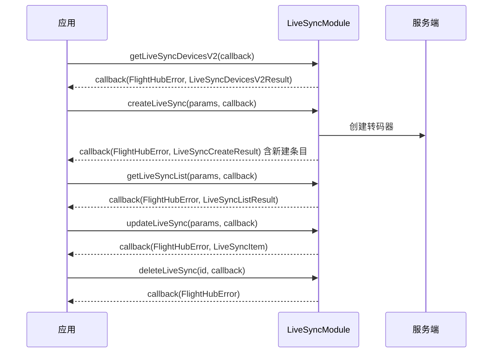

# 直播同步（LiveSyncModule）

## 1 功能概述

### 1.1 功能简介

`LiveSyncModule` 是**工作空间级**的直播同步（转码转发）模块，作用域为当前工作空间下的全部转码器。它解决的是「把设备直播流转发到第三方平台」这一件事：以「转码器」为单位，创建/更新/删除转发通道，分页查询转码器列表，查询可用设备树，以及获取转码器总数与启用数的汇总。

本模块负责**直播流向第三方平台的转发配置**，不负责在 SDK 内拉流播放。SDK 内的拉流与逐帧消费见 [直播视频流](./live-stream.md)；可转发的设备与直播源来自 [直播设备管理](./live-device.md)。

**获取方式：**

```java
Workspace workspace = FlightHubSDK.getWorkspaceInstance();
LiveSyncModule liveSyncModule = workspace.getLiveSyncModule();
```

### 1.2 核心概念

| 概念 | 说明 |
| --- | --- |
| 转码器（LiveSync） | 一条把某台设备某路直播画面转发到第三方平台的转发通道，云端以 `uuid` 唯一标识。 |
| 推流协议（`schema` + `schemaOption`） | `schema` 为协议标识（如 RTMP / GB28181 / RTSP，取值以 javadoc 为准）；`schemaOption`（`LiveSyncSchemaOption`）承载各协议参数：服务器地址/端口、设备鉴权、URL、`provider` 等，多协议字段同层扁平。 |
| 转发源 | 由 `sn`（设备）+ `cameraIndex`（摄像头）+ `videoType`（视频流类型）+ `videoQuality`（画质等级）共同指定要转发的那一路直播源。 |
| 部分更新 | `LiveSyncUpdateParams` 通过 `setXxx()` 标记要修改的字段，**未标记的字段不写入**；既可仅切换 `enable` 启用/停用，也可全量改配置。 |
| 转码器条目（`LiveSyncItem`） | 一条转码器的完整信息，含 `uuid`、状态 `status`、组织 `orgUuid`、设备 SN/名称/型号/在否机场/是否在线、转发源参数、区域 `region`、是否启用 `enable`、错误信息 `errMsg` 等。 |
| 汇总与设备树 | `getLiveSyncSummary()` 返回转码器总数与启用数；`getLiveSyncDevicesV2()` 返回可用设备树，供选择转发源。 |

### 1.3 能力清单

| 能力 | 对应接口 | 接口类型 | 说明 |
| --- | --- | --- | --- |
| 创建转码器 | `createLiveSync(params, cb)` | 异步回调 | 入参 `LiveSyncCreateParams`，回调返回 `LiveSyncCreateResult`（含新建条目与数量上限信息） |
| 更新转码器 | `updateLiveSync(params, cb)` | 异步回调 | 入参 `LiveSyncUpdateParams`（仅 `enable` 或全量改配置），回调返回更新后的 `LiveSyncItem` |
| 删除转码器 | `deleteLiveSync(id, cb)` | 异步回调 | 传入转码器 ID，回调仅返回错误信息 |
| 分页查询转码器列表 | `getLiveSyncList(params, cb)` | 异步回调 | 入参 `LiveSyncListParams`，回调返回 `LiveSyncListResult`（分页 + 列表） |
| 获取可用设备树 | `getLiveSyncDevicesV2(cb)` | 异步回调 | 回调返回 `LiveSyncDevicesV2Result`（可用设备树 V2） |
| 获取转码器汇总 | `getLiveSyncSummary(cb)` | 异步回调 | 回调返回 `LiveSyncSummaryResult`（总数 `total` 与启用数 `enableCnt`） |

---

## 2 前提条件

- 已完成上云 API 2 底座部署，并获取到服务地址与鉴权 Token。详见 [部署指南](../../../02.deployment/00.index.md)、[鉴权接入指南](../../../08.auth.md)。
- 已完成 SDK 初始化且 `FlightHubSDK.isInitialized()` 返回 `true`。详见 [SDK初始化](../init/sdk-init.md)。
- 已通过 `FlightHubSDK.getWorkspaceInstance()` 获取工作空间实例，并调用其 `getLiveSyncModule()` 拿到本模块实例。
- 作为转发源的设备已完成上云、已绑定至当前工作空间且在线；可先用 `getLiveSyncDevicesV2()` 获取可用设备树。详见 [设备上云](../../../04.device-onboarding/00.index.md)。
- 已具备第三方平台的推流参数（服务器地址、端口、鉴权、URL 等），用于填充 `LiveSyncSchemaOption`。
- 创建转码器可能受数量上限约束：`LiveSyncCreateResult` 的 `isHasLimit()` / `getLimit()` 反映上限情况，创建前后需据此判断。

---

## 3 快速上手

### 3.1 获取模块实例

```java
// 前置：已完成 FlightHubSDK.initialize(config)
Workspace workspace = FlightHubSDK.getWorkspaceInstance();
LiveSyncModule module = workspace.getLiveSyncModule();
```

### 3.2 使用流程

1. **获取模块实例** —— 从工作空间实例调用 `getLiveSyncModule()`。
2. **选转发源** —— 用 `getLiveSyncDevicesV2()` 获取可用设备树，确定 `sn` / `cameraIndex` / `videoType`。
3. **创建转码器** —— 组装 `LiveSyncCreateParams`（转发源 + `schema` + `schemaOption`），调用 `createLiveSync()`，保存返回条目的 `uuid`。
4. **查询与汇总** —— 用 `getLiveSyncList()` 分页查看转码器；用 `getLiveSyncSummary()` 看总数与启用数。
5. **更新/启停** —— 用 `updateLiveSync()` 修改配置，或仅设置 `enable` 启用/停用转码器。
6. **删除** —— 不再需要时用 `deleteLiveSync(id)` 删除。

### 3.3 调用时序图



---

## 4 示例代码

### 4.1 完整示例

```java
/**
 * 直播同步：创建转码器 -> 分页查列表 -> 启用/停用 -> 删除。
 */
public class LiveSyncManager {

    // ============ 1. 创建转码器（转发源 + 推流协议参数） ============
    public void create(String sn, String cameraIndex) {
        LiveSyncModule module = FlightHubSDK.getWorkspaceInstance().getLiveSyncModule();

        LiveSyncCreateParams params = new LiveSyncCreateParams();
        params.setConverterName("转发-" + System.currentTimeMillis());
        params.setSn(sn);                       // 转发源设备 SN
        params.setCameraIndex(cameraIndex);     // 摄像头索引
        params.setVideoType("normal");          // 视频流类型（取值以 javadoc / 设备能力为准）
        params.setVideoQuality(4);              // 画质等级：0=自适应, 1=标清, 4=超清
        params.setSchema("rtmp");               // 推流协议标识（如 RTMP/GB28181/RTSP，取值以 javadoc 为准）

        LiveSyncSchemaOption option = new LiveSyncSchemaOption();
        option.setUrl("rtmp://your-server/live/streamKey");  // RTMP 推流地址
        // GB28181/RTSP 场景改填 serverIp/serverPort/deviceId/localChannel/username/password 等对应字段
        params.setSchemaOption(option);

        module.createLiveSync(params, new FlightHubCallback.CreateLiveSyncCallback() {
            @Override
            public void onResult(FlightHubError error, LiveSyncCreateResult result) {
                if (error != null && !error.isSuccess()) {
                    System.err.println("创建转码器失败: " + error
                            + " serverCode=" + error.getServerCode()
                            + " msg=" + error.getServerMessage());
                    return;
                }
                if (result == null || result.getItem() == null) return;
                // 注意：hasLimit=true 时 limit 为可创建上限，需关注是否已达上限
                System.out.println("转码器已创建: uuid=" + result.getItem().getUuid()
                        + " 是否有上限=" + result.isHasLimit()
                        + " 上限=" + result.getLimit());
            }
        });
    }

    // ============ 2. 分页查询转码器列表 ============
    public void list(int page, int size) {
        LiveSyncModule module = FlightHubSDK.getWorkspaceInstance().getLiveSyncModule();

        LiveSyncListParams params = new LiveSyncListParams();
        params.setPage(page);   // 页码
        params.setSize(size);   // 每页数量
        // 可选过滤：params.setEnable(true); / params.setSn(sn); / params.setSchema("rtmp");

        module.getLiveSyncList(params, new FlightHubCallback.GetLiveSyncListCallback() {
            @Override
            public void onResult(FlightHubError error, LiveSyncListResult result) {
                if (error != null && !error.isSuccess()) {
                    System.err.println("查询转码器列表失败: " + error);
                    return;
                }
                if (result == null || result.getList() == null) return;
                for (LiveSyncItem item : result.getList()) {
                    System.out.println("转码器 uuid=" + item.getUuid()
                            + " 名称=" + item.getName()
                            + " 设备=" + item.getSn() + "(" + item.getDeviceName() + ")"
                            + " 在线=" + item.isDeviceOnline()
                            + " 协议=" + item.getSchema()
                            + " 启用=" + item.isEnable()
                            + " 状态=" + item.getStatus()
                            + " 错误=" + item.getErrMsg());
                }
                // 注意：必须处理分页，只取第一页会漏数据
                if ((long) result.getPage() * result.getSize() < result.getTotal()) {
                    list(result.getPage() + 1, result.getSize());
                }
            }
        });
    }

    // ============ 3. 仅启用/停用转码器（部分更新，只标记 enable 字段） ============
    public void setEnable(String id, boolean enable) {
        LiveSyncUpdateParams params = new LiveSyncUpdateParams();
        params.setId(id);
        params.setEnable(enable);   // 只调用 setEnable，其余字段不写入

        FlightHubSDK.getWorkspaceInstance().getLiveSyncModule()
                .updateLiveSync(params, new FlightHubCallback.UpdateLiveSyncCallback() {
                    @Override
                    public void onResult(FlightHubError error, LiveSyncItem result) {
                        boolean ok = error != null && error.isSuccess();
                        System.out.println((enable ? "启用" : "停用") + "转码器: "
                                + (ok ? "成功" : "失败 " + error));
                    }
                });
    }

    // ============ 4. 删除转码器 ============
    public void delete(String id) {
        FlightHubSDK.getWorkspaceInstance().getLiveSyncModule()
                .deleteLiveSync(id, error -> {
                    boolean ok = error != null && error.isSuccess();
                    System.out.println("删除转码器: " + (ok ? "成功" : "失败 " + error));
                });
    }
}
```

### 4.2 场景化片段

**查询转码器汇总（总数与启用数）**

```java
// 前置：SDK 已初始化
FlightHubSDK.getWorkspaceInstance().getLiveSyncModule()
        .getLiveSyncSummary(new FlightHubCallback.GetLiveSyncSummaryCallback() {
            @Override
            public void onResult(FlightHubError error, LiveSyncSummaryResult result) {
                if (error != null && !error.isSuccess()) {
                    System.err.println("获取汇总失败: " + error);
                    return;
                }
                if (result == null) return;
                System.out.println("转码器总数=" + result.getTotal()
                        + " 已启用=" + result.getEnableCnt());
            }
        });
```

**获取可用设备树，作为创建转码器的选源依据**

```java
// 前置：SDK 已初始化
FlightHubSDK.getWorkspaceInstance().getLiveSyncModule()
        .getLiveSyncDevicesV2((error, result) -> {
            if (error != null && !error.isSuccess()) {
                System.err.println("获取设备树失败: " + error);
                return;
            }
            if (result == null) return;
            System.out.println("可用设备总数=" + result.getTotal());
            // result.getList() 为设备树条目，逐项展开选取 sn / cameraIndex 作为转发源
        });
```

---

## 5 相关文档

- [SDK初始化](../init/sdk-init.md) —— 获取工作空间实例与调用本模块前必须完成的初始化步骤
- [直播设备管理](./live-device.md) —— 可转发的设备与直播源来源
- [直播视频流](./live-stream.md) —— SDK 内直播流的拉流与播放
- [设备上云](../../../04.device-onboarding/00.index.md) —— 转发源设备绑定到工作空间的前置流程
- [部署指南](../../../02.deployment/00.index.md) —— 上云 API 2 底座部署与服务地址获取
- [鉴权接入指南](../../../08.auth.md) —— 获取鉴权 Token 的接入流程
- [使用 API 文档查阅接口详情](../../03.api-docs-guide.md) —— 查阅 `LiveSyncModule` 完整方法签名与字段定义
