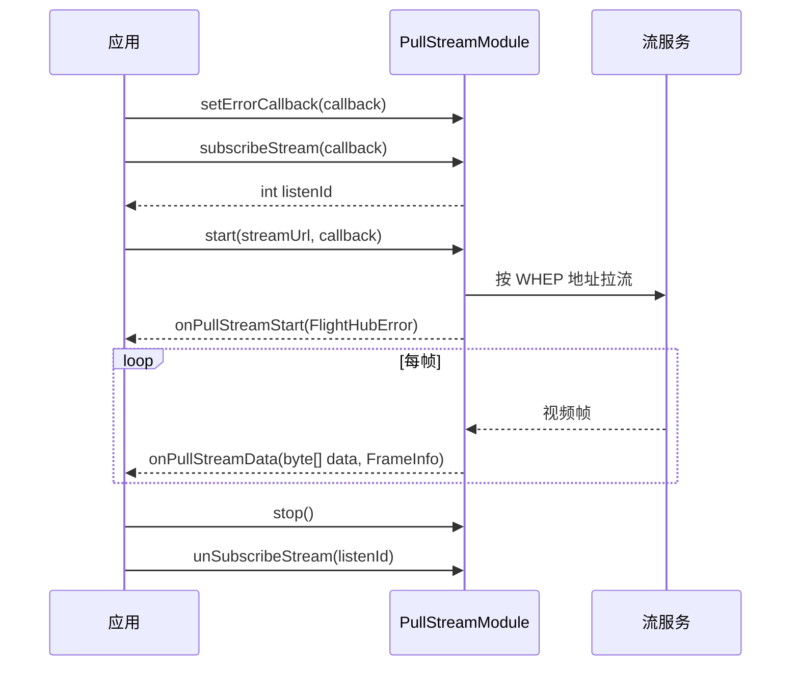

# WHEP 自定义拉流（PullStreamModule）

## 1 功能概述

### 1.1 功能简介

`PullStreamModule` 是**流处理级**的通用拉流模块，负责从指定地址拉取 WebRTC 流（支持 WHEP 协议），本身不包含业务逻辑。它解决的是「拿到一个拉流地址后，把流拉起来并逐帧取数据」这一件事：按地址开始/停止拉流、订阅逐帧视频数据、设置错误回调，以及查询是否正在拉流与当前流信息。

本模块只做**按地址拉流与取帧**，不负责发现直播源、也不生成拉流地址。拉流地址（WHEP）通常来自 [直播视频流](./live-stream.md) 的 `startWithURL()` 返回的 `LiveStreamStartResult.getUrl()`（`urlType=agora` 时即 WHEP 地址）。取到的帧可交给 [自定义 SEI](./custom-sei.md) 做 SEI 编解码。

**获取方式：**

```java
// streamId 为本次拉流实例的流标识
Stream stream = FlightHubSDK.getStream();
PullStreamModule pullStreamModule = stream.getPullStreamModule("your_stream_id");
```

### 1.2 核心概念

| 概念 | 说明 |
| --- | --- |
| 流标识（`streamId`） | 获取本模块时传入的流标识，用于标识本次拉流实例。 |
| 拉流地址（`streamUrl`） | `start()` 的入参，支持 WHEP 协议地址；常来自 [直播视频流](./live-stream.md) `startWithURL()` 返回的 `url`。 |
| 逐帧数据（`FrameInfo`） | `subscribeStream()` 每帧回调一次，返回原始字节 `data` 与帧信息 `FrameInfo`（当前含 `isKeyFrame()` 是否关键帧）。 |
| 错误回调 | `setErrorCallback()` 单独设置，回调返回 `errorCode` + `errorMessage`；与启动回调、帧回调相互独立。 |
| 状态查询 | `isStreaming()` 返回是否正在拉流；`getStreamInfo()` 返回当前流信息字符串。 |
| 专用回调命名 | 本模块回调为嵌套类型且方法名带前缀：`onPullStreamStart` / `onPullStreamData` / `onPullStreamError`（并非统一的 `onResult`）。 |

### 1.3 能力清单

| 能力 | 对应接口 | 接口类型 | 说明 |
| --- | --- | --- | --- |
| 开始拉流 | `start(streamUrl, cb)` | 异步回调 | 入参拉流地址（支持 WHEP），回调 `onPullStreamStart(FlightHubError)` |
| 停止拉流 | `stop()` | 同步返回 | 停止当前拉流 |
| 订阅视频帧 | `subscribeStream(cb)` / `unSubscribeStream(listenId)` | 事件订阅 | 每帧触发一次，回调 `onPullStreamData(byte[] data, FrameInfo)` |
| 设置错误回调 | `setErrorCallback(cb)` | 回调注册 | 回调 `onPullStreamError(int errorCode, String errorMessage)` |
| 查询是否在拉流 | `isStreaming()` | 同步返回 | 返回 `boolean`，`true` 表示正在拉流 |
| 获取当前流信息 | `getStreamInfo()` | 同步返回 | 返回流信息字符串 |

---

## 2 前提条件

- 已完成上云 API 2 底座部署，并获取到服务地址与鉴权 Token。详见 [部署指南](../../../02.deployment/00.index.md)、[鉴权接入指南](../../../08.auth.md)。
- 已完成 SDK 初始化且 `FlightHubSDK.isInitialized()` 返回 `true`。详见 [SDK初始化](../init/sdk-init.md)。
- 已通过 `FlightHubSDK.getStream()` 获取 `Stream` 实例，并调用其 `getPullStreamModule(streamId)` 拿到本模块实例。
- 已具备可用的拉流地址（WHEP）：通常来自 [直播视频流](./live-stream.md) 的 `startWithURL()`；注意其返回的凭证有过期时间（`expireTs`），过期需重新获取。
- 逐帧数据仅在拉流成功建立后才会持续产生；`start()` 与 `subscribeStream()` 需配合使用。

---

## 3 快速上手

### 3.1 获取模块实例

```java
// 前置：已完成 FlightHubSDK.initialize(config)
Stream stream = FlightHubSDK.getStream();
PullStreamModule module = stream.getPullStreamModule("your_stream_id");
```

### 3.2 使用流程

1. **获取模块实例** —— `FlightHubSDK.getStream().getPullStreamModule(streamId)`。
2. **拿拉流地址** —— 从 [直播视频流](./live-stream.md) `startWithURL()` 获取 WHEP 地址。
3. **设置错误回调** —— 调用 `setErrorCallback()`，以便拉流过程中出错时收到通知。
4. **订阅视频帧** —— 调用 `subscribeStream()` 并保存 `listenId`，用于消费逐帧数据。
5. **开始拉流** —— 调用 `start(streamUrl, cb)`，在 `onPullStreamStart` 中判断启动结果。
6. **停止与退订** —— 结束时调用 `stop()`，并用保存的 `listenId` 调用 `unSubscribeStream()`。

### 3.3 调用时序图



---

## 4 示例代码

### 4.1 完整示例

```java
/**
 * WHEP 自定义拉流：设置错误回调 -> 订阅帧 -> 按地址开始拉流 -> 停止并退订。
 * 注意：本模块回调方法名带前缀（onPullStreamStart/onPullStreamData/onPullStreamError）。
 */
public class WhepPuller {

    private int frameListenId = -1;
    private final PullStreamModule module;

    public WhepPuller(String streamId) {
        this.module = FlightHubSDK.getStream().getPullStreamModule(streamId);
    }

    public void start(String whepUrl) {
        // ============ 1. 设置错误回调（回调方法名 onPullStreamError） ============
        module.setErrorCallback(new PullStreamModule.PullStreamErrorCallback() {
            @Override
            public void onPullStreamError(int errorCode, String errorMessage) {
                System.err.println("拉流错误: code=" + errorCode + " msg=" + errorMessage);
            }
        });

        // ============ 2. 订阅视频帧（回调方法名 onPullStreamData，无 error 参数） ============
        frameListenId = module.subscribeStream(new PullStreamModule.PullStreamDataCallback() {
            @Override
            public void onPullStreamData(byte[] data, FrameInfo frameInfo) {
                if (data == null || frameInfo == null) return;   // 注意：帧回调无 error 参数，需判空
                // 注意：帧回调频率高，勿在此做耗时操作，应尽快转交解码/渲染线程
                System.out.println("收到帧: 长度=" + data.length
                        + " 关键帧=" + frameInfo.isKeyFrame());
            }
        });

        // ============ 3. 开始拉流（streamUrl 支持 WHEP 协议） ============
        module.start(whepUrl, new PullStreamModule.PullStreamStartCallback() {
            @Override
            public void onPullStreamStart(FlightHubError error) {
                boolean ok = error != null && error.isSuccess();
                System.out.println("开始拉流: " + (ok ? "成功" : "失败 " + error));
                if (ok) {
                    System.out.println("拉流状态: isStreaming=" + module.isStreaming()
                            + " 流信息=" + module.getStreamInfo());
                }
            }
        });
    }

    // ============ 4. 停止拉流并退订 ============
    public void stop() {
        module.stop();
        if (frameListenId != -1) {
            module.unSubscribeStream(frameListenId);
            frameListenId = -1;
        }
    }
}
```

### 4.2 场景化片段

**衔接直播视频流：取 WHEP 地址后拉流**

```java
// 前置：已从 LiveDeviceModule 拿到 LiveInfo
FlightHubSDK.getDroneInstance(deviceSn).getLiveStream(liveInfo)
        .startWithURL((error, result) -> {
            if (error != null && !error.isSuccess() || result == null) {
                System.err.println("获取拉流地址失败: " + error);
                return;
            }
            // 注意：agora 类型的 url 即 WHEP 地址，可直接交给 PullStreamModule
            if ("agora".equals(result.getUrlType())) {
                PullStreamModule pull = FlightHubSDK.getStream().getPullStreamModule("stream-1");
                pull.start(result.getUrl(), err -> {
                    boolean ok = err != null && err.isSuccess();
                    System.out.println("WHEP 拉流: " + (ok ? "成功" : "失败 " + err));
                });
            }
        });
```

---

## 5 相关文档

- [SDK初始化](../init/sdk-init.md) —— 获取 `Stream` 实例与调用本模块前必须完成的初始化步骤
- [直播视频流](./live-stream.md) —— WHEP 拉流地址（`startWithURL()`）的来源
- [直播设备管理](./live-device.md) —— 发现可用直播源 `LiveInfo`
- [自定义 SEI](./custom-sei.md) —— 对拉取到的 H.264 帧做自定义 SEI 编解码
- [部署指南](../../../02.deployment/00.index.md) —— 上云 API 2 底座部署与服务地址获取
- [鉴权接入指南](../../../08.auth.md) —— 获取鉴权 Token 的接入流程
- [使用 API 文档查阅接口详情](../../03.api-docs-guide.md) —— 查阅 `PullStreamModule` 完整方法签名与字段定义
