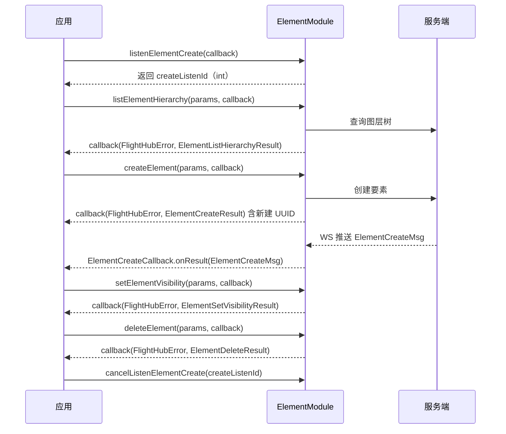

# 地图元素管理（ElementModule）

## 1 功能概述

### 1.1 功能简介

`ElementModule` 是**工作空间级**的地图元素管理模块，负责地图上基础几何要素（点/线/面/圆）的增删改查、显示状态控制，以及通过 WebSocket 实时感知其他端对要素的变更。要素以图层树形结构组织，层级关系可通过 `listElementHierarchy()` 一次性获取。

本模块无需飞行控制权或 DRC 链路，直接通过工作空间实例获取使用。

**获取方式：**

```java
Workspace workspace = FlightHubSDK.getWorkspaceInstance();
ElementModule elementModule = workspace.getElementModule();
```

### 1.2 核心概念

| 概念 | 说明 |
| --- | --- |
| 要素（Element） | 地图上的基础几何对象，以 UUID 唯一标识。目前支持点（`resourceType=0`）、线（`resourceType=1`）、面（`resourceType=2`）、圆（`resourceType=7`）四种类型，`deleteElement()` 仅支持删除这四种基础几何类型。 |
| 图层（Group） | 要素的组织容器，以树形结构管理。`ElementGroupOutput` 为单个图层节点，含直属要素列表（`elements`）和子图层列表（`children`），支持递归遍历。 |
| GeoJSON Feature | 要素的几何内容采用 GeoJSON Feature 结构（`ElementResourceContent`），包含渲染属性（`ElementProperties`，如颜色、是否贴地）和几何数据（`ElementGeometry`，如几何类型、坐标字符串、圆半径）。`ElementResourceContent.type` 固定传 `"Feature"`。 |
| 显示状态（`display`） | 控制要素在地图上的可见性：`1=显示，0=隐藏`。可通过 `setElementVisibility()` 单独变更，也可在 `updateElement()` 中随其他属性一并更新。 |
| WS 事件推送 | 要素增删改通过 WebSocket 向订阅方实时推送；订阅方法返回 `int` 类型监听 ID，取消订阅时需传入该 ID。事件回调无 `FlightHubError` 参数，需对消息对象判空。 |

### 1.3 能力清单

| 能力分组 | 方法 | 接口类型 | 说明 |
| --- | --- | --- | --- |
| 要素操作 | `createElement(params, callback)` | 异步回调 | 创建要素，入参 `ElementCreateParams`（`resourceType` 与 `resourceContent` 必填），返回新建要素 UUID |
| 要素操作 | `updateElement(params, callback)` | 异步回调 | 更新要素属性，入参 `ElementUpdateParams`（`id` 必填，其余字段 `null` 不更新），返回被更新要素 UUID |
| 要素操作 | `listElementHierarchy(params, callback)` | 异步回调 | 查询元素层级列表（目录树），入参 `ElementListHierarchyParams`，返回 `ElementListHierarchyResult`（图层树形列表） |
| 要素操作 | `deleteElement(params, callback)` | 异步回调 | 删除要素（仅限基础几何类型：点/线/面/圆），入参 `ElementDeleteParams`（`id` 必填） |
| 显示状态 | `setElementVisibility(params, callback)` | 异步回调 | 单独设置要素显示/隐藏状态，入参 `ElementSetVisibilityParams`（`id` 与 `display` 必填） |
| WS 事件订阅 | `listenElementCreate(callback)` | 事件订阅 | 订阅要素创建事件，返回监听 ID（`int`） |
| WS 事件订阅 | `cancelListenElementCreate(listenId)` | 取消订阅 | 取消要素创建事件订阅，传入 `listenElementCreate()` 返回的 ID |
| WS 事件订阅 | `listenElementUpdate(callback)` | 事件订阅 | 订阅要素更新事件，返回监听 ID（`int`） |
| WS 事件订阅 | `cancelListenElementUpdate(listenId)` | 取消订阅 | 取消要素更新事件订阅，传入 `listenElementUpdate()` 返回的 ID |
| WS 事件订阅 | `listenElementDelete(callback)` | 事件订阅 | 订阅要素删除事件，返回监听 ID（`int`） |
| WS 事件订阅 | `cancelListenElementDelete(listenId)` | 取消订阅 | 取消要素删除事件订阅，传入 `listenElementDelete()` 返回的 ID |

---

## 2 前提条件

- 已完成上云 API 2 底座部署，并获取到服务地址与鉴权 Token。详见 [部署指南](../../../02.deployment/00.index.md)、[鉴权接入指南](../../../08.auth.md)。
- 已完成 SDK 初始化且 `FlightHubSDK.isInitialized()` 返回 `true`。详见 [SDK初始化](../init/sdk-init.md)。
- 已通过 `FlightHubSDK.getWorkspaceInstance()` 获取工作空间实例，并调用其 `getElementModule()` 拿到本模块实例。
- 若需使用 WS 事件订阅（`listenElementCreate` / `listenElementUpdate` / `listenElementDelete`），需在 SDK 配置中正确填写 WebSocket 通知地址，确保服务端能够推送事件。详见 [SDK配置](../init/sdk-config.md)。
- 本模块操作无需飞行控制权或 DRC 链路。

---

## 3 快速上手

### 3.1 获取模块实例

```java
// 前置：已完成 FlightHubSDK.initialize(config)
Workspace workspace = FlightHubSDK.getWorkspaceInstance();
ElementModule elementModule = workspace.getElementModule();
```

### 3.2 使用流程

1. **获取模块实例** —— 从工作空间实例调用 `getElementModule()`。
2. **订阅 WS 事件**（可选）—— 调用 `listenElementCreate()` / `listenElementUpdate()` / `listenElementDelete()`，保存返回的监听 ID 以便后续取消订阅。
3. **查询图层树** —— 用 `listElementHierarchy()` 获取工作空间下图层与要素的目录树结构，确定目标图层 UUID。
4. **创建要素** —— 组装 `ElementCreateParams`（填写 `resourceType` 和 `resourceContent`），调用 `createElement()`，保存返回的要素 UUID。
5. **更新 / 控制显示** —— 用 `updateElement()` 修改名称、几何数据等属性；用 `setElementVisibility()` 单独切换显示/隐藏状态。
6. **删除要素** —— 不再需要时用 `deleteElement()` 删除。
7. **取消订阅** —— 不再需要 WS 推送时，用保存的监听 ID 调用对应的 `cancelListenXxx()` 方法。

### 3.3 调用时序图



---

## 4 示例代码

### 4.1 完整示例

```java
/**
 * 地图元素管理：订阅 WS 事件 -> 查询图层树 -> 创建点要素 -> 设置隐藏 -> 删除要素 -> 取消订阅。
 */
public class ElementManager {

    private final ElementModule elementModule =
            FlightHubSDK.getWorkspaceInstance().getElementModule();

    // 保存监听 ID，用于后续取消订阅
    private int createListenId = -1;
    private int updateListenId = -1;
    private int deleteListenId = -1;

    // ============ 1. 订阅 WS 事件（创建 / 更新 / 删除） ============
    public void startListen() {
        // 注意: 事件回调无 FlightHubError 参数，必须对 msg 判空
        createListenId = elementModule.listenElementCreate(msg -> {
            if (msg == null) return;
            System.out.println("要素创建事件 id=" + msg.getId()
                    + " groupId=" + msg.getGroupId()
                    + " name=" + msg.getName()
                    + " display=" + msg.getDisplay());
        });

        updateListenId = elementModule.listenElementUpdate(msg -> {
            if (msg == null) return;
            System.out.println("要素更新事件 id=" + msg.getId()
                    + " groupId=" + msg.getGroupId()
                    + " name=" + msg.getName()
                    + " display=" + msg.getDisplay());
        });

        deleteListenId = elementModule.listenElementDelete(msg -> {
            if (msg == null) return;
            System.out.println("要素删除事件 id=" + msg.getId()
                    + " groupId=" + msg.getGroupId());
        });
    }

    // ============ 2. 查询图层树 ============
    public void listHierarchy() {
        ElementListHierarchyParams params = new ElementListHierarchyParams();
        params.setGroupId(null);        // null=查 workspace 下全部图层
        params.setPid(null);            // null=查根目录
        params.setIsDistributed(null);  // null=不过滤分发状态
        params.setType(null);           // null=不过滤图层类型
        params.setElementUuid(null);    // null=不定位特定元素
        params.setExcludeCopy(false);   // false=包含复制中的图层

        elementModule.listElementHierarchy(params, new FlightHubCallback.ElementListHierarchyCallback() {
            @Override
            public void onResult(FlightHubError error, ElementListHierarchyResult result) {
                if (error != null && !error.isSuccess()) {
                    System.err.println("查询图层树失败: " + error);
                    return;
                }
                if (result == null || result.getList() == null) return;
                for (ElementGroupOutput group : result.getList()) {
                    // type: 0=普通 1=默认 2=共享 3=C2C 4=视锥 5=DataHub 6=自动派遣 7=大疆行业APP
                    System.out.println("图层 id=" + group.getId()
                            + " name=" + group.getName()
                            + " type=" + group.getType()
                            + " isLock=" + group.isLock()
                            + " triState=" + group.getTriState()  // "all"/"none"/"half"
                            + " isDistributed=" + group.isDistributed()
                            + " order=" + group.getOrder()
                            + " parentId=" + group.getParentId()
                            + " createTime=" + group.getCreateTime()
                            + " elements=" + (group.getElements() != null ? group.getElements().size() : 0)
                            + " children=" + (group.getChildren() != null ? group.getChildren().size() : 0));
                }
            }
        });
    }

    // ============ 3. 创建点要素 ============
    public void createPointElement() {
        // 构造几何数据
        ElementGeometry geometry = new ElementGeometry();
        geometry.setType("Point");
        // 注意: coordinates 是 raw JSON 字符串，点格式为 [经度, 纬度, 高度（米）]
        geometry.setCoordinates("[114.0600, 22.5500, 50.0]");
        // geometry.setRadius() 仅圆要素（resourceType=7）使用，点要素不填
        // geometry.setBreadCrumbs() 面包屑轨迹点，按需填写

        // 构造渲染属性
        ElementProperties properties = new ElementProperties();
        properties.setColor("#2D8CF0");     // 渲染颜色，HEX 格式
        properties.setClampToGround(true);  // 是否贴地渲染
        properties.setIs3d(false);          // 是否 3D 要素
        properties.setTransparent(false);   // 是否透明渲染
        properties.setFontSize(12);         // 字体大小
        properties.setIcon(0);              // 图标 ID

        // 组装 GeoJSON Feature 内容
        ElementResourceContent content = new ElementResourceContent();
        content.setType("Feature");         // 注意: 固定传 "Feature"，不可修改
        content.setGeometry(geometry);
        content.setProperties(properties);
        // content.setMediaResources(null); // 无绑定图片时不传

        // 构造创建参数
        ElementCreateParams params = new ElementCreateParams();
        params.setResourceType(0);          // 必填：0=点 1=线 2=面 7=圆
        params.setName("SDK 测试标注点-" + System.currentTimeMillis());
        params.setDesc("由 SDK 创建的测试点要素");
        params.setResourceContent(content); // 必填
        // params.setResourceRemark("备注");
        // params.setId("自定义UUID");      // 注意: 不填时服务端自动生成，避免重复 UUID 冲突

        elementModule.createElement(params, new FlightHubCallback.ElementCreateElementCallback() {
            @Override
            public void onResult(FlightHubError error, ElementCreateResult result) {
                if (error != null && !error.isSuccess()) {
                    System.err.println("创建要素失败: " + error);
                    return;
                }
                if (result == null) return;
                System.out.println("要素创建成功，id=" + result.getId());
            }
        });
    }

    // ============ 4. 设置要素隐藏 ============
    public void hideElement(String elementId) {
        ElementSetVisibilityParams params = new ElementSetVisibilityParams();
        params.setId(elementId);  // 要素 UUID，必填
        params.setDisplay(0);     // 必填：0=隐藏 1=显示

        elementModule.setElementVisibility(params, new FlightHubCallback.ElementSetVisibilityCallback() {
            @Override
            public void onResult(FlightHubError error, ElementSetVisibilityResult result) {
                if (error != null && !error.isSuccess()) {
                    System.err.println("设置显示状态失败: " + error);
                    return;
                }
                if (result == null) return;
                System.out.println("已隐藏要素 id=" + result.getId());
            }
        });
    }

    // ============ 5. 删除要素 ============
    public void deleteElement(String elementId) {
        ElementDeleteParams params = new ElementDeleteParams();
        params.setId(elementId);            // 要素 UUID，必填
        // 注意: setFromBatchDelete(true) 时跳过单条分发通知；单条删除场景传 false
        params.setFromBatchDelete(false);

        elementModule.deleteElement(params, new FlightHubCallback.ElementDeleteElementCallback() {
            @Override
            public void onResult(FlightHubError error, ElementDeleteResult result) {
                if (error != null && !error.isSuccess()) {
                    System.err.println("删除要素失败: " + error);
                    return;
                }
                if (result == null) return;
                System.out.println("要素已删除 id=" + result.getId());
            }
        });
    }

    // ============ 6. 取消所有 WS 事件订阅 ============
    public void stopListen() {
        if (createListenId >= 0) {
            elementModule.cancelListenElementCreate(createListenId);
        }
        if (updateListenId >= 0) {
            elementModule.cancelListenElementUpdate(updateListenId);
        }
        if (deleteListenId >= 0) {
            elementModule.cancelListenElementDelete(deleteListenId);
        }
    }
}
```

### 4.2 场景化片段

**更新要素名称（仅改名，其余字段不变）**

```java
// 注意: ElementUpdateParams 中 null 字段不会被写入服务端，可做部分更新
ElementUpdateParams params = new ElementUpdateParams();
params.setId("目标要素UUID");    // 必填
params.setName("新名称");        // 仅改名；其余字段（content/display/remark 等）保持 null 不更新
// params.setDisplay(1);         // 单独改显示状态时可设置；null=不更新
// params.setRemark("新备注");   // null=不更新
// params.setStatus(null);       // null=不更新
// params.setElevationLoadStatus(null); // 仅 Web 端使用；null=不更新
// params.setUserStatus(null);   // 用户个人显影状态；null=不更新
// params.setTargetLayerId("目标图层UUID"); // 非空时触发移动到目标图层操作
// params.setOrders(null);       // 移动后目标图层内的排序列表

FlightHubSDK.getWorkspaceInstance().getElementModule()
        .updateElement(params, new FlightHubCallback.ElementUpdateElementCallback() {
            @Override
            public void onResult(FlightHubError error, ElementUpdateResult result) {
                if (error != null && !error.isSuccess()) {
                    System.err.println("更新要素失败: " + error);
                    return;
                }
                if (result == null) return;
                System.out.println("要素已更新 id=" + result.getId());
            }
        });
```

**创建圆要素（`resourceType=7`，需填写圆心坐标和半径）**

```java
// 构造圆的几何数据
ElementGeometry circleGeometry = new ElementGeometry();
circleGeometry.setType("Point");                    // 圆要素的几何类型仍为 "Point"（圆心）
circleGeometry.setCoordinates("[114.0600, 22.5500, 0.0]"); // 圆心坐标 [经度, 纬度, 高度]
// 注意: 圆要素必须设置 radius，单位为米
circleGeometry.setRadius(500.0);

ElementProperties circleProps = new ElementProperties();
circleProps.setColor("#FF6600");
circleProps.setClampToGround(true);
circleProps.setIs3d(false);
circleProps.setTransparent(false);
circleProps.setFontSize(12);
circleProps.setIcon(0);

ElementResourceContent circleContent = new ElementResourceContent();
circleContent.setType("Feature");
circleContent.setGeometry(circleGeometry);
circleContent.setProperties(circleProps);

ElementCreateParams circleParams = new ElementCreateParams();
// 注意: 圆要素 resourceType 必须传 7，传其他值会导致几何类型不匹配
circleParams.setResourceType(7);
circleParams.setName("500m 警戒圆");
circleParams.setResourceContent(circleContent);

FlightHubSDK.getWorkspaceInstance().getElementModule()
        .createElement(circleParams, new FlightHubCallback.ElementCreateElementCallback() {
            @Override
            public void onResult(FlightHubError error, ElementCreateResult result) {
                if (error != null && !error.isSuccess()) {
                    System.err.println("创建圆要素失败: " + error);
                    return;
                }
                if (result == null) return;
                System.out.println("圆要素创建成功 id=" + result.getId());
            }
        });
```

**查询特定图层下的要素（按图层 UUID 过滤）**

```java
// 仅查询指定图层 UUID 下的内容，而非全量
ElementListHierarchyParams params = new ElementListHierarchyParams();
params.setGroupId("目标图层UUID");  // 指定图层；null=查 workspace 下全部
params.setPid(null);                // null=查根目录
params.setIsDistributed(true);      // true=仅返回已分发的图层；null=不过滤
params.setExcludeCopy(true);        // 排除复制中的图层

FlightHubSDK.getWorkspaceInstance().getElementModule()
        .listElementHierarchy(params, new FlightHubCallback.ElementListHierarchyCallback() {
            @Override
            public void onResult(FlightHubError error, ElementListHierarchyResult result) {
                if (error != null && !error.isSuccess()) {
                    System.err.println("查询图层失败: " + error);
                    return;
                }
                if (result == null || result.getList() == null) return;
                System.out.println("图层数量=" + result.getList().size());
            }
        });
```

---

## 5 相关文档

- [SDK初始化](../init/sdk-init.md) —— 获取工作空间实例与调用本模块前必须完成的初始化步骤
- [SDK配置](../init/sdk-config.md) —— 配置 WebSocket 通知地址以接收要素 WS 事件推送
- [部署指南](../../../02.deployment/00.index.md) —— 上云 API 2 底座部署与服务地址获取
- [鉴权接入指南](../../../08.auth.md) —— 获取鉴权 Token 的接入流程
- [设备上云](../../../04.device-onboarding/00.index.md) —— 设备绑定到工作空间的前置流程
- [安全服务](./safety-service.md) —— 自定义飞行区域与信号地图的管理，与地图元素管理同属地图环境能力
- [使用 API 文档查阅接口详情](../../03.api-docs-guide.md) —— 查阅 `ElementModule` 完整方法签名与 Bean 字段定义
