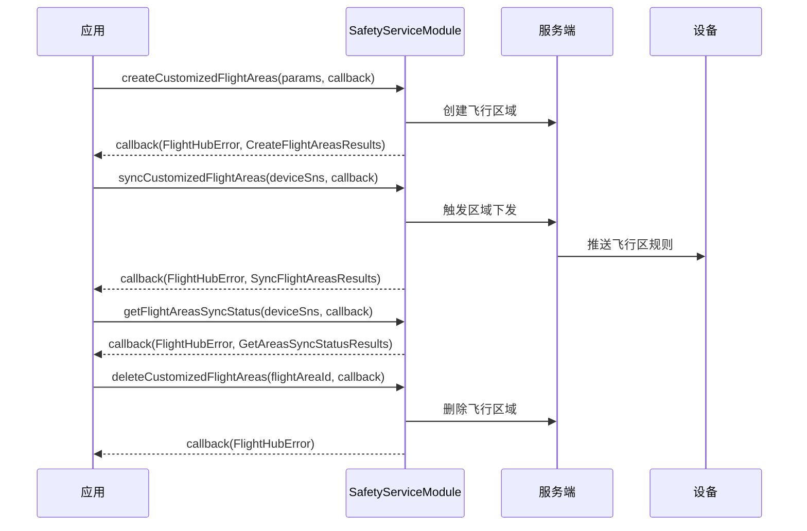

# 安全服务（SafetyServiceModule）

## 1 功能概述

### 1.1 功能简介

`SafetyServiceModule` 是**工作空间级**安全服务模块，覆盖信号地图查询、自定义飞行区域管理、地形障碍物离线地图管理和设备解锁证书管理四类能力。

- **信号地图查询**：按设备 SN 列表和数据类型（如 `"4g"`、`"sdr"`）查询指定设备的历史信号覆盖信息，辅助航线规划。
- **自定义飞行区域管理**：创建、查询、更新、删除限飞区（`nfz`）、作业区（`dfence`）和禁降区（`noland`），并将飞行区规则同步推送至机场/地面站等网关类型设备，设备实时生效；另提供飞行区文件签名下载地址获取。
- **地形障碍物离线地图管理**：管理三维/二维障碍物模型的创建/更新、取消、开关，将模型同步到设备；支持订阅指定飞行器的离线地图开关状态实时变化。
- **解锁证书管理**：查询、上传、校验、提交、启用/禁用、清除设备解锁证书，用于申请在限制空域内飞行的授权。

本模块属工作空间级，无需飞行控制权或 DRC 链路即可调用。

**获取方式：**

```java
Workspace workspace = FlightHubSDK.getWorkspaceInstance();
SafetyServiceModule safetyServiceModule = workspace.getSafetyServiceModule();
```

### 1.2 核心概念

| 概念 | 说明 |
| --- | --- |
| 自定义飞行区域 | 以 GeoJSON Feature 格式定义的地理围栏，按类型分限飞区（`"nfz"`，最多 100 个）、作业区（`"dfence"`）、禁降区（`"noland"`，最多 50 个）。几何支持圆形（`"Circle"`）、多边形（`"Polygon"`）和折线缓冲（`"Polyline"`，仅禁降区）。 |
| 飞行区域内容（`FlightAreasContentData`） | 飞行区的 GeoJSON Feature 表示，含 `type`（固定 `"Feature"`）、`geometry`（`ContentsGeometryData`，包含区域形状、坐标/圆心/半径）和 `properties`（`ContentsPropertyData`，包含颜色/贴地/缓冲宽度）。 |
| 飞行区同步 | 创建或更新飞行区域后，必须显式调用 `syncCustomizedFlightAreas()` 向指定网关设备（机场 1/2/3 或地面站）推送规则，规则在设备端立即生效；可用 `getFlightAreasSyncStatus()` 查询推送进度。 |
| 信号地图（SignalMap） | 按设备 SN 列表和数据类型查询设备历史信号覆盖情况，结果通过 `SignalMapsResults` 返回。 |
| 离线地图（OfflineMaps） | 地形障碍物离线三维/二维模型，支持创建/更新（`updateOfflineMapsModelInfo`）、取消（`cancelOfflineMapsModelInfo`）、全局开关（`setOfflineMaps`）、同步到设备（`syncOfflineMaps`）；可订阅飞行器的 `offline_map_enable` 状态实时推送。 |
| 解锁证书（UnlockLicense） | 用于申请在特定限制区域飞行的授权凭证。典型流程：本地上传文件（`uploadUnlockLicenseFile`，返回 `fileStoreDir`）→ 校验（`checkUnlockLicense`）→ 提交到设备（`submitUnlockLicense`）→ 启用（`switchUnlockLicense`）→ 按需清除（`clearDeviceUnlockLicense`）。 |

### 1.3 能力清单

**信号地图查询**

| 能力 | 对应接口 | 接口类型 | 说明 |
| --- | --- | --- | --- |
| 获取信号地图 | `searchSignalMaps(deviceSns, dataTypes, cb)` | 异步回调 | 按设备 SN 列表和数据类型查询信号地图，回调返回 `SignalMapsResults` |

**自定义飞行区域管理**

| 能力 | 对应接口 | 接口类型 | 说明 |
| --- | --- | --- | --- |
| 创建飞行区域 | `createCustomizedFlightAreas(requestParams, cb)` | 异步回调 | 入参 `CreateCustomizedFlightAreasParams`，回调返回 `CreateFlightAreasResults` |
| 查询飞行区域（Bean 入参） | `getCustomizedFlightAreas(requestParams, cb)` | 异步回调 | 入参 `GetCustomizedFlightAreasParams`（名称/类型/状态/ID/分页），回调返回 `GetFlightAreasResults` |
| 查询飞行区域（散参数） | `getCustomizedFlightAreas(name, type, status, ids, pageIndex, pageSize, cb)` | 异步回调 | 字段与 Bean 版一致，以散参数形式传入，回调返回 `GetFlightAreasResults` |
| 更新飞行区域 | `updateCustomizedFlightAreas(requestParams, cb)` | 异步回调 | 入参 `UpdateCustomizedFlightAreasParams`，回调返回 `UpdateFlightAreasResults` |
| 删除飞行区域 | `deleteCustomizedFlightAreas(flightAreaId, cb)` | 异步回调 | 传入飞行区域 ID，回调仅返回错误信息 |
| 同步飞行区域到设备 | `syncCustomizedFlightAreas(deviceSns, cb)` | 异步回调 | 推送规则至网关设备，回调返回 `SyncFlightAreasResults` |
| 获取飞行区域同步状态 | `getFlightAreasSyncStatus(deviceSns, cb)` | 异步回调 | 查询各网关设备的同步进度，回调返回 `GetAreasSyncStatusResults` |
| 获取飞行区文件下载地址 | `getFlightAreasUrl(cb)` | 异步回调 | 回调返回 `GetFlightAreasUrlResults`（文件名、签名下载地址有效期 3600 秒、SHA-256 校验值、文件大小） |

**地形障碍物离线地图管理**

| 能力 | 对应接口 | 接口类型 | 说明 |
| --- | --- | --- | --- |
| 查询离线地图模型信息 | `getOfflineMapsModelInfo(cb)` | 异步回调 | 回调返回 `GetOfflineMapsModelInfoResults` |
| 创建/更新离线地图模型 | `updateOfflineMapsModelInfo(requestParams, cb)` | 异步回调 | 入参 `UpdateOfflineMapsParams`（3D 模型列表/2D 模型列表），回调仅返回错误信息 |
| 取消离线地图生成 | `cancelOfflineMapsModelInfo(cb)` | 异步回调 | 回调仅返回错误信息 |
| 修改离线地图开关 | `setOfflineMaps(requestParams, cb)` | 异步回调 | 入参 `SetOfflineMapsParams`，控制离线地图全局开/关，回调仅返回错误信息 |
| 同步离线地图到设备 | `syncOfflineMaps(deviceSns, cb)` | 异步回调 | 推送模型至网关设备，回调返回 `OfflineMapsSyncResults` |
| 获取设备离线地图同步状态 | `getOfflineMapsSyncStatus(deviceSns, cb)` | 异步回调 | 回调返回 `GetOfflineMapsSyncStatusResults` |
| 订阅飞行器离线地图开关 | `listenDroneOfflineMapEnable(droneSn, cb)` | 事件订阅 | 回调无 error 参数，收到 `DroneOfflineMapEnable`；方法返回监听 ID（int） |
| 取消订阅飞行器离线地图开关 | `cancelListenDroneOfflineMapEnable(listenId)` | 同步 | 传入 `listenDroneOfflineMapEnable` 返回的监听 ID |

**解锁证书管理**

| 能力 | 对应接口 | 接口类型 | 说明 |
| --- | --- | --- | --- |
| 获取解锁证书列表 | `getUnlockLicenseList(param, cb)` | 异步回调 | 入参 `QueryDeviceUnlockLicenseListParam`，回调返回 `QueryDeviceUnlockLicenseListResult` |
| 上传解锁证书文件 | `uploadUnlockLicenseFile(filePath, cb)` | 异步回调 | 传入本地文件路径，回调返回 `UploadUnlockLicenseFileResult`（含 `fileStoreDir`） |
| 检查解锁证书 | `checkUnlockLicense(param, cb)` | 异步回调 | 入参 `CheckUnlockLicenseParam`（fileKey + deviceSn），回调返回 `CheckUnlockLicenseResult` |
| 提交解锁证书 | `submitUnlockLicense(param, cb)` | 异步回调 | 入参 `ImportUnlockLicenseParam`（deviceSn + certUrl），回调仅返回错误信息 |
| 切换解锁证书状态 | `switchUnlockLicense(param, cb)` | 异步回调 | 入参 `SwitchUnlockLicenseParam`（deviceSn + licenseId + enable），回调仅返回错误信息 |
| 清除设备解锁证书 | `clearDeviceUnlockLicense(deviceSn, cb)` | 异步回调 | 传入设备 SN，回调仅返回错误信息 |

---

## 2 前提条件

- 已完成上云 API 2 底座部署，并获取到服务地址与鉴权 Token。详见 [部署指南](../../../02.deployment/00.index.md)、[鉴权接入指南](../../../08.auth.md)。
- 已完成 SDK 初始化且 `FlightHubSDK.isInitialized()` 返回 `true`。详见 [SDK初始化](../init/sdk-init.md)。
- 已通过 `FlightHubSDK.getWorkspaceInstance()` 获取工作空间实例，并调用 `getSafetyServiceModule()` 拿到本模块实例。
- 相关设备已完成上云、已绑定至当前工作空间。飞行区域同步（`syncCustomizedFlightAreas`）和离线地图同步（`syncOfflineMaps`）仅支持网关类型设备（机场 1/2/3 及地面站）的 SN；`listenDroneOfflineMapEnable` 传入飞行器 SN。详见 [设备上云](../../../04.device-onboarding/00.index.md)。
- 若需接收飞行区同步状态等服务端异步推送，需在 SDK 初始化时配置通知地址。详见 [SDK配置](../init/sdk-config.md)。
- 本模块无需飞行控制权或 DRC 链路，可在无飞行任务时调用。

---

## 3 快速上手

### 3.1 获取模块实例

```java
// 前置：已完成 FlightHubSDK.initialize(config)
Workspace workspace = FlightHubSDK.getWorkspaceInstance();
SafetyServiceModule module = workspace.getSafetyServiceModule();
```

### 3.2 使用流程

**自定义飞行区域管理**

1. **获取模块实例** —— 从工作空间实例调用 `getSafetyServiceModule()`。
2. **创建飞行区域** —— 组装 `CreateCustomizedFlightAreasParams`（名称、类型、`FlightAreasContentData` 几何内容），调用 `createCustomizedFlightAreas()`，记录返回的区域 ID。
3. **查询已有区域** —— 用 `getCustomizedFlightAreas()` 按名称/类型/状态分页查询，获取区域 ID 用于后续更新或删除。
4. **同步到网关设备** —— 创建/更新后调用 `syncCustomizedFlightAreas(deviceSns, cb)` 将规则推送到目标设备，设备实时生效。
5. **查询同步状态** —— 用 `getFlightAreasSyncStatus(deviceSns, cb)` 查询各设备的同步进度。
6. **更新/删除** —— 用 `updateCustomizedFlightAreas()` 修改区域内容，或 `deleteCustomizedFlightAreas(id, cb)` 删除后再次同步。

**解锁证书管理**

1. **上传证书文件** —— 调用 `uploadUnlockLicenseFile(filePath, cb)`，回调返回 `UploadUnlockLicenseFileResult`（含 `fileStoreDir`，用于拼接 fileKey）。
2. **校验证书** —— 调用 `checkUnlockLicense(param, cb)`（fileKey + deviceSn），确认证书有效。
3. **提交证书** —— 调用 `submitUnlockLicense(param, cb)`（deviceSn + certUrl），将证书导入目标设备。
4. **启用证书** —— 调用 `switchUnlockLicense(param, cb)` 设置 `enable=true`，激活证书。
5. **按需清除** —— 调用 `clearDeviceUnlockLicense(deviceSn, cb)` 清除设备上所有证书。

### 3.3 调用时序图



---

## 4 示例代码

### 4.1 完整示例

```java
/**
 * 自定义飞行区域全生命周期：创建圆形限飞区 → 查询列表 → 同步到设备 → 获取同步状态 → 删除。
 */
public class FlightAreaManager {

    private final SafetyServiceModule module =
            FlightHubSDK.getWorkspaceInstance().getSafetyServiceModule();

    // ============ 1. 创建圆形限飞区 ============
    public void createCircleNfz(String userId) {
        // 构造几何数据：圆形，圆心 [经度, 纬度]，单位米
        ContentsGeometryData geometry = new ContentsGeometryData();
        geometry.setType("Circle");
        geometry.setCenter(Arrays.asList(113.9231, 22.5251));  // [经度, 纬度]，GeoJSON 标准
        geometry.setRadius(500.0);                             // 半径（米），需大于 0

        // 构造属性：颜色与是否贴地
        ContentsPropertyData properties = new ContentsPropertyData();
        properties.setColor("#FF0000");       // 地图显示颜色
        properties.setClampToGround(true);    // 贴地显示

        // 构造 Feature 内容
        FlightAreasContentData content = new FlightAreasContentData();
        content.setType("Feature");           // 固定值 "Feature"
        content.setGeometry(geometry);
        content.setProperties(properties);

        // 构造创建参数
        CreateCustomizedFlightAreasParams params = new CreateCustomizedFlightAreasParams();
        params.setName("禁飞区-深圳测试-500m圆");
        params.setType("nfz");               // "nfz"=限飞区（最多 100 个），"dfence"=作业区，"noland"=禁降区（最多 50 个）
        params.setContent(content);
        params.setCreatedBy(userId);          // 创建用户 ID

        module.createCustomizedFlightAreas(params,
                new FlightHubCallback.CreateCustomizedFlightAreasCallback() {
                    @Override
                    public void onResult(FlightHubError error, CreateFlightAreasResults result) {
                        if (error != null && !error.isSuccess()) {
                            System.err.println("创建飞行区域失败: " + error);
                            return;
                        }
                        if (result == null) return;
                        // 注意：保存区域 ID，后续同步/更新/删除均需用到
                        System.out.println("飞行区域已创建: " + result);
                    }
                });
    }

    // ============ 2. 查询限飞区列表（Bean 入参版，含分页） ============
    public void listNfzAreas() {
        GetCustomizedFlightAreasParams params = new GetCustomizedFlightAreasParams();
        params.setType("nfz");          // 只查限飞区；不传则查全部类型
        params.setStatus("enable");     // "enable"=已启用，"disable"=已禁用
        params.setPageIndex(1);         // 页码从 1 开始；不传表示查全部
        params.setPageSize(20);

        module.getCustomizedFlightAreas(params,
                new FlightHubCallback.GetCustomizedFlightAreasCallback() {
                    @Override
                    public void onResult(FlightHubError error, GetFlightAreasResults result) {
                        if (error != null && !error.isSuccess()) {
                            System.err.println("查询飞行区域失败: " + error);
                            return;
                        }
                        if (result == null) return;
                        System.out.println("查询成功: " + result);
                    }
                });
    }

    // ============ 3. 同步飞行区域到网关设备（机场/地面站） ============
    public void syncToGateway(List<String> gatewaySns) {
        // 注意：deviceSns 只支持网关类型设备（机场1、2、3 以及地面站）的 SN，不能传飞机 SN
        module.syncCustomizedFlightAreas(gatewaySns,
                new FlightHubCallback.SyncCustomizedFlightAreasCallback() {
                    @Override
                    public void onResult(FlightHubError error, SyncFlightAreasResults result) {
                        if (error != null && !error.isSuccess()) {
                            System.err.println("同步飞行区域失败: " + error);
                            return;
                        }
                        if (result == null) return;
                        System.out.println("同步已触发: " + result);
                    }
                });
    }

    // ============ 4. 查询各设备的同步状态 ============
    public void querySyncStatus(List<String> gatewaySns) {
        module.getFlightAreasSyncStatus(gatewaySns,
                new FlightHubCallback.GetFlightAreasSyncStatusCallback() {
                    @Override
                    public void onResult(FlightHubError error, GetAreasSyncStatusResults result) {
                        if (error != null && !error.isSuccess()) {
                            System.err.println("获取同步状态失败: " + error);
                            return;
                        }
                        if (result == null) return;
                        System.out.println("同步状态: " + result);
                    }
                });
    }

    // ============ 5. 删除飞行区域 ============
    public void delete(String flightAreaId) {
        module.deleteCustomizedFlightAreas(flightAreaId,
                error -> {
                    if (error != null && !error.isSuccess()) {
                        System.err.println("删除飞行区域失败: " + error);
                        return;
                    }
                    System.out.println("飞行区域已删除，id=" + flightAreaId);
                });
    }
}
```

**`CreateCustomizedFlightAreasParams` 字段说明**

| 字段（getter/setter） | 类型 | 说明 |
| --- | --- | --- |
| `getName()` / `setName(String)` | `String` | 飞行区名称，如 `"圆形限飞区"` |
| `getType()` / `setType(String)` | `String` | 飞行区类型：`"nfz"`=限飞区（最多 100 个），`"dfence"`=作业区，`"noland"`=禁降区（最多 50 个） |
| `getContent()` / `setContent(FlightAreasContentData)` | `FlightAreasContentData` | 飞行区 GeoJSON Feature 内容，含几何与属性 |
| `getCreatedBy()` / `setCreatedBy(String)` | `String` | 创建用户 ID |

**`FlightAreasContentData` 字段说明**

| 字段（getter/setter） | 类型 | 说明 |
| --- | --- | --- |
| `getType()` / `setType(String)` | `String` | 固定值 `"Feature"` |
| `getGeometry()` / `setGeometry(ContentsGeometryData)` | `ContentsGeometryData` | 几何数据，描述区域形状与坐标 |
| `getProperties()` / `setProperties(ContentsPropertyData)` | `ContentsPropertyData` | 属性数据，含颜色、贴地开关、缓冲宽度 |

**`ContentsGeometryData` 字段说明**

| 字段（getter/setter） | 类型 | 说明 |
| --- | --- | --- |
| `getType()` / `setType(String)` | `String` | 几何类型：`"Circle"`=圆形，`"Polygon"`=多边形，`"Polyline"`=折线缓冲（仅禁降区） |
| `getCoordinates()` / `setCoordinates(List<List<List<Double>>>)` | `List<List<List<Double>>>` | 坐标数据，非圆形时必填；格式 `[经度, 纬度]`（GeoJSON 标准，经度在前）；多边形要求至少 3 个顶点 |
| `getCenter()` / `setCenter(List<Double>)` | `List<Double>` | 圆心坐标，圆形时必填；格式 `[经度, 纬度]` |
| `getRadius()` / `setRadius(double)` | `double` | 半径（米），圆形时必填，需大于 0 |

**`ContentsPropertyData` 字段说明**

| 字段（getter/setter） | 类型 | 说明 |
| --- | --- | --- |
| `getColor()` / `setColor(String)` | `String` | 区域颜色，如 `"#FF0000"`，用于在地图上区分不同区域 |
| `isClampToGround()` / `setClampToGround(boolean)` | `boolean` | 是否贴地显示 |
| `getWidth()` / `setWidth(int)` | `int` | 缓冲宽度（米），仅折线类型有效，取值 10～100，默认 10 |

**`GetCustomizedFlightAreasParams` 字段说明**

| 字段（getter/setter） | 类型 | 说明 |
| --- | --- | --- |
| `getName()` / `setName(String)` | `String` | 名称过滤 |
| `getType()` / `setType(String)` | `String` | 类型过滤：`"nfz"` / `"dfence"` / `"noland"` |
| `getStatus()` / `setStatus(String)` | `String` | 状态过滤：`"enable"`=已启用，`"disable"`=已禁用 |
| `getIds()` / `setIds(List<String>)` | `List<String>` | 按飞行区 ID 列表过滤 |
| `getPageIndex()` / `setPageIndex(int)` | `int` | 页码，从 1 开始；不传表示查全部 |
| `getPageSize()` / `setPageSize(int)` | `int` | 每页数量 |

### 4.2 场景化片段

**搜索信号地图**

```java
// 前置：SDK 已初始化
SafetyServiceModule module = FlightHubSDK.getWorkspaceInstance().getSafetyServiceModule();

List<String> deviceSns = Arrays.asList("DEVICE_SN_1", "DEVICE_SN_2");
List<String> dataTypes = Arrays.asList("4g", "sdr");  // 待查询的数据类型

module.searchSignalMaps(deviceSns, dataTypes,
        new FlightHubCallback.SearchSignalMapsCallback() {
            @Override
            public void onResult(FlightHubError error, SignalMapsResults result) {
                if (error != null && !error.isSuccess()) {
                    System.err.println("搜索信号地图失败: " + error);
                    return;
                }
                if (result == null) return;
                System.out.println("信号地图数据: " + result);
            }
        });
```

**获取飞行区文件签名下载地址**

```java
// 注意：签名地址有效期 3600 秒，需在过期前完成下载；结果同时含文件名、SHA-256 校验值和文件大小
module.getFlightAreasUrl(new FlightHubCallback.GetFlightAreasUrlCallback() {
    @Override
    public void onResult(FlightHubError error, GetFlightAreasUrlResults result) {
        if (error != null && !error.isSuccess()) {
            System.err.println("获取飞行区文件地址失败: " + error);
            return;
        }
        if (result == null) return;
        System.out.println("飞行区文件信息: " + result);
    }
});
```

**离线地图开关管理与订阅飞行器状态**

```java
SafetyServiceModule module = FlightHubSDK.getWorkspaceInstance().getSafetyServiceModule();

// 1. 修改离线地图全局开关
SetOfflineMapsParams setParams = new SetOfflineMapsParams();
setParams.setOfflineMapEnable(true);  // true=开启，false=关闭

module.setOfflineMaps(setParams, error -> {
    if (error != null && !error.isSuccess()) {
        System.err.println("设置离线地图开关失败: " + error);
        return;
    }
    System.out.println("离线地图全局开关已更新");
});

// 2. 订阅飞行器离线地图开关状态（DroneOfflineMapEnableCallback 无 error 参数）
String droneSn = "DRONE_SN_001";
int listenId = module.listenDroneOfflineMapEnable(droneSn,
        new FlightHubCallback.DroneOfflineMapEnableCallback() {
            @Override
            public void onResult(DroneOfflineMapEnable droneOfflineMapEnable) {
                // 注意：该回调无 error 参数，需主动判空 result
                if (droneOfflineMapEnable == null) return;
                System.out.println("飞行器 " + droneSn
                        + " 离线地图开关=" + droneOfflineMapEnable.isOfflineMapEnable());
            }
        });

// 3. 取消订阅（传入 listenDroneOfflineMapEnable 返回的监听 ID）
module.cancelListenDroneOfflineMapEnable(listenId);
```

**解锁证书上传→校验→提交→启用**

```java
SafetyServiceModule module = FlightHubSDK.getWorkspaceInstance().getSafetyServiceModule();
String deviceSn = "DRONE_SN_001";

// 1. 上传本地证书文件，获取 fileStoreDir（用于拼接 fileKey 调用 checkUnlockLicense）
module.uploadUnlockLicenseFile("/path/to/unlock_license.license",
        new FlightHubCallback.UploadUnlockLicenseFileCallback() {
            @Override
            public void onResult(FlightHubError error, UploadUnlockLicenseFileResult result) {
                if (error != null && !error.isSuccess()) {
                    System.err.println("上传证书文件失败: " + error);
                    return;
                }
                if (result == null) return;
                // 注意：fileStoreDir 用于拼接 fileKey，具体拼接格式见平台接入说明
                System.out.println("上传成功，fileStoreDir=" + result.getFileStoreDir());
            }
        });

// 2. 校验证书（fileKey 由上传结果的 fileStoreDir 拼接而成）
CheckUnlockLicenseParam checkParam = new CheckUnlockLicenseParam();
checkParam.setFileKey("unlock_license/your_cert_filename");  // 注意：fileKey 由 fileStoreDir 拼接
checkParam.setDeviceSn(deviceSn);

module.checkUnlockLicense(checkParam,
        new FlightHubCallback.CheckUnlockLicenseCallback() {
            @Override
            public void onResult(FlightHubError error, CheckUnlockLicenseResult result) {
                if (error != null && !error.isSuccess()) {
                    System.err.println("校验证书失败: " + error);
                    return;
                }
                if (result == null) return;
                // result.getErrFileNames()：错误文件名列表；result.getErrCertMismatch()：不匹配证书列表
                boolean hasError = (result.getErrFileNames() != null
                        && !result.getErrFileNames().isEmpty())
                        || (result.getErrCertMismatch() != null
                        && !result.getErrCertMismatch().isEmpty());
                System.out.println("证书校验" + (hasError ? "有误: " + result : "通过"));
            }
        });

// 3. 提交证书到设备
ImportUnlockLicenseParam importParam = new ImportUnlockLicenseParam();
importParam.setDeviceSn(deviceSn);
importParam.setCertUrl("https://example.com/cert.license");  // 证书 URL

module.submitUnlockLicense(importParam,
        new FlightHubCallback.SubmitUnlockLicenseCallback() {
            @Override
            public void onResult(FlightHubError error) {
                if (error != null && !error.isSuccess()) {
                    System.err.println("提交证书失败: " + error);
                    return;
                }
                System.out.println("证书提交成功");
            }
        });

// 4. 启用证书（licenseId 从 getUnlockLicenseList 返回的列表中获取）
SwitchUnlockLicenseParam switchParam = new SwitchUnlockLicenseParam();
switchParam.setDeviceSn(deviceSn);
switchParam.setLicenseId(1);    // 注意：getLicenseId() 返回 int，非 String
switchParam.setEnable(true);    // true=启用，false=禁用

module.switchUnlockLicense(switchParam,
        new FlightHubCallback.SwitchUnlockLicenseCallback() {
            @Override
            public void onResult(FlightHubError error) {
                boolean ok = error != null && error.isSuccess();
                System.out.println("启用证书: " + (ok ? "成功" : "失败 " + error));
            }
        });
```

---

## 5 相关文档

- [SDK初始化](../init/sdk-init.md) —— 获取工作空间实例与调用本模块前必须完成的初始化步骤
- [SDK配置](../init/sdk-config.md) —— 配置 WS 推送通知地址，接收飞行区同步等异步事件
- [设备上云](../../../04.device-onboarding/00.index.md) —— 设备绑定至工作空间的前置流程
- [部署指南](../../../02.deployment/00.index.md) —— 上云 API 2 底座部署与服务地址获取
- [鉴权接入指南](../../../08.auth.md) —— 获取鉴权 Token 的接入流程
- [模型重建](../media/3d-reconstruction.md) —— 配合离线地图使用的三维/二维重建任务管理
- [使用 API 文档查阅接口详情](../../03.api-docs-guide.md) —— 查阅 `SafetyServiceModule` 完整方法签名与字段定义
