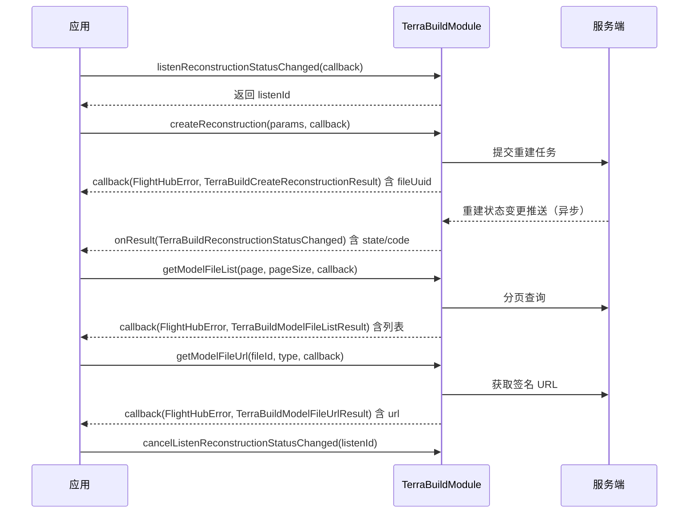

# 模型重建（TerraBuildModule）

## 1 功能概述

### 1.1 功能简介

`TerraBuildModule` 是**工作空间级**的模型重建模块，依托 DJI Terra 算法引擎提供从航拍影像到三维/二维/全景/点云模型的全流程管理能力。核心覆盖三类工作：**重建任务生命周期管理**（创建、停止、重试）、**模型文件管理**（分页查询、下载、展示、删除、重命名）以及**质量报告与空三结果查询**。此外，模块提供四组 WebSocket 状态推送订阅，覆盖重建状态变更、模型解压进度、模型状态变更和地图展示状态变化。

重建所需的媒体影像来源于工作空间媒体库；如需先查询或管理影像文件，参见 [媒体服务](./media-service.md)。

**获取方式：**

```java
Workspace workspace = FlightHubSDK.getWorkspaceInstance();
TerraBuildModule terraBuildModule = workspace.getTerraBuildModule();
```

### 1.2 核心概念

| 概念 | 说明 |
| --- | --- |
| 重建任务（Reconstruction） | 以一批媒体影像文件夹为输入，指定重建类型（二维/三维/3DGS/全景/激光雷达），云端异步执行重建，以 `fileUuid`（字符串）和 `fileId`（整型）双重标识。`fileUuid` 是创建任务后返回的主要操作句柄，`fileId` 是模型文件列表项的主要操作句柄。 |
| 全景拼接（Panorama） | 独立的全景图拼接作业，入参为影像文件夹 UUID 列表、WKT 坐标范围和是否展示到地图；完成后生成全景模型文件，可通过模型文件列表查询。 |
| 模型文件（Model File） | 重建输出的可下载文件，以整型 `fileId` 标识，包含状态、文件类型、子文件类型、缩略图 URL 等元信息。调用 `getModelFileUrl()` 获取签名下载地址。 |
| 空三（SfM） | Structure from Motion 空中三角测量，是模型重建的中间过程结果，可通过 `getSfmResult()` 单独获取，用于精度验证或调试。 |
| 质量报告 | 描述重建精度与质量的报告，`getQualityReport()` 返回报告下载 URL，支持多语言（zh/en/es/fr/de/ja/ko）与度量单位制（metric/imperial）切换。 |
| 重建设置（Settings） | `getReconstructionSettings()` 返回指定任务当前的重建配置及所用影像文件夹列表，便于二次确认或展示配置摘要。 |
| 任务状态推送 | SDK 通过 WebSocket 异步推送重建任务的状态变更，消息类型为 `TerraBuildReconstructionStatusChanged`，包含 `state`（建图文件状态）、`code`（结果码）等字段。需提前调用 `listenReconstructionStatusChanged()` 订阅，订阅无 error 参数，回调内须对消息对象判空。 |
| 模型地图展示 | 通过 `showModelOnMap()` 批量加载或卸载模型到地图，`showOnMap=true` 为加载，`false` 为卸载；解压进度、模型状态变更和展示/隐藏状态均有对应推送订阅接口。 |
| LAS 坐标系 | 对 `subFileType=7`（FormatLas）的点云模型，需调用 `setLasWkt()` 指定坐标系 WKT 后才会触发格式转换流程。 |
| 可选字段序列化 | `TerraBuildCreateReconstructionParams` 的可选参数（如 `qualityLevel`、`simplifiedFactor`、`isShownOnMap`、`optimizeSfM`）采用"标记才序列化"机制：调用 `setXxx()` 设置值后，还必须调用对应的 `setXxxSet(true)` 才会将该字段序列化到请求中。 |

**`TerraBuildCreateReconstructionParams` 字段说明**

| 字段（getter） | 类型 | 说明 |
| --- | --- | --- |
| `getName()` | `String` | 任务名称 |
| `getReconstructionType()` | `List<Integer>` | 重建类型。2=二维，3=三维，4=3DGS RGB，6=全景，7=激光雷达 |
| `getFolderUuids()` | `List<String>` | 媒体文件夹 UUID 列表（与 `folderIds` 二选一） |
| `getFolderIds()` | `List<Integer>` | 媒体文件夹 ID 列表（与 `folderUuids` 二选一） |
| `getWkt()` | `String` | 输出坐标系 WKT 字符串 |
| `getQualityLevel()` | `int` | 重建精细程度；需配合 `setQualityLevelSet(true)` 才序列化 |
| `isQualityLevelSet()` | `boolean` | `qualityLevel` 是否已设置 |
| `getQualityLevel3dgs()` | `int` | 3DGS 质量等级；需配合 `setQualityLevel3dgsSet(true)` 才序列化 |
| `isQualityLevel3dgsSet()` | `boolean` | `qualityLevel3dgs` 是否已设置 |
| `getSimplifiedFactor()` | `double` | 模型简化系数；需配合 `setSimplifiedFactorSet(true)` 才序列化 |
| `isSimplifiedFactorSet()` | `boolean` | `simplifiedFactor` 是否已设置 |
| `isShownOnMap()` | `boolean` | 是否在地图上展示；需配合 `setShownOnMapSet(true)` 才序列化 |
| `isShownOnMapSet()` | `boolean` | `isShownOnMap` 是否已设置 |
| `isOptimizeSfM()` | `boolean` | 是否优化空三；需配合 `setOptimizeSfMSet(true)` 才序列化 |
| `isOptimizeSfMSet()` | `boolean` | `optimizeSfM` 是否已设置 |
| `getCustomStorageParentId()` | `int` | 自定义存储父目录 ID；需配合 `setCustomStorageParentIdSet(true)` 才序列化 |
| `isCustomStorageParentIdSet()` | `boolean` | `customStorageParentId` 是否已设置 |
| `getGenerateModelFormats()` | `List<Integer>` | 生成模型格式列表 |
| `getQualityReportLanguage()` | `String` | 质量报告语言。取值：zh/en/es/fr/de/ja/ko |
| `getQualityReportMeasureUnitSystem()` | `String` | 度量单位制。取值：metric（公制）/ imperial（英制） |
| `getPredefineArea()` | `TerraBuildPredefineArea` | 兴趣区域（含 polygonPoints） |
| `getParameter2d()` | `TerraBuildParameter2D` | 2D 可见光重建子参数（设置后自动启用） |
| `getParameter3d()` | `TerraBuildParameter3D` | 3D 重建子参数（设置后自动启用） |
| `getParameter3dgs()` | `TerraBuildParameter3DGS` | 3DGS 重建子参数（设置后自动启用） |
| `getParameterLidar()` | `TerraBuildParameterLidar` | 激光雷达重建子参数（设置后自动启用） |

**`TerraBuildCreateReconstructionResult` 字段说明**

| 字段（getter） | 类型 | 说明 |
| --- | --- | --- |
| `getId()` | `int` | ID |
| `getUuid()` | `String` | 任务 UUID（即 `fileUuid`，是后续停止/重试/设置查询等操作的主要标识） |
| `getJobUuid()` | `String` | 作业 UUID |

**`TerraBuildReconstructionStatusChanged` 字段说明**（重建状态推送消息）

| 字段（getter） | 类型 | 说明 |
| --- | --- | --- |
| `getWorkspaceId()` | `String` | 工作空间 ID |
| `getId()` | `long` | ID |
| `getName()` | `String` | 任务名称 |
| `getState()` | `int` | 建图文件状态。0=未知，1=模型文件解压中，2=模型文件解压成功，3=模型文件解压失败，4=选择坐标系，5=格式转换中，6=格式转换后续（完整枚举见 javadoc） |
| `getUuid()` | `String` | 任务 UUID |
| `getFileType()` | `int` | 文件类型。枚举：tif/b3dm/pnts |
| `getSubFileType()` | `int` | 子文件类型 |
| `getCode()` | `int` | 结果码。0=成功 |
| `getSize()` | `long` | 文件大小 |
| `getJobInfo()` | `TerraBuildJobInfo` | 作业信息 |
| `getJobInfos()` | `List<TerraBuildJobInfo>` | 作业 Info 列表 |
| `getFastReconstructionId()` | `int` | 快速重建 ID |

**`TerraBuildModelFileItem` 字段说明**（模型文件列表项）

| 字段（getter） | 类型 | 说明 |
| --- | --- | --- |
| `getId()` | `int` | ID（即 `fileId`，用于下载/重命名/删除/详情查询） |
| `getUuid()` | `String` | 任务 UUID |
| `getName()` | `String` | 任务名称 |
| `getFileType()` | `int` | 文件类型。枚举：tif/b3dm/pnts |
| `getSubFileType()` | `int` | 子文件类型 |
| `getState()` | `int` | 建图文件状态（同 `TerraBuildReconstructionStatusChanged.getState()` 枚举） |
| `getReconstructionType()` | `List<Integer>` | 重建类型列表 |
| `getThumbnailUrl()` | `String` | 缩略图 URL |
| `getZipUrl()` | `String` | 压缩包 URL |
| `getCreatedAt()` | `String` | 创建时间（ISO 8601） |
| `getUpdatedAt()` | `String` | 更新时间（ISO 8601） |

**`TerraBuildModelFileUrlResult` 字段说明**

| 字段（getter） | 类型 | 说明 |
| --- | --- | --- |
| `getUrl()` | `String` | 文件签名下载地址（有时效性，请即时使用） |

**`TerraBuildQualityReportResult` 字段说明**

| 字段（getter） | 类型 | 说明 |
| --- | --- | --- |
| `getQualityReportUrl()` | `String` | 质量报告下载 URL |

**`TerraShowOnMapParams` 字段说明**

| 字段（getter） | 类型 | 说明 |
| --- | --- | --- |
| `getIds()` | `List<Integer>` | 文件 ID 列表（与 `selectFilter` 二选一） |
| `getShowOnMap()` | `Boolean` | `true`=加载到地图，`false`=从地图卸载 |
| `getIsDistributed()` | `Boolean` | 是否分布式处理 |
| `getSelectFilter()` | `TerraSelectFilterParams` | 批量筛选参数（与 `ids` 二选一） |

**`TerraShowOnMapResult` 字段说明**

| 字段（getter） | 类型 | 说明 |
| --- | --- | --- |
| `getIds()` | `List<Integer>` | 实际执行操作的文件 ID 列表 |

### 1.3 能力清单

**重建任务管理**

| 接口 | 回调 | 说明 |
| --- | --- | --- |
| `createReconstruction(TerraBuildCreateReconstructionParams, callback)` | `TerraBuildCreateReconstructionCallback` | 创建重建任务（Bean 参数版），返回 `fileUuid` |
| `createReconstruction(CreateReconstructionJavaParams, callback)` | `TerraBuildCreateReconstructionCallback` | 创建重建任务（Java 原生参数版） |
| `createPanorama(String name, List<String> folderUuids, String wkt, boolean isShownOnMap, callback)` | `TerraBuildCreatePanoramaCallback` | 创建全景拼接任务，返回 `fileUuid` |
| `retryReconstruction(String fileUuid, callback)` | `ResultCallback` | 重试重建任务 |
| `stopReconstruction(String fileUuid, callback)` | `ResultCallback` | 停止重建任务 |
| `getReconstructionSettings(String fileUuid, callback)` | `TerraBuildGetReconstructionSettingsCallback` | 获取重建设置，含当前参数与影像文件夹列表 |
| `getReconstructionImages(String fileUuid, callback)` | `TerraBuildGetReconstructionImagesCallback` | 获取重建所用图像列表 |
| `getSfmResult(String fileUuid, callback)` | `TerraBuildGetSfmResultCallback` | 获取空三（SfM）结果 |
| `getQualityReport(String fileUuid, String language, String measureUnitSystem, callback)` | `TerraBuildGetQualityReportCallback` | 获取质量报告 URL；language 取值：zh/en/es/fr/de/ja/ko；measureUnitSystem：metric/imperial |

**重建状态订阅**

| 接口 | 回调 | 说明 |
| --- | --- | --- |
| `listenReconstructionStatusChanged(callback)` | `TerraBuildReconstructionStatusChangedCallback` | 订阅重建任务状态变更推送，返回 `int` 监听 ID；回调**无 error 参数** |
| `cancelListenReconstructionStatusChanged(int listenId)` | — | 取消订阅重建任务状态变更推送 |

**模型文件管理**

| 接口 | 回调 | 说明 |
| --- | --- | --- |
| `getModelFileList(int page, int pageSize, callback)` | `TerraBuildGetModelFileListCallback` | 分页查询模型文件列表，返回 `TerraBuildModelFileListResult` |
| `getModelFileUrl(int fileId, int type, callback)` | `TerraBuildGetModelFileUrlCallback` | 获取模型文件签名 URL；type：1=原始文件（默认），2=转换后 ZIP |
| `getModelDetail(int fileId, callback)` | `TerraGetModelDetailCallback` | 获取模型文件详情，返回 `TerraModelDetailResult` |
| `deleteModelFile(int fileId, callback)` | `ResultCallback` | 删除单个模型文件 |
| `batchDeleteModelFiles(List<Integer> fileIds, callback)` | `ResultCallback` | 批量删除模型文件 |
| `renameModel(int fileId, TerraRenameModelParams, callback)` | `TerraRenameModelCallback` | 模型重命名；回调**无 result 参数** |
| `showModelOnMap(TerraShowOnMapParams, callback)` | `TerraShowOnMapCallback` | 批量加载/取消加载模型到地图，返回实际操作的 ID 列表 |
| `uploadModelCallback(TerraUploadCallbackParams, callback)` | `TerraUploadCallbackCallback` | 模型文件上传完成后的回调通知（objectKey/name 必填），返回 `id`/`uuid`/`name` |
| `setLasWkt(TerraSetLasWktParams, callback)` | `TerraSetLasWktCallback` | 设置 LAS 点云模型坐标系 WKT 并触发格式转换；回调**无 result 参数** |

**模型状态订阅**

| 接口 | 回调 | 说明 |
| --- | --- | --- |
| `listenTerraUnzipProgress(callback)` | `TerraUnzipProgressCallback` | 订阅模型解压进度推送，返回监听 ID；回调**无 error 参数** |
| `cancelListenTerraUnzipProgress(int listenId)` | — | 取消订阅模型解压进度推送 |
| `listenTerraModelStatusChanged(callback)` | `TerraModelStatusChangedCallback` | 订阅模型状态变更推送，返回监听 ID；回调**无 error 参数** |
| `cancelListenTerraModelStatusChanged(int listenId)` | — | 取消订阅模型状态变更推送 |
| `listenTerraFileShowOnMap(callback)` | `TerraFileShowOnMapCallback` | 订阅文件展示地图状态推送，返回监听 ID；回调**无 error 参数** |
| `cancelListenTerraFileShowOnMap(int listenId)` | — | 取消订阅文件展示地图状态推送 |
| `listenTerraMediaFileHideOnMap(callback)` | `TerraMediaFileHideOnMapCallback` | 订阅模型隐藏地图推送，返回监听 ID；回调**无 error 参数** |
| `cancelListenTerraMediaFileHideOnMap(int listenId)` | — | 取消订阅模型隐藏地图推送 |
| `listenTerraMediaFileShowOnMap(callback)` | `TerraMediaFileShowOnMapCallback` | 订阅模型显示地图推送，返回监听 ID；回调**无 error 参数** |
| `cancelListenTerraMediaFileShowOnMap(int listenId)` | — | 取消订阅模型显示地图推送 |

---

## 2 前提条件

- 已完成上云 API 2 底座部署，并获取到服务地址与鉴权 Token。详见 [部署指南](../../../02.deployment/00.index.md)、[鉴权接入指南](../../../08.auth.md)。
- 已完成 SDK 初始化且 `FlightHubSDK.isInitialized()` 返回 `true`。详见 [SDK 初始化](../init/sdk-init.md)。
- 已通过 `FlightHubSDK.getWorkspaceInstance()` 获取工作空间实例，并调用其 `getTerraBuildModule()` 拿到本模块实例。
- 设备已完成上云并绑定至当前工作空间，已采集影像并上传至媒体库，可获取到影像文件夹 UUID 或 ID。详见 [设备上云](../../../04.device-onboarding/00.index.md)、[媒体服务](./media-service.md)。
- 如需接收重建状态变更、模型解压进度或模型展示状态等推送，需在 SDK 配置中设置 WebSocket 通知地址。详见 [SDK 配置](../init/sdk-config.md)。

---

## 3 快速上手

### 3.1 获取模块实例

```java
// 前置：已完成 FlightHubSDK.initialize(config)
Workspace workspace = FlightHubSDK.getWorkspaceInstance();
TerraBuildModule terraBuildModule = workspace.getTerraBuildModule();
```

### 3.2 使用流程

1. **获取模块实例** —— 从工作空间实例调用 `getTerraBuildModule()`。
2. **订阅状态推送** —— 调用 `listenReconstructionStatusChanged()` 订阅重建任务状态变更；保存返回的整型监听 ID，事后调用 `cancelListenReconstructionStatusChanged()` 释放。
3. **创建重建任务** —— 组装 `TerraBuildCreateReconstructionParams`（设置影像文件夹 UUID/ID、重建类型、任务名称，以及需序列化的可选字段）；调用 `createReconstruction()` 并从结果的 `getUuid()` 保存 `fileUuid`。
4. **接收状态推送** —— 重建任务异步执行，SDK 通过 WebSocket 推送 `TerraBuildReconstructionStatusChanged`；在回调中检查 `getState()` 判断进度，`getCode()` 判断是否出错。
5. **查询模型文件列表** —— 重建完成后调用 `getModelFileList()` 分页获取生成的模型文件；每条 `TerraBuildModelFileItem` 包含 `getId()`（即 `fileId`）、状态、类型、缩略图等。
6. **获取文件下载地址** —— 用 `getModelFileUrl(fileId, type)` 获取签名下载 URL；type=1 为原始文件，type=2 为转换后 ZIP；签名 URL 有时效性，请即时使用。
7. **质量报告与空三** —— 按需调用 `getQualityReport()` 获取质量报告 URL，或调用 `getSfmResult()` 获取空三中间结果。
8. **地图展示管理** —— 调用 `showModelOnMap()` 批量加载/卸载模型到地图；可通过 `listenTerraFileShowOnMap()` 等订阅接口监听展示状态变化。
9. **清理与取消订阅** —— 调用 `deleteModelFile()` / `batchDeleteModelFiles()` 删除不需要的模型文件；业务结束后取消已订阅的各类推送。

### 3.3 调用时序图



---

## 4 示例代码

### 4.1 完整示例

```java
import com.dji.flighthubsdk.FlightHubCallback;
import com.dji.flighthubsdk.FlightHubSDK;
import com.dji.flighthubsdk.bean.*;
import com.dji.flighthubsdk.core.TerraBuildModule;
import java.util.Arrays;
import java.util.List;

/**
 * 模型重建完整流程：订阅状态 → 创建任务 → 等待推送 → 查询模型列表 → 获取下载 URL → 取消订阅。
 */
public class TerraBuildExample {

    // 保存监听 ID，用于事后取消订阅
    private int statusListenId = -1;

    // ============ 步骤 1：订阅重建任务状态变更推送 ============
    public void subscribeStatus() {
        TerraBuildModule module = FlightHubSDK.getWorkspaceInstance().getTerraBuildModule();

        // 注意：TerraBuildReconstructionStatusChangedCallback 回调无 error 参数，必须对 msg 判空
        statusListenId = module.listenReconstructionStatusChanged(msg -> {
            if (msg == null) return;
            System.out.println("重建状态变更:"
                    + " uuid=" + msg.getUuid()
                    + " state=" + msg.getState()   // 完整枚举见 javadoc
                    + " code=" + msg.getCode()     // 0=成功，非 0 见 javadoc 错误码
                    + " size=" + msg.getSize());
        });
        System.out.println("已订阅重建状态推送, listenId=" + statusListenId);
    }

    // ============ 步骤 2：创建三维重建任务 ============
    public void createReconstruction(List<String> folderUuids) {
        TerraBuildModule module = FlightHubSDK.getWorkspaceInstance().getTerraBuildModule();

        TerraBuildCreateReconstructionParams params = new TerraBuildCreateReconstructionParams();
        params.setName("三维重建-" + System.currentTimeMillis());
        // 注意：reconstructionType 是列表，此处指定三维重建（3）
        params.setReconstructionType(Arrays.asList(3));
        // folderUuids 与 folderIds 二选一；影像文件夹 UUID 可通过媒体服务接口获取
        params.setFolderUuids(folderUuids);
        params.setQualityReportLanguage("zh");
        params.setQualityReportMeasureUnitSystem("metric");
        // 注意：isShownOnMap 等可选字段须同时调用 set*Set(true) 才会被序列化到请求中
        params.setShownOnMap(true);
        params.setShownOnMapSet(true);

        module.createReconstruction(params, new FlightHubCallback.TerraBuildCreateReconstructionCallback() {
            @Override
            public void onResult(FlightHubError error, TerraBuildCreateReconstructionResult result) {
                if (error != null && !error.isSuccess()) {
                    System.err.println("创建重建任务失败: " + error
                            + " serverCode=" + error.getServerCode()
                            + " msg=" + error.getServerMessage());
                    return;
                }
                if (result == null) return;
                // 保存 fileUuid，后续停止/重试/设置查询等操作均以此为参数
                String fileUuid = result.getUuid();
                System.out.println("重建任务已创建:"
                        + " id=" + result.getId()
                        + " fileUuid=" + fileUuid
                        + " jobUuid=" + result.getJobUuid());
            }
        });
    }

    // ============ 步骤 3：分页查询模型文件列表 ============
    public void listModelFiles(int page, int pageSize) {
        TerraBuildModule module = FlightHubSDK.getWorkspaceInstance().getTerraBuildModule();

        module.getModelFileList(page, pageSize, new FlightHubCallback.TerraBuildGetModelFileListCallback() {
            @Override
            public void onResult(FlightHubError error, TerraBuildModelFileListResult result) {
                if (error != null && !error.isSuccess()) {
                    System.err.println("查询模型文件列表失败: " + error);
                    return;
                }
                if (result == null || result.getList() == null) return;
                System.out.println("模型文件总数=" + result.getTotal()
                        + " 当前页=" + result.getPage()
                        + " 每页=" + result.getPageSize());
                for (TerraBuildModelFileItem item : result.getList()) {
                    System.out.println("  模型 fileId=" + item.getId()
                            + " uuid=" + item.getUuid()
                            + " name=" + item.getName()
                            + " state=" + item.getState()
                            + " fileType=" + item.getFileType()
                            + " createdAt=" + item.getCreatedAt());
                }
                // 注意：如需全量数据，根据 total 与 pageSize 循环翻页，避免漏数据
                long fetched = (long) result.getPage() * result.getPageSize();
                if (fetched < result.getTotal()) {
                    listModelFiles(result.getPage() + 1, result.getPageSize());
                }
            }
        });
    }

    // ============ 步骤 4：获取模型文件签名下载 URL ============
    public void getDownloadUrl(int fileId) {
        TerraBuildModule module = FlightHubSDK.getWorkspaceInstance().getTerraBuildModule();

        // type=1 原始文件（默认），type=2 转换后 ZIP
        module.getModelFileUrl(fileId, 1, new FlightHubCallback.TerraBuildGetModelFileUrlCallback() {
            @Override
            public void onResult(FlightHubError error, TerraBuildModelFileUrlResult result) {
                if (error != null && !error.isSuccess()) {
                    System.err.println("获取文件 URL 失败: " + error);
                    return;
                }
                if (result == null) return;
                // 注意：签名 URL 有时效性，请即时下载，不要长期缓存
                System.out.println("模型文件下载地址: " + result.getUrl());
            }
        });
    }

    // ============ 步骤 5：取消订阅，释放资源 ============
    public void unsubscribe() {
        if (statusListenId >= 0) {
            FlightHubSDK.getWorkspaceInstance().getTerraBuildModule()
                    .cancelListenReconstructionStatusChanged(statusListenId);
            System.out.println("已取消重建状态订阅, listenId=" + statusListenId);
            statusListenId = -1;
        }
    }
}
```

### 4.2 场景化片段

**获取重建质量报告**

```java
// 前置：已知任务 fileUuid 且重建已完成
String fileUuid = "your-file-uuid";
FlightHubSDK.getWorkspaceInstance().getTerraBuildModule()
        .getQualityReport(fileUuid, "zh", "metric",
                new FlightHubCallback.TerraBuildGetQualityReportCallback() {
                    @Override
                    public void onResult(FlightHubError error, TerraBuildQualityReportResult result) {
                        if (error != null && !error.isSuccess()) {
                            System.err.println("获取质量报告失败: " + error);
                            return;
                        }
                        if (result == null) return;
                        // 获得报告 URL 后可用 HTTP 客户端下载 PDF 文件
                        System.out.println("质量报告地址: " + result.getQualityReportUrl());
                    }
                });
```

**创建全景拼接任务**

```java
// 前置：已知影像文件夹 UUID 列表
List<String> folderUuids = Arrays.asList("folder-uuid-1", "folder-uuid-2");
// wkt 为可选的 WKT 坐标范围字符串；不限范围时传空字符串
String wkt = "";
boolean showOnMap = true;

FlightHubSDK.getWorkspaceInstance().getTerraBuildModule()
        .createPanorama("全景拼接-" + System.currentTimeMillis(), folderUuids, wkt, showOnMap,
                new FlightHubCallback.TerraBuildCreatePanoramaCallback() {
                    @Override
                    public void onResult(FlightHubError error, TerraBuildCreatePanoramaResult result) {
                        if (error != null && !error.isSuccess()) {
                            System.err.println("创建全景任务失败: " + error);
                            return;
                        }
                        if (result == null) return;
                        System.out.println("全景任务已创建:"
                                + " uuid=" + result.getUuid()
                                + " jobUuid=" + result.getJobUuid());
                    }
                });
```

**批量加载模型到地图**

```java
// 前置：已知要加载的模型 fileId 列表（从 getModelFileList 返回的 TerraBuildModelFileItem.getId()）
List<Integer> fileIds = Arrays.asList(101, 102, 103);

TerraShowOnMapParams showParams = new TerraShowOnMapParams();
showParams.setIds(fileIds);
// 注意：showOnMap=true 为加载到地图；false 为从地图卸载
showParams.setShowOnMap(true);

FlightHubSDK.getWorkspaceInstance().getTerraBuildModule()
        .showModelOnMap(showParams, new FlightHubCallback.TerraShowOnMapCallback() {
            @Override
            public void onResult(FlightHubError error, TerraShowOnMapResult result) {
                if (error != null && !error.isSuccess()) {
                    System.err.println("加载模型到地图失败: " + error);
                    return;
                }
                if (result == null) return;
                // 返回实际操作成功的 fileId 列表（可能少于入参，如部分文件仍在处理中）
                System.out.println("已加载到地图的模型 IDs: " + result.getIds());
            }
        });
```

**重试失败的重建任务**

```java
// 前置：已知 fileUuid，任务状态为失败
String fileUuid = "your-file-uuid";
FlightHubSDK.getWorkspaceInstance().getTerraBuildModule()
        .retryReconstruction(fileUuid, error -> {
            if (error != null && !error.isSuccess()) {
                System.err.println("重试重建失败: " + error);
                return;
            }
            System.out.println("已发起重试，等待状态推送通知进度");
        });
```

---

## 5 相关文档

- [SDK 初始化](../init/sdk-init.md) —— 获取工作空间实例与调用本模块前必须完成的初始化步骤
- [SDK 配置](../init/sdk-config.md) —— 配置 WebSocket 通知地址，以接收重建状态变更等推送
- [部署指南](../../../02.deployment/00.index.md) —— 上云 API 2 底座部署与服务地址获取
- [鉴权接入指南](../../../08.auth.md) —— 获取鉴权 Token 的接入流程
- [设备上云](../../../04.device-onboarding/00.index.md) —— 设备绑定工作空间及影像采集的前置流程
- [媒体服务](./media-service.md) —— 查询、下载和管理重建所需的航拍影像文件，影像文件夹 UUID 由此获取
- [使用 API 文档查阅接口详情](../../03.api-docs-guide.md) —— 查阅 `TerraBuildModule` 完整方法签名与字段定义
