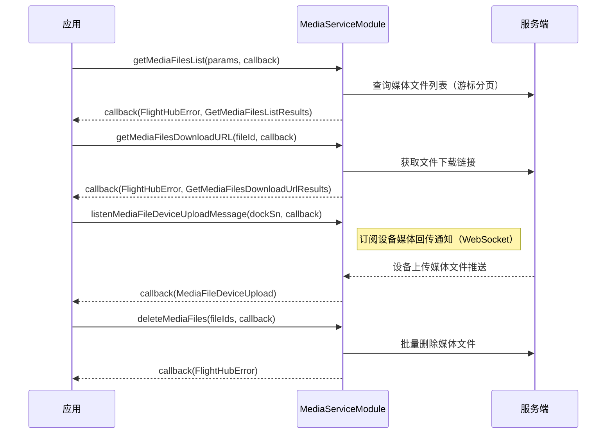

# 媒体服务（MediaServiceModule）

## 1 功能概述

### 1.1 功能简介

`MediaServiceModule` 是**工作空间级**的媒体服务模块，覆盖机场（Dock）上传至云端的媒体文件的完整生命周期：分页查询文件列表与详情、按文件 ID 或 ObjectKey 获取下载链接、批量删除、获取 OSS STS 临时凭证（ISV 自行直传后回调服务端入库）、地理标注媒体资源上传，以及订阅设备媒体后处理完成通知和设备媒体回传通知。模块还内置全景照片处理能力：触发/停止/重试 3X 超清全景拼接、触发 1X 全景瓦片切片，以及查询瓦片 CDN URL 和订阅拼接进度推送。

> 媒体文件由机场（Dock）上传至云端。查询时 `deviceSn` 须填机场 SN，而非飞机 SN。

本模块是 [模型重建](./3d-reconstruction.md) 的数据来源：三维/二维/全景重建任务以媒体文件夹为输入，建议先通过本模块查询并确认媒体文件就绪后再发起重建。

**获取方式：**

```java
Workspace workspace = FlightHubSDK.getWorkspaceInstance();
MediaServiceModule mediaModule = workspace.getMediaServiceModule();
```

### 1.2 核心概念

| 概念 | 说明 |
| --- | --- |
| 媒体文件（Media File） | 机场上传至云端的图片（fileType=2）或视频（fileType=3），以 `fileId`（long，files 表主键）和 `objectKey`（对象存储唯一路径键）双重标识。 |
| 分页游标（`startIndex` / `nextIndex`） | 列表查询采用游标分页：首次传 `startIndex=0`；响应的 `nextIndex` 是下一页起始值，返回 `-1` 表示已是最后一页。 |
| ObjectKey | 文件在对象存储（OSS/S3）中的唯一路径标识，获取批量下载 URL 和上传回调均需用到。 |
| STS 临时凭证（`GetMediaUploadStsResult`） | ISV 调用 `getMediaUploadSts()` 获取 OSS STS 凭证后，自行调用 OSS SDK 直传文件；传输完成后**必须**调用 `mediaUploadCallback()` 通知服务端，否则服务端不感知文件入库。 |
| 后处理通知（`MediaFilePostProcess`） | 文件入库后服务端异步完成编/转码等处理，完成时通过 WebSocket 推送；ISV 调用 `listenMediaFilePostProcessMessage()` 订阅，感知文件可用状态。 |
| 设备媒体回传通知（`MediaFileDeviceUpload`） | 设备将文件上传至云端时实时推送，ISV 可据此驱动后续处理逻辑。 |
| 全景拼接（Pano Stitch） | 对 `panoTotalCount > 0` 的全景照片目录触发 3X 超清拼接；成片生成后，1X 全景需手动调 `startPanoTier()` 切片，3X 拼接完成后自动切片无需单独调。切片完成后（state=3）可通过 `getPanoTierTileUrl()` 获取 CDN URL 渲染全景播放器。 |

### 1.3 能力清单

**媒体文件查询与详情**

| 方法 | 说明 |
| --- | --- |
| `getMediaFilesList(GetMediaFilesListParams, GetMediaFilesListCallback)` | 获取媒体文件列表（Params 入参，游标分页） |
| `getMediaFilesList(String, int, int, List, String, long, long, GetMediaFilesListCallback)` | 获取媒体文件列表（逐字段入参，游标分页） |
| `getMediaFileDetailById(int, GetMediaFileDetailByIdCallback)` | 根据文件 ID 获取媒体文件详情（含 url / thumbnailUrl） |

**媒体文件删除**

| 方法 | 说明 |
| --- | --- |
| `deleteMediaFiles(List, ResultCallbackWithError)` | 批量删除媒体文件（传 fileId 列表） |

**媒体文件下载**

| 方法 | 说明 |
| --- | --- |
| `getMediaFilesDownloadURL(long, GetMediaFilesDownloadUrlCallback)` | 按文件 ID 获取单文件下载 URL |
| `getMediaFilesDownloadURL(List, GetMediaFilesDownloadUrlListCallback)` | 按 ObjectKey 列表批量获取下载 URL |

**媒体文件上传**

| 方法 | 说明 |
| --- | --- |
| `getMediaUploadSts(GetMediaUploadStsParams, GetMediaUploadStsCallback)` | 获取 OSS STS 临时上传凭证 |
| `mediaUploadCallback(MediaUploadCallbackParams, MediaUploadCallbackCallback)` | 媒体文件上传完成后通知服务端（入库回调） |
| `uploadGeoMediaFile(UploadGeoMediaFileParams, UploadGeoMediaFileCallback)` | 上传地理标注媒体资源（图片备注；name / objectKey 必填） |

**设备事件监听**

| 方法 | 说明 |
| --- | --- |
| `listenMediaFilePostProcessMessage(String, MediaFilePostProcessCallback)` | 订阅设备媒体后处理完成通知；返回 listenId |
| `cancelListenMediaFilePostProcessMessage(int)` | 取消订阅媒体后处理通知 |
| `listenMediaFileDeviceUploadMessage(String, MediaFileDeviceUploadCallback)` | 订阅设备媒体回传通知；返回 listenId |
| `cancelListenMediaFileDeviceUploadMessage(int)` | 取消订阅设备媒体回传通知 |

**全景拼接与瓦片**

| 方法 | 说明 |
| --- | --- |
| `startPanoStitch(long, PanoStitchActionCallback)` | 触发 3X 超清全景拼接（入参为全景照片目录 ID） |
| `stopPanoStitch(long, PanoStitchActionCallback)` | 停止全景拼接（仅 WaitingResource/Processing 状态可停） |
| `retryPanoStitch(long, PanoStitchActionCallback)` | 重试全景拼接（仅 Failed/Cancel/PaidFailed 状态可重试） |
| `startPanoTier(long, PanoStitchActionCallback)` | 触发全景瓦片切片（1X 全景成片使用；3X 拼接自带切片无需单独调） |
| `getPanoTierTileUrl(long, GetPanoTierTileUrlCallback)` | 获取全景瓦片 CDN URL 及鉴权信息 |
| `subscribePanoStitchProgress(String, PanoStitchProgressCallback)` | 订阅全景拼接进度（WS topic: topic_pano_stitch_progress）；返回 listenId |
| `cancelListenPanoStitchProgress(int)` | 取消订阅全景拼接进度 |

---

## 2 前提条件

- 已完成上云 API 2 底座部署，并获取到服务地址与鉴权 Token。详见 [部署指南](../../../02.deployment/00.index.md)、[鉴权接入指南](../../../08.auth.md)。
- 已完成 SDK 初始化且 `FlightHubSDK.isInitialized()` 返回 `true`。详见 [SDK初始化](../init/sdk-init.md)。
- 已通过 `FlightHubSDK.getWorkspaceInstance()` 获取工作空间实例，并调用 `getMediaServiceModule()` 拿到本模块实例。
- 媒体文件由机场（Dock）上传至云端；相关设备已完成上云并绑定至当前工作空间。详见 [设备上云](../../../04.device-onboarding/00.index.md)。
- 订阅类接口（`listenMediaFilePostProcessMessage` / `listenMediaFileDeviceUploadMessage` / `subscribePanoStitchProgress`）依赖 WebSocket 连接，需在 SDK 初始化时配置通知回调地址。详见 [SDK配置](../init/sdk-config.md)。

---

## 3 快速上手

### 3.1 获取模块实例

```java
// 前置：已完成 FlightHubSDK.initialize(config)
Workspace workspace = FlightHubSDK.getWorkspaceInstance();
MediaServiceModule mediaModule = workspace.getMediaServiceModule();
```

### 3.2 使用流程

1. **获取模块实例** —— 从工作空间实例调用 `getMediaServiceModule()`。
2. **查询媒体文件列表** —— 组装 `GetMediaFilesListParams`（机场 Dock SN、文件类型、时间范围），首次 `startIndex=0`，按响应的 `nextIndex` 循环翻页，直到 `nextIndex == -1`。
3. **获取下载链接** —— 按单个 `fileId` 调用 `getMediaFilesDownloadURL(long, cb)` 获取直链；或收集多个 ObjectKey 调用 `getMediaFilesDownloadURL(List, cb)` 批量获取。
4. **删除媒体文件** —— 收集需要删除的 `fileId` 列表，调用 `deleteMediaFiles()`。
5. **（可选）上传媒体文件** —— 调 `getMediaUploadSts()` 获取 STS 凭证 → 用 OSS SDK 直传 → 上传成功后**必须**调 `mediaUploadCallback()` 通知服务端入库。
6. **（可选）订阅事件** —— 调 `listenMediaFileDeviceUploadMessage()` 订阅回传通知，或 `listenMediaFilePostProcessMessage()` 订阅后处理完成通知；不再需要时用对应的 `cancelListen*` 传入 `listenId` 取消。
7. **（可选）全景拼接** —— 对全景照片目录调 `startPanoStitch()`，通过 `subscribePanoStitchProgress()` 监听进度；拼接完成（state=3）后调 `getPanoTierTileUrl()` 获取 CDN URL 渲染全景播放器。

### 3.3 调用时序图



---

## 4 示例代码

### 4.1 完整示例

```java
/**
 * 媒体服务：分页查询媒体文件列表 -> 获取下载 URL -> 批量删除。
 */
public class MediaServiceExample {

    private final MediaServiceModule mediaModule =
            FlightHubSDK.getWorkspaceInstance().getMediaServiceModule();

    // ============ 1. 分页查询媒体文件列表 ============
    public void queryMediaFiles(String dockSn) {
        GetMediaFilesListParams params = new GetMediaFilesListParams();
        // 注意: deviceSn 须填机场（Dock）SN，而非飞机 SN；媒体由机场上传至云端
        params.setDeviceSn(dockSn);
        params.setStartIndex(0);      // 首次查询从 0 开始
        params.setPageSize(100);      // 每页最多 500 条，建议传 100
        // 可选：文件类型过滤；"2"=图片，"3"=视频
        params.setFileTypes(java.util.Arrays.asList("2", "3"));
        // 可选：时间范围（秒级时间戳），-1 表示不限
        params.setStartCreateTime(-1);
        params.setEndCreateTime(-1);

        fetchPage(params);
    }

    private void fetchPage(GetMediaFilesListParams params) {
        mediaModule.getMediaFilesList(params, new FlightHubCallback.GetMediaFilesListCallback() {
            @Override
            public void onResult(FlightHubError error, GetMediaFilesListResults results) {
                if (error != null && !error.isSuccess()) {
                    System.err.println("查询媒体文件列表失败: " + error
                            + " serverCode=" + error.getServerCode()
                            + " msg=" + error.getServerMessage());
                    return;
                }
                if (results == null || results.getList() == null) return;

                System.out.println("本页条数=" + results.getList().size()
                        + " 总记录数=" + results.getTotal());

                for (MediaFilesListItemInfoData item : results.getList()) {
                    System.out.println("fileId=" + item.getFileId()
                            + " fileName=" + item.getFileName()
                            + " objectKey=" + item.getObjectKey()
                            + " size=" + item.getSize() + "B"
                            + " suffix=" + item.getSuffix()
                            + " deviceSn=" + item.getDeviceSn()
                            + " createdAt=" + item.getCreatedAt());
                }

                // 注意: nextIndex == -1 表示已到最后一页，否则继续翻页
                if (results.getNextIndex() != -1) {
                    params.setStartIndex(results.getNextIndex());
                    fetchPage(params);
                }
            }
        });
    }

    // ============ 2. 按文件 ID 获取单文件下载 URL ============
    public void downloadById(long fileId) {
        mediaModule.getMediaFilesDownloadURL(fileId,
                new FlightHubCallback.GetMediaFilesDownloadUrlCallback() {
                    @Override
                    public void onResult(FlightHubError error, GetMediaFilesDownloadUrlResults results) {
                        if (error != null && !error.isSuccess()) {
                            System.err.println("获取下载 URL 失败: " + error);
                            return;
                        }
                        if (results == null) return;
                        System.out.println("下载地址: " + results.getUrl());
                    }
                });
    }

    // ============ 3. 批量删除媒体文件 ============
    public void deleteFiles(java.util.List<Long> fileIds) {
        // 注意: fileIds 为媒体文件的 fileId（long）列表
        mediaModule.deleteMediaFiles(fileIds, new FlightHubCallback.ResultCallbackWithError() {
            @Override
            public void onResult(FlightHubError error) {
                if (error != null && !error.isSuccess()) {
                    System.err.println("批量删除失败: " + error
                            + " serverCode=" + error.getServerCode()
                            + " msg=" + error.getServerMessage());
                    return;
                }
                System.out.println("批量删除成功，已删除 " + fileIds.size() + " 个文件");
            }
        });
    }
}
```

**`GetMediaFilesListParams` 字段说明**

| 字段（getter / setter） | 类型 | 必填 | 说明 |
| --- | --- | --- | --- |
| `getStartIndex()` / `setStartIndex(int)` | `int` | 是 | 游标起始索引，首次传 `0` |
| `getPageSize()` / `setPageSize(int)` | `int` | 是 | 每页大小，默认 100，最大 500 |
| `getDeviceSn()` / `setDeviceSn(String)` | `String` | 否 | 机场 Dock SN（非飞机 SN），传空字符串表示不过滤 |
| `getFlightId()` / `setFlightId(String)` | `String` | 否 | 飞行任务 ID，传空字符串表示不过滤 |
| `getFileTypes()` / `setFileTypes(List<String>)` | `List<String>` | 否 | 文件类型，`"2"`=图片，`"3"`=视频 |
| `getStartCreateTime()` / `setStartCreateTime(long)` | `long` | 否 | 创建开始时间（秒级时间戳），-1 表示不限 |
| `getEndCreateTime()` / `setEndCreateTime(long)` | `long` | 否 | 创建结束时间（秒级时间戳），-1 表示不限 |

**`GetMediaFilesListResults` 字段说明**

| 字段（getter） | 类型 | 说明 |
| --- | --- | --- |
| `getList()` | `List<MediaFilesListItemInfoData>` | 当前页媒体文件列表 |
| `getTotal()` | `int` | 总记录数 |
| `getPageSize()` | `int` | 本页数据大小 |
| `getNextIndex()` | `int` | 下一页起始索引，`-1` 表示已是最后一页 |

**`GetMediaFilesDownloadUrlResults` 字段说明**

| 字段（getter） | 类型 | 说明 |
| --- | --- | --- |
| `getUrl()` | `String` | 文件下载地址 |

### 4.2 场景化片段

**获取 STS 上传凭证并在上传完成后通知服务端**

```java
// 步骤一：获取 STS 临时上传凭证
public void uploadMedia(String dockSn, String localFilePath) {
    GetMediaUploadStsParams stsParams = new GetMediaUploadStsParams();
    stsParams.setSn(dockSn);
    stsParams.setFilePath("media/photos/sample.jpg");  // 上传至 OSS 的目标路径
    stsParams.setExpire(3600);   // 凭证有效期（秒）
    // 注意: module 为 0 或其他非特殊值时使用默认设备 STS；2=飞行记录 STS；2001=SN 加密
    stsParams.setModule(0);

    FlightHubSDK.getWorkspaceInstance().getMediaServiceModule()
            .getMediaUploadSts(stsParams, new FlightHubCallback.GetMediaUploadStsCallback() {
                @Override
                public void onResult(FlightHubError error, GetMediaUploadStsResult result) {
                    if (error != null && !error.isSuccess()) {
                        System.err.println("获取 STS 凭证失败: " + error);
                        return;
                    }
                    if (result == null) return;

                    // 使用凭证通过 OSS SDK 直传文件（此处调用 OSS/S3 SDK，不属于 FlightHub SDK 范围）
                    MediaUploadStsCredentials creds = result.getCredentials();
                    String objectKey = result.getObjectKeyPrefix() + "sample.jpg";
                    System.out.println("Endpoint=" + result.getEndpoint()
                            + " Bucket=" + result.getBucket()
                            + " Provider=" + result.getProvider()
                            + " Region=" + result.getRegion()
                            + " AK=" + creds.getAccessKeyId()
                            + " SecurityToken=" + creds.getSecurityToken()
                            + " 有效期=" + creds.getExpire() + "s");

                    // 步骤二：OSS SDK 直传完成后，必须通知服务端入库；否则服务端不感知文件
                    notifyUploadDone(dockSn, objectKey);
                }
            });
}

// 步骤二：上传完成后通知服务端入库
private void notifyUploadDone(String sn, String objectKey) {
    MediaUploadCallbackFile file = new MediaUploadCallbackFile();
    file.setObjectKey(objectKey);
    file.setName("sample.jpg");
    file.setType(2);   // 2=图片，3=视频

    MediaUploadCallbackParams cbParams = new MediaUploadCallbackParams();
    cbParams.setSn(sn);
    cbParams.setResult(0);            // 0 表示上传成功
    cbParams.setProgress(100);        // 上传进度 0-100
    cbParams.setFile(file);
    cbParams.setExpectedFileCount(1); // 本次预期上传文件总数
    cbParams.setUploadedFileCount(1); // 已上传文件数

    FlightHubSDK.getWorkspaceInstance().getMediaServiceModule()
            .mediaUploadCallback(cbParams, new FlightHubCallback.MediaUploadCallbackCallback() {
                @Override
                public void onResult(FlightHubError error, MediaUploadCallbackResult result) {
                    if (error != null && !error.isSuccess()) {
                        System.err.println("上传回调通知失败: " + error);
                        return;
                    }
                    if (result == null) return;
                    // 注意: 保存服务端返回的 objectKey / uuid / mediaId，后续查询和删除时使用
                    System.out.println("入库成功 objectKey=" + result.getObjectKey()
                            + " uuid=" + result.getUuid()
                            + " mediaId=" + result.getMediaId()
                            + " flightId=" + result.getFlightId());
                }
            });
}
```

**`GetMediaUploadStsResult` 字段说明**

| 字段（getter） | 类型 | 说明 |
| --- | --- | --- |
| `getBucket()` | `String` | 存储桶名称 |
| `getObjectKeyPrefix()` | `String` | 上传路径前缀 |
| `getEndpoint()` | `String` | 访问端点 |
| `getProvider()` | `String` | 存储提供商 |
| `getRegion()` | `String` | 区域 |
| `getCredentials()` | `MediaUploadStsCredentials` | STS 临时凭证（含 AK/SK/SecurityToken） |

**`MediaUploadStsCredentials` 字段说明**

| 字段（getter） | 类型 | 说明 |
| --- | --- | --- |
| `getAccessKeyId()` | `String` | AccessKeyId |
| `getAccessKeySecret()` | `String` | AccessKeySecret |
| `getSecurityToken()` | `String` | 安全令牌（SecurityToken） |
| `getExpire()` | `int` | 凭证有效期（秒） |

**订阅设备媒体回传通知**

```java
// 注意: 依赖 WebSocket 连接，须在 SDK 初始化时配置通知地址（参见 SDK配置）
public void subscribeDeviceUpload(String dockSn) {
    int listenId = FlightHubSDK.getWorkspaceInstance().getMediaServiceModule()
            .listenMediaFileDeviceUploadMessage(dockSn,
                    new FlightHubCallback.MediaFileDeviceUploadCallback() {
                        @Override
                        public void onResult(MediaFileDeviceUpload msg) {
                            // 注意: 此回调无 FlightHubError 参数，须对 msg 做判空
                            if (msg == null) return;
                            System.out.println("设备媒体回传通知"
                                    + " deviceSn=" + msg.getDeviceSn()
                                    + " fileId=" + msg.getFileId()
                                    + " objectKey=" + msg.getObjectKey()
                                    + " fileType=" + msg.getFileType()  // 2=图片 3=视频 -1=未知
                                    + " size=" + msg.getObjectSize() + "B"
                                    + " flightId=" + msg.getFlightId());
                        }
                    });

    // 业务结束后取消订阅，传入 listenId
    FlightHubSDK.getWorkspaceInstance().getMediaServiceModule()
            .cancelListenMediaFileDeviceUploadMessage(listenId);
}
```

**全景拼接：触发 -> 订阅进度 -> 查询瓦片 URL**

```java
/**
 * 触发 3X 超清全景拼接并监听进度；拼接完成后获取瓦片 CDN URL。
 *
 * @param panoDirectoryFileId 全景照片目录的 fileId（panoTotalCount > 0 的目录）
 * @param workspaceId         工作空间 UUID
 */
public void runPanoStitch(long panoDirectoryFileId, String workspaceId) {
    MediaServiceModule module =
            FlightHubSDK.getWorkspaceInstance().getMediaServiceModule();

    // 步骤一：订阅全景拼接进度（建议先订阅再触发，避免错过早期进度推送）
    int panoListenId = module.subscribePanoStitchProgress(workspaceId,
            new FlightHubCallback.PanoStitchProgressCallback() {
                @Override
                public void onResult(PanoStitchProgressMsg msg) {
                    // 注意: 此回调无 FlightHubError 参数，须对 msg 做判空
                    if (msg == null) return;
                    System.out.println("拼接进度 fileId=" + msg.getFileId()
                            + " name=" + msg.getName()
                            + " state=" + msg.getPanoStitchState()
                            // state: 0=未处理 1=等待资源 2=处理中 3=成功 4=失败 5=取消 6=欠费
                            + " progress=" + msg.getPanoStitchProgress() + "%"
                            + " errorCode=" + msg.getPanoErrorCode());

                    if (msg.getPanoStitchState() == 3) {
                        // 拼接成功，查询瓦片 URL（步骤三）
                        fetchPanoTileUrl(msg.getFileId());
                    } else if (msg.getPanoStitchState() >= 4) {
                        System.err.println("拼接失败/取消/欠费 state="
                                + msg.getPanoStitchState()
                                + " errorCode=" + msg.getPanoErrorCode());
                    }
                }
            });

    // 步骤二：触发 3X 超清全景拼接
    // 注意: 入参为全景照片目录 ID，非成片文件 ID；stopPanoStitch / retryPanoStitch 入参为成片文件 ID
    module.startPanoStitch(panoDirectoryFileId,
            new FlightHubCallback.PanoStitchActionCallback() {
                @Override
                public void onResult(FlightHubError error) {
                    if (error != null && !error.isSuccess()) {
                        System.err.println("触发全景拼接失败: " + error);
                        return;
                    }
                    System.out.println("全景拼接已触发，等待进度推送...");
                }
            });

    // 不再需要时取消订阅
    // module.cancelListenPanoStitchProgress(panoListenId);
}

// 步骤三：拼接成功后获取全景瓦片 CDN URL
private void fetchPanoTileUrl(long stitchedFileId) {
    FlightHubSDK.getWorkspaceInstance().getMediaServiceModule()
            .getPanoTierTileUrl(stitchedFileId,
                    new FlightHubCallback.GetPanoTierTileUrlCallback() {
                        @Override
                        public void onResult(FlightHubError error, GetPanoTierTileUrlResult result) {
                            if (error != null && !error.isSuccess()) {
                                System.err.println("获取瓦片 URL 失败: " + error);
                                return;
                            }
                            if (result == null) return;
                            // 注意: 仅当 state == 3 时 baseUrl / queryParams 字段有效
                            if (result.getState() != 3) {
                                System.out.println("瓦片切片尚未完成，当前 state=" + result.getState());
                                return;
                            }
                            System.out.println("瓦片 baseUrl=" + result.getBaseUrl()
                                    + " queryParams=" + result.getQueryParams());
                        }
                    });
}
```

**`PanoStitchProgressMsg` 字段说明**

| 字段（getter） | 类型 | 说明 |
| --- | --- | --- |
| `getFileId()` | `long` | 成片文件 ID |
| `getName()` | `String` | 成片文件名 |
| `getWorkspaceId()` | `String` | 工作空间 UUID |
| `getPanoStitchState()` | `int` | 拼接状态（0=未处理，1=等待资源，2=处理中，3=成功，4=失败，5=取消，6=欠费） |
| `getPanoStitchProgress()` | `int` | 拼接进度（0~100） |
| `getPanoErrorCode()` | `int` | 错误码，0 表示无错误 |

**`GetPanoTierTileUrlResult` 字段说明**

| 字段（getter） | 类型 | 说明 |
| --- | --- | --- |
| `getState()` | `int` | 瓦片切片状态，`3` 表示成功，此时其余字段有效 |
| `getBaseUrl()` | `String` | 瓦片基础 URL |
| `getQueryParams()` | `Map<String, String>` | URL Query 鉴权参数 |
| `getCookies()` | `List<PanoTierCookie>` | CDN Cookie 鉴权列表（PaaS 通道不填充） |

---

## 5 相关文档

- [SDK初始化](../init/sdk-init.md) —— 获取工作空间实例与调用本模块的必要初始化步骤
- [SDK配置](../init/sdk-config.md) —— 配置 WebSocket 通知地址，订阅类回调（媒体回传/后处理/全景进度）的必要前置
- [部署指南](../../../02.deployment/00.index.md) —— 上云 API 2 底座部署与服务地址获取
- [鉴权接入指南](../../../08.auth.md) —— 获取鉴权 Token 的接入流程
- [设备上云](../../../04.device-onboarding/00.index.md) —— 机场绑定到工作空间的前置流程
- [模型重建](./3d-reconstruction.md) —— 以本模块查询的媒体文件为输入，创建三维/二维/全景重建任务
- [使用 API 文档查阅接口详情](../../03.api-docs-guide.md) —— 查阅 `MediaServiceModule` 完整方法签名与字段定义
