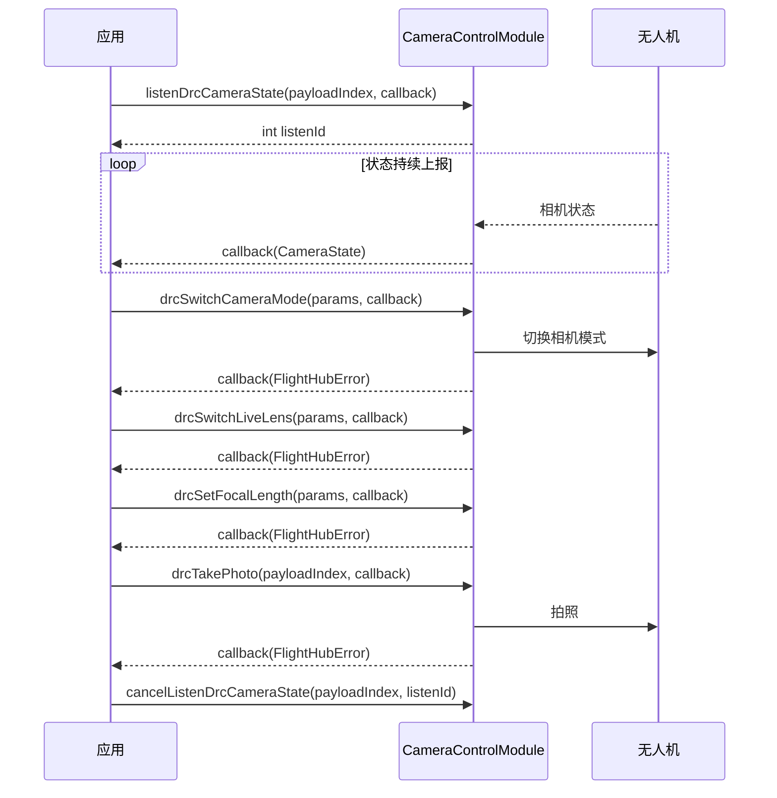

# 相机控制（CameraControlModule）

## 1 功能概述

### 1.1 功能简介

`CameraControlModule` 是**单架无人机级**的相机与云台控制模块，作用域为一架具体无人机（由设备 SN 指定）上的相机负载。它把「对飞行中相机负载的下行控制与状态感知」聚合到一处：拍照/录像、切换相机模式与镜头、变焦与对焦、云台朝向控制、夜景/红外热成像/等温线调节、存储与水印设置，以及对相机各类工作状态的订阅监听。

本模块的绝大多数下行控制方法以 `drc` 前缀命名，需经 DRC 链路下发；同时提供 `listenDrc*` 系列事件订阅，用于持续接收相机状态、镜头状态、云台状态、测温信息等上行数据。本模块只负责相机负载的控制与状态，不负责飞行控制（见 [飞行控制](./flight-control.md)），也不负责视频画面的拉流播放（见 [直播视频流]，画面另由直播相关模块提供）。

**获取方式：**

```java
// deviceSn 为目标无人机 SN；相机控制作用于该机的相机负载
Drone drone = FlightHubSDK.getDroneInstance("your_device_sn");
CameraControlModule cameraModule = drone.getCameraControlModule();
```

### 1.2 核心概念

| 概念 | 说明 |
| --- | --- |
| 负载索引（`payloadIndex`） | 几乎所有方法的首个入参，标识具体相机负载，格式为 `{type-subtype-gimbalindex}`，例如 `"81-0-0"`。 |
| DRC 下行控制 | `drc*` 前缀方法（如 `drcTakePhoto`、`drcSwitchLiveLens`）为下行控制指令，需先建立 DRC 链路并持有控制权后才能下发。 |
| 镜头类型（`CameraLensType`） | 相机镜头枚举：`NORMAL`、`WIDE`（广角）、`ZOOM`（变焦）、`IR`（红外）、`THERMAL`（热成像）、`UNKNOWN`。用于切换镜头、变焦、框选放大等。 |
| 相机模式（`CameraMode`） | 相机工作模式枚举：`PHOTO`（拍照）、`VIDEO`（录像）、`SMART_PHOTO`（智能拍照）、`PANO_PHOTO`（全景）、`INTERVAL_PHOTO`（定时拍）、`UNKNOWN`。`CameraState.getCameraMode()` 返回整型码，可用 `CameraMode.fromValue(int)` 对照。 |
| 相机状态（`CameraState`） | `listenDrcCameraState()` 持续回调的相机工作状态，含当前模式、是否录制/拍照、剩余可拍数量与录制时长、各镜头分辨率/照片尺寸等。 |
| 状态订阅与退订 | `listenDrc*()` 返回 `int` 监听 ID，需保存；退订时以「负载索引 + 监听 ID」调用配对的 `cancelListenDrc*(payloadIndex, listenId)`。 |
| 两类水印订阅 | `listenDrcCameraWatermarkSettings()` 走 DRC 上行；`listenDroneCameraWatermarkSettings()` 走 WebSocket 推送（topic_drone_camera_watermark_settings），两者不同，切勿混用。 |

以下为「4 示例代码」实际用到的 Bean 字段（与 javadoc 一致，全量列出）。

**`SwitchCameraModeParams`（切换相机模式参数）**

| 字段方法 | 类型 | 说明 |
| --- | --- | --- |
| `getPayloadIndex()` / `setPayloadIndex(String)` | String | 负载索引，格式 `{type-subtype-gimbalindex}`，如 `"81-0-0"` |
| `getCameraMode()` / `setCameraMode(CameraMode)` | CameraMode | 相机模式：`PHOTO`/`VIDEO`/`SMART_PHOTO`/`PANO_PHOTO`/`INTERVAL_PHOTO` |

**`SwitchLiveLensParams`（切换直播镜头参数）**

| 字段方法 | 类型 | 说明 |
| --- | --- | --- |
| `getPayloadIndex()` / `setPayloadIndex(String)` | String | 负载索引，如 `"81-0-0"` |
| `getLensType()` / `setLensType(CameraLensType)` | CameraLensType | 镜头类型：`NORMAL`/`WIDE`/`ZOOM`/`IR`/`THERMAL` |

**`CameraFocalLengthParams`（设置变焦焦距参数）**

| 字段方法 | 类型 | 说明 |
| --- | --- | --- |
| `getPayloadIndex()` / `setPayloadIndex(String)` | String | 负载索引，如 `"81-0-0"` |
| `getCameraType()` / `setCameraType(CameraLensType)` | CameraLensType | 目标镜头类型 |
| `getZoomFactor()` / `setZoomFactor(int)` | int | 变焦倍数，可见光为 2~200 |

**`ZoomAtTargetParams`（框选放大参数）**

| 字段方法 | 类型 | 说明 |
| --- | --- | --- |
| `getPayloadIndex()` / `setPayloadIndex(String)` | String | 负载索引，如 `"81-0-0"` |
| `getCameraLensType()` / `setCameraLensType(CameraLensType)` | CameraLensType | 目标镜头类型 |
| `getX()` / `setX(double)` | double | 目标框左上角坐标 x，0~1 |
| `getY()` / `setY(double)` | double | 目标框左上角坐标 y，0~1 |
| `getWidth()` / `setWidth(double)` | double | 目标框宽度，0~1 |
| `getHeight()` / `setHeight(double)` | double | 目标框高度，0~1 |

**`LookAtTargetParams`（云台朝向目标点参数）**

| 字段方法 | 类型 | 说明 |
| --- | --- | --- |
| `getPayloadIndex()` / `setPayloadIndex(String)` | String | 负载索引，如 `"81-0-0"` |
| `getLatitude()` / `setLatitude(double)` | double | 纬度 |
| `getLongitude()` / `setLongitude(double)` | double | 经度 |
| `getHeight()` / `setHeight(double)` | double | 高度 |

**`CameraState`（相机工作状态，`listenDrcCameraState` 回调返回，全字段只读）**

| 字段方法 | 类型 | 说明 |
| --- | --- | --- |
| `getPayloadIndex()` | String | 负载索引，如 `"81-0-0"` |
| `getCameraMode()` | int | 相机模式整型码，可用 `CameraMode.fromValue(int)` 对照 |
| `getRecordTime()` | int | 录制时长（秒） |
| `isRecordingState()` | boolean | 是否正在录制 |
| `getRemainRecordDuration()` | int | 剩余可录制时长 |
| `isPhotoState()` | boolean | 是否正在拍照 |
| `getRemainPhotoNum()` | int | 剩余可拍照数量 |
| `getIntervalPhotoInterval()` | double | 定时拍照间隔 |
| `getVideoResolution()` | int | 通用视频分辨率 |
| `getLinkageZoomState()` | int | 联动变焦状态 |
| `getPhotoSize()` | int | 照片尺寸 |
| `getVideoResolutionWide()` | int | 广角视频分辨率 |
| `getVideoResolutionZoom()` | int | 变焦视频分辨率 |
| `getPhotoSizeWide()` | int | 广角照片尺寸 |
| `getPhotoSizeZoom()` | int | 变焦照片尺寸 |
| `getPhotoFormat()` | int | 照片格式 |
| `isThermalTempExceedRangeValid()` | boolean | 温度超出范围有效性 |
| `isThermalSuperResolutionEnable()` | boolean | 红外超分使能 |
| `getIsothermEnable()` | int | 等温线使能 |
| `getIsothermRoiBasedRenderingEnable()` | int | 等温线 ROI 渲染使能 |
| `getIsothermColorRenderingType()` | int | 等温线颜色渲染类型 |
| `getIsothermLowerThreshold()` | int | 等温线下阈值 |
| `getIsothermUpperThreshold()` | int | 等温线上阈值 |

### 1.3 能力清单

方法名与 `CameraControlModule` javadoc 逐字一致。本模块方法极多（共 114 个），按能力分组全量列出如下。

**拍照 / 录像 / 拍摄任务**

| 能力 | 方法名 |
| --- | --- |
| 拍照 | `drcTakePhoto` |
| 停止拍照 | `drcStopTakePhoto` |
| 开始录像 | `drcStartRecord` |
| 停止录像 | `drcStopRecord` |
| 智能低光拍照 | `drcSmartPhotoTakePhoto` |
| 开始全景拍摄 | `drcStartPanorama` |
| 停止全景拍摄 | `drcStopPanorama` |
| 设置定时拍参数 | `drcSetIntervalTakePhoto` |
| 执行定时拍 | `drcIntervalTakePhoto` |
| 设置倒计时动作 | `drcSetCountDownAction` |
| 设置预录制状态 | `drcSetPreRecordedStatus` |
| 设置预录制时长 | `drcSetPreRecordedTime` |

**镜头 / 变焦 / 相机模式**

| 能力 | 方法名 |
| --- | --- |
| 切换直播镜头 | `drcSwitchLiveLens` |
| 切换相机模式 | `drcSwitchCameraMode` |
| 设置焦距（变焦） | `drcSetFocalLength` |
| 框选变焦 | `drcZoomAtTarget` |
| 设置联动变焦 | `drcSetLinkageZoom` |
| 双击画面瞄准目标 | `drcCameraAimAtTarget` |
| 相机点对焦 | `drcCameraPointFocusAction` |

**云台**

| 能力 | 方法名 |
| --- | --- |
| 看向目标 | `lookAtTarget` |
| 重置云台 | `drcResetGimbal` |
| 画面拖动控制云台转动速度 | `drcSendCameraScreenDrag` |

**曝光 / 对焦 / 成像参数**

| 能力 | 方法名 |
| --- | --- |
| 设置光圈值 | `drcSetCameraApertureValue` |
| 设置曝光模式 | `drcSetCameraExposureMode` |
| 设置曝光值 | `drcSetCameraExposureValue` |
| 设置对焦模式 | `drcSetCameraFocusMode` |
| 设置对焦值 | `drcSetCameraFocusValue` |
| 设置 ISO | `drcSetCameraIso` |
| 设置快门速度 | `drcSetCameraShutter` |
| 设置机械快门 | `drcSetCameraMechanicalShutter` |
| 设置降噪级别 | `drcSetCameraDenoiseLevelSet` |
| 重置相机设置 | `drcResetCameraSettings` |

**存储 / 水印 / 分辨率与格式**

| 能力 | 方法名 |
| --- | --- |
| 设置照片存储参数 | `drcSetPhotoStorageSettings` |
| 设置视频存储参数 | `drcSetVideoStorageSettings` |
| 设置照片分辨率 | `drcSetPhotoSize` |
| 设置视频分辨率 | `drcSetVideoResolution` |
| 设置照片格式 | `drcSetCameraPhotoFormat` |
| 设置相机水印 | `drcSetCameraWatermark` |

**夜景 / 夜视 / 去雾 / 画面辅助**

| 能力 | 方法名 |
| --- | --- |
| 设置夜景模式 | `drcSetNightSceneMode` |
| 设置黑白夜视 | `drcSetCameraNightVisionEnable` |
| 除雾 | `drcCleanFog` |
| 设置去雾模式 | `drcSetAlgorithmDehazeMode` |
| 设置去雾级别 | `drcSetAlgorithmDehazeLevel` |
| 设置畸变矫正 | `drcSetCameraDewarping` |
| 设置分屏显示 | `drcSetCameraScreenSplit` |
| 设置辅助画面模式 | `drcSetAssistantVideoMode` |
| 设置辅助画面开关 | `drcSetAssistantVideoSwitch` |

**红外 / 热成像 / 等温线**

| 能力 | 方法名 |
| --- | --- |
| 设置红外增益模式 | `drcSetThermalGainMode` |
| 设置红外调色板 | `drcSetThermalCurrentPalette` |
| 设置红外超分辨率 | `drcSetThermalSuperResolutionEnable` |
| 设置红外测温模式 | `drcSetIrMeteringMode` |
| 设置红外测温点 | `drcSetIrMeteringPoint` |
| 设置红外测温区域 | `drcSetIrMeteringArea` |
| 设置红外显示模式 | `drcSetIrDisplayMode` |
| 设置红外增强模式 | `drcSetIrEnhanceMode` |
| 设置红外混合比例 | `drcSetIrMixRate` |
| 设置等温线开关 | `drcSetIsothermEnable` |
| 设置等温线渲染类型 | `drcSetIsothermColorRenderingType` |
| 设置等温线温度范围 | `drcSetIsothermLowerUpperRange` |
| 设置等温线渲染多边形 | `drcSetIsothermRenderingPolygon` |
| 设置等温线 ROI 渲染使能 | `drcSetIsothermRoiBasedRenderingEnable` |
| 设置红外补光灯 | `drcSetInfraredFillLightEnable` |

**状态与推送监听（订阅 / 退订成对）**

| 能力 | 订阅方法 | 退订方法 |
| --- | --- | --- |
| 相机状态 | `listenDrcCameraState` | `cancelListenDrcCameraState` |
| 云台状态 | `listenDrcGimbalState` | `cancelListenDrcGimbalState` |
| 全景拍摄状态 | `listenDrcPanoramaStatus` | `cancelListenDrcPanoramaStatus` |
| 定时拍状态 | `listenDrcIntervalTakePhotoStatus` | `cancelListenDrcIntervalTakePhotoStatus` |
| 可用相机模式列表 | `listenDrcCameraModeAvailableRange` | `cancelListenDrcCameraModeAvailableRange` |
| 实时视图世界区域 | `listenDrcLiveviewWorldRegion` | `cancelListenDrcLiveviewWorldRegion` |
| 广角镜头状态 | `listenDrcCameraWideLensState` | `cancelListenDrcCameraWideLensState` |
| 变焦镜头状态 | `listenDrcCameraZoomLensState` | `cancelListenDrcCameraZoomLensState` |
| 测量目标数据 | `listenDrcCameraMeasureTarget` | `cancelListenDrcCameraMeasureTarget` |
| 夜景模式设置 | `listenDrcNightModeSettings` | `cancelListenDrcNightModeSettings` |
| 直播视频信息 | `listenDrcLiveVideoInfo` | `cancelListenDrcLiveVideoInfo` |
| 红外增益模式 | `listenDrcThermalGainMode` | `cancelListenDrcThermalGainMode` |
| 红外镜头状态 | `listenDrcCameraIrLensState` | `cancelListenDrcCameraIrLensState` |
| 红外测温信息 | `listenDrcCameraIrThermometry` | `cancelListenDrcCameraIrThermometry` |
| 相机水印设置（DRC 上行） | `listenDrcCameraWatermarkSettings` | `cancelListenDrcCameraWatermarkSettings` |
| 相机存储信息 | `listenDrcCameraStorageInfo` | `cancelListenDrcCameraStorageInfo` |
| 红外画中画状态 | `listenDrcCameraIrPipState` | `cancelListenDrcCameraIrPipState` |
| 等温线渲染多边形 | `listenDrcCameraIsothermPolygon` | `cancelListenDrcCameraIsothermPolygon` |
| 媒体存储列表 | `listenDrcCameraMediaStorage` | `cancelListenDrcCameraMediaStorage` |
| 去雾算法信息 | `listenDrcCameraAlgorithmDehazeInfo` | `cancelListenDrcCameraAlgorithmDehazeInfo` |
| 预录制信息 | `listenDrcCameraPreRecordedInfo` | `cancelListenDrcCameraPreRecordedInfo` |
| 相机能力集 | `listenDrcCameraCapability` | `cancelListenDrcCameraCapability` |
| 相机可设置能力集 | `listenDrcCameraSettableCapability` | `cancelListenDrcCameraSettableCapability` |
| 相机可见能力集 | `listenDrcCameraVisibleCapability` | `cancelListenDrcCameraVisibleCapability` |
| 相机拍照上行信息 | `listenDrcCameraPhotoInfo` | `cancelListenDrcCameraPhotoInfo` |
| 飞机相机水印设置（WebSocket 推送） | `listenDroneCameraWatermarkSettings` | `cancelListenDroneCameraWatermarkSettings` |

> 完整方法签名与全部参数字段以 javadoc 为准，详见 [使用 API 文档查阅接口详情](../../03.api-docs-guide.md)。

---

## 2 前提条件

- 已完成上云 API 2 底座部署，并获取到服务地址与鉴权 Token。详见 [部署指南](../../../02.deployment/00.index.md)、[鉴权接入指南](../../../08.auth.md)。
- 已完成 SDK 初始化且 `FlightHubSDK.isInitialized()` 返回 `true`。详见 [SDK初始化](../init/sdk-init.md)。
- 目标无人机已完成上云、已绑定至当前工作空间且在线。详见 [设备上云](../../../04.device-onboarding/00.index.md)。
- 已通过 `ControlAuthModule` 抢得该机的**飞行控制权**；相机负载控制还需额外持有**负载控制权**。详见 [控制权管理](./control-auth.md)。
- 已通过 `DrcModule.connectDrcLink()` 建立 **DRC 链路**，本模块所有 `drc*` 下行控制方法与 `listenDrc*` 订阅均依赖该链路。详见 [DRC链路](./drc.md)。
- 负载索引 `payloadIndex`（如 `"81-0-0"`）需与目标机实际挂载的相机负载一致，可由相机相关状态订阅或设备负载信息确认。
- `listenDroneCameraWatermarkSettings()` 走 WebSocket 推送，与 DRC 侧 `listenDrcCameraWatermarkSettings()` 是不同通道，按需分别订阅，不要混用。

---

## 3 快速上手

### 3.1 获取模块实例

```java
// 前置：已完成 FlightHubSDK.initialize(config)，已抢得飞行控制权与负载控制权，且 DRC 链路已建立
Drone drone = FlightHubSDK.getDroneInstance("your_device_sn");
CameraControlModule module = drone.getCameraControlModule();
```

### 3.2 使用流程

1. **准备前置条件** —— 抢得飞行控制权与负载控制权，并建立 DRC 链路（见「2 前提条件」）。
2. **获取模块实例** —— 调用无人机实例的 `getCameraControlModule()`。
3. **订阅相机状态** —— 调用 `listenDrcCameraState(payloadIndex, cb)` 并保存返回的监听 ID，持续感知模式与拍摄状态。
4. **切换模式与镜头** —— 按需 `drcSwitchCameraMode()` 切到拍照/录像模式，`drcSwitchLiveLens()` 切到目标镜头。
5. **变焦与构图** —— 用 `drcSetFocalLength()` 设倍数，或用 `drcZoomAtTarget()` 框选放大；用 `lookAtTarget()` 让云台朝向指定地理坐标。
6. **执行拍摄** —— `drcTakePhoto()` 拍照，或 `drcStartRecord()` / `drcStopRecord()` 录像。
7. **退订与释放** —— 结束时以「负载索引 + 监听 ID」调用 `cancelListenDrcCameraState()` 等退订，再断开 DRC 链路、释放控制权。

### 3.3 调用时序图



---

## 4 示例代码

### 4.1 完整示例

```java
/**
 * 相机控制：监听相机状态 -> 切换相机模式 -> 切换镜头 -> 变焦 -> 拍照/录像 -> 退订。
 * 前置：已抢得飞行控制权 + 负载控制权，且 DRC 链路已建立。
 */
public class CameraController {

    private final String deviceSn;
    private final String payloadIndex;   // 如 "81-0-0"
    private int cameraStateListenId = -1;

    public CameraController(String deviceSn, String payloadIndex) {
        this.deviceSn = deviceSn;
        this.payloadIndex = payloadIndex;
    }

    private CameraControlModule module() {
        return FlightHubSDK.getDroneInstance(deviceSn).getCameraControlModule();
    }

    /** 1. 订阅相机状态（事件回调无 error 参数，需判空 cameraState） */
    public void subscribeState() {
        cameraStateListenId = module().listenDrcCameraState(payloadIndex,
                new FlightHubCallback.CameraStateCallback() {
                    @Override
                    public void onResult(CameraState cameraState) {
                        if (cameraState == null) return;   // 注意：状态回调无 error 参数，先判空
                        // getCameraMode() 为整型码，可用 CameraMode.fromValue(int) 对照
                        System.out.println("相机状态: 模式码=" + cameraState.getCameraMode()
                                + " 正在录制=" + cameraState.isRecordingState()
                                + " 已录时长(s)=" + cameraState.getRecordTime()
                                + " 剩余可录(s)=" + cameraState.getRemainRecordDuration()
                                + " 正在拍照=" + cameraState.isPhotoState()
                                + " 剩余可拍张数=" + cameraState.getRemainPhotoNum());
                    }
                });
    }

    /** 2. 切换到拍照模式，再切到变焦镜头，然后变焦到 5 倍，最后拍照 */
    public void switchAndTakePhoto() {
        // 2.1 切换相机模式为拍照
        SwitchCameraModeParams modeParams = new SwitchCameraModeParams();
        modeParams.setPayloadIndex(payloadIndex);
        modeParams.setCameraMode(CameraMode.PHOTO);   // 枚举：PHOTO/VIDEO/SMART_PHOTO/PANO_PHOTO/INTERVAL_PHOTO
        module().drcSwitchCameraMode(modeParams, modeErr -> {
            if (modeErr == null || !modeErr.isSuccess()) {
                System.err.println("切换相机模式失败: " + modeErr);
                return;
            }
            // 2.2 切换直播镜头到变焦镜头
            SwitchLiveLensParams lensParams = new SwitchLiveLensParams();
            lensParams.setPayloadIndex(payloadIndex);
            lensParams.setLensType(CameraLensType.ZOOM);   // NORMAL/WIDE/ZOOM/IR/THERMAL
            module().drcSwitchLiveLens(lensParams, lensErr -> {
                if (lensErr == null || !lensErr.isSuccess()) {
                    System.err.println("切换镜头失败: " + lensErr);
                    return;
                }
                // 2.3 设置变焦倍数（可见光 2~200）
                CameraFocalLengthParams zoomParams = new CameraFocalLengthParams();
                zoomParams.setPayloadIndex(payloadIndex);
                zoomParams.setCameraType(CameraLensType.ZOOM);
                zoomParams.setZoomFactor(5);   // 5 倍变焦
                module().drcSetFocalLength(zoomParams, zoomErr -> {
                    if (zoomErr == null || !zoomErr.isSuccess()) {
                        System.err.println("变焦失败: " + zoomErr);
                        return;
                    }
                    // 2.4 拍照（drcTakePhoto 只需负载索引）
                    module().drcTakePhoto(payloadIndex, photoErr -> {
                        boolean ok = photoErr != null && photoErr.isSuccess();
                        System.out.println("拍照: " + (ok ? "成功" : "失败 " + photoErr));
                    });
                });
            });
        });
    }

    /** 3. 录像：先切到录像模式，再开始录像 */
    public void startRecord() {
        SwitchCameraModeParams modeParams = new SwitchCameraModeParams();
        modeParams.setPayloadIndex(payloadIndex);
        modeParams.setCameraMode(CameraMode.VIDEO);   // 注意：录像前必须先切到 VIDEO 模式
        module().drcSwitchCameraMode(modeParams, modeErr -> {
            if (modeErr == null || !modeErr.isSuccess()) {
                System.err.println("切换录像模式失败: " + modeErr);
                return;
            }
            module().drcStartRecord(payloadIndex, recErr -> {
                boolean ok = recErr != null && recErr.isSuccess();
                System.out.println("开始录像: " + (ok ? "成功" : "失败 " + recErr));
            });
        });
    }

    /** 停止录像 */
    public void stopRecord() {
        module().drcStopRecord(payloadIndex, err -> {
            boolean ok = err != null && err.isSuccess();
            System.out.println("停止录像: " + (ok ? "成功" : "失败 " + err));
        });
    }

    /** 4. 退订相机状态（以 负载索引 + 监听 ID 退订） */
    public void release() {
        if (cameraStateListenId != -1) {
            module().cancelListenDrcCameraState(payloadIndex, cameraStateListenId);
            cameraStateListenId = -1;
        }
    }
}
```

### 4.2 场景化片段

**云台朝向指定地理坐标（lookAtTarget）**

```java
// 让云台朝向某个经纬度 + 高度的目标点（如地面某建筑）
CameraControlModule module = FlightHubSDK.getDroneInstance(deviceSn).getCameraControlModule();

LookAtTargetParams params = new LookAtTargetParams();
params.setPayloadIndex(payloadIndex);   // 如 "81-0-0"
params.setLatitude(22.123456);          // 目标纬度
params.setLongitude(113.654321);        // 目标经度
params.setHeight(30.0);                 // 目标高度

module.lookAtTarget(params, error -> {
    boolean ok = error != null && error.isSuccess();
    System.out.println("云台看向目标: " + (ok ? "成功" : "失败 " + error));
});
```

**框选放大画面局部（drcZoomAtTarget）**

```java
// 在画面上框选一块区域，相机自动变焦放大该区域；坐标均为 0~1 归一化值
CameraControlModule module = FlightHubSDK.getDroneInstance(deviceSn).getCameraControlModule();

ZoomAtTargetParams params = new ZoomAtTargetParams();
params.setPayloadIndex(payloadIndex);
params.setCameraLensType(CameraLensType.ZOOM);   // 目标镜头
params.setX(0.4);        // 目标框左上角 x（0~1）
params.setY(0.4);        // 目标框左上角 y（0~1）
params.setWidth(0.2);    // 目标框宽度（0~1）
params.setHeight(0.2);   // 目标框高度（0~1）

module.drcZoomAtTarget(params, error -> {
    boolean ok = error != null && error.isSuccess();
    System.out.println("框选变焦: " + (ok ? "成功" : "失败 " + error));
});
```

**重置云台姿态（drcResetGimbal）**

```java
// resetMode 为云台重置模式（取值语义以 javadoc 为准），此处以 0 为例
CameraControlModule module = FlightHubSDK.getDroneInstance(deviceSn).getCameraControlModule();

int resetMode = 0;
module.drcResetGimbal(payloadIndex, resetMode, error -> {
    boolean ok = error != null && error.isSuccess();
    System.out.println("重置云台: " + (ok ? "成功" : "失败 " + error));
});
```

---

## 5 相关文档

- [SDK初始化](../init/sdk-init.md) —— 获取设备实例与调用本模块前必须完成的初始化步骤
- [控制权管理](./control-auth.md) —— 抢占飞行控制权与负载控制权的流程，相机控制的前置
- [DRC链路](./drc.md) —— 建立 DRC 链路，本模块所有 `drc*` 控制与 `listenDrc*` 订阅的依赖
- [飞行控制](./flight-control.md) —— 飞行姿态与运动控制，与相机控制配合完成拍摄作业
- [PSDK 控制](./psdk-control.md) —— 第三方负载（PSDK）设备的控制能力
- [设备上云](../../../04.device-onboarding/00.index.md) —— 设备绑定到工作空间的前置流程
- [使用 API 文档查阅接口详情](../../03.api-docs-guide.md) —— 查阅 `CameraControlModule` 完整方法签名与字段定义
