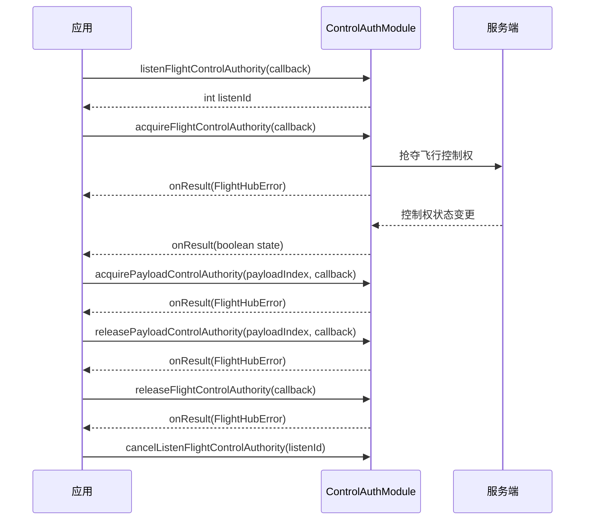

# 控制权管理（ControlAuthModule）

## 1 功能概述

### 1.1 功能简介

`ControlAuthModule` 是**单机级**的控制权管理模块，作用域为一架具体的飞行器（由设备 SN 指定）。它解决的是「谁能对这架飞机及其负载下发控制指令」这一件事：抢夺/释放**飞行控制权**、抢夺/释放**负载控制权**（按负载索引），以及订阅这两类控制权状态的实时变化。

控制权是**全局互斥资源**——同一时刻一架飞机只能被一个操控端持有。DRC 链路建链、一键起飞、飞向目标点、POI 环绕、相机与 PSDK 下行控制等所有下行控制类操作，都需先经本模块抢得对应控制权（相机/PSDK 还需负载控制权），再经 [DRC链路](./drc.md) 建链后方可下发。

**获取方式：**

```java
// 按飞行器 SN 获取控制权管理模块
Drone drone = FlightHubSDK.getDroneInstance("your_device_sn");
ControlAuthModule controlAuthModule = drone.getControlAuthModule();
```

### 1.2 核心概念

| 概念 | 说明 |
| --- | --- |
| 飞行控制权 | 对飞行器本体下发运动类指令（起飞、飞向目标点、摇杆、返航等）所需的控制权，通过 `acquireFlightControlAuthority` 抢夺、`releaseFlightControlAuthority` 释放。 |
| 负载控制权 | 对某一具体负载（相机/云台/PSDK 载荷）下发指令所需的控制权，按**负载索引** `payloadIndex` 独立抢夺与释放。相机、PSDK 等负载操作在飞行控制权之外**另需**负载控制权。 |
| 负载索引（`payloadIndex`） | 字符串形式的负载标识，用于区分同一飞行器上的不同负载，抢夺/释放/订阅负载控制权时均需传入。 |
| 全局互斥 | 控制权为独占资源，同一时刻仅一个操控端可持有；操作完成后应及时释放，避免占用导致他端无法接管。 |
| 控制权状态（`state`） | 订阅回调 `onResult(boolean state)` 推送的布尔值，表示当前该项控制权是否被本端持有。 |
| 监听 ID（`listenId`） | `listenFlightControlAuthority` / `listenPayloadControlAuthority` 返回的整型句柄，取消订阅时必须回传同一个值。 |

### 1.3 能力清单

| 能力 | 对应接口 | 接口类型 | 说明 |
| --- | --- | --- | --- |
| 抢夺飞行控制权 | `acquireFlightControlAuthority(cb)` | 异步回调 | 回调 `onResult(FlightHubError)`，仅返回错误信息 |
| 释放飞行控制权 | `releaseFlightControlAuthority(cb)` | 异步回调 | 回调 `onResult(FlightHubError)`，仅返回错误信息 |
| 订阅飞行控制权状态 | `listenFlightControlAuthority(cb)` / `cancelListenFlightControlAuthority(listenId)` | 事件订阅 | 事件回调方法名为 `onResult(boolean state)`，无 error 参数；订阅返回 `int listenId` |
| 抢夺负载控制权 | `acquirePayloadControlAuthority(payloadIndex, cb)` | 异步回调 | 按负载索引抢夺，回调 `onResult(FlightHubError)` |
| 释放负载控制权 | `releasePayloadControlAuthority(payloadIndex, cb)` | 异步回调 | 按负载索引释放，回调 `onResult(FlightHubError)` |
| 订阅负载控制权状态 | `listenPayloadControlAuthority(payloadIndex, cb)` / `cancelListenPayloadControlAuthority(payloadIndex, listenId)` | 事件订阅 | 事件回调方法名为 `onResult(boolean state)`，无 error 参数；订阅返回 `int listenId` |

---

## 2 前提条件

- 已完成上云 API 2 底座部署，并获取到服务地址与鉴权 Token。详见 [部署指南](../../../02.deployment/00.index.md)、[鉴权接入指南](../../../08.auth.md)。
- 已完成 SDK 初始化且 `FlightHubSDK.isInitialized()` 返回 `true`。详见 [SDK初始化](../init/sdk-init.md)。
- 目标飞行器已完成上云、已绑定至当前工作空间且在线。详见 [设备上云](../../../04.device-onboarding/00.index.md)。
- 控制权为全局互斥资源，抢夺前需确认无其他操控端正持有；抢夺成功后应在操作完成时调用对应的 `releaseXxx` 释放，避免占用。
- 抢夺负载控制权前，需先确定目标负载的负载索引 `payloadIndex`；相机、PSDK 等负载下行控制在飞行控制权之外另需负载控制权。相机控制见 [相机控制](./camera-control.md)，PSDK 控制见 [PSDK 控制](./psdk-control.md)。
- 抢得控制权只是下行控制的第一步：DRC 建链及后续飞行控制指令下发，仍需经 [DRC链路](./drc.md) 建链，具体见 [飞行控制](./flight-control.md)。
- 若需使用 `listenFlightControlAuthority` / `listenPayloadControlAuthority` 订阅控制权状态，SDK 配置中的 `notificationServerAddress` 必须正确且连接可用。详见 [SDK配置](../init/sdk-config.md)。

---

## 3 快速上手

### 3.1 获取模块实例

```java
// 前置：已完成 FlightHubSDK.initialize(config)
Drone drone = FlightHubSDK.getDroneInstance("your_device_sn");
ControlAuthModule module = drone.getControlAuthModule();
```

### 3.2 使用流程

1. **获取模块实例** —— 调用 `FlightHubSDK.getDroneInstance(sn).getControlAuthModule()`。
2. **订阅控制权状态**（可选） —— 调用 `listenFlightControlAuthority` 并保存 `listenId`，实时掌握控制权归属变化。
3. **抢夺飞行控制权** —— 调用 `acquireFlightControlAuthority(cb)`，回调返回 `FlightHubError` 判成功。
4. **抢夺负载控制权**（按需） —— 如需操作相机/PSDK 负载，调用 `acquirePayloadControlAuthority(payloadIndex, cb)`。
5. **下发控制指令** —— 抢权成功后经 [DRC链路](./drc.md) 建链，再下发飞行/相机/PSDK 指令。
6. **释放控制权** —— 操作完成后依次调用 `releasePayloadControlAuthority(payloadIndex, cb)`、`releaseFlightControlAuthority(cb)`。
7. **退出时取消订阅** —— 用保存的 `listenId` 调用 `cancelListenFlightControlAuthority` / `cancelListenPayloadControlAuthority`。

### 3.3 调用时序图



---

## 4 示例代码

### 4.1 完整示例

```java
/**
 * 控制权管理：订阅飞行控制权状态 -> 抢夺飞行控制权 -> 抢夺负载控制权
 *            -> 释放负载控制权 -> 释放飞行控制权 -> 退订。
 * 注意：控制权为全局互斥资源，操作完成后必须释放，否则他端无法接管。
 */
public class ControlAuthManager {

    private int flightAuthListenId = -1;
    private final String deviceSn;
    private final String payloadIndex;  // 目标负载索引，如相机负载

    public ControlAuthManager(String deviceSn, String payloadIndex) {
        this.deviceSn = deviceSn;
        this.payloadIndex = payloadIndex;
    }

    // ============ 1. 订阅飞行控制权状态（回调方法名为 onResult，参数为 boolean，无 error 参数） ============
    public void start() {
        ControlAuthModule module = FlightHubSDK.getDroneInstance(deviceSn).getControlAuthModule();

        flightAuthListenId = module.listenFlightControlAuthority(
                new FlightHubCallback.FlightControlAuthorityCallback() {
                    @Override
                    public void onResult(boolean state) {
                        // 注意：订阅回调无 error 参数，state 表示当前是否持有飞行控制权
                        System.out.println("[飞行控制权状态] 本端持有=" + state);
                    }
                });

        // ============ 2. 抢夺飞行控制权 ============
        module.acquireFlightControlAuthority(new FlightHubCallback.ResultCallbackWithError() {
            @Override
            public void onResult(FlightHubError error) {
                boolean ok = error != null && error.isSuccess();
                if (!ok) {
                    // 注意：控制权已被他端持有时抢夺会失败，需读取 error 判断原因
                    System.err.println("抢夺飞行控制权失败: " + error);
                    return;
                }
                System.out.println("抢夺飞行控制权成功");
                // 抢得飞行控制权后，再抢夺负载控制权
                acquirePayload(module);
            }
        });
    }

    // ============ 3. 抢夺负载控制权（相机/PSDK 等负载下行控制另需此权） ============
    private void acquirePayload(ControlAuthModule module) {
        module.acquirePayloadControlAuthority(payloadIndex, new FlightHubCallback.ResultCallbackWithError() {
            @Override
            public void onResult(FlightHubError error) {
                boolean ok = error != null && error.isSuccess();
                System.out.println("抢夺负载控制权[" + payloadIndex + "]: " + (ok ? "成功" : "失败 " + error));
                // 至此可经 DRC 建链后下发飞行/相机/PSDK 指令
            }
        });
    }

    // ============ 4. 释放负载控制权 + 释放飞行控制权（操作完成后按序释放） ============
    public void releaseAll() {
        ControlAuthModule module = FlightHubSDK.getDroneInstance(deviceSn).getControlAuthModule();

        module.releasePayloadControlAuthority(payloadIndex, error -> {
            boolean ok = error != null && error.isSuccess();
            System.out.println("释放负载控制权[" + payloadIndex + "]: " + (ok ? "成功" : "失败 " + error));
        });

        module.releaseFlightControlAuthority(error -> {
            boolean ok = error != null && error.isSuccess();
            System.out.println("释放飞行控制权: " + (ok ? "成功" : "失败 " + error));
        });
    }

    // ============ 5. 退出前取消订阅（必须执行，否则订阅泄漏） ============
    public void stop() {
        if (flightAuthListenId != -1) {
            FlightHubSDK.getDroneInstance(deviceSn).getControlAuthModule()
                    .cancelListenFlightControlAuthority(flightAuthListenId);
            flightAuthListenId = -1;
        }
    }
}
```

### 4.2 场景化片段

**仅抢夺飞行控制权用于飞行控制，用后立即释放**

```java
// 前置：已完成 SDK 初始化。仅需飞行控制、不涉及负载时，只抢飞行控制权即可
ControlAuthModule module = FlightHubSDK.getDroneInstance(deviceSn).getControlAuthModule();
module.acquireFlightControlAuthority(error -> {
    if (error != null && !error.isSuccess()) {
        System.err.println("抢夺飞行控制权失败: " + error);
        return;
    }
    // 抢权成功：经 DRC 建链后下发起飞/飞向目标点等指令……
    // 指令下发完成后释放，避免占用互斥资源
    module.releaseFlightControlAuthority(err -> {
        boolean ok = err != null && err.isSuccess();
        System.out.println("释放飞行控制权: " + (ok ? "成功" : "失败 " + err));
    });
});
```

**订阅负载控制权状态并在退出时取消订阅**

```java
// 前置：已拿到目标负载索引 payloadIndex
ControlAuthModule module = FlightHubSDK.getDroneInstance(deviceSn).getControlAuthModule();
int payloadListenId = module.listenPayloadControlAuthority(payloadIndex,
        state -> System.out.println("[负载控制权状态] 本端持有=" + state)); // 注意：无 error 参数

// ……业务运行期间可据 state 判断是否被他端抢走负载控制权……

// 退出前用同一个 payloadIndex 与 listenId 取消订阅
module.cancelListenPayloadControlAuthority(payloadIndex, payloadListenId);
```

---

## 5 相关文档

- [SDK初始化](../init/sdk-init.md) —— 获取设备实例与调用本模块前必须完成的初始化步骤
- [SDK配置](../init/sdk-config.md) —— WebSocket 通知地址等配置项，影响控制权状态订阅能否收到推送
- [DRC链路](./drc.md) —— 抢得控制权后建立低时延下行链路，是下发飞行/相机/PSDK 指令的前置
- [飞行控制](./flight-control.md) —— 抢得飞行控制权并建链后下发飞行运动指令
- [相机控制](./camera-control.md) —— 需在飞行控制权之外另抢负载控制权后使用
- [PSDK 控制](./psdk-control.md) —— 需在飞行控制权之外另抢负载控制权后使用
- [设备上云](../../../04.device-onboarding/00.index.md) —— 设备绑定到工作空间的前置流程
- [部署指南](../../../02.deployment/00.index.md) —— 上云 API 2 底座部署与服务地址获取
- [鉴权接入指南](../../../08.auth.md) —— 获取鉴权 Token 的接入流程
- [使用 API 文档查阅接口详情](../../03.api-docs-guide.md) —— 查阅 `ControlAuthModule` 完整方法签名与字段定义
