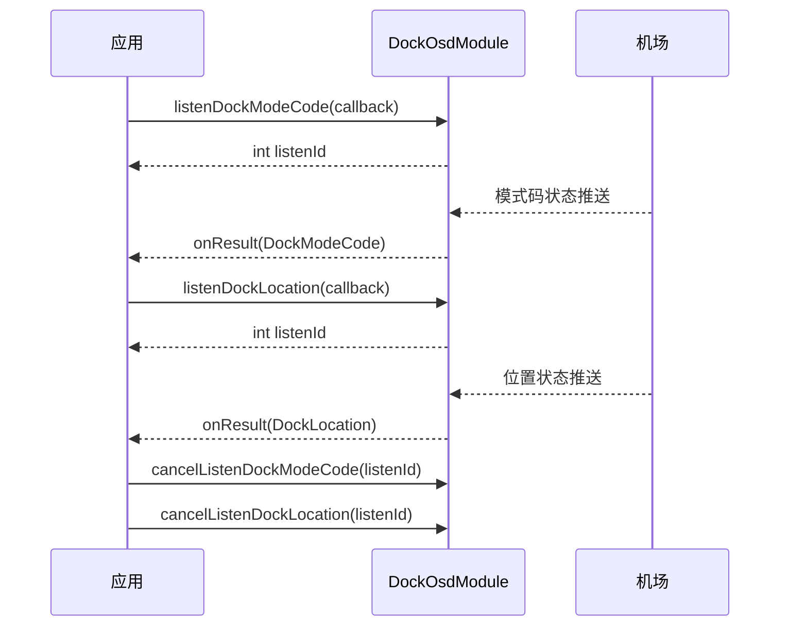

# 机场状态监听（DockOsdModule）

## 1 功能概述

### 1.1 功能简介

`DockOsdModule` 是**单机场级**的机场 OSD（On-Screen Display，实时状态）监听模块，作用域为一台具体的机场设备。它解决的是「实时掌握一台机场的运行状态」这一件事：以订阅（`listen*`）方式持续接收机场推送的位置、舱盖、推杆、供电与电池、存储与媒体、网络与图传链路、模式码与作业步骤、固件与子设备、声光报警与急停、气象与空调等各类状态，并在不再需要时用监听 ID 取消订阅（`cancelListen*`）。

本模块只做**上行状态监听**，不含任何下行控制指令，因此无需抢占控制权、也无需建立 DRC 链路。它与 [飞机状态监听](./drone-status.md) 是对称关系：后者监听飞行器 OSD，本模块监听机场 OSD。

**获取方式：**

```java
Dock dock = FlightHubSDK.getDockInstance("your_dock_sn");
DockOsdModule dockOsdModule = dock.getDockOsdModule();
```

### 1.2 核心概念

| 概念 | 说明 |
| --- | --- |
| OSD 状态订阅 | 通过 `listen*` 方法注册回调，机场状态变化时经通知通道持续推送最新值。 |
| 监听 ID（`listenId`） | 每个 `listen*` 方法返回的整型句柄；取消订阅时必须把同一个 `listenId` 回传给对应的 `cancelListen*`。 |
| 状态回调 | 各 `*Callback` 的回调方法为 `onResult(<状态 Bean>)`，**无 error 参数**，回调内必须判空后再读取字段。 |
| 机场模式码（`DockModeCode`） | `listenDockModeCode` 推送的机场工作模式：0 空闲中 / 1 现场调试中 / 2 远程调试中 / 3 设备升级中 / 4 设备作业中（细分见 `listenFlightTaskStepCode`）/ 5 机场设备未标定 / 6 节能状态中 / 7 现场急停中 / 8 换电中 / 9 日志拉取中。 |
| 机场位置（`DockLocation`） | `listenDockLocation` 推送的机场地理位置，含纬度、经度、高度、朝向。 |

### 1.3 能力清单

> 本模块方法均为「订阅 + 取消订阅」成对出现：`listen*` 返回 `int` 监听 ID，`cancelListen*(int)` 用该 ID 退订。以下按状态类别分组列全全部 34 组订阅能力。

**位置、搜星与备降点**

| 能力 | 订阅接口 / 取消接口 |
| --- | --- |
| 机场位置 | `listenDockLocation(DockLocationCallback)` / `cancelListenDockLocation(int)` |
| 搜星（定位）状态 | `listenDockPositionState(DockPositionStateCallback)` / `cancelListenDockPositionState(int)` |
| 备降点 | `listenDockAlternateLandPoint(DockAlternateLandPointCallback)` / `cancelListenDockAlternateLandPoint(int)` |
| 相对备降点 | `listenDockRelativeAlternateLandPoint(DockRelativeAlternateLandPointCallback)` / `cancelListenDockRelativeAlternateLandPoint(int)` |
| 自动收敛坐标 | `listenDockSelfConvergeCoordinate(DockSelfConvergeCoordinateCallback)` / `cancelListenDockSelfConvergeCoordinate(int)` |

**舱盖、推杆、机内飞行器与充电**

| 能力 | 订阅接口 / 取消接口 |
| --- | --- |
| 舱盖状态 | `listenDockCoverState(DockCoverStateCallback)` / `cancelListenDockCoverState(int)` |
| 推杆状态 | `listenDockPutterState(DockPutterStateCallback)` / `cancelListenDockPutterState(int)` |
| 机场内无人机状态 | `listenDroneInDock(DroneInDockCallback)` / `cancelListenDroneInDock(int)` |
| 飞行器充电状态 | `listenDockDroneChargeState(DockDroneChargeStateCallback)` / `cancelListenDockDroneChargeState(int)` |

**供电与电池**

| 能力 | 订阅接口 / 取消接口 |
| --- | --- |
| 机场供电状态 | `listenDockPowerState(DockPowerStateCallback)` / `cancelListenDockPowerState(int)` |
| 电池存储模式 | `listenDockBatteryStoreMode(DockBatteryStoreModeCallback)` / `cancelListenDockBatteryStoreMode(int)` |
| 备用电池信息 | `listenDockBackupBatteryInfo(DockBackupBatteryInfoCallback)` / `cancelListenDockBackupBatteryInfo(int)` |
| 飞行器电池保养信息 | `listenDockDroneBatteryMaintenanceInfo(DockDroneBatteryMaintenanceInfoCallback)` / `cancelListenDockDroneBatteryMaintenanceInfo(int)` |

**存储与媒体**

| 能力 | 订阅接口 / 取消接口 |
| --- | --- |
| 存储容量状态 | `listenDockStorageState(DockStorageStateCallback)` / `cancelListenDockStorageState(int)` |
| 媒体文件详情 | `listenDockMediaFileDetail(DockMediaFileDetailCallback)` / `cancelListenDockMediaFileDetail(int)` |

**网络与链路**

| 能力 | 订阅接口 / 取消接口 |
| --- | --- |
| 图传链路质量 | `listenDockWirelessLink(DockWirelessLinkCallback)` / `cancelListenDockWirelessLink(int)` |
| 网络状态 | `listenDockNetworkState(DockNetworkStateCallback)` / `cancelListenDockNetworkState(int)` |
| DRC 链路状态 | `listenDockDrcState(DockDrcStateCallback)` / `cancelListenDockDrcState(int)` |
| Dongle 信息 | `listenDockDongleInfos(DockDongleInfosCallback)` / `cancelListenDockDongleInfos(int)` |

**设备信息、模式与作业**

| 能力 | 订阅接口 / 取消接口 |
| --- | --- |
| 机场模式码 | `listenDockModeCode(DockModeCodeCallback)` / `cancelListenDockModeCode(int)` |
| 作业步骤码 | `listenFlightTaskStepCode(FlightTaskStepCodeCallback)` / `cancelListenFlightTaskStepCode(int)` |
| 作业次数 | `listenDockJobNumber(DockJobNumberCallback)` / `cancelListenDockJobNumber(int)` |
| 固件信息 | `listenDockFirmwareInfo(DockFirmwareInfoCallback)` / `cancelListenDockFirmwareInfo(int)` |
| 子设备信息 | `listenDockSubDevice(DockSubDeviceInfoListCallback)` / `cancelListenDockSubDevice(int)` |
| 首次上电时间 | `listenDockFirstPowerOnTime(DockFirstPowerOnTimeCallback)` / `cancelListenDockFirstPowerOnTime(int)` |
| 激活时间（Unix 秒） | `listenDockActivationTime(DockActivationTimeCallback)` / `cancelListenDockActivationTime(int)` |
| 累计运行时长 | `listenDockAccumulatedRunningTime(DockAccTimeCallback)` / `cancelListenDockAccumulatedRunningTime(int)` |
| 维护状态信息 | `listenDockMaintainStatusInfo(DockMaintainStatusInfoCallback)` / `cancelListenDockMaintainStatusInfo(int)` |

**报警与安全**

| 能力 | 订阅接口 / 取消接口 |
| --- | --- |
| 声光报警状态 | `listenDockAlarmState(DockAlarmStateCallback)` / `cancelListenDockAlarmState(int)` |
| 紧急停止按钮状态 | `listenDockEmergencyStopState(DockEmergencyStopStateCallback)` / `cancelListenDockEmergencyStopState(int)` |

**环境与其他**

| 能力 | 订阅接口 / 取消接口 |
| --- | --- |
| 气象信息 | `listenDockMeteorologicalInfo(DockMeteorologicalInfoCallback)` / `cancelListenDockMeteorologicalInfo(int)` |
| 空调模式 | `listenDockAirConditionerMode(DockAirConditionerModeCallback)` / `cancelListenDockAirConditionerMode(int)` |
| 静音模式 | `listenDockSilentMode(DockSilentModeCallback)` / `cancelListenDockSilentMode(int)` |
| 用户体验改善计划状态 | `listenDockUserExperienceImprovement(DockUserExperienceImprovementCallback)` / `cancelListenDockUserExperienceImprovement(int)` |

---

## 2 前提条件

- 已完成上云 API 2 底座部署，并获取到服务地址与鉴权 Token。详见 [部署指南](../../../02.deployment/00.index.md)、[鉴权接入指南](../../../08.auth.md)。
- 已完成 SDK 初始化且 `FlightHubSDK.isInitialized()` 返回 `true`。详见 [SDK初始化](../init/sdk-init.md)。
- 目标机场设备已完成上云、已绑定至当前工作空间且在线。详见 [设备上云](../../../04.device-onboarding/00.index.md)。
- SDK 配置中的 `notificationServerAddress`（WebSocket 通知地址）必须正确且连接可用——所有 `listen*` 状态推送都依赖该通知通道。详见 [SDK配置](../init/sdk-config.md)。
- 本模块仅为状态监听（上行），**无需抢占控制权、无需建立 DRC 链路**；机场需实际支持并上报对应状态字段，否则相应回调不会有数据。

---

## 3 快速上手

### 3.1 获取模块实例

```java
// 前置：已完成 FlightHubSDK.initialize(config)，通知通道可用
Dock dock = FlightHubSDK.getDockInstance("your_dock_sn");
DockOsdModule dockOsdModule = dock.getDockOsdModule();
```

### 3.2 使用流程

1. **获取模块实例** —— 调用 `FlightHubSDK.getDockInstance(dockSn).getDockOsdModule()`。
2. **按需订阅状态** —— 调用所需的 `listen*` 方法（如 `listenDockLocation`、`listenDockModeCode`），并**保存返回的 `listenId`**。
3. **在回调中处理状态** —— 回调 `onResult(<状态 Bean>)` 无 error 参数，先判空再读取字段。
4. **退出时取消订阅** —— 用保存的 `listenId` 调用对应的 `cancelListen*(listenId)`，避免订阅泄漏。

### 3.3 调用时序图



---

## 4 示例代码

### 4.1 完整示例

> 涉及的 Bean 字段：
>
> **DockLocation（机场位置）**
>
> | 字段 | 类型 | 说明 |
> | --- | --- | --- |
> | `getLatitude()` | `double` | 纬度 |
> | `getLongitude()` | `double` | 经度 |
> | `getHeight()` | `double` | 高度 |
> | `getHeading()` | `double` | 朝向 |
>
> **DroneInDock（机场内无人机状态）**
>
> | 字段 | 类型 | 说明 |
> | --- | --- | --- |
> | `getDroneInDock()` | `int` | 机场中的无人机状态 |
>
> **DockCoverState（舱盖状态）**
>
> | 字段 | 类型 | 说明 |
> | --- | --- | --- |
> | `getCoverState()` | `int` | 0 关闭 / 1 打开 / 2 半开 / 3 舱盖状态异常 |
>
> **DockPowerState（供电状态）**
>
> | 字段 | 类型 | 说明 |
> | --- | --- | --- |
> | `getElectricSupplyVoltage()` | `int` | 市电电压，单位：V |
> | `getWorkingVoltage()` | `int` | 工作电压，单位：mV |
> | `getWorkingCurrent()` | `int` | 工作电流，单位：mA |
>
> **DockModeCode（机场模式码）**
>
> | 字段 | 类型 | 说明 |
> | --- | --- | --- |
> | `getModeCode()` | `int` | 机场模式码，语义见 1.2 核心概念 |

```java
/**
 * 机场状态监听：订阅机场位置/机内无人机/舱盖/供电/模式码，退出时统一退订。
 * 前置：已完成 SDK 初始化、通知通道可用；无需控制权与 DRC 链路。
 */
public class DockOsdMonitor {

    private final String dockSn;
    // 保存各订阅的 listenId，退出时逐一取消
    private int locationListenId = -1;
    private int droneInDockListenId = -1;
    private int coverListenId = -1;
    private int powerListenId = -1;
    private int modeCodeListenId = -1;

    public DockOsdMonitor(String dockSn) {
        this.dockSn = dockSn;
    }

    public void start() {
        DockOsdModule osd = FlightHubSDK.getDockInstance(dockSn).getDockOsdModule();

        // ============ 1. 机场位置（回调无 error 参数，需判空） ============
        locationListenId = osd.listenDockLocation(location -> {
            if (location == null) return;   // 注意：状态回调无 error 参数，必须判空
            System.out.println("[机场位置] lat=" + location.getLatitude()
                    + " lng=" + location.getLongitude()
                    + " height=" + location.getHeight()
                    + " heading=" + location.getHeading());
        });

        // ============ 2. 机场内无人机状态 ============
        droneInDockListenId = osd.listenDroneInDock(droneInDock -> {
            if (droneInDock == null) return;
            System.out.println("[机内无人机] state=" + droneInDock.getDroneInDock());
        });

        // ============ 3. 舱盖状态 ============
        coverListenId = osd.listenDockCoverState(cover -> {
            if (cover == null) return;
            int s = cover.getCoverState();   // 0关闭 1打开 2半开 3异常
            System.out.println("[舱盖] state=" + s + describeCover(s));
        });

        // ============ 4. 供电状态 ============
        powerListenId = osd.listenDockPowerState(power -> {
            if (power == null) return;
            System.out.println("[供电] 市电电压=" + power.getElectricSupplyVoltage() + "V"
                    + " 工作电压=" + power.getWorkingVoltage() + "mV"
                    + " 工作电流=" + power.getWorkingCurrent() + "mA");
        });

        // ============ 5. 机场模式码（判断机场是否处于作业中） ============
        modeCodeListenId = osd.listenDockModeCode(mode -> {
            if (mode == null) return;
            int code = mode.getModeCode();
            System.out.println("[模式码] code=" + code);
            if (code == 4) {
                System.out.println("  机场设备作业中，具体步骤可再订阅 listenFlightTaskStepCode");
            } else if (code == 7) {
                System.out.println("  现场急停中，需人工处理");
            }
        });
    }

    private String describeCover(int s) {
        switch (s) {
            case 0: return "（关闭）";
            case 1: return "（打开）";
            case 2: return "（半开）";
            case 3: return "（异常）";
            default: return "";
        }
    }

    // ============ 6. 退出时统一取消订阅（必须执行，否则订阅泄漏） ============
    public void stop() {
        DockOsdModule osd = FlightHubSDK.getDockInstance(dockSn).getDockOsdModule();
        if (locationListenId != -1)    { osd.cancelListenDockLocation(locationListenId);       locationListenId = -1; }
        if (droneInDockListenId != -1) { osd.cancelListenDroneInDock(droneInDockListenId);     droneInDockListenId = -1; }
        if (coverListenId != -1)       { osd.cancelListenDockCoverState(coverListenId);        coverListenId = -1; }
        if (powerListenId != -1)       { osd.cancelListenDockPowerState(powerListenId);        powerListenId = -1; }
        if (modeCodeListenId != -1)    { osd.cancelListenDockModeCode(modeCodeListenId);       modeCodeListenId = -1; }
    }
}
```

### 4.2 场景化片段

**订阅图传链路质量与存储容量，用于作业前健康检查**

```java
// 前置：已获取模块实例。以下回调均无 error 参数，需判空 result
DockOsdModule osd = FlightHubSDK.getDockInstance(dockSn).getDockOsdModule();

// 图传链路质量：起飞前确认链路可用
int linkListenId = osd.listenDockWirelessLink(link -> {
    if (link == null) return;
    System.out.println("[图传链路] " + link);
});

// 存储容量：确认机场剩余空间充足，避免作业中媒体落盘失败
int storageListenId = osd.listenDockStorageState(storage -> {
    if (storage == null) return;
    System.out.println("[存储状态] " + storage);
});

// 检查完成后退订
osd.cancelListenDockWirelessLink(linkListenId);
osd.cancelListenDockStorageState(storageListenId);
```

**订阅声光报警与急停状态，用于现场安全监控**

```java
// 前置：已获取模块实例
DockOsdModule osd = FlightHubSDK.getDockInstance(dockSn).getDockOsdModule();

int alarmListenId = osd.listenDockAlarmState(alarm -> {
    if (alarm == null) return;
    System.out.println("[声光报警] " + alarm);
});

int estopListenId = osd.listenDockEmergencyStopState(estop -> {
    if (estop == null) return;
    System.out.println("[紧急停止按钮] " + estop);   // 触发时应立即联动现场处置
});

// 退出监控时退订
osd.cancelListenDockAlarmState(alarmListenId);
osd.cancelListenDockEmergencyStopState(estopListenId);
```

---

## 5 相关文档

- [飞机状态监听](./drone-status.md) —— 对称能力：监听飞行器 OSD 实时状态
- [DRC链路](./drc.md) —— `listenDockDrcState` 反映的机场 DRC 链路的建链流程
- [控制权管理](./control-auth.md) —— 需对机场/飞行器下发控制指令时的控制权抢占
- [频闪灯配置](./flash-led.md) —— 机场/飞行器补光灯等配置能力
- [SDK初始化](../init/sdk-init.md) —— 获取设备实例与调用本模块前必须完成的初始化步骤
- [SDK配置](../init/sdk-config.md) —— WebSocket 通知地址等配置项，直接决定状态订阅是否可用
- [设备上云](../../../04.device-onboarding/00.index.md) —— 机场绑定到工作空间的前置流程
- [部署指南](../../../02.deployment/00.index.md) —— 上云 API 2 底座部署与服务地址获取
- [鉴权接入指南](../../../08.auth.md) —— 获取鉴权 Token 的接入流程
- [使用 API 文档查阅接口详情](../../03.api-docs-guide.md) —— 查阅 `DockOsdModule` 完整方法签名与状态 Bean 字段定义
