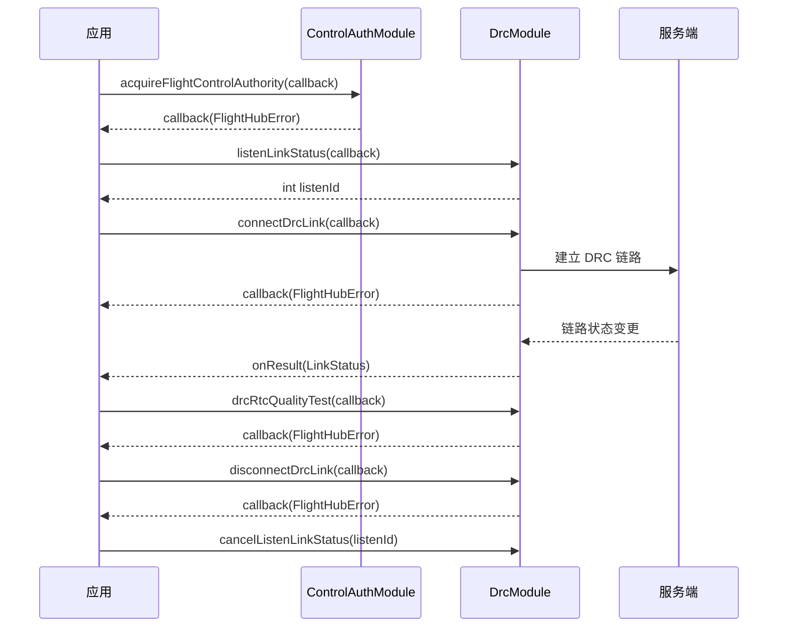

# DRC链路（DrcModule）

## 1 功能概述

### 1.1 功能简介

`DrcModule` 是**单机级**的 DRC（Direct Remote Control）链路模块，作用域为一架具体的飞机（由设备 SN 指定）。它解决的是「为飞机建立一条低时延的直连操控链路」这一件事：连接/断开 DRC 链路、订阅链路状态、发起 RTC 质量测试，以及订阅链路运行期的延时、心跳、倒计时等推送信息。

DRC 链路是**下行实时操控的通道基础**。[飞行控制](./flight-control.md)、[飞向目标点](./fly-to-point.md)、[相机控制](./camera-control.md) 等模块的下行指令，都依赖本模块先把 DRC 链路建立起来才能下发。本模块只负责「链路本身」的建立与状态观测，不下发任何飞行或负载指令。

**获取方式：**

```java
// 通过飞机实例获取本模块，sn 为目标飞机序列号
Drone drone = FlightHubSDK.getDroneInstance("your_device_sn");
DrcModule drcModule = drone.getDrcModule();
```

### 1.2 核心概念

| 概念 | 说明 |
| --- | --- |
| DRC 链路 | Direct Remote Control 直连操控链路，为飞机提供低时延的下行指令通道。`connectDrcLink()` 建链，`disconnectDrcLink()` 断链。 |
| 链路状态（`LinkStatus`） | `listenLinkStatus()` 推送的链路状态聚合，含三条子链路：控制链路 `getCtrlLinkStatus()`、数据链路 `getDataLinkStatus()`、图传链路 `getLiveLinkStatus()`，取值均为 `DroneLinkState`。 |
| 链路状态取值（`DroneLinkState`） | 无人机链路状态枚举：`CONNECTED` 已连接、`CONNECTING` 连接中、`DISCONNECTED` 已断开、`IDLE` 空闲、`UNKNOWN` 未知或未在表中定义的取值。可用 `getValue()` 取整型值、`fromValue(int)` 由整型解析。 |
| RTC 质量测试 | `drcRtcQualityTest()` 发起一次 RTC 链路质量测试，回调返回错误信息。 |
| 延时信息推送 | `listenDrcDelayInfo()` 订阅 DRC 延时信息推送，回调返回延时信息对象。 |
| 设备心跳推送 | `listenDrcDeviceHeartBeat()` 订阅设备 DRC 心跳推送，回调返回心跳信息对象。 |
| 倒计时信息推送 | `listenDrcCountDownInfo()` 订阅倒计时信息推送，回调返回倒计时信息对象。 |
| 监听 ID（`listenId`） | 各 `listenXxx()` 返回的整型句柄，取消订阅时必须回传同一个值。 |

### 1.3 能力清单

| 能力 | 对应接口 | 接口类型 | 说明 |
| --- | --- | --- | --- |
| 连接 DRC 链路 | `connectDrcLink(cb)` | 异步回调 | 连接 DRC 链路，回调 `onResult(FlightHubError)` 仅返回错误信息 |
| 断开 DRC 链路 | `disconnectDrcLink(cb)` | 异步回调 | 断开 DRC 链路，回调 `onResult(FlightHubError)` 仅返回错误信息 |
| RTC 质量测试 | `drcRtcQualityTest(cb)` | 异步回调 | RTC 质量测试，回调 `onResult(FlightHubError)` 仅返回错误信息 |
| 订阅链路状态 | `listenLinkStatus(cb)` / `cancelListenLinkStatus(listenId)` | 事件订阅 | 回调方法为 `onResult(LinkStatus status)`，无 error 参数 |
| 订阅延时信息 | `listenDrcDelayInfo(cb)` / `cancelListenDrcDelayInfo(listenId)` | 事件订阅 | 回调方法为 `onResult(DrcDelayInfo info)`，无 error 参数 |
| 订阅设备心跳 | `listenDrcDeviceHeartBeat(cb)` / `cancelListenDrcDeviceHeartBeat(listenId)` | 事件订阅 | 回调方法为 `onResult(DrcDeviceHeartBeat info)`，无 error 参数 |
| 订阅倒计时信息 | `listenDrcCountDownInfo(cb)` / `cancelListenDrcCountDownInfo(listenId)` | 事件订阅 | 回调方法为 `onResult(DrcCountDownInfo info)`，无 error 参数 |

---

## 2 前提条件

- 已完成上云 API 2 底座部署，并获取到服务地址与鉴权 Token。详见 [部署指南](../../../02.deployment/00.index.md)、[鉴权接入指南](../../../08.auth.md)。
- 已完成 SDK 初始化且 `FlightHubSDK.isInitialized()` 返回 `true`。详见 [SDK初始化](../init/sdk-init.md)。
- 目标飞机已完成上云、已绑定至当前工作空间且在线。详见 [设备上云](../../../04.device-onboarding/00.index.md)。
- **必须先经 [控制权管理](./control-auth.md) 抢得飞行控制权，再调用 `connectDrcLink()` 建链。** 即先调用 `ControlAuthModule.acquireFlightControlAuthority(cb)` 成功拿到飞行控制权，DRC 链路建立后才能承载下行操控指令。
- DRC 链路是下行操控指令的通道基础。[飞行控制](./flight-control.md)、[飞向目标点](./fly-to-point.md)、[相机控制](./camera-control.md) 等下发指令前，须确保本模块已 `connectDrcLink()` 成功；其中相机/PSDK 类操作还需额外抢得负载控制权。
- 若需使用 `listenLinkStatus()`、`listenDrcDelayInfo()`、`listenDrcDeviceHeartBeat()`、`listenDrcCountDownInfo()` 订阅推送，SDK 配置中的 `notificationServerAddress` 必须正确且连接可用。详见 [SDK配置](../init/sdk-config.md)。

---

## 3 快速上手

### 3.1 获取模块实例

```java
// 前置：已完成 FlightHubSDK.initialize(config)
Drone drone = FlightHubSDK.getDroneInstance("your_device_sn");
DrcModule module = drone.getDrcModule();
```

### 3.2 使用流程

1. **抢飞行控制权** —— 先经 [控制权管理](./control-auth.md) 调用 `ControlAuthModule.acquireFlightControlAuthority(cb)` 成功。
2. **获取模块实例** —— 调用飞机实例的 `getDrcModule()`。
3. **订阅链路状态** —— 调用 `listenLinkStatus()` 并保存 `listenId`，实时掌握三条子链路状态。
4. **连接 DRC 链路** —— 调用 `connectDrcLink(cb)`，回调成功即建链完成。
5. **（可选）质量测试与推送订阅** —— 调用 `drcRtcQualityTest(cb)` 测链路质量；按需 `listenDrcDelayInfo()` / `listenDrcDeviceHeartBeat()` / `listenDrcCountDownInfo()` 订阅运行期信息。
6. **下发操控指令** —— 建链成功后，经 [飞行控制](./flight-control.md)、[飞向目标点](./fly-to-point.md) 等模块下发指令。
7. **断开 DRC 链路** —— 操控结束调用 `disconnectDrcLink(cb)`。
8. **退出时取消订阅** —— 用保存的各 `listenId` 调用对应的 `cancelListenXxx()`。

### 3.3 调用时序图



---

## 4 示例代码

### 4.1 完整示例

```java
/**
 * DRC 链路：抢飞行控制权 -> 订阅链路状态 -> 连接 DRC 链路 -> 质量测试 -> 断链 -> 退订。
 * 注意：DRC 链路是下行操控指令的通道基础，必须先抢得飞行控制权再 connectDrcLink。
 */
public class DrcLinkManager {

    private int linkStatusListenId = -1;
    private final String deviceSn;

    public DrcLinkManager(String deviceSn) {
        this.deviceSn = deviceSn;
    }

    // ============ 1. 先抢飞行控制权，成功后再建 DRC 链路 ============
    public void start() {
        Drone drone = FlightHubSDK.getDroneInstance(deviceSn);

        drone.getControlAuthModule().acquireFlightControlAuthority(new FlightHubCallback.ResultCallbackWithError() {
            @Override
            public void onResult(FlightHubError error) {
                boolean ok = error != null && error.isSuccess();
                if (!ok) {
                    // 注意：飞行控制权可能被其他客户端占用，抢夺失败时不可建链
                    System.err.println("抢飞行控制权失败: " + error);
                    return;
                }
                System.out.println("抢飞行控制权成功");
                subscribeAndConnect(drone.getDrcModule());
            }
        });
    }

    // ============ 2. 订阅链路状态并连接 DRC 链路 ============
    private void subscribeAndConnect(DrcModule module) {
        // 订阅链路状态（回调方法名为 onResult(LinkStatus)，无 error 参数）
        linkStatusListenId = module.listenLinkStatus(new FlightHubCallback.LinkStatusCallback() {
            @Override
            public void onResult(LinkStatus status) {
                if (status == null) return;   // 注意：订阅回调无 error 参数，需判空
                System.out.println("[链路状态]"
                        + " 控制链路=" + status.getCtrlLinkStatus()   // DroneLinkState 枚举
                        + " 数据链路=" + status.getDataLinkStatus()
                        + " 图传链路=" + status.getLiveLinkStatus());
                // 三条子链路均为 CONNECTED 时，链路整体可用
                if (status.getCtrlLinkStatus() == DroneLinkState.CONNECTED) {
                    System.out.println("控制链路已连接，可下发操控指令");
                }
            }
        });

        // 连接 DRC 链路（回调仅返回错误信息）
        module.connectDrcLink(new FlightHubCallback.ResultCallback() {
            @Override
            public void onResult(FlightHubError error) {
                boolean ok = error != null && error.isSuccess();
                if (!ok) {
                    // 注意：未抢得飞行控制权或设备离线时建链会失败
                    System.err.println("连接 DRC 链路失败: " + error);
                    return;
                }
                System.out.println("DRC 链路已连接");
                // 建链成功后可发起 RTC 质量测试
                module.drcRtcQualityTest(qErr -> {
                    boolean qOk = qErr != null && qErr.isSuccess();
                    System.out.println("RTC 质量测试: " + (qOk ? "已发起" : "失败 " + qErr));
                });
            }
        });
    }

    // ============ 3. 断开 DRC 链路 ============
    public void disconnect() {
        FlightHubSDK.getDroneInstance(deviceSn).getDrcModule()
                .disconnectDrcLink(error -> {
                    boolean ok = error != null && error.isSuccess();
                    System.out.println("断开 DRC 链路: " + (ok ? "成功" : "失败 " + error));
                });
    }

    // ============ 4. 退出前取消订阅（必须执行，否则订阅泄漏） ============
    public void stop() {
        if (linkStatusListenId != -1) {
            FlightHubSDK.getDroneInstance(deviceSn).getDrcModule()
                    .cancelListenLinkStatus(linkStatusListenId);
            linkStatusListenId = -1;
        }
    }
}
```

### 4.2 场景化片段

**订阅链路运行期推送：延时、心跳、倒计时**

```java
// 前置：DRC 链路已 connectDrcLink 成功
DrcModule module = FlightHubSDK.getDroneInstance(deviceSn).getDrcModule();

// 订阅 DRC 延时信息推送（回调无 error 参数，需判空 info）
int delayListenId = module.listenDrcDelayInfo(info -> {
    if (info == null) return;
    // 注意：DrcDelayInfo 为链路延时推送对象，收到即代表链路在持续上报延时
    System.out.println("[DRC 延时] 收到延时信息推送");
});

// 订阅设备 DRC 心跳推送
int heartBeatListenId = module.listenDrcDeviceHeartBeat(info -> {
    if (info == null) return;
    System.out.println("[DRC 心跳] 收到设备心跳推送");
});

// 订阅倒计时信息推送
int countDownListenId = module.listenDrcCountDownInfo(info -> {
    if (info == null) return;
    System.out.println("[DRC 倒计时] 收到倒计时信息推送");
});

// 退出前逐一取消订阅（回传对应 listenId）
module.cancelListenDrcDelayInfo(delayListenId);
module.cancelListenDrcDeviceHeartBeat(heartBeatListenId);
module.cancelListenDrcCountDownInfo(countDownListenId);
```

---

## 5 相关文档

- [控制权管理](./control-auth.md) —— 建链前必须先抢得飞行控制权，本模块的前置依赖
- [飞行控制](./flight-control.md) —— 基于 DRC 链路下发的实时飞行操控指令
- [飞向目标点](./fly-to-point.md) —— 基于 DRC 链路下发的飞向目标点指令
- [POI 环绕飞行](./poi.md) —— 基于 DRC 链路下发的环绕飞行指令
- [相机控制](./camera-control.md) —— 基于 DRC 链路的相机操控（另需抢得负载控制权）
- [PSDK 控制](./psdk-control.md) —— 基于 DRC 链路的 PSDK 负载操控（另需抢得负载控制权）
- [SDK初始化](../init/sdk-init.md) —— 获取设备实例与调用本模块前必须完成的初始化步骤
- [SDK配置](../init/sdk-config.md) —— WebSocket 通知地址等配置项，影响链路状态与推送订阅能否收到推送
- [设备上云](../../../04.device-onboarding/00.index.md) —— 设备绑定到工作空间的前置流程
- [部署指南](../../../02.deployment/00.index.md) —— 上云 API 2 底座部署与服务地址获取
- [鉴权接入指南](../../../08.auth.md) —— 获取鉴权 Token 的接入流程
- [使用 API 文档查阅接口详情](../../03.api-docs-guide.md) —— 查阅 `DrcModule` 完整方法签名与字段定义
```
