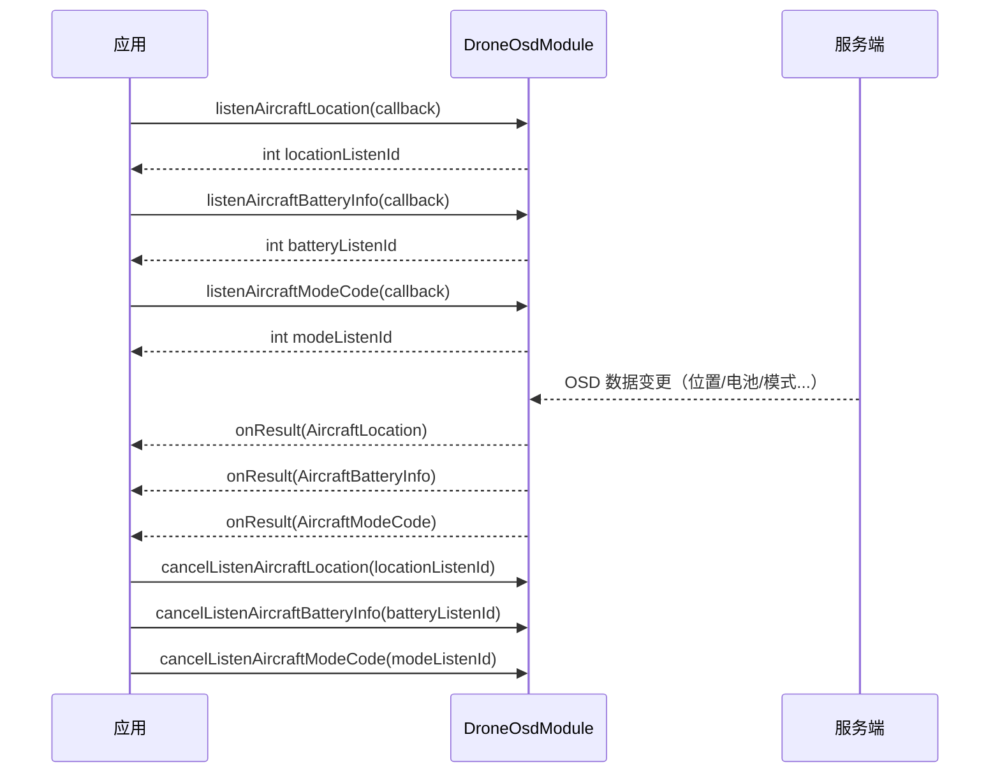

# 飞机状态监听（DroneOsdModule）

## 1 功能概述

### 1.1 功能简介

`DroneOsdModule` 是**单架飞机级**的状态监听模块，作用域为一台具体的飞行器（由飞机 SN 指定）。它把飞行器在云端上报的 OSD（On-Screen Display）遥测数据以**事件订阅**的方式推送给应用：位置、姿态、速度、电池、飞行模式、负载与云台、避障与限飞、返航配置、维护与激活信息等，几乎覆盖飞行过程中需要实时掌握的全部状态量。

本模块只做**只读监听**，不下发任何控制指令。每个能力都成对提供 `listenXxx`（订阅，返回一个整型监听 ID）与 `cancelListenXxx`（按监听 ID 取消订阅）两个方法。订阅回调在数据变化时被持续调用，直到显式取消。

机场（Dock）的状态监听请见 [机场状态监听](./dock-status.md)；本模块只负责飞机侧遥测。

**获取方式：**

```java
Drone drone = FlightHubSDK.getDroneInstance("your_device_sn");
DroneOsdModule droneOsdModule = drone.getDroneOsdModule();
```

### 1.2 核心概念

| 概念 | 说明 |
| --- | --- |
| 事件订阅（listen/cancel） | 每类状态由一对方法组成：`listenXxx(callback)` 开始订阅并返回 `int` 监听 ID；`cancelListenXxx(listenId)` 用同一个监听 ID 取消订阅。 |
| 监听 ID（`listenId`） | `listenXxx()` 返回的整型句柄，取消订阅时必须回传同一个值。请自行保存，退出时逐一取消，避免订阅泄漏。 |
| 监听回调无 error 参数 | OSD 订阅回调方法统一为 `onResult(Xxx bean)`，**不带 `FlightHubError` 参数**。回调内应先对 bean 判空再取值。 |
| 推送依赖通知通道 | OSD 数据经服务端 WebSocket 通知通道下发，SDK 配置中的 `notificationServerAddress` 必须正确且连接可用，否则收不到回调。详见 [SDK配置](../init/sdk-config.md)。 |
| 只读监听 | 本模块所有方法均为订阅，不改变飞机状态，通常无需飞行控制权或 DRC 链路。 |
| 负载 OSD 暂不支持 | `listenAircraftPayloadsOsdInfo` 依据 javadoc 说明「当前版本后端暂不支持 `topic_drone_payloads_osd_info` 推送，调用后无法收到回调」；替代方案见 1.3 备注。 |

### 1.3 能力清单

本模块方法极多，以下按主题分组列全所有 `listen*` / `cancel*` 方法（方法名照抄 javadoc）。每类均为「订阅 + 取消订阅」一对。

**位置与姿态**

| 订阅方法 | 取消订阅方法 | 说明 |
| --- | --- | --- |
| `listenAircraftLocation` | `cancelListenAircraftLocation` | 订阅飞机位置 |
| `listenAircraftAttitude` | `cancelListenAircraftAttitude` | 订阅飞机姿态 |
| `listenAircraftHomeDistance` | `cancelListenAircraftHomeDistance` | 订阅飞机 Home 点距离 |
| `listenAircraftHomeGeographicalInfo` | `cancelListenAircraftHomeGeographicalInfo` | 订阅飞机 Home 点地理坐标信息 |
| `listenAircraftPositionState` | `cancelListenAircraftPositionState` | 订阅飞机搜星状态 |
| `listenAircraftTrackId` | `cancelListenAircraftTrackId` | 订阅航迹 ID |

**速度、风速与档位**

| 订阅方法 | 取消订阅方法 | 说明 |
| --- | --- | --- |
| `listenAircraftSpeed` | `cancelListenAircraftSpeed` | 订阅飞机速度 |
| `listenAircraftWindSpeed` | `cancelListenAircraftWindSpeed` | 订阅飞机风速 |
| `listenAircraftGear` | `cancelListenAircraftGear` | 订阅飞机档位信息 |

**电池**

| 订阅方法 | 取消订阅方法 | 说明 |
| --- | --- | --- |
| `listenAircraftBatteryInfo` | `cancelListenAircraftBatteryInfo` | 订阅飞机电池信息 |
| `listenAircraftBatteryWarningThresholds` | `cancelListenAircraftBatteryWarningThresholds` | 订阅电量告警信息（用户设置的阈值） |

**飞行状态、模式与控制权**

| 订阅方法 | 取消订阅方法 | 说明 |
| --- | --- | --- |
| `listenAircraftModeCode` | `cancelListenAircraftModeCode` | 订阅飞机模式码 |
| `listenDroneModeCodeReason` | `cancelListenDroneModeCodeReason` | 订阅飞行器进入当前状态原因（mode_code_reason） |
| `listenAircraftControlCode` | `cancelListenAircraftControlCode` | 订阅飞机控制码 |
| `listenAircraftControlSource` | `cancelListenAircraftControlSource` | 订阅飞机当前控制源 |
| `listenControlRightsCloudControlStatus` | `cancelListenControlRightsCloudControlStatus` | 订阅控制权限云控制状态 |
| `listenControlRightsDeviceControlStatus` | `cancelListenControlRightsDeviceControlStatus` | 订阅控制权限设备控制状态 |

**负载与云台**

| 订阅方法 | 取消订阅方法 | 说明 |
| --- | --- | --- |
| `listenAircraftPayloadsList` | `cancelListenAircraftPayloadsList` | 订阅载荷列表 |
| `listenAircraftPayloadsGimbalAttitude` | `cancelListenAircraftPayloadsGimbalAttitude` | 订阅载荷云台姿态 |
| `listenAircraftPayloadsCamerasList` | `cancelListenAircraftPayloadsCamerasList` | 订阅飞行器相机信息 |
| `listenAircraftPayloadsCameraLiveviewWorldRegion` | `cancelListenAircraftPayloadsCameraLiveviewWorldRegion` | 订阅载荷相机实时视图世界区域 |
| `listenAircraftPayloadsOsdInfo` | `cancelListenAircraftPayloadsOsdInfo` | 订阅飞机负载 OSD 信息列表。**注意：** 据 javadoc「当前版本后端暂不支持 `topic_drone_payloads_osd_info` 推送，调用后无法收到回调」；云台姿态改用 `listenAircraftPayloadsGimbalAttitude`，激光测距等改用 [相机控制](./camera-control.md) |

**避障与限飞**

| 订阅方法 | 取消订阅方法 | 说明 |
| --- | --- | --- |
| `listenAircraftObstacleAvoidanceState` | `cancelListenAircraftObstacleAvoidanceState` | 订阅飞行器避障状态 |
| `listenHsiInfo` | `cancelListenHsiInfo` | 订阅飞行器 HSI 信息（障碍物感知/避障传感器数据） |
| `listenAircraftLimitsInfo` | `cancelListenAircraftLimitsInfo` | 订阅飞机限制类信息状态 |
| `listenAircraftComplianceInfo` | `cancelListenAircraftComplianceInfo` | 订阅合规相关信息 |
| `listenDroneFlysafeDatabaseVersion` | `cancelListenDroneFlysafeDatabaseVersion` | 订阅限飞数据库版本（flysafe_database_version） |

**返航与失控**

| 订阅方法 | 取消订阅方法 | 说明 |
| --- | --- | --- |
| `listenAircraftRthInfo` | `cancelListenAircraftRthInfo` | 订阅返航信息（返航模式、返航高度） |
| `listenAircraftCurrentRthMode` | `cancelListenAircraftCurrentRthMode` | 订阅返航高度模式当前值 |
| `listenAircraftRcLostAction` | `cancelListenAircraftRcLostAction` | 订阅遥控器失控动作 |

**存储、固件与外设**

| 订阅方法 | 取消订阅方法 | 说明 |
| --- | --- | --- |
| `listenAircraftStorageInfo` | `cancelListenAircraftStorageInfo` | 订阅存储容量信息 |
| `listenAircraftFirmwareStatus` | `cancelListenAircraftFirmwareStatus` | 订阅固件状态信息 |
| `listenDroneWpmzVersion` | `cancelListenDroneWpmzVersion` | 订阅航线解析库版本（wpmz_version） |
| `listenDroneDongleInfos` | `cancelListenDroneDongleInfos` | 订阅飞机 4G Dongle 信息（dongle_infos） |
| `listenAircraftNightLightsState` | `cancelListenAircraftNightLightsState` | 订阅飞行器夜航灯状态 |

**维护与激活**

| 订阅方法 | 取消订阅方法 | 说明 |
| --- | --- | --- |
| `listenAircraftActivationTime` | `cancelListenAircraftActivationTime` | 订阅飞行器激活时间 |
| `listenAircraftMaintainStatusInfo` | `cancelListenAircraftMaintainStatusInfo` | 订阅飞机保养信息 |
| `listenAircraftTotalFlightInfo` | `cancelListenAircraftTotalFlightInfo` | 订阅累计飞行信息 |

**飞行任务**

| 订阅方法 | 取消订阅方法 | 说明 |
| --- | --- | --- |
| `listenFlightTasksException` | `cancelListenFlightTasksException` | 订阅飞行任务异常 |
| `listenFlightTasksMediaFileDisplayAvailable` | `cancelListenFlightTasksMediaFileDisplayAvailable` | 订阅飞行任务媒体文件显示可用 |

> 以上共 40 对（40 个 `listen*` + 40 个 `cancel*`）方法，已列全。完整方法签名与字段定义可查阅 [使用 API 文档查阅接口详情](../../03.api-docs-guide.md)。

---

## 2 前提条件

- 已完成上云 API 2 底座部署，并获取到服务地址与鉴权 Token。详见 [部署指南](../../../02.deployment/00.index.md)、[鉴权接入指南](../../../08.auth.md)。
- 已完成 SDK 初始化且 `FlightHubSDK.isInitialized()` 返回 `true`。详见 [SDK初始化](../init/sdk-init.md)。
- 目标飞机已完成上云、已绑定至当前工作空间。详见 [设备上云](../../../04.device-onboarding/00.index.md)。
- SDK 配置中的 `notificationServerAddress` 必须正确且连接可用，OSD 推送经该通知通道下发，否则订阅后收不到回调。详见 [SDK配置](../init/sdk-config.md)。
- 本模块为只读监听，通常无需通过 [控制权管理](./control-auth.md) 抢占飞行控制权，也无需建立 [DRC链路](./drc.md)。以各方法 javadoc 说明为准。
- OSD 数据在飞机通电并有数据上报后才会推送；飞机离线或无数据时，订阅成功但回调不触发属正常现象。

---

## 3 快速上手

### 3.1 获取模块实例

```java
// 前置：已完成 FlightHubSDK.initialize(config)
Drone drone = FlightHubSDK.getDroneInstance("your_device_sn");
DroneOsdModule module = drone.getDroneOsdModule();
```

### 3.2 使用流程

1. **获取模块实例** —— `FlightHubSDK.getDroneInstance(sn).getDroneOsdModule()`。
2. **按需订阅状态** —— 调用所需的 `listenXxx(callback)`，每个方法返回一个 `int` 监听 ID。
3. **保存监听 ID** —— 将每个 `listenId` 保存起来（如放入集合），供退订时使用。
4. **在回调中消费数据** —— 回调方法为 `onResult(Xxx bean)`，无 error 参数，先判空 bean 再取字段。
5. **退出时取消订阅** —— 对每个保存的监听 ID 调用对应的 `cancelListenXxx(listenId)`，避免订阅泄漏。

### 3.3 调用时序图



---

## 4 示例代码

### 4.1 完整示例

以位置、电池、模式码、姿态四类典型状态为例，演示订阅、消费与统一退订。

```java
import com.dji.flighthubsdk.Drone;
import com.dji.flighthubsdk.FlightHubSDK;
import com.dji.flighthubsdk.FlightHubCallback;
import com.dji.flighthubsdk.bean.AircraftLocation;
import com.dji.flighthubsdk.bean.AircraftBatteryInfo;
import com.dji.flighthubsdk.bean.AircraftModeCode;
import com.dji.flighthubsdk.bean.AircraftAttitude;
import com.dji.flighthubsdk.bean.BatteryInfo;
import com.dji.flighthubsdk.value.DroneModeCode;

import java.util.ArrayList;
import java.util.List;

/**
 * 飞机状态监听：订阅位置/电池/模式码/姿态 -> 回调消费 -> 退出时统一退订。
 * 注意：OSD 订阅回调方法名为 onResult，且无 error 参数，回调内需先判空。
 */
public class DroneStatusWatcher {

    private final String deviceSn;
    private DroneOsdModule module;
    /** 保存所有监听 ID，退出时逐一取消，避免订阅泄漏 */
    private final List<Runnable> cancelActions = new ArrayList<>();

    public DroneStatusWatcher(String deviceSn) {
        this.deviceSn = deviceSn;
    }

    public void start() {
        Drone drone = FlightHubSDK.getDroneInstance(deviceSn);
        module = drone.getDroneOsdModule();

        // ============ 1. 订阅飞机位置 ============
        int locationListenId = module.listenAircraftLocation(new FlightHubCallback.AircraftLocationCallback() {
            @Override
            public void onResult(AircraftLocation location) {
                if (location == null) return;   // 注意：订阅回调无 error 参数，需判空
                System.out.println("[位置] 经度=" + location.getLongitude()
                        + " 纬度=" + location.getLatitude()
                        + " 椭球高度=" + location.getHeight()
                        + " 相对起飞点高度=" + location.getElevation());
            }
        });
        cancelActions.add(() -> module.cancelListenAircraftLocation(locationListenId));

        // ============ 2. 订阅飞机电池信息 ============
        int batteryListenId = module.listenAircraftBatteryInfo(new FlightHubCallback.AircraftBatteryInfoCallback() {
            @Override
            public void onResult(AircraftBatteryInfo battery) {
                if (battery == null) return;
                System.out.println("[电池] 电量=" + battery.getCapacityPercent() + "%"
                        + " 返航电量=" + battery.getReturnHomePower() + "%"
                        + " 降落电量=" + battery.getLandingPower() + "%"
                        + " 剩余飞行时间(s)=" + battery.getRemainFlightTime());
                List<BatteryInfo> cells = battery.getBatteries();   // 各电池条目
                if (cells != null) {
                    for (BatteryInfo cell : cells) {
                        System.out.println("  电池#" + cell.getIndex()
                                + " SN=" + cell.getSn()
                                + " 电量=" + cell.getCapacityPercent() + "%"
                                + " 温度=" + cell.getTemperature() + "℃"
                                + " 循环次数=" + cell.getLoopTimes());
                    }
                }
            }
        });
        cancelActions.add(() -> module.cancelListenAircraftBatteryInfo(batteryListenId));

        // ============ 3. 订阅飞机模式码 ============
        int modeListenId = module.listenAircraftModeCode(new FlightHubCallback.AircraftModeCodeCallback() {
            @Override
            public void onResult(AircraftModeCode modeCode) {
                if (modeCode == null) return;
                DroneModeCode code = modeCode.getModeCode();   // 枚举，取值语义见 DroneModeCode
                System.out.println("[模式码] " + code);
                // 注意：可据此判断飞行阶段，例如是否在航线飞行 / 自动返航
                if (code == DroneModeCode.ROUTE_FLIGHT) {
                    System.out.println("  当前正在执行航线飞行");
                } else if (code == DroneModeCode.RETURN_HOME_AUTOMATICALLY) {
                    System.out.println("  当前正在自动返航");
                }
            }
        });
        cancelActions.add(() -> module.cancelListenAircraftModeCode(modeListenId));

        // ============ 4. 订阅飞机姿态 ============
        int attitudeListenId = module.listenAircraftAttitude(new FlightHubCallback.AircraftAttitudeCallback() {
            @Override
            public void onResult(AircraftAttitude attitude) {
                if (attitude == null) return;
                System.out.println("[姿态] 机头朝向=" + attitude.getAttitudeHead()
                        + " 俯仰=" + attitude.getAttitudePitch()
                        + " 横滚=" + attitude.getAttitudeRoll());
            }
        });
        cancelActions.add(() -> module.cancelListenAircraftAttitude(attitudeListenId));
    }

    // ============ 5. 退出前统一取消所有订阅（必须执行，否则订阅泄漏） ============
    public void stop() {
        for (Runnable cancel : cancelActions) {
            cancel.run();
        }
        cancelActions.clear();
    }
}
```

### 4.2 场景化片段

**只订阅电量并做低电量告警**

```java
// 前置：已初始化 SDK
DroneOsdModule module = FlightHubSDK.getDroneInstance(deviceSn).getDroneOsdModule();

int listenId = module.listenAircraftBatteryInfo(battery -> {
    if (battery == null) return;   // 注意：回调无 error 参数，需判空
    int percent = battery.getCapacityPercent();
    int rthPower = battery.getReturnHomePower();
    if (percent <= rthPower) {
        // 电量已到返航阈值，业务侧可触发提醒或返航流程
        System.out.println("低电量告警：当前 " + percent + "%，已达返航电量 " + rthPower + "%");
    }
});

// 不再需要时退订
module.cancelListenAircraftBatteryInfo(listenId);
```

**订阅飞机模式码，感知飞行阶段变化**

```java
DroneOsdModule module = FlightHubSDK.getDroneInstance(deviceSn).getDroneOsdModule();

int modeListenId = module.listenAircraftModeCode(modeCode -> {
    if (modeCode == null) return;
    DroneModeCode code = modeCode.getModeCode();
    switch (code) {
        case READY_TO_TAKE_OFF: System.out.println("已就绪，可起飞"); break;
        case AUTOMATIC_TAKEOFF: System.out.println("自动起飞中"); break;
        case ROUTE_FLIGHT:      System.out.println("航线飞行中"); break;
        case RETURN_HOME_AUTOMATICALLY: System.out.println("自动返航中"); break;
        case AUTOMATIC_LANDING: System.out.println("自动降落中"); break;
        default: System.out.println("当前模式: " + code);
    }
});

module.cancelListenAircraftModeCode(modeListenId);
```

---

## 5 相关文档

- [SDK初始化](../init/sdk-init.md) —— 获取设备实例与调用本模块前必须完成的初始化步骤
- [SDK配置](../init/sdk-config.md) —— WebSocket 通知地址等配置项，直接影响 OSD 订阅能否收到推送
- [机场状态监听](./dock-status.md) —— 机场（Dock）侧的状态监听，与本模块互补
- [飞行控制](./flight-control.md) —— 结合飞机状态实现起飞、返航等下行控制
- [相机控制](./camera-control.md) —— 激光测距等负载能力的替代获取入口
- [控制权管理](./control-auth.md) —— 下行控制前抢占飞行控制权（本模块只读监听通常无需）
- [DRC链路](./drc.md) —— 下行控制所需的低延迟链路（本模块只读监听通常无需）
- [设备上云](../../../04.device-onboarding/00.index.md) —— 飞机绑定到工作空间的前置流程
- [部署指南](../../../02.deployment/00.index.md) —— 上云 API 2 底座部署与服务地址获取
- [鉴权接入指南](../../../08.auth.md) —— 获取鉴权 Token 的接入流程
- [使用 API 文档查阅接口详情](../../03.api-docs-guide.md) —— 查阅 `DroneOsdModule` 完整方法签名与字段定义
