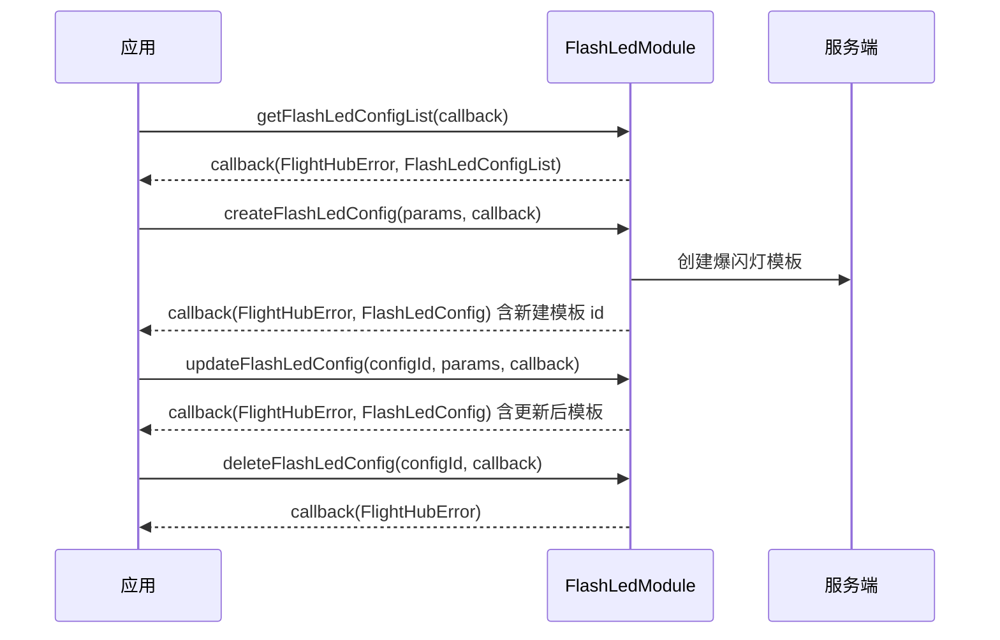

# 频闪灯配置（FlashLedModule）

## 1 功能概述

### 1.1 功能简介

`FlashLedModule` 是**工作空间级**的爆闪灯（频闪灯）模板管理模块，作用域为当前工作空间下的全部爆闪灯模板。它解决的是「把一套爆闪灯闪烁方案沉淀为可复用模板」这一件事：以「模板」为单位，创建/更新/删除模板，并查询模板列表。

本模块负责**模板的增删改查（配置管理）**，不负责把爆闪灯效果实时下发到飞机。真正把某个模板或某段闪烁参数下发给在飞飞机，由 [飞行控制](./flight-control.md) 的 `drcSetFlashLed` 通过 DRC 链路完成；本模块只做云端模板的持久化管理，因此**不涉及控制权与 DRC 建链**。

**获取方式：**

```java
Workspace workspace = FlightHubSDK.getWorkspaceInstance();
FlashLedModule flashLedModule = workspace.getFlashLedModule();
```

### 1.2 核心概念

| 概念 | 说明 |
| --- | --- |
| 爆闪灯模板（FlashLedConfig） | 一套可复用的爆闪灯闪烁方案，云端以 `id`（模板 UUID）唯一标识，含名称 `name` 与片段列表 `flashSegments`。 |
| 模板参数（FlashLedConfigParams） | 创建/更新模板的入参，由 `name`（配置名称）与 `flashSegments`（爆闪片段列表）两部分组成。 |
| 爆闪片段（FlashLedSegment） | 一段闪烁描述，字段含颜色 `color`、闪烁次数 `count`、亮灯时长 `on`、灭灯时长 `off`、组间停顿 `interval`（时长单位均为毫秒 ms）。多个片段顺序拼接构成完整闪烁方案。 |
| 模板列表（FlashLedConfigList） | 一次列表查询的结果，`configs` 为工作空间下全部模板 `FlashLedConfig` 的集合。 |

### 1.3 能力清单

| 能力 | 对应接口 | 接口类型 | 说明 |
| --- | --- | --- | --- |
| 获取模板列表 | `getFlashLedConfigList(callback)` | 异步回调 | 回调返回 `FlashLedConfigList`（含全部模板）与错误信息 |
| 创建模板 | `createFlashLedConfig(params, callback)` | 异步回调 | 入参 `FlashLedConfigParams`（名称 + `flashSegments`），回调返回创建后的 `FlashLedConfig` |
| 更新模板 | `updateFlashLedConfig(configId, params, callback)` | 异步回调 | 传入模板 UUID 与 `FlashLedConfigParams`，回调返回更新后的 `FlashLedConfig` |
| 删除模板 | `deleteFlashLedConfig(configId, callback)` | 异步回调 | 传入模板 UUID，回调仅返回错误信息 |

---

## 2 前提条件

- 已完成上云 API 2 底座部署，并获取到服务地址与鉴权 Token。详见 [部署指南](../../../02.deployment/00.index.md)、[鉴权接入指南](../../../08.auth.md)。
- 已完成 SDK 初始化且 `FlightHubSDK.isInitialized()` 返回 `true`。详见 [SDK初始化](../init/sdk-init.md)。
- 已通过 `FlightHubSDK.getWorkspaceInstance()` 获取工作空间实例，并调用其 `getFlashLedModule()` 拿到本模块实例。
- 本模块仅做工作空间级模板的增删改查，**不需要飞行控制权、也不需要 DRC 建链**；若需把模板效果实时下发到在飞飞机，另见 [飞行控制](./flight-control.md) 的 `drcSetFlashLed`，其下发前提是先经 [控制权管理](./control-auth.md) 抢得飞行控制权并建立 [DRC链路](./drc.md)。

---

## 3 快速上手

### 3.1 获取模块实例

```java
// 前置：已完成 FlightHubSDK.initialize(config)
Workspace workspace = FlightHubSDK.getWorkspaceInstance();
FlashLedModule module = workspace.getFlashLedModule();
```

### 3.2 使用流程

1. **获取模块实例** —— 从工作空间实例调用 `getFlashLedModule()`。
2. **查询模板列表** —— 用 `getFlashLedConfigList()` 拉取工作空间下已有模板，确认名称是否重复、复用已有方案。
3. **创建模板** —— 组装 `FlashLedConfigParams`（`name` + `flashSegments`），调用 `createFlashLedConfig()`，保存返回 `FlashLedConfig` 的 `id`。
4. **更新模板** —— 用模板 `id` 与新的 `FlashLedConfigParams` 调用 `updateFlashLedConfig()`，改名称或调整闪烁片段。
5. **删除模板** —— 不再需要时用 `deleteFlashLedConfig(configId)` 删除。

### 3.3 调用时序图



---

## 4 示例代码

### 4.1 完整示例

```java
/**
 * 频闪灯配置：查列表 -> 创建模板 -> 更新模板 -> 删除模板。
 */
public class FlashLedConfigManager {

    // ============ 1. 查询工作空间下的爆闪灯模板列表 ============
    public void list() {
        FlashLedModule module = FlightHubSDK.getWorkspaceInstance().getFlashLedModule();

        module.getFlashLedConfigList(new FlightHubCallback.FlashLedConfigListCallback() {
            @Override
            public void onResult(FlightHubError error, FlashLedConfigList list) {
                if (error != null && !error.isSuccess()) {
                    System.err.println("查询模板列表失败: " + error
                            + " serverCode=" + error.getServerCode()
                            + " msg=" + error.getServerMessage());
                    return;
                }
                // 注意：回调无 error 保证时也可能 list 为 null，需判空
                if (list == null || list.getConfigs() == null) return;
                for (FlashLedConfig config : list.getConfigs()) {
                    System.out.println("模板 id=" + config.getId()
                            + " 名称=" + config.getName()
                            + " 片段数=" + (config.getFlashSegments() == null
                                    ? 0 : config.getFlashSegments().size()));
                }
            }
        });
    }

    // ============ 2. 创建爆闪灯模板（名称 + 片段列表） ============
    public void create() {
        FlashLedModule module = FlightHubSDK.getWorkspaceInstance().getFlashLedModule();

        // 组装一段爆闪片段：红灯闪 3 次，亮 200ms、灭 200ms，组间停顿 500ms
        FlashLedSegment segment = new FlashLedSegment();
        segment.setColor(1);        // 颜色：0关 1红 2绿 3蓝 4黄 5白
        segment.setCount(3);        // 闪烁次数，取值范围 1..99
        segment.setOn(200);         // 亮灯时长（毫秒）
        segment.setOff(200);        // 灭灯时长（毫秒）
        segment.setInterval(500);   // 组间停顿（毫秒）

        FlashLedConfigParams params = new FlashLedConfigParams();
        params.setName("红色应急闪烁");
        params.setFlashSegments(java.util.Collections.singletonList(segment));

        module.createFlashLedConfig(params, new FlightHubCallback.FlashLedConfigCallback() {
            @Override
            public void onResult(FlightHubError error, FlashLedConfig config) {
                if (error != null && !error.isSuccess()) {
                    System.err.println("创建模板失败: " + error);
                    return;
                }
                if (config == null) return;
                // 保存 id，后续更新/删除均以此 id 定位模板
                System.out.println("模板已创建: id=" + config.getId()
                        + " 名称=" + config.getName());
            }
        });
    }

    // ============ 3. 更新爆闪灯模板（改名称与片段） ============
    public void update(String configId) {
        FlashLedModule module = FlightHubSDK.getWorkspaceInstance().getFlashLedModule();

        FlashLedSegment segment = new FlashLedSegment();
        segment.setColor(3);        // 改为蓝灯
        segment.setCount(5);
        segment.setOn(150);
        segment.setOff(150);
        segment.setInterval(300);

        // 注意：更新为整体覆盖，flashSegments 需给出完整片段列表，缺项即被清除
        FlashLedConfigParams params = new FlashLedConfigParams();
        params.setName("蓝色巡航闪烁");
        params.setFlashSegments(java.util.Collections.singletonList(segment));

        module.updateFlashLedConfig(configId, params, new FlightHubCallback.FlashLedConfigCallback() {
            @Override
            public void onResult(FlightHubError error, FlashLedConfig config) {
                if (error != null && !error.isSuccess()) {
                    System.err.println("更新模板失败: " + error);
                    return;
                }
                if (config == null) return;
                System.out.println("模板已更新: id=" + config.getId()
                        + " 名称=" + config.getName());
            }
        });
    }

    // ============ 4. 删除爆闪灯模板 ============
    public void delete(String configId) {
        FlightHubSDK.getWorkspaceInstance().getFlashLedModule()
                .deleteFlashLedConfig(configId, new FlightHubCallback.ResultCallbackWithError() {
                    @Override
                    public void onResult(FlightHubError error) {
                        boolean ok = error != null && error.isSuccess();
                        System.out.println("删除模板: " + (ok ? "成功" : "失败 " + error));
                    }
                });
    }
}
```

### 4.2 场景化片段

**组装多段闪烁方案（红→绿交替）后创建模板**

```java
// 前置：SDK 已初始化
FlashLedModule module = FlightHubSDK.getWorkspaceInstance().getFlashLedModule();

// 第 1 段：红灯闪 2 次
FlashLedSegment red = new FlashLedSegment();
red.setColor(1);            // 1红
red.setCount(2);
red.setOn(300);
red.setOff(300);
red.setInterval(400);

// 第 2 段：绿灯闪 2 次
FlashLedSegment green = new FlashLedSegment();
green.setColor(2);          // 2绿
green.setCount(2);
green.setOn(300);
green.setOff(300);
green.setInterval(400);

FlashLedConfigParams params = new FlashLedConfigParams();
params.setName("红绿交替告警");
// 注意：片段按 List 顺序依次执行，红段先于绿段
params.setFlashSegments(java.util.Arrays.asList(red, green));

module.createFlashLedConfig(params, (error, config) -> {
    if (error != null && !error.isSuccess()) {
        System.err.println("创建多段模板失败: " + error);
        return;
    }
    if (config == null) return;
    System.out.println("多段模板已创建: id=" + config.getId());
});
```

**查询列表并按名称定位某个模板的 id**

```java
// 前置：SDK 已初始化
FlightHubSDK.getWorkspaceInstance().getFlashLedModule()
        .getFlashLedConfigList((error, list) -> {
            if (error != null && !error.isSuccess()) {
                System.err.println("查询模板列表失败: " + error);
                return;
            }
            if (list == null || list.getConfigs() == null) return;
            for (FlashLedConfig config : list.getConfigs()) {
                if ("红色应急闪烁".equals(config.getName())) {
                    // 拿到 id 后可用于 updateFlashLedConfig / deleteFlashLedConfig
                    System.out.println("命中模板 id=" + config.getId());
                }
            }
        });
```

---

## 5 相关文档

- [SDK初始化](../init/sdk-init.md) —— 获取工作空间实例与调用本模块前必须完成的初始化步骤
- [飞行控制](./flight-control.md) —— 通过 `drcSetFlashLed` 把爆闪灯效果实时下发到在飞飞机
- [控制权管理](./control-auth.md) —— 下发飞行/爆闪控制前抢占飞行控制权
- [DRC链路](./drc.md) —— 实时下发爆闪灯效果所需的低延时控制链路
- [设备上云](../../../04.device-onboarding/00.index.md) —— 设备绑定到工作空间的前置流程
- [部署指南](../../../02.deployment/00.index.md) —— 上云 API 2 底座部署与服务地址获取
- [鉴权接入指南](../../../08.auth.md) —— 获取鉴权 Token 的接入流程
- [使用 API 文档查阅接口详情](../../03.api-docs-guide.md) —— 查阅 `FlashLedModule` 完整方法签名与字段定义
