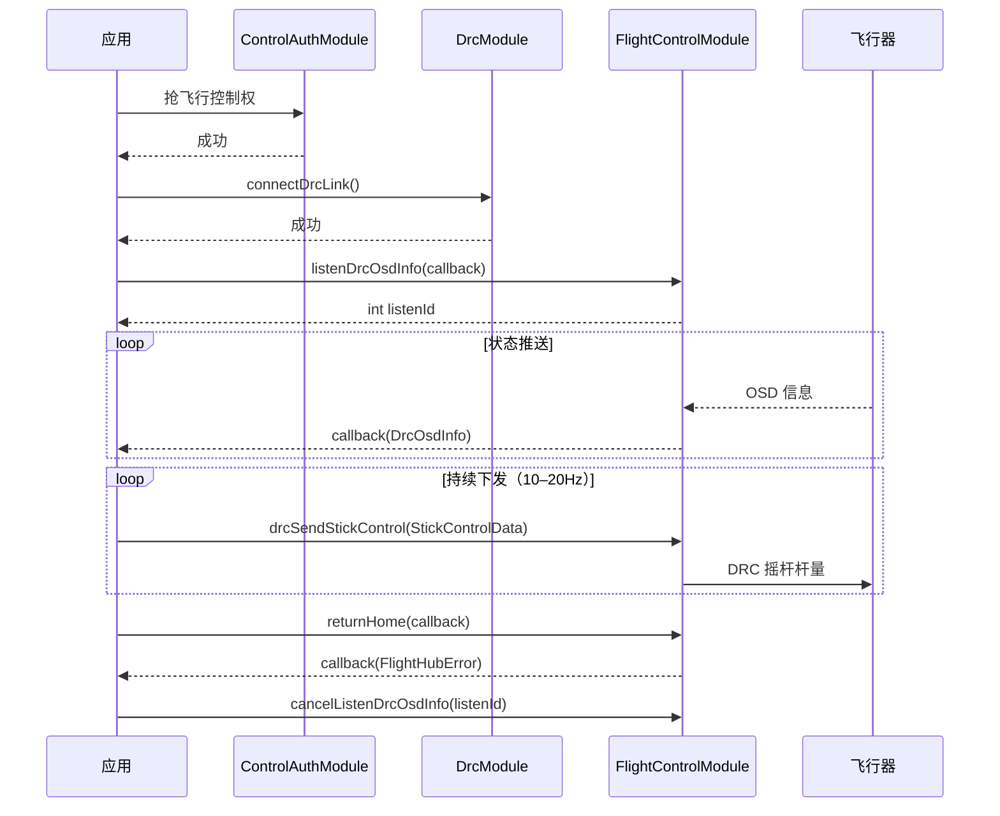

# 飞行控制（FlightControlModule）

## 1 功能概述

### 1.1 功能简介

`FlightControlModule` 是**单机维度的 DRC 实时飞行操控模块**，作用域为一架具体的飞行器（由设备 SN 指定）。它解决的是「通过 DRC 低时延链路对飞行器下发实时操控与安全指令」这一件事：虚拟摇杆杆量下发、悬停设置、紧急停桨/紧急降落/强制降落/开伞等安全处置、返航与取消返航、夜航灯/隐身模式/爆闪灯等机身设置、相机 LookAt，以及 DRC 链路下的 OSD、电池、降落伞、爆闪灯状态订阅。

本模块负责**DRC 链路下的实时下行控制与状态订阅**，不负责抢占飞行控制权（见 [控制权管理](./control-auth.md)），也不负责建立 DRC 链路（见 [DRC链路](./drc.md)）。航点/一键起飞/飞向目标点/POI 等自动化飞行分别由独立模块承担：[一键起飞](./takeoff.md)、[飞向目标点](./fly-to-point.md)、[POI 环绕飞行](./poi.md)。

**获取方式：**

```java
Drone drone = FlightHubSDK.getDroneInstance("your_device_sn");
FlightControlModule flightControlModule = drone.getFlightControlModule();
```

### 1.2 核心概念

| 概念 | 说明 |
| --- | --- |
| 虚拟摇杆（`drcSendStickControl`） | 通过 DRC 链路下发 `StickControlData` 杆量，模拟遥控器摇杆操控飞行器与云台。各轴中性值 `1024`（悬停/无输入），建议操控范围 `364–1684`（即 `1024±660`）。松杆建议连续发送若干帧全 `1024`；建议发送频率约 10–20Hz。 |
| 悬停保活（`drcSetDroneHover`） | 设置悬停时长（毫秒），取值范围 `[0, 1800000]`，`0` 表示取消悬停保活定时器。**仅支持大疆机场 4（DJI Dock 4）搭载机型，其他机型不支持。** |
| 安全处置 | 紧急停桨 `drcEmergencyStop`、紧急降落 `drcEmergencyLanding`、强制降落 `drcForceLanding`、开伞 `drcOpenParachute` 等一次性安全指令，回调仅返回错误信息。 |
| 返航 | `returnHome` 触发返航，`returnHomeCancel` 取消返航，回调仅返回错误信息。 |
| 爆闪灯设置（`drcSetFlashLed`） | 入参 `FlashLedParams`（开关、pattern uuid/名称、pattern 信息数组）。爆闪 pattern 的编排见 [频闪灯配置](./flash-led.md)。 |
| 相机 LookAt（`drcCameraLookAt`） | 入参 `CameraLookAtParams`，令指定负载相机朝向某个经纬度高度目标点，可锁定跟随。 |
| DRC 状态订阅 | `listenDrcOsdInfo` / `listenDrcBatteriesInfo` / `listenDrcParachuteInfo` / `listenDrcFlashLed` 分别订阅 DRC 链路下的 OSD、电池、降落伞、爆闪灯状态推送；订阅返回监听 ID，用对应 `cancelListen*` 退订。事件回调仅返回 info，无 error 参数。 |

### 1.3 能力清单

**安全处置**

| 能力 | 对应接口 | 接口类型 | 说明 |
| --- | --- | --- | --- |
| 紧急停桨 | `drcEmergencyStop(cb)` | 异步回调 | 回调 `ResultCallbackWithError`，仅返回错误信息 |
| 紧急降落 | `drcEmergencyLanding(cb)` | 异步回调 | 回调 `ResultCallbackWithError`，仅返回错误信息 |
| 强制降落 | `drcForceLanding(cb)` | 异步回调 | 回调 `ResultCallbackWithError`，仅返回错误信息 |
| 开伞 | `drcOpenParachute(int, cb)` | 异步回调 | 回调 `ResultCallbackWithError`，仅返回错误信息 |

**返航**

| 能力 | 对应接口 | 接口类型 | 说明 |
| --- | --- | --- | --- |
| 返航 | `returnHome(cb)` | 异步回调 | 回调 `ResultCallbackWithError`，仅返回错误信息 |
| 取消返航 | `returnHomeCancel(cb)` | 异步回调 | 回调 `ResultCallbackWithError`，仅返回错误信息 |

**飞行操控**

| 能力 | 对应接口 | 接口类型 | 说明 |
| --- | --- | --- | --- |
| 发送摇杆控制量（DRC 虚拟摇杆） | `drcSendStickControl(StickControlData)` | 同步下发 | 入参 `StickControlData`（roll/pitch/throttle/yaw/gimbalPitch），需持续下发 |
| 悬停设置 | `drcSetDroneHover(int, cb)` | 异步回调 | 入参悬停时长（毫秒），回调 `ResultCallbackWithError`；仅 DJI Dock 4 搭载机型支持 |
| 指哪打哪参数设置 | `drcSetFollowMouseParameter(int, cb)` | 异步回调 | 回调 `ResultCallbackWithError`，仅返回错误信息 |
| 相机 LookAt | `drcCameraLookAt(CameraLookAtParams, cb)` | 异步回调 | 入参 `CameraLookAtParams`，回调 `ResultCallbackWithError` |

**飞行器设置**

| 能力 | 对应接口 | 接口类型 | 说明 |
| --- | --- | --- | --- |
| 夜航灯设置 | `drcSetNightLightsState(int, cb)` | 异步回调 | 回调 `ResultCallbackWithError`，仅返回错误信息 |
| 隐身模式设置 | `drcSetStealthState(int, cb)` | 异步回调 | 回调 `ResultCallbackWithError`，仅返回错误信息 |
| 爆闪灯设置 | `drcSetFlashLed(FlashLedParams, cb)` | 异步回调 | 入参 `FlashLedParams`，回调 `ResultCallbackWithError` |

**DRC 状态订阅**

| 能力 | 对应接口 | 接口类型 | 说明 |
| --- | --- | --- | --- |
| 订阅 OSD 信息推送 | `listenDrcOsdInfo(cb)` / `cancelListenDrcOsdInfo(listenId)` | 事件订阅 | 回调 `DrcOsdInfoCallback`，仅返回 info，无 error 参数 |
| 订阅电池信息推送 | `listenDrcBatteriesInfo(cb)` / `cancelListenDrcBatteriesInfo(listenId)` | 事件订阅 | 回调 `DrcBatteriesInfoCallback`，仅返回 info，无 error 参数 |
| 订阅降落伞信息推送 | `listenDrcParachuteInfo(cb)` / `cancelListenDrcParachuteInfo(listenId)` | 事件订阅 | 回调 `DrcParachuteInfoCallback`，仅返回 info，无 error 参数 |
| 订阅爆闪灯状态推送 | `listenDrcFlashLed(cb)` / `cancelListenDrcFlashLed(listenId)` | 事件订阅 | 回调 `FlashLedStateInfoCallback`，返回 `FlashLedStateInfo`；订阅返回监听 ID，失败返回 -1 |

---

## 2 前提条件

- 已完成上云 API 2 底座部署，并获取到服务地址与鉴权 Token。详见 [部署指南](../../../02.deployment/00.index.md)、[鉴权接入指南](../../../08.auth.md)。
- 已完成 SDK 初始化且 `FlightHubSDK.isInitialized()` 返回 `true`。详见 [SDK初始化](../init/sdk-init.md)。
- 目标飞行器已完成上云、已绑定至当前工作空间且在线。详见 [设备上云](../../../04.device-onboarding/00.index.md)。
- 已通过 [控制权管理](./control-auth.md) 的 `ControlAuthModule` 抢得该飞行器的**飞行控制权**。这是本模块所有下行控制指令的前提。
- 已通过 [DRC链路](./drc.md) 的 `DrcModule.connectDrcLink()` **建立 DRC 链路**。虚拟摇杆、悬停、安全处置、机身设置、相机 LookAt 等下行指令均经 DRC 链路下发；OSD/电池/降落伞/爆闪灯状态订阅也基于 DRC 链路的推送。
- 虚拟摇杆需**持续下发**：各轴中性值 `1024`，建议操控范围 `364–1684`，建议发送频率约 10–20Hz；停止操控时应连续发送若干帧全 `1024` 松杆。
- `drcSetDroneHover`（悬停设置）**仅支持大疆机场 4（DJI Dock 4）搭载机型**，其他机型不支持。

---

## 3 快速上手

### 3.1 获取模块实例

```java
// 前置：已完成 FlightHubSDK.initialize(config)
Drone drone = FlightHubSDK.getDroneInstance("your_device_sn");
FlightControlModule module = drone.getFlightControlModule();
```

### 3.2 使用流程

1. **抢控制权** —— 经 [控制权管理](./control-auth.md) 的 `ControlAuthModule` 抢得飞行控制权。
2. **建 DRC 链路** —— 经 [DRC链路](./drc.md) 的 `DrcModule.connectDrcLink()` 建立低时延链路。
3. **获取模块实例** —— 调用 `getFlightControlModule()`。
4. **（可选）订阅状态** —— 调用 `listenDrcOsdInfo()` 等并保存各 `listenId`，用于消费 DRC 链路推送的遥测数据。
5. **下发操控** —— 用 `drcSendStickControl()` 持续下发摇杆杆量；按需调用 `drcSetDroneHover()`、`drcCameraLookAt()`、`drcSetFlashLed()`、`returnHome()` 等。
6. **安全处置** —— 异常时调用 `drcEmergencyStop()` / `drcEmergencyLanding()` / `drcForceLanding()` / `drcOpenParachute()`。
7. **退订与收尾** —— 用保存的各 `listenId` 调用对应 `cancelListen*()`，随后断开 DRC 链路、释放控制权。

### 3.3 调用时序图



---

## 4 示例代码

### 4.1 完整示例

```java
/**
 * 飞行控制：订阅 DRC OSD 状态 -> 持续下发虚拟摇杆 -> 松杆悬停 -> 返航 -> 退订收尾。
 * 前置：已抢得飞行控制权、已 connectDrcLink 建链。
 */
public class DrcFlightController {

    private final String deviceSn;
    private int osdListenId = -1;

    public DrcFlightController(String deviceSn) {
        this.deviceSn = deviceSn;
    }

    private FlightControlModule module() {
        return FlightHubSDK.getDroneInstance(deviceSn).getFlightControlModule();
    }

    /** 1. 订阅 DRC OSD 信息推送（事件回调仅返回 info，无 error 参数） */
    public void subscribeOsd() {
        osdListenId = module().listenDrcOsdInfo(new FlightHubCallback.DrcOsdInfoCallback() {
            @Override
            public void onResult(DrcOsdInfo info) {
                if (info == null) return;   // 注意：事件回调无 error 参数，需判空 info
                // info 承载 DRC 链路下的实时 OSD 遥测，按业务需要转交监控/渲染线程消费
                System.out.println("收到 DRC OSD 推送: " + info);
            }
        });
        if (osdListenId == -1) {
            System.err.println("订阅 OSD 失败");
        }
    }

    /** 2. 向前飞：pitch 前推，其余轴保持中性 1024 */
    public void pushForward() {
        StickControlData stick = new StickControlData();
        stick.setPitch(1400);        // 俯仰前为正，1024 为中性，建议范围 364–1684
        stick.setRoll(1024);         // 横滚中性
        stick.setThrottle(1024);     // 油门中性
        stick.setYaw(1024);          // 偏航中性
        stick.setGimbalPitch(1024);  // 云台俯仰中性
        // 注意：摇杆需持续下发（约 10–20Hz），单次调用不足以维持运动
        module().drcSendStickControl(stick);
    }

    /** 3. 松杆悬停：连续发送若干帧全 1024 */
    public void releaseSticks() {
        StickControlData neutral = new StickControlData();
        neutral.setRoll(1024);
        neutral.setPitch(1024);
        neutral.setThrottle(1024);
        neutral.setYaw(1024);
        neutral.setGimbalPitch(1024);
        for (int i = 0; i < 5; i++) {   // 注意：松杆建议连续发送若干帧全 1024
            module().drcSendStickControl(neutral);
        }
    }

    /** 4. 返航 */
    public void goHome() {
        module().returnHome(new FlightHubCallback.ResultCallbackWithError() {
            @Override
            public void onResult(FlightHubError error) {
                boolean ok = error != null && error.isSuccess();
                System.out.println("返航下发: " + (ok ? "成功" : "失败 " + error));
            }
        });
    }

    /** 5. 退订并收尾 */
    public void release() {
        if (osdListenId != -1) {
            module().cancelListenDrcOsdInfo(osdListenId);
            osdListenId = -1;
        }
        // 随后由调用方断开 DRC 链路、释放飞行控制权
    }
}
```

### 4.2 场景化片段

**悬停保活（仅 DJI Dock 4 搭载机型支持）**

```java
// 前置：已建链并持有控制权，且机型为大疆机场 4（DJI Dock 4）搭载机型
// duration 单位毫秒，取值范围 [0, 1800000]；0 表示取消悬停保活定时器
int durationMs = 60000;   // 悬停保活 60 秒
FlightHubSDK.getDroneInstance(deviceSn).getFlightControlModule()
        .drcSetDroneHover(durationMs, error -> {
            boolean ok = error != null && error.isSuccess();
            // 注意：非 DJI Dock 4 搭载机型不支持该指令
            System.out.println("悬停设置: " + (ok ? "成功" : "失败 " + error));
        });
```

**紧急停桨（安全处置）**

```java
// 前置：已建链并持有控制权。紧急停桨为一次性安全指令，回调仅返回错误信息
FlightHubSDK.getDroneInstance(deviceSn).getFlightControlModule()
        .drcEmergencyStop(new FlightHubCallback.ResultCallbackWithError() {
            @Override
            public void onResult(FlightHubError error) {
                boolean ok = error != null && error.isSuccess();
                // 注意：紧急停桨会立即停止电机，请仅在确认必要时调用
                System.out.println("紧急停桨: " + (ok ? "已下发" : "失败 " + error));
            }
        });
```

**爆闪灯设置**

```java
// 前置：已建链并持有控制权。pattern 编排见「频闪灯配置」
FlashLedParams params = new FlashLedParams();
params.setOn(1);                        // 开关状态：0 关闭，1 开启
params.setPatternUuid("your_pattern_uuid");   // pattern 的 uuid
params.setPatternName("SOS");                 // pattern 的名字

FlightHubSDK.getDroneInstance(deviceSn).getFlightControlModule()
        .drcSetFlashLed(params, error -> {
            boolean ok = error != null && error.isSuccess();
            System.out.println("爆闪灯设置: " + (ok ? "成功" : "失败 " + error));
        });
```

**相机 LookAt（令相机朝向指定目标点）**

```java
// 前置：已建链并持有控制权
CameraLookAtParams params = new CameraLookAtParams();
params.setPayloadIndex("81-0-0");   // 负载索引，格式 {type-subtype-gimbalindex}
params.setLocked(true);             // 是否锁定：false 关闭，true 开启
params.setLatitude(22.5431);        // 目标点纬度
params.setLongitude(113.9345);      // 目标点经度
params.setHeight(50.0);             // 目标点高度值

FlightHubSDK.getDroneInstance(deviceSn).getFlightControlModule()
        .drcCameraLookAt(params, error -> {
            boolean ok = error != null && error.isSuccess();
            System.out.println("相机 LookAt: " + (ok ? "成功" : "失败 " + error));
        });
```

**订阅爆闪灯状态推送**

```java
// 前置：已建链并持有控制权。事件回调仅返回 info，无 error 参数
int flashListenId = FlightHubSDK.getDroneInstance(deviceSn).getFlightControlModule()
        .listenDrcFlashLed(new FlightHubCallback.FlashLedStateInfoCallback() {
            @Override
            public void onResult(FlashLedStateInfo info) {
                if (info == null) return;   // 注意：事件回调无 error 参数，需判空
                System.out.println("爆闪灯状态: 开关=" + info.getOn()
                        + " patternUuid=" + info.getPatternUuid()
                        + " patternName=" + info.getPatternName());
            }
        });
// 退出前取消订阅（listenId 为 -1 表示订阅失败，无需退订）
if (flashListenId != -1) {
    FlightHubSDK.getDroneInstance(deviceSn).getFlightControlModule()
            .cancelListenDrcFlashLed(flashListenId);
}
```

---

## 5 相关文档

- [SDK初始化](../init/sdk-init.md) —— 获取设备实例与调用本模块前必须完成的初始化步骤
- [控制权管理](./control-auth.md) —— 下发控制指令前抢占飞行控制权的前置流程
- [DRC链路](./drc.md) —— 建立 DRC 低时延链路，本模块下行控制与状态订阅的前置
- [一键起飞](./takeoff.md) —— 从机场一键起飞至指定点的自动化飞行
- [飞向目标点](./fly-to-point.md) —— 指定目标点自动飞行
- [POI 环绕飞行](./poi.md) —— 绕兴趣点环绕飞行
- [频闪灯配置](./flash-led.md) —— 爆闪灯 pattern 的编排与配置
- [设备上云](../../../04.device-onboarding/00.index.md) —— 设备绑定到工作空间的前置流程
- [部署指南](../../../02.deployment/00.index.md) —— 上云 API 2 底座部署与服务地址获取
- [鉴权接入指南](../../../08.auth.md) —— 获取鉴权 Token 的接入流程
- [使用 API 文档查阅接口详情](../../03.api-docs-guide.md) —— 查阅 `FlightControlModule` 完整方法签名与字段定义
