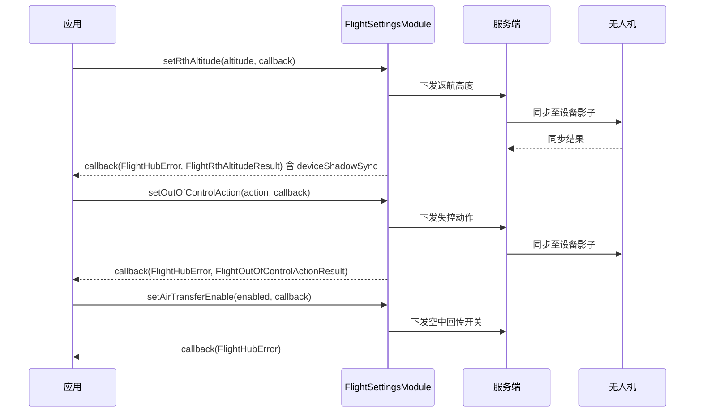

# 飞行参数设置（FlightSettingsModule）

## 1 功能概述

### 1.1 功能简介

`FlightSettingsModule` 是**无人机级**的飞行参数设置模块，作用域为某一台指定 SN 的无人机。它提供飞行设置类参数的下发配置，涵盖智能规划模式、失控动作、飞行任务高度、返航高度以及空中回传开关五项。

每次设置都是「一次配置一项参数」：应用调用对应的 `setXxx()` 方法把新值下发到云端并同步到设备，回调返回设备当前生效的该项参数值，以及本次配置向设备影子（Device Shadow）同步的结果，供应用确认参数是否已真正写入设备。

本模块只负责飞行参数的读写配置，不负责飞行动作的下发。起飞、飞向目标点、环绕、摇杆等飞行控制见 [飞行控制](./flight-control.md)、[一键起飞](./takeoff.md)、[飞向目标点](./fly-to-point.md)。

### 1.2 核心概念

| 概念 | 说明 |
| --- | --- |
| 智能规划模式（`smartPlanningMode`） | 通过 `setFlightSmartPlanMode(int mode)` 配置。回调结果字段 `getSmartPlanningMode()` 的取值语义为：`0`=开启，`1`=关闭。 |
| 失控动作（`outOfControlAction`） | 通过 `setOutOfControlAction(String action)` 配置。回调结果字段 `getOutOfControlAction()` 的取值语义为：`"Hover"`（悬停）/ `"ReturnHome"`（返航）/ `"Continue"`（继续任务）。 |
| 飞行任务高度（`commanderFlightHeight`） | 通过 `setFlightTaskHeight(int height)` 配置。回调结果字段 `getCommanderFlightHeight()` 表示飞行作业高度，单位为米。 |
| 返航高度（`rthAltitude`） | 通过 `setRthAltitude(int altitude)` 配置。回调结果字段 `getRthAltitude()` 表示返航高度，单位为米。 |
| 空中回传开关（`enabled`） | 通过 `setAirTransferEnable(boolean enabled)` 配置，`true` 为开启、`false` 为关闭。该方法回调仅返回错误信息，无结果对象。 |
| 设备影子同步结果（`FlightSafeSyncResult`） | 除空中回传外，其余四项设置的回调结果均含 `getDeviceShadowSync()`。其 `getStatus()` 取值为 `"all_synced"` / `"partial_synced"` / `"failed"`；`getResults()` 为各字段的同步详情列表（`FlightSafeSyncField`，含字段名 `getField()` 与是否已同步 `isSynced()`）。 |

### 1.3 能力清单

| 能力 | 对应接口 | 接口类型 | 说明 |
| --- | --- | --- | --- |
| 设置智能规划模式 | `setFlightSmartPlanMode(mode, cb)` | 异步回调 | 入参 `int mode`（规划模式），回调返回 `FlightSmartPlanModeResult` |
| 设置失控动作 | `setOutOfControlAction(action, cb)` | 异步回调 | 入参 `String action`（失控动作），回调返回 `FlightOutOfControlActionResult` |
| 设置飞行任务高度 | `setFlightTaskHeight(height, cb)` | 异步回调 | 入参 `int height`（任务高度），回调返回 `FlightCommanderHeightResult` |
| 设置返航高度 | `setRthAltitude(altitude, cb)` | 异步回调 | 入参 `int altitude`（返航高度），回调返回 `FlightRthAltitudeResult` |
| 设置空中回传开关 | `setAirTransferEnable(enabled, cb)` | 异步回调 | 入参 `boolean enabled`（是否开启），回调仅返回错误信息 |

---

## 2 前提条件

- 已完成上云 API 2 底座部署，并获取到服务地址与鉴权 Token。详见 [部署指南](../../../02.deployment/00.index.md)、[鉴权接入指南](../../../08.auth.md)。
- 已完成 SDK 初始化且 `FlightHubSDK.isInitialized()` 返回 `true`。详见 [SDK初始化](../init/sdk-init.md)。
- 目标无人机已完成上云、已绑定至当前工作空间且处于在线状态，参数配置方能同步到设备。详见 [设备上云](../../../04.device-onboarding/00.index.md)。
- 已通过 `FlightHubSDK.getDroneInstance(sn)` 获取无人机实例，并调用其 `getFlightSettingsModule()` 拿到本模块实例。
- 已具备待下发参数的业务取值：智能规划模式（`0`=开启 / `1`=关闭）、失控动作（`"Hover"` / `"ReturnHome"` / `"Continue"`）、任务高度与返航高度（单位米）、空中回传开关（布尔）。

---

## 3 快速上手

### 3.1 获取模块实例

```java
// 前置：已完成 FlightHubSDK.initialize(config)
String sn = "your-drone-sn";                          // 目标无人机 SN
Drone drone = FlightHubSDK.getDroneInstance(sn);      // 获取无人机实例
FlightSettingsModule module = drone.getFlightSettingsModule();
```

### 3.2 使用流程

1. **获取模块实例** —— 用目标无人机 SN 调用 `FlightHubSDK.getDroneInstance(sn).getFlightSettingsModule()`。
2. **准备参数** —— 按业务确定要下发的参数值（如返航高度、失控动作等）。
3. **下发设置** —— 调用对应的 `setXxx()` 方法，异步回调返回配置结果。
4. **校验结果** —— 回调中先判 `FlightHubError`，成功后读取结果对象中的当前生效值，并检查 `getDeviceShadowSync().getStatus()` 确认是否已同步到设备。
5. **按需重试** —— 若设备影子同步状态为 `"partial_synced"` 或 `"failed"`，可根据 `getResults()` 中未同步的字段决定重试。

### 3.3 调用时序图



---

## 4 示例代码

### 4.1 完整示例

```java
/**
 * 飞行参数设置：智能规划模式 -> 失控动作 -> 任务高度 -> 返航高度 -> 空中回传开关。
 * 每项参数一次配置一项，回调校验错误码与设备影子同步结果。
 */
public class FlightSettingsManager {

    private FlightSettingsModule module(String sn) {
        // 无人机级模块：用目标无人机 SN 获取实例
        return FlightHubSDK.getDroneInstance(sn).getFlightSettingsModule();
    }

    // ============ 1. 设置智能规划模式（0=开启, 1=关闭） ============
    public void setSmartPlanMode(String sn, int mode) {
        module(sn).setFlightSmartPlanMode(mode, new FlightHubCallback.SetFlightSmartPlanModeCallback() {
            @Override
            public void onResult(FlightHubError error, FlightSmartPlanModeResult result) {
                if (error != null && !error.isSuccess()) {
                    System.err.println("设置智能规划模式失败: " + error
                            + " serverCode=" + error.getServerCode()
                            + " msg=" + error.getServerMessage());
                    return;
                }
                if (result == null) return;
                System.out.println("智能规划模式当前值=" + result.getSmartPlanningMode());
                printSyncResult(result.getDeviceShadowSync());
            }
        });
    }

    // ============ 2. 设置失控动作（"Hover" / "ReturnHome" / "Continue"） ============
    public void setOutOfControlAction(String sn, String action) {
        module(sn).setOutOfControlAction(action, new FlightHubCallback.SetOutOfControlActionCallback() {
            @Override
            public void onResult(FlightHubError error, FlightOutOfControlActionResult result) {
                if (error != null && !error.isSuccess()) {
                    System.err.println("设置失控动作失败: " + error);
                    return;
                }
                if (result == null) return;
                System.out.println("失控动作当前值=" + result.getOutOfControlAction());
                printSyncResult(result.getDeviceShadowSync());
            }
        });
    }

    // ============ 3. 设置飞行任务高度（单位：米） ============
    public void setTaskHeight(String sn, int height) {
        module(sn).setFlightTaskHeight(height, new FlightHubCallback.SetFlightTaskHeightCallback() {
            @Override
            public void onResult(FlightHubError error, FlightCommanderHeightResult result) {
                if (error != null && !error.isSuccess()) {
                    System.err.println("设置飞行任务高度失败: " + error);
                    return;
                }
                if (result == null) return;
                System.out.println("飞行作业高度当前值(米)=" + result.getCommanderFlightHeight());
                printSyncResult(result.getDeviceShadowSync());
            }
        });
    }

    // ============ 4. 设置返航高度（单位：米） ============
    public void setRthAltitude(String sn, int altitude) {
        module(sn).setRthAltitude(altitude, new FlightHubCallback.SetRthAltitudeCallback() {
            @Override
            public void onResult(FlightHubError error, FlightRthAltitudeResult result) {
                if (error != null && !error.isSuccess()) {
                    System.err.println("设置返航高度失败: " + error);
                    return;
                }
                if (result == null) return;
                System.out.println("返航高度当前值(米)=" + result.getRthAltitude());
                printSyncResult(result.getDeviceShadowSync());
            }
        });
    }

    // ============ 5. 设置空中回传开关（回调仅返回错误信息，无结果对象） ============
    public void setAirTransfer(String sn, boolean enabled) {
        module(sn).setAirTransferEnable(enabled, error -> {
            // 注意：SetAirTransferEnableCallback 只有 error 参数，没有结果对象，不要读取 result
            boolean ok = error != null && error.isSuccess();
            System.out.println((enabled ? "开启" : "关闭") + "空中回传: "
                    + (ok ? "成功" : "失败 " + error));
        });
    }

    // ============ 公共：打印设备影子同步结果 ============
    private void printSyncResult(FlightSafeSyncResult sync) {
        if (sync == null) return;
        // 注意：status 为 "partial_synced" 或 "failed" 时，说明未完全写入设备，需据 getResults() 决定是否重试
        System.out.println("设备影子同步状态=" + sync.getStatus());
        if (sync.getResults() != null) {
            for (FlightSafeSyncField field : sync.getResults()) {
                System.out.println("  字段=" + field.getField() + " 已同步=" + field.isSynced());
            }
        }
    }
}
```

### 4.2 场景化片段

**执行飞行任务前统一下发安全参数（返航高度 + 失控动作）**

```java
// 前置：SDK 已初始化，无人机在线
String sn = "your-drone-sn";
FlightSettingsModule module = FlightHubSDK.getDroneInstance(sn).getFlightSettingsModule();

// 先设返航高度（单位：米）
module.setRthAltitude(120, (error, result) -> {
    if (error != null && !error.isSuccess()) {
        System.err.println("返航高度设置失败: " + error);
        return;
    }
    if (result == null) return;
    System.out.println("返航高度已生效(米)=" + result.getRthAltitude());

    // 返航高度成功后再设失控动作为返航
    module.setOutOfControlAction("ReturnHome", (err2, res2) -> {
        boolean ok = err2 != null && err2.isSuccess();
        System.out.println("失控动作设为 ReturnHome: " + (ok ? "成功" : "失败 " + err2));
    });
});
```

**开启空中回传（仅关注是否成功）**

```java
// 前置：SDK 已初始化，无人机在线
String sn = "your-drone-sn";
FlightHubSDK.getDroneInstance(sn).getFlightSettingsModule()
        .setAirTransferEnable(true, error -> {
            // 注意：该回调无结果对象，仅判 error
            if (error != null && error.isSuccess()) {
                System.out.println("空中回传已开启");
            } else {
                System.err.println("空中回传开启失败: " + error);
            }
        });
```

---

## 5 相关文档

- [SDK初始化](../init/sdk-init.md) —— 获取无人机实例与调用本模块前必须完成的初始化步骤
- [设备上云](../../../04.device-onboarding/00.index.md) —— 无人机绑定到工作空间的前置流程
- [飞行控制](./flight-control.md) —— DRC 链路下的飞行动作下发
- [一键起飞](./takeoff.md) —— 从机场一键起飞
- [飞向目标点](./fly-to-point.md) —— 指定坐标点飞行
- [控制权管理](./control-auth.md) —— 飞行控制权的抢占与释放
- [部署指南](../../../02.deployment/00.index.md) —— 上云 API 2 底座部署与服务地址获取
- [鉴权接入指南](../../../08.auth.md) —— 获取鉴权 Token 的接入流程
- [使用 API 文档查阅接口详情](../../03.api-docs-guide.md) —— 查阅 `FlightSettingsModule` 完整方法签名与字段定义
```
