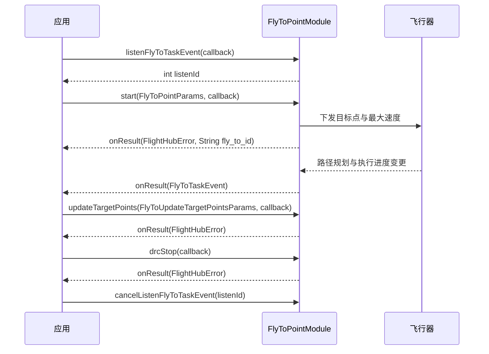

# 飞向目标点（FlyToPointModule）

## 1 功能概述

### 1.1 功能简介

`FlyToPointModule` 是**单机级**的指点飞行（Fly To Point）控制模块，作用域为一架具体的飞行器（由设备 SN 指定）。它解决的是「让正在空中的飞行器自主飞向一个或多个指定经纬高目标点」这一件事：下发目标点开始指点飞行、飞行途中动态更新目标点、紧急停止，以及订阅任务的路径规划与执行进度事件。

指点飞行属于 DRC 下行控制能力，需先抢得飞行控制权并建立 DRC 链路后方可下发。控制权与链路的准备见 [控制权管理](./control-auth.md)、[DRC链路](./drc.md)；若只需让飞行器围绕某点环绕，见 [POI 环绕飞行](./poi.md)。

**获取方式：**

```java
Drone drone = FlightHubSDK.getDroneInstance("your_device_sn");
FlyToPointModule flyToPointModule = drone.getFlyToPointModule();
```

### 1.2 核心概念

| 概念 | 说明 |
| --- | --- |
| 目标点（`FlyToPointParams` / `FlyToTargetPoint`） | 一个指点飞行目标，由纬度 `latitude`、经度 `longitude`、高度 `height`（米）描述；`FlyToPointParams` 另含最大飞行速度 `maxSpeed`（m/s）。 |
| 任务 ID（`fly_to_id`） | `start` 成功后由回调返回的当前指点飞行任务标识，`updateTargetPoints` 更新目标点时必须回传同一个值。 |
| 任务事件（`FlyToTaskEvent`） | `listenFlyToTaskEvent` 推送的任务事件（创建与更新），含事件标识 `eventId`、操作类型 `action`、任务 `uuid`、时间戳 `timestamp` 与任务详情 `taskData`。 |
| 任务详情（`FlyToTaskData`） | 事件内的任务数据，含任务状态 `status`（0-待执行、1-执行中、2-成功、3-失败、4-取消、5-超时）、当前航点索引 `wayPointIndex`、航点列表 `wayPoints`、规划路径点 `plannedPathPoints`、剩余距离 `remainingDistance`（米）、剩余时间 `remainingTime`（秒）等。 |
| 监听 ID（`listenId`） | `listenFlyToTaskEvent` 返回的整型句柄，取消订阅时必须回传同一个值。 |
| 事件订阅替代关系 | `listenFlyToTaskEvent` 已统一替代旧的 `subscribeFlyToPointProgress`（进度）与 `subscribeFlyToDroneSelfPlanPath`（自主规划路径）两个订阅，新接入请直接使用 `listenFlyToTaskEvent`。 |

### 1.3 能力清单

| 能力 | 对应接口 | 接口类型 | 说明 |
| --- | --- | --- | --- |
| 开始指点飞行 | `start(params, callback)` | 异步回调 | 下发目标点坐标与最大速度，成功时回调返回 `fly_to_id` |
| 更新目标点 | `updateTargetPoints(params, callback)` | 异步回调 | 飞行途中更新目标点，入参含 `fly_to_id`、起始点、目标点数组、最大速度，回调仅返回错误信息 |
| 停止指点飞行 | `drcStop(callback)` | 异步回调 | 紧急停止指点飞行，回调仅返回错误信息 |
| 订阅任务事件 | `listenFlyToTaskEvent(callback)` / `cancelListenFlyToTaskEvent(listenId)` | 事件订阅 | 事件回调方法名为 `onResult(FlyToTaskEvent)`，无 error 参数；含路径规划与执行进度 |
| 订阅自主规划路径（已废弃） | `subscribeFlyToDroneSelfPlanPath(callback)` / `unSubscribeFlyToDroneSelfPlanPath(listenId)` | 事件订阅 | **已废弃，推荐用 `listenFlyToTaskEvent`** |
| 订阅指点飞行进度（已废弃） | `subscribeFlyToPointProgress(callback)` / `unSubscribeFlyToPointProgress(listenId)` | 事件订阅 | **已废弃，推荐用 `listenFlyToTaskEvent`** |

---

## 2 前提条件

- 已完成上云 API 2 底座部署，并获取到服务地址与鉴权 Token。详见 [部署指南](../../../02.deployment/00.index.md)、[鉴权接入指南](../../../08.auth.md)。
- 已完成 SDK 初始化且 `FlightHubSDK.isInitialized()` 返回 `true`。详见 [SDK初始化](../init/sdk-init.md)。
- 目标飞行器已完成上云、已绑定至当前工作空间且在线。详见 [设备上云](../../../04.device-onboarding/00.index.md)。
- 已通过 `ControlAuthModule` 抢得该飞行器的**飞行控制权**。详见 [控制权管理](./control-auth.md)。
- 已通过 `DrcModule` 的 `connectDrcLink()` 建立 **DRC 链路**，指点飞行的下行控制指令（`start`、`updateTargetPoints`、`drcStop`）方可下发。详见 [DRC链路](./drc.md)。
- 飞行器已处于空中（通常已完成一键起飞），才能下发飞向目标点指令。详见 [一键起飞](./takeoff.md)。
- 若需使用 `listenFlyToTaskEvent()` 订阅任务事件，SDK 配置中的 `notificationServerAddress` 必须正确且连接可用。详见 [SDK配置](../init/sdk-config.md)。

---

## 3 快速上手

### 3.1 获取模块实例

```java
// 前置：已完成 FlightHubSDK.initialize(config)，已抢得飞行控制权并建立 DRC 链路
Drone drone = FlightHubSDK.getDroneInstance("your_device_sn");
FlyToPointModule module = drone.getFlyToPointModule();
```

### 3.2 使用流程

1. **准备控制权与链路** —— 抢得飞行控制权（[控制权管理](./control-auth.md)）并建立 DRC 链路（[DRC链路](./drc.md)），飞行器已在空中。
2. **订阅任务事件** —— 调用 `listenFlyToTaskEvent(callback)` 并保存 `listenId`，实时掌握路径规划与执行进度。
3. **开始指点飞行** —— 组装 `FlyToPointParams`（目标点经纬高 + 最大速度），调用 `start(params, callback)`，成功时从回调取出 `fly_to_id` 并保存。
4. **按需更新目标点** —— 飞行途中如需改航，组装 `FlyToUpdateTargetPointsParams`（回传 `fly_to_id`、起始点、目标点数组、最大速度），调用 `updateTargetPoints(params, callback)`。
5. **紧急停止** —— 需要立即中止时调用 `drcStop(callback)`。
6. **退出时取消订阅** —— 用保存的 `listenId` 调用 `cancelListenFlyToTaskEvent(listenId)`。

### 3.3 调用时序图



---

## 4 示例代码

### 4.1 完整示例

```java
import com.dji.flighthubsdk.FlightHubSDK;
import com.dji.flighthubsdk.FlightHubCallback;
import com.dji.flighthubsdk.FlightHubError;
import com.dji.flighthubsdk.core.FlyToPointModule;
import com.dji.flighthubsdk.bean.FlyToPointParams;
import com.dji.flighthubsdk.bean.FlyToUpdateTargetPointsParams;
import com.dji.flighthubsdk.bean.FlyToTargetPoint;
import com.dji.flighthubsdk.bean.FlyToTaskEvent;
import com.dji.flighthubsdk.bean.FlyToTaskData;

import java.util.ArrayList;
import java.util.List;

/**
 * 飞向目标点：订阅任务事件 -> 开始指点飞行 -> 途中更新目标点 -> 紧急停止 -> 退订。
 * 前提：已抢得飞行控制权并建立 DRC 链路，且飞行器已在空中。
 */
public class FlyToPointDemo {

    private final String deviceSn;
    private int taskEventListenId = -1;
    private String flyToId;   // start 成功后返回，updateTargetPoints 必须回传

    public FlyToPointDemo(String deviceSn) {
        this.deviceSn = deviceSn;
    }

    // ============ 1. 订阅任务事件（回调方法名为 onResult，无 error 参数，需判空） ============
    public void start() {
        FlyToPointModule module = FlightHubSDK.getDroneInstance(deviceSn).getFlyToPointModule();

        taskEventListenId = module.listenFlyToTaskEvent(new FlightHubCallback.FlyToTaskEventCallback() {
            @Override
            public void onResult(FlyToTaskEvent event) {
                if (event == null) return;   // 注意：事件订阅回调无 error 参数，必须判空
                FlyToTaskData data = event.getTaskData();
                if (data == null) return;
                System.out.println("[任务事件] action=" + event.getAction()
                        + " uuid=" + event.getUuid()
                        + " status=" + statusText(data.getStatus())   // 0待执行,1执行中,2成功,3失败,4取消,5超时
                        + " 当前航点=" + data.getWayPointIndex()
                        + " 剩余距离(m)=" + data.getRemainingDistance()
                        + " 剩余时间(s)=" + data.getRemainingTime());
            }
        });

        // ============ 2. 开始指点飞行（成功时回调返回 fly_to_id） ============
        FlyToPointParams params = new FlyToPointParams();
        params.setLatitude(22.5931);     // 目标点纬度，单位：度
        params.setLongitude(113.9668);   // 目标点经度，单位：度
        params.setHeight(120.0);         // 目标点高度，单位：米
        params.setMaxSpeed(10);          // 最大飞行速度，单位：m/s

        module.start(params, new FlightHubCallback.FlyToPointStartCallback() {
            @Override
            public void onResult(FlightHubError error, String fly_to_id) {
                boolean ok = error != null && error.isSuccess();
                if (!ok) {
                    System.err.println("开始指点飞行失败: " + error);
                    return;
                }
                flyToId = fly_to_id;   // 保存任务 ID，后续更新目标点要回传
                System.out.println("开始指点飞行成功, fly_to_id=" + flyToId);
            }
        });
    }

    // ============ 3. 途中更新目标点（回传 fly_to_id、起始点、目标点数组、最大速度） ============
    public void updateTarget(double startLat, double startLng, double startHeight) {
        if (flyToId == null) {
            System.err.println("尚未获得 fly_to_id，无法更新目标点");   // 注意：必须先 start 成功
            return;
        }
        FlyToPointModule module = FlightHubSDK.getDroneInstance(deviceSn).getFlyToPointModule();

        FlyToTargetPoint startPoint = new FlyToTargetPoint();   // 起始点为当前飞机位置
        startPoint.setLatitude(startLat);
        startPoint.setLongitude(startLng);
        startPoint.setHeight(startHeight);

        FlyToTargetPoint newTarget = new FlyToTargetPoint();   // 新的目标点
        newTarget.setLatitude(22.5950);
        newTarget.setLongitude(113.9700);
        newTarget.setHeight(130.0);

        List<FlyToTargetPoint> points = new ArrayList<>();
        points.add(newTarget);   // 目标点数组至少 1 个

        FlyToUpdateTargetPointsParams params = new FlyToUpdateTargetPointsParams();
        params.setFlyToId(flyToId);
        params.setStartPoint(startPoint);
        params.setPoints(points);
        params.setMaxSpeed(8);

        module.updateTargetPoints(params, error -> {
            boolean ok = error != null && error.isSuccess();
            System.out.println("更新目标点: " + (ok ? "成功" : "失败 " + error));
        });
    }

    // ============ 4. 紧急停止指点飞行 ============
    public void emergencyStop() {
        FlightHubSDK.getDroneInstance(deviceSn).getFlyToPointModule()
                .drcStop(error -> {
                    boolean ok = error != null && error.isSuccess();
                    System.out.println("停止指点飞行: " + (ok ? "成功" : "失败 " + error));
                });
    }

    // ============ 5. 退出前取消订阅（必须执行，否则订阅泄漏） ============
    public void stop() {
        if (taskEventListenId != -1) {
            FlightHubSDK.getDroneInstance(deviceSn).getFlyToPointModule()
                    .cancelListenFlyToTaskEvent(taskEventListenId);
            taskEventListenId = -1;
        }
    }

    /** 任务状态语义同 FlyToTaskData.status */
    private static String statusText(int s) {
        switch (s) {
            case 0:  return "待执行";
            case 1:  return "执行中";
            case 2:  return "成功";
            case 3:  return "失败";
            case 4:  return "取消";
            case 5:  return "超时";
            default: return "未知(" + s + ")";
        }
    }
}
```

### 4.2 场景化片段

**不订阅事件，直接下发目标点并保存 fly_to_id**

```java
// 前置：已抢得飞行控制权、已建立 DRC 链路，且飞行器已在空中
FlyToPointModule module = FlightHubSDK.getDroneInstance(deviceSn).getFlyToPointModule();

FlyToPointParams params = new FlyToPointParams();
params.setLatitude(22.5931);
params.setLongitude(113.9668);
params.setHeight(120.0);
params.setMaxSpeed(10);

module.start(params, (error, fly_to_id) -> {
    if (error == null || !error.isSuccess()) {
        System.err.println("开始指点飞行失败: " + error);
        return;
    }
    // 注意：fly_to_id 需保存，后续 updateTargetPoints / 关联事件都要用到
    System.out.println("指点飞行任务已创建, fly_to_id=" + fly_to_id);
});
```

**只监听执行进度到达成功状态后自动退订**

```java
FlyToPointModule module = FlightHubSDK.getDroneInstance(deviceSn).getFlyToPointModule();
final int[] listenIdHolder = new int[1];

listenIdHolder[0] = module.listenFlyToTaskEvent(event -> {
    if (event == null || event.getTaskData() == null) return;   // 注意：无 error 参数，需判空
    int status = event.getTaskData().getStatus();
    if (status == 2) {   // 2-成功
        System.out.println("指点飞行已到达目标点, uuid=" + event.getUuid());
        module.cancelListenFlyToTaskEvent(listenIdHolder[0]);   // 到达后取消订阅
    } else if (status == 3 || status == 4 || status == 5) {   // 失败/取消/超时
        System.out.println("指点飞行结束, status=" + status);
        module.cancelListenFlyToTaskEvent(listenIdHolder[0]);
    }
});
```

---

## 5 相关文档

- [控制权管理](./control-auth.md) —— 下发指点飞行前必须抢得的飞行控制权
- [DRC链路](./drc.md) —— 指点飞行下行控制指令依赖的 DRC 低时延链路
- [飞行控制](./flight-control.md) —— 飞行器基础飞行控制能力
- [一键起飞](./takeoff.md) —— 让飞行器起飞至空中的前置操作
- [POI 环绕飞行](./poi.md) —— 围绕某一兴趣点环绕飞行的相邻能力
- [SDK初始化](../init/sdk-init.md) —— 获取设备实例与调用本模块前必须完成的初始化步骤
- [SDK配置](../init/sdk-config.md) —— WebSocket 通知地址等配置项，影响任务事件订阅能否收到推送
- [设备上云](../../../04.device-onboarding/00.index.md) —— 设备绑定到工作空间的前置流程
- [部署指南](../../../02.deployment/00.index.md) —— 上云 API 2 底座部署与服务地址获取
- [鉴权接入指南](../../../08.auth.md) —— 获取鉴权 Token 的接入流程
- [使用 API 文档查阅接口详情](../../03.api-docs-guide.md) —— 查阅 `FlyToPointModule` 完整方法签名与字段定义
