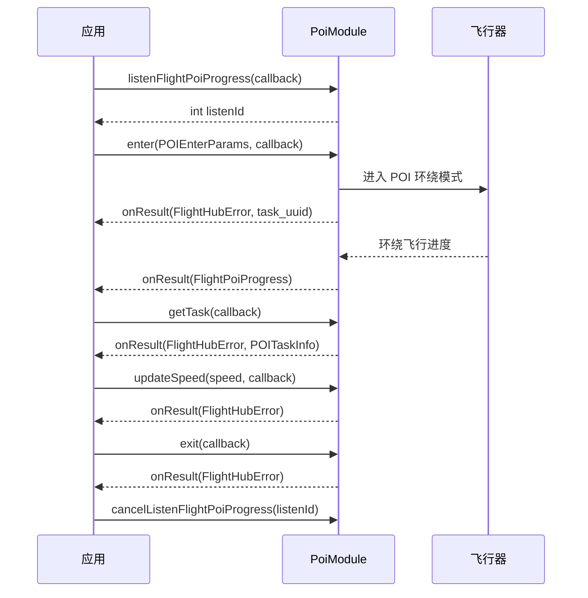

# POI 环绕飞行（PoiModule）

## 1 功能概述

### 1.1 功能简介

`PoiModule` 是**单机级**的兴趣点（POI，Point of Interest）环绕飞行模块，作用域为一架具体的飞行器。它解决的是「让飞行器绕着一个地面目标点做定点盘旋」这一件事：以指定的中心点坐标、环绕半径与环绕速度进入 POI 环绕模式，在环绕过程中动态调整环绕速度，查询当前 POI 任务信息，订阅 POI 任务事件与实时飞行进度，并在结束时退出环绕模式。

本模块属于 DRC 下行控制类能力，飞行器需先处于可被控制的状态（已抢得飞行控制权并建立 DRC 链路）才能下发环绕指令。与 [飞向目标点](./fly-to-point.md) 的「飞到某点即停」不同，POI 环绕是让飞行器**持续绕点盘旋**。

**获取方式：**

```java
Drone drone = FlightHubSDK.getDroneInstance("your_device_sn");
PoiModule poiModule = drone.getPoiModule();
```

### 1.2 核心概念

| 概念 | 说明 |
| --- | --- |
| POI 环绕 | 飞行器围绕一个固定中心点（`poiCenterPoint`）按设定半径与速度做圆周盘旋，机头/负载持续朝向中心点。 |
| 进入参数（`POIEnterParams`） | 进入环绕模式时的入参，包含中心点坐标 `poiCenterPoint`、环绕速度 `speed`、环绕半径 `circleRadius`、负载索引 `payloadIndex`。 |
| 中心点坐标（`Waypoint`） | 地理点，含纬度 `latitude`、经度 `longitude`、高度 `height`（度、度、米）。环绕的圆心即由它指定。 |
| 任务 UUID（`task_uuid`） | `enter()` 成功后回调返回的任务唯一标识，代表本次 POI 环绕任务。 |
| POI 任务信息（`POITaskInfo`） | `getTask()` 返回的当前任务快照，含任务 UUID、设备/飞行器 SN、中心点、速度、半径、负载索引、任务状态 `taskStatus`（`POITaskStatus`）与错误码 `errCode`。 |
| 任务状态（`POITaskStatus`） | 任务生命周期枚举：`WAITING`、`PREPARING`、`QUEUE_FOR_TAKEOFF`、`STARTING_FAILURE`、`EXECUTING`、`PAUSED`、`SUSPENDED`、`TERMINATED`、`SUCCESS`、`PARTIALLY_DONE`、`TIMEOUT`、`UNKNOWN`；需要整型编码时用 `POITaskStatus.getValue()`。 |
| 任务事件（`PoiTaskEvent`） | `listenPoiTaskEvent()` 推送的任务事件，含事件 ID `eventId`、操作类型 `action`、任务 UUID `uuid`、时间戳 `timestamp` 与任务详情 `taskData`（`PoiTaskData`）。 |
| 飞行进度（`FlightPoiProgress`） | `listenFlightPoiProgress()` 推送的实时环绕飞行进度消息（`com.dji.flighthubsdk.generated.FlightPoiProgress`）。 |
| 监听 ID（`listenId`） | `listenPoiTaskEvent()` / `listenFlightPoiProgress()` 返回的整型句柄，取消订阅时必须回传同一个值。 |

### 1.3 能力清单

| 能力 | 对应接口 | 接口类型 | 说明 |
| --- | --- | --- | --- |
| 进入环绕模式 | `enter(POIEnterParams, PoiEnterCallback)` | 异步回调 | 按中心点/速度/半径/负载索引进入 POI 环绕，成功回调返回任务 UUID |
| 退出环绕模式 | `exit(ResultCallback)` | 异步回调 | 退出 POI 环绕模式，回调仅返回错误信息 |
| 更新环绕速度 | `updateSpeed(double, ResultCallback)` | 异步回调 | 动态更新环绕速度（m/s），回调仅返回错误信息 |
| 查询当前任务 | `getTask(PoiGetTaskCallback)` | 异步回调 | 查询当前 POI 任务信息，成功回调返回 `POITaskInfo` |
| 订阅任务事件 | `listenPoiTaskEvent(PoiTaskEventCallback)` / `cancelListenPoiTaskEvent(int)` | 事件订阅 | 事件回调方法名为 `onResult(PoiTaskEvent)`，无 error 参数；`listenPoiTaskEvent` 返回 `int` 监听 ID |
| 订阅飞行进度 | `listenFlightPoiProgress(FlightPoiProgressCallback)` / `cancelListenFlightPoiProgress(int)` | 事件订阅 | 事件回调方法名为 `onResult(FlightPoiProgress)`，无 error 参数；`listenFlightPoiProgress` 返回 `int` 监听 ID |

---

## 2 前提条件

- 已完成上云 API 2 底座部署，并获取到服务地址与鉴权 Token。详见 [部署指南](../../../02.deployment/00.index.md)、[鉴权接入指南](../../../08.auth.md)。
- 已完成 SDK 初始化且 `FlightHubSDK.isInitialized()` 返回 `true`。详见 [SDK初始化](../init/sdk-init.md)。
- 目标飞行器已完成上云、已绑定至当前工作空间且在线。详见 [设备上云](../../../04.device-onboarding/00.index.md)。
- 已通过 `ControlAuthModule` 抢得该飞行器的**飞行控制权**。POI 环绕属于下行飞行控制指令，无控制权无法下发。详见 [控制权管理](./control-auth.md)。
- 已通过 `DrcModule.connectDrcLink()` 建立 **DRC 链路**。`enter` / `exit` / `updateSpeed` 等下行控制方法依赖 DRC 链路可用。详见 [DRC链路](./drc.md)。
- 飞行器已处于空中并可被 DRC 控制（POI 环绕需要飞行器在空中盘旋，可先经 [一键起飞](./takeoff.md) 或 [飞行控制](./flight-control.md) 使其处于飞行状态）。
- POI 中心点应为一个地面目标点，且飞行器与中心点保持约等于 `circleRadius` 的水平距离，才能顺利进入环绕；不要把中心点设为飞行器当前正上方位置。
- 若需使用 `listenPoiTaskEvent()` / `listenFlightPoiProgress()` 订阅事件与进度，SDK 配置中的 `notificationServerAddress` 必须正确且连接可用。详见 [SDK配置](../init/sdk-config.md)。

---

## 3 快速上手

### 3.1 获取模块实例

```java
// 前置：已完成 FlightHubSDK.initialize(config)，已抢得飞行控制权并建立 DRC 链路
Drone drone = FlightHubSDK.getDroneInstance("your_device_sn");
PoiModule poiModule = drone.getPoiModule();
```

### 3.2 使用流程

1. **抢控制权、建 DRC 链路** —— 先经 [控制权管理](./control-auth.md) 抢得飞行控制权，再经 [DRC链路](./drc.md) 调用 `connectDrcLink()` 建链。
2. **获取模块实例** —— 调用 `drone.getPoiModule()`。
3. **订阅飞行进度**（可选）—— 调用 `listenFlightPoiProgress()` 并保存返回的 `listenId`，实时掌握环绕进度。
4. **订阅任务事件**（可选）—— 调用 `listenPoiTaskEvent()` 并保存 `listenId`，跟踪任务生命周期。
5. **进入环绕模式** —— 组装 `POIEnterParams`（中心点 `poiCenterPoint`、速度 `speed`、半径 `circleRadius`、负载索引 `payloadIndex`），调用 `enter(params, cb)`，成功回调返回 `task_uuid`。
6. **查询当前任务** —— 调用 `getTask(cb)`，从 `POITaskInfo` 读取任务状态 `taskStatus` 等信息。
7. **动态调速** —— 环绕途中调用 `updateSpeed(speed, cb)` 调整环绕速度。
8. **退出环绕** —— 完成后调用 `exit(cb)` 退出 POI 环绕模式。
9. **退出时取消订阅** —— 用保存的 `listenId` 调用 `cancelListenFlightPoiProgress()` 与 `cancelListenPoiTaskEvent()`。

### 3.3 调用时序图



---

## 4 示例代码

### 4.1 完整示例

> 涉及的 Bean 字段：
>
> **POIEnterParams（进入参数）**
>
> | 字段 | 类型 | 说明 |
> | --- | --- | --- |
> | `getPoiCenterPoint()` / `setPoiCenterPoint(Waypoint)` | `Waypoint` | POI 中心点坐标 |
> | `getSpeed()` / `setSpeed(double)` | `double` | 环绕速度，单位：m/s |
> | `getCircleRadius()` / `setCircleRadius(double)` | `double` | 环绕半径，单位：米 |
> | `getPayloadIndex()` / `setPayloadIndex(String)` | `String` | 负载索引，格式 `{type-subtype-gimbalindex}`，例如 `"81-0-0"` |
>
> **Waypoint（地理点）**
>
> | 字段 | 类型 | 说明 |
> | --- | --- | --- |
> | `getLatitude()` / `setLatitude(double)` | `double` | 纬度，单位：度 |
> | `getLongitude()` / `setLongitude(double)` | `double` | 经度，单位：度 |
> | `getHeight()` / `setHeight(double)` | `double` | 高度，单位：米 |
>
> **POITaskInfo（任务信息）**
>
> | 字段 | 类型 | 说明 |
> | --- | --- | --- |
> | `getUuid()` | `String` | POI 任务 UUID |
> | `getDeviceSn()` | `String` | 设备 SN（机场/遥控器） |
> | `getSn()` | `String` | 飞行器 SN |
> | `getTaskStatus()` | `POITaskStatus` | POI 任务状态；整型编码用 `getValue()` |
> | `getErrCode()` | `int` | 错误码（任务失败时的错误代码） |
> | `getPoiCenterPoint()` | `Waypoint` | POI 中心点坐标（经纬度和高度） |
> | `getSpeed()` | `double` | 环绕速度，单位：m/s |
> | `getCircleRadius()` | `double` | 环绕半径，单位：米 |
> | `getPayloadIndex()` | `String` | 负载索引，格式 `{type-subtype-gimbalindex}` |

```java
/**
 * POI 环绕飞行：订阅进度 -> 进入环绕 -> 查询任务 -> 动态调速 -> 退出 -> 退订。
 * 前置：已抢得飞行控制权、已建立 DRC 链路、飞行器已在空中。
 */
public class PoiOrbitDemo {

    private int progressListenId = -1;
    private String taskUuid;
    private final String droneSn;

    public PoiOrbitDemo(String droneSn) {
        this.droneSn = droneSn;
    }

    public void start() {
        PoiModule poiModule = FlightHubSDK.getDroneInstance(droneSn).getPoiModule();

        // ============ 1. 订阅飞行进度（回调无 error 参数，需判空 msg） ============
        progressListenId = poiModule.listenFlightPoiProgress(msg -> {
            if (msg == null) return;   // 注意：进度回调无 error 参数，必须判空
            System.out.println("[环绕进度] " + msg);   // FlightPoiProgress 承载实时环绕飞行进度
        });

        // ============ 2. 组装进入参数：中心点 + 半径 + 速度 + 负载索引 ============
        Waypoint center = new Waypoint();
        center.setLatitude(22.593700);      // 地面目标点纬度（度）
        center.setLongitude(113.958200);    // 地面目标点经度（度）
        center.setHeight(30.0);             // 中心点高度（米）

        POIEnterParams params = new POIEnterParams();
        params.setPoiCenterPoint(center);
        params.setCircleRadius(50.0);       // 环绕半径 50 米
        params.setSpeed(5.0);               // 环绕速度 5 m/s
        params.setPayloadIndex("81-0-0");   // 负载索引：机头/负载朝向中心点

        // ============ 3. 进入 POI 环绕模式（成功回调返回任务 UUID） ============
        // 注意：飞行器应与中心点保持约 circleRadius 的水平距离，否则可能无法进入环绕
        poiModule.enter(params, (error, task_uuid) -> {
            boolean ok = error != null && error.isSuccess();
            if (!ok) {
                System.err.println("进入 POI 环绕失败: " + error);
                return;
            }
            taskUuid = task_uuid;
            System.out.println("进入 POI 环绕成功，任务 UUID=" + task_uuid);

            // ============ 4. 查询当前任务信息 ============
            poiModule.getTask((err, task) -> {
                if (err != null && !err.isSuccess()) {
                    System.err.println("查询 POI 任务失败: " + err);
                    return;
                }
                if (task == null) return;
                System.out.println("任务 uuid=" + task.getUuid()
                        + " 飞行器 sn=" + task.getSn()
                        + " 状态=" + task.getTaskStatus()          // POITaskStatus 枚举
                        + " 速度=" + task.getSpeed()
                        + " 半径=" + task.getCircleRadius()
                        + " errCode=" + task.getErrCode());
            });
        });
    }

    // ============ 5. 环绕途中动态调整环绕速度 ============
    public void changeSpeed(double newSpeed) {
        FlightHubSDK.getDroneInstance(droneSn).getPoiModule()
                .updateSpeed(newSpeed, error -> {
                    boolean ok = error != null && error.isSuccess();
                    System.out.println("更新环绕速度: " + (ok ? "成功" : "失败 " + error));
                });
    }

    // ============ 6. 退出 POI 环绕模式 ============
    public void exitOrbit() {
        FlightHubSDK.getDroneInstance(droneSn).getPoiModule()
                .exit(error -> {
                    boolean ok = error != null && error.isSuccess();
                    System.out.println("退出 POI 环绕: " + (ok ? "成功" : "失败 " + error));
                });
    }

    // ============ 7. 退出前取消订阅（必须执行，否则订阅泄漏） ============
    public void stop() {
        if (progressListenId != -1) {
            FlightHubSDK.getDroneInstance(droneSn).getPoiModule()
                    .cancelListenFlightPoiProgress(progressListenId);
            progressListenId = -1;
        }
    }
}
```

### 4.2 场景化片段

**订阅 POI 任务事件，跟踪任务生命周期**

`PoiTaskEvent` 字段：`getEventId()`（事件唯一标识 UUID）、`getAction()`（操作类型，对应 Routing Key）、`getUuid()`（任务 UUID）、`getTimestamp()`（时间戳，毫秒）、`getTaskData()`（任务详情 `PoiTaskData`）。`PoiTaskData` 含 `getUuid()`、`getSn()`（机场序列号）、`getDeviceSn()`（无人机序列号）、`getPoiCenterPoint()`、`getSpeed()`、`getCircleRadius()`、`getPayloadIndex()`、`getStatus()`（任务状态）、`getErrCode()`（错误码）。

```java
// 前置：已获取模块实例。任务事件回调无 error 参数，需判空 event
PoiModule poiModule = FlightHubSDK.getDroneInstance(droneSn).getPoiModule();

int eventListenId = poiModule.listenPoiTaskEvent(event -> {
    if (event == null) return;   // 注意：事件回调无 error 参数，必须判空
    PoiTaskData data = event.getTaskData();
    System.out.println("[POI 事件] action=" + event.getAction()
            + " uuid=" + event.getUuid()
            + " ts=" + event.getTimestamp()
            + " status=" + (data != null ? data.getStatus() : "-")
            + " errCode=" + (data != null ? data.getErrCode() : "-"));
});

// 退出时用同一个 listenId 取消订阅
poiModule.cancelListenPoiTaskEvent(eventListenId);
```

---

## 5 相关文档

- [控制权管理](./control-auth.md) —— 下发 POI 环绕前必须抢得的飞行控制权
- [DRC链路](./drc.md) —— `enter`/`exit`/`updateSpeed` 等下行控制依赖的 DRC 建链流程
- [飞行控制](./flight-control.md) —— 使飞行器进入可被 DRC 控制的飞行状态
- [一键起飞](./takeoff.md) —— 让飞行器起飞至空中，为进入环绕做准备
- [飞向目标点](./fly-to-point.md) —— 「飞到某点」的点对点飞行，可用于先把飞行器移动到环绕起始位置
- [飞行参数设置](./flight-settings.md) —— 限高、限远等飞行参数配置
- [飞机状态监听](./drone-status.md) —— 环绕过程中读取飞行器实时位置与姿态
- [SDK初始化](../init/sdk-init.md) —— 获取设备实例与调用本模块前必须完成的初始化步骤
- [SDK配置](../init/sdk-config.md) —— WebSocket 通知地址等配置项，影响任务事件与飞行进度订阅
- [设备上云](../../../04.device-onboarding/00.index.md) —— 设备绑定到工作空间的前置流程
- [部署指南](../../../02.deployment/00.index.md) —— 上云 API 2 底座部署与服务地址获取
- [鉴权接入指南](../../../08.auth.md) —— 获取鉴权 Token 的接入流程
- [使用 API 文档查阅接口详情](../../03.api-docs-guide.md) —— 查阅 `PoiModule` 完整方法签名与字段定义
