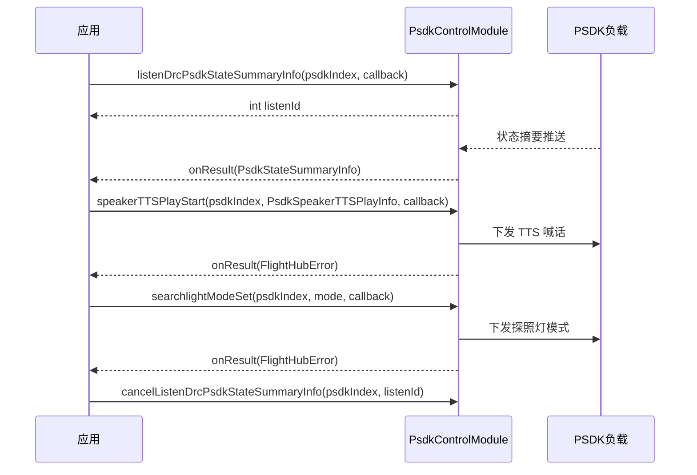

# PSDK 控制（PsdkControlModule）

## 1 功能概述

### 1.1 功能简介

`PsdkControlModule` 是**单机级**的 PSDK 负载控制模块，作用域为一架具体飞行器所挂载的 PSDK（Payload SDK）负载设备。它解决的是「在 DRC 链路上实时控制机载 PSDK 负载并订阅其状态」这一件事：订阅飞行器上的 PSDK 设备列表与各负载的状态摘要、喊话器状态、探照灯状态；对喊话器下发音频/TTS 喊话、重播、停止、音量与播放模式、TTS 配置；对探照灯下发模式、亮度、校准、微调、广域模式、云台控制、类型设置；以及对 PSDK 自定义控件（Widget）设置数值与输入框文本。

本模块属于 DRC 下行控制类能力，飞行器需先处于可被控制的状态（已抢得飞行控制权与负载控制权、并建立 DRC 链路）才能下发指令。PSDK 负载的音频/控件等**资源的上传与管理**不在本模块，见 [PSDK 资源管理](./psdk-resource.md)。

**获取方式：**

```java
Drone drone = FlightHubSDK.getDroneInstance("your_device_sn");
PsdkControlModule psdkControlModule = drone.getPsdkControlModule();
```

### 1.2 核心概念

| 概念 | 说明 |
| --- | --- |
| PSDK 索引（`psdkIndex`） | 整型 PSDK 序号，用于指定要控制/订阅的具体 PSDK 负载。取值来自 `listenDrcPsdkStateSummaryInfo` 回调的 `PsdkStateSummaryInfo.getPsdkIndex()`。 |
| 状态摘要（`PsdkStateSummaryInfo`） | 单个 PSDK 负载的基础信息：索引、类型、子类型、名称、SN、版本、库版本、受限状态（`psdkRestrictState`：0 限制功能 / 1 不限制 / 2 部分限制）。 |
| 喊话器（Speaker/Megaphone） | PSDK 喊话器负载，可播放预置音频或 TTS 文本。TTS 播放信息用 `PsdkSpeakerTTSPlayInfo`，TTS 配置用 `PsdkSpeakerTTSconfig`，播放模式用 `MegaphonePlayMode`。 |
| 探照灯（Searchlight） | PSDK 探照灯负载，支持模式、亮度、校准、微调、广域模式、云台控制、类型等设置。 |
| Widget（自定义控件） | PSDK 负载在 App 端暴露的自定义控件，可设置控件值 `widgetValueSet` 或输入框文本 `widgetInputBoxTextSet`。 |
| 监听 ID（`listenId`） | 各 `listen*` 方法返回的整型句柄，取消订阅时必须回传同一个值；带 `psdkIndex` 的订阅取消时需同时回传原 `psdkIndex`。 |

### 1.3 能力清单

**PSDK 设备与状态订阅**

| 能力 | 对应接口 | 说明 |
| --- | --- | --- |
| 订阅 PSDK 设备列表 | `listenDrcPsdkDeviceList(PsdkDeviceListCallback)` / `cancelListenDrcPsdkDeviceList(int)` | 订阅飞行器当前挂载的 PSDK 设备列表，返回 `int` 监听 ID |
| 订阅状态摘要 | `listenDrcPsdkStateSummaryInfo(int, PsdkStateSummaryInfoCallback)` / `cancelListenDrcPsdkStateSummaryInfo(int, int)` | 订阅指定 `psdkIndex` 的状态摘要，回调返回 `PsdkStateSummaryInfo` |
| 订阅喊话器状态 | `listenDrcPsdkStateSpeakerInfo(int, PsdkStateSpeakerInfoCallback)` / `cancelListenDrcPsdkStateSpeakerInfo(int, int)` | 订阅指定 PSDK 喊话器状态 |
| 订阅探照灯状态 | `listenDrcPsdkStateSearchlightInfo(int, PsdkStateSearchlightInfoCallback)` / `cancelListenDrcPsdkStateSearchlightInfo(int, int)` | 订阅指定 PSDK 探照灯状态 |
| 订阅浮窗文本 | `listenDrcPsdkFloatingWindowTextInfo(int, PsdkFloatingWindowTextInfoCallback)` / `cancelListenDrcPsdkFloatingWindowTextInfo(int, int)` | 订阅 PSDK 浮窗文本 |
| 订阅 UI 资源 | `listenDronePsdkUiResource(DronePsdkUiResourceCallback)` / `cancelListenDronePsdkUiResource(int)` | 订阅 PSDK UI 资源（`psdk_ui_resource`） |

**喊话器控制**

| 能力 | 对应接口 | 说明 |
| --- | --- | --- |
| 开始音频喊话 | `speakerAudioPlayStart(int, PsdkSpeakerAudioPlayInfo, ResultCallbackWithError)` | 播放已上传的音频文件 |
| 开始 TTS 喊话 | `speakerTTSPlayStart(int, PsdkSpeakerTTSPlayInfo, ResultCallbackWithError)` | 播放 TTS 文本 |
| 重播 | `speakerReplay(int, ResultCallbackWithError)` | 重播上一次内容 |
| 停止播放 | `speakerPlayStop(int, ResultCallbackWithError)` | 停止当前喊话播放 |
| 设置音量 | `speakerPlayVolumeSet(int, int, ResultCallbackWithError)` | 设置喊话器播放音量 |
| 设置播放模式 | `speakerPlayModeSet(int, MegaphonePlayMode, ResultCallbackWithError)` | 设置播放模式（`SINGLE_PLAY` / `LOOP_PLAYBACK` / `UNKNOWN`） |
| 设置 TTS 配置 | `speakerTTSSet(int, PsdkSpeakerTTSconfig, ResultCallbackWithError)` | 设置 TTS 音量/音色/语言/语速 |
| 订阅播放进度 | `listenDrcPsdkSpeakerPlayProgressInfo(int, PsdkSpeakerPlayProgressInfoCallback)` / `cancelListenDrcPsdkSpeakerPlayProgressInfo(int, int)` | 订阅喊话器播放进度 |
| 订阅音频播放开始进度 | `listenPsdkSpeakerAudioPlayStartProgress(PsdkSpeakerAudioPlayStartProgressCallback)` / `cancelListenPsdkSpeakerAudioPlayStartProgress(int)` | 订阅音频喊话开始进度 |
| 订阅 TTS 播放开始进度 | `listenPsdkSpeakerTtsPlayStartProgress(PsdkSpeakerTtsPlayStartProgressCallback)` / `cancelListenPsdkSpeakerTtsPlayStartProgress(int)` | 订阅 TTS 喊话开始进度 |

**探照灯控制**

| 能力 | 对应接口 | 说明 |
| --- | --- | --- |
| 设置模式 | `searchlightModeSet(int, int, ResultCallbackWithError)` | 设置探照灯模式（`mode` 为整型模式值） |
| 设置亮度 | `searchlightBrightnessSet(int, int, ResultCallbackWithError)` | 设置探照灯亮度 |
| 校准 | `searchlightCalibration(int, ResultCallbackWithError)` | 探照灯校准 |
| 微调设置 | `searchlightFineTuningSet(int, int, double, boolean, ResultCallbackWithError)` | 参数：`position` 微调位置、`value` 微调值、`saved` 是否保存 |
| 设置广域模式 | `searchlightWideFieldModeSet(int, int, ResultCallbackWithError)` | 设置探照灯广域模式 |
| 设置云台控制 | `searchlightLightGimbalControlSet(int, int, ResultCallbackWithError)` | 设置探照灯云台控制值 |
| 设置类型 | `searchlightTypeSet(int, int, ResultCallbackWithError)` | 设置探照灯类型 |

**Widget 控件控制**

| 能力 | 对应接口 | 说明 |
| --- | --- | --- |
| 设置控件值 | `widgetValueSet(int, int, int, ResultCallbackWithError)` | 参数：`index` 控件索引、`value` 控件值 |
| 设置输入框文本 | `widgetInputBoxTextSet(int, String, ResultCallbackWithError)` | 设置 Widget 输入框文本内容 |

---

## 2 前提条件

- 已完成上云 API 2 底座部署，并获取到服务地址与鉴权 Token。详见 [部署指南](../../../02.deployment/00.index.md)、[鉴权接入指南](../../../08.auth.md)。
- 已完成 SDK 初始化且 `FlightHubSDK.isInitialized()` 返回 `true`。详见 [SDK初始化](../init/sdk-init.md)。
- 目标飞行器已完成上云、已绑定至当前工作空间且在线，并已挂载对应的 PSDK 负载（喊话器/探照灯等）。详见 [设备上云](../../../04.device-onboarding/00.index.md)。
- 已通过 `ControlAuthModule` 抢得该飞行器的**飞行控制权**，并抢得对应负载的**负载控制权**。PSDK 控制属于下行控制指令，缺少控制权无法下发。详见 [控制权管理](./control-auth.md)。
- 已通过 `DrcModule.connectDrcLink()` 建立 **DRC 链路**。本模块的下行控制方法依赖 DRC 链路可用。详见 [DRC链路](./drc.md)。
- 下发喊话器/探照灯控制或订阅其状态前，需先取得目标负载的 `psdkIndex`（来自 `listenDrcPsdkStateSummaryInfo` 回调的 `PsdkStateSummaryInfo.getPsdkIndex()`）。
- 音频喊话（`speakerAudioPlayStart`）所播放的音频文件需已通过 [PSDK 资源管理](./psdk-resource.md) 上传并创建为喊话器资源。
- 若需订阅 PSDK 状态/进度事件，SDK 配置中的 `notificationServerAddress` 必须正确且连接可用。详见 [SDK配置](../init/sdk-config.md)。

---

## 3 快速上手

### 3.1 获取模块实例

```java
// 前置：已完成 FlightHubSDK.initialize(config)，已抢得飞行控制权+负载控制权、已建立 DRC 链路
Drone drone = FlightHubSDK.getDroneInstance("your_device_sn");
PsdkControlModule psdkControlModule = drone.getPsdkControlModule();
```

### 3.2 使用流程

1. **抢控制权、建 DRC 链路** —— 先经 [控制权管理](./control-auth.md) 抢得飞行控制权与负载控制权，再经 [DRC链路](./drc.md) 调用 `connectDrcLink()` 建链。
2. **获取模块实例** —— 调用 `drone.getPsdkControlModule()`。
3. **订阅状态摘要，取得 `psdkIndex`** —— 调用 `listenDrcPsdkStateSummaryInfo(psdkIndex, cb)`，从回调 `PsdkStateSummaryInfo.getPsdkIndex()` 确认目标负载索引。
4. **下发控制指令** —— 例如喊话器 `speakerTTSPlayStart(psdkIndex, ttsPlayInfo, cb)`、探照灯 `searchlightModeSet(psdkIndex, mode, cb)`。
5. **订阅进度/状态**（可选）—— 调用 `listenDrcPsdkSpeakerPlayProgressInfo(psdkIndex, cb)` 等跟踪播放进度。
6. **退出时取消订阅** —— 用保存的 `listenId`（及原 `psdkIndex`）调用对应的 `cancelListen*`。

### 3.3 调用时序图



---

## 4 示例代码

### 4.1 完整示例

> 涉及的 Bean 字段：
>
> **PsdkStateSummaryInfo（状态摘要）**
>
> | 字段 | 类型 | 说明 |
> | --- | --- | --- |
> | `getPsdkIndex()` | `int` | PSDK 索引 |
> | `getPsdkType()` | `PsdkType` | PSDK 类型 |
> | `getPsdkSubType()` | `PsdkSubType` | PSDK 子类型 |
> | `getPsdkName()` | `String` | PSDK 名称 |
> | `getPsdkSn()` | `String` | PSDK 序列号 |
> | `getPsdkVersion()` | `String` | PSDK 版本 |
> | `getPsdkLibVersion()` | `String` | PSDK 库版本 |
> | `getPsdkRestrictState()` | `int` | 受限状态：0 限制功能 / 1 不限制 / 2 部分限制（默认无效状态） |
>
> **PsdkSpeakerTTSPlayInfo（TTS 播放信息）**
>
> | 字段 | 类型 | 说明 |
> | --- | --- | --- |
> | `getName()` / `setName(String)` | `String` | 名称 |
> | `getText()` / `setText(String)` | `String` | 文本内容 |
> | `getMd5()` / `setMd5(String)` | `String` | MD5 校验值 |

```java
/**
 * PSDK 控制：订阅状态摘要取得 psdkIndex -> TTS 喊话 -> 探照灯开灯。
 * 前置：已抢得飞行控制权+负载控制权、已建立 DRC 链路。
 */
public class PsdkControlDemo {

    private final String droneSn;
    private int summaryListenId = -1;
    // 注意：psdkIndex 来自 PsdkStateSummaryInfo.getPsdkIndex()，此处先给一个待订阅的初始索引
    private int speakerPsdkIndex = 0;

    public PsdkControlDemo(String droneSn) {
        this.droneSn = droneSn;
    }

    public void start() {
        PsdkControlModule psdk = FlightHubSDK.getDroneInstance(droneSn).getPsdkControlModule();

        // ============ 1. 订阅状态摘要（回调无 error 参数，需判空 summary） ============
        summaryListenId = psdk.listenDrcPsdkStateSummaryInfo(speakerPsdkIndex, summary -> {
            if (summary == null) return;   // 注意：状态摘要回调无 error 参数，必须判空
            // 从摘要确认真实的 PSDK 索引与负载信息
            speakerPsdkIndex = summary.getPsdkIndex();
            System.out.println("PSDK 负载 name=" + summary.getPsdkName()
                    + " sn=" + summary.getPsdkSn()
                    + " index=" + summary.getPsdkIndex()
                    + " restrict=" + summary.getPsdkRestrictState());
        });

        // ============ 2. TTS 喊话 ============
        PsdkSpeakerTTSPlayInfo ttsInfo = new PsdkSpeakerTTSPlayInfo();
        ttsInfo.setName("safety_notice");
        ttsInfo.setText("前方正在进行无人机作业，请注意安全。");
        // md5 用于校验，如无预置资源可留空由服务端处理
        psdk.speakerTTSPlayStart(speakerPsdkIndex, ttsInfo, error -> {
            boolean ok = error != null && error.isSuccess();
            if (!ok) {
                System.err.println("TTS 喊话失败: " + error);
                return;
            }
            System.out.println("TTS 喊话已下发");
        });

        // ============ 3. 打开探照灯（mode 为整型模式值，取值以负载定义为准） ============
        int searchlightPsdkIndex = speakerPsdkIndex;   // 按实际探照灯负载索引替换
        int searchlightMode = 1;                       // 注意：mode 取值以 PSDK 探照灯定义为准
        psdk.searchlightModeSet(searchlightPsdkIndex, searchlightMode, error -> {
            boolean ok = error != null && error.isSuccess();
            System.out.println("探照灯模式设置: " + (ok ? "成功" : "失败 " + error));
        });
    }

    // ============ 4. 退出时取消订阅（需回传原 psdkIndex 与 listenId） ============
    public void stop() {
        if (summaryListenId != -1) {
            FlightHubSDK.getDroneInstance(droneSn).getPsdkControlModule()
                    .cancelListenDrcPsdkStateSummaryInfo(speakerPsdkIndex, summaryListenId);
            summaryListenId = -1;
        }
    }
}
```

### 4.2 场景化片段

**配置 TTS 参数并设置循环播放模式**

`PsdkSpeakerTTSconfig` 字段：`getVolume()`（音量）、`getType()`（音色 `MegaphoneTTSVoiceType`：`MAN`/`WOMAN`/`UNKNOWN`）、`getLanguage()`（语言 `MegaphoneTTSLanguageType`：`CHINESE`/`ENGLISH`/`UNKNOWN`）、`getSpeed()`（语速）。`MegaphonePlayMode` 取值：`SINGLE_PLAY`（单次）、`LOOP_PLAYBACK`（循环）、`UNKNOWN`。

```java
// 前置：已获取模块实例、已取得 psdkIndex
PsdkControlModule psdk = FlightHubSDK.getDroneInstance(droneSn).getPsdkControlModule();
int psdkIndex = 0;   // 按实际喊话器负载索引替换

// 1) 设置 TTS 配置：中文、女声、音量与语速
PsdkSpeakerTTSconfig ttsConfig = new PsdkSpeakerTTSconfig();
ttsConfig.setVolume(80);
ttsConfig.setType(MegaphoneTTSVoiceType.WOMAN);
ttsConfig.setLanguage(MegaphoneTTSLanguageType.CHINESE);
ttsConfig.setSpeed(5);
psdk.speakerTTSSet(psdkIndex, ttsConfig, error -> {
    boolean ok = error != null && error.isSuccess();
    System.out.println("TTS 配置: " + (ok ? "成功" : "失败 " + error));
});

// 2) 设置循环播放模式
psdk.speakerPlayModeSet(psdkIndex, MegaphonePlayMode.LOOP_PLAYBACK, error -> {
    boolean ok = error != null && error.isSuccess();
    System.out.println("播放模式设置: " + (ok ? "成功" : "失败 " + error));
});

// 3) 设置音量
psdk.speakerPlayVolumeSet(psdkIndex, 90, error -> {
    boolean ok = error != null && error.isSuccess();
    System.out.println("音量设置: " + (ok ? "成功" : "失败 " + error));
});
```

**设置 PSDK 自定义控件（Widget）值与输入框文本**

```java
// 前置：已获取模块实例、已取得 psdkIndex
PsdkControlModule psdk = FlightHubSDK.getDroneInstance(droneSn).getPsdkControlModule();
int psdkIndex = 0;

// 设置索引为 2 的控件值为 1（如开关型控件置为「开」）
psdk.widgetValueSet(psdkIndex, 2, 1, error -> {
    boolean ok = error != null && error.isSuccess();
    System.out.println("Widget 值设置: " + (ok ? "成功" : "失败 " + error));
});

// 设置输入框文本
psdk.widgetInputBoxTextSet(psdkIndex, "TASK-20260908-01", error -> {
    boolean ok = error != null && error.isSuccess();
    System.out.println("Widget 输入框设置: " + (ok ? "成功" : "失败 " + error));
});
```

---

## 5 相关文档

- [PSDK 资源管理](./psdk-resource.md) —— 喊话器音频、Widget 等 PSDK 资源的上传与管理
- [控制权管理](./control-auth.md) —— 下发 PSDK 控制前必须抢得的飞行控制权与负载控制权
- [DRC链路](./drc.md) —— 本模块下行控制依赖的 DRC 建链流程
- [相机控制](./camera-control.md) —— 同为 DRC 下行的负载控制能力
- [飞行控制](./flight-control.md) —— 飞行器下行飞行控制能力
- [SDK初始化](../init/sdk-init.md) —— 获取设备实例与调用本模块前必须完成的初始化步骤
- [SDK配置](../init/sdk-config.md) —— WebSocket 通知地址等配置项，影响状态与进度订阅
- [设备上云](../../../04.device-onboarding/00.index.md) —— 设备绑定到工作空间的前置流程
- [部署指南](../../../02.deployment/00.index.md) —— 上云 API 2 底座部署与服务地址获取
- [鉴权接入指南](../../../08.auth.md) —— 获取鉴权 Token 的接入流程
- [使用 API 文档查阅接口详情](../../03.api-docs-guide.md) —— 查阅 `PsdkControlModule` 完整方法签名与字段定义
