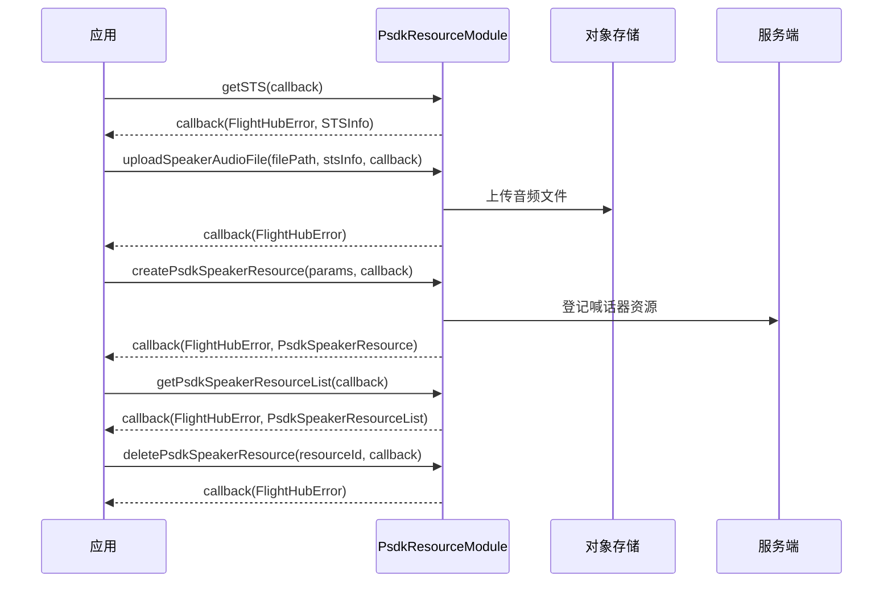

# PSDK 资源管理（PsdkResourceModule）

## 1 功能概述

### 1.1 功能简介

`PsdkResourceModule` 是**工作空间级**的 PSDK 资源管理模块，作用域为当前工作空间下的 PSDK 负载资源。它解决两类资源的准备与维护：

- **喊话器资源**：管理飞行器喊话器（扬声器）要播放的音频与 TTS 文本资源，支持列表查询、创建、编辑、删除；音频文件先通过 STS 临时凭证上传到对象存储，再登记为可播放资源。
- **控件（Widget）资源**：按对象存储 Key 批量获取 PSDK 自定义控件的 UI 资源地址。

本模块负责**资源的准备与管理**，不负责把资源下发给飞行器播放/执行。资源准备完成后，喊话器播放、控件下发等下行控制见 [PSDK 控制](./psdk-control.md)。

**获取方式：**

```java
Workspace workspace = FlightHubSDK.getWorkspaceInstance();
PsdkResourceModule psdkResourceModule = workspace.getPsdkResourceModule();
```

### 1.2 核心概念

| 概念 | 说明 |
| --- | --- |
| 喊话器资源（`PsdkSpeakerResource`） | 一条可供喊话器播放的资源，云端以 `id` 唯一标识。含名称、文件类型 `fileType`、对象存储 Key/URL、格式、时长、状态 `state`、内容 `content`、MD5、以及 PCM / Opus 转码产物等信息。 |
| 文件类型（`fileType`） | 取值 `"audio"`（音频文件）或 `"tts"`（文本转语音）。`audio` 需先上传文件并提供 `objectKey`；`tts` 直接提供文本 `content`。 |
| STS 临时凭证（`STSInfo`） | 上传音频文件前需先获取的对象存储临时凭证，含上传路径前缀 `objectKeyPrefix`、存储桶 `bucket`、端点 `endpoint`、提供商 `provider`、区域 `region` 及临时凭证 `credentials`（`STSCredential`）。 |
| 上传与登记两步 | 音频资源需先 `getSTS()` 拿凭证、`uploadSpeakerAudioFile()` 把本地文件上传到对象存储，再用 `createPsdkSpeakerResource()` 以 `objectKey` 登记为可播放资源。 |
| 控件资源（`PsdkWidgetResource`） | PSDK 自定义控件的 UI 资源条目，含对象存储 Key `objectKey` 与可访问地址 `url`；通过 `getPsdkWidgetResources()` 按一组 `objectKeys` 批量换取。 |

### 1.3 能力清单

| 能力 | 对应接口 | 接口类型 | 说明 |
| --- | --- | --- | --- |
| 获取喊话器资源列表 | `getPsdkSpeakerResourceList(cb)` | 异步回调 | 回调返回 `PsdkSpeakerResourceList` |
| 创建喊话器资源 | `createPsdkSpeakerResource(params, cb)` | 异步回调 | 入参 `CreatePsdkSpeakerResourceParams`，回调返回创建后的 `PsdkSpeakerResource` |
| 编辑喊话器资源 | `editPsdkSpeakerResource(params, cb)` | 异步回调 | 入参 `EditPsdkSpeakerResourceParams`，回调返回更新后的 `PsdkSpeakerResource` |
| 删除喊话器资源 | `deletePsdkSpeakerResource(resourceId, cb)` | 异步回调 | 传入资源 ID（int），回调仅返回错误信息 |
| 获取 STS 临时凭证 | `getSTS(cb)` | 异步回调 | 回调返回 `STSInfo`，用于上传音频文件 |
| 上传喊话器音频文件 | `uploadSpeakerAudioFile(filePath, stsInfo, cb)` | 异步回调 | 传入本地文件路径与 `STSInfo`，回调仅返回错误信息 |
| 批量获取控件资源 | `getPsdkWidgetResources(params, cb)` | 异步回调 | 入参 `GetPsdkWidgetResourceParams`，回调返回 `PsdkWidgetResourceList` |

---

## 2 前提条件

- 已完成上云 API 2 底座部署，并获取到服务地址与鉴权 Token。详见 [部署指南](../../../02.deployment/00.index.md)、[鉴权接入指南](../../../08.auth.md)。
- 已完成 SDK 初始化且 `FlightHubSDK.isInitialized()` 返回 `true`。详见 [SDK初始化](../init/sdk-init.md)。
- 已通过 `FlightHubSDK.getWorkspaceInstance()` 获取工作空间实例，并调用其 `getPsdkResourceModule()` 拿到本模块实例。
- 上传音频文件前，必须先调用 `getSTS()` 获取有效的 `STSInfo` 临时凭证；凭证 `STSCredential` 含过期时间 `expire`，过期后需重新获取。
- 创建 `audio` 类型喊话器资源前，音频文件需已通过 `uploadSpeakerAudioFile()` 成功上传，并取得其对象存储 `objectKey`。
- 本模块只做资源准备与管理，不涉及飞行器下行控制，因此**不需要**飞行控制权或 DRC 链路；资源实际播放/下发见 [PSDK 控制](./psdk-control.md)。

---

## 3 快速上手

### 3.1 获取模块实例

```java
// 前置：已完成 FlightHubSDK.initialize(config)
Workspace workspace = FlightHubSDK.getWorkspaceInstance();
PsdkResourceModule module = workspace.getPsdkResourceModule();
```

### 3.2 使用流程

以「新增一条音频喊话器资源」为主线：

1. **获取模块实例** —— 从工作空间实例调用 `getPsdkResourceModule()`。
2. **获取 STS 凭证** —— 调用 `getSTS()`，拿到 `STSInfo`（含上传前缀、存储桶、临时凭证）。
3. **上传音频文件** —— 用 `uploadSpeakerAudioFile(filePath, stsInfo, cb)` 把本地音频上传到对象存储。
4. **登记为资源** —— 组装 `CreatePsdkSpeakerResourceParams`（`fileType="audio"` + `objectKey`），调用 `createPsdkSpeakerResource()`，保存返回资源的 `id`。
5. **查询列表** —— 用 `getPsdkSpeakerResourceList()` 查看已有资源及其状态 `state`。
6. **编辑 / 删除** —— 用 `editPsdkSpeakerResource()` 改名或改可见性；不再需要时用 `deletePsdkSpeakerResource(resourceId)` 删除。
7. **（可选）获取控件资源** —— 用 `getPsdkWidgetResources()` 按 `objectKeys` 批量换取控件 UI 资源地址。

> TTS 资源无需上传文件：跳过第 2、3 步，直接以 `fileType="tts"` + `content` 调用 `createPsdkSpeakerResource()`。

### 3.3 调用时序图



---

## 4 示例代码

### 4.1 完整示例

```java
/**
 * PSDK 喊话器资源管理：获取 STS -> 上传音频 -> 登记资源 -> 查列表 -> 编辑 -> 删除。
 */
public class PsdkSpeakerResourceManager {

    // ============ 1. 上传本地音频并登记为喊话器资源 ============
    public void importAudioResource(String localFilePath, String resourceName) {
        PsdkResourceModule module = FlightHubSDK.getWorkspaceInstance().getPsdkResourceModule();

        // 第 1 步：获取 STS 临时凭证
        module.getSTS(new FlightHubCallback.STSInfoCallback() {
            @Override
            public void onResult(FlightHubError error, STSInfo stsInfo) {
                if (error != null && !error.isSuccess()) {
                    System.err.println("获取 STS 凭证失败: " + error
                            + " serverCode=" + error.getServerCode()
                            + " msg=" + error.getServerMessage());
                    return;
                }
                if (stsInfo == null) return;
                // 注意：credentials.getExpire() 为过期时间，凭证过期需重新 getSTS
                System.out.println("STS 就绪: 前缀=" + stsInfo.getObjectKeyPrefix()
                        + " bucket=" + stsInfo.getBucket()
                        + " endpoint=" + stsInfo.getEndpoint());

                // 第 2 步：上传本地音频文件到对象存储
                uploadThenCreate(module, stsInfo, localFilePath, resourceName);
            }
        });
    }

    private void uploadThenCreate(PsdkResourceModule module, STSInfo stsInfo,
                                  String localFilePath, String resourceName) {
        module.uploadSpeakerAudioFile(localFilePath, stsInfo, error -> {
            if (error != null && !error.isSuccess()) {
                System.err.println("上传音频文件失败: " + error);
                return;
            }
            // 上传成功。objectKey 为该文件在对象存储中的 Key
            // 注意：objectKey 需与上传时使用的 Key 一致，通常为 objectKeyPrefix + 文件名
            String fileName = new java.io.File(localFilePath).getName();
            String objectKey = stsInfo.getObjectKeyPrefix() + fileName;

            // 第 3 步：登记为喊话器资源
            CreatePsdkSpeakerResourceParams params = new CreatePsdkSpeakerResourceParams();
            params.setName(resourceName);
            params.setFileType("audio");            // "audio" 或 "tts"
            params.setObjectKey(objectKey);         // audio 类型必填
            params.setCreateScene("import");        // "import"（导入）或 "record"（录制）
            params.setSize(new java.io.File(localFilePath).length()); // 文件大小
            params.setNeedOpus(true);               // 是否转 opus 格式
            params.setVisible(true);                // 是否可见
            // 注意：createScene="record" 且为 audio 时，还需 setDuration(时长)

            module.createPsdkSpeakerResource(params, new FlightHubCallback.PsdkSpeakerResourceCallback() {
                @Override
                public void onResult(FlightHubError error, PsdkSpeakerResource resource) {
                    if (error != null && !error.isSuccess()) {
                        System.err.println("创建喊话器资源失败: " + error);
                        return;
                    }
                    if (resource == null) return;
                    System.out.println("资源已创建: id=" + resource.getId()
                            + " 名称=" + resource.getName()
                            + " 类型=" + resource.getFileType()
                            + " 状态=" + resource.getState()
                            + " URL=" + resource.getObjectUrl());
                }
            });
        });
    }

    // ============ 2. 查询喊话器资源列表 ============
    public void listResources() {
        FlightHubSDK.getWorkspaceInstance().getPsdkResourceModule()
                .getPsdkSpeakerResourceList(new FlightHubCallback.PsdkSpeakerResourceListCallback() {
                    @Override
                    public void onResult(FlightHubError error, PsdkSpeakerResourceList resourceList) {
                        if (error != null && !error.isSuccess()) {
                            System.err.println("获取资源列表失败: " + error);
                            return;
                        }
                        if (resourceList == null || resourceList.getResources() == null) return;
                        for (PsdkSpeakerResource item : resourceList.getResources()) {
                            System.out.println("资源 id=" + item.getId()
                                    + " 名称=" + item.getName()
                                    + " 类型=" + item.getFileType()
                                    + " 时长=" + item.getDuration()
                                    + " 状态=" + item.getState()
                                    + " 状态消息=" + item.getStateMessage());
                        }
                    }
                });
    }

    // ============ 3. 编辑喊话器资源（改名 / 改可见性） ============
    public void renameResource(String resourceId, String newName) {
        EditPsdkSpeakerResourceParams params = new EditPsdkSpeakerResourceParams();
        params.setId(resourceId);           // 注意：服务端期望 string 类型的 id
        params.setName(newName);            // 必填
        params.setFileType("audio");        // "audio" 或 "tts"
        params.setVisible(true);            // audio 类型必填

        FlightHubSDK.getWorkspaceInstance().getPsdkResourceModule()
                .editPsdkSpeakerResource(params, new FlightHubCallback.PsdkSpeakerResourceCallback() {
                    @Override
                    public void onResult(FlightHubError error, PsdkSpeakerResource resource) {
                        boolean ok = error != null && error.isSuccess();
                        System.out.println("编辑资源: " + (ok ? "成功 id=" + resource.getId() : "失败 " + error));
                    }
                });
    }

    // ============ 4. 删除喊话器资源 ============
    public void deleteResource(int resourceId) {
        FlightHubSDK.getWorkspaceInstance().getPsdkResourceModule()
                .deletePsdkSpeakerResource(resourceId, error -> {
                    boolean ok = error != null && error.isSuccess();
                    System.out.println("删除资源: " + (ok ? "成功" : "失败 " + error));
                });
    }
}
```

### 4.2 场景化片段

**创建 TTS（文本转语音）资源（无需上传文件）**

```java
// 前置：SDK 已初始化
CreatePsdkSpeakerResourceParams params = new CreatePsdkSpeakerResourceParams();
params.setName("巡检提示语");
params.setFileType("tts");              // TTS 类型
params.setContent("请注意，无人机正在作业，请远离作业区域。"); // tts 类型必填
params.setVisible(true);

FlightHubSDK.getWorkspaceInstance().getPsdkResourceModule()
        .createPsdkSpeakerResource(params, new FlightHubCallback.PsdkSpeakerResourceCallback() {
            @Override
            public void onResult(FlightHubError error, PsdkSpeakerResource resource) {
                if (error != null && !error.isSuccess()) {
                    System.err.println("创建 TTS 资源失败: " + error);
                    return;
                }
                if (resource == null) return;
                System.out.println("TTS 资源已创建: id=" + resource.getId()
                        + " 内容=" + resource.getContent()
                        + " 状态=" + resource.getState());
            }
        });
```

**批量获取 PSDK 控件资源地址**

```java
// 前置：SDK 已初始化，已知控件资源的对象存储 Key 列表
GetPsdkWidgetResourceParams params = new GetPsdkWidgetResourceParams();
params.setObjectKeys(java.util.Arrays.asList(
        "widget/ui/icon_a.png",
        "widget/ui/icon_b.png"));   // 必填，一组对象存储 Key

FlightHubSDK.getWorkspaceInstance().getPsdkResourceModule()
        .getPsdkWidgetResources(params, new FlightHubCallback.PsdkWidgetResourceListCallback() {
            @Override
            public void onResult(FlightHubError error, PsdkWidgetResourceList resourceList) {
                if (error != null && !error.isSuccess()) {
                    System.err.println("获取控件资源失败: " + error);
                    return;
                }
                if (resourceList == null || resourceList.getUiResourceUrls() == null) return;
                for (PsdkWidgetResource item : resourceList.getUiResourceUrls()) {
                    System.out.println("控件资源 key=" + item.getObjectKey()
                            + " url=" + item.getUrl());
                }
            }
        });
```

---

## 5 相关文档

- [SDK初始化](../init/sdk-init.md) —— 获取工作空间实例与调用本模块前必须完成的初始化步骤
- [SDK配置](../init/sdk-config.md) —— SDK 运行参数与配置项说明
- [PSDK 控制](./psdk-control.md) —— 喊话器播放、控件下发等 PSDK 负载的下行控制
- [设备上云](../../../04.device-onboarding/00.index.md) —— 挂载 PSDK 负载的设备绑定到工作空间的前置流程
- [部署指南](../../../02.deployment/00.index.md) —— 上云 API 2 底座部署与服务地址获取
- [鉴权接入指南](../../../08.auth.md) —— 获取鉴权 Token 的接入流程
- [使用 API 文档查阅接口详情](../../03.api-docs-guide.md) —— 查阅 `PsdkResourceModule` 完整方法签名与字段定义
