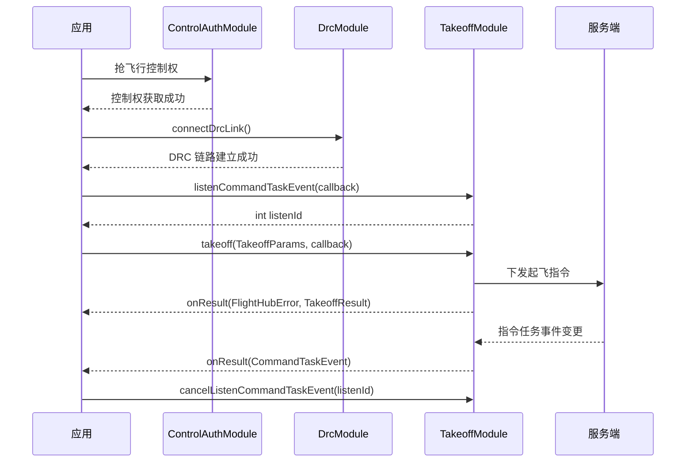

# 一键起飞（TakeoffModule）

## 1 功能概述

### 1.1 功能简介

`TakeoffModule` 是**飞机级**的指令飞行起飞模块，作用域为一架具体的无人机（由设备 SN 指定）。它解决的是「让停机坪/机场里的无人机一键起飞」这一件事：下发一次起飞指令（可只起飞悬停，也可起飞后直接飞向指定经纬度），并订阅指令任务事件与指点飞行相关的模式、失控动作推送。

起飞是一条**下行控制指令**，需先抢得飞行控制权并建立 DRC 链路后方可下发。起飞成功后回调返回飞行任务 ID（`flightId`）；若为「起飞后飞向目标点」模式，还会返回指点飞行任务 ID（`flyToId`）。起飞后的持续飞行控制见 [飞行控制](./flight-control.md)，指定目标点飞行见 [飞向目标点](./fly-to-point.md)。

**获取方式：**

```java
Drone drone = FlightHubSDK.getDroneInstance("your_device_sn");
TakeoffModule takeoffModule = drone.getTakeoffModule();
```

### 1.2 核心概念

| 概念 | 说明 |
| --- | --- |
| 起飞参数（`TakeoffParams`） | 一次起飞的全部入参，含起飞模式、安全起飞高度、目标高度、目标经纬度、最大速度、失控动作、返航高度等；对应 `CommandRequest`。 |
| 起飞模式（`TakeoffMode`） | `Takeoff`（直接起飞至目标高度悬停）或 `TakeoffWithFlyTo`（起飞后飞向目标经纬度）。为 `TakeoffWithFlyTo` 时需填写目标经纬度。 |
| 失控动作（`OutOfControlAction`） | 起飞后失去链路时的处置：`Hover`（悬停）/`ReturnHome`（返航）/`Continue`（继续）。 |
| 起飞结果（`TakeoffResult`） | `takeoff()` 回调返回，含飞行任务 ID（`flightId`）与指点飞行任务 ID（`flyToId`）。 |
| 指令任务事件（`CommandTaskEvent`） | `listenCommandTaskEvent()` 推送，含事件标识、操作类型（`action`：`command_task_created`/`command_task_updated`）、任务 UUID、时间戳与任务详情（`CommandTaskData`）。 |
| 指点飞行模式（`DroneCommanderFlightMode` / `DroneCurrentCommanderFlightMode`） | 分别为指点飞行模式的设置值（`commander_flight_mode`）与当前值（`current_commander_flight_mode`）的实时推送。 |
| 指点失控动作（`DroneCommanderModeLostAction`） | 指点飞行失控动作（`commander_mode_lost_action`）的实时推送。 |
| 监听 ID（`listenId`） | 各 `listen*` 方法返回的整型句柄，取消订阅时必须回传同一个值。 |

### 1.3 能力清单

| 能力 | 对应接口 | 接口类型 | 说明 |
| --- | --- | --- | --- |
| 一键起飞 | `takeoff(params, callback)` | 异步回调 | 下发起飞指令，回调 `onResult(FlightHubError, TakeoffResult)` 返回错误信息与起飞结果 |
| 订阅指令任务事件 | `listenCommandTaskEvent(callback)` / `cancelListenCommandTaskEvent(listenId)` | 事件订阅 | 事件回调 `onResult(CommandTaskEvent)`，无 error 参数 |
| 订阅指点飞行模式设置值 | `listenDroneCommanderFlightMode(callback)` / `cancelListenDroneCommanderFlightMode(listenId)` | 事件订阅 | 事件回调 `onResult(DroneCommanderFlightMode)`，无 error 参数 |
| 订阅指点飞行模式当前值 | `listenDroneCurrentCommanderFlightMode(callback)` / `cancelListenDroneCurrentCommanderFlightMode(listenId)` | 事件订阅 | 事件回调 `onResult(DroneCurrentCommanderFlightMode)`，无 error 参数 |
| 订阅指点飞行失控动作 | `listenDroneCommanderModeLostAction(callback)` / `cancelListenDroneCommanderModeLostAction(listenId)` | 事件订阅 | 事件回调 `onResult(DroneCommanderModeLostAction)`，无 error 参数 |

---

## 2 前提条件

- 已完成上云 API 2 底座部署，并获取到服务地址与鉴权 Token。详见 [部署指南](../../../02.deployment/00.index.md)、[鉴权接入指南](../../../08.auth.md)。
- 已完成 SDK 初始化且 `FlightHubSDK.isInitialized()` 返回 `true`。详见 [SDK初始化](../init/sdk-init.md)。
- 目标设备已完成上云、已绑定至当前工作空间且在线。详见 [设备上云](../../../04.device-onboarding/00.index.md)。
- 已通过 `ControlAuthModule` 抢得该飞机的**飞行控制权**（起飞为下行控制指令，无控制权无法下发）。详见 [控制权管理](./control-auth.md)。
- 已通过 `DrcModule` 的 `connectDrcLink()` 建立 **DRC 链路**，链路可用后方可下发 `takeoff()`。详见 [DRC链路](./drc.md)。
- 若需使用 `listenCommandTaskEvent()` 等订阅方法接收推送，SDK 配置中的 `notificationServerAddress` 必须正确且连接可用。详见 [SDK配置](../init/sdk-config.md)。

---

## 3 快速上手

### 3.1 获取模块实例

```java
// 前置：已完成 FlightHubSDK.initialize(config)，且已抢得飞行控制权、建立 DRC 链路
Drone drone = FlightHubSDK.getDroneInstance("your_device_sn");
TakeoffModule module = drone.getTakeoffModule();
```

### 3.2 使用流程

1. **抢控制权** —— 经 [控制权管理](./control-auth.md) 抢得目标飞机的飞行控制权。
2. **建 DRC 链路** —— 经 [DRC链路](./drc.md) 调用 `connectDrcLink()` 建链成功。
3. **获取模块实例** —— 调用 `drone.getTakeoffModule()`。
4. **订阅指令任务事件**（可选） —— 调用 `listenCommandTaskEvent()` 并保存 `listenId`，实时掌握起飞任务进展。
5. **组装起飞参数** —— 构造 `TakeoffParams`，设置起飞模式、安全起飞高度、目标高度、最大速度、失控动作、返航高度等；若为 `TakeoffWithFlyTo` 还需设置目标经纬度。
6. **下发起飞** —— 调用 `takeoff(params, callback)`，在回调中读取 `TakeoffResult` 的 `flightId`。
7. **退出时取消订阅** —— 用保存的 `listenId` 调用对应的 `cancelListen*()`。

### 3.3 调用时序图



---

## 4 示例代码

### 4.1 完整示例

```java
/**
 * 一键起飞：订阅指令任务事件 -> 组装起飞参数 -> 下发起飞 -> 退订。
 * 前置：已抢得飞行控制权 + 已建立 DRC 链路（详见相关文档）。
 */
public class DroneTakeoff {

    private int taskEventListenId = -1;
    private final String deviceSn;

    public DroneTakeoff(String deviceSn) {
        this.deviceSn = deviceSn;
    }

    // ============ 1. 订阅指令任务事件（回调方法名为 onResult，无 error 参数） ============
    public void start() {
        TakeoffModule module = FlightHubSDK.getDroneInstance(deviceSn).getTakeoffModule();

        taskEventListenId = module.listenCommandTaskEvent(
                new FlightHubCallback.CommandTaskEventCallback() {
                    @Override
                    public void onResult(CommandTaskEvent event) {
                        if (event == null) return;   // 注意：订阅回调无 error 参数，需判空
                        System.out.println("[指令任务] action=" + event.getAction()   // command_task_created / command_task_updated
                                + " uuid=" + event.getUuid()
                                + " ts=" + event.getTimestamp());
                        CommandTaskData data = event.getTaskData();
                        if (data != null) {
                            System.out.println("  droneSn=" + data.getDroneSn()
                                    + " status=" + data.getStatus()   // 0待执行,1执行中,2已完成,3失败,4已取消
                                    + " errCode=" + data.getErrCode());
                        }
                    }
                });

        // ============ 2. 组装起飞参数 ============
        TakeoffParams params = new TakeoffParams();
        params.setTakeoffMode(TakeoffMode.Takeoff);              // 直接起飞至目标高度悬停
        params.setSecurityTakeoffHeight(20);                     // 安全起飞高度（米），范围 8-1500
        params.setTargetHeight(50);                              // 目标高度（米），范围 2-10000
        params.setMaxSpeed(10);                                  // 最大速度（米/秒）
        params.setOutOfControlAction(OutOfControlAction.ReturnHome); // 失控返航
        params.setRthAltitude(100);                              // 返航高度（米），范围 15-1500

        // ============ 3. 下发起飞（回调返回 FlightHubError + TakeoffResult） ============
        module.takeoff(params, new FlightHubCallback.TakeoffCallback() {
            @Override
            public void onResult(FlightHubError error, TakeoffResult result) {
                if (error != null && !error.isSuccess()) {
                    // 注意：无控制权 / DRC 未建链 / 参数越界都会失败，需读取 error 判断原因
                    System.err.println("起飞失败: " + error);
                    return;
                }
                if (result != null) {
                    System.out.println("起飞成功 flightId=" + result.getFlightId()
                            + " flyToId=" + result.getFlyToId());
                }
            }
        });
    }

    // ============ 4. 退出前取消订阅（必须执行，否则订阅泄漏） ============
    public void stop() {
        if (taskEventListenId != -1) {
            FlightHubSDK.getDroneInstance(deviceSn).getTakeoffModule()
                    .cancelListenCommandTaskEvent(taskEventListenId);
            taskEventListenId = -1;
        }
    }
}
```

### 4.2 场景化片段

**起飞后直接飞向目标点（`TakeoffWithFlyTo`）**

```java
// 前置：已抢得飞行控制权 + 已建立 DRC 链路
TakeoffModule module = FlightHubSDK.getDroneInstance(deviceSn).getTakeoffModule();

TakeoffParams params = new TakeoffParams();
params.setTakeoffMode(TakeoffMode.TakeoffWithFlyTo);   // 起飞后飞向目标经纬度
params.setSecurityTakeoffHeight(20);                   // 安全起飞高度（米）
params.setTargetHeight(80);                            // 目标高度（米）
params.setTargetLatitude(22.586);                      // 目标纬度（TakeoffWithFlyTo 必填）
params.setTargetLongitude(113.945);                    // 目标经度（TakeoffWithFlyTo 必填）
params.setMaxSpeed(12);                                // 最大速度（米/秒）
params.setOutOfControlAction(OutOfControlAction.ReturnHome);
params.setRthAltitude(120);                            // 返航高度（米）

module.takeoff(params, (error, result) -> {
    if (error != null && !error.isSuccess()) {
        System.err.println("起飞并飞向目标点失败: " + error);
        return;
    }
    if (result != null) {
        // 起飞后飞向目标点会额外返回指点飞行任务 ID
        System.out.println("flightId=" + result.getFlightId()
                + " flyToId=" + result.getFlyToId());
    }
});
```

**订阅指点飞行模式当前值（`current_commander_flight_mode`）**

```java
TakeoffModule module = FlightHubSDK.getDroneInstance(deviceSn).getTakeoffModule();

int listenId = module.listenDroneCurrentCommanderFlightMode(
        new FlightHubCallback.DroneCurrentCommanderFlightModeCallback() {
            @Override
            public void onResult(DroneCurrentCommanderFlightMode mode) {
                if (mode == null) return;   // 注意：订阅回调无 error 参数，需判空
                System.out.println("指点飞行模式当前值=" + mode.getCurrentCommanderFlightMode());
            }
        });

// 退出时取消订阅（回传同一个 listenId）
module.cancelListenDroneCurrentCommanderFlightMode(listenId);
```

---

## 5 相关文档

- [SDK初始化](../init/sdk-init.md) —— 获取设备实例与调用本模块前必须完成的初始化步骤
- [SDK配置](../init/sdk-config.md) —— WebSocket 通知地址等配置项，影响指令任务事件订阅能否收到推送
- [控制权管理](./control-auth.md) —— 下发起飞前抢占飞行控制权的前置流程
- [DRC链路](./drc.md) —— 下发起飞前建立 DRC 低时延链路的前置流程
- [飞行控制](./flight-control.md) —— 起飞后的持续飞行控制（打杆、姿态等）
- [飞向目标点](./fly-to-point.md) —— 指定经纬度飞行，与 `TakeoffWithFlyTo` 起飞后飞行衔接
- [设备上云](../../../04.device-onboarding/00.index.md) —— 设备绑定到工作空间的前置流程
- [部署指南](../../../02.deployment/00.index.md) —— 上云 API 2 底座部署与服务地址获取
- [鉴权接入指南](../../../08.auth.md) —— 获取鉴权 Token 的接入流程
- [使用 API 文档查阅接口详情](../../03.api-docs-guide.md) —— 查阅 `TakeoffModule` 完整方法签名与字段定义
